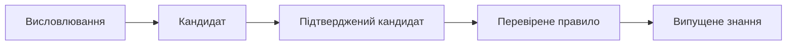
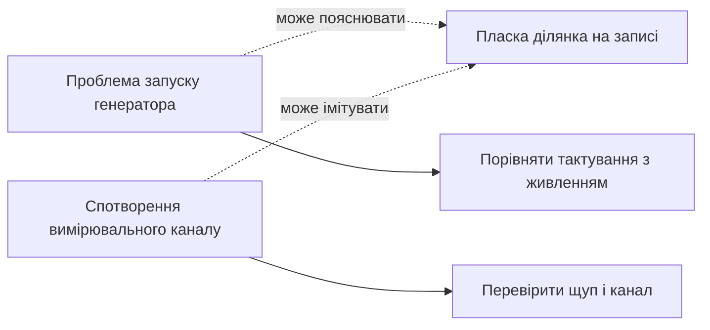
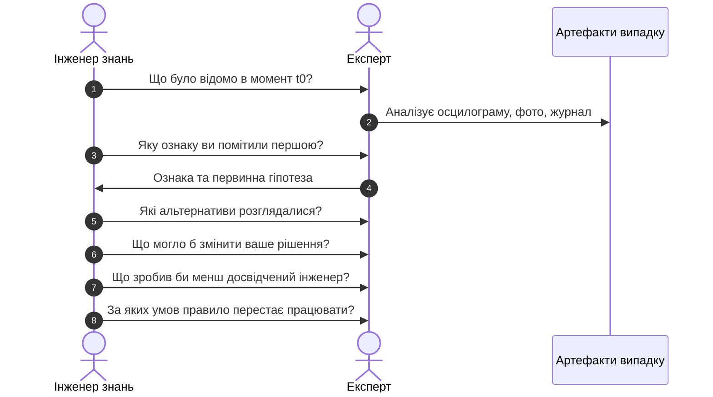
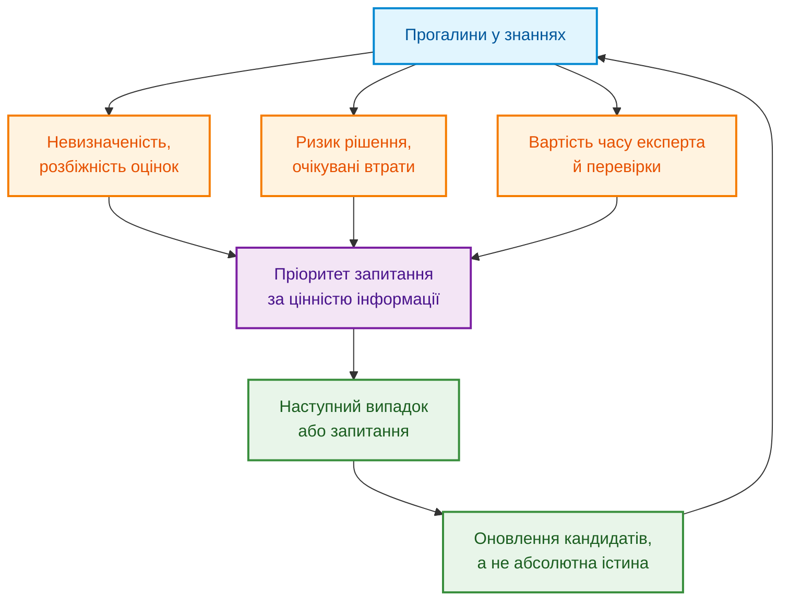
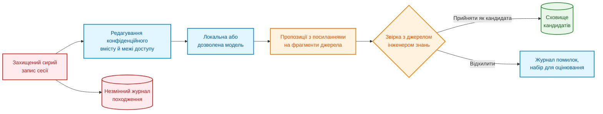
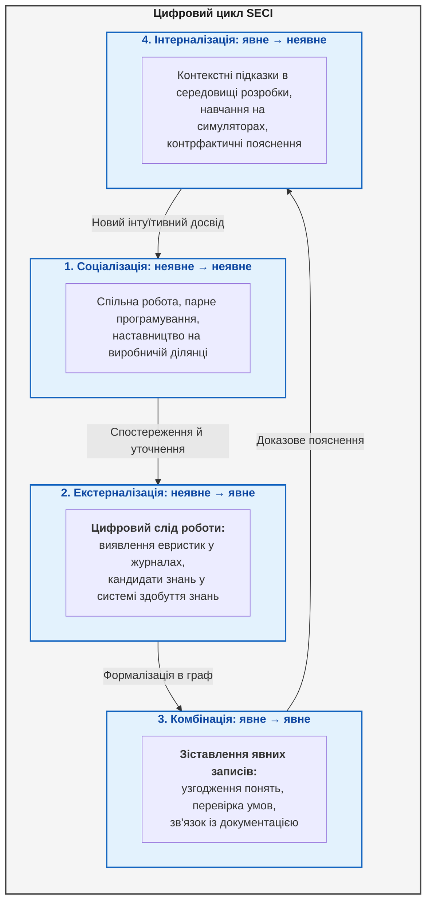

# Глава 11. Вилучення знань у експертів: інтерв'ювання, когнітивні карти та формалізація досвіду

> **Книга:** [Архітектура доказових експертних систем](README.md) · [Частина III: Оцінювання вхідної інформації, здобуття знань та мовний аналіз](part-03-knowledge-engineering-nlp.md)  
> **Попередня глава:** [Глава 10. Системи здобуття знань: джерела, допуск і життєвий цикл](ch10-knowledge-acquisition-systems.md)  
> **Наступна глава:** [Глава 12. Лінгвістичний аналіз і локальні моделі: збереження змісту та джерела](ch12-linguistic-analysis-and-local-models.md)  
> **Зміст книги:** [README.md](README.md)  
> **Автор:** [Микола Мартинович Федчик](about-the-author.md)  
> **Передумови:** базове розуміння правила «якщо — то», таблиць і часток; імовірнісні методи пояснено в міру потреби.  
> **Очікувані результати:** підготувати розмову з експертом навколо конкретного рішення; відокремлювати предметні знання, операції виведення й порядок виконання задачі за CommonKADS; перетворити висловлювання експерта на кандидата знань з умовами, винятками й походженням; перевірити кандидата на випадках, контрприкладах і незалежних джерелах; відрізняти впевненість мовця від частоти й від каліброваної ймовірності.  

## Анотація

Експертна система потребує знань не лише з документів: частину корисних розрізнень людина набуває в роботі й не записує як готові правила. Глава пояснює, як отримати ці розрізнення, зберегти їхнє походження та перевірити перед включенням до бази знань. На одному навчальному випадку діагностики запуску послідовно розглянуто підготовку запитань, порівняння випадків, відновлення ходу рішення, формалізацію кандидата й пошук контрприкладів. Потім введено частоту, невизначеність оцінки та міжекспертну згоду: вони відповідають на різні питання й не замінюють доказової перевірки. Автором для цієї книги запропоновано навчальний життєвий цикл кандидата знань, узгоджений із практиками CommonKADS, репертуарних ґраток і аналізу критичних рішень; це інтеграція для викладу, а не підтвердження достовірності самими статусами.

«Запитайте нашого головного інженера, він знає систему напам'ять». Команда записує розмову, мовна модель стискає запис до двадцяти правил, а через місяць одне з правил блокує справний виріб. Тоді інженер згадує: правило стосувалося старої ревізії плати й діяло лише за низької температури.

Так втрачається контекст **неявного знання** (*tacit knowledge*), тобто досвіду, яким людина користується, але не завжди формулює як правило. Майкл Полані описав це явище коротко: ми знаємо більше, ніж можемо розповісти [[1]](#src-1). Тому завдання інженера знань полягає не в тому, щоб отримати якомога більше тексту, а в тому, щоб разом із твердженням зберегти умови, винятки, походження, невпевненість і спосіб перевірки.

Наскрізний приклад далі є **умовним навчальним сценарієм**, а не звітом про стендовий експеримент. Пристрій іноді не запускається на холоді. У документації є коди помилок, але інженер додатково дивиться на осцилограму: запис зміни напруги й тактового сигналу в часі. Він просить не перезапускати плату, доки цей запис не збережено, бо повторний запуск може приховати ознаку. Авторський **інваріант збереження доказових слідів перед скиданням (Anti-Reboot Evidentiary Invariant)** стосується лише планового діагностичного перезапуску, який можна безпечно відкласти. Він не затримує аварійний захист людей та обладнання.

Щоб не звести досвід до команди «не перезапускати», потрібні п'ять пов'язаних записів. Авторський шаблон діагностичного ланцюга задає місця для них.

<a id="obj-11-1"></a>
**Формула (11.1). Поля діагностичного ланцюга формалізації досвіду**

```math
\mathrm{Chain} = \langle \mathrm{Symptom}, \mathrm{Hypothesis}, \mathrm{DiscriminativeCheck}, \mathrm{ExceptionDefeater}, \mathrm{Action} \rangle
```

Тут `Chain` є впорядкованим записом, а не числовою оцінкою. `Symptom` містить спостережувану ознаку; `Hypothesis` — можливе пояснення; `DiscriminativeCheck` — перевірку, результати якої розрізняють пояснення; `ExceptionDefeater` — умову, що скасовує або послаблює висновок; `Action` — дозволену наступну дію. Значення полів є описами або посиланнями на артефакти, тому спільної фізичної одиниці не мають. Відсутнє значення позначають явно, а не вигадують.

У нашому випадку ланцюг заповнюють так: «пласка ділянка напруги»; «можлива проблема запуску генератора»; «порівняти момент появи тактового сигналу зі стабілізацією живлення»; «пошкоджений щуп може спотворити запис»; «зберегти запис і перевірити канал вимірювання». Це ще не діагноз. Ланцюг підказує, яких відомостей бракує для його перевірки. Головне запитання глави: **як перетворити розмову з експертом на знання, яке можна перевірити, а не лише записати?**

## 1. Епістемічні бар'єри та когнітивні пастки інтерв'ювання експертів

Бар'єр інтерв'ювання полягає в тому, що досвідчена людина може правильно діяти, але неповно пояснювати свої дії. Після [глави 10](ch10-knowledge-acquisition-systems.md) уже відомо, навіщо базі знань походження й перевірка запису. Тепер джерелом є людина: вона може не помітити власної евристики, забути невдалу спробу або змішати спостереження з пізнішим поясненням. **Вилучення знань у людей** (*knowledge elicitation*) означає організоване отримання таких відомостей через розмову, спостереження й завдання. Гарт описувала це як окрему методичну проблему [[2]](#src-2), а Кук систематизувала техніки вилучення [[3]](#src-3).

Наприклад, слова «я відразу впізнав збій генератора» ще не показують, яку ознаку було видно до діагнозу. Варто запитати: «Який запис ви відкрили першим?» і звірити відповідь із журналом. Посада головного інженера допомагає визначити, кого запросити та хто відповідає за рішення, але не надає його спогаду статусу фізичного факту. Схема показує, де саме між розмовою й базою знань потрібні перевірки.

<a id="obj-11-2"></a>
**Діаграма 11.2. Від потреби в рішенні до допуску знань**

```mermaid
flowchart LR
    accTitle: Конвеєр вилучення знань у експертів
    accDescr: Етапи від формулювання рішення до прийняття перевіреного знання у версійовану базу знань.

    NEED["Потреба в рішенні<br/>та межі"] --> PLAN["План сесії<br/>та інформована згода"]
    PLAN --> RAW["Сирі записи,<br/>нотатки й артефакти"]
    RAW --> SEG["Атомарні висловлювання<br/>й фрагменти джерела"]
    SEG --> KC["Кандидати знань"]
    KC --> CH["Випробування:<br/>випадки, «чому», винятки"]
    CH --> TRI["Тріангуляція:<br/>журнали, документація, колеги"]
    TRI --> VAL["Перевірка на<br/>відкладених випадках"]
    VAL --> GOV{"Рада допуску"}
    GOV -->|"Схвалено"| KB[("Версійована<br/>база знань")]
    GOV -->|"Доопрацювати"| PLAN
    GOV -->|"Бракує даних"| UNK["Відоме невідоме,<br/>відкрите питання"]

    classDef stage fill:#e1f5fe,stroke:#0288d1,stroke-width:2px,color:#01579b;
    classDef check fill:#fff3e0,stroke:#f57c00,stroke-width:2px,color:#e65100;
    classDef store fill:#e8f5e9,stroke:#388e3c,stroke-width:2px,color:#1b5e20;
    classDef alert fill:#ffebee,stroke:#d32f2f,stroke-width:2px,color:#b71c1c;

    class NEED,PLAN,RAW,SEG,KC stage;
    class CH,TRI,VAL,GOV check;
    class KB store;
    class UNK alert;
```



Схема показує, що магічного кроку «вилучити знання» немає. Є ланцюг перетворень, і кожен крок може внести інтерпретацію. Тут діє **епістемічний принцип розмежування факту мовлення та істинності судження (Utterance vs Truth Separation)**: стенограма є свідченням того, що людина це сказала, а не свідченням того, що твердження є фізично чи нормативно істинним.

Для цієї книги автором запропоновано п'ять робочих статусів запису знань. Це схема керування станами, а не шкала істинності чи універсальний стандарт; кожен перехід потребує доказу, версії та відповідального за рішення про випуск. Стрілки означають послідовність перевірок, не автоматичне зростання істинності.

<a id="obj-11-3"></a>
**Схема 11.3. П'ять статусів запису знань**



Українською: висловлювання → кандидат → підтверджений кандидат → перевірене правило → випущене знання. Підвищення статусу завжди потребує окремої підстави. Підсумок мовної моделі не може перескочити від висловлювання одразу до перевіреного правила.

> [!NOTE]
> **П'ять робочих статусів кандидата знань**
> 1. Висловлювання (Utterance): первинна стенограма чи фрагмент прямої мови експерта, що підтверджує лише факт виголошення тези.
> 2. Кандидат знання (Knowledge Candidate): типізована структура із зафіксованими предикатами, контекстом, модальністю та відкритими прогалинами.
> 3. Підтверджений кандидат (Corroborated Candidate): для авторської процедури обліку це кандидат, який має додаткову перевірену опору, наприклад журнал відповідного інциденту; згода колеги сама не замінює такої опори.
> 4. Перевірене правило (Validated Rule): правило, перевірене за визначеними критеріями на названих випадках, зокрема відкладених, які не використовували для його побудови. Цей статус обмежений умовами перевірки й не означає нульового ризику.
> 5. Випущене знання (Released Knowledge): версія правила, допущена відповідальною особою до визначеного застосування з протоколом перевірки та умовами перегляду; сам статус не є сертифікацією.
> *Інженерний інваріант:* походження, результати перевірок і рішення про випуск фіксують окремо; жодна назва статусу не замінює цих підстав.

Отже, зі слів «зазвичай допомагає» отримано не команду для машини, а кандидата з відкритим питанням. Наступний крок — підготувати розмову так, щоб це питання можна було розв'язати.

## 2. Цільове проєктування сесії вилучення: орієнтація на прийняття рішень

Цільове проєктування сесії починається з питання: яке рішення має поліпшити майбутнє правило? Для нашого прикладу достатньо знати різницю між спостереженням і дією: запис осцилограми є спостереженням, а перезапуск змінює стан пристрою. Запит «розкажіть усе про запуск» не задає ні потрібного результату, ні способу перевірити корисність відповіді. Орієнтація сесії на конкретне рішення узгоджується з аналізом задач у CommonKADS [[4]](#src-4); автором для підготовки запропоновано сім запитань:

- яке рішення експертна система має підтримати;
- хто й у якому середовищі ухвалює це рішення;
- ціну хибнопозитивних і хибнонегативних помилок та ціну затримки;
- які випадки складні або рідкісні;
- які знання вже є в документах, телеметрії та коді;
- які твердження експерт не має права розкривати;
- за якою ознакою можна буде судити, що сесія була корисною.

Згідно з **авторським правилом розрізнювального діагностичного запитання (Discriminative Diagnostic Query Rule)**, у прикладі ціль формулюють так: «За безпечного утримання поточного стану вибрати спостереження, яке допоможе розрізнити проблему живлення, генератора й прошивки». Приносять записи справного та невдалого стартів, погоджують право на їх використання й запитують: «Який сигнал ви порівняли б наступним і що очікуєте за кожної гіпотези?» Якщо відповідь називає лише причину, але не перевірку, мети сесії ще не досягнуто.

Добре визначене рішення задає межу всієї подальшої роботи. Воно показує, які випадки принести на розмову, які помилки особливо дорогі й за якою поведінкою майбутньої експертної системи можна буде судити, що знання справді допомагає.

### 2.1. Методологія CommonKADS: рівні предметних знань, виведення та задачі

Після формулювання рішення залишається інша проблема: стенограма змішує опис пристрою, висновки експерта й порядок роботи. Якщо зберегти лише правила про несправності, експертна система може втратити заборону перезапуску до запису осцилограми. Якщо зберегти лише послідовність команд, експертна система не зможе пояснити, чому наступне спостереження розрізняє дві гіпотези.

CommonKADS описує шість пов'язаних моделей: організації, задачі, агента, знань, комунікації й проєктування [[4]](#src-4). Перші три відповідають на питання «навіщо, яка робота й хто її виконує»; комунікація описує обмін відомостями, проєктування — перехід до реалізації. Для читання стенограми зараз потрібна **модель знань** із трьома складовими. Сам поділ належить CommonKADS; авторським є наведене застосування до діагностики запуску.

<a id="obj-11-4"></a>
**Таблиця 11.4. Три складові моделі знань у діагностиці запуску**

| Складова моделі знань | Що документує інженер знань | Приклад діагностики запуску |
|---|---|---|
| Предметні знання (*domain knowledge*) | поняття, відношення, факти й правила предметної області | ревізія плати, температура, часові параметри живлення й тактування, умови застосовності правила |
| Знання про виведення (*inference knowledge*) | операції міркування та ролі їхніх входів і виходів | запропонувати гіпотезу, передбачити ознаку за гіпотезою, зіставити передбачення з осцилограмою |
| Знання про задачу (*task knowledge*) | мету, порядок операцій, умови переходу й завершення | спочатку зберегти осцилограму; потім вибрати розрізнювальне спостереження; за нестачі даних передати випадок експертові |

В авторській інтерпретації **концепція динамічних ролей знання (Knowledge Roles)** позначає, для чого конкретний запис використано в операції міркування. Час появи тактового сигналу є предметним фактом; у порівнянні з передбаченням цей факт займає роль «спостереження». Припущення про збій генератора займає роль «гіпотеза», а очікуваний порядок фронтів займає роль «передбачення». Такий поділ дозволяє повторно використати операцію «порівняти спостереження з передбаченням» для іншого пристрою, не переносячи специфічних параметрів першої плати.

Розгляньмо дві відповіді про той самий збій. Перша називає ознаку на фронті живлення, друга пояснює порядок збереження запису. Вони заповнюють різні частини моделі. Авторський **інваріант ортогональності предметних правил та керування задачею** тут є вимогою до модульності: зміни не слід без потреби переносити між частинами. Це не гарантія їх незалежності від обладнання. Заміна приладу на повільніший може вимагати перегляду і способу спостереження, і порядку дій; нова ревізія плати також потребує перевірки застосовності обох частин.

Перед програмуванням інженер знань застосовує **трикомпонентний критерій передпрограмної валідації моделі знань (критерій Федчика)**: 1) семантична повнота понять та умов; 2) функціональна детермінованість входів і виходів кожної операції виведення; 3) вичерпність альтернативних переходів керування задачею для успіху, суперечності та браку даних. Це проєктна перевірка, а не доказ правильності діагнозу. Предметні правила ще потребують випробувань на нових випадках. Реалізацію операцій у компонентах експертної системи розглядає [Глава 16](ch16-expert-systems-architecture.md). Тепер вибір техніки інтерв'ю можна прив'язати до конкретної прогалини моделі, а не до кількості вже записаних сторінок.

## 3. Методичні стратегії та протоколи взаємодії з експертами

Вибір протоколу взаємодії залежить від того, якої частини моделі бракує. Якщо незрозуміле слово «пласка», потрібне порівняння записів; якщо невідомо, чому фахівець відклав скидання, потрібне відновлення ходу рішення. Авторське **узагальнення про комплементарність технік** означає саме такий добір, а не обов'язок застосувати всі методи. Вільне інтерв'ю збирає мову предметної області, спостереження — видимі дії, мислення вголос — словесний звіт під час роботи. Останнє може змінювати навантаження й саму роботу. Порівняння технік наведено в методологічних працях [[5]](#src-5), [[6]](#src-6).

<a id="obj-11-5"></a>
**Таблиця 11.5. Вісім технік вилучення знань: результат і обмеження**

| Метод | Найкраще виявляє | Основне обмеження |
|---|---|---|
| Напівструктуроване інтерв'ю | поняття, межі, пояснення | раціоналізація заднім числом |
| Спостереження в робочому контексті | реальний робочий процес, інструменти, обхідні шляхи | невидимі міркування, приватність |
| Мислення вголос (*think-aloud*) | порядок уваги й проміжні гіпотези | вплив промовляння на роботу, високе навантаження |
| Метод критичних рішень (*critical decision method*, CDM) | сигнали, на які зважав експерт, варіанти, тиск часу в конкретному інциденті | залежність від пам'яті про подію |
| Драбина запитань «як?» і «чому?» (*laddering*) | ієрархію цілей, критеріїв і дій | навідні запитання можуть нав'язати структуру |
| Репертуарні ґратки й тріади | приховані біполярні конструкти й відмінності випадків | штучність і складність на великій множині випадків |
| Сортування карток | категорії й ментальну таксономію | мало процедурного знання |
| Сценарії й симуляції | умовну поведінку й реакцію на аномалії | якість залежить від реалізму сценарію |

Протокольний аналіз Еріксона й Саймона розглядає словесні звіти як дані [[7]](#src-7); CDM відновлює конкретне рішення за часовою шкалою [[8]](#src-8); ґратки виявляють розрізнення між випадками [[9]](#src-9); сортування карток допомагає побачити категорії [[10]](#src-10). Наприклад, після групування карток «живлення», «генератор», «прошивка» варто запитати, чому конкретний запис потрапив до першої групи. Так категоризація готує перевірюване запитання, але сама не доводить причини відмови.

Отримані зв'язки зручно намалювати як **когнітивну карту**: вузлами є поняття, стрілками — названі експертом залежності. У нашому сценарії це карта робочих гіпотез, не встановлена причинна модель.

<a id="obj-11-6"></a>
**Діаграма 11.6. Навчальна когнітивна карта пояснень пласкої ділянки**



Карта виявляє корисну прогалину: сама форма ділянки не розрізняє двох пояснень. Наступні дві техніки допоможуть уточнити ознаку й відновити вибір перевірки.

### 3.1. Метод репертуарних ґраток Келлі: тріадний аналіз розрізнень

Тріадне порівняння потрібне, коли експерт бачить відмінність, але описує її лише словами «цей старт дивний». Йому показують три випадки й запитують, які два подібні та чим відрізняються від третього. У репертуарних ґратках Келлі так виявляють **конструкт** — обрану людиною вісь розрізнення з двома полюсами [[9]](#src-9). Не кожне предметне поняття має бути біполярним; це прийом опитування. Авторське застосування до осцилограм позначимо тріадним оператором.

<a id="obj-11-7"></a>
**Формула (11.7). Запис результату тріадного порівняння**

```math
\mathcal{T}(e_1, e_2, e_3) \to \langle \mathrm{SimilarPair}(e_i, e_j), \mathrm{ContrastElement}(e_k), \mathrm{BipolarConstruct}(C^+ \leftrightarrow C^-) \rangle.
```

Тут $`e_1,e_2,e_3`$ — три різні записи з відомим походженням; індекси $i,j,k$ є перестановкою чисел 1, 2, 3. `SimilarPair` позначає обрану пару, `ContrastElement` — третій запис, `BipolarConstruct` — словесне розрізнення з полюсами $`C^+`$ і $`C^-`$. Стрілка означає результат розмови, а не обчислення істинної причини. Вхід і вихід не мають спільної фізичної одиниці; якщо експерт не бачить змістовної пари, результат лишається невизначеним.

У навчальному прикладі експерт обирає перші два записи: «на них генератор починає працювати раніше, ніж стабілізується живлення». Щоб перевірити це, авторський **принцип метрологічної параметризації** вимагає домовитися, як виміряти «раніше», а не одразу оголосити ознаку причиною відмови. Обидві часові мітки беруть з одного синхронізованого запису.

<a id="obj-11-8"></a>
**Формула (11.8). Часовий зсув появи тактування відносно живлення**

```math
\Delta t=t_{\mathrm{clk}}-t_{\mathrm{stable}}.
```

Тут $`t_{\mathrm{clk}}`$ — час першого тактового фронту, який відповідає заздалегідь заданому критерію виявлення; $`t_{\mathrm{stable}}`$ — час початку неперервного перебування напруги в погодженій смузі протягом погодженого вікна. Обидва часи невід'ємні й вимірюються в мікросекундах від одного початку запису; $`\Delta t`$ може бути від'ємним, нульовим або додатним. Смугу напруги, вікно й похибку визначають для конкретного приладу та плати, не виводять зі слова «пласка».

<a id="obj-11-9"></a>
**Таблиця 11.9. Навчальна ґратка трьох записів за одним конструктом**

| Запис | Ревізія, температура | Стабілізація, мкс | Перше тактування, мкс | Зсув, мкс | Полюс конструкта |
|---|---|---:|---:|---:|---|
| e1 | C, −15 °C | 120 | 100 | −20 | раніше |
| e2 | C, −15 °C | 130 | 110 | −20 | раніше |
| e3 | C, −15 °C | 120 | 150 | 30 | пізніше |

Для e1 віднімаємо 120 від 100 й отримуємо −20 мкс; для e3 — 120 від 150 й отримуємо 30 мкс. Отже, конструкт можна відтворити чисельно. За похибки зсуву ±2 мкс ці знаки розрізняються, але значення біля нуля потребують окремої невизначеної зони. Це приклад визначення ознаки, не доведення діагностичної точності й не нормативний допуск генератора. Тепер можна запитати, як експерт використав цю ознаку в конкретній події.

### 3.2. Метод аналізу критичних інцидентів (Critical Decision Method)

Аналіз критичного інциденту потрібен, щоб від ознаки перейти до порядку рішення. Слова «я завжди спочатку перевіряю тактування» можуть бути спогадом про звичку, а не описом саме цього випадку. **Упередження заднім числом** означає, що знання фіналу змінює оцінку того, наскільки передбачуваним був результат [[11]](#src-11). Метод критичних рішень (*Critical Decision Method*, CDM) відновлює конкретну подію через часову шкалу, цілі, ознаки й альтернативи [[8]](#src-8). Журнал допомагає зіставити спогад із записом, але не відкриває безпосередньо думки людини.

<a id="obj-11-10"></a>
**Діаграма 11.10. Запитання для реконструкції критичного рішення**



Авторський **принцип t0-орієнтованого зондування** пропонує розділити «що було відомо тоді» й «що з'ясували пізніше». $`t_0`$ тут є обраним моментом рішення на часовій шкалі інциденту, не параметром людської пам'яті. У навчальному інтерв'ю спочатку відомо лише про пласку ділянку; після перевірки щупа з'ясовують, що канал справний; лише потім порівнюють часові мітки. До запису додають, де експерт спирається на журнал, а де лише згадує. Процедура зменшує можливості непомітної підміни, але не усуває упередження гарантовано. Отриману послідовність уже можна оформлювати як кандидата.

## 4. Синтаксична та логічна формалізація: перетворення висловлювання на кандидата знань

Формалізація потрібна, щоб інший читач або програма могли однаково зрозуміти, що саме сказано й чого ще не відомо. Для цього достатньо розрізняти поле, значення й пропуск: поле називає властивість, значення її описує, `null` позначає відсутній параметр. Авторський **принцип семантичної типізації та зв'язку з контекстом** вимагає не переносити стенограму прямо в правила, а спочатку створити **кандидата знань**. Формальний запис сам не робить правило правильним: навіть цілком детермінована програма може застосовувати хибну аксіому.

Навчальна репліка звучить так: *«Якщо друга сходинка на фронті живлення пласка, майже завжди винен тактовий генератор; плату в жодному разі не перезапускайте»*. Після уточнення експерт додає: *«Я говорив про C і D нижче −10 °C; йшлося про плановий перезапуск, не про аварійне вимкнення»*. Першу й другу репліки зберігають окремо. У запис нижче потрапляє їхня інтерпретація з посиланнями на обидва фрагменти; так читач бачить, звідки взявся контекст, відсутній у першій фразі.

Лістинг YAML реалізує паспорт кандидата за методом цього розділу: вхід — дві наведені репліки, очікуваний результат — заповнений контекст і незаповнений поріг «пласкості». Перевірка полягає у звірці кожного заповненого поля з репліками; синтаксичний YAML-парсер перевіряє лише форму. Це приклад запису, не повна схема валідатора.

<details>
<summary>Приклад кандидата з невідомим порогом і недослідженими винятками</summary>

```yaml
candidate_id: candidate:clock-startup-flat-slope:017
source:
  kind: teaching_example
  session: ses-2026-08-26-02
  speaker: expert-07
  utterance_span: "00:31:14.220/00:31:27.810"
  clarification_span: "00:32:00.000/00:32:20.000"
context:
  board_revisions: [C, D]
  temperature_c: "< -10"
observation:
  feature: rail_second_step_slope
  operator: "<"
  threshold: null
hypothesis:
  value: clock_startup_fault
  speaker_modality: "almost_always"
action:
  prohibit: power_cycle_before_trace_capture
  scope: safely_deferrable_diagnostic_restart
  emergency_protection_priority: true
exceptions: []
exceptions_status: not_assessed
open_questions:
  - operational threshold for "flat"
  - applicability to revision E
status: candidate
```

</details>

Тут діє **семантичний інваріант експлікації прогалин `threshold: null` (заборона дописування параметрів)**: значення `threshold: null` не є дефектом запису, а явно позначає відсутність емпіричного порогу; суворо заборонено дописувати числове значення на основі суб'єктивної інтонації чи припущень мовної моделі. Згідно з **принципом збереження модальності мовця (`speaker_modality`) окремо від імовірності**, поле `speaker_modality` зберігає аутентичні слова експерта «майже завжди», але категорично не ототожнюється з каліброваною об'єктивною ймовірністю.

Для журналу діє правило цілісності: нова інтерпретація породжує нову версію кандидата, а не непомітно виправлену стенограму. Первинне джерело зберігається окремо від версійованих похідних записів, а кожна правка посилається на підставу. Якщо аудіозапис заборонено, версіонують погоджені нотатки й зазначають, що перевірити точну усну фразу за ними неможливо. Право на зберігання запису та процедура його видалення є окремими питаннями: відокремлений журнал походження з мінімізованими метаданими — лише варіант проєктування, не доказ правової відповідності. Результат розділу — простежуваний кандидат, ще заблокований невідомим порогом. Тепер потрібно шукати умови, за яких сама гіпотеза не спрацює.

## 5. Протоколи фальсифікації: виявлення крайових умов та дефітерів

Фальсифікація перевіряє не красу пояснення, а його вразливість до випадку, який йому суперечить. Для розуміння достатньо відмінності між «завжди» й «часто»: один підтверджений контрприклад спростовує універсальне «завжди», але сам по собі не спростовує певну частоту події. Авторський **попперівський принцип перевірки евристик** пропонує шукати такі випадки навмисно; витримані тести залишають правило неспростованим у перевірених межах, а не назавжди істинним. Це методична пропозиція, не припис ISO 26262 чи IEC 61508.

У нашому сценарії пласку ділянку може імітувати несправний щуп. Такий випадок скасовує прямий висновок «ознака означає несправний генератор». **Дефітер** — відомість, яка скасовує або послаблює підставу висновку; не кожний контрприклад одразу стає готовим дефітером, бо спершу треба перевірити його достовірність і контекст. Авторське **правило ідентифікації дефітерів** вимагає зафіксувати проведений пошук та його результат, у тому числі «ще не досліджено».

Щоб провести такий пошук, інженер знань ставить вісім підготовлених запитань:

- **Уточнення:** що саме означає «пласка» і як це виміряти приладом?
- **Контраст:** яка діаграма виглядає схоже, але веде до зовсім іншої гіпотези?
- **Виняток:** коли ознака присутня, але тактовий генератор повністю справний?
- **Відсутність:** що робити, якщо потрібного вимірювального каналу немає?
- **Час:** чи змінюється правило після прогріву або повторного старту?
- **Походження:** ви спостерігали це особисто, читали в документації чи вивели міркуванням?
- **Незгода:** хто з колег вирішив би інакше і чому?
- **Перевірка:** який результат суперечив би правилу в заявлених умовах і як його встановити?

Так розмова збирає не лише підтвердження правила, а й межу його застосовності. Запитання «чи правильно, що X завжди веде до Y?» є навідним: воно пропонує спрощене твердження й підштовхує до згоди. Для усунення евристичного навіювання застосовується **методичне правило сліпого тестування прецедентів (Unlabeled Case Probing)**: інженер знань пред'являє експерту діагностичний випадок без мітки та запитує прогноз до того, як стане відомим фактичний результат розслідування.

Якщо експерт не може назвати жодного можливого контрприкладу, це сигнал шукати інші випадки й незалежні джерела, а не підстава вважати правило абсолютним.

> [!NOTE]
> **Вісім векторів попперівського фальсифікаційного аудиту евристик експертів (вісім векторів)**
> 1. Вектор уточнення (Clarification): перетворення суб'єктивних прикметників на числові фізичні величини та вимірювані межі допусків.
> 2. Вектор контрасту (Contrast): пошук схожих сигнатур відмов, які відповідають кардинально іншим першопричинам несправності.
> 3. Вектор винятку (Exception): цілеспрямована ідентифікація дефітерів (defeaters) — режимів, коли ознака наявна, але блок справний.
> 4. Вектор відсутності (Absence): моделювання поведінки системи за умов відмови або апаратної відсутності діагностичного сенсора.
> 5. Вектор часу (Temporal Dynamics): оцінка залежності правила від прогріву кристала, деградації компонентів чи повторного старту.
> 6. Вектор походження (Provenance): розмежування особистого практичного досвіду, вивченої документації та теоретичних припущень.
> 7. Вектор незгоди (Disagreement): виявлення розбіжностей з альтернативними інженерними школами чи методиками інших фахівців.
> 8. Вектор експерименту (Falsification Test): визначення результату перевірки, який суперечив би правилу в його заявлених умовах; для ймовірнісної тези потрібен наперед заданий статистичний критерій.
> *Інженерний інваріант:* недосліджені винятки блокують випуск за цією авторською процедурою; порожній список після документованого пошуку не є доказом ані універсальності, ані хибності правила.

Після перевірки щупа просте правило перетворилося на обережнішу рекомендацію: «за підтвердженої справності каналу перевірити часовий порядок живлення й тактування». Це корисний результат навіть без остаточного діагнозу. Щоб оцінити, наскільки часто ознака справді супроводжує гіпотезу, потрібен уже не спогад про один випадок, а визначена вибірка.

## 6. Математичне розмежування суб'єктивної впевненості та статистичної частоти

Розмежування впевненості й частоти потрібне, щоб слова «майже завжди» не перетворилися на вигадане число. Досить спочатку вміти ділити кількість випадків на їх загальне число. Далі окремо введемо модель невизначеності цього результату та оцінку згоди двох людей. Це три різні задачі, не три обов'язкові властивості будь-якого знання. Праця Бейт-Маром присвячена числовому тлумаченню словесних імовірностей [[12]](#src-12); конкретний числовий діапазон її результатів тут не відтворюється без перевіреного протоколу й таблиць першоджерела.

Фраза «я впевнений на 90 %» є **самооцінкою мовця**. Щоб назвати такі прогнози каліброваними, потрібно записувати їх до розкриття результату й перевіряти на багатьох порівнюваних випадках: серед прогнозів поблизу 0,9 подія має траплятися приблизно в дев'яти випадках із десяти, з урахуванням невизначеності вибірки. Один вдалий прогноз цього не встановлює. Каппа нижче також не калібрує впевненості: вона вимірює згоду розмітників.

У нашому прикладі питання таке: «Серед випадків із визначеною ознакою та справним вимірювальним каналом як часто незалежне розслідування підтвердило несправність генератора?» До підрахунку задають ревізії, температуру, критерій ознаки й критерій встановлення причини. Не можна назвати позитивним випадком той, який лише знову оцінив той самий експерт за тією самою ознакою.

<a id="obj-11-11"></a>
**Формула (11.11). Частота підтвердження гіпотези в обраній групі випадків**

```math
\hat p=\frac{k}{n}
```

Складники та розмірність оцінки:

- $\hat p$ — безрозмірна частка підтверджень у межах $[0,1]$;
- $k$ — ціла кількість випадків із підтвердженою несправністю генератора, від 0 до $n$;
- $n$ — додатна ціла кількість усіх відібраних випадків із цією ознакою та завершеним незалежним розслідуванням; це лічильник випадків, не час і не кількість експертів.

Нехай у навчальних 20 випадках причина підтвердилася в 10. Ділення 10 на 20 дає 0,5, або 50 %. Це відповідь для обраної групи, не частота відмов усіх плат і не ймовірність того, що будь-яка плата з генератором зламається. Якщо незавершені розслідування частіше стосуються складних випадків, відбір уже може зміщувати результат. Повторні запуски однієї плати також не слід без перевірки вважати незалежними випадками.

Щоб оцінити невизначеність частоти, потрібні додаткові припущення. Нагадуємо **схему Бернуллі**: кожний незалежний дослід має два результати, а ймовірність цільової події однакова в заданих умовах. Тут подія — підтвердження гіпотези в наперед визначеній групі. Змішування ревізій із різними властивостями або залежні повтори порушують таку модель.

**Байєсівське оновлення** поєднує припущення до спостережень, тобто апріорний розподіл, із правдоподібністю даних. Його правило: апостеріорна щільність пропорційна добутку цих двох складників, якщо дані мають ненульову ймовірність і результат можна нормувати. Для бета-апріора та дослідів Бернуллі степінь при $p$ збільшується на число підтверджень, а при $1-p$ — на число непідтверджень. Звідси отримують спряжене оновлення:

<a id="obj-11-12"></a>
**Формула (11.12). Оновлення бета-розподілу за результатами Бернуллі**

```math
p\mid k,n\sim\mathrm{Beta}(\alpha+k,\ \beta+n-k).
```

Параметри бета-розподілу:

- $p$ — невідома безрозмірна ймовірність цільової події в заданій групі, від 0 до 1; у байєсівській моделі розподіл описує невизначеність щодо неї;
- $\alpha,\beta$ — додатні безрозмірні параметри апріорного бета-розподілу; вони не є виміряними випадками;
- $n,k$ — ті самі цілі лічильники, що у формулі (11.11); $n-k$ рахує непідтвердження, які не обов'язково спростовують ймовірнісну тезу;
- $`\mathrm{Beta}(\alpha+k,\beta+n-k)`$ позначає розподіл, не саме числове значення щільності; $\mid$ означає «за відомих даних», $\sim$ — «має розподіл».

Для навчального розрахунку обираємо рівномірний апріор $`\mathrm{Beta}(1,1)`$. Він рівномірний саме за параметром $p$, а не є універсально «безінформативним» за будь-якої параметризації. За 10 підтверджень із 20 до першої одиниці додаємо 10, до другої — решту 10: отримуємо $`\mathrm{Beta}(11,11)`$. Це точне оновлення в обраній моделі; центральна гранична теорема й поріг 30 для нього не потрібні.

Одного розподілу незручно порівнювати з критерієм підготовки правила. Виділимо центральний 95-відсотковий інтервал: нижче його лівої межі й вище правої залишиться по 2,5 % апостеріорної ймовірності.

<a id="obj-11-13"></a>
**Формула (11.13). Межі й ширина центрального байєсівського інтервалу**

```math
p_{\mathrm{low}}=F^{-1}(0{,}025),\qquad
p_{\mathrm{high}}=F^{-1}(0{,}975),\qquad
\Delta p=p_{\mathrm{high}}-p_{\mathrm{low}}.
```

Тут $F$ — функція накопиченої ймовірності апостеріорного розподілу з (11.12), а $`F^{-1}`$ — її квантильна функція. Аргумент квантиля лежить між 0 і 1; обидві межі належать $[0,1]$, ліва не перевищує правої. Ширина $`\Delta p`$ безрозмірна, від 0 до 1. Передумовами лишаються придатність моделі Бернуллі й обґрунтований вибір апріора. Інтервал характеризує невизначеність параметра за моделлю, а не охоплює 95 % окремих випадків.

Для $`\mathrm{Beta}(11,11)`$ числове обернення $F$ дає межі приблизно 0,297807 і 0,702193. Віднімаємо й отримуємо ширину 0,404386. Для 85 підтверджень зі 170 випадків той самий апріор дає $`\mathrm{Beta}(86,86)`$, межі 0,425586 і 0,574414 та ширину 0,148829. Другий інтервал вужчий, але він усе ще описує частоту близько половини: **точність оцінювання частоти не означає високої діагностичної точності правила**. Політика нижче перевіряє невизначеність, а не прийнятність самого рівня $p$.

Перш ніж рахувати частоти, люди мають однаково розпізнавати ознаку. Для перевірки цього два розмітники незалежно оцінюють ті самі записи за наперед визначеними категоріями. **Каппа Коена** порівнює спостережувану згоду з базовою згодою, розрахованою за частками категорій кожного розмітника [[13]](#src-13). Це не порівняння з незалежно встановленою істиною.

<a id="obj-11-14"></a>
**Таблиця 11.14. Навчальні оцінки ознаки двома розмітниками на 40 записах**

| Оцінка A / оцінка B | Ознака є | Ознаки немає | Разом |
|---|---:|---:|---:|
| Ознака є | 18 | 2 | 20 |
| Ознаки немає | 2 | 18 | 20 |
| Разом | 20 | 20 | 40 |

Діагональ містить збіги, інші дві клітинки — розбіжності. У загальному випадку для скінченного числа категорій розрахунок має вигляд:

<a id="obj-11-15"></a>
**Формула (11.15). Спостережувана згода, базова згода й каппа Коена**

```math
p_o=\frac{\sum_{j=1}^{m}n_{jj}}{M},\qquad
p_e=\sum_{j=1}^{m}\frac{n_{j\cdot}}{M}\frac{n_{\cdot j}}{M},\qquad
\kappa=\frac{p_o-p_e}{1-p_e}.
```

Складники каппи та нормування:

- $M$ — додатна ціла кількість записів, для яких є обидві мітки; $m$ — додатна ціла кількість спільно визначених категорій;
- $`n_{jj}`$ — невід'ємна ціла кількість збігів у категорії $j$; $`n_{j\cdot}`$ і $`n_{\cdot j}`$ — відповідні суми рядка й стовпця, від 0 до $M$; крапка в індексі позначає підсумовування за іншим розмітником;
- $`p_o`$ — фактична частка збігів, $`p_e`$ — очікувана згода за незалежного вибору категорій зі збереженням цих сум; обидві величини безрозмірні, від 0 до 1;
- $\kappa$ — безрозмірна згода з поправкою на цю базову модель, у межах $[-1,1]$ за $`p_e<1`$. При $`p_e=1`$ знаменник нульовий: каппа не визначена, навіть якщо всі мітки збіглися.

У таблиці (11.14) збіглися 36 із 40 міток: $`p_o`$ дорівнює 0,9. Обидва розмітники використали кожну категорію у 20 із 40 випадків, тому два добутки 0,5 на 0,5 дають $`p_e`$ 0,5. Від 0,9 віднімаємо 0,5 й ділимо на 0,5: каппа дорівнює 0,8. Це означає згоду вищу за обрану базову модель. Двоє людей усе ще можуть однаково помилятися. Ці 40 записів для оцінки згоди не є автоматично тими самими 20 чи 170 випадками для частоти підтвердження причини.

За пропущених міток або більшої групи потрібен окремо обраний метод, наприклад альфа Кріппендорфа [[14]](#src-14); її розрахунок тут не підміняється каппою для двох людей. Низька каппа також не доводить причини розбіжності: потрібно перевірити визначення ознаки, контекст і конкретні незбіжні записи.

Щоб показати використання чисел, автором запропоновано **порядок статистичного оцінювання кандидата**. Наведені пороги 10, 30, 0,15, 0,30, 0,40 і 0,75 збережено як авторський навчальний профіль, не як калібровану універсальну шкалу або вимогу стандарту. Їх можна застосовувати лише за визначених моделі, вибірки та наслідків помилки; перенесення в іншу систему потребує калібрування й перевірки узгодженості експертів. Таблицю застосовують зверху вниз: спрацьовує перший відповідний рядок. `REFUSAL` тут означає блокування цього статистичного оцінювання, `QUALIFIED` — потребу уточнення; це не команди фізичній установці й не остаточні вердикти користувачеві.

<a id="obj-11-16"></a>
**Таблиця 11.16. Авторська політика статистичної готовності кандидата**

| Порядок | Умова | Результат оцінювання | Наступна дія та межа повноважень |
|---|---|---|---|
| 0 | Відсутні обов'язкові дані або модель, $n$ не є додатним цілим, $k$ поза $[0,n]$, параметри апріора недодатні, інтервал некоректний або $\kappa$ не визначена | `REFUSAL`: оцінювання недійсне, а не «низька згода» | Зафіксувати причину; не підставляти значення за замовчуванням і не промотувати кандидата |
| 1 | Будь-який блокер: $n < 10$ **або** $`\Delta p > 0{,}30`$ **або** $`\kappa < 0{,}40`$ | `REFUSAL`, карантин / Fail-Safe Hold | Блокер має пріоритет над усіма проміжними умовами; перегляд або нові дані не є автоматичним допуском |
| 2 | Блокерів немає, але $`10 \le n < 30`$ **або** $`0{,}15 < \Delta p \le 0{,}30`$ **або** $`0{,}40 \le \kappa < 0{,}75`$ | `QUALIFIED`, ескалація | Уточнити контекст і зібрати дані; автономне застосування цього кандидата заборонено |
| 3 | $n \ge 30$, $`\Delta p \le 0{,}15`$, $`\kappa \ge 0{,}75`$, а всі входи коректні | Числові критерії виконано | Перейти до доказової верифікації за §10 та погодження введення в baseline; цей результат **не є `ACCEPT`** |

Тут діють області значень і передумови формул (11.11)–(11.15). Невизначена або позадіапазонна величина належить рядку 0, а не проміжній зоні. Для правила іншого типу не треба вигадувати частоту чи каппу лише заради таблиці: спершу визначають придатний протокол перевірки, а непридатність цього профілю фіксують явно.

Застосуємо таблицю до вже розібраних чисел. За 20 випадків ширина 0,404386 перевищує 0,30, тому спрацьовує рядок 1, навіть за каппи 0,8: результат `REFUSAL`, не `QUALIFIED`. За 170 випадків, ширини 0,148829 і каппи 0,8 спрацьовує рядок 3. Однак частота підтвердження близько 0,5 не виправдовує категоричний діагноз «несправний генератор»: можна лише перейти до перевірки корисності обережнішої рекомендації «перевірити генератор». Для випуску ще потрібні визначений критерій втрат, застосовність і відповідальна особа за §10. Зберігають також адресовані випадки, а не лише агреговані числа.

> [!NOTE]
> **Трирівневий математичний шлюз міжекспертної валідації за капою Коена ($\kappa$, три рівні)**
> 1. Висока узгодженість ($`\kappa \ge 0{,}75`$): виконання критерію згоди, а не підтвердження істинності; кандидат проходить решту числових і доказових перевірок.
> 2. Помірна узгодженість ($`0{,}40 \le \kappa < 0{,}75`$): `QUALIFIED` із сесією виділення дефітерів лише за відсутності блокерів обсягу та ширини інтервалу.
> 3. Критична неузгодженість ($`\kappa < 0{,}40`$): блокування кандидата та арбітраж із перевіркою причин розбіжностей.
> *Інженерний інваріант:* будь-який блокер має пріоритет `REFUSAL`; `QUALIFIED` не надає права застосувати кандидата. Статистична готовність не є ані випуском, ані підтвердженням відповідності стандартам функціональної безпеки.

Отже, числа допомагають визначити, чого саме бракує: даних про частоту, однакового розуміння ознаки чи перевірки користі правила. Це готує наступне питання: на що витратити обмежений час наступної розмови?

## 7. Алгоритми активного опитування: максимізація інформаційного виграшу

Активне опитування потрібне, коли є кілька можливих запитань, але часу вистачає лише на частину. Після попереднього розділу відомо, що потрібно шукати перевірку, а не сильніше запевнення. Спочатку оцінимо, як відповідь розрізняє гіпотези; потім — чи допомагає це рішенню. Для формального порівняння потрібна явно задана ймовірнісна модель відповідей. Якщо її немає, ці критерії є способом планування, а не нібито вже обчисленим оптимумом.

Припустімо для навчання, що лишилися дві однаково ймовірні гіпотези: проблема генератора або спотворення каналу. Такі ймовірності є припущенням прикладу, не наслідком професійного статусу експерта. **Ентропія Шеннона** вимірює невизначеність дискретного розподілу [[15]](#src-15).

<a id="obj-11-17"></a>
**Формула (11.17). Ентропія скінченного набору гіпотез**

```math
H(\Theta)=-\sum_i P(\theta_i)\log_2 P(\theta_i).
```

Символи ентропії:

- $\Theta$ — невідома гіпотеза зі скінченного набору взаємовиключних і вичерпних у моделі варіантів; $`\theta_i`$ — варіант з індексом $i$;
- $`P(\theta_i)`$ — його ймовірність у межах $[0,1]$, сума всіх імовірностей дорівнює 1;
- $`\log_2`$ — логарифм за основою 2, тому $H$ вимірюється в бітах. Внесок нульової ймовірності визначають як нуль за границею добутку, не обчислюють логарифм нуля.

Для кожної з двох гіпотез імовірність 0,5 має логарифм −1. Кожний внесок після зміни знака дорівнює 0,5 біта; разом отримуємо 1 біт. За певності в одному варіанті результат 0 біт. Це міра невизначеності моделі, а не вимір фізичної небезпеки.

Тепер запитання можна оцінити за очікуваним зменшенням цієї величини. Для ранжування запитань можна застосувати відомий критерій інформаційного виграшу з активного навчання [[16]](#src-16); його оцінка залежить від заданої моделі гіпотез і відповідей та не підтверджує правдивість відповіді експерта.

<a id="obj-11-18"></a>
**Формула (11.18). Очікуваний інформаційний виграш запитання**

```math
IG(q)=H(\Theta\mid D)-\sum_a P(a\mid q,D)H(\Theta\mid D,q,a).
```

Тут $D$ — уже отримані дані; $q$ — одне запитання зі скінченного набору; $a$ — можлива відповідь. Умовні ймовірності $P$ невід'ємні й сумуються до 1 за відповідями, а умовні ентропії $H$ обчислюють за (11.17) для відповідних розподілів гіпотез. $IG$ вимірюється в бітах. Припущено узгоджену спільну модель гіпотез і відповідей та коректне оновлення після відповіді. За цих умов виграш є умовною взаємною інформацією й невід'ємний; окрема відповідь усе ж може збільшити невизначеність. Невід'ємність випливає з невід'ємності відносної ентропії для нормованих розподілів, а не з гарантії правдивості експерта.

Нехай запитання «що показала незалежна перевірка щупа?» у спрощеній моделі безпомилково розділяє ці дві гіпотези. Кожна з двох відповідей має ймовірність 0,5 і залишкову ентропію 0. Очікувана ентропія після відповіді — 0, виграш — 1 біт. Запитання про колір корпусу, незалежний у моделі від причини збою, залишає 1 біт за будь-якої відповіді, отже має нульовий виграш. У реальній сесії ненадійна пам'ять і шум приладу змінюють розподіл відповідей та зменшують інформативність; їх не можна приховати припущенням безпомилковості. Якщо модель гіпотез і відповідей не перевірена для предметної області, виграш використовується лише як підказка для фахівця, а не для автоматичного вибору запитання.

<a id="obj-11-19"></a>
**Формула (11.19). Авторська межа інформаційної доцільності сесії**

```math
\max_{q\in Q}IG(q)<\epsilon_{\mathrm{stop}}.
```

Тут $Q$ — скінченний непорожній набір доступних зараз запитань; максимум обирає найбільший виграш. Поріг $`\epsilon_{\mathrm{stop}}>0`$ вимірюється в бітах. Авторський приклад профілю задає 0,05 біта: якщо найбільший виграш лише 0,03, обчислюваний критерій пропонує завершити поточний набір уточнень. За порожнього $Q$ максимум не обчислюють, а фіксують відсутність доступних запитань. Зупинка не доводить повноти знань і не усуває втому математично; за втоми сесію можна перервати незалежно від цього критерію.

Інформативна відповідь не завжди корисна рішенню. Для цього теорія цінності інформації порівнює очікувані втрати до й після отримання відповіді [[17]](#src-17). Авторська модифікація додає до ранжування вартість часу фахівця та перевірки.

<a id="obj-11-20"></a>
**Формула (11.20). Цінність запитання та критерій користі на одиницю витрат**

```math
V(q)=\mathbb E\!\left[L(d_0,\Theta)-L(d_q(a),\Theta)\mid D,q\right],\qquad
q^*\in\arg\max_{q\in Q}\frac{V(q)}{C_{\mathrm{expert}}(q)+C_{\mathrm{validation}}(q)}.
```

Критерій вибору запитання:

- $q,Q,D,a,\Theta$ мають попередній зміст; $`d_0`$ — дія з найменшими очікуваними втратами до відповіді, $`d_q(a)`$ — така дія після відповіді $a$. Набір допустимих дій скінченний, і можливість залишити попередню дію збережено;
- $L(d,\Theta)$ — скінченна невід'ємна втрата дії $d$ за фактичного стану $\Theta$; $\mathbb E$ усереднює за спільним умовним розподілом відповідей і станів;
- $V(q)$ — очікуване зменшення втрат без урахування вартості самого запитання; воно невід'ємне за оптимального вибору дій у цій моделі;
- $`C_{\mathrm{expert}}(q)`$ і $`C_{\mathrm{validation}}(q)`$ — невід'ємні витрати, їх сума додатна. Для прикладу всі втрати й витрати виражено в умовних грошових одиницях, тому відношення безрозмірне;
- $`q^*`$ — один із максимізаторів. За однакових оцінок потрібне додаткове правило вибору. У цій главі це авторська евристика ранжування окремих запитань, не доказ оптимальності всього багатокрокового плану; у практичній системі її порівнюють із базовою політикою на узгодженій шкалі витрат.

Припустімо, що вгадування неправильної з двох причин коштує 100 умовних одиниць, правильний вибір — 0. За рівних імовірностей будь-який початковий вибір має очікувану втрату 50. Безпомилкова перевірка щупа дає вибрати правильну дію, залишкова втрата 0, отже її цінність 50. Час фахівця коштує 10 одиниць і перевірка ще 10: відношення дорівнює 2,5. Неінформативне запитання лишає втрату 50; його цінність 0, а за витрат 5 відношення також 0. Обираємо перше запитання. Це умовна арифметика вибору, не виміряна вартість інциденту; фізично небезпечну дію спочатку виключають із допустимих, а не виправдовують низькою середньою ціною.

Авторське **правило економічно-безпекової межі опитування** зберігає прогалину як «відоме невідоме», якщо доступні уточнення вже не окупаються в моделі.

<a id="obj-11-21"></a>
**Формула (11.21). Економічна межа для доступних окремих запитань**

```math
\forall q\in Q:\quad V(q)\le C_{\mathrm{expert}}(q)+C_{\mathrm{validation}}(q).
```

Усі символи й одиниці визначено для (11.20); знак $\forall$ означає «для кожного». Якщо єдине доступне уточнення має цінність 8 за витрат 10, нерівність виконується, і його можна відкласти. Вона не охоплює невідомих майбутніх запитань або спільного ефекту їхніх комбінацій. Залишкова невизначеність не стає «неприводимою» назавжди: новий інструмент чи випадок може зробити її усувною.

Обидва критерії зупинки керують лише поточною сесією. Вони не підвищують статус кандидата: блокер із §6 лишається блокером `REFUSAL`, а не автоматично пом'якшується до `QUALIFIED`. Випуск потребує окремих підстав §10. Так бюджет часу не перетворюється на дозвіл видати неперевірене правило.

<a id="obj-11-22"></a>
**Діаграма 11.22. Невизначеність, ризик і витрати під час вибору запитання**



Схема підсумовує, що пріоритет запитання залежить від трьох чинників одночасно, а відповідь експерта оновлює кандидатів знань, а не встановлює остаточну істину.

## 8. Мультиекспертна колізія: протоколи розв'язання розбіжностей та консенсусу

Розв'язання експертної розбіжності починається не з голосування, а зі з'ясування, чи відповідають люди на однакове питання. Після статистичного оцінювання може виявитися, що один фахівець оцінював стару ревізію плати, інший — нову, або вони по-різному розуміли слово «пласка». Авторський **принцип неприпустимості механічного усереднення (Anti-Averaging Invariant)** забороняє приховувати це середнім числом. Оцінки 0,7 і 0,3 не варто зливати в 0,5 до перевірки змісту, умов і типу впевненості. Обґрунтоване статистичне об'єднання сумісних оцінок можливе, але потребує окремої моделі.

Щоб відрізнити ці причини, для журналювання можна використовувати запропонований автором **кортеж розбіжності (Disagreement Tuple)** — структурований запис позиції кожного учасника, а не алгоритм автоматичного досягнення консенсусу.

<a id="obj-11-23"></a>
**Формула (11.23). Поля запису експертної розбіжності**

```math
d=(\mathrm{claim},\ \mathrm{expert},\ \mathrm{context},\ \mathrm{rationale},\ \mathrm{evidence},\ \text{confidence-type}).
```

Поля запису розбіжності:

- $d$ є одним структурованим записом про твердження й позицію;
- `claim` є твердженням, `expert` є ідентифікатором експерта, а `context` є умовами, за яких висловлено позицію;
- `rationale` є поясненням міркування, `evidence` є посиланням на свідчення, а `confidence-type` є типом упевненості;
- усі поля є текстами, ідентифікаторами або посиланнями, не числами зі спільною одиницею. Дозволені явні пропуски; `confidence-type` розрізняє словесну впевненість, самооцінку ймовірності та оцінку за даними.

Наприклад, перший запис стверджує «раннє тактування є корисною ознакою на C за −15 °C» й посилається на конкретні осцилограми. Другий каже «на E ця ознака не розрізняє випадків» і також називає записи. Спочатку звіряють визначення часу за (11.8), потім ревізії та джерела. Якщо різні залежності підтверджено, утворюють два контекстні кандидати. Якщо обидва твердження стосуються тих самих умов і суперечать одне одному, конфлікт лишають відкритим до перевірки. Самі різні слова експертів не доводять потреби саме двох правил.

Авторський **триаспектний протокол розв'язання колізій** розрізняє три види підстав: для організаційної політики рішення ухвалює уповноважений власник у межах своїх повноважень; для емпіричного твердження потрібні спостереження або випробування; для оцінного судження слід явно записати критерій переваги. Власник політики може встановити, хто погоджує перезапуск, але не може голосуванням змінити порядок фізичних фронтів на осцилограмі.

Метод Дельфі використовує анонімні раунди й зворотний зв'язок для узгодження експертних оцінок [[18]](#src-18). Він може послабити прямий тиск посади, але не гарантує істини або повного усунення соціального впливу. Авторський **інваріант збереження контрприкладу меншості (Minority Counterexample Invariant)** вимагає не губити незручний випадок через більшість голосів. Спочатку його зберігають як повідомлення для перевірки; статус підтвердженого дефітера надають лише після звірки. Роль експерта визначає участь і відповідальність, не достовірність кожної репліки. Наступний розділ поширює це розмежування й на помічника-модель.

## 9. Роль мовних моделей у фасилітації та структуруванні діалогу

Мовна модель потрібна тут як помічник із великим записом розмови, а не як ще один голос під час арбітражу. Після розбору людської незгоди видно, чому гладкий підсумок може бути шкідливим: він здатний стерти відмінність між ревізіями або додумати поріг. У дозволеному середовищі модель можна застосувати, щоб:

- транскрибувати аудіо з прив'язкою до часових міток;
- виконувати первинну сегментацію тексту й виділяти предметні терміни;
- виявляти можливі логічні суперечності між різними сесіями;
- пропонувати **кандидатів** уточнювальних і контрфактичних запитань;
- розкладати фрагменти стенограми в стандартизований чорновий формат.

В авторській архітектурі відповідальна людина погоджує введення правила до **базової лінії** — визначеної версії схваленої бази знань. Детермінований верифікатор перевіряє підстави конкретної відповіді за контрактом цієї бази ([глава 16](ch16-expert-systems-architecture.md)). Мовній моделі жодного з цих повноважень не надано. Схильність генеративних моделей до непідтриманого джерелом тексту розглянуто в огляді [[19]](#src-19). Локальне розміщення моделі змінює умови доступу до даних, але не усуває цієї властивості.

Наприклад, модель переносить у паспорт кандидата число 0,9 замість «майже завжди». Інженер звіряє фрагмент і повертає словесну модальність, а поріг лишає `null`. За **авторським принципом походження згенерованих полів** кожне заповнене поле має мати перевірену опору або позначку `model_hypothesis`. Гіпотеза моделі може підказати нове запитання, але сама не є знанням; схвалення її запису людиною також не замінює перевірки змісту.

<a id="obj-11-24"></a>
**Діаграма 11.24. Структурування сесії моделлю зі звіркою джерела**



Схема закінчується прийняттям **кандидата**, не випуском правила. Авторський **регламент інформаційної безпеки та ізоляції сесій** пропонує визначати доступ, зберігання й видалення до запису. Стенограма може містити персональні дані та комерційну таємницю; право провести інтерв'ю не означає дозволу передавати його сторонній моделі або використовувати для донавчання. Відокремлення журналу походження від видалюваних сирих записів є варіантом проєктування, не підтвердженням відповідності GDPR. Після контролю джерела лишається головна задача: перевірити саме правило.

## 10. Регламент верифікації та валідації вилучених правил

Верифікація й валідація вилученого правила відповідають на два пов'язані питання: чи правильно побудовано запис за визначеними вимогами та чи придатне правило для поставленої задачі. Після звірки джерела ще не відомо, як воно поводитиметься на нових випадках. **Перевірка учасником** (*member checking*) повертає формулювання експертові: він може виправити контекст або сказати, що його неправильно зрозуміли. Обмеження цієї техніки розглянуто в [[20]](#src-20). У нашому прикладі підтвердження репліки «майже завжди» не встановлює частоти підтверджень. Авторський **семиетапний регламент комплексної валідації** поєднує різні перевірки, не підміняючи їх одним підписом:

- **точність джерела:** кандидат відтворює матеріали сесії без спотворень;
- **тріангуляцію:** правило зіставлено з журналами, технічною документацією й незалежними спостереженнями колег;
- **контрприклади:** визначено граничні режими й умови, за яких правило не діє;
- **вимірюваність:** усі змінні, пороги й часові вікна мають однозначні операційні визначення;
- **відкладені випадки:** правило перевірено на нових вибірках, а не лише на відомих успішних прикладах;
- **перспективну перевірку:** експертна система прогнозує наслідки до того, як стає відомим фактичний результат;
- **відповідальність:** визначено власника правила, строк дії та критерії перегляду.

Щоб вирішити, чи правило корисне, треба визначити ціну різних помилок до перегляду результатів. У навчальному прикладі правильне спрямування діагностики має втрату 0, непотрібна перевірка — 1, пропуск критичної несправності — 2 умовні одиниці. Ці числа задають лише навчальну шкалу; вони не є виміряною шкодою. Авторська **контекстна модель емпіричних втрат** застосовує відомий підхід усереднення втрат із явним записом умов випадку.

<a id="obj-11-25"></a>
**Формула (11.25). Середня емпірична втрата правила**

```math
\widehat R(r)=\frac{1}{N}\sum_{i=1}^{N}L\bigl(r(x_i),y_i;\ \mathrm{context}_i\bigr).
```

Середня оцінка правила:

- $r$ — фіксована перед перевіркою версія правила; $N$ — додатна ціла кількість випадків, $i$ перебирає їх від 1 до $N$;
- $`x_i`$ — вхідні ознаки з визначеної області застосування; $`r(x_i)`$ — видана рекомендація; $`y_i`$ — незалежно встановлена правильна рекомендація або мітка за погодженим протоколом;
- $`\mathrm{context}_i`$ — умови випадку, наприклад ревізія й температура; $L$ — наперед задана скінченна невід'ємна втрата для пари результатів у цих умовах;
- $`\widehat R(r)`$ — середня втрата, у тих самих одиницях, що й $L$. Для числового прикладу її діапазон від 0 до 2. Середнє на вибірці не є автоматично прогнозом для всіх майбутніх випадків.

На трьох умовних відкладених випадках отримано втрати 0, 1 і 2: спочатку додаємо їх до 3, потім ділимо на 3 й отримуємо 1 умовну одиницю на випадок. Такий результат не можна порівняти з порогом 0,001 для **частоти бінарних відмов**: це інша шкала й інша подія. Авторський **інваріант нульових втрат на критичних зрізах (Stratified Zero Slice-Loss Invariant)** вимагає окремо перевіряти погоджені критичні групи. Якщо третій випадок є пропуском критичної несправності за холодного старту, випуск за цією політикою заблоковано незалежно від середнього. Нуль спостережених втрат у такій групі також не доводить нульового майбутнього ризику; порожня група є браком перевірки, а не успішним результатом.

Для оцінки рідкісних бінарних відмов потрібен окремий розрахунок. Нагадуємо його передумови: незалежні випробування, однакова невідома ймовірність відмови, фіксований до початку обсяг, відсутність відбору лише успішних прогонів. За нульової кількості відмов імовірність такого результату є добутком імовірностей успіху всіх прогонів. Інвертування цієї біноміальної моделі дає односторонню верхню довірчу межу.

<a id="obj-11-26"></a>
**Формула (11.26). Обсяг випробувань для верхньої межі за нульових відмов**

```math
P(K=0\mid p_f,n)=(1-p_f)^n,\qquad
p_{\mathrm{upper}}=1-\alpha^{1/n},\qquad
n_{\min}=\left\lceil\frac{\ln\alpha}{\ln(1-\tau_{\mathrm{risk}})}\right\rceil.
```

Тут $K$ — випадкова ціла кількість відмов від 0 до $n$; спостережено саме нуль. $n$ — додатне ціле число випробувань; $`p_f`$ — стала ймовірність відмови, від 0 до 1, не ймовірність підтвердження діагностичної гіпотези з §6. $\alpha$ — імовірність хвоста між 0 і 1; рівень довіри — $1-\alpha$. $`p_{\mathrm{upper}}`$ — безрозмірна верхня межа; $`\tau_{\mathrm{risk}}`$ — заданий цільовий рівень у межах $(0,1)$; $`n_{\min}`$ — найменше ціле число, за якого межа не перевищує ціль. $\ln$ означає натуральний логарифм, дужки стелі — округлення вгору.

Для авторського навчального порога 0,001 і довіри 95 % беремо $\alpha$ 0,05. Логарифми приблизно дорівнюють −2,995732 і −0,001000500; ділення дає 2994,234, округлення вгору — 2995 випробувань. За 2995 прогонів без відмов верхня межа приблизно 0,000999744. Це частотна довірча процедура: її рівень характеризує охоплення при повторенні плану, не апостеріорну ймовірність параметра з (11.13). Розрахунок не підтверджує незалежності реальних прогонів, не встановлює нормативного порога ASIL/SIL і не є критерієм сертифікації.

Після розділу зрозуміло, чому навіть багато правильних діагнозів не замінюють перевірки граничного випадку. Перед плануванням пілоту варто зібрати типові способи втратити ці розмежування.

## 11. Антипатерни та типові помилки когнітивної інженерії знань

Навіть добре організована розмова може завершитися хибним правилом, якщо знехтувати упередженнями пам'яті й артефактами спілкування. Збірка Канемана, Словіка й Тверскі систематизує евристики й упередження суджень в умовах невизначеності [[21]](#src-21); таблиця показує, як такі упередження проявляються у вилученні знань.

<a id="obj-11-27"></a>
**Таблиця 11.27. Антипатерни вилучення знань і способи їх виявлення**

| Тип помилки | Наслідок | Протидія |
|---|---|---|
| Інтерв'ю без фокусу на рішенні | багато тексту, мало знань для тестів | аналіз задачі й попередній вибір діагностичних випадків |
| Упередження заднім числом | ланцюжок міркувань здається оманливо очевидним | реконструкція за часовою шкалою: «що було відомо в момент t0?» |
| Навідні запитання | інженер знань підказує бажане правило | нейтральні формулювання, перевірка на випадках без мітки |
| Неявна ознака лишилася прикметником | «нестабільний сигнал» неможливо закодувати | вимірювані визначення, числові пороги, експерименти |
| Модель заповнила прогалину | додуманий поріг отримує статус знання | поля з дозволеним `null`, обов'язкове посилання на фрагмент джерела |
| Консенсус стер корисну розбіжність | втрата контекстних винятків через усереднення | збереження конфліктних гіпотез з різними умовами |
| Повтор сприйнято як незалежне підтвердження | подвійний підрахунок інформації з одного джерела | графи походження знань |
| Експерт підтвердив власне судження | перевірку запису названо перевіркою правила | тести на незалежних, відкладених і перспективних даних |
| Штучне «насичення» вибірки | рідкісні критичні відмови залишилися поза увагою | явний облік невідомого, цільовий вибір граничних режимів |

Усі перелічені помилки можуть безпідставно підвищити статус твердження. Наприклад, другий інженер повторив історію першого, не бачивши плати: маємо двох мовців, але лише одне первинне повідомлення. Повернення до графа походження виявляє повтор; окреме випробування ще треба виконати. Виправляють конкретний дефект, а не оголошують усю розмову недостовірною.

> [!NOTE]
> **Дев'ять авторських антипатернів когнітивної інженерії знань (дев'ять антипатернів)**
> 1. Інтерв'ю без фокусу на рішенні: пасивний збір загального тексту без прив'язки до верифіковних діагностичних прецедентів.
> 2. Упередження заднім числом (Hindsight Bias): оманлива раціоналізація ходу міркувань після того, як фінальний результат уже відомий.
> 3. Навідні запитання: невідоме нав'язування експерту готових гіпотез інженером знань замість нейтрального тестування вибірки.
> 4. Неявна ознака-прикметник: використання нетипізованих слів («нестабільний», «шумний») без точних порогів інженерних допусків.
> 5. Галюцинаторне заповнення прогалин: дописування мовною моделлю бракуючих параметрів замість фіксації статусу `threshold: null`.
> 6. Примусовий консенсус: усереднення суперечливих думок, що призводить до стирання критичних контекстних винятків.
> 7. Псевдонезалежне підтвердження: сприйняття цитування одного й того самого джерела різними експертами як окремих доказів.
> 8. Самопідтвердження експерта: підміна об'єктивної перевірки правила перевіркою коректності стенограми самим автором висловлювання.
> 9. Штучне насичення вибірки: відбір лише типових легких прецедентів із ігноруванням рідкісних катастрофічних відмов граничних режимів.
> *Інженерний інваріант:* встановлений дефект підстав блокує випуск залежного кандидата до виправлення й повторної належної перевірки. Помилка запису потребує звірки джерела, помилка діагнозу — перевірки випадків; це різні дії.

Такий список корисний як перевірка власної роботи перед пілотом: він показує, що саме треба повторити, не створюючи ще одного формального голосування за істину.

## 12. Ітеративний операційний регламент першого циклу вилучення знань

Перший цикл вилучення має перевірити сам спосіб роботи: чи вдається від запитання дійти до відтворюваного кандидата й виявити його межі. Він не повинен обіцяти готову базу знань після кількох бесід. Автором запропоновано **чотиристадійний регламент пілоту** з орієнтовним набором 10–20 прецедентів. Число є параметром планування, не гарантією статистичної достатності. До запису узгоджують доступ і конфіденційність; повтори одного інциденту та записи тієї самої плати групують, щоб вони не опинилися по різні боки робочої й відкладеної частин. Відкладена частина — це випадки, яких не використовують для побудови й налаштування правила.

1. **Стадія 1 (Хронологічна реконструкція):** спільний покроковий аналіз двох критичних випадків без передчасного розкриття їхнього фіналу. Тріади й запитання «як?» і «чому?» застосовують до найбільш нечітких понять.
2. **Стадія 2 (Канонізація кандидатів знань):** кожне зафіксоване формулювання оформлюють як кандидата з цитатою джерела, контекстом, відомими винятками й переліком відкритих запитань.
3. **Стадія 3 (Цілеспрямована фальсифікація):** окрему сесію присвячують пошуку контрприкладів і виділенню дефітерів.
4. **Стадія 4 (Перевірка й рішення про подальшу роботу):** кандидат перевіряють на відкладених випадках і, де потрібно, незалежних випробуваннях. Протокол фіксує результати, власника та відкриті питання. Випуск можливий лише за окремим виконанням погоджених критеріїв §10, не за фактом завершення пілоту.

Зберемо навчальний приклад в один завершений цикл. На першій стадії інженер запитує, яке спостереження відрізнить генератор від проблеми вимірювання, і за трьома осцилограмами отримує часовий конструкт із таблиці (11.9). На другій записує дві репліки та паспорт із `threshold: null`: часовий порядок уже визначено, але він не підміняє невідомого порога нахилу «пласкої» ділянки. На третій знаходить контрприклад зі щупом і додає перевірку вимірювального каналу. На четвертій порівнює прогноз із незалежним результатом для нових випадків. Якщо кандидат дав втрати 0, 1 і 2 з §10, пропуск у критичному випадку блокує випуск. Результат пілоту — уточнена ознака, відхилене надто сильне правило та план перевірити обережнішу рекомендацію, а не штучний `ACCEPT`.

Окремо діє авторський **інваріант захисту життя (Safety-over-Telemetry Priority Invariant)**: збереження осцилограми не затримує необхідної аварійної дії. Якщо загроза вимагає негайного вимкнення, захист має пріоритет, а втрату діагностичного запису фіксують як обмеження подальшого аналізу. Усі наведені репліки, записи й результати пілоту є навчальними, не емпіричним звітом. Наступне питання — як знаходити подібні кандидати між сесіями, не покладаючись лише на пам'ять.

## 13. Екстерналізація неявних знань: трансформація моделі SECI та аналіз цифрового сліду

Екстерналізація означає перехід від уміння, застосованого в роботі, до явного опису, придатного для обговорення. Після пілоту потрібне не тільки нове інтерв'ю, а й спосіб помічати наступні розрізнення в повсякденній роботі. Знання може проявитися в тому, який запис інженер відкрив першим або чому змінив порядок перевірок; частину мотивів він не сформулює на запит [[1]](#src-1). Цифровий слід допомагає знайти привід для уточнення, але не є повною копією досвіду.

### 13.1. Модель динаміки знань SECI у контексті автоматизованої інженерії

Модель SECI потрібна, щоб побачити й зворотний рух: описане правило має знову допомагати людині навчатися. Нонака й Такеучі розрізняють соціалізацію, екстерналізацію, комбінацію та інтерналізацію [[22]](#src-22). У нашому прикладі студент спочатку спостерігає роботу інженера — це спільне набуття досвіду; потім обговорює ознаку й записує критерій — екстерналізація; зіставляє його з документацією — комбінація явних записів; практикується на нових осцилограмах — інтерналізація через застосування. Останній крок не відбувається автоматично від читання підказки.

<a id="obj-11-28"></a>
**Діаграма 11.28. Авторська інженерна інтерпретація циклу SECI**



Схема описує можливі зв'язки способів навчання, не обов'язковий порядок етапів і не доказ повного відновлення неявного досвіду. Експертна система може підтримати цей обмін записами й поясненнями, але спільну практику або людське розуміння не можна звести до оновлення бази знань. Далі розглянемо, які сліди роботи дають корисні входи для такого обміну.

### 13.2. Пасивна екстракція знань із цифрового сліду інженерних процесів

Пасивна екстракція починається з уже наявних артефактів, щоб знайти питання, яке людина могла забути згадати. Наприклад, у рецензії виправлення є фраза «спочатку перевір щуп», а в погодженому журналі інциденту — послідовність перевірок. Це підстава запросити пояснення, не готове правило й не доказ усіх фактичних дій. Авторська **методологія пасивного здобуття знань із цифрового сліду (Digital Shadow of Work)** пропонує три взаємодоповнюючі напрями:

1. **Сліди розв'язання проблем у коді й Git.** Аналізують не лише остаточний коміт, а й послідовність спроб, структуру правок, коментарі рецензування коду й обговорення запитів на злиття.
2. **Розбір комунікацій під час інцидентів.** Погоджені для аналізу повідомлення дають часові опори та названі гіпотези. Фразу «перезапустив» ще потрібно зіставити з журналом пристрою: повідомлення може бути запізнілим або неточним, а незаписана дія лишається невідомою.
3. **Пошук експертизи** (*expertise retrieval*). Авторство коду й участь у розслідуваннях дають кандидатів на консультацію, не об'єктивний рейтинг компетентності. Відсутність цифрового сліду може означати іншу роль або обмеження доступу, а не відсутність знань. Огляд Балога та співавторів систематизує пошук експертів за документами й діяльністю [[23]](#src-23).

> [!IMPORTANT]
> **Етичний і безпековий бар'єр:** здобуття предметних знань відокремлюють від оцінювання персональної продуктивності. До початку визначають мету, мінімізацію даних, права доступу, строки зберігання, згоду, правову підставу й допустиме вторинне використання. Інакше змінюються стимули до ведення записів і виникає ризик нагляду; сама згода не усуває владних, правових і повторної ідентифікації ризиків.

> [!NOTE]
> **Три авторські інваріанти пасивної екстракції знань із цифрового сліду інженерних процесів (три інваріанти)**
> 1. Аудит структури та еволюції коду: аналіз історії виправлень у Git, структури коментарів у pull request для виявлення реальних евристик проектування.
> 2. Деконструкція комунікацій інцидентів: зіставлення повідомлень і технічних журналів для реконструкції хронології з явними пропусками.
> 3. Алгоритмічний пошук експертизи (Expertise Retrieval): картування компетенцій на базі авторства коду за умови суворої етичної ізоляції від систем оцінки персоналу.
> *Інженерний інваріант:* мінімізувати персональні дані й обмежити доступ до зв'язків із джерелом. Прибирання імен саме по собі не виключає повторного встановлення особи або нагляду.

У результаті коментар про щуп стає кандидатом із джерелом, його автор — можливим співрозмовником, а не «найкомпетентнішим» за числом комітів. Кандидат проходить ті самі кроки §4–10. Так цифровий слід доповнює інтерв'ю, не обходячи перевірки й не перетворюючи посадову роль на доказ.

## Висновки
Глава почалася із запитання, як перетворити розмову з експертом на знання, яке можна перевірити. Відповідь така: вилучення знань є дисциплінованим інженерним процесом, у якому висловлювання стає кандидатом, кандидат стає формалізованою гіпотезою, а гіпотеза стає перевіреним правилом із зафіксованими межами застосовності й походженням. Розмова починається з конкретного рішення, методи комбінують, бо кожен втрачає свій тип знання, а впевненість експерта, емпірична частота й калібрована ймовірність зберігаються окремо.

Модель знань CommonKADS пояснила, чому предметна ознака, операція порівняння й порядок дій є різними частинами опису. У навчальному циклі невизначене «пласка» привело до тріадного порівняння, часовий зсув став відтворюваною ознакою, а випадок зі щупом послабив надто сильний діагноз. Планове збереження запису відокремлено від аварійного захисту. Завершений цикл може закінчитися обґрунтованою відмовою від випуску; це корисніший результат, ніж правило з прихованими винятками.

Межі підходу теж визначені. Кількість розмов не доводить повноти, перевірка учасником підтверджує запис, а не правило, мовна модель пропонує кандидатів, але не встановлює істини, а цифровий слід роботи корисний лише за умови, що він не стає наглядом за людьми. Автоматизоване вилучення знань із документів продовжують [Глава 12](ch12-linguistic-analysis-and-local-models.md), присвячена лінгвістичному аналізу й локальним мовним моделям, і [Глава 13](ch13-language-variability-vs-determinism.md) про подолання варіативності природної мови.

## Словник

<a id="obj-11-29"></a>
**Таблиця 11.29. Основні поняття вилучення знань**

| Український термін | Англійський відповідник | Коротке пояснення |
|---|---|---|
| Неявне знання | *tacit knowledge* | Досвід, яким людина користується, але не може повністю виразити словами |
| Вилучення знань | *knowledge elicitation* | Отримання знань від людей-експертів методами інтерв'ю, спостереження й завдань |
| Кандидат знання | *knowledge candidate* | Формалізоване висловлювання з джерелом і контекстом, яке ще не перевірено |
| Мислення вголос | *think-aloud protocol* | Метод, у якому експерт промовляє міркування під час роботи |
| Метод критичних рішень | *critical decision method* | Реконструкція конкретного інциденту за часовою шкалою |
| Репертуарна ґратка | *repertory grid* | Техніка виявлення біполярних конструктів через порівняння елементів, зокрема тріад |
| Драбина запитань | *laddering* | Послідовні запитання «як?» і «чому?» для виявлення ієрархії цілей |
| Упередження заднім числом | *hindsight bias* | Схильність вважати подію передбачуваною після того, як відомий результат |
| Перевірка учасником | *member checking* | Повернення запису чи результатів учасникові для звірки |
| Тріангуляція | *triangulation* | Зіставлення різних джерел або методів із перевіркою їхньої залежності; можливий результат — розбіжність |
| Цінність інформації | *value of information* | Очікуване покращення рішення завдяки новій інформації |
| Метод Дельфі | *Delphi method* | Анонімні раунди опитування експертів зі зворотним зв'язком |
| Пошук експертизи | *expertise retrieval* | Пошук кандидатів на консультацію за артефактами діяльності, не підтвердження компетентності або істинності їхніх слів |
| Цифровий слід роботи | *digital shadow of work* | Артефакти, що залишаються після інженерної діяльності: коміти, чати, журнали |
| Модель знань | *knowledge model* | Опис предметного змісту, операцій виведення й керування задачею в CommonKADS |
| Роль знання | *knowledge role* | Призначення запису як входу чи виходу операції міркування, наприклад спостереження або гіпотеза |

## Абревіатури

<a id="obj-11-30"></a>
**Таблиця 11.30. Скорочення, використані в главі**

| Скорочення | Розшифрування | Значення |
|---|---|---|
| CDM | Critical Decision Method | метод критичних рішень |
| CommonKADS | Common Knowledge Acquisition and Documentation Structuring | методологія інженерії знань і керування знаннями |
| SECI | Socialization, Externalization, Combination, Internalization | модель перетворення знань Нонаки й Такеучі |
| YAML | YAML Ain't Markup Language | текстовий формат структурованих даних |

## Джерела
1. <a id="src-1"></a>Michael Polanyi. [*The Tacit Dimension*](https://openlibrary.org/works/OL117061W). 1966.
2. <a id="src-2"></a>Anna Hart. [*Knowledge Elicitation: Issues and Methods*](https://doi.org/10.1016/0010-4485(85)90293-3). *Computer-Aided Design*, 17(9), 455–462, 1985.
3. <a id="src-3"></a>Nancy J. Cooke. [*Varieties of Knowledge Elicitation Techniques*](https://doi.org/10.1006/ijhc.1994.1083). *International Journal of Human-Computer Studies*, 41(6), 801–849, 1994.
4. <a id="src-4"></a>Guus Schreiber, Hans Akkermans, Anjo Anjewierden, Robert de Hoog, Nigel Shadbolt, Walter Van de Velde, Bob Wielinga. [*Knowledge Engineering and Management: The CommonKADS Methodology*](https://mitpress.mit.edu/9780262193009/knowledge-engineering-and-management/). MIT Press, 1999.
5. <a id="src-5"></a>Robert R. Hoffman, Nigel R. Shadbolt, A. Mike Burton, Gary Klein. [*Eliciting Knowledge from Experts: A Methodological Analysis*](https://doi.org/10.1006/obhd.1995.1039). *Organizational Behavior and Human Decision Processes*, 62(2), 129–158, 1995.
6. <a id="src-6"></a>A. M. Burton, N. R. Shadbolt, G. Rugg, A. P. Hedgecock. [*The Efficacy of Knowledge Elicitation Techniques: A Comparison across Domains and Levels of Expertise*](https://doi.org/10.1016/S1042-8143(05)80010-X). *Knowledge Acquisition*, 2(2), 167–178, 1990.
7. <a id="src-7"></a>K. Anders Ericsson, Herbert A. Simon. [*Protocol Analysis: Verbal Reports as Data*](https://openlibrary.org/works/OL4305747W). MIT Press, 1984.
8. <a id="src-8"></a>G. A. Klein, R. Calderwood, D. MacGregor. [*Critical Decision Method for Eliciting Knowledge*](https://doi.org/10.1109/21.31053). *IEEE Transactions on Systems, Man, and Cybernetics*, 19(3), 462–472, 1989.
9. <a id="src-9"></a>Brian R. Gaines, Mildred L. G. Shaw. [*Knowledge Acquisition Tools Based on Personal Construct Psychology*](https://doi.org/10.1017/S0269888900000060). *The Knowledge Engineering Review*, 8(1), 49–85, 1993.
10. <a id="src-10"></a>Gordon Rugg, Peter McGeorge. [*The Sorting Techniques: A Tutorial Paper on Card Sorts, Picture Sorts and Item Sorts*](https://doi.org/10.1111/1468-0394.00045). *Expert Systems*, 14(2), 80–93, 1997.
11. <a id="src-11"></a>Baruch Fischhoff. [*Hindsight Is Not Equal to Foresight: The Effect of Outcome Knowledge on Judgment under Uncertainty*](https://doi.org/10.1037/0096-1523.1.3.288). *Journal of Experimental Psychology: Human Perception and Performance*, 1(3), 288–299, 1975.
12. <a id="src-12"></a>Ruth Beyth-Marom. [*How Probable Is Probable? A Numerical Translation of Verbal Probability Expressions*](https://doi.org/10.1002/for.3980010305). *Journal of Forecasting*, 1(3), 257–269, 1982.
13. <a id="src-13"></a>Jacob Cohen. [*A Coefficient of Agreement for Nominal Scales*](https://doi.org/10.1177/001316446002000104). *Educational and Psychological Measurement*, 20(1), 37–46, 1960.
14. <a id="src-14"></a>Klaus Krippendorff. [*Content Analysis: An Introduction to Its Methodology*](https://openlibrary.org/works/OL5282413W). SAGE, 1980; книга має пізніші перевидання.
15. <a id="src-15"></a>C. E. Shannon. [*A Mathematical Theory of Communication*](https://doi.org/10.1002/j.1538-7305.1948.tb01338.x). *Bell System Technical Journal*, 27(3), 379–423, 1948.
16. <a id="src-16"></a>Burr Settles. [*Active Learning Literature Survey*](https://minds.wisconsin.edu/handle/1793/60660). University of Wisconsin–Madison, Computer Sciences Technical Report 1648, 2009.
17. <a id="src-17"></a>Ronald A. Howard. [*Information Value Theory*](https://doi.org/10.1109/TSSC.1966.300074). *IEEE Transactions on Systems Science and Cybernetics*, 2(1), 22–26, 1966.
18. <a id="src-18"></a>Norman Dalkey, Olaf Helmer. [*An Experimental Application of the Delphi Method to the Use of Experts*](https://doi.org/10.1287/mnsc.9.3.458). *Management Science*, 9(3), 458–467, 1963.
19. <a id="src-19"></a>Ziwei Ji, Nayeon Lee, Rita Frieske, Tiezheng Yu et al. [*Survey of Hallucination in Natural Language Generation*](https://doi.org/10.1145/3571730). *ACM Computing Surveys*, 55(12), 1–38, 2023.
20. <a id="src-20"></a>Linda Birt, Suzanne Scott, Debbie Cavers, Christine Campbell, Fiona Walter. [*Member Checking: A Tool to Enhance Trustworthiness or Merely a Nod to Validation?*](https://doi.org/10.1177/1049732316654870). *Qualitative Health Research*, 26(13), 1802–1811, 2016.
21. <a id="src-21"></a>Daniel Kahneman, Paul Slovic, Amos Tversky (ред.). [*Judgment under Uncertainty: Heuristics and Biases*](https://doi.org/10.1017/CBO9780511809477). Cambridge University Press, 1982.
22. <a id="src-22"></a>Ikujiro Nonaka, Hirotaka Takeuchi. [*The Knowledge-Creating Company*](https://openlibrary.org/works/OL3515903W). Oxford University Press, 1995.
23. <a id="src-23"></a>Krisztian Balog, Yi Fang, Maarten de Rijke, Pavel Serdyukov, Luo Si. [*Expertise Retrieval*](https://doi.org/10.1561/1500000024). *Foundations and Trends in Information Retrieval*, 6(2–3), 127–256, 2012.

---

[← Глава 10](ch10-knowledge-acquisition-systems.md) | [Зміст книги](README.md) | [Частина III](part-03-knowledge-engineering-nlp.md) | [Глава 12 →](ch12-linguistic-analysis-and-local-models.md)
