# Глава 15. Вилучення знань і побудова бази знань: факти, граматики та автомати

> **Книга:** [Архітектура доказових експертних систем](README.md) · [Частина III: Оцінювання вхідної інформації, здобуття знань та мовний аналіз](part-03-knowledge-engineering-nlp.md)  
> **Попередня глава:** [Глава 14. Виявлення вимог і модальностей: від нормативного тексту до інваріантів](ch14-requirements-detection-and-formalization.md)  
> **Наступна глава:** [Глава 16. Архітектура експертної системи: від формального знання до доказового рішення](ch16-expert-systems-architecture.md)  
> **Зміст книги:** [README.md](README.md)  
> **Автор:** [Микола Мартинович Федчик](about-the-author.md)  
> **Передумови й маршрут:** рядки та байти, множини й умовні оператори; потрібні поняття граматики й автоматів пояснено нижче. Практикум: Лабораторна робота №2 у `LABS.md`.  
> **Очікувані результати:** розкладати інженерний документ на структурні одиниці та метадані версії; прив'язувати кожен вилучений факт до байтового діапазону першоджерела й перевіряти цю прив'язку програмно; вилучати з тексту параметри, нормативні вимоги, граматики та скінченні автомати; враховувати заміщення, оновлення й виправлення документів; будувати цикл редагування й перевірки онтології через Protégé та ROBOT; пояснювати, які перевірки виконує шлюз допуску і що саме доводить сертифікат доведення.  

## Анотація

База знань експертної системи має зберігати не лише значення параметра, а й підставу, за якою це значення дозволено застосувати. У главі послідовно розглянуто шлях від документа до кандидата, від кандидата до схваленого запису й від опублікованого запису до перевірюваного висновку. У цій монографії автором запропоновано п'ятифазний конвеєр екстракції, модель плаваючих одиниць анотації FAU та трирівневу систему перевірки імпорту як проєктні схеми, ефективність яких потребує окремого корпусного оцінювання. Пояснено байтові координати, збереження умов і одиниць, граматики, автомати, версійність, сховище та сертифікат доведення. Аналогію з законом Ешбі відокремлено від доведення якості сегментації, навчальні розрахунки від вимірювань, а підпис документа від підтвердження його змісту. Читачеві достатньо базових понять про рядки, множини й умовні оператори; складніші математичні засоби вводяться через задачу та приклад.

Інженер, який розробляє мережевий контролер, операційну систему реального часу чи модуль керування приводом, працює в межах сотень взаємопов'язаних документів: міжнародних стандартів, галузевих директив, технічних умов замовника й технічних описів мікросхем. Знання, зафіксоване в цих документах, для організації не менш цінне за вихідний код, але користуватися ним заважають три обставини:

1. **Обсяг і розпорошеність.** Десятки тисяч сторінок тексту, таблиць і схем розподілено між стандартами, директивами, технічними умовами й технічними описами мікросхем (*datasheets*).
2. **Різнорідність форматів.** Поруч існують машиночитні схеми, текстові специфікації з формальними граматиками та скановані PDF-документи з розмитим форматуванням.
3. **Еволюція документів.** Стандарти оновлюються, нові редакції скасовують попередні (*obsoletion*), окремі документи виправляють помилки (*errata*) або додають розширення (*extensions*), тому одна й та сама норма в різні роки може звучати по-різному.

Тут набуває чинності сформульований автором **інженерний принцип несамодостатності семантичного RAG-пошуку для нормативних корпусів**: поширена сьогодні відповідь на ці труднощі полягає у зв'язці «пошук фрагментів плюс генерація тексту» (*Retrieval-Augmented Generation*, RAG), де механізм пошуку знаходить фрагменти, схожі на запитання, а велика мовна модель (*Large Language Model*, LLM) складає з них відповідь [[1]](#src-1). Для інженерних корпусів цього принципово недостатньо. Пошук за схожістю відповідає на запитання «які фрагменти схожі на запит», а інженерові потрібна відповідь на інше запитання: «яка норма чинна, з якого місця документа вона взята і що з неї випливає». Схожість тексту не кодує відношень на кшталт «документ B скасовує розділ 3 документа A» чи «команда Y має передувати команді X», а згенерована відповідь не містить доведення, яке можна перевірити без довіри до моделі.

Експертна система підходить до корпусу інакше: вона розглядає технічну документацію як нескомпільований вихідний код знання, так само як [Глава 14](ch14-requirements-detection-and-formalization.md) розглядала окремі вимоги. Ця глава відповідає на запитання: **як перетворити текст специфікацій на базу знань, у якій кожен запис можна перевірити до байта першоджерела?** Теза глави така: **екстракція знань є компіляцією, а не переказом. Документ розбирають на структурні одиниці, кожен кандидат у факт прив'язують до байтового діапазону першоджерела, а до бази знань його пропускає лише детермінований шлюз допуску. Мовна модель у такому конвеєрі може пропонувати кандидатів, але не вирішує, що стає знанням.**

Глава рухається від типів джерел до конвеєра екстракції, далі розглядає вилучення скінченних автоматів, облік версій документів, сховище бази знань, шлюз допуску та сертифікат доведення. Протокол передавання електронної пошти SMTP (*Simple Mail Transfer Protocol*) у редакції RFC 5321 [[2]](#src-2) показує реальні форми граматик і порядку команд. Для покрокового розбору, який не приписує вигаданих норм стандарту, використано окрему **навчальну вимогу R-15**: «У робочому режимі сервер повинен відповісти не пізніше ніж за 150 мс, крім випадку погодженого технічного обслуговування». Це синтетична політика сервісу. Потрібно зберегти суб'єкт, обов'язок, верхню межу часу, режим і виняток, а не лише число 150. Саме ця задача пов'язує послідовні стадії компілятора.

## 1. Класифікація джерел інженерних знань

У запропонованій тут архітектурі експертної системи, яку застосовують у проєкті з вимогами функціональної безпеки ISO 26262, авіаційного ПЗ DO-178C чи медичного ПЗ IEC 62304, база знань моделюється як набір різнорідних регуляторних та апаратних джерел. Це авторське архітектурне рішення, а не універсальна вимога перелічених стандартів до внутрішньої структури бази знань. Єдиний наївний шаблон може сплутати тимчасове обхідне рішення для конкретної ревізії кристала (*errata workaround*) із суворою забороною в стандарті зв'язку або вимогою до аудиту в стандарті безпеки. Тому першим кроком цієї архітектури екстракції є типологізація джерел за їхньою структурою та нормативною силою.

Єдиного формату інженерного знання не існує: документи відрізняються ступенем формалізації, суворістю формулювань і призначенням. Діаграма групує їх у чотири класи.

<a id="obj-15-1"></a>

**Діаграма 15.1. Чотири класи джерел інженерних знань**

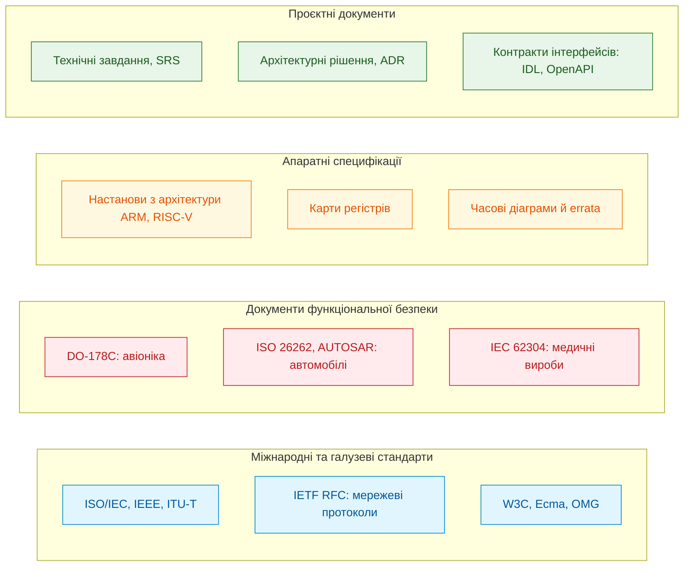

Діаграма показує не ієрархію важливості, а різні форми, у яких знання надходить до експертної системи. Кожен клас потребує власного способу вилучення.

**Міжнародні та галузеві стандарти** описують правила взаємодії компонентів і протоколів. Специфікації IETF (*Internet Engineering Task Force*) серії RFC (*Request for Comments*) є класичним прикладом: поруч із природною мовою вони містять формальні граматики в нотації ABNF (*Augmented Backus-Naur Form*), визначеній у RFC 5234 [[3]](#src-3). Зі стандарту такого типу експертна система вилучає дві форми знання: нормативні речення й граматику, яку можна скомпілювати в синтаксичний аналізатор.

**Документи функціональної безпеки** визначають не лише поведінку виробу, а й життєвий цикл його розроблення та перевірки. DO-178C для бортового програмного забезпечення авіації вимагає простежуваності від вимог до коду й тестів та аналізу структурного покриття [[4]](#src-4). ISO 26262 вводить для автомобільної електроніки рівні цілісності безпеки ASIL (*Automotive Safety Integrity Level*) від A до D [[5]](#src-5). IEC 62304 регламентує процеси життєвого циклу програмного забезпечення медичних виробів [[6]](#src-6). Знання з цих документів має форму обов'язків щодо артефактів процесу: які зв'язки простежуваності мають існувати, які докази покриття треба зібрати, хто й коли затверджує зміни.

**Апаратні специфікації** містять знання іншого типу. Настанови з архітектури процесорів (*Architecture Reference Manuals*), технічні описи контролерів і переліки відомих помилок кристала (*Errata Sheets*) подають знання у вигляді карт регістрів із бітовими полями й режимами доступу, часових діаграм, граничних електричних параметрів і обхідних рішень (*workarounds*) для дефектів кристала. Тут застосовується обов'язкове **інженерне правило ізоляції ревізійних обмежень апаратних специфікацій (Hardware Errata Scope)**: будь-який запис із переліку апаратних помилок є чинним виключно для зазначеної ревізії кремнієвого кристала, тому вилучений факт без предикатної прив'язки до діапазону ревізій безумовно блокується шлюзом знань як потенційно деструктивний для інших апаратних версій.

**Проєктні документи** (технічні завдання, специфікації вимог до програмного забезпечення, записи архітектурних рішень) фіксують конкретні правила проєкту. Вони змінюються найчастіше й мають узгоджуватися з вищими за ієрархією стандартами, тому для них особливо важливий облік версій, якому присвячено окремий розділ нижче.

Тут діє авторський **принцип спеціалізації екстракторів за регуляторним та фізичним типом джерела**: один універсальний екстрактор не здатний коректно опрацювати всі класи інженерних документів; граматику розбирає синтаксичний аналізатор, нормативні речення класифікує модальний аналізатор із [Глави 14](ch14-requirements-detection-and-formalization.md), таблиці регістрів обробляє аналізатор таблиць, а порядок дій вилучає екстрактор автоматів. Проте всі екстрактори мають видавати результат в одному форматі: кандидат у факт разом з адресою в першоджерелі. Формат цієї адреси визначає наступний розділ.

## 2. Інваріант доказовості: побайтова адресація першоджерел

Побайтова адресація відповідає на перше питання аудиту: де саме записано використане речення? Для R-15 недостатньо послатися на назву політики: перевірювач має відновити речення разом із винятком, а не схожу фразу з іншої редакції. Перед означенням потрібні два поняття: байт є одиницею зберігання, а зсув є його позицією від початку файла. Кількість байтів UTF-8 не дорівнює кількості видимих літер. Цей механізм перевіряє походження тексту, але сам не встановлює правильності його тлумачення.

У запропонованій архітектурі **пряме текстове твердження не допускається без прив'язки до незмінного артефакту; похідне твердження додатково потребує правила та всіх передумов його виведення**. Для текстового джерела адресацію задає п'ятірка (*evidence grounding tuple*):

<a id="obj-15-2"></a>

**Формула (15.2). Кортеж побайтової адресації текстового свідчення**

```math
\mathcal{E} = \langle \mathrm{DocID}, \mathrm{ByteStart}, \mathrm{ByteEnd}, \mathrm{SectionPath}, H_{\mathrm{quote}} \rangle
```

Параметри та математичні характеристики кортежу:

- $`\mathrm{DocID} \in \{0, 1\}^{256}`$ є хешем SHA-256 [[7]](#src-7) повного вмісту адресованого артефакту. Він служить практичним ідентифікатором за припущення криптографічної стійкості, а не математичною гарантією відсутності колізій;
- $`\mathrm{ByteStart}, \mathrm{ByteEnd} \in \mathbb{N}_0`$ — цілочисельний напіввідкритий інтервал байтових зсувів $`[\mathrm{ByteStart}, \mathrm{ByteEnd})`$ у бінарному потоці сирого файла з нумерацією від нуля, де $`0 \le \mathrm{ByteStart} < \mathrm{ByteEnd} \le \text{FileSize}`$;
- $`\mathrm{SectionPath} \in \mathcal{P}`$ — канонічний ієрархічний шлях у дереві заголовків документа (наприклад, `"3.3/Mail Transactions"`);
- $`H_{\mathrm{quote}} = \mathrm{SHA256}(\text{FileBytes}[\mathrm{ByteStart}:\mathrm{ByteEnd}])`$ є криптографічним хешем SHA-256 точного фрагмента цитати;
- Кутові дужки $\langle \cdot \rangle$ позначають строго впорядкований кортеж, відсутність будь-якого компонента якого робить факт невалідним для верифікатора.

Тут $`\text{FileBytes}`$ є масивом байтів адресованого артефакту, $`\text{FileSize}`$ його довжиною в байтах, а $`\mathcal{P}`$ множиною допустимих структурних шляхів. Усі зсуви вимірюються в байтах; хеш і шлях не мають фізичної розмірності. Для навчального UTF-8 тексту `AїB` довжина дорівнює 4 байтам: `A` займає `[0,1)`, `ї` займає `[1,3)`, `B` займає `[3,4)`. Отже, для цитати `ї` беруть початок 1, кінець 3 і хешують рівно два байти. Межі `[1,2)` формально лежать у файлі, але розрізають символ, тому текстовий валідатор їх відхиляє.

Після видобування тексту з PDF чи перекодування CP1251 адресують **окремий незмінний текстовий артефакт** із власним хешем. Маніфест пов'язує його з хешем оригіналу, версією перетворювача та картою сторінок або зсувів. Не можна називати координати нового UTF-8 тексту координатами старого файла. Спершу перевіряється ця відповідність, потім зміст кандидата; цим підготовлено конвеєр наступного розділу.

Практичне застосування та інженерні висновки:
- **Автоматична перевірка автентичності:** перед використанням факту в резолюційному виведенні рушій зчитує з диска діапазон байтів вихідного файла $`\text{FileBytes}[\mathrm{ByteStart}:\mathrm{ByteEnd}]`$, повторно обчислює хеш SHA-256 і порівнює його з $`H_{\mathrm{quote}}`$.
- **Блокування за порушення цілісності (Quarantine):** зміна байтів документа порушує збіг його повного хешу з `DocID`; зміна цитованого діапазону може також порушити збіг із $`H_{\mathrm{quote}}`$. Саме переміщення незміненого файла хешу не змінює. Якщо сховище не може знайти документ за його ідентифікатором, це помилка доступності, а не доказ підміни. В обох випадках неперевірене джерело не використовується; порушення цілісності має окремий код `E_GROUNDING_INTEGRITY_VIOLATION`.

> [!NOTE]
> **П'ять компонентів авторського протоколу доказової прив'язки $`\mathcal{E}`$ (Evidence Grounding Tuple)**
> 1. Криптографічний ідентифікатор документа ($`\mathrm{DocID}`$): незмінний 256-бітний хеш SHA-256 повного вмісту еталонного файлу в сховищі артефактів.
> 2. Напіввідкритий інтервал байтових зсувів ($`[\mathrm{ByteStart}, \mathrm{ByteEnd})`$): точні цілочисельні координати підрядка у вихідному бінарному потоці.
> 3. Канонічний ієрархічний шлях ($`\mathrm{SectionPath}`$): однозначне позиціонування в дереві заголовків специфікації для контекстної ізоляції норми.
> 4. Побайтовий хеш автентичності цитати ($`H_{\mathrm{quote}}`$): контрольний дайджест SHA-256 точного фрагмента тексту для захисту від мутацій і парафразів.
> 5. Детермінований протокол верифікації: побайтова перевірка хостом за координатами незмінного першоджерела без звернення до зовнішніх баз даних чи сторонніх сервісів.
> *Керування рантаймом / Інженерний інваріант:* первинне текстове твердження без валідного збігу хешу цитати відхиляється; похідний факт потребує перевірених первинних свідчень і версії правила виведення.

У кортежі п'ять полів: ідентифікатор, початок, кінець, шлях і хеш. У блоці вище початок і кінець об'єднано в один пункт, а п'ятим пунктом описано процедуру перевірки; процедура не є додатковим полем кортежу.

## 3. Конвеєр екстракції: від байтового потоку до кандидатів у факти

Конвеєр потрібний, щоб розділити різні причини відмови: не знайдено джерело, втрачено умову, переплутано одиницю чи відсутнє схвалення. Для R-15 фаза 1 зберігає розділ «робочий режим», фаза 2 знаходить суб'єкт і модальність, фаза 3 формує кандидат верхньої межі 150 мс разом із винятком, фаза 4 прив'язує повний текст, а фаза 5 перевіряє зміст і повноваження. Усередині можуть працювати статистичні парсери; відтворюваними мають бути версії їхніх виходів і правила приймання, а не обіцянка безпомилкового мовного аналізу.

<a id="obj-15-3"></a>

**Діаграма 15.3. П'ять фаз конвеєра екстракції знань**

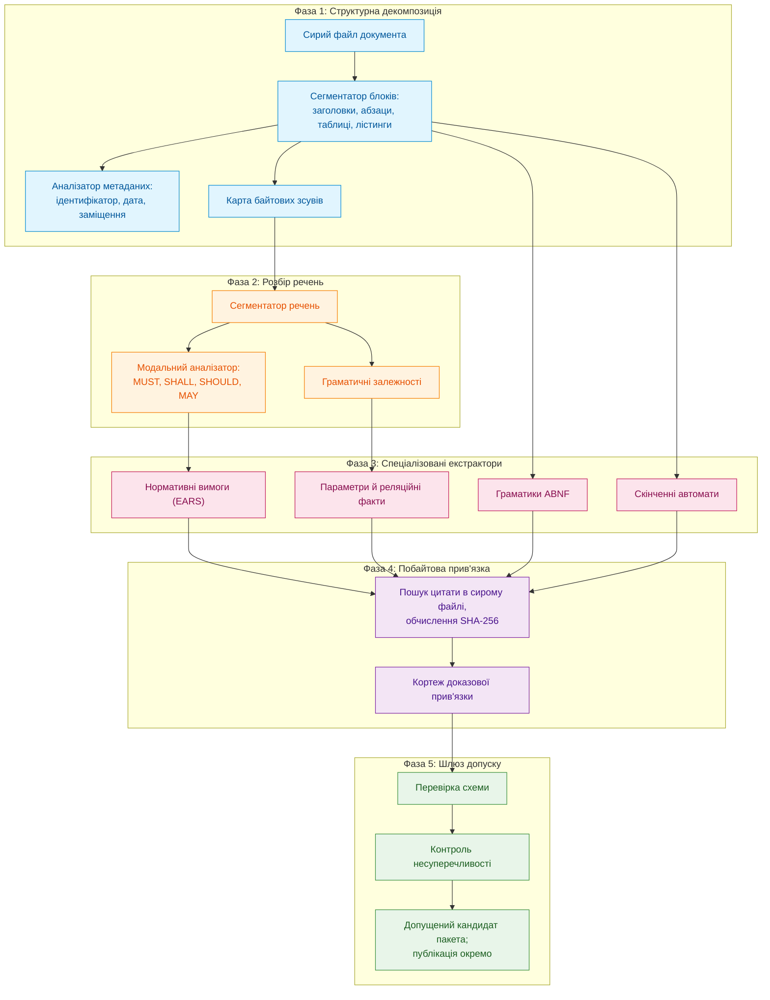

У цьому конвеєрі втілено авторський **інженерний принцип детермінованої пофазної фільтрації (Deferred Admission Principle)**: кожна фаза отримує результат попередньої і може відхилити кандидата за власними детермінованими критеріями, проте жодна проміжна фаза не має права записувати знання в ядро — остаточне рішення про допуск ухвалює виключно фінальний шлюз допуску (фаза 5). Розгляньмо фази по черзі; фазу 5 описано в окремому розділі про шлюз допуску.

### 3.1. Структурна декомпозиція документа

Структурна декомпозиція потрібна, щоб відрізнити правило від його пояснення ще до аналізу окремих слів. Однакові слова в основному тексті, прикладі й інформаційному додатку можуть мати різний статус. Його встановлюють за конвенцією документа та структурним контекстом разом, не лише за місцем чи словом MUST. Це звичайний контекстний аналіз документа, а не окремий авторський метод. Без нього аналізатор може помилково перетворити пояснення на обов'язок.

На першій фазі конвеєр розпізнає каркас документа: дерево розділів, типи текстових блоків (звичайний текст, таблиця, лістинг коду, формальна граматика, діаграма в символах ASCII) і метадані: ідентифікатор, дату, статус чинності та зв'язки з іншими документами. Одночасно фаза 1 будує карту зсувів, тобто запам'ятовує для кожного блоку його байтовий діапазон у сирому файлі.

Заголовок RFC 5321 у текстовому форматі містить рядки `Obsoletes: 2821` і `Updates: 1123` [[2]](#src-2). Аналізатор метаданих перетворює їх на ребра графа версій без участі людини: RFC 5321 скасовує RFC 2821 і оновлює RFC 1123. Той самий файл містить на кожній сторінці колонтитул із прізвищем автора, категорією документа й номером сторінки, наприклад `Klensin ... Standards Track ... [Page 95]`. Фаза 1 позначає їх як службові блоки, щоб жоден екстрактор не сприйняв колонтитул як частину норми.

Результатом фази 1 є дерево документа, кожен вузол якого має тип, шлях і байтовий діапазон. Для R-15 заголовок «робочий режим» залишається умовою застосовності; перенесення речення в довідковий додаток потребувало б повторного схвалення, навіть якби його байти не змінилися. Самого заголовка недостатньо для встановлення нормативної сили: потрібна також конвенція конкретного документа. Тепер можна розбирати речення, не втрачаючи їхнього місця в цілому.

### 3.2. Розбір речень і спеціалізовані екстрактори

Розбір речень потрібний, щоб у R-15 не сплутати «сервер», «150 мс» і «технічне обслуговування» як рівноправні сутності. Фаза 2 пропонує граматичні ролі й модальність. Фаза 3 збирає типізований кандидат: хто зобов'язаний, що зробити, коли, з якою межею та за яким винятком. Пропущене поле є приводом для уточнення, а не дозволом зробити норму безумовною.

#### 3.2.1. Параметри й реляційні факти

Технічні специфікації містять багато фіксованих параметрів: номери портів, розміри буферів, тайм-аути, бітові маски, температурні діапазони. Екстрактор реляційних фактів зводить такі твердження до атомарної структури:

<a id="obj-15-4"></a>

**Формула (15.4). Ядро типізованого параметра**

```math
\mathrm{Fact} = \langle \mathrm{Subject}, \mathrm{Relation}, \mathrm{Value}, \mathrm{Unit}, \mathcal{E} \rangle
```

Параметри та компоненти типізованого факту:

- $`\mathrm{Subject} \in \mathcal{C}`$ є канонічним ідентифікатором концепту онтології предметного домену (наприклад, `smtp:local-part` або `bms:cell_voltage`);
- $`\mathrm{Relation} \in \mathcal{R}`$ позначає семантичне відношення між концептом і значенням із замкненої матриці відношень онтології (наприклад, `hasMaxLength`, `hasTimeout`, `hasTolerance`);
- $`\mathrm{Value} \in \mathbb{R} \cup \mathrm{String}`$ є безпосереднім числовим чи рядковим значенням вилученого інженерного параметра;
- $`\mathrm{Unit} \in \mathcal{U}_{\mathrm{SI}} \cup \mathcal{U}_{\mathrm{std}}`$ задає строго специфіковану фізичну одиницю системи СІ або нормативну протокольну одиницю ($`\text{octet}`$, $`\text{bit/s}`$, $`\text{ms}`$, $`\text{mV}`$); для безрозмірних констант фіксується маркер $`\text{dimensionless}`$;
- $`\mathcal{E}`$ є криптографічним кортежем доказової прив'язки до незмінного першоджерела.

Практичне застосування та інженерні висновки:
- **Перевірка типів та одиниць на шлюзі:** шлюз допуску автоматично верифікує сумісність розмірності $`\mathrm{Unit}`$ із сигнатурою відношення $`\mathrm{Relation}`$. Якщо для часового відношення вказано октети або одиницю не визначено, факт безумовно бракується з кодом `E_INVALID_UNIT_DIMENSION`.
- **Запобігання фантомним фактам:** кутові дужки вимагають обов'язкової наявності всіх п'яти компонентів. Будь-яке твердження з порожнім полем $`\mathcal{E}`$ або невалідованим хешем першоджерела блокується як потенційна галюцинація екстрактора.

Наприклад, розділ 4.5.3.1.1 RFC 5321 містить речення *«The maximum total length of a user name or other local-part is 64 octets»* [[2]](#src-2). Екстрактор пропонує факт про межу 64 октети, де $`\mathcal{E}`$ адресує точні байти речення. Для довжини 63 октети межу не перевищено, для 65 перевищено на 1 октет; число символів Unicode тут не є заміною числа октетів. Це ще не універсальна перевірка адреси: потрібні решта синтаксису, застосовність редакції та схвалене правило порівняння. П'ятірка є ядром параметра, а не повною нормативною нормою: R-15 додатково зберігає `MUST`, робочий режим, оператор «не пізніше» і виняток у пов'язаному фреймі.

> [!NOTE]
> **Чотири принципи вилучення індикативних огинаючих специфікацій за методом М. М. Федчика**
> 1. **Індикативні факти числових меж:** наведене речення RFC 5321 про максимальну довжину є прикладом числового обмеження без окремого *MUST* у цитаті. Воно може бути представлене як факт про документ; це не доводить, що більшість обмежень у технічних стандартах має саме таку граматичну форму.
> 2. **Багатомовна проєкція семантичних фреймів:** запит $`Q_{L_1}`$ може зіставлятися з цитатою у джерелі $`D_{L_2}`$ через типізовані пари термінів і величин. Таке зіставлення саме по собі не є безпомилковим: приймання потребує перевірки сирих байтів, розмірності, предиката й контексту; показник $`ZHR = 1`$ не заявляється без визначеного тестового корпусу.
> 3. **Розділення суб'єктів у багатодокументних кластерах:** система може розглядати однакові лексеми як окремих кандидатів у різних джерельних просторах і перевіряти сумісність предикатів. Це проєктний механізм; його повноту й захист від отруєння треба підтвердити окремими тестами.
> 4. **Багатоступенева маршрутизація кандидатів:** попереднє зіставлення якорів, індекс акронімів і предикатна перевірка можуть бути застосовані послідовно. Складність доступу до окремої індексної структури не визначає сублінійність усього пошуку без опису структури, кількості контейнерів і вимірювання.
> *Керування рантаймом / Інженерний інваріант:* побайтовий збіг цитати й розмірнісна сумісність є необхідними перевірками кандидата, але не достатніми умовами допуску; окремо перевіряються застосовність джерела, тип факту, авторизація, конфлікти та інші умови шлюзу.

#### 3.2.2. Нормативні вимоги

Речення з нормативними словами (*MUST*, *SHALL*, *SHOULD*, *MAY* та їхні заперечення) екстрактор нормалізує за шаблонами EARS (*Easy Approach to Requirements Syntax*) [[8]](#src-8). Правила класифікації модальності залежать від конвенції документа-джерела, тому їх детально розібрано в [Главі 14](ch14-requirements-detection-and-formalization.md). Для цієї глави достатньо прикладу з розділу 3.3 RFC 5321. Речення *«If a RCPT command appears without a previous MAIL command, the server MUST return a 503 "Bad sequence of commands" response»* [[2]](#src-2) стає подієвою вимогою EARS: «Коли SMTP-сервер отримує команду RCPT без попередньої команди MAIL, SMTP-сервер повинен повернути код відповіді 503». Ця вимога ще знадобиться в розділі про скінченні автомати.

#### 3.2.3. Формальні граматики

Багато стандартів описують синтаксис повідомлень формальною нотацією. Розділ 4.1.1.1 RFC 5321 задає синтаксис команд привітання так [[2]](#src-2):

<details>
<summary>Граматичне правило ABNF</summary>

```abnf
ehlo           = "EHLO" SP ( Domain / address-literal ) CRLF
helo           = "HELO" SP Domain CRLF
```

</details>


Екстрактор граматик знаходить такі блоки, компілює їх у синтаксичні дерева й перевіряє, що кожне правило визначене. Правила `SP` і `CRLF` належать до базових правил, визначених у додатку B RFC 5234 [[3]](#src-3), а `Domain` і `address-literal` визначено в інших розділах RFC 5321. Тому екстрактор має розв'язувати посилання між розділами й документами; невизначене правило є помилкою екстракції, а не приводом мовчки пропустити граматику. Скомпільована граматика стає валідатором у складі бази знань: команду `HELO` без доменного імені експертна система відхилить як синтаксично неправильну, не звертаючись до мовної моделі.

### 3.3. Побайтова прив'язка фактів (Byte Anchoring)

Екстрактор чи мовна модель повертає цитату-кандидат одним рядком, а в сирому файлі та сама цитата розірвана перенесенням рядка й відступом. Пошук байт-у-байт такої цитати не знайде, хоча вона дослівно присутня в документі. Друга проблема протилежна: коротка цитата може траплятися в документі кілька разів, і тоді незрозуміло, яке з місць є доказом.

Розв'язок полягає в нормалізації з картою зсувів. Програма стискає кожну послідовність пробільних символів до одного пробілу, але для кожного байта нормалізованого тексту пам'ятає позицію в сирому файлі. Пошук виконується в нормалізованому тексті, а діапазон і хеш обчислюються за сирими байтами. Метод `GroundIn` отримує UTF-8 байти, цитату й наперед погоджений діапазон; повертає глобальні початок, кінець і хеш або помилку. «Прийнято» у виводі означає лише успішну прив'язку. Самодостатня програма нижче використовує синтетичний текст, а тести перевіряють неоднозначність, підміну числа й межі кодування. Мережа й зовнішні пакети не потрібні.

<details>
<summary>Приклад мовою Go: побайтова прив'язка цитати з нормалізацією й картою зсувів</summary>

```go
package main

import (
	"bytes"
	"crypto/sha256"
	"encoding/hex"
    "fmt"
    "unicode/utf8"
)

// Evidence описує побайтову прив'язку цитати до сирого файлу першоджерела.
type Evidence struct {
	Start, End int    // зсуви в сирих байтах; End не входить до діапазону
	SHA256     string // хеш сирих байтів [Start, End)
}

// normalize стискає кожну послідовність пробільних символів до одного пробілу
// і запам'ятовує, з якого байта сирого файлу походить кожен байт результату.
func normalize(raw []byte) ([]byte, []int) {
	var out []byte
	var pos []int
	inSpace := false
	for i, b := range raw {
		switch b {
		case ' ', '\t', '\r', '\n', '\f':
			if !inSpace && len(out) > 0 {
				out = append(out, ' ')
				pos = append(pos, i)
			}
			inSpace = true
			continue
		}
		inSpace = false
		out = append(out, b)
		pos = append(pos, i)
	}
	return out, pos
}

// Ground приймає цитату-кандидат лише тоді, коли вона трапляється
// в нормалізованому тексті документа рівно один раз.
func Ground(raw []byte, quote string) (Evidence, error) {
    return GroundIn(raw, quote, 0, len(raw))
}

func GroundIn(raw []byte, quote string, regionStart, regionEnd int) (Evidence, error) {
    if regionStart < 0 || regionEnd > len(raw) || regionStart >= regionEnd {
        return Evidence{}, fmt.Errorf("некоректні межі ділянки джерела")
    }
    if !utf8.Valid(raw) || !utf8.ValidString(quote) || !utf8.Valid(raw[regionStart:regionEnd]) {
        return Evidence{}, fmt.Errorf("некоректний UTF-8 або розріз усередині символу")
    }
    norm, pos := normalize(raw[regionStart:regionEnd])
	q, _ := normalize([]byte(quote))
	q = bytes.TrimSpace(q)
	if len(q) == 0 {
		return Evidence{}, fmt.Errorf("порожня цитата")
	}
	first := bytes.Index(norm, q)
	if first < 0 {
		return Evidence{}, fmt.Errorf("цитату не знайдено дослівно")
	}
	if bytes.Contains(norm[first+1:], q) {
		return Evidence{}, fmt.Errorf("цитата неоднозначна: кілька входжень")
	}
    start := regionStart + pos[first]
    end := regionStart + pos[first+len(q)-1] + 1
	sum := sha256.Sum256(raw[start:end])
	return Evidence{Start: start, End: end, SHA256: hex.EncodeToString(sum[:])}, nil
}

func main() {
    raw := []byte("Server MUST reply within\n  150 ms.\nstatus pending\nstatus pending")
	doc := sha256.Sum256(raw)
	fmt.Printf("DocID: sha256:%x...\n", doc[:8])

	candidates := []string{
        `Server MUST reply within 150 ms.`,
        `Server MUST reply within 150 s.`,
        `status pending`,
	}
	for _, c := range candidates {
		ev, err := Ground(raw, c)
		if err != nil {
			fmt.Println("ВІДХИЛЕНО:", err)
			continue
		}
		fmt.Printf("ПРИЙНЯТО: байти [%d, %d), sha256:%s...\n", ev.Start, ev.End, ev.SHA256[:16])
	}
}
```

Тест `ground_test.go` виконується через `go test -v main.go ground_test.go` і не потребує зовнішнього корпусу:

```go
package main

import (
    "crypto/sha256"
    "encoding/hex"
    "testing"
)

func TestGroundingRegionsAndEncoding(testCase *testing.T) {
    raw := []byte("first: limit 100 ms\nsecond: limit\n  100 ms")
    if _, err := Ground(raw, "limit 100 ms"); err == nil {
        testCase.Fatal("ambiguous global quote accepted")
    }
    start := len("first: limit 100 ms\nsecond: ")
    evidence, err := GroundIn(raw, "limit 100 ms", start, len(raw))
    if err != nil || evidence.Start != start || evidence.End != len(raw) {
        testCase.Fatalf("incorrect source region: %+v %v", evidence, err)
    }
    checksum := sha256.Sum256(raw[evidence.Start:evidence.End])
    if evidence.SHA256 != hex.EncodeToString(checksum[:]) {
        testCase.Fatal("quote hash does not match original bytes")
    }
    if _, err := Ground(raw, "limit 90 ms"); err == nil {
        testCase.Fatal("changed parameter accepted")
    }
    for _, bounds := range [][2]int{{-1, 2}, {0, len(raw) + 1}, {3, 2}} {
        if _, err := GroundIn(raw, "limit", bounds[0], bounds[1]); err == nil {
            testCase.Fatal("invalid region accepted")
        }
    }
    if _, err := Ground([]byte{0xff, 'a'}, "a"); err == nil {
        testCase.Fatal("invalid UTF-8 accepted")
    }
    if _, err := GroundIn([]byte("ї"), "ї", 1, 2); err == nil {
        testCase.Fatal("region splits Unicode character")
    }
}

func TestGroundingBoundaryCases(testCase *testing.T) {
    cases := []struct {
        name, raw, quote string
        start, end int
        reject bool
    }{
        {"exact", "limit", "limit", 0, 5, false},
        {"whitespace", "  limit\n  150 ms  ", "limit 150 ms", 2, 16, false},
        {"unicode", "AїB", "ї", 1, 3, false},
        {"empty", "limit", "  ", 0, 0, true},
        {"absent", "limit 150 ms", "limit 150 s", 0, 0, true},
        {"overlap", "aaa", "aa", 0, 0, true},
        {"non_ascii_space", "A\u00a0B", "A B", 0, 0, true},
        {"invalid_quote", "limit", string([]byte{0xff}), 0, 0, true},
    }
    for _, item := range cases {
        testCase.Run(item.name, func(testCase *testing.T) {
            evidence, err := Ground([]byte(item.raw), item.quote)
            if item.reject {
                if err == nil { testCase.Fatal("invalid candidate accepted") }
                return
            }
            if err != nil || evidence.Start != item.start || evidence.End != item.end {
                testCase.Fatalf("unexpected grounding: %+v %v", evidence, err)
            }
        })
    }
}

func TestGroundingDocumentAndQuoteIdentity(testCase *testing.T) {
    original := []byte("limit 150 ms\nrevision A")
    changed := []byte("limit 150 ms\nrevision B")
    first, firstErr := Ground(original, "limit 150 ms")
    second, secondErr := Ground(changed, "limit 150 ms")
    if firstErr != nil || secondErr != nil || first.SHA256 != second.SHA256 {
        testCase.Fatal("unchanged quote identity lost")
    }
    if sha256.Sum256(original) == sha256.Sum256(changed) {
        testCase.Fatal("document change not detected")
    }
}
```

Архівний вивід автора для файла розміром 225 929 байтів:

```text
DocID: sha256:7d560eddff1b213c...
ПРИЙНЯТО: байти [52658, 52788), sha256:48f3063677f109b3...
ВІДХИЛЕНО: цитату не знайдено дослівно
ВІДХИЛЕНО: цитата неоднозначна: кілька входжень
```

</details>

В архівному прикладі RFC різниця кінцевої та початкової координат дає 130 байтів; повторити саме ці координати можна лише на тому самому файлі. Архівний вивід не є очікуваним виводом нової самодостатньої програми. У ній перша цитата відновлює 34 сирі байти `[0,34)` із переносом і двома пробілами, друга підмінює мілісекунди секундами й відхиляється, третя має два входження. Так можна перевірити механізм без приписування синтетичному тексту статусу RFC.

Приклад нормалізує лише перелічені ASCII-пробіли. `GroundIn` дозволяє шукати в наперед установленій ділянці розділу й повертає глобальні координати; ділянку має визначити структурний аналізатор, не сама модель після невдалого пошуку. Повторна цитата в іншому розділі тоді не створює неоднозначності всередині погодженої ділянки. Тест також відхиляє неправильне кодування й розріз символу.

Для PDF-документа або скану потрібний незмінний текстовий артефакт із власним ідентифікатором і зв'язок до оригінального файла, сторінки та геометричних рамок. Байтовий діапазон у текстовому артефакті не є діапазоном символів усередині стиснутого PDF. Переноси слів, видалення колонтитулів і лігатури потребують карти перетворень, як пояснює [Глава 12](ch12-linguistic-analysis-and-local-models.md).

### 3.4. Двопрохідний семантичний компілятор знань: від збору символів до зв'язування анафор

Два проходи потрібні, коли поточне речення посилається на визначення або суб'єкт в іншому місці документа. Таке відсилання називається анафорою: у «Сервер отримує запит. Він повинен відповісти...» слово «він» потребує зв'язку із сервером. Однопрохідний аналіз також може зберігати контекст і відкладати невідомі посилання; два проходи є обраним способом організації цих залежностей, не доказом неможливості всіх інших алгоритмів.

Якщо зв'язування пропущено, суб'єктом може залишитися займенник `it` або вигаданий заповнювач `system`; тоді правило втрачає точного виконавця. Таблиця символів запобігає такій підміні, зберігаючи локальні визначення, акроніми та області їхньої видимості. Вона не розв'язує всі мовні неоднозначності, але робить нерозв'язані посилання явним результатом.

Розв'язанням є **двопрохідна модель компіляції знань (Two-Pass Ingestion Compiler)**, аналогічна класичній двоетапній компіляції вихідного коду (збір символів → генерація проміжного коду та зв'язування адрес):

<a id="obj-15-5"></a>

**Діаграма 15.5. Архітектура двопрохідного компілятора знань**

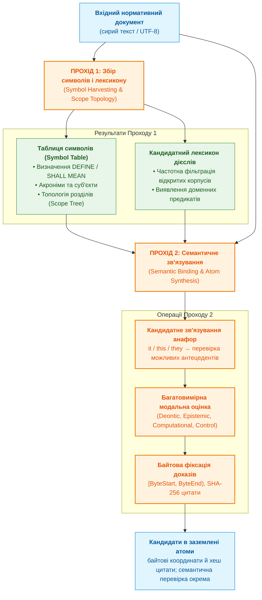

#### 3.4.1. Збір символів, топології та лексикону (Symbol Harvesting)

Під час першого проходу компілятор не продукує фінальних норм, а формує просторово-типізовану **Таблицю символів документа** ($`\mathrm{SymbolTable}`$):
1. **Витяг локальних дефініцій і глосаріїв:** компілятор детектує нормативні конструкції визначень (`DEFINE`, `SHALL MEAN`, `IS DEFINED AS`, `STANDS FOR`) і реєструє введені терміни, їхні синоніми та акроніми.
2. **Побудова топології областей видимості (Scope Topology):** кожен пункт, таблиця або розділ специфікації формує лексичний простір імен ($`\mathrm{Scope}`$). В межах цього простору фіксуються явно заявлені суб'єкти (актори: наприклад, `Client`, `Server`, `Controller`, `Receiver`).
3. **Виявлення кандидатних дієслів (Candidate Verb Harvesting):** компілятор збирає леми дій із документа; для R-15 це «відповісти». Частота допомагає визначити порядок розгляду, але рідкісна критична дія не відкидається лише через частоту. Морфологічний словник може бути допоміжною версійованою залежністю; він не надає знайденому дієслову права автоматично стати предметним предикатом.

#### 3.4.2. Семантичне зв'язування та розв'язання анафор (Semantic Binding)

Під час другого проходу здійснюється повнотекстовий синтактико-семантичний аналіз із використанням уже заповненої Таблиці символів:
- **Кандидатне розв'язання анафор (Typed Anaphora Resolution):** коли граматичний парсер зустрічає займенник (`it`, `this`, `they`) у позиції підмета нормативного речення, компілятор зіставляє можливі антецеденти в активному $`\mathrm{Scope}`$ за граматичним числом і родом. Найближчий кандидат не вважається доведеним лише через позицію; якщо лишається кілька сумісних антецедентів або бракує контексту, факт залишається кандидатом і не допускається до бази до розв'язання неоднозначності.
- **Незмінність доказового інваріанта:** нормалізація суб'єкта до канонічного ідентифікатора символу відбувається в семантичному шарі факту ($`\mathrm{Subject} = \text{"Client"}`$), тоді як кортеж прив'язки $`\mathcal{E} = \langle \mathrm{DocID}, \mathrm{ByteStart}, \mathrm{ByteEnd}, \dots \rangle`$ і хеш $`H_{\mathrm{quote}}`$ незмінно зберігають буквальний байтовий діапазон вихідного тексту першоджерела (з оригінальним словом *«It»*).
- **Матеріалізація заземлених кандидатів:** результат другого проходу — фрейми з явними суб'єктами й посиланнями на текст. Для «Сервер отримує запит. Він повинен відповісти...» антецедентом є сервер лише після перевірки контексту. Для «Сервер звертається до проксі. Він...» два граматично сумісні кандидати означають нерозв'язану неоднозначність. Два проходи організовують роботу, але не доводять правильності вибору.

#### 3.4.3. Еволюція до чотирипрохідного епістемічного компілятора (Epistemic IR)

Потреби компіляції складних специфікацій охоплюють не лише зв'язування анафор, а й структурування відношень частини й цілого (`PART-OF`), таксономій (`IS-A`), кількісних обмежень і винятків (Defeaters). Це мотивує розширену модель проходів, але саме по собі не підтверджує її практичну продуктивність чи повноту.

П'ять фаз у схемі §3 описують зовнішній шлях від структури документа до шлюзу допуску; два проходи §3.4.1–3.4.2 описують окремо модель збору символів і зв'язування анафор; чотири проходи нижче є запропонованою деталізацією компіляції через `Epistemic IR`. Це різні рівні опису, а не дві альтернативні кількості фаз; точне відображення чотирьох внутрішніх проходів на п'ять зовнішніх фаз тут не специфіковано.

Автором запропоновано чотирипрохідну архітектуру компіляції знань над типізованим проміжним представленням `Epistemic IR`, яка розмежовує лінгвістичний аналіз, кількісне заземлення, логічне виведення та низькорівневу бінарну кодогенерацію:

Це проєктна пропозиція автора; у главі не наведено порівняльного прототипу, який підтверджував би її новизну чи перевагу над наявними компіляторними конвеєрами.

> [!NOTE]
> **Чотири запропоновані внутрішні проходи епістемічної компіляції**
> 1. **Прохід 1 — Синтаксично-рольова нормалізація та клаузальна декомпозиція (SRL & Clausal IR):** Первинний потік тексту та структурних таблиць перетворюється у типізовані фрейми проміжного представлення `Epistemic IR` із нормалізацією пасивного стану, розщепленням кон'юнкцій та виділенням умовних передумов.
> 2. **Прохід 2 — Багатовеличинне та лексичне заземлення (Multi-Quantity & UCUM IR):** Прохід призначений для вилучення кандидатів на числові та словесні величини (`four octets`, `32 bits`, `3.3 V`, `125 °C`) із підтримуваних конструкцій, прив'язування їх до параметрів і семантичних ролей (`RoleCondition` та `RoleTargetLimit`) і канонізації одиниць за правилами UCUM ($`1\text{ octet} \equiv 8\text{ bits}`$). Повнота вилучення не встановлена: потрібні опис граматик, розмічений корпус і вимірювання точності та повноти.
> 3. **Прохід 3 — Побудова епістемічного графа та компіляційне виведення (Graph & Inference IR):** Компілятор будує графи таксономії (`IS-A`) і меронімії (`PART-OF`), обчислює агреговані параметри складених структур, зв'язує міжреченнєві дефітери та перевіряє сумісність числових інтервалів.
> 4. **Прохід 4 — Кодогенерація бінарного контейнера знань:** проміжне представлення серіалізується в описані форматом секції фактів, правил, кількісних величин і винятків із кореневим дайджестом дерева Меркла.
> *Керування рантаймом / Інженерний інваріант:* лінгвістичний аналіз виконується під час збирання, а рантайм читає опублікований знімок. Це усуває повторний мовний розбір, але не гарантує субмілісекундної затримки; потрібні вимірювання запитів, індексів і завантаження сторінок.

Для R-15 перший внутрішній прохід зберігає роль сервера й умову режиму, другий переводить 150 мс у секунди без зміни верхньої межі, третій приєднує виняток, четвертий записує прийняте подання. Похідне значення 0,150 с потребує посилання не лише на цитату, а й на версію правила перетворення одиниць. Маніфест фіксує схему IR, версії парсера, онтології, правил і схвалень; оновлення будь-якої залежності перевіряє похідні записи заново. Так розрізняються валідація змісту, компіляція подання та використання опублікованого результату.

### 3.5. Адаптивні семантичні одиниці FAU для збереження контексту

Плаваюче вікно потрібне, щоб пошук не відокремив обов'язок R-15 від винятку про обслуговування. Фіксовані блоки по 512 чи 1024 токени можуть бути корисним індексним поданням, але їхні межі самі не визначають межі норми. Без зв'язків із повним контекстом виникають такі ризики:
- умова (`IF`) і наслідок (`THEN MUST`) можуть потрапити до різних блоків;
- клітинка таблиці може втратити заголовок параметра або одиниці;
- займенник може втратити зв'язок із попереднім суб'єктом.

Для зменшення цього ризику в монографії запропоновано **плаваючі семантичні одиниці анотації (Floating-Size Annotation Unit, FAU)**. Їхні межі мотивовано аналогіями із законом необхідної різноманітності Росса Ешбі та протоколом ковзного вікна; ці аналогії не доводять ефективності сегментації. FAU є проєктною моделлю, а її перевагу над фіксованими блоками потрібно перевірити на однаковому корпусі та однакових критеріях збереження контексту.

#### 3.5.1. Закон необхідної різноманітності Росса Ешбі

Закон Ешбі потрібний тут як нагадування про межі механізму, що не розрізняє істотних ситуацій [[26]](#src-26). У скінченній моделі регулювання різноманітність можна рахувати в бітах як логарифм числа розрізнюваних випадків. За припущення, що кожна доступна реакція компенсує не більше заданого числа випадків, необхідна умова має вигляд:

<a id="obj-15-6"></a>

**Формула (15.6). Необхідна різноманітність у скінченній моделі регулювання**

```math
V_R \ge V_D - V_C
```

Параметри та математичні компоненти формули:
- $`V_R \ge 0`$ — логарифм за основою 2 числа доступних реакцій регулятора, у бітах;
- $`V_D \ge 0`$ — такий самий логарифм числа випадків збурення;
- $`V_C \ge 0`$ — логарифм максимально допустимого числа залишкових випадків на реакцію; числа випадків є додатними цілими, тут не йдеться про дисперсію фізичної величини.

У навчальній моделі є 8 випадків збурення й допускається по 2 залишкові випадки на реакцію. Потрібно щонайменше 4 реакції: 4 групи по 2 покривають 8 випадків; у бітах це 2 не менше ніж 3 мінус 1. Дві реакції покрили б лише 4 випадки й умову не виконали б. Результат задає нижню межу різноманітності цієї моделі, а не достатність або точність парсера.

Для тексту відповідність між такими випадками й мовними залежностями тут не побудовано. Тому нерівність не калібрує FAU й не доводить його переваги. Фіксований блок на 512 токенів може розділити умову й виняток, але може й умістити їх обидва. Перевірний критерій сегментації інший: чи збережено всі залежності конкретної вимоги R-15? Далі розглянуто механізм утримання цих залежностей і граничну довжину $`L_{\mathrm{max}}`$.

#### 3.5.2. Протокол ковзного вікна семантичної анотації

На відміну від статичного лічильника токенів, межі плаваючої одиниці FAU формуються динамічно шляхом синтаксичного та семантичного моніторингу потоку тексту:
- **Відкриття вікна (Window Open):** фіксація появи нового нумерованого структурного заголовка стандарту, суб'єкта нормативного твердження або переходу до нового розділу специфікації;
- **Утримання та розширення (Window Hold/Expand):** динамічне поглинання всіх підрядних умов (`IF... THEN`, `WHEN`, `WHERE`), деонтичних винятків (`UNLESS`, `EXCEPT`), числових меж із допусками та анафоричних займенників;
- **Зв'язування анафор (Anaphora Binding):** перевірка кандидатних антецедентів у межах активної області видимості; нерозв'язана неоднозначність не дозволяє вважати одиницю замкненою;
- **Закриття вікна (Window Close):** виявлення синтаксично замкненого судження, зміна суб'єкта нормативної дії або виявлення наступної логічної секції специфікації.

Кожна сформована одиниця FAU зберігає повний ієрархічний шлях від кореня документа (*breadcrumbs*), наприклад: «Вимоги до гальмівної системи → Аварійне гальмування → пункт 4.2».

#### 3.5.3. Гібридний пошук із злиттям обернених рангів

Для вибірки кандидатних одиниць FAU на етапі вилучення або відповіді на інженерні запити конвеєр застосовує дворівневий гібридний пошук. Розріджений лексичний індекс BM25 знаходить точні збіги номерів стандартів, кодів помилок та мнемонік регістрів [[9]](#src-9). Щільний векторний індекс HNSW знаходить парафразовані та концептуальні відповідності [[10]](#src-10), доступний утилітою pgvector [[11]](#src-11). Списки видачі об'єднуються методом злиття обернених рангів RRF (*Reciprocal Rank Fusion*) [[12]](#src-12):

<a id="obj-15-7"></a>

**Формула (15.7). Об’єднання рангів двох пошукових каналів**

```math
\mathrm{RRF}(d) = \sum_{m \in \{\mathrm{BM25}, \mathrm{Dense}\}} \frac{1}{k + \mathrm{rank}_m(d)}
```

Параметри та математичні компоненти формули:
- $`d \in \mathcal{D}_{\mathrm{FAU}}`$ є структурною одиницею FAU (нормативний пункт, стаття чи таблиця);
- $`m \in \{\mathrm{BM25}, \mathrm{Dense}\}`$ позначає гетерогенні пошукові канали (розріджений лексичний індекс точних збігів та щільний векторний семантичний індекс HNSW);
- $`\mathrm{rank}_m(d) \in \mathbb{N}_{\ge 1}`$ є порядковим місцем кандидата $d$ у списку видачі каналу $m$ ($1$ для першого місця; якщо документ відсутній у вибірці каналу, приймається $`\mathrm{rank}_m(d) = \infty`$, що дає нульовий доданок);
- $`k \in \mathbb{N}_{> 0}`$ — емпіричний гіперпараметр згладжування (канонічно $k = 60$), який нівелює випадкові сплески ранжування в одному каналі;
- $`\mathrm{RRF}(d) \in [0, \frac{2}{k+1}]`$ є сумарним позиційним балом консенсусу; нижня межа досягається, коли документ відсутній в обох каналах.

#### 3.5.4. Дія та замкнений цикл розрахунку семантичного вікна FAU

1. **Керування рантаймом і потоком обчислень (Control Flow & Runtime Decisions):**
   - Рантайм сегментатора відстежує лічильник незакритих анафор $`B_{\mathrm{anaphora}}`$ та прапорець деонтичної незавершеності $`F_{\mathrm{deontic}}`$. Доки $`B_{\mathrm{anaphora}} > 0`$ або $`F_{\mathrm{deontic}} = \mathrm{true}`$, ковзне вікно залишається в стані `EXPAND`, блокуючи спроби скидання даних у чергу індексації.
   - Скидання блоку в індекс (`FLUSH_FAU`) дозволяється виключно при $`B_{\mathrm{anaphora}} = 0 \land F_{\mathrm{deontic}} = \mathrm{false}`$.
    - Якщо розмір вікна досягає налаштованої межі $`L_{\mathrm{max}} = 2048`$ токенів без настання умов закриття, рантайм може позначити його як `DEGRADED_SPLIT` і сформувати `WARN_ANAPHORA_DISRUPTED`. Примусовий поділ за межею речення та копіювання останнього речення не гарантують збереження попередніх залежностей; такий фрагмент залишається неповним кандидатом і потребує відновлення контексту або відмови в допуску.
    - Для вибірки кандидатів до екстрактора налаштовано поріг: відбирається не більше $`K_{\mathrm{pool}} = 20`$ фрагментів із балом $`\mathrm{RRF}(d) \ge 0{,}025`$. Якщо $`\max_{d} \mathrm{RRF}(d) < 0{,}025`$, процес зупиняється з кодом `E_RRF_THRESHOLD_NOT_MET`; поріг ранжування не є оцінкою ймовірності чи гарантією відсутності шуму.
2. **Апаратний сайзинг та інфраструктурні обмеження (Hardware Dimensioning):**
    - Якщо кожен токен зберігається у слоті $`S_{\mathrm{token}} = 64\,\text{байти}`$, один буфер на $`L_{\mathrm{max}} = 2048`$ токенів займає 131 072 байти, тобто 128 КіБ; для $`N_{\mathrm{workers}} = 16`$ буферів сума становить 2 097 152 байти, тобто 2 МіБ. КіБ і МіБ тут означають двійкові, не десяткові одиниці.
    - Ця оцінка задає лише номінальний обсяг даних, а не гарантує їх резидентність у L3-кеші чи відсутність звернень до DRAM: результат залежить від розміру фактичного слота, вирівнювання, асоціативності кешу, інших споживачів і політики планування. Пропускну здатність та затримки потрібно виміряти на цільовій апаратурі за визначеним навантаженням.
3. **Практичний числовий приклад (Worked Numerical Example):**
    - Для арифметики припустімо довжину синтетичного фрагмента 610 токенів; сам фрагмент тут не відтворено й токенізатором не виміряно. Це не цитата чи вимога ISO 26262. Умовна політика контролера вимагає зняти напругу за 10 мс, крім режиму аварійного динамічного гальмування за температури обмоток нижче 120 °C; приклад ілюструє ризик розриву винятку, а не рекомендацію керування реальним приводом.
    - Фіксований поділ після 512-го токена в цьому прикладі розносить дію та виняток по різних фрагментах. Якщо споживач трактує перший фрагмент як безумовну норму, він може сформувати хибну рекомендацію; це модель ризику, а не повідомлення про реальну відмову.
    - Для ілюстрації припустімо, що сегментатор утримує вікно до 610-го токена ($`L = 610 \le L_{\mathrm{max}}`$), а умовний пошуковий прогін повертає фрагмент на 2-ге місце у BM25 ($`\mathrm{rank}_{\mathrm{BM25}} = 2`$) та 3-тє місце в HNSW ($`\mathrm{rank}_{\mathrm{Dense}} = 3`$). Ці ранги не є виміряним бенчмарком. За формулою RRF із $k = 60$:

<a id="obj-15-8"></a>

**Формула (15.8). Навчальний розрахунок RRF для двох позицій**

```math
\mathrm{RRF}(d) = \frac{1}{60 + 2} + \frac{1}{60 + 3} = \frac{1}{62} + \frac{1}{63} \approx 0{,}01613 + 0{,}01587 = 0{,}03200 \ge 0{,}025.
```

    - Бал приблизно 0,03200 перевищує заданий поріг 0,025, тому кандидат надходить на екстракцію. Це рішення про чергу пошуку, а не доказ цілісності норми. $`B_{\mathrm{anaphora}}`$ є невід'ємним цілим лічильником нерозв'язаних посилань, $`F_{\mathrm{deontic}}`$ булевим прапорцем незавершеної умови; вони не мають фізичних одиниць. Їхні нульові значення означають лише те, що аналізатор не знайшов незакритих залежностей. Для R-15 перевіряють окремо наявність робочого режиму й винятку. Пул до 20 фрагментів може пропустити істотне джерело: повнота пошуку на розміченому корпусі не дорівнює повноті всіх застосовних норм.

Вибір моделі векторних представлень (*embeddings*) також потребує верифікації на власних інженерних тестах: у MTEB (*Massive Text Embedding Benchmark*, EACL 2023) серед 33 оцінених моделей жодна не була найкращою за всіма сімома типами задач основного англомовного порівняння на 56 наборах даних [[13]](#src-13). Результат не охоплює всіх можливих моделей і доменів, а перетин навчальних і тестових даних не виключено.

### 3.6. Синтаксично-керована екстракція (Syntax-Directed IE) та вилучення предикатів через Universal Dependencies

Синтаксично-керована екстракція потрібна, щоб відрізнити того, хто діє, від об'єкта дії та її умов. У R-15 «не пізніше» обмежує час відповіді, а не забороняє відповідати. **SDIE** (*Syntax-Directed Information Extraction*) використовує дерево залежностей Universal Dependencies (UD): вузлами є слова, ребрами позначені ролі на зразок підмета `nsubj`, додатка `obj` та допоміжного слова `aux`. Лема є словниковою формою слова. Парсер може помилятися, тому дерево є входом до перевірки, а не доказом змісту.

Для відтворюваної трансляції потрібні не лише ребра дерева, а й версійована схема ролей та словник відповідностей. Оператор повертає фрейм-кандидат разом із нерозв'язаними місцями:

<a id="obj-15-9"></a>

**Формула (15.9). Вихід синтаксично-керованої трансляції**

```math
\Phi_{\mathrm{SDIE}}(T,\Gamma)=(C,U).
```

Тут $T$ є скінченним деревом залежностей із байтовими координатами токенів, $`\Gamma`$ скінченною версійованою схемою зіставлення синтаксичних ролей із предметними полями, $C$ множиною кандидатних фреймів, а $U$ множиною невизначеностей; фізичних одиниць ці структури не мають. Вхідні координати мають належати тому самому текстовому артефакту. Для R-15 у $C$ потрапляють сервер, дія «відповісти», верхня межа 150 мс, робочий режим і виняток. Якщо парсер не прив'язав «обслуговування» до винятку, $U$ не порожня: кандидат не може стати безумовною нормою. Аргумент зі складним розривним піддеревом зберігає кілька інтервалів, а не вигаданий суцільний підрядок.

Модальність визначається конвенцією документа та областю дії заперечення. Нехай $m$ є вже розпізнаним оператором із множини `MUST`, `MAY`, а $s$ перевіреним охопленням заперечення: `action`, `limit` або `none`. Для цього вузького навчального профілю:

<a id="obj-15-10"></a>

**Формула (15.10). Обмежений профіль модальності та області заперечення**

```math
\mathrm{Deontic}(m,s)=
\begin{cases}
\mathbf{F}, & m=\mathtt{MUST},\ s=\mathtt{action},\\
\mathbf{O}, & m=\mathtt{MUST},\ s\in\{\mathtt{limit},\mathtt{none}\},\\
\mathbf{P}, & m=\mathtt{MAY},\ s=\mathtt{none},\\
\mathbf{U}, & \text{інакше}.
\end{cases}
```

Позначення $`\mathbf{F}`$, $`\mathbf{O}`$, $`\mathbf{P}`$, $`\mathbf{U}`$ означають відповідно заборону дії, обов'язок, дозвіл і нерозв'язаний статус; це категорії без числових одиниць. Профіль не охоплює рекомендацій `SHOULD`, вкладених заперечень чи всіх мовних конструкцій: їх не зводять до декларативного факту за замовчуванням. Для R-15 маємо `MUST/limit`, отже обов'язок відповісти в межах часу. Для «сервер не повинен надсилати пароль» маємо `MUST/action`, отже заборону надсилання. «Сервер не відповідає» описує спостереження: без установленого модального оператора це не нормативна заборона. Різниця змінює правило, яке потрапить на предметне схвалення.

> [!NOTE]
> **Чотири інваріанти синтаксично-керованого вилучення фактів за авторською моделлю**
> 1. **Збереження валентності:** обов'язкові ролі визначає сигнатура предиката; неперехідне дієслово не потребує вигаданого прямого додатка. Невідома обов'язкова роль блокує допуск.
> 2. **Побайтова спадщина термів:** кожен первинний аргумент зберігає ідентифікатор артефакту та його інтервали; нормалізований аргумент також називає правило перетворення.
> 3. **Деонтична кваліфікація:** перевіряються оператор і область заперечення. «Не пізніше» не перетворює обов'язок на заборону, а відсутність підтвердженої модальності не створює дозволу.
> 4. **Нормалізація величин:** числовий аргумент зіставляється з параметром, одиницею та оператором, а не лише із найближчим іменником; невизначеність залишається явною.

Для R-15 виходом є кандидат, а не виміряний результат парсера чи цитата залізничного стандарту:

```json
{
    "rule_id": "R-15",
    "subject": "server",
    "action": "reply",
    "modality": "MUST",
    "scope": "operating_mode",
    "limit": {"operator": "<=", "value": "0.150", "unit": "s"},
    "exception": "approved_maintenance",
    "source_span": null,
    "status": "candidate"
}
```

Перевірка порівнює цей фрейм із реченням: 150 мс збережено як верхню, не нижню межу; технічне обслуговування не стало суб'єктом. Порожні координати забороняють випуск. Якщо аналізатор повернув неповний розбір, потрібні уточнення або карантин; числовий бал 0,95 без калібрування на цільовому корпусі не є доказом правильності.

Для вимірювання часу розбору й використання пам'яті потрібні версія моделі, обладнання, довжини речень, повтори та розподіл затримок. Наступні методи організовують перетворення й пошук закономірностей, не усуваючи цієї потреби.

Пошук лише пропонує кандидатів. Він не вирішує, чи норма чинна і чи застосовна до випадку: ці рішення ухвалюють граф версій і механізм виведення. Конвеєр, описаний у цьому розділі, видає кандидатів у факти з адресами в першоджерелі. Проте статичні факти не описують порядку дій, а значна частина інженерних норм стосується саме порядку. Наступний розділ показує, як вилучати поведінку.

> [!NOTE]
> **Чотири фази життєвого циклу плаваючої семантичної одиниці анотації (FAU)**
> 1. Відкриття вікна (Window Open): детекція нового структурного заголовка, суб'єкта нормативного твердження або початку розділу специфікації.
> 2. Семантичне утримання (Window Hold): динамічне поглинання підрядних умов (`IF... THEN`, `WHEN`), винятків (`UNLESS`) та числових допусків.
> 3. Розв'язання анафор (Anaphora Binding): утримання вікна до повного закриття лічильника контекстних займенників ($`B_{\mathrm{anaphora}} = 0`$).
> 4. Детерміноване закриття (Window Close): фіксація замкненого судження та генерація ієрархічного ланцюжка хлібних крихт (*breadcrumbs*).
> *Керування рантаймом / Інженерний інваріант:* після досягнення налаштованого ліміту $`L_{\mathrm{max}}`$ одиниця позначається неповною (`DEGRADED_SPLIT`) і не допускається до бази без відновлення контексту або окремого схвалення; копіювання останнього речення саме по собі не відновлює попередні залежності.

### 3.7. Зважені скінченні трансдьюсери над півкільцями походження (WFST) та аналіз формальних понять (FCA)

Після розбору R-15 виникають два різні питання: як пронести походження через послідовні перетворення й як знайти спільні ознаки вже вилучених об'єктів? Перше пояснює зважений скінченний трансдьюсер (WFST), тобто автомат, який перетворює вхідні символи на вихідні й накопичує ваги шляхів. Друге пояснює аналіз формальних понять (FCA), який працює з таблицею «об'єкт має ознаку». Жоден із них сам не встановлює нормативної сили нового правила.

#### 3.7.1. Математична модель WFST над півкільцем походження

Для R-15 спочатку розпізнають слова, далі словникові форми, одиниці та модальність. Якщо ці операції задані скінченними трансдьюсерами із сумісними проміжними алфавітами, їхню композицію записують так:

<a id="obj-15-11"></a>

**Формула (15.11). Композиція спеціалізованих трансдьюсерів**

$$
T = T_{\mathrm{deontic}} \circ T_{\mathrm{SI}} \circ T_{\mathrm{morph}} \circ T_{\mathrm{lex}}.
$$

Оператор $`\circ`$ означає застосування справа наліво. $`T_{\mathrm{lex}}`$ розпізнає лексеми, $`T_{\mathrm{morph}}`$ нормалізує їхні форми, $`T_{\mathrm{SI}}`$ переводить підтримувані одиниці, $`T_{\mathrm{deontic}}`$ пропонує модальний тег, а $T$ є результуючим перетворенням скінченних рядків. Це дискретні відображення без фізичних одиниць; обмеження часу всередині R-15, навпаки, має одиницю секунди. Складні залежності поза підтриманим профілем передаються на перевірку, а не вважаються автоматично розпізнаними.

Щоб відрізнити альтернативні докази від спільно потрібних, використаємо поліноміальне півкільце походження:

<a id="obj-15-12"></a>

**Формула (15.12). Поліноміальне півкільце походження**

$$
\mathbb K_{\mathrm{prov}}=(\mathbb N[X],+,\cdot,0,1).
$$

Тут $X$ скінченна множина міток первинних свідчень; кожна мітка посилається на артефакт і його інтервали. $`\mathbb N[X]`$ містить скінченні поліноми з невід'ємними цілими коефіцієнтами; додавання позначає альтернативні шляхи, множення спільно використані свідчення, 0 відсутність шляху, 1 порожній добуток. Ці ваги не є ймовірностями й не мають фізичних одиниць. Операції асоціативні, додавання комутативне, множення розподільне щодо додавання, а 0 поглинає добуток; це потрібні властивості півкільця для скінченного підсумовування шляхів. Для циклів із нескінченною кількістю шляхів потрібні додаткові умови збіжності або обмеження, яких ця модель не задає.

Нехай мітка $`x_1`$ адресує «150», а $`x_2`$ адресує «мс» у навчальному тексті. Тоді вага $`x_1x_2`$ показує, що значення 0,150 с потребує обох фрагментів; альтернативна цитата з міткою $`x_3`$ дала б суму $`x_1x_2+x_3`$. Це слід походження, не доказ коректності конвертації: окремо фіксується версія правила перетворення. Фіксований детермінований автомат з обмеженою роботою на символ може виконуватися за лінійний час від довжини входу; загальна композиція WFST, неоднозначність і розростання ваг такої гарантії не мають.

#### 3.7.2. Аналіз формальних понять (FCA) та канонічний базис Дюкамена–Гіге

FCA потрібний, коли треба перевірити, які ознаки справді спільні для групи вилучених об'єктів. Перед обчисленням задають скінченний контекст: множину об'єктів $`\mathcal O`$, множину булевих ознак $`\mathcal A`$ та відношення $`\mathcal I`$ «об'єкт має ознаку». Наведена таблиця є повною **навчальною**, не виміряною таблицею; «ні» тут означає задану відсутність ознаки, а не відсутність даних.

<a id="obj-15-13"></a>

**Таблиця 15.13. Навчальний формальний контекст трьох компонентів**

| Об'єкт | Ізоляція, ознака i | Реакція до 5 мс, ознака f | Струм від 50 А, ознака h |
|---|---|---|---|
| Реле A | так | так | так |
| Реле B | так | ні | ні |
| Тиристор C | ні | так | так |

Щоб знайти спільні ознаки набору об'єктів і всі об'єкти з набором ознак, застосовують два оператори:

<a id="obj-15-14"></a>

**Формула (15.14). Оператори спільних ознак та об’єктів**

$$
A^{\uparrow}=\{a\in\mathcal A:\forall o\in A,\ (o,a)\in\mathcal I\},\qquad
B^{\downarrow}=\{o\in\mathcal O:\forall a\in B,\ (o,a)\in\mathcal I\}.
$$

Тут $`A\subseteq\mathcal O`$ та $`B\subseteq\mathcal A`$ довільні підмножини, $o$ об'єкт, $a$ булева ознака; стрілки задають переходи між множинами, не фізичну операцію. Ознаки f і h утворені порівнянням часу в мілісекундах і струму в амперах; самі результати порівнянь безрозмірні. Для порожньої множини умова «для всіх» істинна, тому порожній набір об'єктів має всі ознаки контексту за означенням, а не за спостереженням.

Візьмімо ознаку h. Нею володіють Реле A та Тиристор C; перетин їхніх ознак містить f і h, але не i. Розрахунок замикання:

<a id="obj-15-15"></a>

**Формула (15.15). Замикання ознаки великого струму в навчальній таблиці**

$$
\{h\}^{\downarrow}=\{\text{Реле A},\text{Тиристор C}\},\qquad
\{h\}^{\downarrow\uparrow}=\{f,h\}.
$$

Отже, імплікація «h тягне f» істинна в цій таблиці, а «h тягне i» хибна: Тиристор C є контрприкладом. Повторне замикання нічого не змінює. Пара множин об'єктів і спільних ознак, що взаємно відновлюються цими операторами, називається формальним поняттям. Теорема про повноту решітки формальних понять застосовна до такого контексту: будь-яка сукупність понять має інфімум і супремум. Тому «відсутність спільного інфімуму» не може бути діагностикою правильно побудованої решітки; це ознака помилки реалізації чи неповного подання.

Для скінченного контексту канонічний базис Дюкамена–Гіге є повним і ненадлишковим описом його атрибутивних імплікацій. Повнота стосується **даної таблиці**, не всіх майбутніх виробів і не нормативних обов'язків. Знайдену імплікацію зберігають із хешем контексту, версією алгоритму й вихідними свідченнями; її не маркують `OBLIGATION` без незалежного нормативного правила. Число понять може зростати експоненційно, тому час і пам'ять NextClosure оцінюють на заданому контексті з обліком кількості породжених понять. Результат FCA допомагає поставити запитання експертові, а наступний підрозділ пояснює, як не загубити передумови наукового твердження.

### 3.8. Екстракція знань з академічного та наукового дискурсу: дефініції, теореми та формальні контексти

Особливим викликом для доказових експертних систем є автоматизоване опрацювання академічних монографій, наукових статей та математичних праць. На відміну від промислових стандартів з жорсткими деонтичними ключовими словами (`MUST`, `SHALL`), науковий стиль послуговується розгорнутими дескриптивними конструкціями, пасивними формами дієслів («називають», «визначається як», «розуміють під», «позначають через») та складними математичними формулами у блоках синтаксису LaTeX.

Словник, зашитий у виконуваний код, важко перевіряти й оновлювати разом із джерелами. Натомість версійований декларативний словник може бути коректною залежністю парсера; сама його наявність не доводить помилки чи втрати узагальнюваності. У запропонованому автором підході кандидатні терміни видобувають із тексту, а схеми ролей і правила приймання фіксують окремо. Потрібно зберегти відмінність між означенням, припущенням, теоремою та емпіричним повідомленням.

#### 3.8.1. Синтаксичний розбір пасивно-іменних конструкцій дефініцій

Конвеєр екстракції виявляє структури наукових дефініцій через аналіз дерева синтаксичних залежностей (Universal Dependencies). Твердження розділяється на:
1. **Визначуване поняття (Definiendum):** іменна група ($NP$), що стоїть у ролі суб'єкта або орудного/знахідного відмінка.
2. **Дефінітивний зв'язок (Definiens Copula):** лексичні маркери тотожності та класифікації («є», «визначається як», «називають», «подається у вигляді»).
3. **Визначальне судження (Definiens):** підрядне речення або предикативна група, що перелічує диференційні ознаки та родову належність поняття.

Означення зберігають як чотирикомпонентний запис, а не як доведений закон:
<a id="obj-15-16"></a>

**Формула (15.16). Запис означення з текстовою підставою**

```math
\langle \text{Термін}, \texttt{isDefinedAs}, \text{Описове\_визначення}, \mathcal{E} \rangle
```
Термін є рядком або канонічним ідентифікатором, `isDefinedAs` типом відношення, описове визначення текстом із збереженими обмеженнями, а $`\mathcal{E}`$ містить координати й хеш. Фізичні одиниці задаються лише для означуваних величин. Наприклад, «простим називають натуральне число, більше за 1, з рівно двома додатними дільниками» дає означення простого числа: 2 його задовольняє, 1 ні. Вилучення лише фрази «натуральне число» змінило б зміст. Приклад перевіряє збереження означення, не доводить теорем теорії чисел.

#### 3.8.2. Динамічна кристалізація формальних контекстів наукового дискурсу

Вилучені дефініції можуть стати об'єктами контексту FCA з попереднього підрозділу, якщо ознаки визначені однозначно й невідомі значення не підмінено «ні». Теорема зберігається разом із кванторами, передумовами, висновком і статусом перевірки доведення. Наприклад, твердження «кожна неперервна функція на замкненому обмеженому відрізку досягає максимуму» не дозволяє висновку для відкритого інтервалу: функція f(x)=x на (0,1) не має найбільшого значення. Цей контрприклад показує, навіщо витягувати передумови, а не лише назву теореми.

Завдяки операторам замикання Галуа експертна система самостійно генерує ґратку концептуальних зв'язків наукової праці, відкриваючи можливість самореферентного аудиту (*self-dogfooding*): експертна система спроможна відповідати на теоретичні запитання щодо власного математичного фундаменту з повною побайтовою перевіркою цитат. Частку відповідей без галюцинацій (ZHR) для таких запитань заявляють лише разом із обсягом тестового набору й довірчою межею за [главою 36](ch36-knowledge-testing-pyramid-and-variational-calibration.md), §5.5.

> [!NOTE]
> **Три вимоги до видобування дефініцій з наукового дискурсу**
> 1. Пасивно-іменні конструкції можна використовувати як ознаки-кандидати для відокремлення визначуваного поняття від опису; точність і мовні межі такого виявлення потрібно перевіряти на розміченому корпусі.
> 2. Формальні контексти об'єктів та їхніх ознак формуються динамічно із синтаксичних структур нормативних положень із збереженням модальних статусів зобов'язань, дозволів та емпіричних тверджень.
> 3. Усі виділені дефінітивні твердження пов'язуються з незмінними байтовими координатами першоджерела, що уможливлює самореферентне виведення експертних висновків щодо теоретичного фундаменту самої системи.
> *Керування рантаймом / Інженерний інваріант:* залежності парсера версійовані, а цитати перевіряються побайтово; істинність теореми не виводиться з наявності цитати чи запису в контексті.

## 4. Вилучення динаміки: трансляція специфікацій у скінченні автомати

В інженерії вбудованих та кіберфізичних систем (ISO 26262, DO-178C) статичних реляційних фактів про константи чи одиниці вимірювання недостатньо: керування приводами, протоколи обміну даними та аварійні перемикання живлення мають темпоральну природу. Якщо експертна система володіє лише розрізненими твердженнями без збереження причинно-наслідкового порядку операцій, вона стає сліпою до аномалій послідовності: порушення порядку команд, передачі даних до автентифікації або несанкціонованого виходу з безпечного режиму. Для моделювання поведінкової динаміки текст специфікацій транслюють у математичний апарат скінченних автоматів.

### 4.1. Математична модель детермінованого автомата

Автомат відповідає на питання, як те саме повідомлення змінює зміст залежно від попередніх подій. Потрібно пам'ятати поточний стан, набір можливих команд і правило переходу; п'ятірка нижче збирає ці компоненти [[14]](#src-14). Це навчальна моніторна модель, у якій явно відрізняються заборонена й ще не описана поведінка:

<a id="obj-15-17"></a>

**Формула (15.17). Моніторна модель скінченного автомата**

```math
\mathcal{M} = \langle S, \Sigma, \delta, s_0, F \rangle
```

Параметри та математичні складові автомата:

- $S$ є скінченною непорожньою множиною дискретних станів системи (наприклад, для SMTP: $`\{\text{Connected}, \text{Ready}, \text{MailOpen}, \text{HasRcpt}, \text{DataBody}\}`$, а для BMS: $`\{\text{STANDBY}, \text{PRECHARGE}, \text{RUN}, \text{FAULT}\}`$);
- $\Sigma$ є скінченним вхідним алфавітом подій, команд протоколу або апаратних переривань;
- $`\delta: S \times \Sigma \to S \cup \{\bot,?\}`$ позначає функцію переходів: стан із $S$ є дозволеним наступним станом, $\bot$ підтвердженою забороною, а $?$ відсутністю перевіреної інформації; ці два маркери не належать до $S$;
- $`s_0 \in S`$ є фіксованим початковим станом ініціалізації системи при скиданні (*reset*);
- $F \subseteq S$ є підмножиною коректних термінальних або стаціонарних станів завершення сеансу.

Усі множини й мітки дискретні та не мають фізичних одиниць; ця модель не перевіряє тривалості відповіді R-15. У стані `Ready` команда `MAIL` у спрощеній моделі відкриває `MailOpen`, команда `RCPT` має перевірену заборону, а неописана `HELP` отримує `?`, доки її норму не додано. Результати означають відповідно продовжити моніторинг, перевірити реакцію на порушення та запросити уточнення. Невідомий перехід не створює нормативного негативного тесту.

Практичне застосування та інженерні висновки:
- **Діагностика послідовності:** доступ до вже побудованої щільної таблиці за числовими індексами стану й події може мати константну складність. Розбір повідомлення, пошук індексів і перевірка його умов є окремими витратами.
- **Реакція на заборону:** маркер $\bot$ означає порушення нормативного порядку, але не задає універсального способу відновлення. Сервер може залишитися в тому самому стані й повернути помилку; інший протокол може вимагати завершення сеансу. Фізичну безпеку самого стану автомат не доводить.

Класичний автомат розпізнавання має повну функцію переходів і приймає слово, якщо завершує його в стані з $F$. Наша модель розширює її двома діагностичними результатами. Протокольні реакції з кодом відповіді додатково описують як переходи автомата з виходом. Тому петля `RCPT/503` на наступній діаграмі показує реакцію сервера на заборонену команду, а не дозвіл клієнтові її надсилати.

> [!WARNING]
> **Діагностична сила забороненого переходу ($\bot$)**
>
> В академічних курсах дискретної математики функцію переходів $\delta$ часто роблять повною, додаючи фіктивний стан помилки, або просто ігнорують невизначені переходи. Для експертних систем функціональної безпеки (ISO 26262, DO-178C) кожна пара $(s, e)$, для якої $\delta(s, e) = \bot$, є безцінною знахідкою. Саме множина заборонених переходів визначає простір потенційних атак, аномалій протоколу та фізичних збоїв апаратури. Автоматичний генератор тестів експертної системи бере ці переходи й транслює їх у негативні тестові сценарії (*fault-injection test suite*): надіслати команду `DATA` до узгодження `EHLO`, спробувати замкнути високовольтний контактор у стані попереднього заряджання або змінити ID пакета в шині CAN. Якщо контролер на стенді не відхилить таку команду чи не перейде в аварійний стан — збій фіксується ще до фізичного випуску виробу.

### 4.2. Інженерний приклад: протокол сеансу SMTP

Розділ 4.1.4 RFC 5321 починається реченням *«There are restrictions on the order in which these commands may be used»*, а розділ 3.3 описує поштову транзакцію [[2]](#src-2). З цих розділів екстрактор будує автомат, спрощену версію якого показано на діаграмі.

<a id="obj-15-18"></a>

**Діаграма 15.18. Спрощений автомат сеансу SMTP за RFC 5321**

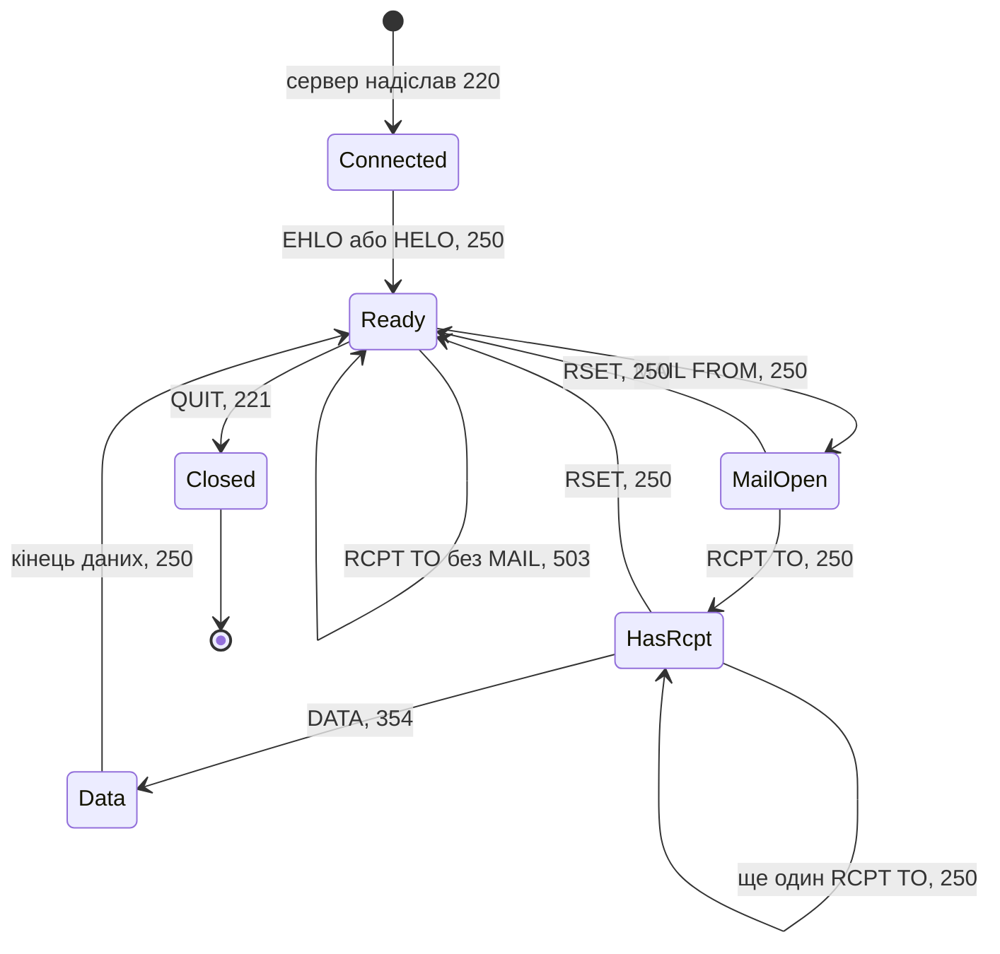

Діаграма читається так. Після з'єднання сервер надсилає привітання з кодом 220, і сеанс переходить у стан `Connected`. Команда `EHLO` або `HELO` ініціалізує сеанс (`Ready`). Команда `MAIL FROM` відкриває транзакцію (`MailOpen`), одна або кілька команд `RCPT TO` додають одержувачів (`HasRcpt`), а команда `DATA` з відповіддю 354 переводить сервер у приймання тексту листа. Рядок, що складається з однієї крапки, завершує дані, і після відповіді 250 сеанс повертається в `Ready`. Команда `RSET` скасовує відкриту транзакцію. Петля на стані `Ready` показує заборонений перехід: команда `RCPT TO` без попередньої `MAIL FROM` отримує відповідь 503 і не змінює стану.

### 4.3. Алгоритм вилучення автоматних переходів із тексту

Специфікації описують автомати у двох формах. Перша форма складається з явних таблиць переходів або діаграм із колонками «поточний стан», «команда», «наступний стан», «код відповіді»; такі таблиці аналізатор таблиць перекладає у функцію $\delta$ безпосередньо. Друга форма складається з речень про порядок дій, розкиданих по тексту. У RFC 5321 екстрактор знаходить чотири типи таких речень:

- **Передумова.** *«A session that will contain mail transactions MUST first be initialized by the use of the EHLO command»* (розділ 4.1.4): перехід `MAIL FROM` можливий лише зі стану, досяжного після `EHLO`.
- **Заборона в стані.** *«MAIL (or SEND, SOML, or SAML) MUST NOT be sent if a mail transaction is already open»* (розділ 4.1.4): у станах `MailOpen` і `HasRcpt` клієнтові заборонено надсилати `MAIL FROM`.
- **Скидання.** *«This command specifies that the current mail transaction will be aborted»* (розділ 4.1.1.5 про `RSET`): з кожного стану транзакції існує перехід назад у `Ready`.
- **Реакція на порушення.** Речення про `RCPT` без `MAIL` з розділу 3.3, розглянуте вище, задає для забороненого переходу код відповіді 503.

Для кожного стану екстрактор обчислює множину допустимих команд:

<a id="obj-15-19"></a>

**Формула (15.19). Множина підтверджених наступних команд**

```math
\mathrm{ValidNext}(s) = \{ e \in \Sigma \mid \delta(s, e) \in S \}
```

Параметри та компоненти множини:

- $s \in S$ є активним дискретним станом скінченного автомата $`\mathcal{M}`$;
- $\Sigma$ є повним скінченним алфавітом подій або команд протоколу;
- $e \in \Sigma$ — окрема вхідна команда чи транзакційна подія;
- Умова належності результату до $S$ відсікає і заборонені ($\bot$), і невідомі ($?$) переходи;
- $`\mathrm{ValidNext}(s) \subseteq \Sigma`$ — набір підтверджених дозволених команд у стані $s$, а не доказ вичерпності всіх команд специфікації.

Практичне застосування та інженерні висновки:
- **Контроль відомих переходів:** у навчальному алфавіті `MAIL`, `RCPT`, `HELP` для `Ready` множина містить тільки `MAIL`; для `RCPT` відома заборона, а для `HELP` бракує моделі. Останні два випадки мають різні діагностики.
- **Межа дії:** заборону, код відповіді й наступний стан реакції задають окремо за застосовним правилом протоколу. Відсутність дозволу в нашій неповній таблиці не доводить порушення реалізацією стандарту.

Екстрактор також зберігає для кожного переходу та кожної заборони кортеж доказової прив'язки до відповідного речення.

### 4.4. Автоматизована генерація негативних тестів

Негативний тест потребує перевіреної заборони, а не лише відсутності команди в таблиці. Для пари з результатом $\bot$ спочатку будують шлях до початкового стану тесту, потім надсилають команду й порівнюють реакцію з обов'язком конкретного учасника. Для результату $?$ готують завдання уточнення моделі. Важливо не підмінити клієнтську заборону серверним обов'язком; це показують три сценарії за RFC 5321.

<a id="obj-15-20"></a>

**Таблиця 15.20. Нормативні очікування трьох SMTP-сценаріїв**

| Стан | Команда поза порядком | Норма RFC 5321 | Очікування тесту |
|---|---|---|---|
| `Ready` | `RCPT TO` | розділ 3.3: сервер MUST повернути 503 | рівно 503; інший код означає порушення обов'язкової вимоги |
| `Ready` або `MailOpen` без прийнятого `RCPT` | `DATA` | розділ 3.3: сервер MAY повернути 503 або 554 | ці коди дозволені; інший результат оцінюється за рештою застосовних норм, не за самим MAY |
| `MailOpen` або `HasRcpt` | `MAIL FROM` | розділ 4.1.4: клієнт MUST NOT надсилати | тест перевіряє клієнта: клієнт не повинен надіслати команду |

Таблиця показує, що автомат без модальності дав би неправильні тести. Якби екстрактор записав обидві норми розділу 3.3 як однаково обов'язкові, тест провалив би сервер, який законно відповідає на `DATA` іншим кодом помилки.

Повнота автомата обмежена повнотою тексту. Розділ 4.1.4 дозволяє команди NOOP, HELP, EXPN, VRFY і RSET *«at any time during a session»*. Якщо екстрактор не додасть для цих команд петлі в усіх станах, генератор тестів вважатиме їх порушенням порядку й видасть хибні результати. Тому автомат, вилучений з тексту, перевіряє інженер, а розбіжності між автоматом і реальними журналами сеансів стають кандидатами на уточнення.

### 4.5. Патерни виявлення автоматних переходів у нормативному тексті

На практиці інженерні специфікації описують автомати неоднорідно. Сучасний екстрактор поведінки реалізує чотири взаємодоповнюючі евристичні стратегії виявлення переходів $\delta(s, e) = s'$:

1. **Стратегія A (Явні прозові предикати):** Речення з прямим причинно-наслідковим дієсловом переходу:
   <details>
   <summary>Дані або результат прикладу</summary>

   ```text
   "Upon receiving {Event}, the entity transitions from {SourceState} to {TargetState}."
   "The system enters {TargetState} after completing {Event} while in {SourceState}."
   ```

   </details>

2. **Стратегія B (ASCII-діаграми та стрілкові графи):** Багато специфікацій IETF та апаратних даташитів малюють графи символами псевдографіки:
   <details>
   <summary>Дані або результат прикладу</summary>

   ```text
   CONNECTED --------[ EHLO / 250 ]--------> READY
   READY ------------[ MAIL / 250 ]--------> MAIL_OPEN
   ```

   </details>

   Парсер виділяє стрілкові маркери (`--->`, `==>`, `->`), витягує сутності ліворуч і праворуч як стани, а підпис над стрілкою трактує як кортеж `Event / Action`.
3. **Стратегія C (Пайп-таблиці станів):** Таблиці у форматі Markdown або plain-text із колонками `Current State | Trigger / Event | Next State | Output`:
   Табличний аналізатор безпосередньо заповнює матрицю переходів автомата.
4. **Стратегія D (Модальні тригери переходу):** Речення з імперативними вимогами модальності MUST:
   <details>
   <summary>Дані або результат прикладу</summary>

   ```text
   "In the {SourceState} state, the client MUST transition to {TargetState} upon {Event}."
   ```

   </details>


Тут набуває чинності сформульований автором **принцип непридатності сліпої мінімізації Хопкрофта для протокольних автоматів із виходами**: для повного детермінованого автомата розпізнавання класичний алгоритм Хопкрофта зберігає прийняту мову [[14]](#src-14), проте для протокольних моделей із виходами, часовими межами та деонтичними анотаціями сліпа мінімізація є неприпустимою, оскільки еквівалентність зобов'язана враховувати коди відповідей, умови переходів та їхні нормативні наслідки; злиття станів лише за схожістю назв руйнує доказову базу. Відсутній у неповній моделі перехід не є доведено забороненим; перед негативними тестами потрібні межа повноти й перевірена норма.

> [!NOTE]
> **Чотири евристичні стратегії автоматизованого вилучення протокольних автоматів із тексту**
> 1. Парсинг причинно-наслідкових предикатів: виявлення речень із прямим дієсловом переходу («Upon receiving... transitions to...»).
> 2. Розпізнавання ASCII-діаграм станів: виділення стрілкових маркерів (`--->`, `==>`) із текстових специфікацій та даташитів.
> 3. Пряма трансляція матриць переходів: синтаксичний розбір пайп-таблиць із колонками поточного стану, тригера, наступного стану та виходу.
> 4. Селекція деонтичних тригерів: виявлення імперативних вимог модальності MUST для визначення обов'язкових цільових переходів.
> *Керування рантаймом / Інженерний інваріант:* заборонені переходи ($\bot$) автоматично транслюються в негативні тестові сценарії для перевірки реакції контролера на стенді.

---

## 5. Формальні граматики: ABNF-екстракція та компіляція синтаксичних дерев

Мережеві протоколи, сервісні інтерфейси та файлові формати описують структуру своїх повідомлень формальними граматиками. У стандартах IETF серії RFC для цього слугує розширена форма Бекуса-Наура (**ABNF, Augmented BNF**), визначена стандартом RFC 5234 [[3]](#src-3).

Після перевірки порядку команд потрібно перевірити форму кожної команди: правильний стан не виправляє пропущеного аргументу. ABNF є одним способом побудувати цей валідатор, але не єдиним. У правилі HELO з §3 потрібні літерал `HELO`, пробіл, домен і кінець рядка; валідний синтаксис не доводить, що команду дозволено в поточному стані.

<a id="obj-15-21"></a>

**Діаграма 15.21. Конвеєр компіляції ABNF-граматик у синтаксичні аналізатори**

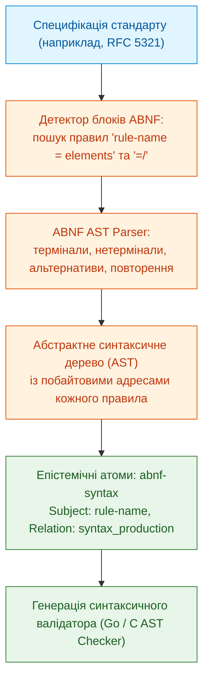

### 5.1. Структурні елементи вилученого правила ABNF

Щоб відновити правило без втрати альтернатив, аналізатор розрізняє означення, доповнення та повторення. Термінал є конкретним символом або літералом, нетермінал посилається на інше правило, а AST є деревом цих операцій:
- **Базове визначення (`=`):** `Reverse-path = Path / "<>"`
- **Інкрементна альтернатива (`=/`):** дозволяє розширювати правило в наступних документах або додатках без перезапису всього правила.
- **Діапазони та повторення:** `1*digit`, `[ CFWS ]`, `%d32-126`.

Екстрактор формує кандидат `abnf-syntax`; наведене подання ще не має перевірених координат і не допускається до пакета.

<details>
<summary>Кандидат граматичного правила без вигаданих координат</summary>

```json
{
  "id": "rfc5321:abnf:Reverse-path",
  "subject": "Reverse-path",
  "relation": "syntax_production",
  "value": "Path / \"<>\"",
  "source": "rfc5321",
    "source_span": null,
    "status": "candidate"
}
```

</details>

Прив'язка має встановити фрагмент правила, його продовження й імпорти. Виявлення рядка `rule-name =` не замінює розбору всієї граматики та правил регістру її літералів.

Для навчальної перевірки `HELO example.org` із завершенням CRLF задовольняє наведену структуру за умови коректного `Domain`, а `HELO` без аргументу ні. Нерозв'язаний імпорт `Domain` блокує випуск валідатора: він не означає «будь-який рядок». Після синтаксису потрібна ще типізація величин, бо граматично правильне число може мати неправильну одиницю.

---

## 6. Нормалізація структурованих параметрів та фізичних величин

Інженерні документи містять числові параметри: час очікування, довжину повідомлення, температуру, напругу й частоту. Частку кількісних вимог потрібно виміряти на конкретному корпусі; універсального відсотка глава не встановлює.

Якщо система трактує рядок `"тайм-аут становить 5 хвилин"` як неструктурований текст, вона не зможе відповісти на запитання: *«Чи порушує сервер вимогу, якщо він очікує відповіді 250 секунд?»*.

### 6.1. Математична модель приведення до одиниць СІ

Щоб порівняти 250 секунд із п'ятьма хвилинами, потрібні одна шкала й напрям нерівності. Екстрактор формує кандидат **`structured-quantity`**; наведений атом зберігає числове ядро, а модальність, область і винятки залишаються в пов'язаному фреймі:

<a id="obj-15-22"></a>

**Формула (15.22). Кандидат нормалізованого кількісного обмеження**

```math
\mathcal{Q} = \langle \text{Parameter}, \; \text{Operator}, \; \text{Value}_{\text{norm}}, \; \text{BaseUnit}, \; \text{RawQuote} \rangle
```

Параметри та нормалізаційні складники:

- $`\mathcal{Q}`$ є типізованим кандидатом кількісного обмеження, не автоматично схваленою нормою;
- $`\text{Parameter} \in \mathcal{P}`$ є канонічним ідентифікатором фізичної або протокольної величини в онтології (наприклад, `bms:max_cell_voltage`, `smtp:command_timeout`);
- $`\text{Operator} \in \{ =, \le, \ge, <, >, \in [a, b] \}`$ позначає алгебраїчний оператор порівняння або належності діапазону;
- $`\text{Value}_{\text{norm}}`$ — дійсне число для скалярного порівняння або впорядкована пара дійсних меж $`(a,b)`$, де $a\le b$, для належності інтервалу; обидві межі приведено до тієї самої одиниці. Тип значення визначається оператором;
- $`\text{BaseUnit} \in \mathcal{U}_{\mathrm{SI}} \cup \mathcal{U}_{\mathrm{std}}`$ — канонічна розмірність (секунда $`\text{s}`$, байт $`\text{B}`$, герц $`\text{Hz}`$, вольт $`\text{V}`$, октет $`\text{octet}`$);
- $`\text{RawQuote}`$ — точний підрядок вихідного тексту першоджерела, закріплений побайтовою адресацією $`\mathcal{E}`$.

Практичне застосування та інженерні висновки:
- **Автоматизоване розв'язання нерівностей:** завдяки зведенню до єдиної шкали $`\text{BaseUnit}`$ рушій формальних методів (SMT/Z3) перевіряє нерівності безпосередньо. Якщо специфікація вимагає $`\text{Value}_{\text{norm}} \ge 300{,}0\,\text{s}`$, а в конфігурації прошивки закладено $`250\,\text{s}`$, розв'язувач миттєво генерує доказ порушення допуску.
- **Fail-safe валідація префіксів:** діє сформульоване автором **інженерне правило нормалізації двійкових та десяткових префіксів за IEC 80000-13**: будь-які неоднозначні десяткові чи двійкові префікси (наприклад, `1 Mbps` як $`10^6\,\text{bit/s}`$ проти $`2^{20}\,\text{bit/s}`$) вимагають обов'язкової нормалізації відповідно до стандарту IEC 80000-13 [[28]](#src-28); у разі невизначеності шлюз допуску блокує величину до підтвердження інженером.

<a id="obj-15-23"></a>

**Таблиця 15.23. Навчальні оператори й одиниці числових обмежень**

| Вихідне формулювання в стандарті | Вилучений оператор | Нормалізоване значення | Канонічна одиниця |
|---|:---:|:---:|:---:|
| *"Server MUST wait at least 5 minutes"* | $\ge$ | `300.0` | `s` (секунда) |
| *"Maximum command length is 512 octets"* | $\le$ | `512` | `octet` (вісім бітів) |
| *"CAN bus bit rate shall not exceed 1 Mbps"* | $\le$ | `1000000` | `bit/s` (десятковий префікс M) |
| *"Operating temperature is at least -40 °C and at most +85 °C"* | $\in [-40, +85]$ | `[-40, 85]` | `°C` (градус Цельсія) |

Рядки таблиці є навчальними формулюваннями, не дослівними нормами одного стандарту. Нормалізація зберігає первісну одиницю, точне десяткове значення й оператор. Octet не замінюють на byte без установленої ширини байта; швидкість бітів не ототожнюють із швидкістю символів у бодах. Для температур потрібне афінне перетворення, а для неоднозначного «between» автор має підтвердити включення меж. Теорію й засоби перевірки одиниць описує [Глава 14](ch14-requirements-detection-and-formalization.md).

Завдяки нормалізації символьний рушій здатен автоматично розв'язувати системи нерівностей під час верифікації вимог: $`250\ \text{s} < 300\ \text{s} \implies`$ **Порушення мінімального тайм-ауту**.

Покроково: одна хвилина містить 60 секунд, тому 5 хвилин дають 300 секунд; для вимоги «чекати щонайменше» 250 секунд бракує 50 секунд. Для R-15 напрям протилежний: 150 мс дають 0,150 с, і відповіді за 0,149 с та 0,150 с задовольняють верхню межу, а 0,151 с ні, якщо режим робочий і виняток не діє. Ці арифметичні порівняння не враховують похибку вимірювання: для реального тесту потрібні визначення початку/кінця інтервалу та точність годинника. Однакові числа без умов не дають однакового вердикту; далі розглянуто саме винятки.

---

## 7. Деонтичні винятки та умови скасування норм (Defeaters)

Винятки потрібні, щоб не застосувати правильну числову межу в неправильному випадку. У R-15 обов'язок обмежений робочим режимом, а погоджене обслуговування його скасовує у визначеній області. Перед розбором потрібно відрізнити початкову умову застосовності від обставини, яка перемагає вже застосовне правило. Частку таких норм у корпусі тут не оцінено.

Екстрактор деонтичних винятків шукає специфічні синтаксичні конструкції:
- `UNLESS` (*«крім випадків, коли...»*);
- `EXCEPT WHEN` (*«за винятком ситуації...»*);
- `PROVIDED THAT` (*«за умови, що...»*);
- `EXCLUSIVE OF` (*«виключаючи...»*).

Тут діє сформульований автором **принцип семантичної дисоціації передумови застосовності та умови скасування**: виняток (*defeater*) слід принципово відрізняти від предикатної передумови (*precondition*). Зворот `provided that` найчастіше звужує початкову область застосовності правила, тоді як конструкції `UNLESS` чи `EXCEPT WHEN` скасовують уже активовану норму при виникненні аномальних обставин; змішування цих категорій руйнує логічну структуру графа виведення. Область заперечення й охоплену дію перевіряють окремо. Приклад нижче є **синтетичною політикою сервісу**, не винятком із RFC 5321; для команд RCPT не слід вигадувати режим, що дозволяє обійти попередню MAIL.

<details>
<summary>Навчальний кандидат винятку з явним джерелом політики</summary>

```json
{
    "id": "example-policy:exc:latency",
    "subject": "response_latency",
    "relation": "exception_clause",
    "value": "Latency limit applies unless an approved exception covers this release and report",
    "defeater_condition": "approved_exception_matches_release_and_report",
    "source": "synthetic-project-policy",
    "source_span": "to_be_grounded",
    "status": "candidate"
}
```

</details>

Не встановлений стан винятку залишається невідомим. Спрацьовування допустиме лише за перевіреної застосовності й схвалення, а не за наявності слова `unless`. Координати джерела не заповнюють умовними числами; до прив'язки приклад не є допущеним знанням.

Для R-15 послідовність рішення така: встановити робочий режим, перевірити чинне погодження обслуговування для потрібного сервера й часу, лише потім порівняти тривалість із 150 мс. Відповідь за 160 мс без винятку порушує навчальну межу; за підтвердженого винятку ця норма не дає негативного висновку. Якщо статус погодження невідомий, остаточний висновок відкладається, а не припускає відсутності винятку. Те саме погодження може змінитися між редакціями: це підводить до версійності.

---

## 8. Версійність інженерних документів: заміщення, оновлення та виправлення

Жоден стандарт не існує окремо від своїх попередників і наступників. Нові редакції скасовують старі, оновлення змінюють окремі розділи, а записи про помилки виправляють дефекти тексту. Якщо фрагменти різних редакцій лежать в одному індексі без позначки версії, механізм пошуку поверне скасовану норму з тією самою впевненістю, що й чинну.

<a id="obj-15-24"></a>

**Діаграма 15.24. Граф версій специфікації SMTP**

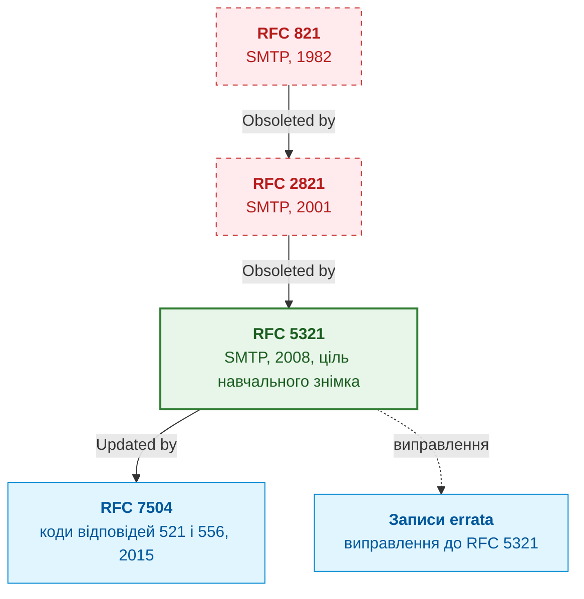

Історія SMTP добре ілюструє ці відношення. RFC 821, опублікований Джоном Постелом 1982 року [[15]](#src-15), скасовано RFC 2821 2001 року, який одночасно скасував RFC 974 і RFC 1869 [[16]](#src-16). RFC 2821 своєю чергою скасовано RFC 5321 [[2]](#src-2). RFC 7504 не замінює RFC 5321, а оновлює його, додаючи коди відповідей 521 і 556 [[17]](#src-17). До RFC 5321 також опубліковано записи про помилки з різними статусами: частину перевірено (*Verified*), а частину відкладено до наступного перегляду документа (*Held for Document Update*) [[18]](#src-18). Експертна система не може застосовувати їх однаково: перевірене виправлення уточнює, як читати норму, а відкладене лише фіксує зауваження до наступної редакції.

Граф версій розрізняє повне заміщення (*Obsoletes*), часткове оновлення (*Updates*) і виправлення (*Errata*). Позначення застарілості (*Deprecates*) є окремим предметним відношенням; його наслідки визначає конкретна норма, а не універсальна заборона використання. Нижче наведено обмежену навчальну політику статусу правила $P$ для редакції $V$: усі події вже перевірені на застосовність, а скасоване правило з тим самим ідентифікатором не вводиться повторно.

<a id="obj-15-25"></a>

**Формула (15.25). Статус правила в незмінному навчальному знімку**

```math
\mathrm{Status}(P, V) = \begin{cases}
\mathrm{Obsolete}, & \text{якщо } \exists D \in \mathrm{Lineage}(V) : \mathrm{Revokes}(D, P), \\
\mathrm{Deprecated}, & \text{інакше, якщо } \exists D \in \mathrm{Lineage}(V) : \mathrm{Deprecates}(D, P), \\
\mathrm{Active}, & \text{інакше, якщо } \exists D \in \mathrm{Lineage}(V) : \mathrm{Defines}(D, P), \\
\mathrm{Unknown}, & \text{в інших випадках}.
\end{cases}
```

Параметри та булеві предикати версійності:

- $`P \in \mathcal{R}_{\mathrm{rules}}`$ є конкретною інженерною нормою, фактом або правилом, що претендує на статус чинності;
- $`V \in \mathcal{V}_{\mathrm{versions}}`$ позначає цільовий знімок версії середовища або редакцію нормативного пакета;
- $`\mathrm{Lineage}(V) \subseteq \mathcal{D}`$ є множиною документів, включених до незмінного цільового знімка $V$ і пов'язаних із його редакцією відношеннями спадкоємності; документи, записані після transaction-time cutoff цього знімка, до множини не входять;
- $`\mathrm{Revokes}(D, P)`$ — бінарний предикат, істинний, якщо документ $D$ явно скасовує або анулює правило $P$;
- $`\mathrm{Deprecates}(D, P)`$ — предикат переведення правила в застарілий статус із визначеним строком виведення з експлуатації;
- $`\mathrm{Defines}(D, P)`$ — предикат нормативної декларації правила в документі $D$;
- $`\mathrm{Status}(P, V) \in \{\mathrm{Active}, \mathrm{Deprecated}, \mathrm{Obsolete}, \mathrm{Unknown}\}`$ — детермінований статус правила.

Практичне застосування та інженерні висновки:
- **Шлюз чинності правил:** рушій логічного виведення має право використовувати правило $P$ для формування доведень відповідності лише тоді, коли $`\mathrm{Status}(P, V) = \mathrm{Active}`$.
- **Карантин скасованих норм:** якщо правило набуває статусу $`\mathrm{Obsolete}`$, воно негайно вилучається з активного графа знань і зберігається виключно в історичному архіві для аудиту старих релізів. Будь-яка спроба послатися на скасовану норму під час поточної сертифікації блокується подією `E_OBSOLETE_RULE_USAGE`.

За цієї політики скасування має пріоритет у межах знімка. Пізніше записане відкликання не переписує заднім числом $`\mathrm{Status}(P,V)`$ для історичного знімка; у новому знімку статус обчислюється повторно з його власним складом документів і cutoff. Якщо предметна модель дозволяє повторне введення правила, наведена формула недостатня: потрібні впорядковані події визначення, заміни й скасування, межі області та пріоритети джерел. Непорівнянні конфліктні зміни потребують перегляду. $`\mathrm{Unknown}`$ не прирівнюється до активного стану й не компенсується збігом цитати.

Для навчального знімка V1 документ A визначає R-15, тому перша застосовна гілка формули є `Active`. У V2 включено також документ B, який явно скасовує R-15: спрацьовує перша гілка `Obsolete`, навіть якщо A збережено. Для неописаної R-16 немає жодної події, отже результат `Unknown`. Так перевіряється алгоритм пріоритетів, але не встановлюється поточний статус зовнішнього стандарту. Останній потребує актуального реєстру й предметного профілю.

Тут діє сформульований автором **принцип неавтоматичного переносу чинності при повторній прив'язці (Re-grounding Principle)**: повторна прив'язка (*re-grounding*) створює виключно кандидата семантичної відповідності між редакціями, але в жодному разі не переносить чинності норми автоматично. Незмінне формулювання тексту в новій редакції може опинитися в незобов'язуючому інформаційному додатку, отримати нову предикатну передумову в заголовку глави або критичний виняток у сусідньому підпункті. Тому факт визнається дійсним лише після повторного проходження шлюзу допуску та підтвердження незмінності його регуляторного контексту; стара редакція лишається в історичному архіві.

### 8.1. Секційні патчі спадкоємності та точкова резолюція оновлень

Оновлення окремого розділу потребує вужчої операції, ніж повне заміщення документа. Наприклад, редактор має правильно розпізнати такі форми повідомлення про зміну:
- *«Updates Section 4.2.1 of RFC XXX»*;
- *«Replaces Section 3.1: New State Transition Logic»*;
- *«Amends Paragraph 4 of ISO 26262-6 Clause 7»*.

Повторний розбір усього корпусу може бути дорогим, але сам по собі не спричиняє комбінаторного вибуху. Інкрементальне збирання скорочує роботу лише за правильної карти залежностей: зміна винятку R-15 змінює допуск правила, хоча цитата з межею 150 мс залишилась незмінною.

Для інкрементальної обробки можна спроєктувати **обробник оновлень розділів**. Це архітектурна пропозиція, не готова універсальна реалізація. Кандидат `section-patch` має називати редакції, вузол дерева розділів, вид зміни й підставу. Наступний запис є синтетичним прикладом форми, не перевіреним тлумаченням RFC 7504.

<details>
<summary>Синтетичний кандидат оновлення розділу</summary>

```json
{
    "id": "example-update:patch:sec-4.2",
  "subject": "rfc5321:section:4.2",
  "relation": "section_patch",
  "target_document": "rfc5321",
  "target_section": "4.2",
  "patch_action": "amends",
  "patch_scope": "adds response codes 521 and 556",
    "source": "synthetic-section-update",
    "source_span": null,
    "status": "candidate"
}
```

</details>

Обробник знаходить вузли за структурним шляхом: префікс рядка `4.2` не має захопити розділ `4.20`. Потім обчислює залежності визначень, правил, автоматів і індексів. Тип `Updates` сам не означає простого додавання: оновлення може звузити дозвіл, змінити виняток або скасувати частину поведінки. Таку дельту класифікують і перевіряють до нового випуску. Для приймання інкрементальний результат порівнюють із повним повторним збиранням за тим самим маніфестом; відмінності потребують пояснення або блокують випуск.

Факти, автомати й граф версій треба зберігати так, щоб кожен тип запиту виконувався ефективно. Цьому присвячено наступний розділ.

## 9. Архітектура сховища бази знань: мультимодельний підхід

Розгляньмо три типи запитів до бази знань. Перший тип фільтрує факти за суб'єктом, відношенням чи модальністю. Другий тип проходить транзитивні зв'язки: ланцюжок заміщень, простежуваність від вимоги до тесту, шлях в автоматі. Третій тип читає незмінний знімок бази під час виведення. Наведена архітектура поєднує три подання, але не вимагає трьох окремих технологій зберігання: реляційна база також може виконувати рекурсивні запити, а потребу в бінарному пакеті встановлює вимірювання навантаження.

<a id="obj-15-26"></a>

**Діаграма 15.26. Три моделі зберігання бази знань**

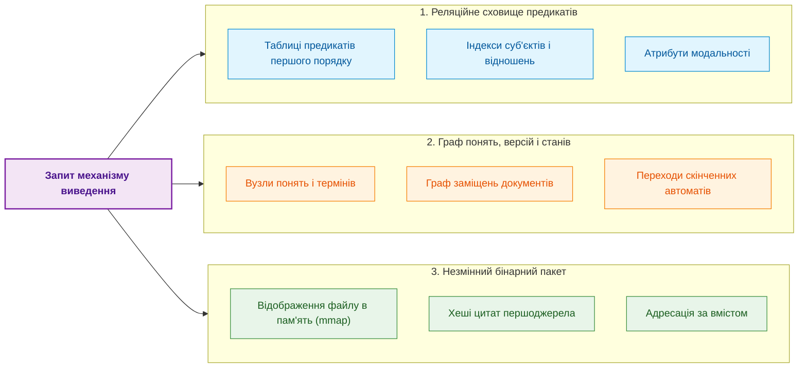

**Реляційне сховище предикатів** зберігає факти першого порядку в таблицях з індексами за суб'єктом і відношенням. Воно обслуговує детерміновану фільтрацію на кшталт «усі обов'язкові вимоги до SMTP-сервера з розділу 3.3».

**Граф понять, версій і станів** зберігає онтологію термінів, граф заміщень і переходи автоматів. На графі природно виконуються транзитивні запити: «чи чинна ця норма в редакції $V$», «чи досяжний стан `Data` без команди `RCPT TO`».

**Незмінний бінарний пакет** є скомпільованим знімком бази знань для механізму виведення. Файл пакета відображається в адресний простір процесу викликом `mmap` [[19]](#src-19), тому механізм виведення читає записи без копіювання й повторного розбору. Ідентифікатором пакета слугує хеш його вмісту: будь-яка зміна знань створює новий пакет із новим ідентифікатором, а кожну відповідь можна зв'язати з точним знімком бази. Час доступу до запису визначає структура індексу всередині пакета, наприклад хеш-таблиця чи відсортований масив, а не сам механізм відображення.

Всі три моделі можна розмістити на одному вузлі. Коли база не вміщується на вузлі або вузли потребують різних профілів знань, її розбивають на шарди, тобто частини, які обслуговують окремі вузли. Ключем розбиття для бази, з якої виводять чинність норм, є родина документів, тобто множина редакцій, пов'язаних графом версій (множина $`\mathrm{Lineage}(V)`$ з розділу про версії документів), бо статус правила обчислюють за усіма документами родини. Якщо редакція зі скасуванням лежить у шарді, що мовчить, статус правила стане $`\mathrm{Active}`$ замість $`\mathrm{Obsolete}`$. Тому відповідь «відсутнє» або статус допускають лише тоді, коли відповіли всі потрібні шарди. Розбиття бази знань не слід плутати з розбиттям тексту для пошуку: структурне розбиття, описане вище, ділить текст на фрагменти тексту, а шардування розміщує на вузлах фрагменти бази знань. Визначення й правила розбиття наведено в [Главі 7](ch07-knowledge-base-typology.md), реалізацію з перевіркою розбиття в розділі 10 [Глави 32](ch32-high-performance-knowledge-packs-mmap-and-harvesting.md).

### 9.1. Високопродуктивний граф знань у пам'яті (CSR) проти зовнішніх графових СУБД

Після вибору логічних подань потрібно оцінити вартість конкретного запиту, наприклад проходу від R-15 до його винятку й редакції. Зовнішня графова СУБД полегшує змінні запити й спільне редагування; резидентне подання скорочує обмін для повторюваних обходів. Вибір роблять за вимірюваннями, а не за назвою продукту. Перевіряють такі витрати:

1. **Мережеві та IPC-витрати:** якщо навчальний послідовний сценарій робить 1000 окремих запитів по 1 мс, лише очікування займає 1 с. Один серверний обхід або пакетний запит має іншу вартість.
2. **Керування пам'яттю:** збирач сміття може впливати на хвостову затримку, але так само впливають блокування, планувальник і завантаження сторінок. Потрібно вимірювати їх у конкретній реалізації.
3. **Серіалізація:** її частку встановлює профілювання конкретного навантаження; сам факт перетворення формату не визначає його вартості.
4. **Втрата прямого зв'язку з першоджерелом:** зовнішня СУБД зберігає записи у власних форматах сторінок; відтворюваність цитати тоді залежить від окремо збережених координат і незмінного оригіналу, а не від самого факту розміщення у графовій базі.

#### 9.1.1. Архітектура нульового копіювання: CSR та масиви суміжності

Замість важкої зовнішньої СУБД база знань компілюється у компактний двійковий статичний пакет знань (Knowledge Pack), який проєктується безпосередньо в оперативну пам'ять процесу через системний виклик `mmap(MAP_SHARED)`. Графова структура відношень подається за допомогою компактного формату **стисненого рядкового розрідженого масиву (Compressed Sparse Row, CSR)** або масиву суміжності:

<a id="obj-15-27"></a>

**Діаграма 15.27. Топологія графа знань у незмінному форматі CSR (Zero-Copy)**

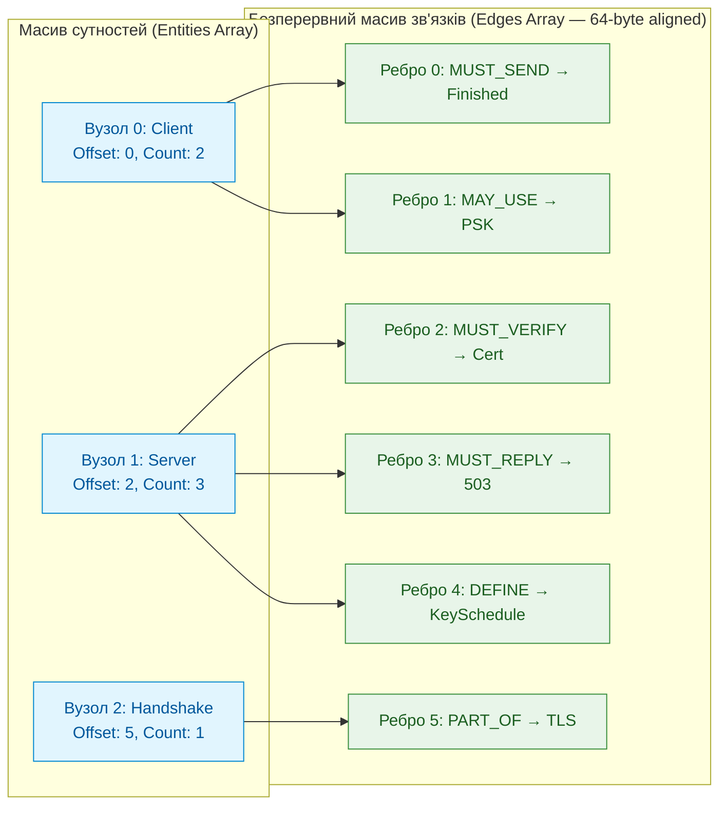

Структура CSR організована трьома неперервними векторами пам'яті:
- $`\mathrm{Entities}[\cdot]`$: плоский масив структур фіксованого розміру (64 байти, вирівняні під рядок процесорного кешу L1/L2), що містить числовий ID поняття, тип і діапазон у масиві ребер: $`(\mathrm{Offset}, \mathrm{Count})`$;
- $`\mathrm{Edges}[\cdot]`$: суцільний масив цільових індексів сутностей і типів зв'язків (деонтична модальність, синтаксичне підпорядкування, каузальність);
- $`\mathrm{EvidencePool}[\cdot]`$: пул незмінних байтових хешів і координат першоджерел, на які посилаються ребра через 32-бітні зміщення.

Переваги такого подання над зовнішніми СУБД:
- **Відсутність повторної десеріалізації:** `mmap` створює відображення, а сторінки можуть підвантажуватися за потребою. Час створення відображення й першого повного обходу вимірюють окремо;
- **Локальність обходу ребер:** суміжні записи читаються послідовно, що може допомогти кешуванню. Пропускну здатність вимірюють із зазначенням розміру графа, запитів, платформи та протоколу;
- **Детермінована локальність пам'яті:** відсутність фрагментації купи та відсутність динамічних вказівників (всі адреси є відносними зміщеннями в межах відображеного бінарного сегмента);
- **Абсолютна цілісність доказів:** кожен запис ребра безпосередньо містить або посилається на незмінні координати першоджерела, уможливлюючи побайтову верифікацію без запитів до сторонніх сервісів.

Три моделі мають генеруватися з одного джерела істини: множини прийнятих фактів із кортежами прив'язки. Якщо реляційне сховище й граф оновлюються незалежно, вони розійдуться, і експертна система почне давати різні відповіді на те саме запитання залежно від маршруту запиту. Архітектуру механізму виведення, який читає ці моделі, розглянуто в [Главі 16](ch16-expert-systems-architecture.md), а стек реалізації в [Главі 17](ch17-implementation-stack.md). Залишається визначити, хто вирішує, які кандидати потрапляють до цих моделей.

> [!NOTE]
> **Чотири інваріанти архітектури нульового копіювання графа знань (CSR Zero-Copy)**
> 1. Посекційне відображення зберігає незмінний двійковий образ; час старту й завантаження сторінок вимірюється окремо.
> 2. Вирівнювання по 64 байти є умовою запропонованого формату, а не універсальною довжиною кеш-лінії всіх процесорів.
> 3. Відносні зміщення перевіряються до доступу: адреса, довжина й їхня сума мають належати секції без переповнення; 32-бітна адресація обмежує діапазон.
> 4. Послідовний обхід суміжності усуває частину непрямих звернень, але не встановлює гарантованої кількості переходів за секунду.
> *Керування рантаймом / Інженерний інваріант:* валідатор формату відхиляє некоректні межі й вирівнювання до доступу до записів; це не автоматична гарантія безпеки від самого `mmap`.

У схемі вузол Server має початок 2 і кількість 3, тому читаються записи 2, 3 і 4, але не 5. Для 64-байтових записів сутностей три вузли потребують 192 байтів без урахування заголовка; обсяг ребер залежить від їхньої окремої схеми. Цей підрахунок перевіряє межі доступу, не вимірює пропускної здатності. Нормативні ребра зберігаються без усічення; пошуковий індекс може бути втратним лише як окреме подання.

### 9.2. Емпіричний досвід суцільної компіляції та універсалізації багатоформатного сховища знань ($15\,972$ пакети, $56\,520$ концептів)

Історія суцільної компіляції показує, які відмови можуть виникати під час побудови бази знань експертної системи на багатоформатному корпусі. Нижче відокремлено авторський опис від 18.10.2026, описи наступних стадій від 19.10.2026 (§9.3) і пізніший опис кодувань від 29.10.2026. Дати позначають описи, а не підтверджені часові мітки виконання всіх прогонів. Це неперевірені історичні агрегати, не навчальні дані й не одна парна серія. Для відтворення потрібні датовані маніфести першоджерел і їхні хеші, версії та конфігурація інструментів, правила дедуплікації й підрахунку пакетів, концептів і ребер, а також машинні журнали. Первинного маніфесту саме прогону, описаного 18.10.2026, не встановлено; повтори його чисел у звітах не є незалежним підтвердженням.

Теоретичні алгоритми видобування знань не можна оцінити лише за невеликою добіркою англомовних документів: потрібні визначені корпус і процедура перевірки. За авторським описом від 18.10.2026 і пов'язаними звітами про доопрацювання книги, було оброблено багатоформатне сховище обсягом **$`47{,}1\text{ ГБ}`$ (`47,130` файлів)** і сформовано `15,972` унікальні бінарні пакети після SHA-256 дедуплікації та бінарний граф онтології розміром **$`64{,}10\text{ МБ}`$** на **`56,520` концептів** і **`1,683,906` CSR-ребер**, включно із секцією стислих даних обсягом **$`32{,}55\text{ МБ}`$**. Ці повідомлені кількості характеризують вихід інструмента; самі по собі вони не вимірюють точності чи нормативної повноти. Їх не замінено пізнішими інвентарями сховища.

У тих самих описах перелічено шість інженерних і мовних середовищ: інтернет-стандарти `IETF RFC` (`9,995` пакетів `.txt`, `1,971,789` правил), корпус законодавства Верховної Ради України (`3,046` унікальних законів `.htm` + `3,051` дзеркальних дублікатів, `95,493` правила), даташити й довідкові керівництва мікроконтролерів та силової електроніки `STM32 / Infineon AURIX / PSoC / TI / Analog Devices / NXP / Intel` (`1,600+` документів `.pdf` та `.html`), веб-стандарти `W3C` (`303` пакети `.html`, `173,338` правил), наукові публікації та звіти `arXiv / NASA NTRS / NIST / PMC` (`.pdf`, `.xml`), а також енциклопедичні XML-дампи `Wikibooks / Wikisource` обсягом до `1,2 ГБ` на файл та історичні книги `Project Gutenberg`. Пакети, документи, дзеркальні копії та правила тут є різними одиницями обліку; без маніфесту їх не можна підсумовувати як однорідний корпус.

В авторських описах перелічено п'ять типів інженерних відмов і відповідні проєктні реакції. Ці історичні повідомлення не є незалежно перевіреною статистикою чи доказом причинного ефекту; таблиця 15.28 не приписує їх одному прогону й не засвідчує усунення дефектів. Для таких висновків потрібні маніфест корпусу, контрольні входи та журнали до й після змін.

<a id="obj-15-28"></a>

**Таблиця 15.28. Повідомлені проблеми масштабування та уточнення рішень**

| № | Виявлена проблема масштабування та універсалізації | Фізична та програмна причина відмови/деградації | Описана проєктна реакція (не підтверджена як усунення проблеми) |
| :--- | :--- | :--- | :--- |
| **1** | **Квадратична деградація фіксації реєстру ($O(N^2)$ Ledger Serialization)** | Перезапис усіх попередніх записів після кожного додавання дає суму від 1 до N. Для N=10 000 це 50 005 000 серіалізованих записів, не понад 100 млн. | Пакетна транзакційна фіксація, наприклад групами по 250; вона зменшує коефіцієнт, але повторний повний перезапис групами сталого розміру не усуває квадратичної асимптотики. |
| **2** | **Переповнення 16-бітного ступеня вершини CSR** | Значення понад 65 535 не вміщується в беззнакове 16-бітне поле. Повторні входження та різні нормативні зв'язки не можна змішувати. | Після хеш-пошуку ідентичність перевіряють за канонічними ключами; агрегують лише тотожні зв'язки зі збереженням усіх підстав. Топ-4096 допустимий як втратний пошуковий індекс, не як повний граф допуску; для нормативного графа потрібне ширше поле або продовження записів. |
| **3** | **Втрата кирилиці через спадкове кодування CP1251** | У пізнішому авторському описі вибіркової сукупності від 29.10.2026 повідомлено про 2168 із 3051 файлів із CP1251, приблизно 71,06 %. Це не незалежне підтвердження причинного ефекту попереднього виправлення. Неправильне декодування створює символи заміни; подальший фільтр може втратити слова. Сам UTF-8 декодер не обов'язково видаляє текст. | Оригінал хешують до будь-якого перетворення; кодування перевіряють за метаданими та вмістом. Похідний UTF-8 артефакт отримує власний хеш, карту перетворення й версію декодера. Неоднозначне визначення кодування потребує уточнення. |
| **4** | **Сліпота межі слова `\b` у рушії регулярних виразів RE2 до кириличної деонтики** | У промислових рушіях регулярних виразів класу RE2 метасимвол `\b` визначений суто для ASCII `[0-9A-Za-z_]`, тому патерн `\b(повинен\|забороняється\|може)\b` дає 0 збігів на українському тексті, оточеному пробілами. | Заміна ASCII-меж `\b` на явні Unicode-межі класів символів `(?:^\|[^\p{L}\p{N}])(...)(?:[^\p{L}\p{N}]\|$)` та перевірка морфологічних варіантів. У повідомленні про ранній прогін заявлено `+14,483` видобутих норм; без однакових входів і решти налаштувань, поелементних виходів та незалежної розмітки цей приріст не є перевіреною виміряною перевагою Unicode-обробки або точності. |
| **5** | **Вичерпання пам'яті на великих PDF та XML** | Завантаження всього файла й складний розбір великих таблиць можуть перевищити бюджет пам'яті; фактичні відмови потребують журналів. | Повний хеш обчислюють потоково до EOF з обмеженим буфером; `io.LimitReader` задає лише частковий хеш, якщо файл довший за ліміт. Для парсера задають окремі ліміти з явним покриттям і відмовами; §9.3 розглядає наслідки усічення. |

> [!NOTE]
> **П'ять проєктних уроків компіляції гетерогенних корпусів першоджерел**
> 1. **Принцип нормалізації кодування до побудови карти зміщень:** однобайтове кодування джерела (`Windows-1251`, `ISO-8859-1`) слід розпізнати й транскодувати до формування текстового представлення та його байтових координат; після перетворення треба зберегти зв'язок із хешем незміненого вихідного файла.
> 2. **Закон інваріантності Unicode-меж у деонтичних парсерах (`Unicode Boundary Invariance`):** компілятори нормативних правил для кириличних та інших не-латинських мов не мають права використовувати ASCII-залежний метасимвол межі слова `\b` у скінченних автоматах RE2; межі деонтичних операторів повинні задаватися виключно через інверсію універсальних категорій Unicode `[^\p{L}\p{N}]`.
> 3. **Принцип обмеженого вікна онтологічної індукції (`Bounded UTF-8 Induction Window`):** при обробці надвеликих документів індукцію термінів `C-value` та побудову таблиці символів можна виконувати на детерміновано обмеженому вікні тексту з розрізом по межі кодової точки UTF-8 та обов'язковим записом покриття (§9.3). Обмеження вікна обмежує робочий набір пам'яті, але не гарантує константного часу повної компіляції: він залежить принаймні від обсягу прочитаних байтів і структури документа.
> 4. **Закон агрегованого стиснення степенів у бінарному графі онтології (`CSR Degree Bounding`):** авторський профіль топ-4096 обмежує ступінь пошукового подання. Нормативний граф не усікають: він зберігає всі різні зв'язки й підстави та використовує перевірене ширше поле або продовження записів.
> 5. **Проєктний принцип відсіву службової лексики без мовних списків (`Dictionary-Free Closed-Class Hygiene`):** структурні ознаки імені та частота в корпусі можуть використовуватися як кандидати на фільтр без окремих переліків слів для кожної мови. Це не гарантує однакової якості на різних мовах і письмах; пороги й помилки класифікації потрібно оцінювати окремо на репрезентативних корпусах.
> *Керування рантаймом / Інженерний інваріант:* Маніфест прогону має перелічувати підтримувані формати, оброблені й відхилені файли та причини відмов. Нуль фатальних помилок є результатом конкретного прогону, який можна стверджувати лише разом із маніфестом; дедуплікація за `SHA-256` застосовується до визначеного набору незмінних байтових артефактів.

### 9.3. Уточнення за результатами повторного прогону: від таблиці службових слів до структурного фільтра та явного покриття

Повторні прогони показують, чому правила фільтрації та облік покриття треба версіонувати окремо. Авторські описи від 19.10.2026 стосуються різних стадій, а не одного парного досліду. Опис структурного фільтра повідомляє, що до перебудови слово «the» було серед сутностей $`38\%`$ із $`655`$ перевірених RFC-пакетів, «other» у $`5{,}6\%`$, «for» у $`3{,}4\%`$; після перебудови ці три слова були відсутні на вибірці $`676`$ пакетів. Різні знаменники не встановлюють поелементної парності. Потрібні ідентифікатори пакетів та оцінка хибного відсіву корисних термінів, перш ніж робити висновок про зміну точності. Фіксована таблиця закритих слів `EN/UK/DE` потребує доповнення для нових мов і письм; у запропонованому автором підході її замінено структурними й корпусними ознаками.

Той самий опис фільтра повідомляє про початкові $`25\,519`$ і створені $`44\,154`$ пакети та підсумок $`69\,671`$. Сума двох наведених кількостей становить 69 673, на два більше від повідомленого підсумку. Причину розбіжності не встановлено; 69 673 є арифметичною перевіркою записаних чисел, не відновленим історичним результатом. Окремий опис очищення від 19.10.2026 наводить $`47\,725`$ змонтованих пакетів після видалення порожніх. Цей підсумок іншої стадії не є знаменником вибірок фільтра й не підміняє знімка з `15,972` пакетами, описаного 18.10.2026. Перехід між усіма цими сукупностями без первинних маніфестів і журналів не відновлено.

В авторських матеріалах про покриття від 19.10.2026 повідомлено, що вікно індукції $`384\text{ КБ}`$ мовчки обмежувало джерела: $`12\,062`$ із $`45\,480`$ текстових першоджерел, близько $`26{,}52\%`$, перевищували це значення. У тому самому описі закон із $`14\text{ МБ}`$ розмітки давав $`49`$ атомів на $`209\text{ КБ}`$ тексту, а повний текст ($`1{,}58\text{ МБ}`$) давав $`293`$; для `RFC 9110` та дев'яти суміжних RFC наведено $`1\,707`$ атомів проти $`14\,589`$. Це неперевірені повідомлення про вихід екстрактора, не розмітка правильних норм. Без запису покриття відмова на запит про норму з відрізаного кінця може бути не відрізнена від відсутності норми.

> [!NOTE]
> **Три принципи структурного фільтра лексикона (за М. М. Федчиком)**
> 1. Відсів ґрунтується на структурних ознаках імені та частоті в корпусі без мовних списків. Це спрощує перенесення, але не доводить однакової точності для всіх мов; потрібні окремі позитивні й негативні еталони.
> 2. Поріг «поширеного слова» задають як частку документів і записують у маніфест кожного пакета; термін, який визначає сам документ, відсіву не підлягає. Авторський опис фільтра від 19.10.2026 повідомляє про поріг $`0{,}80`$ та статистику за $`45\,758`$ текстовими й HTML-документами з окремим обліком письма; це конфігурація того знімка, не універсально оптимальний поріг.
> 3. Версія фільтра входить до умови пропуску повторної компіляції: пакети, зібрані іншим правилом, перебудовуються, решта лишається недоторканою, а прогін можна відновити після переривання.
> *Керування рантаймом / Інженерний інваріант:* жодне ім'я не потрапляє в лексикон без відомого правила відбору; поріг відтворюється із запису в маніфесті, а не повторним обчисленням. В описі фільтра від 19.10.2026 повідомлено про відсів $`21{,}05`$ млн імен як нетермінологічних, $`2{,}78`$ млн як поширених у корпусі та $`0{,}60`$ млн залишків предикатів. Ці неперевірені агрегати без поелементної оцінки не визначають точності чи повноти відбору.

> [!NOTE]
> **Три вимоги до фіксації покриття першоджерела (за М. М. Федчиком)**
> 1. Пакет зберігає, скільки байтів тексту отримав конвеєр до обрізання, скільки використав, які ліміти діяли і чи було обрізання; для PDF додатково кількість сторінок документа й витягнутих сторінок. Обрізання не може бути мовчазним.
> 2. Хеш оригіналу й похідного тексту зберігаються окремо. Пропуск повторної компіляції потребує збігу повного маніфесту залежностей: джерел, перетворень, покриття, схем, правил і схвалень. Збіг лише одного хешу не дозволяє перенести старе походження на новий оригінал.
> 3. Аудит звітує частку усічених пакетів і найбільші втрати, але не вважає усічення порушенням збереження доказів: покриття є властивістю походження, а не помилкою цитування.
> *Керування рантаймом / Інженерний інваріант:* відмова за усіченим джерелом не повинна виглядати як відсутність норми. Опис покриття від 19.10.2026 пов'язує ліміти $`4\text{ МіБ}`$ тексту та $`32\text{ МіБ}`$ читання зі знімком із $`53\,963`$ пакетами й повідомляє про зміну кількості атомів із $`7\,030\,932`$ до $`10\,122\,410`$ ($`+44\%`$ після округлення). Запис покриття мали $`51\,838`$ пакетів; серед них $`1\,127`$ усічених ($`2{,}2\%`$), за описом переважно дампи, а не нормативні документи. Це неперевірені агрегати іншої стадії, не результат очищення до $`47\,725`$ пакетів. Без зіставних входів, конфігурацій та первинних виходів не встановлено, яка частина приросту спричинена саме зміною лімітів.

З наведених чисел можна перевірити арифметику, але не якість екстракції: 12 062 із 45 480 становлять приблизно 26,52 %, а приріст атомів 3 091 478 становить близько 43,97 % від 7 030 932. Повідомлені 1127 усічених пакетів мають окремий знаменник 51 838 пакетів із записом покриття: частка становить близько 2,1741 %, тобто 2,2 % після округлення до десятих. Ці знаменники не взаємозамінні й не підміняють кількості файлів першого прогону. Зростання числа атомів може містити й дублікати або хибні кандидати. Покриття прочитаних байтів не дорівнює повноті вилучених норм; навіть повністю прочитане речення може бути неправильно розібрано. Для R-15 перевіряють окремо збереження умови, винятку й одиниці, а далі передають кандидат шлюзу.

## 10. Шлюз допуску фактів: верифікація та попперівський фільтр

Конвеєр видає кандидатів, частина з яких хибна: екстрактор помилився з модальністю, модель запропонувала парафраз, новий факт суперечить чинному правилу. Шлюз допуску (*admission gate*) перевіряє кандидата за версійованою політикою. Автоматичні перевірки відтворювані, а предметне схвалення надходить як окремий підписаний запис рецензії. Успішні перевірки ще не публікують факт: доступ до факту змінює процедура випуску пакета.

<a id="obj-15-29"></a>

**Діаграма 15.29. Перевірки шлюзу допуску**

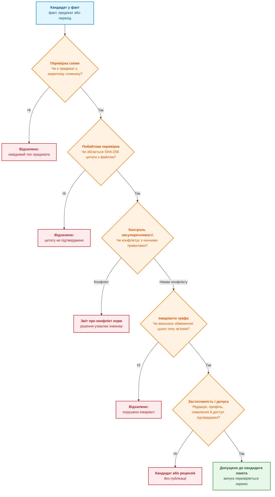

Діаграма показує п'ять груп перевірок. Перевірка схеми встановлює типи й дозволені предикати; перевірка джерела відтворює прив'язку до незмінного артефакту. Контроль несуперечливості формує звіт для інженера, а не приховує суперечність між джерелами. Інваріанти графа залежать від відношення: порядок заміщення редакцій може вимагати ациклічності, тоді як автомат сеансу закономірно має цикли. Цикл підкласів також не обов'язково є логічною суперечністю. Транзитивний обхід циклічного графа з множиною відвіданих вузлів має визначений зміст; забороняти потрібно порушення конкретної схеми, а не всі цикли. Остання група перевіряє паспорт об'єкта знань із [Глави 10](ch10-knowledge-acquisition-systems.md): застосовність, схвалення, доступ і залежності. Невідомий результат перевірки не прирівнюється до успіху.

### 10.1. Керована генерація через GBNF-граматики та попперівське самоспростування

Керована генерація розв'язує вузьку задачу: отримати кандидат R-15 у формі, яку читає програма. Вона не гарантує повноти мовної моделі. Частку синтаксичного браку 3–7 % без зазначеного корпусу й версії декодера тут не підтверджено. JSON розбирають структурним парсером, а граматика генерації додатково обмежує можливі продовження до синтаксично дозволених.

Сучасна архітектура заземлення знань застосовує **граматично-скероване декодування (Grammar-Constrained Decoding / GBNF Logit-Masking)** безпосередньо в циклі генерації токенів:

<a id="obj-15-30"></a>

**Формула (15.30). Нормовані ймовірності дозволених граматикою токенів**

```math
P(v\mid w_{<t},G)=\frac{\exp((z_{t,v}+M(v,g_t))/\tau)}{\sum_{u\in V}\exp((z_{t,u}+M(u,g_t))/\tau)}.
```

**Параметри та інженерні обмеження:**
- $V$ — скінченний словник декодера; $`u,v\in V`$ його токени, $`t\ge1`$ цілий номер кроку, $`w_{<t}`$ уже отриманий префікс;
- $`z_{t,v}\in\mathbb R`$ — логіт токена v; $`\tau>0`$ безрозмірна температура, у прикладі 1;
- $G$ — граматика, $`g_t`$ стан її розпізнавача після префікса; для вкладених структур це не обов'язково лише скінченний автомат;
- $`M(v,g_t)`$ дорівнює 0 для дозволеного продовження й мінус нескінченності для забороненого; принаймні один токен має бути дозволений, інакше декодування завершується діагностикою, а не діленням на нуль;
- $P$ — безрозмірна умовна ймовірність від 0 до 1. Жадібний вибір найбільшого дозволеного логіта є окремим алгоритмом; не слід підставляти нульову температуру в цю формулу.

**Операційні переходи та практичний приклад:**
- Маска виключає заборонені продовження за умови коректної реалізації граматики, токенізації та зупинки. Це не виключає вибору синтаксично допустимого, але хибного `MAY` замість `MUST`.
- Числовий розрахунок: для поля модальності модель розглядає $`t_1`$ (`"MUST"`, $`z_1 = 4{,}2`$), $`t_2`$ (`"SHOULD"`, $`z_2 = 3{,}8`$) та некоректний вільний текст $`t_3`$ (`"Maybe"`, $`z_3 = 6{,}5`$). Без маски переміг би токен $`t_3`$ ($`p_3 \approx 0{,}86`$). Автомат граматики активує маску $`M(t_3) = -\infty`$, обнуляючи його ймовірність ($`e^{-\infty} = 0`$). Результуюча ймовірність:
<a id="obj-15-31"></a>

**Формула (15.31). Навчальний розрахунок після логітного маскування**

```math
P(t_1) = \frac{e^{4{,}2}}{e^{4{,}2} + e^{3{,}8} + 0} \approx \frac{66{,}69}{66{,}69 + 44{,}70} = \frac{66{,}69}{111{,}39} \approx 0{,}599.
```
Тут $`t_1,t_2,t_3`$ позначають три спрощені однотокенні альтернативи, а не обов'язково реальну токенізацію слів. Після маски ймовірності першої й другої альтернатив приблизно 0,599 і 0,401, третьої 0. Сума дорівнює 1, але друга альтернатива лишається доступною: граматика не доводить потрібної модальності. Остаточний JSON повторно розбирають і зіставляють із джерелом.

<details>
<summary>Навчальна граматика форми кандидата R-15 та відповідний JSON</summary>

Це ілюстрація методу обмеження форми, не реалізація перевірки змісту. Вхід розпізнавача є повним JSON нижче, очікуваний результат — прийняття його структури; підміна `MUST` на дозволене `MAY` має пройти граматику, але не предметну перевірку R-15. Перед використанням у конкретному GBNF-рушії потрібний окремий тест його синтаксису й токенізації.

```bnf
root        ::= "{" ws "\"facts\":" ws "[" ws fact_list? ws "]" ws "}"
fact_list   ::= fact (ws "," ws fact)*
fact        ::= "{" ws
                "\"subject\":" ws string ws ","
                "\"modality\":" ws modality ws ","
                "\"predicate\":" ws string ws ","
                "\"condition\":" ws string ws ","
                "\"defeater\":" ws (string | "null") ws ","
                "\"quantity\":" ws (quantity_spec | "null") ws ","
                "\"verbatim_quote\":" ws string ws
                "}"
modality    ::= "\"MUST\"" | "\"MUST NOT\"" | "\"SHOULD\"" | "\"SHOULD NOT\"" | "\"MAY\""
quantity_spec ::= "{" ws "\"value\":" ws number ws "," "\"unit\":" ws string ws "}"
string      ::= "\"" ([^"\\\x00-\x1f] | "\\" (["\\/bfnrt] | "u" [0-9a-fA-F]{4}))* "\""
number      ::= "-"? ("0" | [1-9] [0-9]*) ("." [0-9]+)?
ws          ::= [ \t\n\r]*
```

```json
{
    "facts": [{
        "subject": "server",
        "modality": "MUST",
        "predicate": "reply",
        "condition": "operating_mode",
        "defeater": "approved_maintenance",
        "quantity": { "value": 150, "unit": "ms" },
        "verbatim_quote": "У робочому режимі сервер повинен відповісти не пізніше ніж за 150 мс, крім випадку погодженого технічного обслуговування"
    }]
}
```

</details>

#### 10.1.1. Двосторонній попперівський гейт ($F^+$ проти $F^-$)
Дослівна перевірка підтверджує існування цитати в архівному артефакті, але не правильність тлумачення. Для запобігання надмірному узагальненню екстрактор разом із кандидатом $F^+$ генерує контрастний софізм або контрприклад $F^-$ (наприклад, симуляцію ігнорування умови або підміну обов'язку на дозвіл).

Шлюз допуску перевіряє обидва кандидати через детермінований рушій правил:
1. Позитивний кандидат $F^+$ потребує і побайтової прив'язки, і предметної перевірки всіх полів та застосовності; сама цитата не дає `ACCEPT`;
2. Контрастний контрприклад $F^-$ зобов'язаний викликати детерміновану типізовану відмову (`REFUSAL`, Fail-Closed);
3. Якщо контрприклад не відхиляється — правило визнається логічно слабким (*under-constrained rule defect*) і відхиляється.

Для R-15 позитивний контроль зберігає 150 мс, режим і виняток, а негативний підміняє `ms` на `s`. Інший негативний контроль прибирає виняток. Успіх цих пар виявляє конкретні дефекти, не доводить правильності всіх можливих формалізацій; контрприклади, згенеровані тією самою моделлю, також потребують незалежної перевірки очікування.

#### 10.1.2. Теплові карти дефіциту знань (KDI Heatmaps)
Для пошуку можливо пропущених фрагментів застосовують **індекс щільності знань (KDI)** з [глави 10](ch10-knowledge-acquisition-systems.md). Це сигнал черги перевірки, не гарантія повноти: висока концентрація чисел може належати прикладу, а важливий виняток не містити жодного числа. Якщо у фрагменті R-15 є вимога, але немає кандидата, його повертають на розбір; повторна обробка все одно проходить шлюз. Для вимірювання пропусків потрібна незалежна розмітка корпусу, а для нормативної повноти також перелік усіх застосовних джерел і редакцій.

### 10.2. Безперервне поповнення бази знань

Для великих бібліотек нормативів, що налічують тисячі документів RFC, W3C чи ISO, конвеєр працює пакетно у фоновому режимі. Корпус сегментується за розділами, екстрактори працюють паралельно в пулі виконавців, і кожен кандидат проходить той самий шлюз допуску. Прийняті факти додаються до бази знань інкрементально, а кандидати з конфліктами потрапляють до звіту про суперечності. Обхідного шляху повз шлюз у такій схемі немає: пакетний режим змінює лише швидкість, а не правила допуску.

### 10.3. Захист циклу R&D від епістемічного отруєння знань (Knowledge Poisoning) за матрицею MITRE ATLAS

Під час досліджень, проєктування та супроводу доказових експертних систем інженери знань регулярно автоматизують імпорт масштабних масивів технічної інформації із зовнішніх джерел: специфікацій мікроелектроніки, галузевих стандартів, відкритих репозиторіїв та бюлетенів виправлення помилок (*errata*). Проте неконтрольований імпорт створює критичну загрозу системної безпеки. Згідно з матрицею загроз **MITRE ATLAS** (*Adversarial Threat Landscape for Artificial-Intelligence Systems*) [[27]](#src-27), зокрема тактиками та техніками **AML.T0020 (Poison Training Data)** та **AML.T0043 (Craft Adversarial Data)**, цей конвеєр виступає головною мішенню для атак **епістемічного отруєння знань (Knowledge Poisoning)**.

Суть модельної загрози полягає у підміні числової межі або умови в джерелі. Наприклад, зміна 150 мс у R-15 на 150 с збереже граматику й може мати власний коректний хеш, але змінить дозволену поведінку. Такий запис стає активним лише за помилки допуску та випуску. Відповідність сценарію конкретним технікам AML.T0020 і AML.T0043 тут не переатестовано: їх згадано як орієнтири моделі загроз, не як доказ факту атаки. Потрібні незалежне походження джерела, перевірка дельти й предметне схвалення.

<a id="obj-15-32"></a>

**Діаграма 15.32. Шлюз захисту від епістемічного отруєння знань**

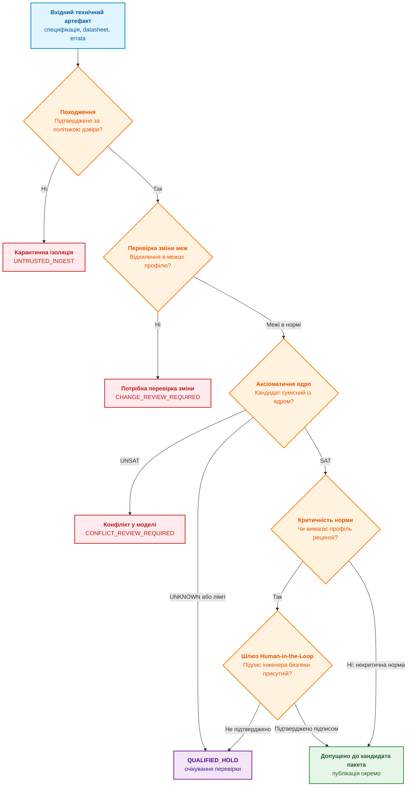

Для опрацювання цього класу загроз у главі запропоновано трирівневу систему перевірок. Це проєктний профіль, а не доведена гарантія захисту від отруєння; переходи між станами, покриття тестами й хибні спрацювання мають бути оцінені окремо:

#### 1. Криптографічна автентифікація першоджерел

Криптографічна перевірка встановлює цілісність і зв'язок із ключем за обраною політикою довіри. Сертифікат HTTPS-сервера X.509 не є підписом окремого завантаженого документа, а Ed25519 є алгоритмом підпису, не самостійним свідченням акредитації автора. Якщо видавець не підписує документи, політика може передбачати перевірене завантаження з офіційного джерела й підписаний внутрішній акт приймання. Непідтверджене джерело лишається в `UNTRUSTED_INGEST`; навіть дійсний підпис не замінює перевірки змісту.

#### 2. Символьна перевірка на семантичну отруєність через SMT-солвер

Усі вилучені правила та параметри підлягають автоматичному тестуванню на збурення за допомогою формального SMT-солвера (Z3):
- **Аналіз чутливості меж (Threshold Sensitivity Check):** алгоритм порівнює вилучений поріг спрацьовування $`\theta_{\mathrm{new}}`$ із нормативним стандартом $`\theta_{\mathrm{std}}`$, перевіряючи виконання інваріанта безпечного допуску:

<a id="obj-15-33"></a>

**Формула (15.33). Профільна межа зміни параметра**

```math
\Delta \theta = \lvert \theta_{\mathrm{new}} - \theta_{\mathrm{std}} \rvert \le \epsilon_{\mathrm{safety}}
```

Параметри та математичні компоненти формули:
- $`\theta_{\mathrm{new}} \in \mathbb{R}`$ — числове значення фізичного або системного параметра, вилучене з нового артефакту специфікації;
- $`\theta_{\mathrm{std}} \in \mathbb{R}`$ — еталонне значення параметра, зафіксоване в базовому сертифікованому стандарті системи;
- $`\epsilon_{\mathrm{safety}} \in \mathbb{R}_{\ge 0}`$ — гранично допустимий інженерний допуск зсуву параметра, регламентований профілем безпеки;
- $`\Delta \theta \in \mathbb{R}_{\ge 0}`$ — абсолютне відхилення запропонованої зміни.

Усі три значення мають однакові одиниці, область застосовності й спосіб вимірювання; для кількох різнорозмірних параметрів одна скалярна межа непридатна. Для R-15 зміна 150 на 151 мс за нульового дозволеного відхилення потребує перевірки, хоча різниця мала. Проходження порога не доводить безпеки, а його перевищення не доводить злого наміру: це може бути легітимна нова редакція.

- **Перевірка сумісності аксіом:** $`\mathcal A_{\mathrm{core}}`$ є скінченною множиною прийнятих формул у підтриманій теорії SMT, $`R_{\mathrm{candidate}}`$ новою формулою. `UNSAT` їхнього об'єднання означає конфлікт у цій формалізації, `SAT` сумісність, `UNKNOWN` відсутність рішення. Жодний результат сам не встановлює причини конфлікту чи правильності перекладу з тексту. Якщо потрібний незалежно перевірний доказ, його формат і checker задаються окремо.

#### 3. Обов'язковий шлюз кваліфікації людиною в циклі керування (Human-in-the-Loop)

За авторською політикою критичні зміни потребують рецензії уповноваженого предметного експерта та статусу `QUALIFIED_HOLD` до її завершення. Це вимога запропонованого процесу, не процитований припис стандарту до бази знань. ASIL належить до ISO 26262, SIL до інших застосовних стандартів, зокрема IEC 61508; їх не ототожнюють. Підпис рецензії пов'язує схвалення з точними джерелами, версією кандидата й областю, після чого все ще потрібна процедура випуску.

#### 10.3.1. Дія та замкнений цикл захисту від епістемічного отруєння знань

1. **Керування рантаймом і потоком обчислень (Control Flow & Runtime Decisions):**
    - Перевищення допуску або конфлікт блокує допуск кандидата й створює запит перегляду. `POISON_DETECTED` можна використовувати лише за окремо підтвердженої атаки, не як синонім арифметичної невідповідності.
   - Якщо правило успішно проходить SMT-перевірку і стосується загальних некритичних параметрів (наприклад, форматування текстових відповідей чи таймаутів інформаційних повідомлень), воно отримує вердикт `ACCEPT` і автоматично інтегрується в кандидатний випуск пакета.
   - Якщо правило стосується критичних систем функціональної безпеки (рівні ASIL C/D, SIL 3/4), рантайм виставляє блокування `QUALIFIED_HOLD`, очікуючи криптографічної авторизації від атестованого інженера в циклі керування (Human-in-the-Loop).
2. **Апаратний сайзинг та інфраструктурні обмеження (Hardware Dimensioning):**
    - Для обмеження ресурсів можна задати навчальний бюджет 500 мс і 512 МіБ на перевірку. Таймер, обмеження пам'яті процесу й обмеження системних викликів є різними механізмами; жодний із них не наведено тут як реалізований пісочник.
    - Вичерпання бюджету дає `E_SMT_RESOURCE_EXHAUSTION` і неперевірений кандидат. Це не доказ атаки й не `UNSAT`; невинна складна формула може мати той самий результат.
3. **Практичний числовий приклад (Worked Numerical Example):**
    - Це синтетичний приклад зміни параметра, не вимога ISO 26262 і не результат випробування інвертора.
    - Навчальний профіль задає еталон 400 В і дозволене відхилення 5 В; відповідний інтервал 395–405 В є умовою перевірки зміни, не доведеним безпечним робочим діапазоном виробу.
    - У модельному сценарії новий бюлетень пропонує $`\theta_{\mathrm{new}} = 435\,\text{В}`$. Причину зміни ще не встановлено; для демонстрації виявлення розбіжності не потрібно припускати наміру автора документа.
   - SMT-солвер обчислює дельту відхилення:

<a id="obj-15-34"></a>

**Формула (15.34). Відхилення напруги в синтетичному прикладі**

```math
\Delta \theta = \lvert 435 - 400 \rvert = 35\,\text{В}.
```

    - 35 В перевищують 5 В на 30 В, тому кандидат не проходить профіль зміни. Для порівняння, 403 В дають відхилення 3 В і проходять лише цю одну перевірку.
    - Якщо SMT-запит містить одночасно фіксовану нову напругу 435 В і вимогу відхилення не більше 5 В від 400 В, він нездійсненний. Це `UNSAT` саме цього запиту, не доказ фізичної аварії. Правило переходить на перегляд; збереження обладнання або встановлення зловмисника цим розрахунком не продемонстровано.

Кандидати отримали правила допуску та пройшли бар'єри захисту від отруєння знань, але змінюються не лише факти: інженер знань змінює також поняття й аксіоми, за якими факти інтерпретуються. Перед отриманням відповіді потрібно перевірити кандидат онтології як окремий артефакт.

> [!NOTE]
> **Три рівні авторської системи захисту від епістемічного отруєння знань (MITRE ATLAS)**
> 1. Криптографічний шлюз першоджерел: перевірка чинності цифрових підписів (X.509, Ed25519) та ізоляція непідтверджених файлів у карантин `UNTRUSTED_INGEST`.
> 2. Символьний аналіз: перевірка профільного допуску й сумісності аксіом у визначеній моделі; конфлікт або невідомий результат не є доказом атаки.
> 3. Шлюз кваліфікації інженером (Human-in-the-Loop): авторська політика переводить критичні зміни в `QUALIFIED_HOLD` до перевірки й підпису уповноваженого експерта.
> *Керування рантаймом / Інженерний інваріант:* непідтверджене походження, конфлікт, перевищення профільної межі чи незавершена перевірка блокують випуск і потребують різних діагностик; статус атаки не виводиться з самого блокування.

## 11. Практичний цикл онтологічного моделювання: Protégé та ROBOT

Додавання правильного факту до неправильної моделі може породити хибний висновок. Тому зміни онтології проходять власний цикл: запитання до компетентності, редагування, збирання, перевірка й допуск. Метод постановки запитань і перевірку понять за OntoClean пояснює [Глава 7](ch07-knowledge-base-typology.md). Тут потрібні інструменти, які перетворюють метод на повторювану процедуру.

Редактор **Protégé** дозволяє інженерові знань редагувати класи й аксіоми мовою вебонтологій OWL (*Web Ontology Language*), переглядати класифікацію й досліджувати пояснення логічних наслідків. **WebProtégé** надає браузерне середовище спільного редагування [[20]](#src-20). Редактор не встановлює, чи правильно витлумачено нормативне речення: походження аксіоми й предметне схвалення зберігають окремо від її логічної перевірки.

Інструмент **ROBOT** (*ROBOT is an OBO Tool*, де OBO означає *Open Biomedical Ontologies*) автоматизує роботу з онтологіями: створює аксіоми за табличними шаблонами, об'єднує модулі, запускає логічний рушій, виконує контрольні запити й порівнює аксіоми між версіями [[21]](#src-21). ROBOT походить із практики біомедичних онтологій; можливості інструмента можна застосовувати до інженерної моделі OWL, але предметні правила перевірки потрібно визначити для цієї моделі. Таблиця розподіляє відповідальність у циклі.

<a id="obj-15-35"></a>

**Таблиця 15.35. Відповідальність і артефакти онтологічного циклу**

| Етап | Виконавець і інструмент | Артефакт для наступного етапу |
|---|---|---|
| Визначення зміни | інженер знань і предметний експерт | запитання, очікуваний результат, джерело й межі застосовності |
| Редагування моделі | інженер знань у Protégé або WebProtégé | авторські аксіоми й обґрунтування зміни |
| Збирання кандидата | ROBOT: шаблони й об'єднання модулів | кандидат онтології з зафіксованими імпортами |
| Логічна перевірка | ROBOT із явно обраним рушієм | звіт про несуперечність, нездійсненні класи й виведені аксіоми |
| Поведінкова перевірка | контрольні запити й порівняння очікуваних відповідей | результати позитивних і негативних випадків |
| Допуск і випуск | предметний експерт та процедура випуску | схвалена версія онтології, звіти й маніфест пакета знань |

Авторські аксіоми й виведені аксіоми не редагують як два незалежні джерела істини. Якщо модуль збирається з таблиці, правку повертають у таблицю; якщо модуль ведеться в Protégé, правку повертають в авторський модуль. Виведений файл є похідним артефактом. Для відтворення збирання фіксують коміт авторських аксіом і шаблонів, версії ROBOT і рушія, імпортовані онтології та результати перевірок. Завантаження змінного імпорту з мережі під час кожного збирання не забезпечує повторення того самого результату.

### 11.1. Верифікація онтології через запитання до компетентності

Повернімося до SMTP. Навчальне запитання «чи належить команда DATA до протокольних команд?» вимагає зберегти шлях між класами. Приклад нижче є авторським поданням класифікації команд, а не дослівною аксіомою RFC 5321. Дані й запит самодостатні; команди виконання потребують Java 11 або новішої та встановленого ROBOT у шляху пошуку програм. Версії інструментів потрібно зафіксувати перед запуском.

<details>
<summary>Навчальна онтологія, контрольний запит і команди PowerShell</summary>

Вхідний файл `candidate.ttl` містить авторські класи. Turtle є синтаксисом запису графа RDF (*Resource Description Framework*).

```turtle
@prefix ex: <https://example.org/protocol/> .
@prefix owl: <http://www.w3.org/2002/07/owl#> .
@prefix rdfs: <http://www.w3.org/2000/01/rdf-schema#> .

ex:ProtocolCommand a owl:Class .
ex:SMTPCommand a owl:Class ; rdfs:subClassOf ex:ProtocolCommand .
ex:DataCommand a owl:Class ; rdfs:subClassOf ex:SMTPCommand .
```

Запит `missing-command-path.rq` мовою SPARQL (*SPARQL Protocol and RDF Query Language*) повертає порушення очікування, а не успішну відповідь.

```sparql
PREFIX ex: <https://example.org/protocol/>
PREFIX rdfs: <http://www.w3.org/2000/01/rdf-schema#>
SELECT ?command WHERE {
    VALUES ?command { ex:DataCommand }
    FILTER NOT EXISTS {
        ?command rdfs:subClassOf+ ex:ProtocolCommand .
    }
}
```

ROBOT виконує логічну перевірку рушієм HermiT і перевірку запиту. Після ненульового коду завершення наступна команда не запускається.

```powershell
robot reason --reasoner hermit --input candidate.ttl --output reasoned.owl
if ($LASTEXITCODE -ne 0) { throw "Ontology reasoning failed" }
robot verify --input reasoned.owl --queries missing-command-path.rq --output-dir checks --fail-on-violation true
if ($LASTEXITCODE -ne 0) { throw "Competency check failed" }
```

</details>

Оператор `rdfs:subClassOf+` проходить один або більше зв'язків підкласу, тому контрольний запит не залежить від наявності окремої матеріалізованої трійки `DataCommand subClassOf ProtocolCommand`. Для наведених даних запит повертає нуль рядків. Якщо прибрати зв'язок `SMTPCommand subClassOf ProtocolCommand` з авторського файлу й повторити збирання, запит поверне один рядок із `DataCommand`, а команда `verify` завершиться з помилкою [[22]](#src-22). Отже, негативний випадок показує, що перевірка справді реагує на втрату потрібного шляху. Цей приклад перевіряє класифікацію, а не правильність поведінки сервера під час сеансу.

Команда `reason` відхиляє логічну суперечність або нездійсненні класи в межах можливостей обраного рушія. Команда `verify` виконує запити до наданого графа, а не довільне повне виведення. За документацією ROBOT, типовий результат `reason` матеріалізує аксіоми підкласів; інші потрібні наслідки слід явно налаштувати або перевіряти засобом, який підтримує відповідний режим виведення [[22]](#src-22). Нуль рядків одного запиту не доводить правильності всіх аксіом і не замінює перевірки походження.

Після перевірок онтологія ще має статус кандидата. Предметне схвалення й шлюз допуску не обходять через успішний запуск ROBOT; доступ до опублікованих знань змінюється лише процедурою випуску. Побудову незмінного пакета знань розглядає [Глава 32](ch32-high-performance-knowledge-packs-mmap-and-harvesting.md). Експертна система споживає опублікований пакет для відповідей і водночас може допомагати інженерові знань: застосовувати правила допуску, знаходити прогалини й пояснювати відмову. Наступний розділ показує, як зробити перевірюваною саму відповідь.

## 12. Сертифікат доведення: машиноперевірюване обґрунтування висновку

Відповідь експертної системи на запитання «чи порушив сервер протокол у цьому сеансі» має бути перевірюваною без довіри до самої експертної системи. Для цього відповідь супроводжується сертифікатом доведення (*proof certificate*), структуру якого показано на діаграмі.

<a id="obj-15-36"></a>

**Діаграма 15.36. Структура сертифіката доведення**

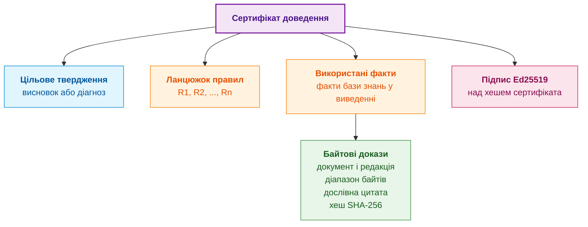

Сертифікат містить цільове твердження, ланцюжок застосованих правил, факти, використані у виведенні, і для кожного факту байтові докази: документ і редакцію, діапазон, дослівну цитату та хеш. Увесь сертифікат підписано алгоритмом Ed25519 [[23]](#src-23). Незалежний валідатор перевіряє такий сертифікат у чотири кроки:

1. Перевіряє підпис над однозначним канонічним поданням сертифіката й довіру до ключа за політикою перевірки. Коректний підпис установлює зв'язок із ключем, але не самостійно встановлює особу, повноваження або відсутність компрометації ключа.
2. Для кожного факту відтворює цитату з адресованого хешем артефакту. Для PDF потрібні також незмінний текстовий шар, версія парсера та зв'язок із сторінкою оригіналу. Хеш підтверджує відповідність архівним байтам, а не нормативний статус цитати.
3. Перевіряє кожен крок за точною версією правила, підстановками змінних і визначеною семантикою. Самого списку ідентифікаторів правил недостатньо. Непідтримуване правило або відсутня передумова дає результат «не перевірено», а не «доведено».
4. Перевіряє редакцію, профіль застосовності й схвалення фактів за довіреним маніфестом та актуальною політикою відкликання. Знімок бази для історичного висновку не скасовує чинних заборон доступу або відкликань.

Вердикт «доведено в межах зазначеної формальної моделі» валідатор видає лише після всіх чотирьох кроків. Мовна модель не потрібна, але потрібні визначення правил, архівні артефакти, маніфест, довірені ключі та політика відкликання. Ці залежності можна включити до перевірюваного комплекту; без залежностей незалежне відтворення не забезпечене.

Межі сертифіката теж треба розуміти. Сертифікат доводить, що висновок випливає з прийнятих фактів за вказаними правилами, але не доводить, що самі правила правильні й повні. Перевірка правил є завданням верифікації бази знань, якій присвячено [Главу 23](ch23-knowledge-base-verification.md). Підпис підтверджує цілісність і походження сертифіката, а не істинність твердження.

Для R-15 мінімальний логічний приклад містить схвалене правило версії 1, підтверджені робочий режим і відсутність застосовного винятку, а також спостереження відповіді за 160 мс. Перетворення дає 0,160 с, порівняння з 0,150 с виявляє перевищення 0,010 с; checker відтворює саме ці кроки й висновок про порушення навчальної політики. Якщо запис про виняток невідомий або спостереження не має підстави, сертифікат незавершений. Для похідного факту не вигадують пряму цитату з числом 0,010: зберігають джерела, підстановки й версії правил конвертації та порівняння. Далі журнали допоможуть шукати помилки моделі, але не стануть самі новим стандартом.

## 13. Запозичення методів Process Mining та аналізу інженерних процесів

Вилучення нормативних правил і виявлення закономірностей у даних мають різні цілі. Нормативне правило визначає дозволену поведінку за прийнятим джерелом; закономірність описує частоту спостережень. Змішування цих статусів створює помилку навіть за правильного розбору тексту.

**Аналіз процесів за журналами подій (*process mining*)** допомагає знайти непокриті сценарії. Бібліотека PM4Py (*Process Mining for Python*) підтримує побудову моделей процесів і перевірку відповідності журналів моделі [[24]](#src-24). Для конвеєра знань корисне порівняння нормативного автомата з журналом нейтрального процесу, наприклад приймання файлу: отримання, перевірка, відхилення або збереження. Журнал, у якому жодного разу не було відхилення, не доводить, що відхилення заборонене. Знайдене розходження може бути порушенням реалізації, неповнотою журналу або помилкою нормативної моделі; інженер має розділити ці пояснення.

**Асоціативний аналіз** знаходить часті поєднання помилок парсера. Засоби `fpgrowth` і `association_rules` бібліотеки mlxtend дозволяють оцінювати частоту наборів ознак, умовну частоту й перевищення над незалежним очікуванням (*lift*) [[25]](#src-25). Якщо втрата заголовка таблиці часто супроводжується неправильною одиницею, результат підказує спільний тест структури й екстракції. Високий lift не доводить причину помилки й не створює нового нормативного правила. Пошук багатьох комбінацій потребує перевірки на відкладених родинах документів.

**Інкрементальні збирання** доцільно перевіряти як компілятор. Зміна абзацу має перевірити не лише факти цього абзацу, а й залежні правила, результати й подання; зміна заголовка або винятку може вплинути на незмінні цитати нижче. Еталоном є повне збирання з того самого корпусу, конфігурації й схвалень. Порівнюють семантичні записи й відповіді, а не час запуску або випадкові службові ідентифікатори.

Навчальний журнал `отримано → збережено` порівнюють із моделлю `отримано → перевірено → збережено`: розбіжність виявлено, але ще невідомо, чи пропущено перевірку, чи лише запис події. Для асоціативного прикладу припустімо 100 розібраних таблиць: у 20 втрачено заголовок, у 10 помилкова одиниця, у 8 обидва дефекти. Тоді серед таблиць без заголовка помилка одиниці трапляється у 8 із 20, тобто 40 %, проти 10 % у всій вибірці; перевищення над незалежним очікуванням, lift, становить 4. Це мотивує спільний тест, не причинний чи нормативний висновок. У реальному дослідженні треба виключити дублікати й перевірити результат на інших родинах документів.

Усі три напрями відокремлюють спостереження, кандидатні гіпотези й допущені знання, а негативні випадки перевіряють, що шлюз не пропускає кандидата без підстави. Після цих меж можна порівняти базу знань із типовим генеративним пошуком.

## 14. Порівняльний аналіз: доказова база знань проти класичного RAG

Порівняння потрібне для вибору договору відповіді, не для присвоєння технології безумовної переваги. Для R-15 пошукова відповідь може знайти правильне речення, але висновок про 160 мс потребує ще перевірки режиму, винятку й редакції. Таблиця зіставляє базовий генеративний пошук із системою, де такі перевірки явно побудовано; критерії якості мають бути однаковими.

<a id="obj-15-37"></a>

**Таблиця 15.37. Порівняння договорів перевірки відповіді**

| Характеристика | Експертна система з перевіреною базою знань | Пошук із генерацією (RAG і LLM) |
|---|---|---|
| **Природа результату** | Логічне виведення з прийнятих фактів і правил | Генерація тексту на основі знайдених фрагментів |
| **Прив'язка до джерела** | Байтовий діапазон і хеш цитати | Фрагмент, знайдений за схожістю; посилання може бути неточним |
| **Порядок дій і стани** | Явна модель переходів, якщо побудована й перевірена | У базовому варіанті порядок відтворюється з тексту; можливі зовнішні моделі станів |
| **Синтаксис** | Граматики ABNF, скомпільовані у валідатори | Можливе обмежене декодування; граматика не підтверджує зміст |
| **Версії документів** | Граф заміщень і повторна прив'язка фактів | Фрагменти різних редакцій можуть змішуватися в одному індексі |
| **Перевірка результату** | Перевірюваний сертифікат за визначеним форматом і правилами | Без додаткового checker потрібний зовнішній аудит; його можна автоматизувати лише за окремим договором |
| **Реакція на брак знань** | Явна відмова, якщо політика й модель передбачають невідомі значення | Потребує окремої політики відмови та її перевірки |
| **Вартість** | Побудова, схвалення, підтримка й перевірка; питома вартість вимірюється | Підготовка корпусу, модель, перевірка й підтримка; витрати залежать від реалізації |

Таблиця порівнює явно перевірюване виведення з базовим генеративним пошуком, а не всі можливі реалізації RAG. Генеративний пошук також можна доповнити адресами джерел, фільтром редакцій, граматикою та зовнішнім перевірювачем. Відмінність визначає фактичний договір перевірки результату, а не назва технології. У конвеєрі цієї глави пошук і мовна модель пропонують кандидатів, а допуск і випуск залежать від окремих перевірок та схвалень.

### 14.1. Інженерна економіка компіляції знань та подолання «вузького місця Файгенбаума»

Економічне питання випливає з попередніх розділів: коли витрати на побудову, схвалення й підтримку формальних знань окупляться на повторних перевірках? Вузьке місце набуття знань не зникає від появи парсера: частину ручної роботи замінюють налаштування, розмітка, рецензія й супровід. Зниження вартості на порядок та автоматизацію 85–92 % вимог без даних не вважаємо виміряним результатом.

Для навчального розрахунку приймемо сталу початкову вартість і сталу вартість запиту, включно з перевіркою. Порівнюються однакові задачі, горизонт і критерії якості; ризик помилок має бути однаково врахований у кожній альтернативі, не приписаний лише RAG:

<a id="obj-15-38"></a>

**Формула (15.38). Лінійна навчальна модель сукупних витрат**

$$
TCO_j(N)=C_j+Nc_j.
$$

Тут $j$ індекс альтернативи, $`N\in\mathbb N_0`$ кількість запитів, $`C_j\ge0`$ початкові витрати в USD, $`c_j\ge0`$ витрати в USD/запит, а $`TCO_j`$ сумарні витрати в USD. Сталість питомих витрат є спрощенням; зміни корпусу, аудит і повторні випуски можуть зробити модель нелінійною.

Умовно задаємо: RAG — 5000 USD спочатку та 40 USD/запит; ручна формалізація — 350 000 USD і 2 USD/запит; автоматизована — 45 000 USD і 1 USD/запит. Для 2000 запитів це відповідно 85 000, 354 000 та 47 000 USD. Числа вигадані для навчання, не кошторис або бенчмарк. Точка рівності витрат RAG і автоматизованої системи за цих умов:

<a id="obj-15-39"></a>

**Формула (15.39). Точка рівності витрат за заданими цінами**

$$
N^*=\frac{C_{\mathrm{ES}}-C_{\mathrm{RAG}}}{c_{\mathrm{RAG}}-c_{\mathrm{ES}}}
=\frac{45000-5000}{40-1}\approx1025{,}64.
$$

Індекси ES і RAG позначають дві названі альтернативи; $`N^*`$ вимірюється числом запитів. Формула застосовна тут за більшої початкової ціни ES і більшої питомої ціни RAG. Від 1026 цілих запитів ES дешевша в цій моделі. За рівних питомих цін ділити на нуль не можна; за дорожчого запиту ES такого переходу може не бути. Графік показує ту саму арифметику, а не підтверджує оцінки:

<a id="obj-15-40"></a>

**Діаграма 15.40. Навчальна модель сукупних витрат трьох альтернатив**

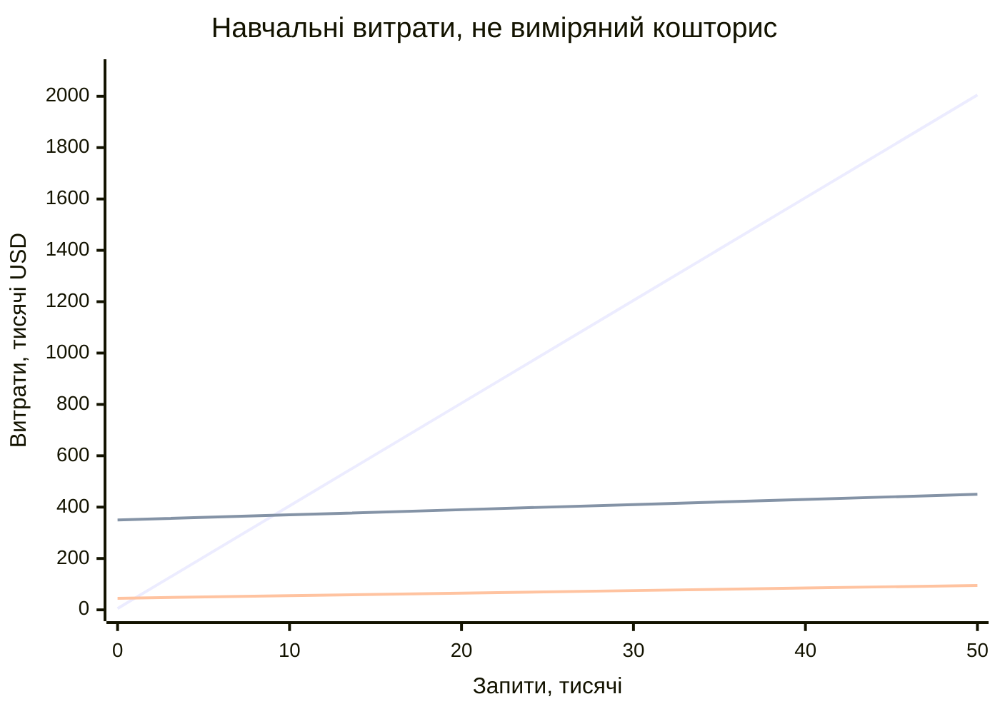

> [!NOTE]
> **Три економічні чинники автоматизованої компіляції баз знань**
> 1. **Амортизація формалізації:** порівнюють початкову й питому вартість. Перевірка сертифіката не безкоштовна; окупність існує лише за відповідних цін і обсягу повторних запитів.
> 2. **Редукція вузького місця набуття знань:** автоматизація може скорочувати чернеткову роботу, але її частку й вартість рецензії потрібно виміряти на репрезентативному корпусі, зокрема на відмовах і винятках.
> 3. **Урахування помилок:** очікувані втрати включають симетрично в усі альтернативи. У наведеній лінійній моделі відношення витрат RAG до ES прямує до 40, а не до нескінченності; інший закон росту потребував би окремих припущень.
> *Керування рантаймом / Інженерний інваріант:* телеметрія вимірює трудомісткість перевірки, повторної компіляції й випуску; лінійна масштабованість не випливає із самого збору телеметрії.

## Висновки
Текст специфікацій перетворюється на перевірювану базу знань через компіляцію в п'ять фаз: структурну декомпозицію, розбір речень, спеціалізовані екстрактори, побайтову прив'язку й шлюз допуску. Кожен прийнятий факт має адресу в першоджерелі: документ, байтовий діапазон, шлях у дереві розділів і хеш цитати. Мовна модель у цьому процесі пропонує кандидатів, а рішення ухвалюють детерміновані перевірки.

Глава показала прив'язку цитат на RFC 5321 і межі навчального автомата SMTP. Порушення застосовної обов'язкової норми є підставою для негативного вердикту; невикористання дозволеної можливості MAY саме по собі не є порушенням чи попередженням. Повторна прив'язка між редакціями знаходить кандидатну відповідність цитат, але не переносить чинність факту без перевірки нового контексту. Додані синтетичні тести перевіряють неоднозначність цитати, вибір відомої області, хеш сирих байтів і межі UTF-8; повноту нормативної моделі ці тести не доводять.

Цикл Protégé й ROBOT відокремив авторські аксіоми від похідних файлів і логічну перевірку від предметного схвалення. Контрольний запит для класифікації команд показав, як запитання до компетентності стає перевіркою, яка виявляє втрату потрібного зв'язку до випуску онтології.

Межі підходу теж визначено. Побайтова перевірка підтверджує цитату, а не її тлумачення. Навіть повний документ може дати неповний автомат через пропуск екстрактора; невідомий перехід не стає забороною. PDF потребує окремого незмінного текстового артефакту та зв'язку з оригіналом. Похідний факт потребує версії правила й передумов; FCA описує таблицю спостережень, не створює нормативних обов'язків. Сертифікат перевіряє виведення у визначеній моделі, а економічний розрахунок порівнює явно задані припущення.

### Підсумки маршруту здобуття та формалізації

Глави 10–15 розглянули здобуття й формалізацію кандидатів у знання:

1. [Глава 10](ch10-knowledge-acquisition-systems.md) побудувала архітектуру систем здобуття знань (KAS): двочасову модель чинності фактів, паспорти об'єктів знань та реєстри відкликань.
2. [Глава 11](ch11-knowledge-elicitation-from-experts.md) описала дисципліновані протоколи вилучення неявного досвіду (SECI, CommonKADS, CDM) без змішування суб'єктивних оцінок з об'єктивними фактами.
3. [Глава 12](ch12-linguistic-analysis-and-local-models.md) поєднала лінгвістичний аналіз із локальними SLM, запровадивши побайтові карти зміщення (Source Maps) та інваріант збереження першоджерела.
4. [Глава 13](ch13-language-variability-vs-determinism.md) вирішила проблему мовної варіативності через семантичну компіляцію запитань у детерміновані структури та перевірку групами еквівалентності.
5. [Глава 14](ch14-requirements-detection-and-formalization.md) формалізувала нормативні модальності (RFC 2119 / ISO/IEC Directives), трансформуючи вимоги SHALL/MUST на перевірювані інженерні інваріанти.
6. [Глава 15](ch15-knowledge-extraction-and-kb-construction.md) замкнула конвеєр синтезом скінченних автоматів (FSM) та криптографічних сертифікатів доведення (Ed25519) із побайтовою доказовістю.

Разом шість глав забезпечили маршрут: **сирий норматив / експерт → лінгвістична нормалізація → формальна вимога → доказова база знань**.

### Подальший шлях пізнання

Після вилучення змісту потрібно оцінити якість підстав. Наступна в тематичному порядку [Глава 37](ch37-input-information-assessment-and-algorithmic-skepticism.md) розрізняє надійність джерела, підтвердження твердження й залежність свідчень. Лише після цього маршрут переходить до застосування знань:

- **[Частина IV](part-04-architecture-and-inference.md)** розглядає архітектуру, перевірку підстав, застосування норм, пояснення та допуск дії. **[Частина VII](part-07-runtime-and-knowledge-exchange.md)** окремо розглядає технологічний стек, апаратуру й фізичний зворотний зв'язок.

## Словник
<a id="obj-15-41"></a>

**Таблиця 15.41. Терміни глави**

| Український термін | Англійський відповідник | Коротке пояснення |
|---|---|---|
| Екстракція знань | Knowledge extraction | Перетворення тексту документів на типізовані факти, правила й автомати з прив'язкою до джерела |
| База знань | Knowledge base | Сукупність прийнятих фактів і правил, з якою працює механізм виведення |
| Побайтова прив'язка до джерела | Evidence grounding | Зв'язок факту з точним діапазоном байтів у незмінному файлі першоджерела |
| Кортеж доказової прив'язки | Evidence tuple | Ідентифікатор документа, діапазон байтів, шлях у дереві розділів і хеш цитати |
| Карта зсувів | Offset map | Відповідність між позиціями нормалізованого тексту та байтами сирого файлу |
| Структурна декомпозиція | Structural decomposition | Розпізнавання розділів, типів блоків і метаданих документа |
| Інформаційний додаток | Informative annex | Частина стандарту, яка пояснює, але не встановлює обов'язків |
| Шлюз допуску | Admission gate | Детермінований набір перевірок, після якого кандидат стає фактом бази знань |
| Відмова в разі сумніву | Fail-closed | Принцип, за яким неперевірений кандидат відхиляється, а не приймається |
| Скінченний автомат | Finite-state machine | Модель зі скінченною множиною станів і переходами за подіями |
| Функція переходів | Transition function | Відображення пари «стан, подія» в наступний стан або заборону |
| Негативний тест | Negative test | Тест, що подає недопустиму послідовність і перевіряє реакцію |
| Граф версій | Document lineage | Граф заміщень, оновлень і виправлень між документами |
| Родина документів | Document family | Множина редакцій, пов'язаних графом версій; одиниця розміщення під час розбиття бази знань на шарди |
| Шард | Shard | Частина бази знань, яку обслуговує один вузол; визначення наведено в Главі 7 |
| Повторна прив'язка | Re-grounding | Пошук відповідності цитат між редакціями; чинність і схвалення перевіряються заново |
| Записи про помилки | Errata | Офіційні виправлення окремих місць опублікованого документа |
| Структурне розбиття | Structural chunking | Поділ тексту для пошуку за структурними одиницями з повним шляхом |
| Плаваюча семантична одиниця анотації (FAU) | Floating-size annotation unit | Блок нормативного тексту зі змінними межами, керованими синтаксичною та семантичною замкненістю суджень, а не лічильником токенів |
| Злиття обернених рангів | Reciprocal rank fusion | Об'єднання ранжованих списків сумою обернених позицій |
| Векторне представлення | Embedding | Числовий вектор, що відображає зміст фрагмента тексту |
| Відображення файлу в пам'ять | Memory mapping | Доступ до файлу як до області пам'яті процесу без копіювання |
| Адресація за вмістом | Content addressing | Ідентифікація об'єкта хешем його вмісту |
| Сертифікат доведення | Proof certificate | Підписаний набір висновку, правил, фактів і байтових доказів |
| Авторські аксіоми | Asserted axioms | Аксіоми, явно записані в керованих джерелах онтології |
| Виведені аксіоми | Inferred axioms | Логічні наслідки авторських аксіом, отримані обраним рушієм |
| Аналіз процесів за подіями | Process mining | Побудова й перевірка моделей спостережуваних процесів за журналами |
| Асоціативний аналіз | Association rule mining | Пошук частих поєднань ознак, що не встановлює причинності або нормативного статусу |
| Епістемічне отруєння знань | Knowledge poisoning | Цілеспрямоване зловмисне викривлення технічних норм або числових меж у джерелах знань для впровадження прихованих дефектів у базу знань |
| Таксономія MITRE ATLAS | MITRE ATLAS framework | База знань тактик і технік кібератак на системи штучного інтелекту та машинного навчання |
| Чутливість меж спрацьовування | Threshold sensitivity | Допустиме відхилення числового параметра безпеки при верифікації нових правил через SMT-солвер |
| Дефініція | Definition | Формальне визначення наукового або технічного терміна, що фіксує його родову належність та видові ознаки |
| Формальний контекст | Formal context | Трійка $(G, M, I)$ множини об'єктів, ознак та бінарного відношення інцидентності в аналізі понять Галуа |
| Самореферентний аудит | Self-dogfooding audit | Здатність експертної системи формувати доказові експертні висновки щодо власного архітектурно-математичного фундаменту |

## Абревіатури
<a id="obj-15-42"></a>

**Таблиця 15.42. Скорочення глави**

| Скорочення | Розшифрування | Значення |
|---|---|---|
| ABNF | Augmented Backus-Naur Form | розширена форма Бекуса-Наура для опису синтаксису |
| ADR | Architecture Decision Record | запис архітектурного рішення |
| ASCII | American Standard Code for Information Interchange | семибітове кодування символів |
| ASIL | Automotive Safety Integrity Level | рівень цілісності безпеки в автомобільній електроніці |
| AUTOSAR | AUTomotive Open System ARchitecture | стандартизована архітектура програмного забезпечення автомобілів |
| AWL | Academic Word List | академічний лексичний список наукових термінів і предикатів |
| BM25 | Best Matching 25 | функція лексичного ранжування документів |
| CSR | Compressed Sparse Row | формат стисненого розрідженого рядкового масиву для графів |
| EARS | Easy Approach to Requirements Syntax | шаблони синтаксису вимог |
| FAU | Floating-size Annotation Unit | плаваюча семантична одиниця анотації |
| FIPS | Federal Information Processing Standards | федеральні стандарти обробки інформації США |
| HNSW | Hierarchical Navigable Small World | графовий індекс для пошуку найближчих векторів |
| IDL | Interface Definition Language | мова опису інтерфейсів |
| IEC | International Electrotechnical Commission | Міжнародна електротехнічна комісія |
| IEEE | Institute of Electrical and Electronics Engineers | Інститут інженерів з електротехніки та електроніки |
| IETF | Internet Engineering Task Force | інженерна рада інтернету |
| ISO | International Organization for Standardization | Міжнародна організація зі стандартизації |
| ITU-T | International Telecommunication Union, Telecommunication Standardization Sector | сектор стандартизації телекомунікацій Міжнародного союзу електрозв'язку |
| JSON | JavaScript Object Notation | текстовий формат обміну даними |
| LLM | Large Language Model | велика мовна модель |
| MITRE ATLAS | Adversarial Threat Landscape for Artificial-Intelligence Systems | таксономія загроз безпеці систем штучного інтелекту |
| MTEB | Massive Text Embedding Benchmark | порівняльний набір задач для векторних представлень тексту |
| OMG | Object Management Group | консорціум стандартів моделювання |
| OBO | Open Biomedical Ontologies | відкриті біомедичні онтології |
| OWL | Web Ontology Language | мова вебонтологій |
| PDF | Portable Document Format | формат документів |
| POSIX | Portable Operating System Interface | стандарт інтерфейсу операційних систем |
| PM4Py | Process Mining for Python | бібліотека аналізу процесів за журналами подій |
| RAG | Retrieval-Augmented Generation | генерація з доповненням знайденими фрагментами |
| RDF | Resource Description Framework | модель опису ресурсів графом трійок |
| RFC | Request for Comments | серія документів зі специфікаціями інтернету |
| ROBOT | ROBOT is an OBO Tool | інструмент автоматизації роботи з онтологіями |
| RRF | Reciprocal Rank Fusion | злиття обернених рангів |
| SHA-256 | Secure Hash Algorithm, 256 bits | криптографічна хеш-функція |
| SIEM | Security Information and Event Management | система керування подіями та інформацією безпеки |
| SMT | Satisfiability Modulo Theories | виконуваність формул з урахуванням теорій |
| SMTP | Simple Mail Transfer Protocol | протокол передавання електронної пошти |
| SPARQL | SPARQL Protocol and RDF Query Language | мова запитів до графів RDF |
| SRS | Software Requirements Specification | специфікація вимог до програмного забезпечення |
| W3C | World Wide Web Consortium | консорціум зі стандартів вебу |
| ZHR | Zero-Hallucination Rate | частка відповідей без галюцинацій на тестовому наборі; заявляється разом з обсягом набору й довірчою межею |

## Джерела
1. <a id="src-1"></a>Patrick Lewis та ін. [*Retrieval-Augmented Generation for Knowledge-Intensive NLP Tasks*](https://arxiv.org/abs/2005.11401). *Advances in Neural Information Processing Systems 33 (NeurIPS 2020)*, 2020.
2. <a id="src-2"></a>J. Klensin. [*RFC 5321: Simple Mail Transfer Protocol*](https://www.rfc-editor.org/rfc/rfc5321). IETF, 2008.
3. <a id="src-3"></a>D. Crocker, P. Overell. [*RFC 5234: Augmented BNF for Syntax Specifications: ABNF*](https://www.rfc-editor.org/rfc/rfc5234). IETF, 2008.
4. <a id="src-4"></a>RTCA. [*DO-178C: Software Considerations in Airborne Systems and Equipment Certification*](https://www.rtca.org/do-178/). RTCA, 2011.
5. <a id="src-5"></a>ISO. [*ISO 26262-1:2018. Road vehicles: Functional safety: Part 1: Vocabulary*](https://www.iso.org/standard/68383.html). 2018.
6. <a id="src-6"></a>IEC. [*IEC 62304:2006+AMD1:2015. Medical device software: Software life cycle processes*](https://webstore.iec.ch/en/publication/22794). 2015.
7. <a id="src-7"></a>National Institute of Standards and Technology. [*FIPS PUB 180-4: Secure Hash Standard (SHS)*](https://doi.org/10.6028/NIST.FIPS.180-4). 2015.
8. <a id="src-8"></a>Alistair Mavin, Philip Wilkinson, Adrian Harwood, Mark Novak. [*Easy Approach to Requirements Syntax (EARS)*](https://doi.org/10.1109/RE.2009.9). *2009 17th IEEE International Requirements Engineering Conference*, 317–322, 2009.
9. <a id="src-9"></a>Stephen Robertson, Hugo Zaragoza. [*The Probabilistic Relevance Framework: BM25 and Beyond*](https://doi.org/10.1561/1500000019). *Foundations and Trends in Information Retrieval*, 2009.
10. <a id="src-10"></a>Yu. A. Malkov, D. A. Yashunin. [*Efficient and Robust Approximate Nearest Neighbor Search Using Hierarchical Navigable Small World Graphs*](https://doi.org/10.1109/TPAMI.2018.2889473). *IEEE Transactions on Pattern Analysis and Machine Intelligence*, 42(4), 824–836, 2020.
11. <a id="src-11"></a>pgvector. [*pgvector: Open-Source Vector Similarity Search for Postgres*](https://github.com/pgvector/pgvector). GitHub.
12. <a id="src-12"></a>Gordon V. Cormack, Charles L. A. Clarke, Stefan Buettcher. [*Reciprocal Rank Fusion Outperforms Condorcet and Individual Rank Learning Methods*](https://doi.org/10.1145/1571941.1572114). *Proceedings of the 32nd International ACM SIGIR Conference on Research and Development in Information Retrieval*, 758–759, 2009.
13. <a id="src-13"></a>Niklas Muennighoff, Nouamane Tazi, Loïc Magne, Nils Reimers. [*MTEB: Massive Text Embedding Benchmark*](https://doi.org/10.18653/v1/2023.eacl-main.148). *Proceedings of the 17th Conference of the European Chapter of the Association for Computational Linguistics*, 2014–2037, 2023.
14. <a id="src-14"></a>John E. Hopcroft, Rajeev Motwani, Jeffrey D. Ullman. [*Introduction to Automata Theory, Languages, and Computation*](https://openlibrary.org/works/OL21407442W). 3rd edition, Pearson Addison-Wesley, 2006.
15. <a id="src-15"></a>J. Postel. [*RFC 821: Simple Mail Transfer Protocol*](https://www.rfc-editor.org/rfc/rfc821). RFC Editor, 1982.
16. <a id="src-16"></a>J. Klensin. [*RFC 2821: Simple Mail Transfer Protocol*](https://www.rfc-editor.org/rfc/rfc2821). IETF, 2001.
17. <a id="src-17"></a>J. Klensin. [*RFC 7504: SMTP 521 and 556 Reply Codes*](https://www.rfc-editor.org/rfc/rfc7504). IETF, 2015.
18. <a id="src-18"></a>RFC Editor. [*Errata for RFC 5321*](https://www.rfc-editor.org/errata/rfc5321). Онлайн-реєстр виправлень.
19. <a id="src-19"></a>The Open Group. [*mmap: Map Pages of Memory*](https://pubs.opengroup.org/onlinepubs/9799919799/functions/mmap.html). *The Open Group Base Specifications Issue 8, IEEE Std 1003.1-2024*, 2024.
20. <a id="src-20"></a>Stanford University. [*Protégé: Ontology Editor*](https://protege.stanford.edu/). Офіційний сайт і опис Protégé Desktop та WebProtégé.
21. <a id="src-21"></a>Rebecca C. Jackson, James P. Balhoff, Eric Douglass, Nomi L. Harris, Christopher J. Mungall, James A. Overton. [*ROBOT: A Tool for Automating Ontology Workflows*](https://doi.org/10.1186/s12859-019-3002-3). *BMC Bioinformatics*, 20, стаття 407, 2019.
22. <a id="src-22"></a>Учасники проєкту ROBOT. [*Getting Started*](https://robot.obolibrary.org/), [*Template*](https://robot.obolibrary.org/template), [*Reason*](https://robot.obolibrary.org/reason), [*Verify*](https://robot.obolibrary.org/verify). Офіційна документація команд і передумов виконання.
23. <a id="src-23"></a>S. Josefsson, I. Liusvaara. [*RFC 8032: Edwards-Curve Digital Signature Algorithm (EdDSA)*](https://www.rfc-editor.org/rfc/rfc8032). IRTF, 2017.
24. <a id="src-24"></a>Alessandro Berti, Sebastiaan van Zelst, Daniel Schuster. [*PM4Py: A Process Mining Library for Python*](https://doi.org/10.1016/j.simpa.2023.100556). *Software Impacts*, 17, 100556, 2023. [Офіційний репозиторій і ліцензійні умови](https://github.com/process-intelligence-solutions/pm4py).
25. <a id="src-25"></a>Sebastian Raschka та учасники mlxtend. [*Association Rules: Metrics and Examples*](https://rasbt.github.io/mlxtend/user_guide/frequent_patterns/association_rules/). Документація метрик і генерації асоціативних правил.
26. <a id="src-26"></a>W. Ross Ashby. [*An Introduction to Cybernetics*](https://openlibrary.org/works/OL3307771W). Chapman & Hall, 1956.
27. <a id="src-27"></a>MITRE Corporation. [*MITRE ATLAS™: Adversarial Threat Landscape for Artificial-Intelligence Systems*](https://atlas.mitre.org/). 2024.
28. <a id="src-28"></a>IEC. [*IEC 80000-13:2008. Quantities and units — Part 13: Information science and technology*](https://www.iso.org/standard/31898.html). 2008.

---

[← Глава 14](ch14-requirements-detection-and-formalization.md) | [Зміст книги](README.md) | [Частина III](part-03-knowledge-engineering-nlp.md) | [Глава 16 →](ch16-expert-systems-architecture.md)
