# Глава 18. Інфраструктура виконання: локальні моделі, апаратні прискорювачі, Edge та On-Premise

> **Книга:** [Архітектура доказових експертних систем](README.md) · [Частина VII: Технологічний стек, апаратна інфраструктура, кібернетичне виконання та розподілена SOA](part-07-runtime-and-knowledge-exchange.md)  
> **Попередня глава:** [Глава 17. Технологічний стек: критерії вибору інструментів, мов програмування та рушіїв правил](ch17-implementation-stack.md)  
> **Наступна глава:** [Глава 21. Від рекомендації до дії: контроль повноважень і безпечне виконання у виробничому середовищі](ch21-from-recommendation-to-action.md)  
> **Зміст книги:** [README.md](README.md)  
> **Автор:** [Микола Мартинович Федчик](about-the-author.md)  
> **Передумови:** одиниці часу й обсягу даних, множення та ділення; для поглиблених прикладів — вектори, графи й булева логіка, які коротко нагадано перед застосуванням. Базова задача доступна першокурсникові; моделі прискорювачів розібрано до рівня застосування бакалавром комп'ютерних наук.  
> **Очікувані результати:** розподіляти компоненти експертної системи між CPU, GPU і NPU за профілем обчислень; оцінювати досяжну продуктивність за моделлю Roofline; порівнювати локальні платформи для моделей станом на жовтень 2026 року за місткістю й пропускною здатністю пам'яті та оцінювати верхню межу швидкості генерації; вирішувати, які моделі виконувати в процесі експертної системи, а які в окремих процесах; обирати топологію розміщення від периферійного пристрою до хмари; складати бюджет затримки за перцентилями; пояснювати й контролювати числовий дрейф результатів після оновлення драйверів і середовищ виконання.  

## Анотація

Попередні глави визначили логічну архітектуру та технологічний стек експертної системи. Але програмні абстракції виконуються фізично: в оперативній пам'яті, на системних шинах, у центральних процесорах (*Central Processing Unit*, CPU), графічних процесорах (*Graphics Processing Unit*, GPU) і нейронних процесорах (*Neural Processing Unit*, NPU). Виконуються вони в хмарних кластерах, на серверах у власному периметрі організації (*on-premise*) або на компактних контролерах поруч із сенсорами (*edge*).

Ця глава відповідає на запитання: **як обґрунтувати апаратуру й топологію виконання для заданої якості, затримки та автономності експертної системи?** Спочатку потрібно описати навантаження: скільки даних зберігається, що обчислюється для одного запиту і коли потрібна відповідь. Розгалужені правила часто доцільні на CPU, а матричні операції можуть виграти від GPU або NPU. Далі перевіряють підтримку операторів, передавання даних, пам'ять і наслідки відмов. Моделі ресурсів дають фільтри вибору, вимірювання — результати конкретного профілю, а WCET потребує обґрунтованих меж для всього критичного маршруту. Ізоляція мережі, партиціювання пам'яті та прямі переходи розглядаються як окремі інженерні засоби, не автоматичні докази безпеки. Історичний огляд платформ датовано 8 жовтня 2026 року; його відомості в цьому локальному проході не перевірялися за зовнішніми джерелами.

Для прикладу розглянуто звичайний поділ праці в гетерогенній системі: символьна логіка виконується на CPU, малі моделі — на NPU, а ресурсомісткі обчислення — на GPU. Це спосіб організації прикладу, а не нова класифікація процесорів:

<a id="obj-18-1"></a>

**Діаграма 18.1. Розподіл компонентів експертної системи за обчислювальними платформами.**

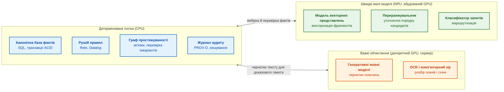

Діаграма не є догмою: на робочій станції всі три зони можуть працювати на одному процесорі з вбудованим NPU. Але межі між зонами відображають різну природу обчислень, і наступний розділ пояснює цю різницю кількісно.

## 1. Профіль обчислень: порівняльний аналіз вимог символьних правил і нейромереж

Профіль обчислень потрібний, щоб відповісти на просте питання: процесор зайнятий арифметикою чи очікує даних? У рушії правил наступна адреса часто залежить від щойно прочитаного запису; у множенні матриць ті самі дані можна багаторазово використати з кешу. В авторському принципі подолання дуальності символьних та тензорних обчислень ці два профілі розглядаються окремо. Кількість операцій за секунду без опису доступу до пам'яті не дозволяє вибрати апаратуру. Водночас не кожний обхід графа насичує шину: послідовні залежні читання можуть обмежуватися затримкою одного звернення задовго до досягнення її пікової смуги.

Для кількісного зіставлення застосовується модель Roofline Вільямса, Вотермана й Паттерсона [[1]](#src-1). Її передумови: задані формат арифметики, обчислювальне ядро та рівень пам'яті, для якого пораховано трафік. Модель обмежує швидкість арифметики двома стелями — обчисленнями й передаванням байтів; вона не прогнозує точно час запиту і не враховує автоматично затримку залежних читань, черги чи синхронізацію. Почнемо з обох стель окремо. Тут і далі ГБ означає $`10^9`$ байтів, а КіБ — $`2^{10}`$ байтів.

Пікова теоретична продуктивність процесора обчислюється для визначення граничної обчислювальної потужності ядра або прискорювача під час виконання щільних матричних операцій:

<a id="obj-18-2"></a>

**Формула (18.2). Теоретична пікова продуктивність.**

$$
P_{\text{peak}} = N_{\text{cores}} \times f \times \mathrm{FLOP}_{\text{cycle}}
$$

де:
- $`P_{\text{peak}}`$ — теоретична пікова продуктивність процесора або прискорювача, вимірювана в операціях з рухомою комою за секунду ($`\text{FLOP}/\text{s}`$, зазвичай $`\text{TFLOP}/\text{s}`$ або $`\text{GFLOP}/\text{s}`$);
- $`N_{\text{cores}}`$ — додатна ціла кількість однаково визначених обчислювальних одиниць; характеристика FLOP за такт нижче має стосуватися саме однієї такої одиниці, не довільної суміші ядер і мультипроцесорів;
- $`f>0`$ — скінченна стала тактова частота обчислювальних блоків у заданій моделі навантаження, вимірювана в герцах ($`\text{Hz}`$); для реального пристрою її визначають за профілем роботи;
- $`\mathrm{FLOP}_{\text{cycle}}`$ — кількість елементарних операцій з рухомою комою, яку одне ядро здатне виконати за один такт за рахунок векторних блоків SIMD/SIMT (наприклад, для ядра з двома 512-бітними блоками FMA у форматі FP32 виконується $`2 \times 16 \times 2 = 64\text{ FLOP}/\text{cycle}`$, де операція $`a \cdot b + c`$ враховується як два FLOP).

**Практичне застосування та інженерні висновки:**
1. Розрахунок виконується на етапі специфікації апаратного комплексу для оцінки верхньої планки продуктивності при виконанні щільної лінійної алгебри (GEMM у шарах нейромережевого кодера чи декодера).
2. Для умовного 16-ядерного CPU на частоті 3,0 ГГц із двома FMA-блоками на ядро пік становить:

<a id="obj-18-3"></a>

**Формула (18.3). Розрахунковий пік умовного CPU.**

$$
P_{\text{peak}} = 16 \times (3{,}0 \times 10^9) \times 64 = 3{,}072 \times 10^{12}\text{ FLOP/s} \approx 3{,}07\text{ TFLOP/s}
$$

3. **Авторський діагностичний критерій GEMM:** частка нижча за умовні 60% піку є приводом для профілювання, не діагнозом несправності. Наприклад, 1,5 TFLOP/s відносно 3,072 TFLOP/s дає приблизно 48,8%. Причиною можуть бути малий розмір матриць, пам'ять, реалізація бібліотеки або частота; розрізнити їх має вимірювання. Поріг 60% не є вимогою стандарту.

Пропускна здатність інтерфейсу пам'яті визначає максимальний темп прокачування байтів із системного ОЗП або відеопам'яті до обчислювальних регістрів:

<a id="obj-18-4"></a>

**Формула (18.4). Стеля смуги пам'яті.**

$$
\mathrm{BW} = f_{\text{mem}} \times \frac{W_{\text{bus}}}{8} \times N_{\text{channels}}
$$

де:
- $`\mathrm{BW}`$ — пікова теоретична пропускна здатність інтерфейсу оперативної пам'яті, вимірювана в байтах за секунду ($`\text{B}/\text{s}`$ або $`\text{GB}/\text{s}`$);
- $`f_{\text{mem}}`$ — ефективна швидкість передавання даних інтерфейсу пам'яті в мегатрансферах за секунду ($`\text{MT}/\text{s}`$ або передачах за секунду, наприклад $`4{,}8 \times 10^9\text{ T/s}`$ для DDR5-4800 або $`8{,}533 \times 10^9\text{ T/s}`$ для LPDDR5X);
- $`W_{\text{bus}}`$ — розрядність шини даних одного фізичного каналу пам'яті в бітах (типово 64 біти для стандартних модулів DDR4/DDR5, 32 або 16 бітів для субканалів LPDDR5/LPDDR5X), де ділення на 8 переводить біти в байти;
- $`N_{\text{channels}}`$ — додатна ціла кількість незалежних каналів однакової ширини. Якщо паспорт уже наводить сумарну ширину, повторне множення на кількість каналів неприпустиме.

**Практичне застосування та інженерні висновки:**
1. Розрахунок застосовується для визначення стелі продуктивності під час вилучення неструктурованих даних, обходу списків суміжності графа та зчитування матриць ваг при поодинокому авторегресивному інференсі.
2. Для двоканальної конфігурації DDR5-4800 (ширина шини 64 біти на канал) пікова смуга дорівнює:

<a id="obj-18-5"></a>

**Формула (18.5). Два канали DDR5-4800.**

$$
\mathrm{BW} = 4{,}8 \times 10^9 \times \frac{64}{8} \times 2 = 76{,}8 \times 10^9\text{ B/s} = 76{,}8\text{ GB/s}
$$

3. **Оцінювання ефективної смуги DRAM:** її вимірюють на потрібному шаблоні доступу. Якщо для планування умовно взяти 80% паспортної, отримаємо 61,44 ГБ/с; це припущення, не універсальний ККД. Поблизу насичення збільшення числа потоків може погіршити затримку. Рішення приймають за кривою «потоки — прийняті запити/с — хвостова затримка», а не за універсальною забороною після 80%.

Модель Roofline поєднує обидва фізичні ліміти через арифметичну (операційну) інтенсивність алгоритму $`I`$:

<a id="obj-18-6"></a>

**Формула (18.6). Верхня межа Roofline.**

$$
P_{\text{observed}} \le \min\left(P_{\text{peak}},\; I \times \mathrm{BW}\right)
$$

де:
- $`P_{\text{observed}}`$ — реально досяжна обчислювальна продуктивність експертної системи для конкретного алгоритму, вимірювана в $`\text{FLOP}/\text{s}`$;
- $`I\ge0`$ — скінченна арифметична інтенсивність ядра: FLOP на байт трафіку через визначений рівень пам'яті; порожній трафік потребує іншої моделі;
- $`\mathrm{BW}`$ — пропускна здатність підсистеми пам'яті ($`\text{byte}/\text{s}`$);
- $`P_{\text{peak}}`$ — пікова продуктивність процесора чи прискорювача ($`\text{FLOP}/\text{s}`$);
- $`\min(a, b)`$ — функція мінімуму, що визначає домінуючий фізичний бар'єр системи.

**Практичне застосування, граничні переходи та інженерні висновки:**
1. **Точка перелому (Ridge Point):**

<a id="obj-18-7"></a>

**Формула (18.7). Точка переходу між двома обмеженнями.**

$$
I_{\text{ridge}} = \frac{P_{\text{peak}}}{\mathrm{BW}}
$$

   Для розглянутої робочої станції ($`P_{\text{peak}} = 3{,}07\text{ TFLOP/s}`$, $`\mathrm{BW} = 76{,}8\text{ GB/s}`$) критична точка становить:

<a id="obj-18-8"></a>

**Формула (18.8). Розрахунок точки переходу.**

$$
I_{\text{ridge}} = \frac{3{,}072 \times 10^{12}}{76{,}8 \times 10^9} = 40{,}0\text{ FLOP/byte}
$$

2. **Граничний аналіз векторного пошуку HNSW у зоні Memory-Bound ($`I < I_{\text{ridge}}`$):** Векторний пошук у графовому індексі HNSW (*Hierarchical Navigable Small World*) [[2]](#src-2) для вектора розмірністю 768 у форматі FP32 (3072 байти) виконує приблизно $`2 \times 768 = 1536`$ операцій, що дає арифметичну інтенсивність $`I \approx 1536 / 3072 = 0{,}5\text{ FLOP/byte}`$. Оскільки $`0{,}5 \ll 40{,}0`$, гранична продуктивність обмежена шиною пам'яті:

<a id="obj-18-9"></a>

**Формула (18.9). Стеля ядра скалярного добутку.**

$$
P_{\text{observed}} \le 0{,}5 \times 76{,}8 \times 10^9 = 38{,}4\text{ GFLOP/s}
$$

    Це 1,25% піку, але лише стеля для ядра скалярного добутку: вектор запиту припускається резидентним, кожний вектор кандидата читається один раз, службові ребра й промахи кешу не пораховано. Повний HNSW може бути повільнішим. Перехід FP32→INT8 зменшує обсяг одного вектора з 3072 до 768 байтів, тобто вчетверо, не вдвічі; натомість змінюються арифметика, похибка й витрати деквантування. Треба перевірити якість пошуку. Інші кандидати на оптимізацію — локальність даних, пакетування та паралельні незалежні пошуки; GPU не виключається без порівняння.
3. **Зона обмеження обчисленнями ($`I \ge I_{\text{ridge}}`$):** для множення двох квадратних матриць FP32 порядку $`n`$ виконують приблизно $`2n^3`$ FLOP. Якщо кожну вхідну матрицю читають один раз, а результат один раз записують, трафік становить $`12n^2`$ байтів, тому інтенсивність приблизно $`n/6`$ FLOP/байт. За $`n=4096`$ маємо 682,7 FLOP/байт. Це ідеалізоване повторне використання даних: блокування матриць і місткість кешу визначають, наскільки реалізація до нього наблизиться; досягнення піку не гарантоване.

<a id="obj-18-10"></a>

**Діаграма 18.10. Модель Roofline для задач експертної системи.**

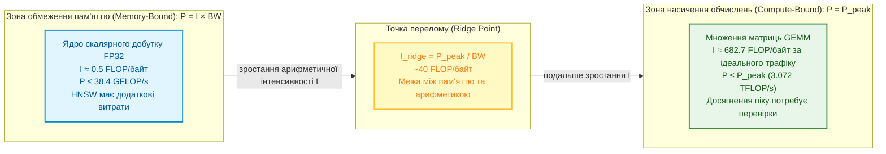

### 1.1. Граничний закон Амдала в гетерогенному конвеєрі експертної системи

Після вибору швидшого обчислювального ядра потрібно перевірити, чи прискориться вся відповідь. Класичний закон Амдала застосовують за незмінного обсягу роботи: частку базового часу прискорюють, решта часу не змінюється, додаткового передавання й перекриття етапів немає. В авторській моделі гетерогенного конвеєра прискорюваною часткою є тензорна обробка; символьна частка тут незмінна за припущенням, а не принципово неприскорювана:

<a id="obj-18-11"></a>

**Формула (18.11). Закон Амдала за незмінної решти роботи.**

$$
S_{\mathrm{system}} = \frac{1}{(1 - p_{\mathrm{tensor}}) + \frac{p_{\mathrm{tensor}}}{s_{\mathrm{acc}}}} \le \frac{1}{1 - p_{\mathrm{tensor}}}
$$

де:
- $`S_{\mathrm{system}}`$ — сукупний коефіцієнт прискорення конвеєра експертної системи ($`S_{\mathrm{system}} \ge 1`$);
- $`p_{\mathrm{tensor}}`$ — частка наскрізного часу виконання базової системи, що припадає на паралельні тензорні операції сприйняття, векторизації та авторегресивної генерації ($`0 \le p_{\mathrm{tensor}} < 1`$);
- $`1 - p_{\mathrm{tensor}}`$ — неподільна послідовна фракція часу, витрачена на транзакційну перевірку фактів, Rete/Datalog-виведення та криптографічний аудит кустодії;
- $`s_{\mathrm{acc}}`$ — коефіцієнт апаратного прискорення тензорного прискорювача порівняно з базовим CPU ($`s_{\mathrm{acc}} \ge 1`$).

**Керування рантаймом і потоком обчислень (Control Flow & Runtime Decisions):**
1. Якщо незмінна частка становить 30%, навіть усунення всього тензорного часу дає не більше 3,33 раза. Це допомагає оцінити очікуваний виграш, але не визначає економічної доцільності без цін, енергії та вимог до якості.
2. Якщо потрібний виграш перевищує цю стелю, профілюють також символьний маршрут: його структури даних, черги та пам'ять. Сама формула не вказує, який компонент купувати.
3. Скасування необов'язкової генерації допустиме, якщо символьний результат уже готовий і перевірений. Час скасування, журналювання та повернення відповіді бюджетують окремо; «один такт» із закону Амдала не випливає.

**Апаратний сайзинг та інфраструктурні обмеження (Hardware Dimensioning):**
Для конвеєра з $`p_{\mathrm{tensor}}=0{,}70`$ прискорення тензорної частини в 10 разів дає приблизно 2,70 раза для всієї відповіді, а в 100 разів — 3,26 раза. Додатковий виграш становить близько 20,5%; з цих коефіцієнтів не випливає пропорційне зростання ціни чи потужності плати.

**Практичний числовий приклад (Worked Numerical Example):**
За базового часу відповіді системи $`T_{\mathrm{base}} = 100\,\text{мс}`$ на символьну верифікацію витрачається $`30\,\text{мс}`$ ($`1 - p_{\mathrm{tensor}} = 0{,}30`$), а на генерацію тексту — $`70\,\text{мс}`$ ($`p_{\mathrm{tensor}} = 0{,}70`$). Встановлення плати прискорювача з коефіцієнтом $`s_{\mathrm{acc}} = 14`$ скорочує час генерації з $`70\,\text{мс}`$ до $`5\,\text{мс}`$. Сукупний час циклу становить $`T_{\mathrm{new}} = 30\,\text{мс} + 5\,\text{мс} = 35\,\text{мс}`$, що відповідає реальному прискоренню системи $`S_{\mathrm{system}} = 100 / 35 \approx 2{,}86\times`$. Навіть повне усунення часу генерації ($`s_{\mathrm{acc}} \to \infty`$) не дозволить системі відповісти швидше ніж за $`30\,\text{мс}`$.

**Практичні наслідки моделі Roofline та закону Амдала для інженера інфраструктури:**
- **Для операцій, обмежених пам'яттю:** спочатку розрізняють затримку звернення та насичення смуги; випробовують локальність, кешування, пакетування й квантування зі збереженням потрібної якості;
- **Для compute-bound операцій (важкі LLM-трансформери, батчевий GEMM):** Обмежувальним фактором стає кремнієва арифметика. Тут вирішальну роль відіграють спеціалізовані тензорні ядра, матричні прискорювачі та підтримка мікроформатів (FP8 / BF16).

> [!NOTE]
> **Чотири відомі обмеження гетерогенного обчислювального профілю**
> 1. Окремо оцінюють обчислювальну роботу й доступ до пам'яті; тензорні операції також можуть обмежуватися арифметикою.
> 2. Для символьного й нейромережевого маршрутів задають межі роботи; вичерпання кроків означає незавершеність, не доведений негативний висновок.
> 3. Резервування пам'яті захищає місткість ядра, а конкуренцію за кеш, шину й живлення перевіряють окремо.
> 4. Пріоритет символьного маршруту потребує перевіреного механізму скасування та окремого бюджету реакції.
> *Керування рантаймом:* Спроба нейромережевого адаптера перевищити виділений ліміт пам'яті або заблокувати символьне ядро призводить до скидання з кодом E_RESOURCE_CONTENTION_FAULT.

Отже, профіль указує, що саме порівнювати на CPU, GPU чи NPU. Наступне питання — хто обирає виконавця та перевіряє результат, якщо один запит проходить кілька пристроїв.

## 2. Експертна система як координатор гетерогенного виконання

Координатор гетерогенного виконання вирішує, кому доручити кожний етап запиту, не передаючи прискорювачу права самостійно підтверджувати факти. У запропонованій архітектурі координатор перевіряє дозволені дані, наявні ресурси й залишок часу, викликає модель та передає її результат символьному перевірнику. Наприклад, відмова сервера генерації не повинна знищити вже перевірені факти або перетворити неповну відповідь на ствердний вердикт. Для цього визначено п'ять функцій:

- **Маршрутизація за змістом запиту.** Класифікатор визначає тип запиту й обирає спеціалізовану модель, наприклад компактну модель для текстів стандартів функціональної безпеки замість моделі загального аналізу специфікацій.
- **Фільтрація контексту за політиками доступу.** Фрагменти документів, до яких користувач не має допуску, не потрапляють у контекст генеративної моделі ще до її виклику.
- **Аудит викликів.** Журнал фіксує повний відбиток виклику: хеш моделі, версію токенізатора, температуру генерації, параметри квантування.
- **Виконання малих моделей у процесі.** Моделі векторних представлень і класифікатори працюють у пам'яті процесу експертної системи без мережевих накладних витрат.
- **Делегування важких моделей.** Генерацію тексту виконують окремі середовища виконання (Ollama, vLLM, llama.cpp), описані в [Главі 17](ch17-implementation-stack.md).

<a id="obj-18-12"></a>

**Діаграма 18.12. Координатор виконання експертної системи.**

```mermaid
flowchart LR
    accTitle: Координатор виконання експертної системи
    accDescr: Запит проходить шлюз політик і архітектурне ядро, яке викликає малі моделі в процесі та зовнішнє середовище виконання, а результати збираються в доказовий пакет для людського перегляду.

    Q["<b>Запит користувача</b>"] --> P["<b>Шлюз політик</b><br/>ABAC, класифікація даних, цільові рівні обслуговування"]
    P --> C["<b>Архітектурне ядро</b><br/>контекст, граф, правила, аудит"]
    C --> S["<b>Малі моделі в процесі</b><br/>векторизація, переранжування, класифікація"]
    C --> R["<b>Зовнішнє середовище виконання</b><br/>Ollama, vLLM, llama.cpp"]
    R --> A["<b>Апаратура</b><br/>CPU, GPU, NPU"]
    S --> V["<b>Перевірка результатів</b><br/>правила, джерела, повнота"]
    R --> V
    V -->|"перевірено"| E["<b>Доказовий пакет</b>"]
    V -->|"немає підстав або вичерпано бюджет"| REF["<b>Типізована відмова</b>"]
    E --> H["<b>Людський перегляд</b><br/>перевірка критичних рішень"]

    classDef in fill:#e1f5fe,stroke:#0288d1,stroke-width:2px,color:#01579b;
    classDef core fill:#ede7f6,stroke:#512da8,stroke-width:2px,color:#311b92;
    classDef rt fill:#fff3e0,stroke:#e65100,stroke-width:2px,color:#bf360c;
    classDef out fill:#e8f5e9,stroke:#2e7d32,stroke-width:2px,color:#1b5e20;

    class Q,P in;
    class C,S core;
    class R,A rt;
    class V,E,H,REF out;
```

З практики автора сформовано **патерн клієнтської ізоляції зовнішніх середовищ виконання з аудитом автора**: експертна система добре працює як клієнт середовищ виконання з аудитом. Генерацію тексту делеговано окремому процесу через REST API, а векторизація виконується в процесі експертної системи через бібліотеки OpenVINO або ONNX Runtime. Падіння зовнішнього сервера мовної моделі тоді фіксується як помилка сервісу й не зупиняє роботу з базою знань. Межу між «у процесі» і «в окремому процесі» варто проводити свідомо, і наступний розділ пояснює, за якими критеріями.

### 2.1. Абстракція провайдерів епістемічного виконання (Epistemic Execution Providers за парадигмою ONNX Runtime) та порівняльна метрологія CPU RAM проти GPU VRAM і UMA

Провайдер виконання потрібний, щоб описати контракт пристрою незалежно від його марки. ONNX задає формат подання моделей, а ONNX Runtime (ORT) є середовищем їх виконання, не міжнародним стандартом. Його провайдери (*Execution Providers*, EP) повідомляють про підтримувані оператори; середовище може розподілити граф між ними. Це не обов'язково глобально найшвидший розподіл: переходи між пристроями теж коштують часу. Повернення на CPU можливе лише для підтримуваних операторів і має бути видимим у профілі.

За аналогією з ONNX Runtime автор запропонував архітектуру провайдерів епістемічного виконання (*Epistemic Execution Providers*, EEP), яка розділяє підбір кандидатів, числову перевірку й символьний допуск. Це концептуальна адаптація без наведеної реалізації чи порівняльного тесту; формула нижче є схемою залежностей, не рівнянням часу:

<a id="obj-18-13"></a>

**Формула (18.13). Послідовність контрактів провайдерів.**

$$
\mathcal{G}_{\mathrm{epistemic}} = \underbrace{\mathcal{G}_{\mathrm{Rel}}^{\mathrm{GPU/UMA}}}_{\text{Relevance } \in [0, 1]} \;\triangleright\; \underbrace{\mathcal{G}_{\mathrm{Num}}^{\mathrm{FPGA/ALU}}}_{\text{Fixed-Point } Q16.16} \;\triangleright\; \underbrace{\mathcal{G}_{\mathrm{Sym}}^{\mathrm{CPU}}}_{\text{ASPIC+ \& Custody}}
$$

Тут $`\mathcal{G}_{\mathrm{epistemic}}`$ — граф опрацювання; підграфи Rel, Num і Sym відповідають релевантності, числовому порівнянню та перевірці правил і походження. Символ $`\triangleright`$ означає передачу кандидата наступному перевірнику, а верхні індекси — можливе розміщення, не обов'язкову апаратуру. Графи й оцінка релевантності безрозмірні. Q16.16 — профіль фіксованої точки з 16 дробовими бітами, розібраний нижче. Наприклад, релевантний фрагмент може пройти числову перевірку, але бути відхиленим через відсутню цитату; швидкість GPU цього рішення не змінює.

При проєктуванні провайдерів виконання часто виникає спокуса повністю перенести базу знань у високошвидкісну відеопам'ять дискретного графічного прискорювача (GDDR6/HBM3) за аналогією до серверів мовних моделей (Ollama, vLLM). Проте порівняння має враховувати відмінність між одиночним інтерактивним запитом і масовим пакетним аудитом:

<a id="obj-18-14"></a>

**Таблиця 18.14. Параметр для вимірювання; CPU RAM і кеш; Дискретна GPU VRAM; Уніфікована пам'ять UMA.**

| Параметр для вимірювання | CPU RAM і кеш | Дискретна GPU VRAM | Уніфікована пам'ять UMA |
|---|---|---|---|
| **Смуга пам'яті, байт/с** | Для заданої кількості каналів і шаблону доступу | Окремо смуга VRAM і передавання хост–пристрій | Спільна смуга для CPU й GPU, не сума незалежних смуг |
| **Затримка звернення, нс** | Розрізняти влучання в кеш і читання DRAM | Вимірювати залежні читання й розходження гілок | Ураховувати когерентність і конкуренцію споживачів |
| **Запуск і синхронізація, мкс** | Немає передавання PCIe, але є виклик і планування | Запуск ядра, копіювання, очікування завершення | Відсутність копії не усуває запуску й синхронізації |
| **Критерій вибору** | Час і якість повного CPU-маршруту | Пакет має окупити всі додаткові витрати | Перевірити фактичне спільне адресування й підтримку драйвера |

Наскрізний час виконання пакету з $`B`$ одночасних перевірок нормативних правил визначається **авторським критерієм порогу рентабельності апаратного делегування $`B_{\mathrm{crit}}`$**:

<a id="obj-18-15"></a>

**Формула (18.15). Часи CPU і GPU з цілими групами.**

$$
T_{\mathrm{CPU}}(B) = B \cdot \tau_{\mathrm{CPU\_rule}}, \qquad T_{\mathrm{dGPU}}(B) = 2\,\tau_{\mathrm{PCIe}} + \left\lceil \frac{B}{W_{\mathrm{warp}}} \right\rceil \cdot \tau_{\mathrm{GPU\_step}}
$$

Тут $`B`$ — додатна ціла кількість незалежних перевірок; $`\tau_{\mathrm{CPU\_rule}}>0`$ — час однієї перевірки CPU, $`\tau_{\mathrm{PCIe}}\ge0`$ — накладні витрати одного напрямку, $`W_{\mathrm{warp}}\ge1`$ — ціла кількість перевірок в умовній паралельній групі, $`\tau_{\mathrm{GPU\_step}}>0`$ — час її обробки. Усі часи подано в мкс; $`\lceil\cdot\rceil`$ округлює вгору до цілої групи. Модель припускає сталі вартості, один послідовний CPU-потік і враховані в параметрах запуск та передавання. Вона не порівнює довільні багатоядерні реалізації.

Без округлення отримуємо лише наближений орієнтир розміру пакета:

<a id="obj-18-16"></a>

**Формула (18.16). Часи CPU і GPU з цілими групами.**

$$
B_{\mathrm{lin}} = \frac{2\,\tau_{\mathrm{PCIe}}}{\tau_{\mathrm{CPU\_rule}} - \tau_{\mathrm{GPU\_step}} / W_{\mathrm{warp}}},\qquad
B_{\mathrm{crit}}=\min\{B\in\mathbb{N}_{>0}:T_{\mathrm{dGPU}}(B)<T_{\mathrm{CPU}}(B)\}.
$$

Розмір пакета безрозмірний. Лінійний орієнтир визначений лише за додатного знаменника; інакше за цією моделлю GPU не виграє. Точний $`B_{\mathrm{crit}}`$ знаходять за початковими часами з округленням, не оголошують лінійний вираз необхідною й достатньою умовою.

Часова вигода не звільняє провайдера від числового контракту. Авторський закон міжпровайдерної побітової тотожності тут означає **вимогу до реалізацій**, а не автоматичну властивість фіксованої точки:

<a id="obj-18-17"></a>

**Формула (18.17). Вимога міжпровайдерної побітової тотожності.**

$$
\forall q \in \mathcal{Q}:\quad \mathrm{Eval}_{\mathrm{FPGA\_EP}}(\mathcal{G}_{\mathrm{Num}}, q) \equiv \mathrm{Eval}_{\mathrm{GPU\_EP}}(\mathcal{G}_{\mathrm{Num}}, q) \equiv \mathrm{Eval}_{\mathrm{CPU\_EP}}(\mathcal{G}_{\mathrm{Num}}, q)
$$

Тут $`\mathcal{Q}`$ — визначена профілем множина допустимих входів, $`q`$ — один такий вхід, а Eval — результат числового підграфа на названому провайдері; $`\equiv`$ вимагає однакових вихідних бітів і статусів помилок. Усі провайдери мають однакові масштаб, округлення, порядок операцій і політику переповнення. Для знакового 32-бітного Q16.16 крок становить $`2^{-16}`$, діапазон — від $`-32768`$ до $`32768-2^{-16}`$; одиницю фізичної величини задає правило. Добуток 0,5 на 0,5 кодується як 32768 на 32768 із 64-бітним проміжним добутком і масштабуванням до 16384, тобто 0,25. Вужчий проміжний тип або інше округлення можуть порушити тотожність. Для значення поза діапазоном потрібний визначений статус відмови, не мовчазне обертання розрядів. Один приклад перевіряє арифметику, але не доводить тотожності на всій $`\mathcal{Q}`$.

> [!NOTE]
> **Чотири запропоновані контрактні вимоги до провайдерів EEP**
> 1. **Розділення ролей:** запропонована схема відокремлює підбір кандидатів від числової перевірки й доказового допуску; конкретне розміщення визначає профіль.
> 2. **Окупність делегування:** порівнюють повні часи CPU і GPU за однакової семантики та якості, включно з неповною останньою групою.
> 3. **Побітова тотожність:** реалізації проходять диференційні тести, зокрема округлення, крайні значення й переповнення; сама назва Q16.16 не є доказом.
> 4. **Умовне резервування на CPU:** потрібні підтримувані оператори, пам'ять і залишок дедлайну. Якщо їх немає, видається відмова, не неперевірений результат.
> *Керування рантаймом / Інженерний інваріант:* Спроба зовнішнього прискорювача релевантності модифікувати прапорець кастодії доказу або повернути нецілочисельний статус допуску блокується координатором із негайним перемиканням на `CPU_EP`.

**Замкнений цикл інженерного розрахунку вибору провайдера виконання:**
1. **Керування рантаймом і потоком обчислень (Control Flow & Runtime Decisions):**
    Планувальник порівнює оцінки для поточного $`B`$, перевіряє числовий контракт і залишок часу. Уніфікована пам'ять може усунути копіювання, але не запуск, синхронізацію чи конкуренцію за шину; `cudaHostAlloc` саме по собі не доводить фізичної UMA. Помилка прискорювача запускає CPU-резерв лише за виконання його умов. Час перемикання вимірюють, не прирівнюють до нуля.
2. **Апаратний сайзинг та інфраструктурні обмеження (Hardware Dimensioning):**
    У навчальному прикладі, не вимірюванні, приймемо 5 мкс на CPU-перевірку, 240 мкс сумарних додаткових витрат GPU, 32 перевірки в групі та 1,6 мкс на групу. Лінійний орієнтир становить:

<a id="obj-18-18"></a>

**Формула (18.18). Лінійний орієнтир і точний поріг делегування.**

$$
B_{\mathrm{lin}} = \frac{240}{5-1{,}6/32}\approx48{,}48,\qquad B_{\mathrm{crit}}=49.
$$

    Результат безрозмірний: за $B=48$ CPU потребує 240 мкс, GPU — 243,2 мкс; за $B=49$ маємо 245 проти 243,2 мкс. Отже, саме 49 є першим вигідним пакетом за заданою моделлю. Інші вартості змінять межу.

3. **Практичний числовий приклад (Worked Numerical Example):**
   - *Сценарій А (Одиночний запит інженера, $`B = 1`$):* на `CPU_EP` час відповіді становить $`T_{\mathrm{CPU}}(1) = 5\,\mu\text{с}`$. Якби цей запит примусово відправили у VRAM дискретної відеокарти через PCIe, час зріс би до $`T_{\mathrm{dGPU}}(1) = 240\,\mu\text{с} + 1{,}6\,\mu\text{с} = 241{,}6\,\mu\text{с}`$ (у **$`48\times`$ повільніше** за процесор).
    - *Сценарій Б (умовна оцінка пакетного аудиту $`B = 100\,000`$ телеметричних відліків):* послідовне виконання на одному ядрі CPU за заданої вартості 5 мкс на відлік становить $`T_{\mathrm{CPU}} = 100\,000 \times 5\,\mu\text{с} = 500\,\text{мс}`$. Для зіставлення умовно приймемо $`T_{\mathrm{UMA}} = 5{,}0\,\text{мс}`$ на `GPU_UMA_EP` вузла Jetson AGX Orin і нульову вартість копіювання через спільну пам'ять LPDDR5; обидва параметри тут не підтверджені вимірюванням. За цих припущень відношення часів дорівнює $`500/5 = 100`$, але це не виміряний виграш і не гарантія для платформи. Розрахунок не охоплює запуск ядра, синхронізацію, доступ до пам'яті та інші витрати; побітову тотожність $`Q16.16`$ також потрібно перевірити окремо для конкретних реалізацій.

## 3. Ізоляція середовищ виконання і керування оперативною пам'яттю

Ізоляція середовищ потрібна, щоб відмова моделі не зупинила перевірку правил і доступ до фактів. За авторським принципом ізоляції за наслідком збою межу процесу проводять там, де потрібно локалізувати аварію. Помилка доступу до пам'яті в бібліотеці може завершити процес; окремий процес зменшує цю область збою, але не усуває відмови ядра ОС, спільного драйвера чи живлення. Вичерпання пам'яті контролюють квотами та резервом для ядра, а не лише розділенням адресних просторів. Незавершена транзакція має відкотитися за контрактом СУБД; аварія клієнта сама по собі не означає руйнування ACID.

<a id="obj-18-19"></a>

**Таблиця 18.19. Критерій; Виконання в процесі; Виконання в окремому процесі.**

| Критерій | Виконання в процесі | Виконання в окремому процесі |
|---|---|---|
| **Накладні витрати** | Немає IPC, але лишаються виклик і виконання | IPC, можлива серіалізація або спільна пам'ять; мережа не обов'язкова |
| **Наслідок збою** | Аварія бібліотеки може зупинити основний процес | Аварія користувацького процесу локалізована; спільні фізичні відмови залишаються |
| **Масштабування** | Разом з експертною системою | Незалежне, з чергою запитів |
| **Типове застосування** | Стабільні легкі бібліотеки: OpenVINO на CPU чи NPU, ONNX Runtime | Великі генеративні моделі, експериментальні драйвери GPU |

Наприклад, на вузлі з 16 ГіБ RAM умовно резервують 4 ГіБ ядру й ОС, а процесу моделі задають квоту 8 ГіБ. Залишок 4 ГіБ не є автоматично вільним: його можуть зайняти кеші й інші процеси. Запит, що потребує 9 ГіБ лише для моделі, не слід допускати в цю квоту. Перевірка примусового завершення моделі має показати, що ядро повертає помилку сервісу й зберігає перевірені факти. Наступне питання — як не дублювати великі незмінні дані між процесами.

### 3.1. Відображення бази фактів у пам'ять (mmap)

Друга проблема пов'язана з розміром бази знань. Коли база налічує мільйони фактів, потоковий розбір текстових файлів (наприклад, JSONL) у купу процесу під час старту може займати десятки секунд і гігабайти оперативної пам'яті. Для периферійних пристроїв та інтерактивних утиліт командного рядка це неприйнятно.

Розв'язок полягає в компіляції бази фактів у двійковий файл, який відображається в адресний простір процесу викликом `mmap` [[4]](#src-4). Запропонована **архітектура дворівневого двійкового індексу бази фактів на базі mmap автора** усуває накладні витрати десеріалізації: операційна система не читає такий файл цілком під час відкриття: сторінки файлу підвантажуються лише тоді, коли процес звертається до відповідних адрес. Діаграма показує дворівневу організацію такого файлу.

<a id="obj-18-20"></a>

**Діаграма 18.20. Дворівневий двійковий індекс бази фактів.**


Перший рівень, компактна таблиця нормалізованих сутностей і зсувів, постійно лежить в оперативній пам'яті й дає змогу швидко перевірити, чи згадана в запитанні сутність взагалі є в базі знань. Другий рівень містить повні атрибути й цитати; ці байти операційна система читає лише для сутностей, задіяних у поточному ланцюжку доведення. Записи фіксованого двійкового формату читаються безпосередньо з відображеної пам'яті без розбору тексту й без виділення об'єктів у купі. Такий самий незмінний пакет знань з адресацією за вмістом описано в [Главі 15](ch15-knowledge-extraction-and-kb-construction.md); тут важливо, що відображення файлу переносить вартість старту з «прочитати все» на «прочитати потрібне».

Відображений файл може бути більшим за фізичну RAM: обмеженням є адресний простір, а резидентність визначає робоча множина сторінок. Наприклад, файл на 8 ГіБ може бути відображений на вузлі з 4 ГіБ RAM, але послідовне торкання всіх його сторінок спричинить читання з накопичувача й витіснення. Це не гарантія швидкого старту чи WCET; перевірка хешу всього файла також потребує його читання. Для часово критичного маршруту окремо забезпечують резидентність, перевіряють межі записів, зсуви та незмінність файла. Якщо робоча множина завелика, застосовують буферизоване читання або поділ на шарди — частини індексу з окремими власниками. Межі `mmap` описано в розділі 3.2 [Глави 32](ch32-high-performance-knowledge-packs-mmap-and-harvesting.md), поділ — у [Главі 7](ch07-knowledge-base-typology.md). Спільне читання економить пам'ять, але тепер потрібно визначити, кому доступні ці сторінки та як захистити їхній вміст.

### 3.2. Безпечний периметр R&D: Air-Gapped виконання та захист інтелектуальної власності (IP Protection)

Захист R&D-периметра починається з питання, чи дозволено передавати конкретний документ іншому власникові обчислювальної інфраструктури. Закриті специфікації й бази правил можуть містити інтелектуальну власність або дані з договірними обмеженнями. Передавання до хмарного API змінює межу довіри; умови зберігання, навчання та доступу залежать від договору й конфігурації, а не є однаковими для всіх сервісів. Локальне виконання прибирає цей маршрут передавання, але не захищає автоматично від інсайдера, носія чи шкідливого документа.

Офіційні картки джерел визначають різні сфери: ISO/IEC 27001 встановлює вимоги до системи управління інформаційною безпекою [[44]](#src-44), а IEC 62443-4-1 визначає вимоги циклу безпечної розробки продуктів для промислових систем керування та адресована їхнім розробникам і супроводжувачам [[48]](#src-48). Ці описи не встановлюють універсального обов'язку переводити будь-яку R&D-інфраструктуру в Air-Gap. Запропонований тут профіль *Air-Gapped R&D* застосовують, коли його вимагають затверджена політика розміщення, модель загроз, договірна умова або конкретний застосовний пункт із підтвердженою редакцією, сферою й юрисдикцією. У межах такого профілю обробка визначених інженерних артефактів виконується локально, зокрема спеціалізованими Domain SLM/VLM та детермінованими символьними компіляторами; апаратний анклав є окремою мірою захисту, а не синонімом мережевої ізоляції.

<a id="obj-18-21"></a>

**Діаграма 18.21. Архітектура ізольованого дослідницького периметра Air-Gapped R&D.**

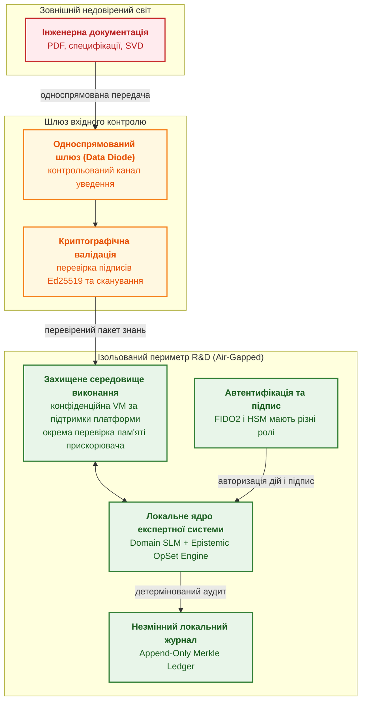

Односпрямований шлюз усе ще є каналом зв'язку: його не слід називати повною відсутністю мережевих з'єднань. SEV-SNP і TDX захищають визначені конфігурації віртуальних машин; це не загальна гарантія шифрування UMA чи захисту від скомпрометованого гостя. FIDO2 автентифікує користувача, а HSM захищає ключі й виконує визначені криптографічні операції; підпис кожного запису потребує окремого протоколу.

Для кількісного навчального прикладу застосовано стандартну модель очікуваних втрат від ексфільтрації: втрати за події пов'язують з імовірністю цієї події:

<a id="obj-18-22"></a>

**Формула (18.22). Очікувані втрати за події витоку.**

$$
R_{\mathrm{exfil}} = V_{\mathrm{asset}} P_{\mathrm{leak}}.
$$

**Збережена межа попередньої редакції:** безумовну рівність імовірності добутку ефективностей бар'єрів не застосовують у шлюзі. Добуток нижче залишається умовною ілюстрацією незалежності, не підтвердженим показником захищеності.

У базовій формулі $`R_{\mathrm{exfil}}`$ — очікувані втрати в USD, $`V_{\mathrm{asset}}>0`$ — сталі втрати за події, а $`P_{\mathrm{leak}}\in[0,1]`$ — її ймовірність за заданий горизонт. Приклад нижче показує й незалежні бар'єри, й консервативну оцінку залежних; спільна причина відмови не зникає від наявності кількох засобів захисту.

де:
- $`R_{\mathrm{exfil}}`$ — очікувані втрати власника від події $`E`$ за горизонт $`H`$ (USD), від $`0`$ до $`V_{\mathrm{asset}}`$;
- $`V_{\mathrm{asset}}`$ — втрати власника за умови події $`E`$ (USD): вартість захищуваного R&D-активу, регуляторні штрафи та витрати на розробку ($`V_{\mathrm{asset}} > 0`$);
- $`P_{\mathrm{leak}} \in [0, 1]`$ — імовірність події $`E`$ за горизонт $`H`$ за моделлю порушника $`\mathcal{A}`$;
- $`\eta_{\mathrm{net}} \in [0, 1]`$ — ефективність мережевого розмежування: VLAN (IEEE 802.1Q, логічна сегментація L2, не фізична ізоляція) $`\eta_{\mathrm{net}} = 0{,}70`$, керований брандмауер $`\eta_{\mathrm{net}} = 0{,}92`$, фізичний розрив з односпрямованим шлюзом *Data Diode* $`\eta_{\mathrm{net}} = 0{,}9999`$;
- $`\eta_{\mathrm{enc}} \in [0, 1]`$ — ефективність криптографічного шифрування оперативної пам'яті та накопичувачів (для стандартного шифрування хоста $`\eta_{\mathrm{enc}} = 0{,}85`$, для апаратних анклавів AMD SEV-SNP / Intel TDX $`\eta_{\mathrm{enc}} = 0{,}995`$);
- $`\eta_{\mathrm{auth}} \in [0, 1]`$ — ефективність автентифікації інженерних операцій (парольний захист $`\eta_{\mathrm{auth}} = 0{,}60`$, апаратний FIDO2 / криптографічний HSM-токен з неподільним Ed25519-підписом кожної сесії $`\eta_{\mathrm{auth}} = 0{,}999`$).

Наведені значення $`\eta`$ є умовними значеннями прикладу для ілюстрації порядку величин, без вибірки чи протоколу. Для реальної оцінки невідоме $`\eta_i`$ не можна замінювати на 0 або 1.

**Модель ризику й правило шлюзу.** Подія $`E`$ — несанкціоноване винесення активу або частини, достатньої для його відтворення. Власник ризику задає горизонт $`H>0`$ у днях чи роках, модель порушника $`\mathcal{A}`$ і скінченну цілу верхню межу числа спроб $`N_H\ge0`$. Припускається, що перелічені бар'єри покривають усі враховані маршрути. Якщо, наприклад, інсайдер може скопіювати відкритий файл в обхід шифрування пам'яті, така спроба не відповідає моделі трьох послідовних бар'єрів і потребує окремої гілки аналізу.

Нехай $`p_i=1-\eta_i`$ — маргінальна ймовірність незупиненої спроби бар'єром $`i`$ для тієї самої сукупності спроб, $`i\in\{1,2,3\}`$. Це не умовна ймовірність після проходження попереднього бар'єра. Для перетину подій межі Фреше не потребують незалежності; добуток дозволений лише за взаємної незалежності. Для кількох спроб застосовують межу об'єднання, також без припущення їхньої незалежності:

<a id="obj-18-23"></a>

**Формула (18.23). Консервативні межі ризику за горизонт.**

$$
\max(0,p_1+p_2+p_3-2)\le p_{\mathrm{att}}\le\min_i p_i,
\qquad
\overline P_{\mathrm{leak}}=\min(1,N_H\overline p_{\mathrm{att}}),
\qquad
\overline R_{\mathrm{exfil}}=V_{\mathrm{asset}}\overline P_{\mathrm{leak}}.
$$

Тут $`p_{\mathrm{att}}\in[0,1]`$ — імовірність подолати всі бар'єри за одну спробу; $`\overline p_{\mathrm{att}}\in[0,1]`$ — обґрунтована верхня межа для кожної спроби. Без незалежності беруть мінімум $`p_i`$, за обґрунтованої незалежності можливий добуток. $`\overline P_{\mathrm{leak}}`$ — верхня ймовірність за горизонт, обмежена одиницею; $`\overline R_{\mathrm{exfil}}`$ — верхня оцінка втрат у USD, не самі очікувані втрати. Надалі в правилі шлюзу $`R_{\mathrm{exfil}}`$ означає саме цю консервативну оцінку. Спільна причина відмови бар'єрів не може бути виключена добутком. Невідомий параметр залишає оцінку невизначеною, а не нульовою.

Пороги $`P_{\max}\in[0,1]`$ і $`\tau_{\mathrm{risk\_accept}}>0`$ у USD затверджує власник ризику. Наприклад, для 20 000 спроб із верхньою межею $`10^{-4}`$ отримуємо не ймовірність 2, а верхню межу 1: така оцінка не підтверджує безпечності. Числа $`10^{-4}`$ і 500 USD у наступному прикладі є авторською політикою, не нормативною шкалою.

Дозвіл на монтаж тому знань (`SEV_SNP_INIT_OK`) видається лише за одночасного виконання умов:
1. Клас системи, політику розміщення та профіль ризику визначено для конкретного виробу й юрисдикції. *Air-Gapped Sovereign* застосовується лише за підстави з §4: його не вмикає автоматично клас ASIL або позначка *safety-critical*, а клас QM сам не дозволяє передавання даних назовні.
2. $`\overline{P}_{\mathrm{leak}}`$ визначено і $`\overline{P}_{\mathrm{leak}} \le P_{\max}`$.
3. $`R_{\mathrm{exfil}}`$ визначено і $`R_{\mathrm{exfil}} < \tau_{\mathrm{risk\_accept}}`$.
4. Значення $`\eta_i`$ відповідають фактично розгорнутим бар'єрам, зокрема $`\eta_{\mathrm{enc}}`$ — апаратному анклаву, у який монтують том.
5. `Strict Isolation Lock` не активний.

За невиконання будь-якої умови оркестратор активує `Strict Isolation Lock`; у вже затвердженому профілі *Air-Gapped Sovereign* порушення умов (2)–(4) також відхиляє монтаж типізованою відмовою. $`\overline{P}_{\mathrm{leak}}`$ і $`R_{\mathrm{exfil}}`$ переоцінюють за кожної зміни конфігурації бар'єрів, оцінок $`\eta_i`$, $`V_{\mathrm{asset}}`$ або параметрів профілю ризику ($`H`$, $`\mathcal{A}`$, $`N_H`$, $`P_{\max}`$, $`\tau_{\mathrm{risk\_accept}}`$). `Strict Isolation Lock` знімає лише людина з мандатом власника ризику після повторного розрахунку за поточною конфігурацією, який підтверджує виконання умов (1)–(4); автоматичного зняття немає.

#### 3.2.1. Замкнений цикл інженерного розрахунку ризику ексфільтрації R&D-активів

1. **Керування рантаймом і потоком обчислень (Control Flow & Runtime Decisions):**
    - Якщо не виконано хоча б одну з умов (1)–(5) моделі ризику §3.2 (зокрема $`\overline{P}_{\mathrm{leak}} > P_{\max}`$, $`\overline{P}_{\mathrm{leak}}`$ не визначено або $`R_{\mathrm{exfil}} \ge \tau_{\mathrm{risk\_accept}}`$), оркестратор активує `Strict Isolation Lock`: блокує USB-накопичувачі, нешифровані дампи пам'яті та завантаження нових вагів або баз правил.
    - Дозвіл на монтаж тому знань у режимі `read-only` всередині шифрованого анклава пам'яті (`SEV_SNP_INIT_OK`) видається лише за одночасного виконання умов (1)–(5). У прикладі авторської політики $`P_{\max} = 10^{-4}`$ і $`\tau_{\mathrm{risk\_accept}} = 500\,\text{USD}`$ є умовними параметрами профілю.
    - $`\overline{P}_{\mathrm{leak}}`$ і $`R_{\mathrm{exfil}}`$ переоцінюють за кожної зміни конфігурації бар'єрів, оцінок $`\eta_i`$, $`V_{\mathrm{asset}}`$ або параметрів профілю. `Strict Isolation Lock` знімає лише людина з мандатом власника ризику після повторного розрахунку, який підтвердив умови дозволу; автоматичного зняття немає.
2. **Апаратний сайзинг та інфраструктурні обмеження (Hardware Dimensioning):**
    - Смугу контрольованого ввезення вибирають за обсягом і вікном оновлення, а не за універсальною вимогою 10 Гбіт/с.
    - Для умовних 16 ГБ ваг і 8 ГБ резидентних фактів множник запасу 1,5 дає 36 ГБ, не 48 ГБ. Конфігурація на 48 ГБ залишає 12 ГБ понад цю оцінку; окремо перевіряють KV-кеш, ОС і підтримку захисту пам'яті. Місткість не доводить захищеності.
3. **Практичний числовий приклад (Worked Numerical Example):**
    - Для умовного R&D-пакета знань польотного контролера втрати власника за умови події $`E`$ становлять $`V_{\mathrm{asset}} = 5\,000\,000\,\text{USD}`$.
    - Для умовних значень VLAN $`\eta_{\mathrm{net}} = 0{,}70`$, шифрування $`\eta_{\mathrm{enc}} = 0{,}85`$ і автентифікації $`\eta_{\mathrm{auth}} = 0{,}60`$ за припущення незалежності $`p_{\mathrm{att}} = (1 - 0{,}70) \cdot (1 - 0{,}85) \cdot (1 - 0{,}60) = 0{,}018`$ на одну спробу. За $`N_H = 1`$ це дає ілюстративну оцінку $`P_{\mathrm{leak}} = 0{,}018`$ і $`R_{\mathrm{exfil}} = 90\,000\,\text{USD}`$. Без незалежності межа Фреше дає $`p_{\mathrm{att}} \le \min(0{,}30, 0{,}15, 0{,}40) = 0{,}15`$ і $`R_{\mathrm{exfil}} \le 750\,000\,\text{USD}`$ за одну спробу; обидва варіанти перевищують прикладний поріг $`500\,\text{USD}`$.
    - Для ілюстративного профілю *Air-Gapped R&D* зі значеннями $`\eta_{\mathrm{net}} = 0{,}9999`$, $`\eta_{\mathrm{enc}} = 0{,}995`$ і $`\eta_{\mathrm{auth}} = 0{,}999`$ припущення незалежності дає $`p_{\mathrm{att}} = 5 \cdot 10^{-10}`$. За $`N_H = 1`$ це дає $`R_{\mathrm{exfil}} = 0{,}0025\,\text{USD}`$. Без незалежності межа Фреше дає $`p_{\mathrm{att}} \le \min(10^{-4}, 5\cdot10^{-3}, 10^{-3}) = 10^{-4}`$ і $`R_{\mathrm{exfil}} \le 500\,\text{USD}`$. Оскільки поріг прикладу дорівнює $`500\,\text{USD}`$, а шлюз вимагає $`R_{\mathrm{exfil}} < \tau_{\mathrm{risk\_accept}}`$, допуск не надається. Приклад ілюструє арифметику, а не доведену захищеність.

### 3.3. Захист від прихованих каналів витоку даних та апаратне партиціювання кешу (Intel RDT / ARM MPAM)

Фізичне відключення мережевого кабелю (наївний *Air-Gap*) не захищає систему, якщо на спільному апаратному сервері або периферійному модулі одночасно співіснують доказове ядро експертної системи та сторонні недовірені підсистеми (наприклад, сторонні плагіни, контейнери мовних моделей чи драйвери периферійного зору). У мультиагентних та гетерогенних середовищах розроблено **таксономію мікроархітектурних та фізичних прихованих каналів витоку автора (Covert Channels / TEMPEST)** [[45]](#src-45):
1. **Мікроархітектурні часові канали через кеш-пам'ять другого та третього рівнів (L2/L3 Cache Timing Attacks):** Атаки класів *Flush+Reload*, *Prime+Probe* та *Evict+Time* дозволяють недовіреному процесу вимірювати час доступу до ліній кешу, відновлюючи секретні криптографічні ключі, послідовності звернення до правил у дереві Rete або нормативні індекси;
2. **Конкуренція за смугу пропускання системної пам'яті (Memory Bandwidth Starvation):** Агресивний сторонній процес може навмисно переповнювати черги контролера DDR, викликаючи багаторазове збільшення затримки звернення ядра експертної системи до відображеного файлу `mmap`;
3. **Фізичні побічні випромінювання (TEMPEST):** Модуляція швидкості обертання вентиляторів охолодження GPU (акустичний канал), високочастотне мерехтіння світлодіодів активності GPIO (оптичний канал) або стрибки споживання струму на шинах живлення під час матричних множень (електромагнітний витік).

Для зменшення частини міжпроцесної інтерференції деякі процесори підтримують Intel RDT або ARM MPAM. CAT обмежує доступні способи асоціативності кешу (*ways*), не резервує довільні окремі лінії та не усуває всі приховані канали. MBA/MPAM надають залежні від реалізації засоби керування трафіком; підтримку перевіряють для конкретного процесора й ОС. Наявність назви технології не доводить мінімальної гарантованої смуги DRAM.

Для оцінювання смуги пам'яті визначеного профілю вимірюють фактичний трафік ядра за заданого розподілу ресурсів:

<a id="obj-18-24"></a>

**Формула (18.24). Виміряна середня смуга профілю.**

$$
\mathrm{BW}_{\mathrm{meas}} = \frac{M_{\mathrm{read}}}{T_{\mathrm{meas}}}, \qquad \mathrm{BW}_{\mathrm{meas}} \ge \mathrm{BW}_{\min\_req}
$$

- $`M_{\mathrm{read}}`$ — байти, фактично передані через визначений рівень пам'яті під час тесту;
- $`T_{\mathrm{meas}}>0`$ — тривалість вимірювального інтервалу в секундах; $`M_{\mathrm{read}}\ge0`$, обидві величини скінченні;
- $`\mathrm{BW}_{\mathrm{meas}}`$ — виміряна середня пропускна здатність профілю в байтах за секунду або у явно зазначених кратних одиницях;
- $`\mathrm{BW}_{\min\_req}`$ — цільовий поріг конкретного профілю, обґрунтований його робочим навантаженням і часовими вимогами, а не універсальне нормативне значення.

CAT розподіляє місткість кешу останнього рівня, а MBA/MPAM надають засоби моніторингу чи обмеження трафіку відповідно до підтримки конкретного процесора. Частка виділених ліній кешу не дорівнює гарантованій частці пропускної здатності DRAM. Для твердження про жорстку часову межу потрібна документована межа арбітражу платформи або окремий кваліфікований аналіз; середнє вимірювання не є WCET.

#### 3.3.1. Замкнений цикл інженерного розрахунку смуги витоку через приховані канали

1. **Керування рантаймом і потоком обчислень (Control Flow & Runtime Decisions):**
    - Диспетчер призначає різним класам задач допустимі неперекривні маски ways, якщо це підтримує платформа. Повна маска одного класу не може водночас бути неперекривною з ненульовою маскою іншого.
    - Моніторинг трафіку порівнюють із порогом профілю. За перевищення зменшують фонове навантаження й вимірюють час реакції; автоматичного миттєвого переривання чи гарантованих 10% смуги з MBM не випливає.
    - Фізичні побічні канали оцінюють окремо. Випадкова зміна обертів вентилятора не є доведеним усуненням акустичного каналу і може погіршити охолодження; її не слід вмикати як універсальний захист.
2. **Апаратний сайзинг та інфраструктурні обмеження (Hardware Dimensioning):**
    - Кількість ways і доступні засоби керування беруть із документації конкретного виробу; 16 ways нижче — параметр прикладу, не мінімальна вимога.
    - Екранування й фільтри вибирають за моделлю загроз і застосовними вимогами. Відповідність NATO SDIP-27 без доступного пункту й випробувань тут не встановлюється.
3. **Практичний числовий приклад (Worked Numerical Example):**
   - Серверний вузол має 16-секційний кеш L3 ($`M_{\mathrm{total\_ways}} = 16`$) та 4-канальну пам'ять DDR5 із піковою смугою $`\mathrm{BW}_{\mathrm{bus\_peak}} = 102{,}4\,\text{ГБ/с}`$.
    - Умовний профіль задає $`\mathrm{BW}_{\min\_req} = 20\,\text{ГБ/с}`$ як проєктну ціль для визначеного навантаження; це не вимога стандарту.
    - Архітектор може налаштувати CAT/ MBA, наприклад виділити ядру 4 з 16 ліній кешу та обмежити сторонній клас обслуговування. Ці налаштування самі не визначають смугу DRAM.
    - Для ілюстративного числового прикладу припустімо, що окреме профільне вимірювання показало $`M_{\mathrm{read}} = 25{,}6\,\text{ГБ}`$ за $`T_{\mathrm{meas}} = 1\,\text{с}`$. Тоді $`\mathrm{BW}_{\mathrm{meas}} = 25{,}6\,\text{ГБ/с}`$, що перевищує задану ціль на 28%. Це умовний розрахунок, не результат стенда й не доказ жорсткої часової гарантії.
    - Якщо потрібна саме гарантована межа для реального часу, її підтверджують арбітражем цільової платформи й аналізом найгіршого випадку; інакше профіль не позначають як такий, що має гарантовану пропускну здатність.

> [!NOTE]
> **П'ять правил безпечної ізоляції рантаймів та керування пам'яттю за архітектурою автора**
> 1. Розділення просторів адрес: запуск нейромережевих рушіїв в окремих непривілейованих процесах або пісочницях без прямого доступу до пам'яті ядра.
> 2. Нульове копіювання через mmap: спільне використання статичних графів знань і словників у режимі MAP_SHARED / PROT_READ без дублювання в пам'яті процесів.
> 3. Квота KV-кешу: попереднє резервування зменшує ризик динамічного вичерпання пам'яті; межі контексту й паралельності перевіряють при прийманні запиту.
> 4. Локалізація аварій: відмову процесу моделі випробовують окремо від спільних відмов драйвера, пам'яті та живлення.
> 5. Санітизація сесії: визначають строк зберігання й очищення буферів, копій, дампів і журналів; занулення одного буфера не доводить видалення всіх копій.
> *Керування рантаймом:* Будь-який неперехоплений збій або спроба неавторизованого читання поза виділеним буфером адаптера блокується з кодом E_ADAPTER_ISOLATION_BARRIER.

Ізоляція дає перелік перевірюваних бар'єрів, а не абсолютну невразливість. Після визначення цих меж можна вирішувати, на якому вузлі тримати кожний компонент і що залишиться доступним без мережі.

## 4. Топології розгортання: від дата-центру до бортового сенсора

Топологія розгортання відповідає на питання, де залишаться потрібні факти й правила, якщо зв'язок зникне. Наприклад, експертна система обслуговування верстата може зберігати локально перевірку допустимого режиму, на цеховому сервері — історію вимірювань, а у власному периметрі — повну базу документів. Хмара може обробляти дозволені відкриті дані. Якщо рішення потрібне за 100 мс, а верхня межа мережевого очікування невідома, хмарний виклик не можна включати до гарантованого маршруту. Авторська чотирирівнева модель розрізняє периферію, проміжний вузол, власний периметр і хмару; клас ASIL сам по собі не визначає це розміщення.

<a id="obj-18-25"></a>

**Діаграма 18.25. Топології розгортання експертної системи.**

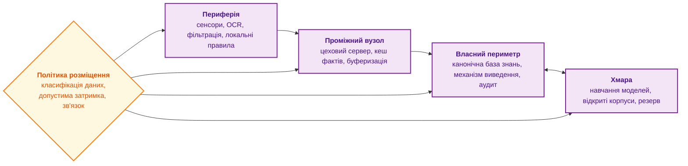

Кожен рівень має свою роль:

- **Власний периметр** (*on-premise*) реалізує **запропонований автором принцип суверенного розміщення даних**: для оборонних, авіаційних, енергетичних і медичних застосувань політика організації може вимагати, щоб первинні дані не залишали її меж, а канонічна база знань і журнал аудиту залишалися під її контролем. Це правило розгортання конкретного профілю, не самостійний висновок із класу ASIL.
- **Периферія** (*edge*) може локально виконувати правила, дані й залежності, потрібні для автономної реакції. Працездатність за втрати зв'язку перевіряють; локальність не усуває відмов сенсора чи живлення.
- **Проміжні вузли** агрегують потоки телеметрії від десятків периферійних контролерів, виконують дедуплікацію й фільтрацію перед передаванням до центральної бази. Концепцію таких вузлів між периферією та хмарою Бономі та співавтори назвали туманними обчисленнями (*fog computing*) [[5]](#src-5).
- **Хмара** підходить для навчання моделей, обробки відкритих корпусів і резервних пакетних обчислень, але конфіденційні дані туди потрапляють лише за явним рішенням політики розміщення.

Для навчального порівняння виділено **два профілі розгортання**. Це звичайні архітектурні варіанти, не нова таксономія й не універсальна нормативна вимога стандарту:
1. **Закритий автономний профіль (*Air-Gapped Sovereign*):** застосовується, коли затверджена політика розміщення, модель загроз, договірна умова або конкретний нормативний пункт вимагає нульового зовнішнього мережевого зв'язку. Сам ярлик ASIL, DAL чи SIL не доводить обов'язковості цього профілю; його підставу фіксують для конкретного виробу й юрисдикції (див. підрозділ 3.2).
2. **Гібридний корпоративний профіль (*Hybrid Policy-Gated*):** допускається лише коли затверджена класифікація даних і політики ABAC/DLP дозволяють передавання визначених знеособлених фрагментів або обробку відкритих корпусів. Це не автоматичний дозвіл для QM і не автоматична заборона для класів ASIL.

Топології описують, де працює експертна система, коли відповідає користувачеві. Пакетні задачі на кшталт повного переіндексування корпусу мають інший профіль: вони не потребують відповіді за мілісекунди, але потребують багато обчислень, і для них існує ще одна топологія.

## 5. Фонове індексування на простійних NPU робочих станцій

Зміна моделі векторних представлень змушує переіндексувати весь корпус: вектори різних моделей не можна порівнювати між собою, тож кожен фрагмент треба векторизувати заново. Чи встигне один прискорювач обробити корпус у доступне вікно, визначають за темпом конкретної моделі; відправлення конфіденційних специфікацій до хмари може забороняти політика розміщення. Водночас ноутбуки й робочі станції інженерів можуть мати вбудований нейронний процесор із доступними періодами простою. Ідея використати простій чужих машин давня: система керування пакетними задачами Condor Літцкова, Лівні й Мутки ще 1988 року запускала задачі на робочих станціях, власники яких на той момент не працювали [[6]](#src-6), а платформа BOINC Андерсона поширила той самий підхід на добровільні обчислення в інтернеті [[7]](#src-7). У монографії запропоновано застосувати цей підхід до фонового індексування: роздільник ділить корпус на незалежні одиниці роботи, а агенти на робочих станціях виконують векторизацію на своїх NPU. Це пропозиція, а не перевірена архітектура; перед реалізацією потрібно визначити авторизацію вузлів, ізоляцію й захист даних, мережеву модель довіри, перевірку результатів і виміряти ефективність.

Розподілена мережа є кандидатом для порівняння, не доведеним виграшем. Уже придбане обладнання зменшує капітальні витрати, але енергію на прийнятий результат, доступність і вартість супроводу потрібно виміряти. NPU не завжди споживає менше енергії за CPU на всьому маршруті: додаткове передавання, запуск моделі й повернення на CPU можуть змінити результат. Периметр організації теж не є одним рівнем довіри: фрагмент дозволяють передати лише конкретно авторизованому вузлу.

### 5.1. Класифікація задач для розподіленої мережі NPU

Задача підходить для мережі NPU лише тоді, коли виконуються всі шість умов:

1. **Підтримуваний режим моделі.** У цьому проєкті мережа виконує навчені моделі; можливості конкретного NPU й програмного стека перевіряють окремо.
2. **Підтримувані оператори й форми.** Компілятор може вимагати фіксованих розмірів або обмежень динамічних форм [[8]](#src-8). Успішне завантаження моделі не доводить, що всі її оператори виконуються на NPU.
3. **Незалежні одиниці роботи.** Фрагменти обробляються окремо, без обміну даними між вузлами.
4. **Терпимість до затримки.** Вузол може заснути, вимкнутися чи зайнятися роботою власника, тож мережа годиться для пакетів, а не для відповіді користувачеві.
5. **Достатня точність FP16 чи INT8.** Задача не потребує обчислень подвійної точності.
6. **Дозволене переміщення даних.** Політика класифікації дозволяє передати фрагмент на інший вузол ([Глава 10](ch10-knowledge-acquisition-systems.md)).

Векторизація, переранжування й класифікація є кандидатами, але кожну модель перевіряють за шістьма умовами. Не можна загалом виключити генерацію на NPU: придатність визначають модель, оператори й середовище виконання. Натомість звичайне стиснення DEFLATE або zstd не слід переносити на тензорний прискорювач без відповідної реалізації та вимірювань; CPU є базовим варіантом ([Глава 32](ch32-high-performance-knowledge-packs-mmap-and-harvesting.md)).

### 5.2. Архітектура та протокол координації мережі

Схема показує мережу на основі NATS JetStream, шару надійного зберігання повідомлень у тому самому брокері NATS, через який система здобуття знань обмінюється даними з експертною системою ([Глава 10](ch10-knowledge-acquisition-systems.md), [Глава 17](ch17-implementation-stack.md)).

<a id="obj-18-26"></a>

**Діаграма 18.26. Мережа фонового індексування на NPU робочих станцій.**

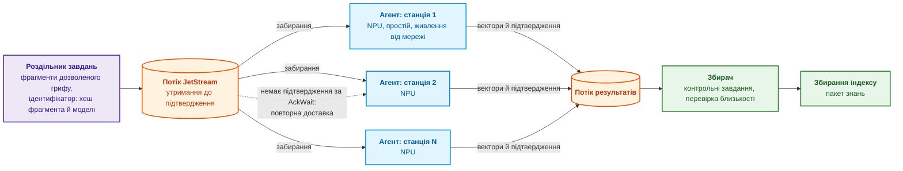

Фіолетовий блок готує роботу, помаранчеві блоки є потоками брокера, сині блоки є агентами на станціях, зелені блоки перевіряють і використовують результат. Надійність мережі тримається на чотирьох рішеннях.

1. **Одиниці роботи й ідемпотентність.** Ідентифікатор охоплює вміст, модель, токенізатор, конфігурацію й схему виходу. JetStream допускає повторну доставку після втрати підтвердження [[9]](#src-9); збереження результату має бути ідемпотентним. Підтвердження надсилають після надійного прийняття результату, а збій між записом і підтвердженням перевіряють окремо. Два різні результати для одного ідентифікатора потребують перевірки конфлікту, не мовчазного вибору першого.
2. **Поведінка «доброго сусіда».** Агент бере роботу, лише коли станція простоює, живиться від мережі й NPU вільний, і звільняє NPU, щойно NPU знадобився власникові: операційна система й застосунки власника, наприклад обробка відео під час наради, теж можуть використовувати NPU. Агент також обмежує власне споживання пам'яті, бо вбудований NPU ділить оперативну пам'ять із рештою станції.
3. **Відтворюваність між вузлами.** Станції мають різні покоління NPU й різні версії драйверів, а обчислення у FP16 дають на різній апаратурі трохи різні вектори (розділ про числовий дрейф нижче). Тому модель і її версію фіксують, кожен вузол перед допуском проходить перевірку на контрольному наборі фрагментів із відомими векторами (косинусна близькість не нижча за поріг), а збирач періодично підкидає контрольні завдання з відомою відповіддю. Вузол, що не пройшов перевірку, виключають з мережі до з'ясування причини.
4. **Безпека передавання.** З'єднання захищають взаємною автентифікацією TLS і обліковими даними NATS, а до мережі потрапляють лише фрагменти, гриф яких дозволяє переміщення. Агент не зберігає текст фрагмента після векторизації.

### 5.3. Оцінка сумарної обчислювальної продуктивності

Оцінка сумарної продуктивності відповідає на питання, чи варто віддавати корпус фоновій мережі в доступне вікно обслуговування. Піки NPU не підсумовують: потрібний темп прийнятих векторів на конкретній моделі. У спрощеній авторській моделі кожний вузол має сталий темп під час доступності й частку втрат, а брокер та збирач не є спільним вузьким місцем:

<a id="obj-18-27"></a>

**Формула (18.27). Очікуваний темп фонової мережі.**

$$
Q_{\text{eff}} = \sum_{i=1}^{M} q_i \, a_i \, (1 - o_i)
$$

де:
- $`Q_{\text{eff}}`$ — математичне сподівання інтегральної пропускної здатності розподіленої мережі фонового індексування, вимірюване у згенерованих та верифікованих векторах за секунду ($`\text{vectors}/\text{s}`$);
- $`M`$ — скінченна невід'ємна ціла кількість станцій; $`i`$ перебирає їх від 1 до $`M`$;
- $`q_i\ge0`$ — скінченний темп вузла під час доступності у векторах/с. Для розгортання його вимірюють; 240 векторів/с нижче — умовне число прикладу, не встановлена характеристика Intel NPU;
- $`a_i`$ — коефіцієнт експлуатаційної доступності $`i`$-ї станції ($`a_i \in [0, 1]`$), що визначає частку часу, коли машина живиться від стаціонарної електромережі, процесор перебуває в стані простою (відсутня активність користувача $`> 5`$ хв), а системний планувальник дозволяє запуск фонового демона;
- $`o_i`$ — коефіцієнт накладних витрат і втрат продуктивності ($`o_i \in [0, 1]`$), що враховує затримки TLS-рукостискання, передавання пакетів через NATS JetStream, повторні відправлення при перевищенні `AckWait` та витрати на обчислення контрольних завдань валідації.

**Практичне застосування та інженерні висновки:**
1. Розрахунок викликається системним архітектором перед початком міграції бази знань на нову розмірність або архітектуру ембеддингів для оцінки тривалості технологічного вікна:

<a id="obj-18-28"></a>

**Формула (18.28). Орієнтир тривалості переіндексації.**

$$
T_{\text{reindex}} = \frac{N_{\text{total}}}{Q_{\text{eff}}}
$$

    де $`N_{\text{total}}\ge0`$ — ціла кількість фрагментів, а $`Q_{\text{eff}}>0`$ — оцінка прийнятих векторів/с; результат має одиниці секунд. За нульового темпу завершення не планується. Ділення обсягу на середній темп є орієнтиром, не математичним сподіванням випадкового часу завершення й не гарантією дедлайну. Лінійність сподівання суми не потребує незалежності вузлів, але спільне вимкнення всіх станцій різко змінює ризик запізнення.
2. **Числовий орієнтир і калібрування (за розрахунковою оцінкою автора):** Для парку з $`M = 200`$ офісних станцій ($`q_i \approx 240\text{ vectors/s}`$, $`a_i \approx 0{,}10`$, $`o_i \approx 0{,}20`$) ефективний темп становить:

<a id="obj-18-29"></a>

**Формула (18.29). Числовий приклад фонової мережі.**

$$
Q_{\text{eff}} = 200 \times 240 \times 0{,}10 \times (1 - 0{,}20) = 3\,840\text{ vectors/s}
$$

    За цих умовних параметрів орієнтир часу для 20 мільйонів фрагментів становить $`T_{\text{reindex}} \approx 20 \times 10^6 / 3840 \approx 5\,208\text{ s} \approx 1{,}45\text{ год}`$. Це навчальний розрахунок за моделлю, не вимір мережі й не порівняння з серверним CPU. Для вибору між ними потрібний однаковий корпус і протокол приймання векторів.
3. **Критерії диспетчеризації та карантину:**
    - Поріг доступності 0,03 може бути параметром авторського профілю: рішення також враховує тривалість одиниці роботи й частоту повторної доставки.
    - Якщо оцінка перевищує умовне шестигодинне вікно, планувальник попереджає про ризик; резервні сервери залучають лише за їхньої доступності й дозволу політики. Зменшення порогу простою не повинне порушити пріоритет роботи власника станції.

Мережа простійних NPU розширює обчислювальні можливості власного периметра без нових серверів, але працює лише для пакетних задач. Інтерактивна генерація пояснень потребує окремої станції, і наступний розділ порівнює платформи, доступні або анонсовані станом на жовтень 2026 року.

> [!NOTE]
> **Чотири практичні вимоги до фонового збору й індексування на NPU**
> 1. Неінвазивна утилізація простійних обчислювачів: активація нейронних процесорів суто за наявності невикористаних теплових і енергетичних лімітів.
> 2. Атомарність пакетного збору: векторизовані фрагменти публікуються в канонічний індекс виключно перевіреними транзакційними пакетами з валідацією контрольних сум.
> 3. Пріоритет інтерактивного переривання: фонові пакети мають перевірений час зупинки або завершення поточної одиниці роботи; миттєве витіснення NPU не припускається.
> 4. Детермінована прив'язка до версії: кожен сформований на NPU індекс маркується криптографічним хешем першоджерела та конвеєра квантування.
> *Керування рантаймом:* Перевищення фоновим процесом порогу затримки інтерактивного тракту активує негайне переривання з кодом E_NPU_PREEMPTION_TRIGGERED.

## 6. Локальні платформи для моделей: стан на жовтень 2026 року

Локальну платформу вибирають не за кількістю назв у каталозі, а за пам'яттю, темпом потрібної моделі та підтримкою операторів. Наприклад, умовні 35 ГБ ваг, 8 ГБ KV-кешу і 5 ГБ робочих буферів разом потребують 48 ГБ доступної прискорювачу пам'яті; пристрій на 32 ГБ не підходить, а 64 ГБ залишає 16 ГБ запасу лише відносно цих складників. Це розрахунок місткості, не швидкості. Уніфікована пам'ять спільна для CPU й GPU, тому повний паспортний обсяг не дорівнює доступному моделі. Далі наведено збережений історичний огляд станом на 8 жовтня 2026 року; його роль — показати поля для перевірки, не рекомендувати неперевірений продукт до закупівлі.

У таблиці нижче пікову продуктивність наведено так, як її подає виробник: у TOPS (трильйонах операцій за секунду), TFLOPS або PFLOPS (трильйонах чи квадрильйонах операцій з рухомою комою за секунду) для форматів FP4, FP8 або FP16, тобто 4-, 8- чи 16-бітних чисел з рухомою комою. LPDDR5X є енергоощадною оперативною пам'яттю, спільною для CPU і GPU, а GDDR6 і GDDR7 є окремою пам'яттю графічного прискорювача. У стовпці програмного стека CUDA (*Compute Unified Device Architecture*) є платформою обчислень на GPU NVIDIA, ROCm є відкритою платформою AMD того самого призначення, а WSL (*Windows Subsystem for Linux*) є підсистемою Windows для виконання програм Linux. Рядки впорядковано від настільних станцій до серверних прискорювачів і NPU ноутбуків.

<details>
<summary>Історичний огляд платформ: заявлені параметри й статуси, без повторної зовнішньої звірки</summary>

<a id="obj-18-30"></a>

**Таблиця 18.30. Платформа; Статус у вихідному огляді на 8 жовтня 2026 року; Пам'ять для моделі; Пропускна здатність пам'яті; Заявлений пік і формат; Програмний стек.**

| Платформа | Статус у вихідному огляді на 8 жовтня 2026 року | Пам'ять для моделі | Пропускна здатність пам'яті | Заявлений пік і формат | Програмний стек |
|---|---|---|---|---|---|
| **NVIDIA DGX Spark**, настільна станція на системі на кристалі GB10 | продається з 15 жовтня 2025 року [[10]](#src-10) | 128 ГБ уніфікованої LPDDR5X | 273 ГБ/с [[11]](#src-11) | до 1 PFLOPS у FP4 з розрідженістю; 20 ядер Arm | DGX OS на основі Ubuntu, CUDA |
| **NVIDIA RTX Spark** у ноутбуках і компактних комп'ютерах ASUS, Dell, HP, Lenovo, Microsoft Surface, MSI | оголошено 31 травня 2026 року, продаж восени 2026 року [[12]](#src-12) | до 128 ГБ уніфікованої, залежно від конфігурації | виробник не вказав | до 1 PFLOPS у FP4 з розрідженістю; 20 ядер Grace і 6144 ядра CUDA у ноутбуках, 18 і 5120 у настільних моделях [[13]](#src-13) | Windows 11 на Arm, CUDA, TensorRT |
| **Microsoft Surface RTX Spark Dev Box**, компактний комп'ютер розробника на RTX Spark | оголошено 2 червня 2026 року [[14]](#src-14); попереднє замовлення в США з 7 жовтня 2026 року, відвантаження з листопада [[15]](#src-15) | 128 ГБ уніфікованої; GPU адресує меншу частину | виробник не вказав | до 1 PFLOPS у FP4 з розрідженістю; тепловий бюджет 100 Вт [[16]](#src-16) | Windows 11 Pro, WSL 2 із підтримкою CUDA, Windows ML |
| **NVIDIA DGX Station for Windows**, станція на модулі GB300 Grace Blackwell Ultra | оголошено 31 травня 2026 року, очікується в IV кварталі 2026 року [[17]](#src-17) | до 748 ГБ когерентної | виробник не вказав | до 20 PFLOPS у FP4; 72 ядра Grace | Windows, WSL |
| **NVIDIA RTX PRO 6000 Blackwell Workstation Edition**, дискретний GPU | продається | 96 ГБ GDDR7 з кодом корекції помилок (ECC) | 1792 ГБ/с | 4000 TOPS у FP4 з розрідженістю; до 600 Вт [[18]](#src-18) | CUDA, TensorRT |
| **AMD Ryzen AI Halo** на процесорі Ryzen AI Max+ 395 | попереднє замовлення з червня 2026 року [[19]](#src-19) | 128 ГБ уніфікованої LPDDR5X | 256 ГБ/с | до 60 TFLOPS у FP16; 16 ядер Zen 5, GPU Radeon 8060S на 40 обчислювальних блоків, NPU XDNA 2 [[20]](#src-20) | Linux або Windows 11, ROCm |
| **AMD Ryzen AI Max PRO 400** у наступному поколінні Ryzen AI Halo і комп'ютерах HP та Lenovo | оголошено в травні 2026 року, постачання заявлено з III кварталу 2026 року | до 192 ГБ, з них до 160 ГБ як відеопам'ять | виробник не вказав | NPU до 55 TOPS; налаштовувана потужність 45–120 Вт [[19]](#src-19) | ROCm |
| **Intel Core Ultra Series 3** у ноутбуках і периферійних комп'ютерах | продається з 27 січня 2026 року | оперативна пам'ять комп'ютера | залежить від конфігурації | NPU до 50 TOPS; до 16 ядер CPU і 12 ядер Xe [[21]](#src-21) | OpenVINO |
| **Intel Crescent Island**, серверний GPU для виконання моделей з повітряним охолодженням | оголошено 14 жовтня 2025 року; зразки замовникам у II півріччі 2026 року [[22]](#src-22) | 160 ГБ LPDDR5X | виробник не вказав в анонсі | архітектура Xe3P; пік в анонсі не наведено | відкритий програмний стек Intel, що розробляється |
| **Qualcomm Snapdragon X2 Elite** у ноутбуках на Arm | пристрої з I півріччя 2026 року [[23]](#src-23) | оперативна пам'ять комп'ютера | до 228 ГБ/с залежно від моделі | NPU Hexagon до 85 TOPS; до 18 ядер Oryon [[24]](#src-24) | засоби Qualcomm AI Engine Direct |
| **Tenstorrent Blackhole p150**, плата розширення | продається | 32 ГБ GDDR6 | 512 ГБ/с | 664 TFLOPS у блоковому форматі FP8; 120 ядер Tensix і 16 ядер RISC-V; 300 Вт [[25]](#src-25) | відкритий програмний стек Tenstorrent |

</details>

Таблиця ілюструє **епістемічний принцип деконструкції маркетингових піків продуктивності автора**: паспортні числа пікової обчислювальної спроможності є маркетинговою абстракцією, якщо вони не прив'язані до конкретної розрядності, структури розрідженості та пропускної здатності шини пам'яті. По-перше, стовпець заявленого піку не можна читати як рейтинг, бо виробники наводять числа в різних форматах. NVIDIA наводить пік FP4 із структурованою розрідженістю 2:4: у кожному блоці з чотирьох значень ваг два мають дорівнювати нулю, тензорні блоки обробляють лише ненульові значення, і паспортний пік подвоюється [[26]](#src-26). Модель без такої розрідженості отримує щонайбільше половину піку, а виграш від розрідженості на рівні застосунку зазвичай менший за двократний. AMD для Ryzen AI Halo наводить пік FP16, а виробники NPU рахують цілочисельні операції. По-друге, для генерації тексту першим фільтром є місткість пам'яті: ваги моделі й кеш ключів і значень ([Глава 12](ch12-linguistic-analysis-and-local-models.md)) мають уміститися в пам'ять, доступну GPU. На платформах із уніфікованою пам'яттю ця частина менша за повний обсяг: Microsoft прямо зазначає, що найбільший обсяг, який адресує GPU, залежить від конфігурації й навантаження і менший за загальний [[15]](#src-15). По-третє, у п'яти рядках виробник не вказав пропускної здатності пам'яті, хоча саме вона визначає швидкість генерації малими пакетами. Це число потрібно запитати в постачальника або виміряти, і наступний підрозділ показує чому.

### 6.1. Оцінка швидкості генерації за пропускною здатністю пам'яті

Оцінка швидкості генерації дає дешеву перевірку: чи здатна навіть ідеалізована платформа вкласти текст у потрібний час? Розглядається один потік звичайного авторегресивного декодування без спекулятивного прийняття кількох токенів. Припускається, що активні ваги не утримуються в швидшому кеші й кожний крок читає їх із розглянутого рівня пам'яті. За цієї умови ділення доступних байтів/с на байти/токен дає верхню межу темпу. Малі моделі, пакетування та кешування можуть змінити трафік, тому це не універсальний закон для всіх режимів:

<a id="obj-18-31"></a>

**Формула (18.31). Стеля темпу за трафіком одного токена.**

$$
r_{\text{dec}} \le \frac{\mathrm{BW}}{N_{\text{act}} \cdot q / 8 + S_{\text{KV}}}
$$

де:
- $`r_{\text{dec}}`$ — максимальна швидкість авторегресивного декодування для поодинокого потоку запитів, вимірювана в токенах за секунду ($`\text{tokens}/\text{s}`$ або $`\text{tps}`$);
- $`\mathrm{BW}>0`$ — скінченна доступна смуга у байтах/с. Паспортна стеля дає ще оптимістичнішу межу; ефективну смугу визначають для потрібного навантаження;
- $`N_{\text{act}}>0`$ — ціла кількість активних параметрів; $`N_{\text{total}}\ge N_{\text{act}}`$ — повна кількість. Для щільної моделі вони збігаються, для суміші експертів активна лише частина;
- $`q`$ — розрядність квантування ваг моделі в бітах на один параметр ($`q \in \{4, 8, 16\}`$, де ділення на 8 переводить біти в байти);
- $`S_{\text{KV}}\ge0`$ — скінченний трафік KV-кешу в байтах/токен; знаменник додатний. Нижче наведено його модель для повної уваги:

<a id="obj-18-32"></a>

**Формула (18.32). Ідеалізоване читання KV-кешу.**

$$
S_{\text{KV}} = 2 \times n_{\text{layers}} \times d_{\text{head}} \times n_{\text{heads\_kv}} \times L_{\text{ctx}} \times \frac{q_{\text{kv}}}{8}
$$

    Тут $`n_{\text{layers}}`$ — додатна ціла кількість шарів, $`d_{\text{head}}`$ — додатна ціла кількість компонентів однієї голови, $`n_{\text{heads\_kv}}`$ — додатна ціла кількість KV-голів на шар, $`L_{\text{ctx}}\ge0`$ — ціла довжина контексту в токенах, $`q_{\text{kv}}>0`$ — біти на компонент. Множник 2 рахує ключі та значення. Це ідеалізоване одноразове читання кешу для повної уваги; новий запис, метадані й повторні читання тут не враховані. За 32 шарів, 128 компонентів, 8 KV-голів, контексту 4096 і FP16 добуток дає 536 870 912 байтів на крок, тобто 512 МіБ. За 8192 токенів він подвоюється. Кеш також займає місткість, але обсяг зберігання й фактичний трафік не слід ототожнювати без опису ядра.

**Практичне застосування та інженерні висновки:**
1. Розрахунок виконується під час кваліфікації апаратної платформи для перевірки, чи здатна станція забезпечити інтерактивний поріг SLA без затримки роботи користувача.
2. **Числові орієнтири для настільних платформ (273 ГБ/с):**
   - **Щільна модель 70B (INT4, $`N_{\text{act}} = 70 \times 10^9`$, $`q = 4`$):** Трафік на один токен складає $`35\text{ GB}`$. За смуги $`\mathrm{BW} = 273\text{ GB/s}`$ швидкість становить лише:

<a id="obj-18-33"></a>

**Формула (18.33). Стеля темпу щільної моделі без KV-трафіку.**

$$
r_{\text{dec}} \le \frac{273 \times 10^9}{35 \times 10^9} \approx 7{,}8\text{ tokens/s}
$$

    Якщо тут знехтувати KV-трафіком, темп не перевищує 7,8 токена/с. Отже, 150 токенів потребують **не менше** 19,23 с лише на декодування, а не гарантованих 19,2 с на повну відповідь. Цього вже достатньо, щоб відхилити таку конфігурацію для умовного бюджету 1 с.
    - **Навчальний приклад MoE 117B із 5,1B активних параметрів та 4 бітами на вагу** [[27]](#src-27), [[28]](#src-28): у запропонованій автором оцінці для пам'яті розділено місткість усіх ваг і мінімальний трафік активних параметрів. Ідеалізовані ваги потребують 2,55 ГБ/токен. Це нижня оцінка без маршрутизації, кешу й фактичного шаблону доступу, не виміряний трафік, доказ однакової якості зі щільною 70B чи прискорення у 14 разів; новизну моделі не зіставлено з попередніми оцінками.

<a id="obj-18-34"></a>

**Формула (18.34). Стеля темпу MoE без KV-трафіку.**

$$
r_{\text{dec}} \le \frac{273 \times 10^9}{2{,}55 \times 10^9} \approx 107\text{ tokens/s}
$$

    Без KV-трафіку маємо верхню межу 107,06 токена/с і нижню межу 1,40 с на 150 токенів. Додавання наведених вище 536 870 912 байтів KV-трафіку зменшує стелю до 88,44 токена/с і підвищує нижню межу до 1,70 с. Усі 117B ваг за ідеального 4-бітного пакування займають 58,5 ГБ; шкали квантування, кеш і буфери додаються. Платформа на 32 ГБ не підходить навіть за місткістю.
3. **Критерії допуску та архітектурні шлюзи:**
    - В авторському прикладі профілю виміряні темпи від 15 токенів/с, від 8 до 15 та нижче 8 розрізняють як три режими подання тексту. Це не універсальні межі людського комфорту або нормативні SLA.
    - Для кожного режиму окремо вимірюють час до першого токена та повної відповіді. Висока стеля не доводить проходження; занизька стеля може одразу відсіяти кандидата.
    - Структурований символьний результат показують після його перевірки, незалежно від готовності необов'язкового пояснення. Зміна моделі, квантування чи режиму декодування знову потребує перевірки якості.

### 6.2. Критерії вибору та функціональні ролі платформ

З таблиці й оцінки випливає послідовність перевірок, показана на діаграмі.

<a id="obj-18-35"></a>

**Діаграма 18.35. Порядок вибору платформи для локальних моделей експертної системи.**

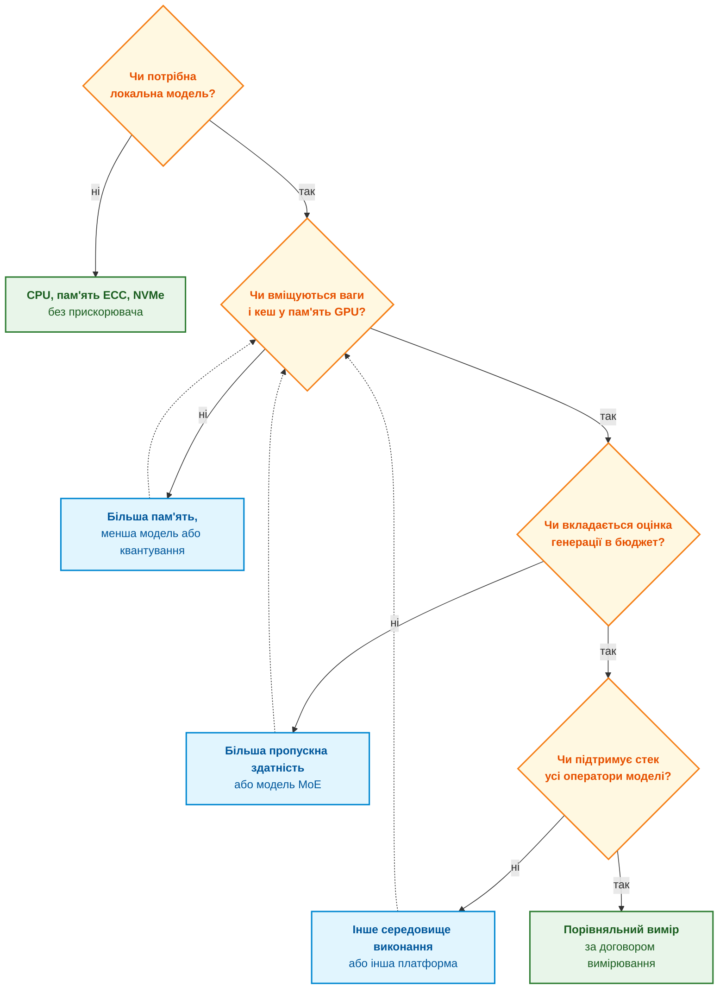

Діаграма читається згори вниз: кожна перевірка дешевша за наступну, а порівняльний вимір виконують лише для платформ, що пройшли всі попередні фільтри. Пунктирні стрілки означають, що зміна моделі чи платформи повертає до перевірки пам'яті. За цим порядком платформи з таблиці отримують такі ролі:

- **Станція одного розробника.** DGX Spark, Ryzen AI Halo і Surface RTX Spark Dev Box мають близький клас пам'яті й відрізняються насамперед програмним стеком: Linux і CUDA, Linux або Windows і ROCm, Windows 11 Pro і CUDA через WSL 2. Для доказового пакета ця різниця істотна, бо відбиток ланцюжка виконання з [Глави 17](ch17-implementation-stack.md) охоплює драйвер і середовище виконання: перенесення моделі між станціями різних виробників є зміною ланцюжка й вимагає повторного регресійного прогону.
- **Робоча станція з дискретним GPU.** RTX PRO 6000 має найбільшу пропускну здатність серед розглянутих варіантів, але обмежує модель 96 ГБ і споживає до 600 Вт.
- **Спільний вузол команди у власному периметрі.** DGX Station for Windows і серверний Crescent Island розраховані на великі моделі й багато одночасних запитів, але на 8 жовтня 2026 року перша платформа перебуває на етапі анонсу, а друга на етапі зразків. Визначати архітектуру виконання через такі платформи можна лише як гіпотезу з резервним варіантом.
- **NPU у ноутбуках інженерів.** Core Ultra Series 3 і Snapdragon X2 Elite мають NPU на 50–85 TOPS, придатні для векторизації, класифікації й мережі фонового індексування з попереднього розділу. Генерацію на таких NPU перевіряють окремо для кожної моделі за шістьма умовами з того самого розділу.
- **Дослідницький стенд відкритої апаратури.** Плата Tenstorrent Blackhole поєднує ядра RISC-V з матричними ядрами й відкритим програмним стеком, тож підходить для експериментів із розділу про перспективні напрями нижче.

У базовому розміщенні цієї глави правила, граф простежуваності й SQL виконуються на CPU; інша платформа може змінити і їхню швидкість, тому абсолютна заборона прискорення некоректна. Наприклад, кандидат на 64 ГБ пройшов перевірку місткості для 48 ГБ даних, але модель не підтримує потрібний оператор: його ще не можна прийняти. Інший кандидат підтримує оператори, але занизька стеля темпу відсіює його до дорогого тесту. Лише повне порівняння за однакової якості завершує вибір. Анонси й неперевірені параметри залишаються ризиками планування. Далі до цих перевірок додаються фізичні обмеження периферійного пристрою.

## 7. Апаратна база й фізичні обмеження периферійних систем

Фізичні обмеження периферійного пристрою змінюють вибір навіть тоді, коли модель уміщується в пам'ять. Потрібно знати доступну потужність у ватах, температуру середовища, спосіб охолодження й допустимий час роботи від батареї. TDP описує розрахункову теплову характеристику, а не гарантоване споживання всього вузла. Наприклад, вузол на 10 Вт із батареєю 100 Вт·год мав би ідеалізовані 10 год роботи без інших споживачів; перетворювачі, сенсори й обмеження розряду скоротять цей час. Зростання температури може знизити частоти й збільшити затримку. Сам поріг тротлінгу, зокрема умовний поріг моделі нижче, не доводить порушення ISO 26262 або IEC 61508 без застосовної вимоги й підтвердженого виходу за її критерій. Таблиця пов'язує характер задачі з класом апаратури, не сертифікує вибір.

<a id="obj-18-36"></a>

**Таблиця 18.36. Клас обчислень; Характер операцій; Апаратура; Програмні платформи.**

| Клас обчислень | Характер операцій | Апаратура | Програмні платформи |
|---|---|---|---|
| **Символьна логіка, предикати, SQL** | Розгалуження, обхід графів, цілочисельні індекси | Багатоядерні CPU (x86-64, ARM64) | Стандартні компілятори, векторні розширення (AVX-512, AMX) |
| **Щільна лінійна алгебра** | Множення матриць, тензорні операції | Серверні й робочі GPU | CUDA і TensorRT, ROCm |
| **Енергоефективне виконання моделей** | Квантовані тензори (INT8, INT4), згортки | Вбудовані NPU, мобільні прискорювачі | OpenVINO, Qualcomm QNN, Core ML |
| **Потокова обробка сигналів** | Детерміновані конвеєри з мікросекундною затримкою, злиття даних сенсорів | ПЛІС (FPGA), сигнальні процесори (DSP) | Засоби проєктування AMD і Altera |

На борту рухомих об'єктів (автомобілів, безпілотних літальних апаратів, наземних робототехнічних комплексів) до вибору апаратури додаються обмеження розміру, маси й енергоспоживання (*Size, Weight and Power*, SWaP), що утворюють **таксономію умов розгортання периферійних систем за обмеженнями середовища автора (SWaP)**. Діаграма порівнює умови трьох типів бортового розміщення з дата-центром.

<a id="obj-18-37"></a>

**Діаграма 18.37. Фізичні умови розгортання експертних систем.**

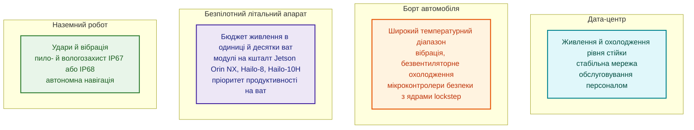

Для безпілотного літального апарата кожен ват живлення скорочує час польоту, тому важить не пікова продуктивність, а продуктивність на ват. Модулі Jetson Orin NX дають до 100 TOPS (трильйонів операцій за секунду) з налаштовуваною потужністю від 10 до 25 Вт [[29]](#src-29), а прискорювач Hailo-8 дає до 26 TOPS за типового споживання 2,5 Вт [[30]](#src-30). Для генеративних моделей на борту з'явилося наступне покоління: модулі Jetson Thor дають до 2070 TFLOPS у FP4 з розрідженістю й до 128 ГБ пам'яті за потужності 40–130 Вт [[31]](#src-31), а прискорювач Hailo-10H дає 40 TOPS у форматі INT4 за типового споживання 2,5 Вт і має власний інтерфейс до зовнішньої пам'яті LPDDR4 для мовних і візуально-мовних моделей [[32]](#src-32). Intel уперше сертифікувала периферійні версії Core Ultra Series 3 для вбудованих і промислових застосувань із розширеним температурним діапазоном і цілодобовою роботою [[21]](#src-21). Ці числа є паспортними піковими значеннями в різних форматах чисел; реальну швидкість конкретної моделі треба вимірювати на борту.

В авторському патерні дворівневого розділення керування обчислювально важке сприйняття відокремлюється від захисних правил. Система на кристалі готує кандидата, а мікроконтролер або FPGA перевіряє визначені обмеження; числовий контракт наведено в §8.3.1. Стенд J501 нижче є прикладом першого рівня, не готовим виробом із доведеною безпекою. На другому рівні можливі контролери з lockstep: два ядра виконують однакові інструкції, а апаратура порівнює результати. Прикладом є TMS570LC4357 [[33]](#src-33). Захист корпусу від пилу й води позначає код IP за IEC 60529 [[34]](#src-34); він не характеризує правильність правил.

Таке розділення допомагає забезпечити три властивості, важливі для функціональної безпеки за ISO 26262 [[35]](#src-35), особливо на найвищому рівні цілісності ASIL D:

- **Передбачувана затримка.** Мікроконтролер обробляє правила безпеки за обмежений час без пауз на збирання сміття.
- **Локалізація збоїв.** Якщо нейромережевий модуль сприйняття зависає чи видає шум через засліплення камер, мікроконтролер безпеки продовжує утримувати фізичні інваріанти, наприклад дистанцію аварійного гальмування.
- **Автономність.** Захисний маневр не потребує стільникового зв'язку чи підтвердження з хмари.

Це цілі проєктування, не доведені властивості будь-якого мікроконтролера. Lockstep може виявляти певні розходження виконання, але не однакову помилку програми на двох ядрах. Потрібні аналіз небезпек, часові межі, перевірка сенсорних даних, спільних ресурсів і незалежності захисного механізму. Наявність контролера сама не встановлює відповідності ASIL D.

### 7.1. Часткові дані бортової телеметрії Jetson AGX Orin

Емпіричний профіль потрібний, щоб відрізняти паспортну потужність від показів датчиків під час роботи експертної системи. Автором описано стенд Seeed Studio reServer Industrial J501 із Jetson AGX Orin 64GB та пасивним охолодженням, але одного опису обладнання недостатньо для відтворюваного результату. Назва підрозділу не встановлює режим кожного збереженого ряду. Нижче наведено лише показники, перераховані за первинними записами; без прив'язки рядів до навантаження, режиму, версій і повторів їх не можна тлумачити як порівняльний емпіричний профіль.

Метод передбачає запис часових міток, температур CPU, переходу кристала та SoC, потужностей каналів `VIN_SYS_5V0`, `VDD_GPU_SOC`, `VDD_CPU_CV` і завантаження ядер через утиліту `tegrastats`. Запланований крок опитування не замінює фактичних інтервалів між мітками. Для відтворюваного виміру також фіксують конфігурацію `nvpmodel`, версії програмного стека, температуру довкілля, охолодження, входи й межі операції. Без цих зв'язків не можна приписати відлік певній моделі або сценарію.

<a id="obj-18-38"></a>

**Таблиця 18.38. Звірені показники трьох збережених телеметричних рядів.**

| Ряд і дата (UTC) | Кількість відліків | Максимум температури переходу, °C | Звірений часовий показник | Потужність |
| :--- | ---: | ---: | :--- | :--- |
| A03, 08.10.2026 | 558 | 60 | Інтервали 0,5120–0,6412 с; медіана 0,51548 с | Сценарних агрегатів не встановлено |
| A05, 08.10.2026 | 6 | 59,187 | Від першої до останньої мітки 1,0628 с | Середнє шести показів `VIN_SYS_5V0`: 4436,17 мВт |
| A07, 13.10.2026 | 368 | 49,968 | Медіанний інтервал 0,30647 с | Сценарних агрегатів не встановлено |

Ідентифікатори відповідають звіту про первинні протоколи, який зберігається локально й не включений до публікації. У A03 немає полів сценарію, моделі, входу або версії; A05 не визначає меж операції чи кількості виконаних дій. Середнє шести показів каналу не є автоматично середнім за часом або повною потужністю виробу; канали не підсумовують без схеми живлення. Пов'язаний з A07 опис називає MODE_50W, а не MODE_30W; сам ряд не встановлює відповідності попереднім сценаріям. Різні максимуми цих рядів не є ефектом зміни охолодження.

#### 7.1.1. Інженерні висновки з аналізу телеметрії

Інженерний висновок із телеметрії обмежується тим, що саме виміряно. Щоб перевірити порядок величини енергії, середню потужність за той самий інтервал множать на його тривалість:

<a id="obj-18-39"></a>

**Формула (18.39). Енергія запуску за потужністю і часом.**

$$
E=\int_0^t P(u)\,du=\overline P\,t.
$$

Тут $`t>0`$ — тривалість у секундах, $`u\in[0,t]`$ — час, $`P(u)\ge0`$ — потужність у ватах на визначеній межі живлення, $`\overline P`$ — її середнє за цей самий інтервал, $`E\ge0`$ — енергія в джоулях. Для дискретних відліків інтеграл наближають сумою з урахуванням часових міток та обраного правила інтерполяції. Похибка залежить від калібрування датчика, часової прив'язки та неврахованих змін між відліками. Без визначення кількості прийнятих фактів результат не можна називати енергією на один факт; без межі живлення — споживанням усього виробу.

**Новий навчальний приклад «Двосекундне вікно».** Нехай умовне навантаження споживає сталі 3 Вт протягом 2 с на явно обраній шині. Тоді енергія дорівнює 3 Вт × 2 с = 6 Дж. Якщо задані межі похибки становлять ±0,1 Вт і ±0,02 с, крайні добутки дають від 2,9 × 1,98 = 5,742 Дж до 3,1 × 2,02 = 6,262 Дж. Для вимоги «не більше 6 Дж» цього недостатньо: верхня межа перевищує бюджет. Це розрахунок за припущеннями, не вимірювання стенда й не оцінка енергії A05.

Звірена телеметрія встановлює лише записані показники та часові інтервали. Вона не визначає якості видобування знань, енергії сценарію чи придатності до тривалої роботи. Для теплової кваліфікації потрібні температура довкілля, вихід на усталений стан і найгірше навантаження. Це мотивує розгляд політики нагляду, а не числовий рейтинг профілів.

### 7.2. Активне термодинамічне керування та конфігурація MODE_30W: розширення обчислювального бюджету

Активне охолодження розглядають, коли пасивний профіль не забезпечує потрібного теплового режиму. У координаторі виконання ЕС нагляд має обмежувати навантаження й обробляти відмову кулера; просте підвищення ліміту потужності може збільшити нагрів замість корисної швидкодії. `nvpmodel` керує профілем ресурсів [[42]](#src-42), [[43]](#src-43), але назва MODE_30W не означає сталих 30 Вт на вході всього вузла. Відповідність номера режиму, активних ядер і частот перевіряють за конфігурацією конкретного пристрою, не відновлюють із назви.

Нижче задано **модель політики теплового нагляду**, не виміряну конфігурацію прошивки. Її умовні пороги: попередження за 75 °C, зниження частот за 99 °C, вимкнення за 104 °C; повернення дозволяється за нижчих температур, щоб уникнути частих перемикань. Ці числа задають лише поведінку моделі й не підтверджують допустимих температур виробу. Реальні пороги обирають за документацією, аналізом небезпек і перевіркою захисної дії.

<a id="obj-18-40"></a>

**Діаграма 18.40. Проєктна модель теплового нагляду стенда.**

```mermaid
stateDiagram-v2
    accTitle: Проєктна модель теплового нагляду стенда
    accDescr: Вибір пасивного або активного профілю, попередження та захисне вимкнення; числові пороги є заявленими параметрами прикладу, не перевіреною конфігурацією іншого виробу.

    state Choose <<choice>>
    state "Робота з активним охолодженням" as ActiveCooledZone
    state "Робота з пасивним охолодженням" as PassiveZone
    state "Попередження та обмеження навантаження" as WarningZone
    state "Захисне зниження частот" as ThrottleZone
    state "Захисне вимкнення" as ShutdownState

    [*] --> Choose
    Choose --> ActiveCooledZone: Встановлений і справний кулер
    Choose --> PassiveZone: Затверджений пасивний профіль
    ActiveCooledZone --> WarningZone: T >= 75°C або відмова кулера
    PassiveZone --> WarningZone: T >= 75°C
    WarningZone --> ThrottleZone: T >= 99°C
    ThrottleZone --> ShutdownState: T >= 104°C
    WarningZone --> ActiveCooledZone: T < 50°C і кулер справний
    WarningZone --> PassiveZone: T < 50°C і дозволено пасивний профіль
    ThrottleZone --> WarningZone: T < 95°C
    ShutdownState --> [*]
```

Діаграма є моделлю політики нагляду, не реконструкцією прошивки. Наприклад, у новому навчальному випадку «Повернення після попередження» умовні 74 °C ще не дозволяють повернення з попередження: потрібна температура нижче 50 °C та відповідна умова профілю. Повернення до активного охолодження залежить від справності кулера; пасивний вузол не отримує команди керувати відсутнім вентилятором. Вимкнення обчислювача саме по собі не доводить безпечного стану керованої машини.

#### 7.2.1. Емпірична телеметрія випробувань у режимі MODE_30W з GBNF-маскуванням

Телеметрію випробування з GBNF потрібно пов'язувати з конкретними запитами й відповідями, інакше покази датчика нічого не говорять про якість виходу. Для описаного тут MODE_30W такої первинної прив'язки не встановлено; звірений ряд A07 з таблиці 18.38 не є його заміною. GBNF обмежує допустиму форму генерації, але не підтверджує істинності змісту.

<a id="obj-18-41"></a>

**Неперевірене авторське повідомлення.** Автором повідомлено про нуль пропущених дефектів і нуль синтаксичного браку для моделей класів 7B/14B у власних випробуваннях. Повних первинних запитів, відповідей, незалежного еталона та журналу фактичних перевірок не встановлено. Пов'язаний оповідний звіт не підтверджує семантичного нуля; у перевіреній поточній версії симулятора відмову контрприкладу призначено наперед, а її тотожність історичній версії невідома. Повідомлення збережено як атрибуцію досвіду автора, не як доказ правильності, гарантію, результат MODE_30W або підставу апаратного порівняння.

#### 7.2.2. Порівняльний аналіз MODE_15W проти MODE_30W: інженерні наслідки

Порівняння MODE_15W і MODE_30W потребує парних вимірів на однаковій задачі: самі назви режимів не визначають ні енергії, ні температури, ні якості. Наявні звірені ряди такого порівняння не утворюють. Замість рейтингу платформ застосовується протокол перевірки:

> [!NOTE]
> **Чотири умови зіставного вимірювання за методикою автора**
> 1. Зафіксувати модель, вхід, декодування, незалежний еталон і критерій завершення; перевірити однаковий зміст виконаної роботи.
> 2. Зберегти профіль ресурсів, охолодження, температуру довкілля, прогрів і повтори, а не лише назву режиму.
> 3. Прив'язати межі кожної операції до часових міток потужності на визначеній шині; врахувати похибку та споживання охолодження на обраній межі системи.
> 4. Окремо оцінити синтаксичну відповідність і семантичні помилки за незалежними очікуваннями; телеметричні відліки не рахувати як тестові запити.
> *Інженерний інваріант:* Без зіставних первинних даних виграш режиму не встановлено, а відсутність зареєстрованих дефектів не є гарантією їх відсутності.

Апаратура визначає, що можна виконати; наступний розділ розглядає, як швидко й наскільки відтворювано.

## 8. Бюджет затримки й числовий дрейф результатів

Бюджет затримки й числовий дрейф поєднує одне питання: чи залишиться відповідь своєчасною та змістово прийнятною після зміни навантаження або платформи? Спочатку потрібно розкласти час одного запиту, потім перевірити розподіл багатьох запитів і стабільність числового результату. Телеметрія з попереднього розділу не визначає затримки запиту; навіть виміряний середній час не дає ані хвостового перцентиля, ані WCET.

### 8.1. Формування та декомпозиція бюджету затримки

Декомпозиція бюджету показує, якому етапу потрібна оптимізація, якщо відповідь запізнюється. Для одного запиту з послідовними неперекривними етапами тривалості додаються. Векторизація може передувати пошуку, а не йти за ним: сума нижче є обліком часу, не наказом щодо порядку. Очікування черги й повернення відповіді мають входити до накладних витрат; для паралельних гілок рахують критичний шлях, не суму всіх робіт:

<a id="obj-18-42"></a>
<a id="obj-18-current-41"></a>

**Формула (18.41). Час послідовного запиту.**

$$
T_{\text{total}} = T_{\text{retrieval}} + T_{\text{embedding}} + T_{\text{reranking}} + T_{\text{rules}} + T_{\text{LLM}} + T_{\text{overhead}}
$$

де всі тривалості скінченні, невід'ємні й вимірюються в мілісекундах; значення визначають для конкретного маршруту, а не беруть з універсального діапазону:
- $`T_{\text{total}}`$ — наскрізний час обробки експертного запиту від моменту надходження до повернення валідованого результату, вимірюваний у мілісекундах ($`\text{ms}`$);
- $`T_{\text{retrieval}}`$ — тривалість пошуку кандидатних фактів у реляційній базі SQL та індексі повнотекстового пошуку BM25;
- $`T_{\text{embedding}}`$ — час векторизації запиту на локальному NPU або CPU;
- $`T_{\text{reranking}}`$ — час нейромережевого переранжування знайдених фрагментів моделлю cross-encoder;
- $`T_{\text{rules}}`$ — час виконання рушія логічних правил Rete/Datalog на CPU;
- $`T_{\text{LLM}}`$ — тривалість авторегресивного синтезу природномовного обґрунтування мовною моделлю;
- $`T_{\text{overhead}}`$ — накладні витрати на IPC-серіалізацію тензорів, валідацію схем JSON/GBNF, криптографічне хешування аудиту PROV-O та мережевий транспорт.

**Практичне застосування та інженерні висновки:**
1. Розрахунок використовується для наскрізного профілювання системи через трейси OpenTelemetry та встановлення квот на кожен етап обробки.
2. **Авторський контрприклад до додавання перцентилів:** p95 — найменший час, до якого накопичено щонайменше 95% імовірності. Для двох незалежних етапів із тривалістю 0 мс з імовірністю 0,95 і 100 мс з імовірністю 0,05 кожний p95 дорівнює нулю, але ймовірність нульової суми — лише 0,9025. Сума дорівнює 100 мс із імовірністю 0,095 і 200 мс із імовірністю 0,0025, тому її p95 — 100 мс. Отже, рівність перцентиля суми й суми перцентилів **не є загальним законом**, хоча в окремих розподілах можлива. Для реального навантаження вимірюють повний маршрут. Якщо всі тривалості мають доведені верхні межі, їхня сума дає верхню межу послідовного маршруту; це інше твердження.
3. **Критерії fail-safe та аварійні шлюзи:**
    - Умовні цілі p95 ≤ 1000 мс і p99 ≤ 100 мс є параметрами двох різних профілів обслуговування. p99 допускає 1% повільніших запитів і не є гарантією жорсткого реального часу.
    - Перевищення 50 мс пошуком і правилами мотивує профілювання, але саме не діагностує фрагментацію SQLite чи перевантаження Rete.
    - Для навчального прикладу із заданими тривалостями 30 + 10 + 25 + 5 + 700 + 10 мс отримуємо 780 мс. Якщо генерація триває вже 800 мс, обов'язкові етапи потребували 70 мс, а скасування й повернення обмежені 20 мс, завершення до 890 мс ще вкладається в бюджет 1000 мс. Це умовні межі: якщо символічного результату немає, повертають статус незавершення, не вигадане дерево доведення.

### 8.2. Регламент вимірювання та вимоги до автономності

Регламент вимірювання потрібний, щоб два числа швидкодії описували ту саму задачу. За орієнтиром MLPerf Inference [[3]](#src-3) фіксують модель, ваги, токенізатор, вхід, вихід, точність, пристрій, драйвери й паралельність. Це локальний протокол за мотивами підходу, не заява про офіційний результат MLPerf. Окремо вимірюють холодний запуск, прогріте виконання, перший токен, повну відповідь, пам'ять, енергію й якість. Наприклад, 1000 запитів дають емпіричний p95 як 950-й елемент упорядкованої вибірки за правилом найближчого рангу; невелика вибірка не підтверджує рідкісних найгірших випадків. Повернення операторів на CPU має бути видимим.

Локальна інсталяція не доводить автономності. Перевіряють роботу без зовнішньої мережі, наявність ваг і залежностей, відсутність недозволеної телеметрії, поведінку за нестачі пам'яті й доступ до незмінного пакета знань. Окремий процес локалізує частину програмних збоїв, але не спільну нестачу пам'яті, живлення або відмову драйвера. Простий маршрут CPU є базовим варіантом для порівняння OpenVINO, ONNX Runtime та сервісів генерації.

### 8.3. Природа та верифікація числового дрейфу

Числовий дрейф потрібно перевіряти, щоб зміна драйвера не змінила пошук або рішення непомітно. Навіть із незмінними вагами додавання чисел з рухомою комою залежить від порядку операцій [[36]](#src-36). Лістинг реалізує послідовну редукцію скалярного добутку та редукцію з вісьмома частковими сумами, не справжній SIMD. Вхід — однаково довгі ненульові скінченні вектори; результат — добуток і косинусна близькість. `cosine` відхиляє некоректні входи й переповнення редукції, а явні перетворення `float32` фіксують місця округлення. Це демонстрація названого методу, не модель похибки всієї нейромережі.

<details>
<summary>Приклад мовою Go: числовий дрейф суми з рухомою комою</summary>

```go
package main

import (
    "errors"
	"fmt"
	"math"
	"math/rand"
)

func dotSeq(left, right []float32) float32 {
    var sum float32
    for index := range left {
        product := float32(left[index] * right[index])
        sum = float32(sum + product)
	}
    return sum
}

func dotLanes(left, right []float32) float32 {
    var lanes [8]float32
    for index := range left {
        product := float32(left[index] * right[index])
        lanes[index%8] = float32(lanes[index%8] + product)
	}
    var sum float32
    for _, partial := range lanes {
        sum = float32(sum + partial)
	}
    return sum
}

func cosine(dot func([]float32, []float32) float32, left, right []float32) (float64, error) {
    if dot == nil || len(left) == 0 || len(left) != len(right) {
        return 0, errors.New("invalid dimensions or method")
    }
    for index := range left {
        for _, value := range []float32{left[index], right[index]} {
            if math.IsNaN(float64(value)) || math.IsInf(float64(value), 0) {
                return 0, errors.New("nonfinite component")
            }
        }
    }
    leftNorm := float64(dot(left, left))
    rightNorm := float64(dot(right, right))
    product := float64(dot(left, right))
    if leftNorm <= 0 || rightNorm <= 0 || math.IsNaN(leftNorm+rightNorm+product) ||
        math.IsInf(leftNorm, 0) || math.IsInf(rightNorm, 0) || math.IsInf(product, 0) {
        return 0, errors.New("invalid reduction")
    }
    return product / math.Sqrt(leftNorm*rightNorm), nil
}

func main() {
	big := float32(1e8)
    fmt.Println("(1e8 + 1) - 1e8 =", float32(big+1)-big)
	fmt.Println("(1e8 - 1e8) + 1 =", (big-big)+1)

    random := rand.New(rand.NewSource(42))
    left := make([]float32, 768)
    right := make([]float32, 768)
    for index := range left {
        left[index] = float32(random.NormFloat64())
        right[index] = left[index] + 0.3*float32(random.NormFloat64())
	}
    sequential, parallel := dotSeq(left, right), dotLanes(left, right)
    fmt.Printf("скалярний добуток: %.7f проти %.7f, різниця %.1e\n", sequential, parallel, sequential-parallel)
    firstCosine, firstError := cosine(dotSeq, left, right)
    secondCosine, secondError := cosine(dotLanes, left, right)
    if firstError != nil || secondError != nil {
        panic("invalid demonstration vectors")
    }
    fmt.Printf("косинус: %.9f проти %.9f, різниця %.1e\n", firstCosine, secondCosine, firstCosine-secondCosine)
}
```

</details>

З Go 1.27.1 на процесорі архітектури amd64 програма виводить:

<details>
<summary>Дані або результат прикладу</summary>

```text
(1e8 + 1) - 1e8 = 0
(1e8 - 1e8) + 1 = 1
скалярний добуток: 657.9636841 проти 657.9638672, різниця -1.8e-04
косинус: 0.952824235 проти 0.952824475, різниця -2.4e-07
```

</details>


Перші два рядки показують ефект у найпростішій формі: у форматі float32 число $`10^8 + 1`$ округлюється до $`10^8`$, тому порядок дій змінює результат з 1 на 0. Наступні рядки показують той самий ефект для векторів розмірністю 768: послідовне додавання й додавання вісьмома смугами дають скалярні добутки, що різняться в четвертому знаку після коми, а косинусна близькість різниться приблизно на $`2 \times 10^{-7}`$. На іншій архітектурі чи з іншою версією компілятора числа можуть бути іншими, і саме тому відтворюваність не можна гарантувати порівнянням на точну рівність.

Тому регресійні тести порівнюють поточні вектори з еталонними (*gold baseline*) за косинусною близькістю з порогом:

<a id="obj-18-43"></a>
<a id="obj-18-current-42"></a>

**Формула (18.42). Косинусна перевірка числового дрейфу.**

$$
\cos(\vec{v}_{\text{now}}, \vec{v}_{\text{base}}) = \frac{\vec{v}_{\text{now}} \cdot \vec{v}_{\text{base}}}{\|\vec{v}_{\text{now}}\| \, \|\vec{v}_{\text{base}}\|} \geq \tau_{\text{drift}}
$$

де:
- $`\vec{v}_{\text{now}} \in \mathbb{R}^d`$ — вектор нормативного фрагмента, згенерований поточною версією середовища виконання або оновленим драйвером NPU/GPU;
- $`\vec{v}_{\text{base}} \in \mathbb{R}^d`$ — еталонний вектор із зафіксованої базової збірки; $`d\ge1`$ — ціла розмірність. Обидва вектори мають скінченні компоненти й строго додатні норми; нульовий вектор не має визначеного косинуса;
- $`\vec{v}_{\text{now}} \cdot \vec{v}_{\text{base}} = \sum_{j=1}^d v_{\text{now}, j} \, v_{\text{base}, j}`$ — скалярний добуток двох векторів однакової розмірності $`d`$;
- $`\|\vec{v}\| = \sqrt{\sum_{j=1}^d v_j^2}`$ — евклідова $`L_2`$-норма вектора;
- $`\tau_{\text{drift}}\in[0,1]`$ — поріг конкретного регресійного профілю, безрозмірний. Сам косинус лежить у $`[-1,1]`$; обчислений вихід за цей діапазон потребує оцінки похибки, не мовчазного допуску.

**Практичне застосування та інженерні висновки:**
1. Розрахунок викликається в автоматизованому конвеєрі CI/CD перед допуском будь-якого оновлення драйвера, оптимізатора ONNX або прошивки NPU до робочого середовища.
2. **Інженерні пороги допуску та критерії відхилення:**
    - $`\cos\ge0{,}999`$: пройдено лише геометричний тест профілю. Причину розходження та допустимість оновлення він сам не встановлює.
    - $`0{,}990\le\cos<0{,}999`$: за умовною авторською політикою призначають додаткову діагностику. Перевірка рангів і остаточних рішень потрібна також у першому діапазоні.
    - $`\cos<0{,}990`$: профіль блокує оновлення до з'ясування причини; це не доказ семантичної помилки й не автоматичний наказ переіндексувати корпус.

Наприклад, вектори (1; 0) і (1; 0,01) мають добуток 1 та норми 1 і приблизно 1,00005, отже косинус приблизно 0,99995. Геометричний поріг 0,999 пройдено. Але близькі оцінки двох кандидатів можуть помінятися місцями: прийняття оновлення потребує окремого тесту ранжування. У наступному пункті ця сама проблема розглядається як запас до конкретного порога рішення.

Поріг є параметром досліду, не універсальною межею прийнятності драйвера. Навіть близькі вектори можуть змінити порядок майже однакових кандидатів або перейти поріг класифікації. Перевіряють також розмірність, скінченність, норму за договором, якість пошуку й остаточні вердикти на граничних прикладах. Розходження потребує діагностики; повна переіндексація потрібна не за будь-якого числового шуму. Для побітового повторення фіксують підтримувані детерміновані операції, ядра, потоки й порядок редукції та перевіряють повторні запуски.

#### 8.3.1. Запас до порога та чинна межа сумарної похибки

Запас до порога потрібен координатору виконання ЕС для перевірки кожного наближеного кандидата, а не лише для регресії драйверів: дрейф або аналогове обчислення можуть змінити бік порога навіть за високої косинусної близькості. Порівнюють запас і межу похибки в одиницях вихідної величини, наприклад прискорення вібрації в м/с². Перевірка лише середньої похибки приховує небезпечні крайні випадки.

Для профілю з обґрунтованими детермінованими межами складників застосовується консервативний бюджет:

<a id="obj-18-44"></a>
<a id="obj-18-current-43"></a>

**Формула (18.43). Запас до порога і сумарна межа похибки.**

$$
\Delta=\lvert\tilde s-\theta\rvert,\qquad
E_{\mathrm{total}}=E_{\mathrm{cal}}+E_{\mathrm{meas}}+E_{\mathrm{drift}}+E_{\mathrm{quant}}+E_{\mathrm{ref}}.
$$

Тут $`\tilde s`$ — скінченна оцінка кандидата, $`\theta`$ — скінченний поріг правила, $`\Delta\ge0`$ — запас; усі вони мають однакову розмірність. Невід'ємні скінченні межі $`E_{\mathrm{cal}}`$, $`E_{\mathrm{meas}}`$, $`E_{\mathrm{drift}}`$, $`E_{\mathrm{quant}}`$, $`E_{\mathrm{ref}}`$ покривають відповідно залишок калібрування, вимірювання, дрейф за часом і температурою, квантування та похибку цифрового еталона; складник дозволено занулити лише з обґрунтуванням його незастосовності. Версійована модель визначає область входів, апаратну конфігурацію, умови й строк чинності, для яких сумарна межа покриває відхилення від визначеної правилом величини.

За $`\Delta>E_{\mathrm{total}}`$ інтервал $`[\tilde s-E_{\mathrm{total}},\tilde s+E_{\mathrm{total}}]`$ цілком лежить по один бік порога: дозволено використати числовий результат порівняння, але не оголосити фізичне твердження істинним. За $`\Delta\le E_{\mathrm{total}}`$ шлюз консервативно вимагає цифрового перерахунку, включно з дотиком інтервалу до порога. Відсутня, застаріла модель або вихід за її область також забороняють прямий допуск: незалежний цифровий еталон або `REFUSAL`.

**Розрахунковий приклад, не результат нового випробування.** Нехай для заданої області сертифіковано складники $`0{,}03+0{,}04+0{,}02+0{,}02+0{,}01=0{,}12\,\text{м/с}^2`$, а правило має вигляд $`s\ge5{,}00\,\text{м/с}^2`$. Оцінка $`5{,}20\pm0{,}12\,\text{м/с}^2`$ дає інтервал $`[5{,}08;5{,}32]\,\text{м/с}^2`$: порівняння істинне. Для $`5{,}12\pm0{,}12\,\text{м/с}^2`$ нижня межа дорівнює порогу, тому за консервативною політикою виконують перерахунок. Еталон зберігає оператор правила: точна рівність задовольняє $`\ge`$, але не $`>`$; якщо і його інтервал перетинає поріг, видають `REFUSAL`, а не округлюють до зручного вердикту.

Цифровий еталон реалізують незалежно від наближеного ядра, з перевіреними входами, одиницями, часовими мітками, вагами та версією семантики правила. Перерахунок усуває числову неоднозначність лише в межах власної похибки; спільна помилка сенсора чи хибні вхідні факти від нього не зникають. Емпіричне стандартне відхилення чи гауссівський квантиль не є детермінованою межею: скінченні канаркові тести контролюють чинність профілю, але самі не доводять верхньої межі. Статистичні оцінки звітують із припущеннями й довірчим рівнем за [Главою 36, §5.5](ch36-knowledge-testing-pyramid-and-variational-calibration.md#55-метрологія-нульових-галюцинацій-zhr-точні-довірчі-інтервали-клоппера-пірсона-та-правило-трьох).

**Ресурсний наслідок.** Для проєктних 10 000 кандидатів/с і заданої верхньої межі 50 мкс на перерахунок резервують щонайменше 0,5 процесорної секунди щосекунди лише для еталона, якщо весь потік стане неоднозначним; окремо бюджетують калібрування, передавання й чергу. Межа 50 мкс тут є умовою розрахунку, не виміряним чи доведеним WCET. Середня частка перерахунків не замінює перевірки WCET і місткості буфера. Вичерпання резерву до дедлайну означає `REFUSAL`, а не обхід шлюзу.

> [!NOTE]
> **Запропонований автором контракт допуску наближеного кандидата**
> 1. У цьому проєктному профілі числовий допуск пов'язано з чинною моделлю сумарної похибки та строгим запасом до порога; це застосування звичайної практики числової верифікації, а не нова метрика. Успішний допуск не підміняє перевірки походження спостереження.
> 2. Незалежний еталон і зарезервований бюджет перерахунку є умовами роботи прискореного профілю, а не необов'язковою діагностикою.
> *Інженерний інваріант:* Невідома похибка або вичерпаний бюджет не дають права прийняти наближений результат.

### 8.4. Обмеження зворотних переходів для оцінювання часу виконання (WCET)

Заборона зворотних переходів спрощує відповідь на питання, скільки інструкцій може виконати рушій правил до завершення. Проте для часової гарантії потрібно знати ще й максимальну тривалість кожної інструкції, включно з доступом до пам'яті [[46]](#src-46). У системі жорсткого реального часу результат потрібний до заданого дедлайну; допустимий інтервал до небезпечної відмови (*Fault Tolerant Time Interval*, FTTI) розподіляють між виявленням, обчисленням, зв'язком і захисною дією. Він не дорівнює автоматично бюджету самого рушія.

Проблема зупинки стверджує: не існує алгоритму, який для довільної програми тьюрінг-повної мови та довільного входу завжди визначає, чи завершиться виконання. Це не забороняє доводити завершення конкретних програм із циклами: достатні, наприклад, доведена межа повторень і скінченна вартість тіла. Так само поліноміальна складність або фіксований бюджет ітерацій ще не дають WCET у мікросекундах. Сторожовий таймер залишається окремим захисним механізмом; його поріг і час реакції мають укладатися в бюджет, а не спрацьовувати лише після небезпечного запізнення.

У цій монографії запропоновано застосувати **обмеження лише прямих переходів (Forward-Only Jumps)** до команд логічного процесора як спосіб обмежити кількість кроків. Це проєктна пропозиція, не гарантія WCET: передумови — скінченний незмінний блок інструкцій, перевірені цілі переходів усередині нього, відсутність прихованої рекурсії та повторного входу; окремо потрібна верхня межа вартості кожного кроку. Кожний перехід, зокрема неявний перехід до наступної інструкції, підпорядковується інваріанту:

<a id="obj-18-45"></a>
<a id="obj-18-current-44"></a>

**Формула (18.44). Інваріант прямих переходів.**

$$
\mathrm{TargetAddress} > \mathrm{CurrentPC}
$$

Тут TargetAddress і CurrentPC — цілі адреси інструкцій у тих самих одиницях, наприклад байтові зсуви; обидві адреси мають належати перевіреному блоку й бути правильно вирівняні. Для блоку з адресами 0, 4, 8 перехід 0→8 дозволений, а 8→4 та 4→4 — ні. За скінченності блоку й відсутності інших переходів граф потоку керування (*Control Flow Graph*, CFG) є ациклічним (*Directed Acyclic Graph*, DAG): повернутися до меншої адреси неможливо. Це доводить скінченність числа інструкцій, але не скінченність зовнішнього очікування всередині однієї інструкції.

<a id="obj-18-46"></a>
<a id="obj-18-current-45"></a>

**Діаграма 18.45. Ациклічний граф потоку керування логічного процесора із забороною зворотних переходів.**

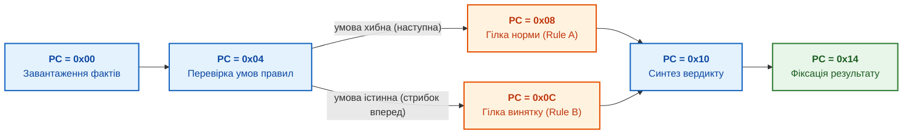

У скінченному DAG кожна інструкція відвідується не більше одного разу за один запуск. Якщо для кожної відвідуваної інструкції відома консервативна верхня вартість, суму рахують уздовж найдорожчого шляху. Умовне твердження автора застосовне лише за покриття всіх затримок:

<a id="obj-18-47"></a>
<a id="obj-18-current-46"></a>

**Формула (18.46). Умовна верхня межа часу маршруту.**

$$
T_{\mathrm{actual}}\le T_{\mathrm{bound}}
=\max_{p\in\mathcal P}\sum_{I_i\in p}\frac{c(I_i)}{F_{\mathrm{clk}}}
+T_{\mathrm{external}}
\le\frac{N_{\mathrm{rules}}c_{\max}}{F_{\mathrm{clk}}}+T_{\mathrm{external}}.
$$

де:
- $`T_{\mathrm{actual}}\ge0`$ — фактичний час одного запуску, $`T_{\mathrm{bound}}\ge0`$ — доведена за передумовами верхня межа; обидва в секундах або узгоджено переведених мкс. Консервативна межа може бути більшою за точний WCET;
- $`\mathcal P`$ — скінченна множина дозволених шляхів від входу до завершення; $`p`$ — один шлях, $`I_i`$ — його інструкція;
- $`c(I_i)\ge1`$ — скінченна верхня вартість інструкції в тактах, із залежностями, пам'яттю й арбітражем, якщо їх не винесено окремо; $`c_{\max}`$ — найбільша така вартість;
- $`F_{\mathrm{clk}}>0`$ — гарантована для профілю частота в Гц; $`N_{\mathrm{rules}}\ge1`$ тут рахує **інструкції**, не предметні правила;
- $`T_{\mathrm{external}}\ge0`$ — скінченна верхня межа решти затримок у секундах: входу, виходу, переривань і заповнення конвеєра, без подвійного обліку. Якщо хоч одна затримка необмежена, часову гарантію не отримано. Пропускна здатність «одна інструкція за такт» не означає одиничної затримки будь-якої інструкції.

#### 8.4.1. Замкнений цикл інженерного розрахунку та верифікації WCET

1. **Керування рантаймом і потоком обчислень (Control Flow & Runtime Decisions):**
    - Компілятор перевіряє всі переходи, межі й цілісність блоку; алгоритм Кана може перевірити ациклічність. Ациклічний граф залежностей правил і CFG машинної програми — різні об'єкти: доведення для одного не переноситься автоматично на інший.
    - Декодер блокує недопустиму ціль, зокрема рівну чи меншу адресу, і повертає визначену помилку. Тривалість реакції та безпечний стан виконавчого механізму перевіряють окремо; один такт не припускається.
    - Порівняння $`T_{\mathrm{bound}}`$ із виділеним бюджетом є лише часовою перевіркою профілю. Воно не надає сертифікаційного статусу, не замінює аналізу небезпек і не скасовує незалежного нагляду.
2. **Апаратний сайзинг та інфраструктурні обмеження (Hardware Dimensioning):**
   - Розмір локальної пам'яті команд BRAM процесора знань підбирається таким чином, щоб повністю вмістити критичний шлях $`N_{\mathrm{rules}}`$ без використання зовнішньої динамічної пам'яті DRAM (Zero Cache Miss Jitter);
    - За умовних 200 МГц, однієї тактової вартості інструкції та **виділених лише інструкціям** 100 мкс уміщуються 20 000 інструкцій. Якщо решта маршруту потребує 20 мкс із тих самих 100, залишається 80 мкс, тобто 16 000 інструкцій. Це приклад бюджету, не нормативна FTTI гальмівної системи.
3. **Практичний числовий приклад (Worked Numerical Example):**
   - Бортова система контролю аварійного зближення безпілотного апарата містить базу правил логіки уникнення зіткнень, що скомпільована в $`N_{\mathrm{rules}} = 1\,200`$ інструкцій Epistemic OpSet.
   -    У прикладі профілю Epistemic OpSet ([Глава 22](ch22-cybernetics-edge-to-backend.md), §10.1.2) кожна інструкція виконується за $`c(I)=1`$ такт ($`t_{\mathrm{cycle}}=1`$). Тактова частота FPGA EPU становить $`F_{\mathrm{clk}} = 100\,\text{МГц}`$ ($`T_{\mathrm{clk}} = 10\,\text{ns}`$).
     - Нехай у навчальному DAG найдорожчий шлях містить 450 інструкцій із верхньою вартістю один такт; решта затримок спочатку умовно нульова. Отримаємо 450 × 10 нс = 4,5 мкс.
     - За проєктного бюджету 50 мкс відношення бюджету до цієї **часткової** межі — 11,11. Якщо додати доведену зовнішню межу 20 мкс, повна межа стає 24,5 мкс, а відношення — 2,04. За зовнішніх 46 мкс маємо вже 50,5 мкс: профіль не проходить.
     - Отже, ациклічність дозволила порахувати роботу, але саме відома вартість усіх затримок дозволяє порівняти її з дедлайном. Приклад не є апаратним випробуванням чи доказом функціональної безпеки.

> [!NOTE]
> **П'ять практик аудиту затримки та числового дрейфу**
> 1. Розподіл бюджету затримки за перцентилями: фіксація граничного часу виконання для кожного сегмента (авторизація, пошук, виведення, генерація).
> 2. Детекція квантизаційного дрейфу: вимірювання деградації косинусної схожості при переході між форматами FP16, INT8 та INT4 на калібрувальному корпусі.
> 3. Контроль режиму декодування: greedy-вибір зменшує випадковість вибору токена, але не усуває числових розходжень, конкуренції ресурсів і неоднозначних максимумів.
> 4. Компенсація мікроархітектурної неоднорідності: контроль еквівалентності виведення на різних наборах інструкцій (x86_64 AVX-512 проти ARM NEON/SVE).
> 5. Карантин числових аномалій: автоматичне відхилення векторних результатів при виявленні значень NaN, нескінченностей або нульових норм.
> *Керування рантаймом:* Виявлення квантизаційного дрейфу понад поріг або вихід за межі бюджету затримки блокує конвеєр з кодом E_NUMERICAL_DRIFT_EXCEEDED.

## 9. Перспективні напрями апаратури для систем знань

Перспективна апаратура має сенс лише після виявлення конкретного вузького місця. Якщо профілювання показало залежні читання графа, додаткові тензорні операції за секунду не обов'язково допоможуть; якщо переважає зіставлення бітових масок, можна дослідити інше подання. Питання цього розділу — які операції можна перенести, зберігши семантику й перевірність? Таблиця дає напрями пошуку, а приклади нижче показують їхні межі. Жодний запис не є рекомендацією обов'язково будувати власний процесор.

<a id="obj-18-48"></a>
<a id="obj-18-current-47"></a>

**Таблиця 18.47. Напрям; Яке вузьке місце усуває; Стан.**

| Напрям | Яке вузьке місце усуває | Стан |
|---|---|---|
| **Прискорювачі графової аналітики** | Нерегулярний доступ до пам'яті під час обходу графа | Дослідницькі прототипи, наприклад Graphicionado [[37]](#src-37) |
| **Обчислення в пам'яті** (*processing-in-memory*) | Передавання даних між пам'яттю й процесором під час обходу ребер | Дослідницькі прототипи, наприклад Tesseract для паралельної обробки графів [[38]](#src-38) |
| **Спільна пам'ять за CXL** (*Compute Express Link*) | Розміщення великих графів знань у пам'яті кількох процесорів без серіалізації через мережу | Відкритий промисловий стандарт [[39]](#src-39) |
| **Власні інструкції RISC-V** | Відсутність команд для уніфікації термів і бітових масок предикатів | Відкрита архітектура набору команд із простором для розширень [[40]](#src-40); серійні плати Tenstorrent Blackhole вже поєднують ядра RISC-V із матричними ядрами й відкритим програмним стеком [[25]](#src-25) |
| **Нейро-символьні прискорювачі** | Обмін між векторним простором нейромереж і дискретними фактами | Концепції й ранні дослідження |

Таблиця розділяє напрями за зрілістю: CXL і RISC-V вже доступні для проєктування, прискорювачі графів і обчислення в пам'яті існують як дослідницькі прототипи, а нейро-символьні прискорювачі поки що є концепцією.

### 9.1. Концептуальна модель спеціалізованого процесора знань

Поєднання цих напрямів автор формалізує як **концептуальну трисубстратну модель процесора знань (Knowledge Processing Unit, KPU) автора**. Це гіпотеза для досліджень, а не наявний продукт. Модель поєднує три обчислювальні субстрати, кожен з яких оптимізовано під власну природу даних.

<a id="obj-18-49"></a>
<a id="obj-18-current-48"></a>

**Діаграма 18.48. Концептуальна модель процесора знань.**

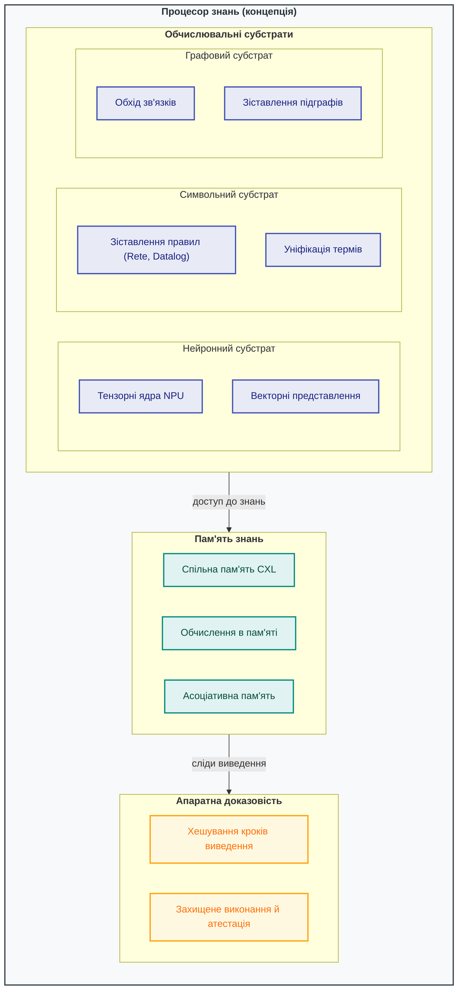

Нейронний субстрат перетворює сенсорні потоки й тексти на векторні представлення та символи. Символьний субстрат детерміновано перевіряє правила й контракти. Графовий субстрат зберігає контекст і причинно-наслідкові зв'язки. Рівень апаратної доказовості хешує кроки виведення в захищеній пам'яті, щоб журнал аудиту не можна було непомітно змінити.

Один зі шляхів дослідження авторської моделі — апаратно-програмне співпроєктування на FPGA з ядром RISC-V. Воно не обов'язково дешевше чи швидше за оптимізацію CPU; вибір залежить від профілю. Специфікація RISC-V залишає простір кодів для власних команд. В авторському проєкті розширення набору операторів доказового виведення розглядаються такі **ескізи інтерфейсів**, не виконуваний асемблер:

<details>
<summary>Дані або результат прикладу</summary>

<a id="obj-18-50"></a>
<a id="obj-18-current-49"></a>

**Схема 18.49. Ескізи інтерфейсів спеціалізованих команд.**

```text
K_UNIFY      rd, rs1, rs2   ; зіставлення двох предикатних термів
K_SUBGRAPH   rd, rs1, imm   ; крок переходу за дескриптором ребра графа
K_RULE_MATCH rd, rs1, rs2   ; перевірка бітової маски активних умов Rete
```

</details>


Ці команди є ілюстрацією дослідницького запитання «які операції механізму виведення варто перенести в апаратуру», а не описом наявного розширення. Відповідь на це запитання має давати профілювання реальної експертної системи, а не інтуїція.

> [!NOTE]
> **Розмежування дослідницької апаратури та допущеного профілю**
> 1. Для цього проєктного профілю прискорювач оцінюють за перевіркою числового запасу (§8.3.1) та бюджету часу (§8.4), а не за назвою платформи; це рекомендація, не свідчення допуску конкретного пристрою.
> 2. Наявність стенду або успішний приклад не засвідчують функціональної безпеки; незалежний аудит пропусків до цифрового шлюзу визначено в [Главі 37, §5.1](ch37-input-information-assessment-and-algorithmic-skepticism.md#51-незалежний-аудит-мовчазних-пропусків).
> *Інженерний інваріант:* Дослідницька пропозиція не є доказом експлуатаційного допуску.

### 9.2. П'ять апаратно-алгебраїчних напрямів обробки знань

П'ять апаратно-алгебраїчних архітектур нижче порівнюють за способом подання тієї самої перевірки. Для прикладів достатньо булевих фактів, правила «якщо відомі передумови, додати наслідок» і розрідженої матриці — таблиці, де зберігають лише ненульові елементи. CSR є одним із форматів такої таблиці: значення, індекси стовпців і зсуви початків рядків. Фіксований двійковий запис факту ([Глава 12](ch12-linguistic-analysis-and-local-models.md)) може спростити доступ, але не гарантує певного відсотка простоїв чи субмікросекундної відповіді.

Розглядаються п'ять кандидатних підходів до перенесення обчислень. Це оглядова класифікація без окремого правила відбору; кожний варіант потрібно порівнювати з CPU на однакових правилах, входах і критеріях завершення. Дослідницька гіпотеза не є часовою гарантією.

#### 9.2.1. Лінійно-алгебраїчне виведення GraphBLAS над півкільцями на тензорних ядрах

Лінійно-алгебраїчне подання потрібне, якщо багато однакових логічних операцій можна виконати пакетно. Півкільце задає дві операції: одну для об'єднання альтернатив, другу для поєднання кроків. Для булевих даних це OR і AND. Але тіло правила з двох передумов вимагає **обох** фактів, тому його не можна замінити двома незалежними ребрами. Спершу зафіксуємо клас правил, для якого трансляція коректна.

**Клас програм, для якого чинні твердження §9.2.1.** Тут і далі в §9.2.1 і в пункті 1 підсумкового NOTE §9.2 програмою правил є пропозиційна програма Горна без заперечення: скінченна множина атомів $`\{1,\dots,N\}`$ і скінченна множина правил $`r:\ b_1\land\dots\land b_{\ell_r}\to h_r`$ з $`\ell_r\ge1`$; факти задає початковий вектор $`\mathbf{x}_0`$. Для такої програми ітерація прямого виведення до нерухомої точки дає її найменшу модель. Трансляцію в матричні операції виконують двостадійно. Матриця тіл $`\mathbf{B}\in\{0,1\}^{R\times N}`$ має $`B_{rj}=1`$, якщо атом $`j`$ входить у тіло правила $`r`$; матриця голів $`\mathbf{H}\in\{0,1\}^{N\times R}`$ має $`H_{hr}=1`$, якщо $`h_r=h`$. Крок виведення:

<a id="obj-18-51"></a>
<a id="obj-18-current-50"></a>

**Формула (18.50). Двостадійний крок позитивного Горна.**

$$
f_r=\bigwedge_{j:\,B_{rj}=1}x_j,\qquad \mathbf{x}_{t+1}=\mathbf{x}_t\lor\bigl(\mathbf{H}\mathbin{\lor.\land}\mathbf{f}\bigr).
$$

Тут $`N`$ — число атомів, $`R`$ — число правил, $`r`$ — індекс правила, $`j,h`$ — індекси атомів, а $`t`$ — номер кроку від нуля. Компоненти $`x_j`$ поточного вектора $`\mathbf{x}_t`$ і компоненти вектора спрацювань $`\mathbf{f}`$ булеві; $`f_r=1`$ означає, що всі атоми тіла правила $`r`$ вже відомі. $`\ell_r`$ є кількістю різних атомів у тілі: повтори кон'юнктів нормалізуються як ідемпотентні. Голова правила $`h_r`$ — один атом. $`\lor`$ між векторами є покомпонентною диз'юнкцією, а $`\lor.\land`$ позначає булеве матрично-векторне множення. Усі ці величини безрозмірні; матриці мають скінченні розміри, а початкові факти входять до програми, найменшу модель якої обчислюють.

Перша стадія обчислює спрацювання тіл (над $`(+,\times)`$ еквівалентно $`f_r=[(\mathbf{B}\mathbf{x})_r=\ell_r]`$), друга — диз'юнкцію за правилами з тією самою головою. Лише коли тіло кожного правила складається з одного атома, двостадійна трансляція зводиться до одного множення розрідженої матриці суміжності $`\mathbf{A}`$ ($`A_{hj}=1`$ для правила $`j\to h`$) на вектор. Заперечення як невдача (потребує стратифікації, див. [главу 6, §3.4](ch06-applied-mathematics-for-expert-systems.md#34-datalog-стратифіковане-заперечення-та-семантика-найменшої-нерухомої-точки)), Datalog зі змінними (реляційні з'єднання, `SpGEMM`) і семантика аргументації ASPIC+ до цього класу не належать; твердження §9.2.1 на них не поширюються. Обмеження взаємовиключення й задачі `MAX-SAT`/`QUBO` §9.2.5 також виходять за цей клас і мають там статус дослідницької гіпотези.

У рушії експертної системи спочатку формується вектор спрацювань, потім додаються голови правил; обчислення повторюється до незмінності вектора фактів. Апаратне відображення повинно враховувати окремі структури тіл і голів та робочий вектор спрацювань, а не підміняти кон'юнктивне тіло незалежними ребрами суміжності. Це обмеження логічної трансляції, не вимір продуктивності, не сертифікація апаратури й не доказ семантики інших алгебр.

**Покроковий приклад.** Для атомів $`a,b,c`$ і правила $`a\land b\to c`$ рядок матриці тіла дорівнює (1; 1; 0), а стовпець голови — (0; 0; 1). Початковий вектор (1; 0; 0) дає спрацювання 0 і не додає $`c`$. Вектор (1; 1; 0) дає спрацювання 1 і після кроку стає (1; 1; 1); наступний крок його не змінює. Передумова теореми про найменшу нерухому точку тут проста: оператор монотонний, лише додає факти зі скінченної множини. Кожний крок зі зміною додає принаймні один із $`N`$ атомів, тому таких кроків не більше $`N`$; потрібна ще перевірка незмінності. Менший фіксований ліміт ітерацій може зупинити обчислення до замикання. Тоді відсутність атома не є доведенням його хибності, а логічна межа кроків ще не є WCET.

Транзитивне замикання графа знань на $`N`$ вершинах і крок прямого виведення для програм, у яких тіло кожного правила складається з одного атома, є множенням розрідженої матриці суміжності $`\mathbf{A}`$ на вектор активних фактів $`\mathbf{x}`$ над півкільцем $`(\mathbb{S},\oplus,\otimes)`$. Для кон'юнктивних тіл одне таке множення хибне: для правила $`a\land b\to c`$ і фактів $`\{a\}`$ воно виводить $`c`$; тому застосовують визначену вище двостадійну трансляцію. Наступна формула описує саме одноатомний випадок:

<a id="obj-18-52"></a>
<a id="obj-18-current-51"></a>

**Формула (18.51). Матричний крок для одноатомних тіл.**

$$
\mathbf{y} = \mathbf{A} \mathbin{\oplus.\otimes} \mathbf{x} \quad \Longleftrightarrow \quad y_i = \bigoplus_{j=1}^{N} \bigl( A_{ij} \otimes x_j \bigr)
$$

Тут $`\mathbf A`$ — квадратна матриця $`N\times N`$, $`\mathbf x,\mathbf y`$ — вектори довжини $`N\ge1`$, $`i,j`$ — цілі індекси від 1 до $`N`$. Елементи належать множині $`\mathbb S`$ обраного півкільця; $`\oplus`$ об'єднує внески, $`\otimes`$ поєднує ребро й вхід. Для булевого правила $`a\to c`$ єдина ненульова комірка в рядку $`c`$ і стовпці $`a`$ перетворює (1; 0; 0) на (0; 0; 1); додавання попередніх фактів дає (1; 0; 1). Для числових оцінок одиниці задає алгебра: наприклад, у тропічному випадку додаються вартості, не булеві істини. Цей приклад не охоплює з'єднання відношень Datalog зі змінними.

Алгебру поширення оцінок потрібно відрізняти від повної семантики експертної системи:

1. Булеве півкільце $`(\{0,1\},\lor,\land)`$ у двостадійній трансляції до нерухомої точки обчислює найменшу модель пропозиційної програми Горна без заперечення (Modus Ponens).
2. Тропічне півкільце $`(\mathbb{R}_{\ge0}\cup\{+\infty\},\min,+)`$ для одноатомних тіл дає вартість найдешевшого ланцюга. Тут $`+\infty`$ — нейтральний елемент $`\min`$ і значення «не виводиться». Для кон'юнктивних правил вартість найдешевшого дерева обчислюють двостадійно: $`c_h=\min_{r:\,h_r=h}\bigl(w_r+\sum_{j\in\mathrm{body}(r)}c_j\bigr)`$, а не одним множенням матриці на вектор. $`w_r\ge0`$ — вартість правила в одиницях профілю, $`c_j`$ — вартість доведення атома тіла; початковий факт має нульову вартість, а атом без доведення — нескінченну. Якщо голова вже є початковим фактом, її нульову вартість не замінюють дорожчим деревом.
3. Півкільце Гейтінга $`([0,1],\max,\min)`$ для одноатомних тіл дає оцінку найсильнішого ланцюга за принципом слабкої ланки. Для кон'юнктивного тіла оцінка спрацювання дорівнює $`\min_{j\in\mathrm{body}(r)}x_j`$ — це перша стадія трансляції, де $`x_j\in[0,1]`$ є оцінкою опори відповідного атома, не автоматично каліброваною ймовірністю. Аргументацію ASPIC+ цим обчисленням не замінюють.
4. Чотиризначне півкільце Белнапа $`(\mathcal{B}_4,\sqcup_k,\sqcap_k)`$ із нулем $`\mathbf{N}`$ та одиницею $`\mathbf{B}`$ застосовують через двоканальне кодування: атом $`p`$ подається парою $`(t_p,f_p)`$ — «є підстава для $`p`$» та «є підстава для $`\neg p`$». Правила для двох каналів транслюються окремо й обчислюються до нерухомої точки. Значення $`\mathbf{B}`$, тобто $`t_p=f_p=1`$, позначає суперечність, виводжувану в цій трансляції; суперечності, для яких потрібні заперечення як невдача чи аргументаційні атаки, вона не виявляє.

Така трансляція дозволяє використовувати бібліотеки розрідженої лінійної алгебри GraphBLAS на CPU і GPU. Чи можна виконувати SpMV над небулевими ідемпотентними півкільцями на тензорних ядрах і з якою пропускною здатністю — гіпотеза, що потребує джерела й виміру.

Для розрізнення алгебр достатньо логічного прикладу. Два одноатомні ланцюги до $`c`$ з вартостями 2+3 і 7 дають тропічний мінімум 5 умовних одиниць. Опори 0,8 і 0,6 уздовж першого ланцюга дають мінімум 0,6; альтернативний ланцюг з опорою 0,7 перемагає за максимумом, тобто результат 0,7. Для кон'юнктивних тіл вартості дерев рахують окремо; спільний піддоказ може враховуватися кілька разів, тому це не автоматично мінімальна вартість DAG-доказу. У двоканальному булевому кодуванні позитивна й негативна опори одного атома дають пару (1; 1), тобто суперечність; (0; 0) означає відсутність обох опор, не хибність. Усі ці оцінки — різні семантики, не взаємозамінні ймовірності.

#### 9.2.2. Асоціативна пам'ять потрійних станів (TCAM) та обчислення в пам'яті (PIM)

Асоціативна пам'ять відповідає на питання «які записи збігаються з цим бітовим ключем?», не обходячи їх звичайним програмним циклом. TCAM порівнює ключі паралельно, а PIM переносить частину обробки ближче до пам'яті; це різні механізми, не однакова однотактова реалізація. Для TCAM:

- Комірка TCAM зберігає три значення: `0`, `1` та `X` (*Don't Care* — параметр не входить у передумову правила);
- Вектор вимірювань датчиків подається на шину пошуку одночасно до всіх правил бази знань;
- Пошук активує лінії правил, записаних у TCAM фізичної місткості $`C`$. Число тактів і частоту визначає реалізація; їх не прирівнюють до одного такту без підстав. Складність $`O(1)`$ за кількістю записів стосується лише пошуку у фіксованому масиві; більша база потребує блоків і додаткових пошуків. Діапазон над $`w`$-бітовим полем за $`w\ge2`$ може потребувати до $`2w-2`$ префіксних записів (для $`w=16`$ — 30). Кілька збігів потребують пріоритетного кодера; заперечення в тілі правила кодується окремо.

Наприклад, запис `10X1` збігається з ключами `1001` і `1011`, але не з `1111`. Якщо масив має місткість $`C=2`$ записи, три шаблони вже не вміщуються; потрібні інший масив або щонайменше два проходи. $`C`$ і ширина ключа — додатні цілі параметри апаратури; $`w`$ вимірюється в бітах. Навіть збіг шаблону не підтверджує походження факту й не замінює правила розв'язання конфліктів.

#### 9.2.3. Бітово-паралельні автомати Глушкова та співпроцесори ядра Linux eBPF/XDP

Бітово-паралельний автомат потрібний, коли до формального допуску слід швидко розпізнати шаблон у потоці. Регулярний вираз із $`m`$ позиціями — входженнями символів-предикатів — перетворюється на автомат Глушкова з $`m+1`$ станами без порожніх переходів; обмежені повторення спочатку розгортають. Для явного кодування всіх станів в одному $`w`$-бітовому регістрі потрібно $`m+1\le w`$, де $`m\ge0`$ і $`w\ge1`$ — цілі числа. Для простого шаблону-ланцюга застосовують Shift-And:

<a id="obj-18-53"></a>
<a id="obj-18-current-52"></a>

**Формула (18.52). Оновлення маски Shift-And.**

$$
D_{\mathrm{next}}=((D\ll1)\mathbin{\mid}1)\mathbin{\&}B[c].
$$

Тут $`D`$ — невід'ємна бітова маска активних позицій, $`c`$ — поточний символ, $`B[c]`$ — маска його входжень у шаблоні; зсув, OR та AND виконуються в регістрі заданої ширини. Початковий стан окремим бітом не зберігається. Для шаблону `ab` маски дорівнюють `01` та `10`, початково $`D=0`$: після `a` отримуємо `01`, після `b` — `10`; установлений другий біт означає збіг. Потік `aa` не встановлює другий біт. Для альтернатив і повторень потрібні переходи за follow-множинами; проста формула їх не реалізує. Shift-Or є інвертованим варіантом. Повноширинний зсув SIMD однією інструкцією не припускається; бібліографічний орієнтир — [[47]](#src-47), без заяви про повнотекстову звірку цієї реалізації.

Компіляція бінарних пакетів знань безпосередньо у верифікований байткод **ядра Linux `eBPF`** дозволяє виконувати фільтрацію мережевої телеметрії Ethernet на рівні драйвера мережевої карти (**XDP — eXpress Data Path**) у ядрі без перемикання контексту процесора в простір користувача. Автомат перевірки має вкладатися в обмеження верифікатора eBPF: лише обмежені цикли й обмежена кількість інструкцій програми.

#### 9.2.4. Реконфігуровані крупнозернисті масиви (CGRA)

Сучасні гетерогенні кристали (AMD/Xilinx Versal ACAP з масивом ядер AI Engine) замінюють повільну побітову реконфігурацію класичних FPGA на двовимірну шахівницю VLIW/SIMD-мікроядер, з'єднаних апаратною мережею на кристалі (**NoC — Network-on-Chip**). Відображення графа онтології на цю топологію як мікросекундна переконфігурація є дослідницькою гіпотезою, не виміряною властивістю описаної експертної системи. Частота $`f_{\mathrm{AIE}}`$ — параметр конкретного пристрою й профілю розгортання, який беруть із документації виробника та перевіряють на стенді; непідтверджені діапазони частот не є нормативною межею.

Практичне питання CGRA — чи можна розкласти повторювану обробку на стабільні стадії. Наприклад, одна стадія читає поля, друга перевіряє інтервал, третя формує статус. Зміна коефіцієнтів у підтримуваних операціях може не вимагати перепроєктування всього тракту; нове правило з непідтримуваною операцією вже потребує іншого відображення. Частота додатна й вимірюється в Гц, але сама не визначає час усього конвеєра. Виграш від такої організації потрібно зіставити з вартістю передавання та заповнення стадій.

#### 9.2.5. Апаратно-паралельні розв'язувачі зваженої часткової виконуваності (Weighted Partial MaxSAT)

Коли в базі знань одночасно активуються суперечливі рекомендаційні правила або конфігураційні обмеження різних підсистем, пряме булеве виведення зупиняється через несумісність. Щоб знайти допустиму робочу конфігурацію без порушення обов'язкових норм безпеки, задачу формулюють як задачу **зваженої часткової максимальної виконуваності (`Weighted Partial MaxSAT`, `WPMaxSAT`)**: усі правила поділяють на непорушні жорсткі інваріанти безпеки $`\mathcal{C}_{\mathrm{hard}}`$ та м'які правила-переваги $`\mathcal{R}_{\mathrm{soft}}`$ із додатними штрафами за їхнє невиконання:

<a id="obj-18-54"></a>
<a id="obj-18-current-53"></a>

**Формула (18.53). Цільова функція зваженої релаксації конфліктних правил (WPMaxSAT).**

$$
\min_{\mathbf{x} \in \{0,1\}^N} \; J(\mathbf{x}) = \sum_{r \in \mathcal{R}_{\mathrm{soft}}} w_r \cdot \bigl(1 - \mathbb{I}\bigl(r(\mathbf{x}) = 1\bigr)\bigr) \qquad \text{за умови} \qquad \forall c \in \mathcal{C}_{\mathrm{hard}}:\; c(\mathbf{x}) = 1
$$

Тут $`N \ge 1`$ — ціла кількість булевих змінних стану та рішень, $`\mathbf{x} \in \{0,1\}^N`$ — вектор їхніх значень ($1$ — істина, $0$ — хиба); $`\mathcal{C}_{\mathrm{hard}}`$ — скінченна множина обов'язкових інваріантів безпеки (`MUST` / `SHALL`), кожен із яких мусить дорівнювати $1$; $`\mathcal{R}_{\mathrm{soft}}`$ — скінченна множина м'яких правил або бажаних налаштувань (`SHOULD`) із додатними скінченними вагами пріоритету $`w_r > 0`$; $`\mathbb{I}(r(\mathbf{x}) = 1) \in \{0, 1\}`$ — індикатор виконання правила $r$ на наборі $`\mathbf{x}`$. Значення $`J(\mathbf{x})`$ дорівнює сумарній вазі порушених м'яких правил і має одиниці ваг $`w_r`$. Якщо множина допустимих станів, що задовольняють усі $`c \in \mathcal{C}_{\mathrm{hard}}`$, порожня (`UNSAT`), задача не має розв'язку й жодна комбінація м'яких ваг не може компенсувати порушення жорсткого інваріанта.

Наприклад, нехай жорсткий інваріант безпеки забороняє одночасне ввімкнення двох потужних навантажень: $`c_1(\mathbf{x}) = \neg(x_1 \land x_2) = 1`$. Два м'які правила просять увімкнути перше навантаження ($`r_1(\mathbf{x}) = x_1`$, вага $`w_1 = 10`$) та друге навантаження ($`r_2(\mathbf{x}) = x_2`$, вага $`w_2 = 4`$). Набір $(1, 1)$ відкидається жорстким обмеженням $`c_1`$. Серед трьох допустимих наборів:
- $(1, 0)$ порушує лише $`r_2`$ і дає штраф $`J(1, 0) = 10 \cdot 0 + 4 \cdot 1 = 4`$;
- $(0, 1)$ порушує $`r_1`$ і дає штраф $`J(0, 1) = 10 \cdot 1 + 4 \cdot 0 = 10`$;
- $(0, 0)$ порушує обидва м'які правила й дає штраф $`J(0, 0) = 14`$.
Розв'язувач гарантовано обирає конфігурацію $(1, 0)$ з мінімальним штрафом $4$ і явно звітує, що м'яке правило $`r_2`$ було тимчасово відхилено заради дотримання жорсткого інваріанта $`c_1`$. На апаратних прискорювачах (FPGA/CGRA) паралельний перебір гілок та поширення одиничних диз'юнктів (*unit propagation*) виконуються з обмеженим бюджетом кроків, а знайдений кандидат обов'язково перевіряється прямою підстановкою у $`\mathcal{C}_{\mathrm{hard}}`$.

> [!NOTE]
> **П'ять апаратно-алгебраїчних парадигм прискорення логічного виведення поза класичним CPU (класифікація автора)**
> 1. **Тензорне лінійно-алгебраїчне виведення (GraphBLAS-парадигма):** двостадійна трансляція пропозиційних правил Горна без заперечення, окремі алгебри булевих значень і оцінок та двоканальне кодування Белнапа; одне SpMV достатнє лише для одноатомного тіла. CPU/GPU-бібліотека не означає доведеної підтримки довільного півкільця тензорними блоками.
> 2. **Асоціативне зіставлення в масивах пам'яті (TCAM/PIM-парадигма):** паралельний пошук у фіксованому масиві TCAM має сталу кількість стадій за його місткості; більший обсяг потребує додаткових пошуків. Час кожної стадії залежить від реалізації, не випливає зі складності $`O(1)`$.
> 3. **Внутрішньоядерні бітово-паралельні автомати (eBPF/Glushkov-парадигма):** операції `SHIFT-AND` для шаблонів-ланцюгів і маски переходів для загальних регулярних шаблонів із перевіркою обмежень eBPF/XDP.
> 4. **Просторовий потік даних на кристалі (CGRA/Spatial-парадигма):** відображення на масив VLIW-ядер із частотою $`f_{\mathrm{AIE}}`$ конкретного профілю; мікросекундна переконфігурація є гіпотезою, не підтвердженим виміром.
> 5. **Зважена часткова виконуваність для розв'язання колізій (WPMaxSAT-парадигма):** мінімізація сумарного штрафу порушених м'яких правил $`\mathcal{R}_{\mathrm{soft}}`$ за суворого виконання всіх жорстких інваріантів безпеки $`\mathcal{C}_{\mathrm{hard}}`$ (§9.2.5).

**Імператив замкненого циклу розрахунку (Actionable Closed Loop):**

1. **Керування рантаймом і потоком обчислень (Control Flow & Runtime Decisions):**
   Апаратний диспетчер KPU аналізує тип задачі: за масового транзитивного замикання графа на понад $`N_{\mathrm{SpGEMM}}`$ фактів обирає рушій `GraphBLAS SpGEMM`; для сенсорного потоку з частотою понад $`f_{\mathrm{XDP}}`$ — бітові фільтри `eBPF/XDP`. Ці пороги встановлюють за базовим виміром часу на CPU та співпроцесорі для цільових баз і потоків і затверджують у профілі диспетчера. Значення $`10^5`$ фактів і 10 кГц є прикладом авторської політики, не виміряними межами. За колізій між м'якими правилами конфігурації запускається розв'язувач `WPMaxSAT` (§9.2.5) для пошуку допустимого набору релаксацій; кожен кандидат перевіряється прямою підстановкою в жорсткі інваріанти $`\mathcal{C}_{\mathrm{hard}}`$.
2. **Апаратний сайзинг та інфраструктурні обмеження (Hardware Dimensioning):**
   Для сценарію з $`N=50\,000`$ концептів і середнім ступенем зв'язності $`d=8`$ місткість пам'яті залежить від розрядностей значень та індексів CSR, структури тіл і голів, двох каналів опори й робочих векторів. Оцінка лише матриці суміжності не є сайзингом повної двостадійної трансляції. Час одного SpMV не можна порівнювати з часом завершеного Rete-виведення як виміряне прискорення: потрібні однакові правила, факти, критерій завершення й протокол часу та енергії. Без такого протоколу конкретне прискорення цього маршруту не стверджується.
3. **Практичний числовий приклад (Worked Numerical Example):**
   Виконується одночасна перевірка $`12\,000`$ взаємопов'язаних правил електромагнітної сумісності бортового обладнання літака.
   - Для кожного атома окремо зберігаються біти позитивної та негативної опори; матриці тіл і голів будують за нормативною трансляцією, не підміняють кон'юнкцію ребрами суміжності.
   - Обидва канали обчислюються до нерухомої точки. Якщо після цього для атомів 412 і 1894 обидва біти опори дорівнюють одиниці, їхні парні значення є $`\mathbf{B}`$.
   - За цієї умови арбітр фіксує `CONTRADICTION_FAIL_CLOSED` і блокує команду; пояснення має вказувати правила та підстави обох каналів. Час повного такого обчислення потребує окремого протоколу, не успадковується від оцінки одного SpMV.

<a id="93-апаратно-кремнієва-верифікація-подвійної-буферизації-bram-ping-pong-та-dma-на-стенді-xilinx-pynq-z1"></a>

### 9.3. Проєкт стенда подвійної буферизації BRAM (Ping-Pong) і DMA на Xilinx PYNQ-Z1

*Референсна реалізація (ілюстрація, не нормативна частина специфікації). Нормативну семантику задають числовий профіль $`\mathcal{P}_{Q16.16}`$ ([Глава 22](ch22-cybernetics-edge-to-backend.md), §3.1.2) та ISA-профіль Epistemic OpSet ([Глава 22](ch22-cybernetics-edge-to-backend.md), §10.1.2).*

**Статус архітектури й чисел.** Позначка «ілюстрація» стосується наведеної організації банків, часової схеми та параметричних розрахунків. Первинних журналів DMA, захоплення ILA й повного протоколу конфігурації не встановлено; нижче залишено тільки проєктні умови й навчальні розрахунки, не архівні апаратні результати. Розрахунок стелі шини й часу за заданими параметрами відтворюється арифметично; реальна пропускна здатність і відсутність простою потребують окремого протоколу.

Автор запропонував проєкт стенда для детермінованого ядра правил без динамічних кешів на платі **Xilinx PYNQ-Z1** із кристалом **Zynq-7000 XC7Z020-1CLG400C**, використовуючи відомий FPGA-патерн подвійної буферизації BRAM і DMA. Це опис проєкту, а не усунення «стіни пам'яті» чи результат вимірювання. Процесорна система PS керує передаванням, а програмована логіка PL містить банки BRAM і виконавче ядро. Синтез, статичний аналіз таймінгів і вимірювання на кристалі для цього проєкту не встановлено; доступні ресурси й допустимі частоти слід звіряти з документацією плати та звітом конкретної збірки. Числа нижче — параметричний приклад і проєктний намір за означеннями [меж обіцянок](README.md#межі-обіцянок).

Проєкт мікроархітектури подвійної буферизації (*Ping-Pong Double Buffering*) містить два банки `Bank_0` та `Bank_1` по 32 або 64 КіБ на True Dual-Port BRAM. Порт A призначено для фонового запису AXI DMA через AXI HP0, а порт B — для читання інструкцій Epistemic OpSet виконавчим ядром EPU. Формат інструкції задає версія ISA-профілю; нижче використано приклад із шириною 4 Б, не неперевірену конкретну реалізацію версії Epistemic OpSet.

<a id="obj-18-55"></a>
<a id="obj-18-current-54"></a>

**Діаграма 18.54. Подвійна буферизація BRAM Ping-Pong на кристалі Zynq-7000.**

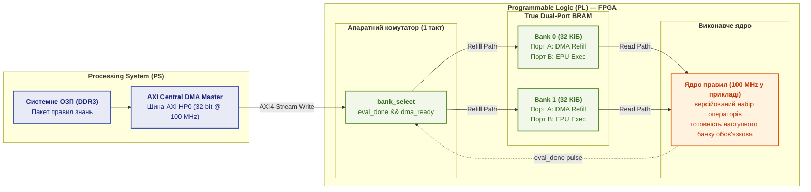

<a id="931-фізичні-результати-тестування-пропускної-здатності-контролера-axi4-dma"></a>

#### 9.3.1. Параметричний розрахунок пропускної здатності контролера AXI4 DMA

Параметричний розрахунок DMA відповідає на питання, чи встигне наступний блок надійти до завершення поточного. Спочатку оцінюють стелю інтерфейсу й час передавання:

<a id="obj-18-56"></a>
<a id="obj-18-current-55"></a>

**Формула (18.55). Стеля DMA і час заповнення банку.**

$$
B_{\mathrm{theo}}=w_{\mathrm{bus}}F_{\mathrm{clk}},\qquad
T_{\mathrm{refill}}=\frac{V_{\mathrm{bank}}}{B_{\mathrm{DMA}}}.
$$

Тут $`w_{\mathrm{bus}}>0`$ — ціла кількість байтів за такт, $`F_{\mathrm{clk}}>0`$ — частота у Гц, $`B_{\mathrm{theo}}`$ — байти/с за одного передавання щотакту; $`V_{\mathrm{bank}}>0`$ — цілий обсяг блока в байтах, а $`0<B_{\mathrm{DMA}}\le B_{\mathrm{theo}}`$ — ефективна смуга для всього передавання, включно з налаштуванням і підтвердженням. Усі величини скінченні; час отримують у секундах. Для 32 бітів і 100 МГц маємо 4 Б × 100 МГц = 400 МБ/с. Burst-транзакції зменшують накладні витрати, але не перевищують цієї стелі. Реальну смугу беруть із протоколу; стеля дає нижню межу часу, не виміряну швидкодію.

1. **Порція 32 КіБ (8 192 слова по 32 біти):** для ілюстративного ISA-профілю $`s_{\mathrm{instr}}=4`$ Б це до 8 192 інструкцій Epistemic OpSet. Навіть за стелі 400 МБ/с час становить:

<a id="obj-18-57"></a>
<a id="obj-18-current-56"></a>

**Формула (18.56). Нижня межа передавання 32 КіБ.**

$$
T_{\mathrm{refill}}(32\,\text{КіБ}) \ge \frac{32\cdot1024\,\text{Б}}{400\cdot10^6\,\text{Б/с}} = 81{,}92\,\mu\text{с}.
$$

2. **Порція 64 КіБ (16 384 слова по 32 біти):** та сама теоретична стеля дає:

<a id="obj-18-58"></a>
<a id="obj-18-current-57"></a>

**Формула (18.57). Нижня межа передавання 64 КіБ.**

$$
T_{\mathrm{refill}}(64\,\text{КіБ}) \ge \frac{64\cdot1024\,\text{Б}}{400\cdot10^6\,\text{Б/с}} = 163{,}84\,\mu\text{с}.
$$

#### 9.3.2. Часова діаграма та осцилограма однотактового перемикання банків

Часова діаграма потрібна, щоб відрізнити завершення обчислення від готовності наступних даних. Нижче наведено умовну схему одного успішного перемикання, **не осцилограму й не захоплення ILA**. Вона не охоплює випадок запізнення DMA, який розібрано після неї:

<a id="obj-18-59"></a>
<a id="obj-18-current-58"></a>

**Схема 18.58. Умовне успішне перемикання банків.**

```text
clk (100 MHz)      : _/¯\_/¯\_/¯\_/¯\_/¯\_/¯\_/¯\_/¯\_/¯\_/¯\_/¯\_/¯\_/¯\_/¯\_/¯\_
eval_done          : ________/¯¯¯¯\_______________________________________________  (1 такт)
dma_ready          : ¯¯¯¯¯¯¯¯¯¯¯¯¯¯\__________________________________________________  (скидання при перемиканні)
bank_select        : 00000000000000\1111111111111111111111111111111111111111111111  (перемикання за 10 нс)
epu_pipeline_stall : _____________________________________________________________  (0 тактів очікування!)
epu_pc             : [PC_end_0]    |[PC_start_1] -> [PC_start_1 + 1] -> ...
```

У цій схемі `bank_select` змінює рівень за один такт (10 нс за 100 МГц), але це не виміряна осцилограма. `dma_ready` для пасивного банку встановлюється лише після запису всього поточного блоку й перевірки його цілісності та скидається в такті перемикання. Перемикання на банк без підтвердженого завершення заборонене; повторне або застаріле завершення без нового запису не встановлює `dma_ready`.

> [!NOTE]
> **Чотири інваріанти подвійної буферизації BRAM у проєкті стенда PYNQ-Z1 за архітектурою автора**
> 1. *Розділення портів і власників*: DMA записує лише неактивний банк, а ядро читає активний; два порти самі не усувають колізій запису й читання тієї самої адреси.
> 2. *Проєктне однотактове перемикання*: за `eval_done && dma_ready` передбачається один такт перемикання; це потребує перевірки синхронізації, готовності даних і таймінгів, не є виміряною властивістю.
> 3. *Перевірка запасу підкачування*: для кожного блоку перевіряють $`T_{\mathrm{refill}}(i+1)\le T_{\mathrm{execute,min}}(i)`$, де праворуч стоїть найкоротший можливий шлях виконання. Самі місткість банку й теоретична смуга цієї умови не гарантують.
> 4. *Сторожовий захист часового зазору*: коли на межі блоку `dma_ready = 0`, у WCET-тракті повертається `REFUSAL` із `LATENCY_SLACK_FAULT` без запуску наступного блоку; поза ним допускається `WAIT_BUFFER_VALID` без видачі вердиктів.
> *Керування рантаймом / Інженерний інваріант:* Відсутність простою є умовною властивістю для перевірених блоків. Простій і перемикання банків входять у повний час; ККД не прирівнюється до одиниці автоматично.

**Імператив замкненого циклу розрахунку (Actionable Closed Loop):**

1. **Керування рантаймом і потоком обчислень (Control Flow & Runtime Decisions):**
   Якщо на момент завершення блоку `dma_ready = 0`, поведінка залежить від тракту. У WCET-тракті з бюджетом FTTI (§8.4.1) усі блоки завантажуються до старту й очікування заборонені: нестача готового блоку означає порушення профілю, `LATENCY_SLACK_FAULT` і відмову `REFUSAL` без предметного вердикту. Поза WCET-трактом ядро очікує в `WAIT_BUFFER_VALID`; це очікування входить до повного часу, а не приховується за оцінкою виконання.
2. **Апаратний сайзинг та інфраструктурні обмеження (Hardware Dimensioning):**
   Конвеєр не простоює, лише якщо підкачування наступного блоку завершується не пізніше за найкоротше виконання поточного. Кількість інструкцій цього не гарантує: прямі переходи й раннє завершення скорочують шлях. Поза WCET-трактом для $`n`$ блоків повний час оцінюють разом із холодним стартом і перемиканнями:

<a id="obj-18-60"></a>
<a id="obj-18-current-59"></a>

**Формула (18.59). Повний час подвійної буферизації.**

$$
T_{\mathrm{total}}\le T_{\mathrm{refill}}(1)
+\sum_{i=1}^{n}\max\bigl(T_{\mathrm{execute}}(i),T_{\mathrm{refill}}(i+1)\bigr)
+\sum_{i=1}^{n-1}T_{\mathrm{switch}}(i),
\qquad T_{\mathrm{refill}}(n+1)=0.
$$

    Тут $n\ge1$ — ціле число блоків, $i$ — їхній індекс; усі часові межі невід'ємні й скінченні. $`T_{\mathrm{execute}}(i)`$ — межа виконання поточного блоку, $`T_{\mathrm{refill}}(i+1)`$ — межа часу від початку його виконання до готовності наступного банку, $`T_{\mathrm{switch}}(i)`$ — межа перемикання, а $`T_{\mathrm{total}}`$ — повний час. Формула припускає незалежне перекриття запису неактивного банку з читанням активного; конкуренція врахована у межах. $`T_{\mathrm{refill}}(1)`$ оплачує холодний старт, останнього підкачування немає. Без обґрунтованих меж це не WCET. Доданок перемикання потрібний, бо він не включений у виконання. Для перевірки місткості $`N_{\mathrm{block}}`$ — ціла кількість інструкцій, $`s_{\mathrm{instr}}>0`$ — байти на інструкцію; їхній добуток не перевищує місткості банку. Для послідовного потоку необхідний темп підкачування не менший за $`s_{\mathrm{instr}}/\tau_{\mathrm{rule}}`$, де $`\tau_{\mathrm{rule}}>0`$ — час однієї інструкції в секундах; раннє завершення може вимагати більшого темпу.
3. **Практичний числовий приклад (Worked Numerical Example):**
   Бортовий вузол верифікує потік із $`10\,000`$ правил гальмівної системи ASIL D.
   - Для умовного профілю $`s_{\mathrm{instr}}=4`$ Б два блоки по 5 000 інструкцій займають по 20 000 Б і вміщуються в банки по 32 КіБ;
   - Для прикладу профілю з $`c(I)=2`$ такти на інструкцію, тобто $`\tau_{\mathrm{rule}}=2\cdot10\,\text{нс}=20\,\text{нс}`$, час виконання блоку становить $`T_{\mathrm{execute}}=5\,000\cdot20\,\text{нс}=100{,}0\,\mu\text{с}`$. Це інший приклад профілю, ніж однотактний у §8.4.1;
   - Час підкачування задає $`T_{\mathrm{refill}}=20\,000\,\text{Б}/B_{\mathrm{DMA}}`$; він не перевищує 100 мкс за ефективної смуги не меншої за 200 МБ/с для всього передавання;
   - Лише за відсутності раннього завершення, коли $`T_{\mathrm{execute,min}}=T_{\mathrm{execute}}`$, та виконання цієї межі смуги перемикання не потребує очікування. Приклад, а не нормативна константа, задає $`T_{\mathrm{switch}}=10\,\text{нс}`$;
    - Без холодного старту час за цих умов становить $`2T_{\mathrm{execute}}+T_{\mathrm{switch}}`$, а з ним додається $`T_{\mathrm{refill}}(1)`$. Умовні 200 МБ/с дають 100 мкс початкового підкачування, 200,01 мкс теплого виконання та 300,01 мкс від холодного старту. Частка корисного виконання $`\eta=T_{\mathrm{exec}}/T_{\mathrm{total}}`$ приблизно 0,667, не одиниця; $`T_{\mathrm{exec}}=200`$ мкс. Якщо поточний блок завершується вже за 40 мкс, наступний за 100 мкс ще не готовий: поза критичним маршрутом потрібне очікування, у затвердженому маршруті без очікувань — відмова.

Отже, спеціалізована апаратура додає перевірювані контракти, а не усуває їх. Перед її впровадженням варто перевірити, чи можна виконати задачу простішим автономним ядром.

## 10. Мінімальна автономна конфігурація для відмовостійкого розгортання

Мінімальна автономна конфігурація повертає до початкового питання: що справді потрібно для перевірюваної відповіді? Якщо задача розв'язується локальними фактами й правилами, ні генеративна модель, ні дискретний GPU не є обов'язковими. Авторський шаблон нижче дозволяє спочатку перевірити предметну модель на звичайному CPU; менше залежностей спрощує випробування, але не дає абсолютної відмовостійкості.

<a id="obj-18-61"></a>
<a id="obj-18-current-60"></a>

**Діаграма 18.60. Мінімальна автономна конфігурація експертної системи.**


Конфігурація використовує один файл бази даних SQLite, у якому розширення FTS5 дає повнотекстовий пошук із вбудованою функцією ранжування `bm25()` [[41]](#src-41). Генеративна модель тут необов'язкова: пояснення складається з правила, що спрацювало, і пункту стандарту, на який правило посилається. Такої конфігурації досить, щоб перевірити на реальних документах, чи правильно сформульовано предметну модель, перш ніж інвестувати в прискорювачі.

> [!NOTE]
> **Чотири критерії автономного відмовостійкого розгортання ядра**
> 1. Потрібні документи, правила, залежності й журнал доступні без зовнішньої мережі; юридична чинність не випливає з локальності.
> 2. CPU-маршрут проходить той самий набір змістових тестів без дискретного прискорювача; його швидкість перевіряють на заданому навантаженні.
> 3. Сховище має визначені права читання й оновлення. SQLite у мінімальному прикладі та незмінний пакет із `mmap` є різними можливими організаціями, не обов'язковими одночасними залежностями.
> 4. Холодне відновлення вимірюють разом із перевіркою цілісності та потрібними сторінками даних; субсекундний старт не гарантується незалежно від обсягу.
> *Керування рантаймом:* Спроба автономного вузла ініціювати зовнішнє мережеве звернення в автономному закритому режимі негайно блокується з кодом E_AIRGAP_SECURITY_FAULT.

Наприклад, навчальний локальний пакет містить 20 правил і джерела їхніх передумов. Для підтвердженого факту рушій повертає правило й цитату; для відсутнього — повідомляє про недостатність підстав, а не звертається потай до моделі. Окремі випробування вимикають мережу, забирають право читання та пошкоджують копію пакета: очікуються відповідно автономна робота, типізована відмова доступу й відмова перевірки цілісності. Це критерії майбутнього тесту реалізації, не виконані тут випробування.

## Висновки
Профіль обчислень допомагає сформувати гіпотезу розміщення, а вимірювання підтримки операторів, якості, затримки, пам'яті й енергії дозволяє її прийняти або відхилити. Roofline є моделлю верхньої межі для обраних операцій, не універсальним прогнозом обходу графа чи генерації. Розподілена мережа простійних NPU є окремою дослідницькою пропозицією; наведені числа планування не є виміряним прискоренням такого кластера.

Вибір локальної платформи починається з місткості, підтримки операторів і моделі трафіку. У прикладі 273 ГБ/с без KV-трафіку дають стелі 7,8 та 107,06 токена/с для двох різних моделей; це не виміряні швидкості й не доказ однакової якості. Для MoE додавання 512 МіБ KV-трафіку зменшує стелю до 88,44 токена/с. Історичний каталог збережено як довідковий матеріал, а не поточну рекомендацію закупівлі; зовнішню звірку параметрів у цьому проході не виконано.

Перевірка збережених рядів Jetson підтвердила тільки наведені в таблиці 18.38 відліки, температурні максимуми й часові показники та середнє показів визначеного каналу A05. Межі сценаріїв і тотожність моделей та профілів не встановлено, тому енергетичного або швидкісного рейтингу MODE_15W і MODE_30W тут немає. Повідомлення автора про нуль дефектів 7B/14B залишається неперевіреним, а теплова політика й розрахунки BRAM/DMA є моделями, не доказами апаратних гарантій.

Незалежний контрприклад показав, що сума p95 етапів може бути нижчою за p95 повного запиту. Програма Go демонструє неасоціативність обчислень float32; близькість векторів потрібно доповнити перевіркою якості пошуку й рішень. Окремий процес зменшує область програмного збою, але спільні фізичні ресурси й відмови перевіряють додатково.

Межі глави такі. Числа продуктивності для умовного процесора й паспортні дані прискорювачів не замінюють вимірювань на конкретній апаратурі. Характеристики платформ зафіксовано за матеріалами виробників на 8 жовтня 2026 року без власних вимірювань, а оцінка швидкості генерації є верхньою межею. Розділ про перспективну апаратуру спирається на дослідницькі прототипи, а модель процесора знань є гіпотезою автора. [Глава 22](ch22-cybernetics-edge-to-backend.md) переходить від апаратної бази до безпосереднього замикання кібернетичного циклу керування та обробки телеметрії від сенсорів до бекенду.

## Словник
<a id="obj-18-62"></a>
<a id="obj-18-current-61"></a>

**Таблиця 18.61. Словник термінів.**

| Український термін | Англійський відповідник | Коротке пояснення |
|---|---|---|
| Власний периметр | On-premise | Розміщення на серверах організації всередині її периметра безпеки |
| Периферія | Edge | Обчислення на пристроях поруч із сенсорами й виконавчими механізмами |
| Туманні обчислення | Fog computing | Проміжний рівень обчислень між периферією та хмарою |
| Арифметична інтенсивність | Arithmetic intensity | Кількість операцій на байт прочитаних з пам'яті даних |
| Обмеженість пам'яттю | Memory-bound | Стан, коли продуктивність обмежує пропускна здатність або затримка доступу до пам'яті |
| Обмеженість обчисленнями | Compute-bound | Стан, коли продуктивність визначають обчислювальні блоки |
| Злите множення-додавання | Fused multiply-add | Операція $`a \cdot b + c`$ з одним округленням |
| Бюджет затримки | Latency budget | Розподіл допустимої затримки між етапами обробки запиту |
| Перцентиль | Percentile | Значення, нижче якого лежить задана частка вимірювань |
| Числовий дрейф | Numerical drift | Зміна числових результатів моделі без зміни її ваг |
| Відображення файлу в пам'ять | Memory mapping | Доступ до файлу як до області пам'яті процесу з підвантаженням сторінок на вимогу |
| Режим lockstep | Lockstep | Виконання тих самих інструкцій двома ядрами з апаратним порівнянням результатів |
| Обчислення в пам'яті | Processing-in-memory | Виконання операцій безпосередньо в мікросхемах пам'яті |
| Процесор знань | Knowledge processing unit | Концептуальна модель процесора для систем знань, запропонована автором |
| Співпроєктування апаратури й програм | Hardware/software co-design | Спільне проєктування апаратної та програмної частин під задачу |
| Мережа фонового індексування | Idle-cycle compute mesh | Агенти на робочих станціях, що виконують пакетну векторизацію на простійних NPU |
| Утримання до підтвердження | Work-queue retention | Політика потоку JetStream, за якої повідомлення зникає після підтвердження обробки одним споживачем |
| Повторна доставка | Redelivery | Видача непідтвердженої одиниці роботи іншому споживачеві після спливу часу очікування |
| Шард | Shard | Частина бази знань чи її індексу, яку обслуговує один вузол або процес; визначення наведено в Главі 7 |
| Суміш експертів | Mixture of experts | Архітектура моделі, у якій вентильна мережа для кожного токена вибирає лише кілька підмереж-експертів |
| Активні параметри | Active parameters | Параметри моделі, які беруть участь в обчисленні одного токена |
| Структурована розрідженість | Structured sparsity | Шаблон нулів у вагах, наприклад 2:4, який тензорні блоки пропускають і цим подвоюють паспортний пік |
| Спекулятивне декодування | Speculative decoding | Генерація, за якої кілька запропонованих токенів перевіряють одним проходом основної моделі |
| Ізольований дослідницький периметр | Air-Gapped R&D | Повністю автономне дослідницьке середовище без підключення до зовнішніх мереж із захистом інтелектуальної власності |
| Прихований канал | Covert channel | Несанкціонований канал передачі даних через мікроархітектурні або фізичні побічні ефекти |
| Партиціювання кешу | Cache allocation technology | Апаратне виділення ізольованих ліній кешу для запобігання міжпроцесній інтерференції (Intel RDT / ARM MPAM) |
| Пряме розгалуження | Forward-only jumps | Переходи лише до більших перевірених адрес у скінченному блоці; обмежує кроки, але потребує окремих часових меж |
| Час найгіршого випадку | Worst-case execution time (WCET) | Найбільший час виконання в явно визначеній області входів і станів платформи; консервативна доведена межа може бути більшою |

## Абревіатури
<a id="obj-18-63"></a>
<a id="obj-18-current-62"></a>

**Таблиця 18.62. Абревіатури.**

| Скорочення | Розшифрування | Значення |
|---|---|---|
| ABAC | Attribute-Based Access Control | керування доступом на основі атрибутів |
| AMX | Advanced Matrix Extensions | матричні розширення процесорів Intel |
| ASIL | Automotive Safety Integrity Level | рівень цілісності безпеки в автомобільній електроніці |
| AVX-512 | Advanced Vector Extensions 512 | 512-бітні векторні розширення x86 |
| BM25 | Best Matching 25 | функція лексичного ранжування |
| CAT | Cache Allocation Technology | технологія виділення ліній кешу |
| CPU | Central Processing Unit | центральний процесор |
| CUDA | Compute Unified Device Architecture | платформа обчислень на GPU NVIDIA |
| CXL | Compute Express Link | стандарт з'єднання процесорів, прискорювачів і пам'яті |
| DAG | Directed Acyclic Graph | спрямований ациклічний граф |
| DDR5 | Double Data Rate 5 | стандарт оперативної пам'яті |
| DSP | Digital Signal Processor | сигнальний процесор |
| ECC | Error-Correcting Code | код корекції помилок пам'яті |
| FMA | Fused Multiply-Add | злите множення-додавання |
| FP16 | 16-bit floating point | формат чисел з рухомою комою половинної точності |
| FP4 | 4-bit floating point | 4-бітний формат чисел з рухомою комою для квантованих моделей |
| FP8 | 8-bit floating point | 8-бітний формат чисел з рухомою комою |
| FPGA | Field-Programmable Gate Array | програмовна логічна інтегральна схема (ПЛІС) |
| FTS5 | Full-Text Search 5 | розширення повнотекстового пошуку SQLite |
| GDDR6, GDDR7 | Graphics Double Data Rate 6, 7 | покоління оперативної пам'яті графічних прискорювачів |
| GPU | Graphics Processing Unit | графічний процесор |
| HNSW | Hierarchical Navigable Small World | графовий індекс для пошуку найближчих векторів |
| INT4 | 4-bit integer | цілі 4-бітні числа, формат квантованих моделей |
| INT8 | 8-bit integer | цілі 8-бітні числа, формат квантованих моделей |
| IP | Ingress Protection | код ступеня захисту корпусу за IEC 60529 |
| JSONL | JSON Lines | текстовий формат з одним записом JSON на рядок |
| KPU | Knowledge Processing Unit | процесор знань (концепція) |
| LPDDR4, LPDDR5X | Low-Power Double Data Rate 4, 5X | покоління енергоощадної оперативної пам'яті |
| MBA | Memory Bandwidth Allocation | розподіл пропускної здатності пам'яті |
| MoE | Mixture of Experts | суміш експертів |
| MPAM | Memory System Resource Partitioning and Monitoring | архітектура партиціювання пам'яті ARM |
| NPU | Neural Processing Unit | нейронний процесор |
| OCR | Optical Character Recognition | оптичне розпізнавання символів |
| PFLOPS | Peta Floating-Point Operations Per Second | квадрильйонів операцій з рухомою комою за секунду |
| PROV-O | PROV Ontology | онтологія походження W3C |
| RDT | Resource Director Technology | технологія керування ресурсами Intel |
| RISC-V | Reduced Instruction Set Computer, п'ята версія | відкрита архітектура набору команд |
| ROCm | власна назва виробника | відкрита платформа обчислень на GPU AMD |
| SWaP | Size, Weight and Power | обмеження розміру, маси й енергоспоживання |
| TFLOPS | Tera Floating-Point Operations Per Second | трильйонів операцій з рухомою комою за секунду |
| TLS | Transport Layer Security | протокол захищеного з'єднання; у взаємному варіанті сертифікат перевіряють обидві сторони |
| TOPS | Tera Operations Per Second | трильйонів операцій за секунду |
| WCET | Worst-Case Execution Time | час виконання найгіршого випадку |
| WSL | Windows Subsystem for Linux | підсистема Windows для виконання програм Linux |
| ПЛІС | програмовна логічна інтегральна схема | мікросхема з конфігуровною логікою |

## Джерела
1. <a id="src-1"></a>Samuel Williams, Andrew Waterman, David Patterson. [*Roofline: An Insightful Visual Performance Model for Multicore Architectures*](https://doi.org/10.1145/1498765.1498785). *Communications of the ACM*, 52(4), 65–76, 2009.
2. <a id="src-2"></a>Yu. A. Malkov, D. A. Yashunin. [*Efficient and Robust Approximate Nearest Neighbor Search Using Hierarchical Navigable Small World Graphs*](https://doi.org/10.1109/TPAMI.2018.2889473). *IEEE Transactions on Pattern Analysis and Machine Intelligence*, 42(4), 824–836, 2020.
3. <a id="src-3"></a>Vijay Janapa Reddi та ін. [*MLPerf Inference Benchmark*](https://doi.org/10.1109/ISCA45697.2020.00045). *2020 ACM/IEEE 47th Annual International Symposium on Computer Architecture (ISCA)*, 446–459, 2020.
4. <a id="src-4"></a>The Open Group. [*mmap: Map Pages of Memory*](https://pubs.opengroup.org/onlinepubs/9799919799/functions/mmap.html). *The Open Group Base Specifications Issue 8, IEEE Std 1003.1-2024*, 2024.
5. <a id="src-5"></a>Flavio Bonomi, Rodolfo Milito, Jiang Zhu, Sateesh Addepalli. [*Fog Computing and Its Role in the Internet of Things*](https://doi.org/10.1145/2342509.2342513). *Proceedings of the First Edition of the MCC Workshop on Mobile Cloud Computing*, 13–16, 2012.
6. <a id="src-6"></a>Michael J. Litzkow, Miron Livny, Matt W. Mutka. [*Condor: A Hunter of Idle Workstations*](https://doi.org/10.1109/DCS.1988.12507). *Proceedings of the 8th International Conference on Distributed Computing Systems*, 104–111, 1988.
7. <a id="src-7"></a>David P. Anderson. [*BOINC: A System for Public-Resource Computing and Storage*](https://doi.org/10.1109/GRID.2004.14). *Fifth IEEE/ACM International Workshop on Grid Computing*, 4–10, 2004.
8. <a id="src-8"></a>OpenVINO. [*NPU Device*](https://docs.openvino.ai/2024/openvino-workflow/running-inference/inference-devices-and-modes/npu-device.html). Документація OpenVINO 2024.
9. <a id="src-9"></a>NATS.io. [*JetStream*](https://docs.nats.io/nats-concepts/jetstream). Документація NATS.
10. <a id="src-10"></a>NVIDIA. [*NVIDIA DGX Spark Arrives for World's AI Developers*](https://nvidianews.nvidia.com/news/nvidia-dgx-spark-arrives-for-worlds-ai-developers). Прес-реліз, 13 жовтня 2025 року.
11. <a id="src-11"></a>NVIDIA. [*DGX Spark User Guide: Hardware Overview*](https://docs.nvidia.com/dgx/dgx-spark/hardware.html). Документація NVIDIA, версія від 10 вересня 2026 року.
12. <a id="src-12"></a>NVIDIA. [*NVIDIA and Microsoft Reinvent Windows PCs for the Age of Personal AI*](https://nvidianews.nvidia.com/news/nvidia-microsoft-windows-pcs-agents-rtx-spark). Прес-реліз, 31 травня 2026 року.
13. <a id="src-13"></a>NVIDIA. [*NVIDIA RTX Spark*](https://www.nvidia.com/en-us/products/rtx-spark/). Сторінка продукту, розділ характеристик.
14. <a id="src-14"></a>Andrew Hill. [*Building the Next Generation of Devices for Developers: Surface RTX Spark Dev Box*](https://blogs.windows.com/devices/2026/06/02/building-the-next-generation-of-devices-for-developers-surface-rtx-spark-dev-box/). Windows Blog, 2 червня 2026 року.
15. <a id="src-15"></a>Brett Ostrum. [*Pre-order Our Most Powerful Surface Devices Ever*](https://blogs.windows.com/devices/2026/10/07/pre-order-our-most-powerful-surface-devices-ever/). Windows Blog, 7 жовтня 2026 року.
16. <a id="src-16"></a>Microsoft. [*Introducing Surface RTX Spark Dev Box*](https://www.microsoft.com/en-us/surface/devices/surface-rtx-spark-dev-box). Сторінка продукту.
17. <a id="src-17"></a>NVIDIA. [*NVIDIA DGX Station for Windows Puts a Trillion-Parameter AI Supercomputer on Every Enterprise Desk*](https://nvidianews.nvidia.com/news/nvidia-dgx-station-for-windows-puts-a-trillion-parameter-ai-supercomputer-on-every-enterprise-desk). Прес-реліз, 31 травня 2026 року.
18. <a id="src-18"></a>NVIDIA. [*NVIDIA RTX PRO 6000 Blackwell Workstation Edition*](https://www.nvidia.com/en-us/products/workstations/professional-desktop-gpus/rtx-pro-6000/). Сторінка продукту, розділ характеристик.
19. <a id="src-19"></a>AMD. [*AMD Powers Next-Generation Agent Computers with New Ryzen AI Halo Developer Platform and Ryzen AI Max PRO 400 Series Processors*](https://www.amd.com/en/blogs/2026/amd-powers-next-generation-agent-computers-with-new-ryzen-ai-hal.html). Блог AMD, 20 травня 2026 року.
20. <a id="src-20"></a>AMD. [*AMD Ryzen AI Halo Developer Platform with Ryzen AI Max+ 395 Processor*](https://www.amd.com/en/products/processors/desktops/ryzen/ryzen-ai-halo/ryzen-ai-max-plus-395.html). Сторінка продукту, технічні характеристики.
21. <a id="src-21"></a>Intel. [*CES 2026: Intel Core Ultra Series 3 Debut as First Built on Intel 18A*](https://www.intel.com/content/www/us/en/newsroom/news/artificial-intelligence/ces-2026-intel-core-ultra-series-3-debut-first-built-on-intel-18a.html). Intel Newsroom, 5 січня 2026 року.
22. <a id="src-22"></a>Intel. [*Intel to Expand AI Accelerator Portfolio with New GPU*](https://www.intel.com/content/www/us/en/newsroom/news/artificial-intelligence/intel-to-expand-ai-accelerator-portfolio-with-new-gpu.html). Intel Newsroom, 14 жовтня 2025 року.
23. <a id="src-23"></a>Qualcomm. [*New Snapdragon X2 Elite Extreme and Snapdragon X2 Elite Are the Fastest and Most Efficient Processors for Windows PCs*](https://www.qualcomm.com/news/releases/2025/09/new-snapdragon-x2-elite-extreme-and-snapdragon-x2-elite-are-the-). Прес-реліз, 24 вересня 2025 року.
24. <a id="src-24"></a>Qualcomm. [*Snapdragon X2 Elite*](https://www.qualcomm.com/laptops/products/snapdragon-x2-elite). Сторінка продукту, порівняння моделей Snapdragon X.
25. <a id="src-25"></a>Tenstorrent. [*Blackhole*](https://tenstorrent.com/hardware/blackhole). Сторінка продукту, порівняння моделей p100a, p150a і p150b.
26. <a id="src-26"></a>Jeff Pool, Abhishek Sawarkar, Jay Rodge. [*Accelerating Inference with Sparsity Using the NVIDIA Ampere Architecture and NVIDIA TensorRT*](https://developer.nvidia.com/blog/accelerating-inference-with-sparsity-using-ampere-and-tensorrt/). NVIDIA Technical Blog, 20 липня 2021 року.
27. <a id="src-27"></a>Noam Shazeer, Azalia Mirhoseini, Krzysztof Maziarz, Andy Davis, Quoc Le, Geoffrey Hinton, Jeff Dean. [*Outrageously Large Neural Networks: The Sparsely-Gated Mixture-of-Experts Layer*](https://doi.org/10.48550/arXiv.1701.06538). arXiv:1701.06538, 2017.
28. <a id="src-28"></a>OpenAI. [*gpt-oss-120b & gpt-oss-20b Model Card*](https://doi.org/10.48550/arXiv.2508.10925). arXiv:2508.10925, 2025; картка моделі [openai/gpt-oss-120b](https://huggingface.co/openai/gpt-oss-120b) на Hugging Face.
29. <a id="src-29"></a>NVIDIA. [*Jetson Orin*](https://www.nvidia.com/en-us/autonomous-machines/embedded-systems/jetson-orin/). Сторінка продукту.
30. <a id="src-30"></a>Hailo. [*Hailo-8 AI Accelerator*](https://hailo.ai/products/ai-accelerators/hailo-8-ai-accelerator/). Сторінка продукту.
31. <a id="src-31"></a>NVIDIA. [*NVIDIA Jetson Thor*](https://www.nvidia.com/en-us/autonomous-machines/embedded-systems/jetson-thor/). Сторінка продукту.
32. <a id="src-32"></a>Hailo. [*Hailo-10H AI Accelerator*](https://hailo.ai/products/ai-accelerators/hailo-10h-ai-accelerator/). Сторінка продукту.
33. <a id="src-33"></a>Texas Instruments. [*TMS570LC4357: High-Performance Automotive-Grade Microcontroller for Safety-Critical Applications*](https://www.ti.com/product/TMS570LC4357). Сторінка продукту.
34. <a id="src-34"></a>IEC. [*IEC 60529:1989+A1:1999+A2:2013. Degrees of Protection Provided by Enclosures (IP Code)*](https://webstore.iec.ch/en/publication/2452). 2013.
35. <a id="src-35"></a>ISO. [*ISO 26262-1:2018. Road vehicles: Functional safety: Part 1: Vocabulary*](https://www.iso.org/standard/68383.html). 2018.
36. <a id="src-36"></a>David Goldberg. [*What Every Computer Scientist Should Know About Floating-Point Arithmetic*](https://doi.org/10.1145/103162.103163). *ACM Computing Surveys*, 23(1), 5–48, 1991.
37. <a id="src-37"></a>Tae Jun Ham, Lisa Wu, Narayanan Sundaram, Nadathur Satish, Margaret Martonosi. [*Graphicionado: A High-Performance and Energy-Efficient Accelerator for Graph Analytics*](https://doi.org/10.1109/MICRO.2016.7783759). *2016 49th Annual IEEE/ACM International Symposium on Microarchitecture (MICRO)*, 1–13, 2016.
38. <a id="src-38"></a>Junwhan Ahn, Sungpack Hong, Sungjoo Yoo, Onur Mutlu, Kiyoung Choi. [*A Scalable Processing-in-Memory Accelerator for Parallel Graph Processing*](https://doi.org/10.1145/2749469.2750386). *Proceedings of the 42nd Annual International Symposium on Computer Architecture (ISCA)*, 105–117, 2015.
39. <a id="src-39"></a>CXL Consortium. [*Compute Express Link*](https://computeexpresslink.org/).
40. <a id="src-40"></a>RISC-V International. [*Ratified Specifications*](https://riscv.org/specifications/ratified/).
41. <a id="src-41"></a>SQLite. [*SQLite FTS5 Extension*](https://www.sqlite.org/fts5.html). Документація SQLite.
42. <a id="src-42"></a>NVIDIA. [*Jetson AGX Orin Series Thermal Design Guide*](https://developer.nvidia.com/embedded/learn/jetson-agx-orin-devkit-user-guide). Technical Whitepaper, 2024.
43. <a id="src-43"></a>NVIDIA. [*Jetson Linux Developer Guide: Power Management and nvpmodel*](https://docs.nvidia.com/jetson/archives/r36.2/DeveloperGuide/SD/PlatformPowerAndPerformance/JetsonOrinNanoSeriesJetsonOrinNxSeriesAndJetsonAgxOrinSeries.html). JetPack 6.2 Documentation, 2025.
44. <a id="src-44"></a>ISO/IEC. [*ISO/IEC 27001:2022. Information security, cybersecurity and privacy protection — Information security management systems — Requirements*](https://www.iso.org/standard/27001). 2022.
45. <a id="src-45"></a>Intel Corporation. [*Intel Resource Director Technology (Intel RDT) Architecture Specification*](https://www.intel.com/content/www/us/en/developer/articles/technical/intel-resource-director-technology-architecture.html). Reference Guide, 2023.
46. <a id="src-46"></a>Reinhard Wilhelm та ін. [*The Worst-Case Execution Time Problem — Overview of Methods and Survey of Tools*](https://doi.org/10.1145/1347375.1347389). *ACM Transactions on Embedded Computing Systems*, 7(3), 36:1–36:53, 2008.
47. <a id="src-47"></a>Gonzalo Navarro, Mathieu Raffinot. [*New Techniques for Regular Expression Searching*](https://doi.org/10.1007/s00453-004-1120-3). Онлайн-публікація, 2004. Бібліографічні дані звірено за реєстром DOI; повнотекстову звірку конкретної бітової реалізації тут не заявлено.
48. <a id="src-48"></a>IEC. [*IEC 62443-4-1:2018. Security for industrial automation and control systems — Part 4-1: Secure product development lifecycle requirements*](https://webstore.iec.ch/en/publication/33615). Офіційна картка публікації; область застосування підтверджено за анотацією, точні нормативні пункти не перевірялися.

---

[← Глава 17](ch17-implementation-stack.md) | [Зміст книги](README.md) | [Частина VII](part-07-runtime-and-knowledge-exchange.md) | [Глава 21 →](ch21-from-recommendation-to-action.md)
