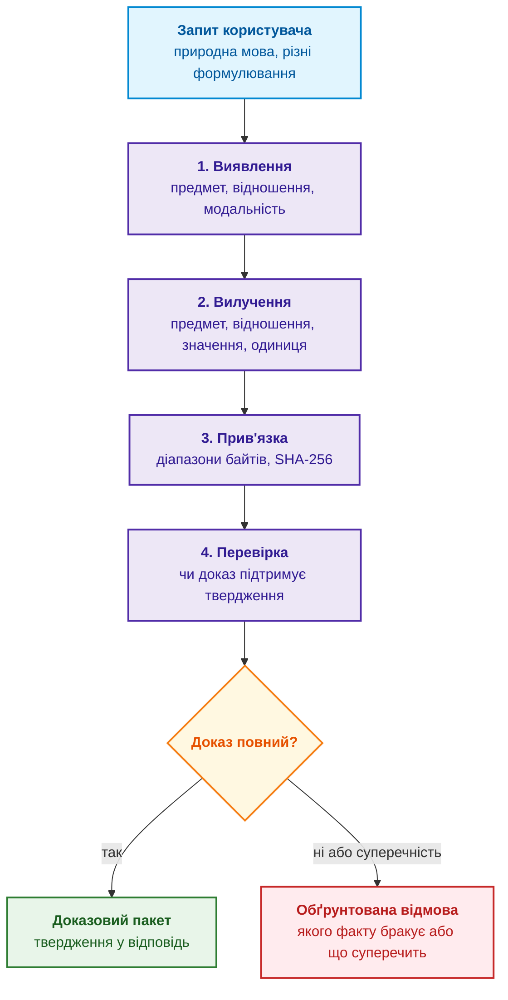
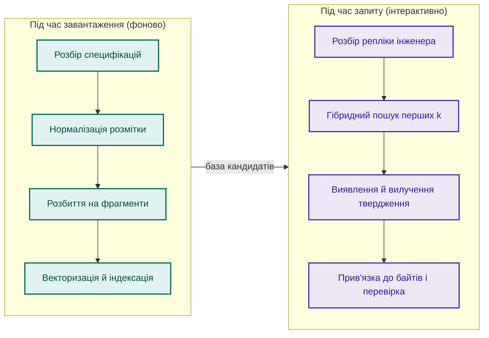
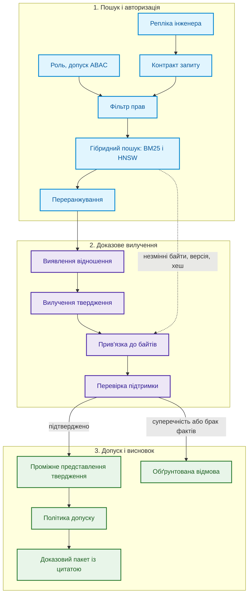
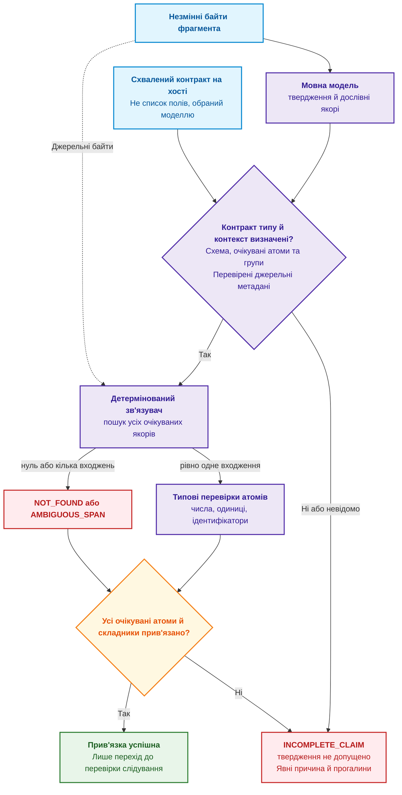
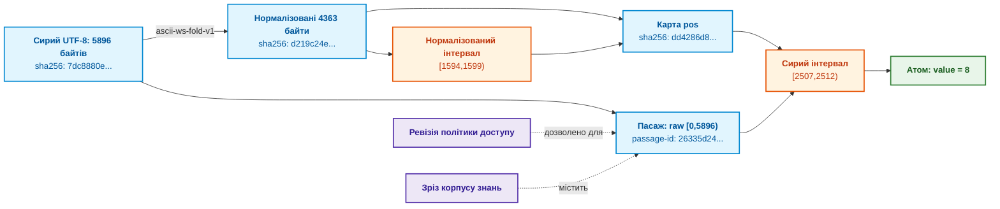
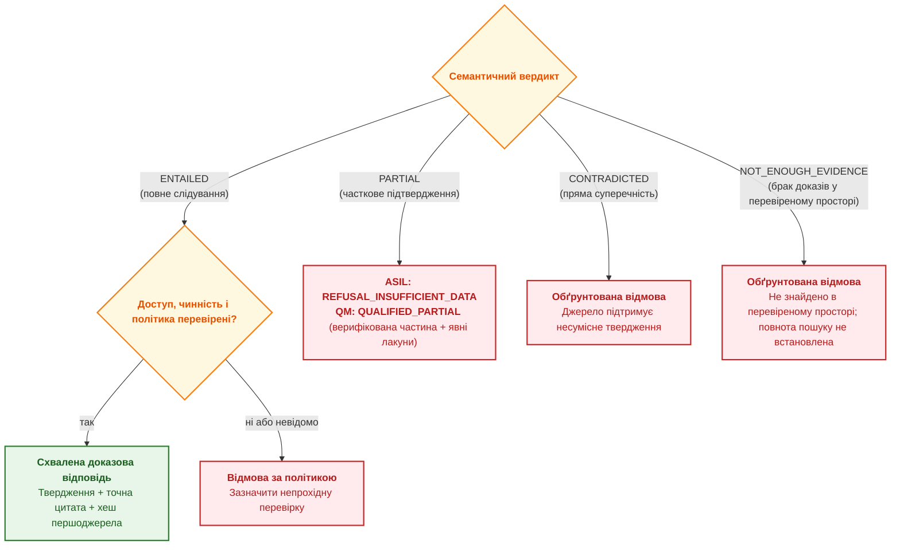
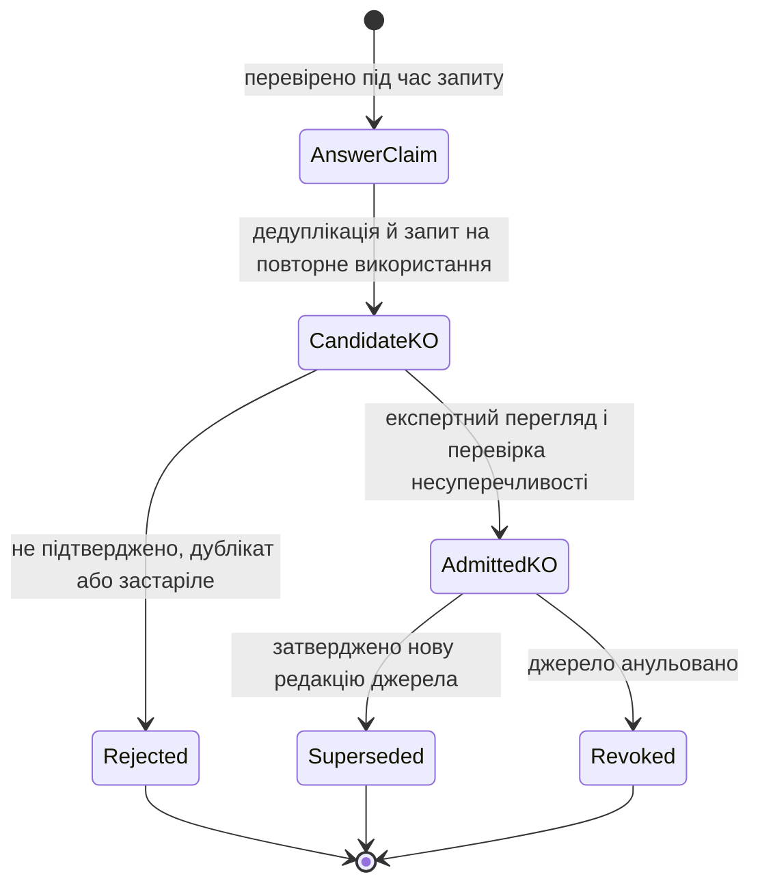

# Глава 19. Від запитання до доказу: пошук, прив'язка та перевірка твердження

> **Книга:** [Архітектура доказових експертних систем](README.md) · [Частина IV: Архітектура системи, нормативне виведення, діагностика та пояснення](part-04-architecture-and-inference.md)  
> **Попередня глава:** [Глава 13. Варіативність природної мови проти детермінізму: компіляція сенсу запитання](ch13-language-variability-vs-determinism.md)  
> **Наступна глава:** [Глава 31. Виведення за нормами: ієрархії предикатів, винятки та чинність](ch31-syllogistic-reasoning-and-relation-lattices.md)  
> **Зміст книги:** [README.md](README.md)  
> **Автор:** [Микола Мартинович Федчик](about-the-author.md)  
> **Передумови й навчальний маршрут:** достатньо розуміти запис «величина + одиниця» та структуру об'єкта JSON; поняття байтової адреси й перевірки підтримки пояснено в главі. Від прикладу UDP переходимо до контракту запиту, зв'язування цитат і рішення про допуск.  
> **Очікувані результати:** розкладати запитання природною мовою на предмет, відношення й комунікативну дію; розрізняти етапи виявлення, вилучення, прив'язки й перевірки твердження; прив'язувати кожен матеріальний атом твердження до байтів першоджерела й обчислювати повноту прив'язки; нормалізувати значення й одиниці вимірювання; будувати проміжне представлення твердження з доказом; організовувати регресійне тестування й безпечний допуск тверджень до бази знань.  

---

## Анотація

Знайти абзац із потрібним числом ще не означає обґрунтувати відповідь експертної системи: число може стосуватися іншого об'єкта, мати іншу одиницю або діяти лише за певної умови. На наскрізному прикладі мінімальної довжини UDP-датаграми показано, як відокремити розбір запитання й пошук кандидатів від перевірки їхньої підтримки джерелом. Авторська чотириетапна модель поєднує виявлення, вилучення, байтову прив'язку (*grounding*) та перевірку слідування (*entailment*). Навчальна програма Go відтворює чотири текстові опори з RFC 768; метрика $`\mathrm{Comp}(C)`$ пояснює, як виявити втрачені складники, але не вимірює істинності. Далі розглянуто типізацію величин, походження цитат, чотири статуси підтримки, регресійні перевірки та допуск кандидата до бази знань. Програмно реалізовано зв'язувач, а загальна семантична перевірка й політика допуску залишаються окремими обов'язками архітектури.

---

Уявімо експертну систему, яка аналізує мережеві специфікації й відповідає лише за перевіреної підтримки першоджерелом. Користувач запитує: *«Яка мінімальна довжина UDP-датаграми?»* Нехай механізм пошуку в системі з доповненою пошуком генерацією (*Retrieval-Augmented Generation*, RAG) [[1]](#src-1) знайшов RFC 768, специфікацію протоколу UDP (*User Datagram Protocol*), і потрібний абзац [[2]](#src-2). Це навчальне припущення про успішний пошук, не гарантія RAG:

> *Length is the length in octets of this user datagram including this header and the data. (This means the minimum value of the length is eight.)*

Генеративна модель відповідає коротко: *«8»*. Число правильне, але інженерна відповідь неповна. Вісім чого: бітів, октетів, 32-розрядних слів? У тексті число записано словом *eight*, а одиниця *octets* стоїть в іншій частині речення, тож пошук цифр регулярним виразом тут не знайшов би нічого. До того ж інженер міг поставити те саме запитання по-різному:

- *«Яка мінімальна довжина UDP-датаграми?»* (пряме запитання);
- *«Скільки щонайменше займає UDP-датаграма?»* (прохання про розрахунок);
- *«Покажи в RFC, де визначено мінімальну довжину датаграми»* (запит на доказ);
- *«Чи правильно, що мінімальна UDP-датаграма має 8 октетів?»* (запит на перевірку твердження).

Ці репліки різняться граматикою й комунікативною дією, але спираються на одне інженерне твердження. Набір даних Natural Questions розрізняє довгу відповідь (фрагмент, що містить відповідь) і коротку відповідь (точний фрагмент усередині нього) [[3]](#src-3). Для експертної системи навіть короткої цитати недостатньо: у цій монографії автором запропоновано **концепцію повноструктурного інженерного твердження**. У простому кількісному випадку записують предмет, відношення, значення, одиницю та походження: «UDP-датаграма; мінімальна довжина; 8; октетів; RFC 768 і точні цитати». Матеріальною названо складову, втрата якої змінює зміст або застосовність відповіді. Це фрейм простого визначення, не універсальний перелік полів: для умовної чи деонтичної норми повний склад задає контракт §5.1. Відмінність цієї моделі від наявних схем evidence/claim тут не встановлено; її новизна й повнота потребують окремого зіставлення.

Ця глава відповідає на запитання: **як перетворити знайдений фрагмент на перевірюване твердження для відповіді?** Для цього автором запропоновано **чотириетапну архітектурну модель перетворення запитання на доказ**: виявлення, вилучення, прив'язка, перевірка. Мовна модель пропонує структуру й якорі, тобто дослівні фрагменти для пошуку; зв'язувач обчислює їхні байтові адреси, а окрема перевірка встановлює ролі, застосовність і відповідність запитанню. Цю послідовність подано як проєктну архітектуру; її новизну не зіставлено з наявними конвеєрами, а якість етапів потребує окремого оцінювання. За авторським **принципом необхідності побайтової прив'язки для джерельної верифікації** непідтверджене поле веде до уточнення або відмови (`REFUSAL`), а не до його домислювання. Прив'язка є необхідною умовою цього профілю перевірки, але сама не доводить правильності висновку.

<a id="obj-19-1"></a>

**Діаграма 19.1. Чотири етапи від запитання до перевіреної підтримки**



Діаграма показує, що відповідь можлива лише після всіх чотирьох етапів, а будь-який збій веде до відмови з поясненням. Наступний розділ уточнює, де саме в архітектурі експертної системи працює цей процес.

## 1. Місце задачі в архітектурі експертної системи

Місце цієї задачі визначає різниця між двома результатами: пошук повертає текст, схожий на потрібний, а ядро виведення потребує перевірених передумов. Для цієї системи автором запропоновано **захисний перехідний шлюз між неструктурованим пошуком та символьним ядром**. Наприклад, у реченні про UDP знайдено `eight`, але без одиниці та зв'язку з довжиною датаграми це ще не придатна передумова для розрахунку. Це проєктний патерн, а не новий клас систем; його межі потрібно перевірити на пропусках, хибних допусках і неоднозначних фрагментах. Шлюз має виявляти такі втрати до використання факту, а не покладатися на переконливість відповіді генератора.

Авторський **інженерний принцип детермінізму ланцюжків міркувань у місійно-критичних доменах** тут задає вимогу до архітектури: кожна використана передумова повинна мати перевірене походження й застосовність, а кожний перехід — відповідати схваленому правилу виведення. Це не еквівалентність між наявністю байтових посилань та істинністю: детермінована програма теж може містити хибне правило. ISO 26262, IEC 61508 і DO-178C наведено як приклади доменів із високою ціною помилки; конкретних вимог цих стандартів до такого шлюзу тут не встановлено. Отже, потрібні окремі перевірки джерела, структури твердження й самого висновку.

Ця глава розглядає відрізок шляху читання з [Глави 16](ch16-expert-systems-architecture.md): документ уже має дозволений доступ і зафіксовану версію, механізм пошуку повернув перші $k$ кандидатів, і тепер текст треба перетворити на машинно-перевірне твердження. Тут $k$ — додатне ціле число фрагментів у пошуковій видачі; наприклад, за $k=5$ перевіряються п'ять кандидатів, а не весь корпус. Авторська **таксономія шести контрольно-пропускних шлюзів перевірки факту** у таблиці 19.2 додає до чотирьох змістових етапів пошук і допуск. Це запропонована класифікація: критерії незалежності, покриття й відмінності від наявних моделей потребують окремої перевірки.

<a id="obj-19-2"></a>

**Таблиця 19.2. Запропонована автором таксономія шести перевірок факту**

| Етап | Контрольне запитання | Типовий прихований дефект |
|---|---|---|
| **Пошук** (*retrieval*) | Чи потрапив потрібний фрагмент у перші $k$ результатів? | Знайдено правильний документ, але застарілу редакцію |
| **Виявлення** (*detection*) | Чи містить фрагмент саме те відношення, про яке питають? | Речення про довжину датаграми прийнято за відповідь про довжину заголовка |
| **Вилучення** (*extraction*) | Чи збережено повну структуру значення? | `eight octets` скорочено до числа `8` |
| **Прив'язка** (*grounding*) | Чи має кожен атом точні координати в документі? | Цитата правильна, але взята з нечинної редакції |
| **Перевірка** (*verification*) | Чи підтримує доказ твердження повністю? | Не помічено винятку на кшталт «крім випадків протоколу X» |
| **Допуск** (*admission*) | Чи має користувач право отримати цей фрагмент? | Модель використала закритий документ у відповіді на відкритий запит |

Кожен рядок таблиці описує окремий клас інженерних ризиків, що вимагає детермінованого захисного механізму. Перша лінія захисту розгортається ще до звернення до пошукового індексу — на етапі семантичного розбору самого запитання.

## 2. Слабкоструктурована природа запитань природною мовою та семантична декомпозиція

Щоб знайти потрібне свідчення, спочатку треба встановити, про що саме запитує користувач. Семантичною декомпозицією названо розклад запитання на змістові частини: «довжина заголовка UDP» і «мінімальна довжина UDP-датаграми» містять схожі слова, але задають різні задачі. На відміну від запиту формальною мовою SQL, природна репліка може пропускати предмет («А скільки це в бітах?») або спиратися на попередню відповідь. Простий пошук ключових слів не завжди відновлює цей контекст; незрозумілий предмет потрібно уточнити до виведення.

Для такого розбору автором запропоновано **модель трикомпонентної семантичної декомпозиції технічного запиту**, яка розділяє три ролі. Це кандидатна схема типізації: її межі й узгодженість ролей потрібно перевірити на розмічених запитах, зокрема з пропущеним предметом і неоднозначною дією:

1. **Предмет запиту** (*subject*): технічний об'єкт, підсистема чи параметр (наприклад, UDP-датаграма, шина CAN FD, інвертор).
2. **Відношення** (*relation*): нормативно визначена властивість чи характеристика (наприклад, мінімальна довжина, граничний струм, допустимий джиттер).
3. **Комунікативна дія** (*speech act*): прагматичний намір інженера — запит прямого факту, вимога надати первинний нормативний доказ, верифікація гіпотези чи спростування припущення (теоретичну базу мовленнєвих актів як цілеспрямованих дій заклав Джон Серл [[4]](#src-4)).

Мовна модель пропонує структурований розбір, а JSON Schema [[5]](#src-5) перевіряє наявність полів, типи та дозволені значення. Наприклад, схема може відхилити невідоме значення `speech_act`, але не помітить, що модель переплутала заголовок UDP із цілою датаграмою: обидві назви є допустимими рядками. Тому коректний за схемою об'єкт є кандидатом для пошуку, а не підтвердженим тлумаченням запитання. За кількох змістових прочитань система має попросити уточнення. Нижче наведено приклад такого об'єкта, не саму схему:

<details>
<summary>Структуровані дані JSON</summary>

```json
{
  "schema_version": "query-contract.v1",
  "subject": "UDP datagram",
  "relation": "minimum length",
  "speech_act": "request_evidence",
  "answer_shape": "quantity",
  "constraints": {
    "document_family": "IETF RFC",
    "status": "current"
  },
  "dialogue_context_refs": []
}
```

</details>


Поле `answer_shape` зі значенням `quantity` повідомляє наступним етапам, що для цього запиту відповідь мусить містити число з одиницею, а `request_evidence` вимагає показати цитату. Розбір початкової репліки «Яка мінімальна довжина?» дав би `request_fact`; наведений варіант відповідає репліці «Покажи в RFC…». Поле `status: current` є умовою перевірки чинності редакції, не вже встановленим фактом. Так само атрибути доступу ABAC (*Attribute-Based Access Control*) має задавати довірений сервіс ідентифікації, а не сама модель. Контракт задає, що шукати; наступне питання — коли саме добувати ці знання з документів.

> [!NOTE]
> **Чотири проєктні інваріанти семантичної декомпозиції запитань**
> 1. Формування типізованого контракту запиту (`QueryContract`) з явною фіксацією очікуваної форми відповіді (`answer_shape`) та типу мовленнєвого акту (`speech_act`).
> 2. Обмеження синтаксису виходу формальною граматикою, наприклад GBNF (розширеною формою Бекуса — Наура для керованого генерування). Граматика контролює форму запису, але не усуває змістової неоднозначності; її перевіряють окремо до пошуку.
> 3. Декомпозиція складеного запитання на мінімальні атомарні підзапити зі збереженням графів логічної залежності передумов.
> 4. Обов'язкове призначення ролевих обмежень та контекстних атрибутів безпеки (ABAC) на рівні специфікації контракту.
> *Керування рантаймом:* Запит із суперечливими або нерозпізнаними передумовами переводиться у стан CLARIFICATION_REQUIRED з кодом E_AMBIGUOUS_QUERY_INTENT.

## 3. Два часові шляхи здобуття знань

Два часові шляхи потрібні, щоб не повторювати підготовку документа для кожного запитання, але й не намагатися передбачити всі майбутні запити. В авторській **парадигмі двочасового здобуття знань** (*Ingest-Time vs. Query-Time Acquisition*) під час завантаження готуються текст та індекси, а під час запиту вилучається конкретне твердження. Наприклад, RFC 768 можна один раз розбити на фрагменти, а згодом окремо перевіряти запитання про довжину й про контрольну суму. Це розподіл роботи, не доведена гарантія затримки: час залежить від розміру документів, індексу та реалізації перевірок.

<a id="obj-19-3"></a>

**Діаграма 19.3. Фонова підготовка й перевірка під час запиту**



Фонове здобуття (*ingest-time acquisition*) виконується, коли додають нові документи: воно зберігає структуру й версії, розпізнає таблиці, обчислює контрольні суми. Цей процес описано в [Главі 15](ch15-knowledge-extraction-and-kb-construction.md). Здобуття під час запиту (*query-time acquisition*) вилучає й перевіряє твердження за контрактом користувача. Для скінченного, наперед визначеного набору питань усі відповіді іноді можна підготувати завчасно; довільних майбутніх інтерпретацій такий перелік не охоплює. У прикладі запит про мінімальну довжину використовує готовий фрагмент, не запускаючи повторного розбору всього документа. Далі потрібно простежити, як обидва шляхи сходяться в одному перевірюваному запиті.

> [!NOTE]
> **П'ять правил темпорального розділення шляхів здобуття знань за архітектурою автора**
> 1. Асинхронне виконання важкої нормалізації, розмітки та індексації специфікацій виключно у фоновому тракті Ingest Path.
> 2. Обмеження оперативного інтерактивного тракту Query Path суто екстракцією, побайтовим зв'язуванням та символьною верифікацією запитаного факту.
> 3. Кешування незмінних проміжних фрагментів із криптографічним хешуванням вмісту для захисту від перевитрати обчислювальних бюджетів.
> 4. Вимога до реалізації: готувати нову версію окремо від незмінного знімка активних сеансів читання. Відсутність блокувань і дотримання бюджету затримки потребують перевірки конкретного сховища, а не випливають із поділу на два шляхи.
> 5. Фіксація єдиного детермінованого зрізу корпусу (Corpus Snapshot) для усього життєвого циклу обробки сесії запиту.
> *Керування рантаймом:* Спроба використання невалідованого кандидата знань у тракті виведення Read Path блокується з кодом E_UNCOMMITTED_EVIDENCE_ACCESS.

## 4. Конвеєр перетворення запиту на доказ

Конвеєр перетворення запиту на доказ має зберегти зв'язок між тим, що запитали, що знайшли та що перевірили. Для запиту про UDP авторська **трифазна схема наскрізного циклу** групує роботу так: спочатку пошук дозволених фрагментів, потім чотири змістові етапи, нарешті рішення про відповідь. Це інший масштаб тієї самої моделі, а не три етапи замість чотирьох.

На вході пошуку застосовують попередню авторизацію ABAC: недоступні користувачеві фрагменти не передаються генератору. Гібридний пошук поєднує лексичний ранг BM25 (збіг слів) і векторний індекс HNSW (близькість числових подань тексту); переранжування уточнює порядок уже знайдених кандидатів. Жоден із цих рангів не є вердиктом про правильність: фрагмент із багатьма згадками UDP ще може не відповідати на питання про довжину. Тому в діаграмі 19.4 пошук відокремлено від прив'язки й перевірки.

<a id="obj-19-4"></a>

**Діаграма 19.4. Наскрізний маршрут запиту з окремим каналом джерельних байтів**



Пунктирна стрілка втілює авторський **принцип прямого каналу незмінних байтів** (*Bypass Raw Bytes Channel*): зв'язувач отримує байти, версію й хеш документа зі сховища, а не з відповіді моделі. Якщо модель підставила `bits` замість `octets`, зв'язувач перевірить цей якір у незалежному вході й виявить його відсутність. Але всі слова хибного твердження можуть трапитися в різних реченнях: прямий канал дає змогу перевірити цитату, не довільну змістову помилку. Тепер розглянемо саме цей обмежений, відтворюваний крок.

## 5. Вилучення та детерміноване зв'язування з байтами

Вилучення дає кандидатне твердження; детерміноване зв'язування має відповісти на вужче питання: де саме в джерелі записано його складники? Авторський **принцип функціонального розділення генератора гіпотез та детермінованого валідатора** відводить моделі пропозицію якорів, а програмі — відтворюваний пошук їхніх байтових адрес і перевірку типів. Спаном названо інтервал тексту. Наприклад, якір `eight` вказує на число, але адреса без ідентичності файла була б неоднозначною.

На цьому розділенні побудовано авторський **патерн детермінованого зв'язувача текстових спанів** (*deterministic span binder*). За **правилом єдиності входження текстового якоря** (*Unique Anchor Rule*) зв'язувач приймає якір, що має рівно одне входження в обраному фрагменті. Нуль збігів дає `NOT_FOUND`, кілька — `AMBIGUOUS_SPAN`. Це консервативний профіль прикладу, не властивість істинних речень: повторюване слово може бути цілком доречним. Потрібно звузити фрагмент чи запропонувати довший якір і повторити перевірку, а не довільно вибрати перший збіг.

<a id="obj-19-5"></a>

**Діаграма 19.5. Зв'язування очікуваних атомів за незалежно заданим контрактом**



### 5.1. Повнота прив'язки та критерії валідності

Повнота прив'язки потрібна верифікатору експертної системи, щоб не пропустити твердження з утраченою умовою чи винятком. Якщо знаменник метрики містить тільки поля, які запропонувала модель, пропущене обмеження зникає також із перевірки: чотири правильні якорі можуть приховати неправильне правило. Тому перед обчисленням $`\mathrm{Comp}(C)`$ хост, тобто довірений вузол виконання, визначає контракт $\Gamma$ для типу твердження $C$ та його джерельного контексту, а не довіряє довільному переліку полів кандидата.

Контракт має схвалені тип і версію схеми, повний перелік очікуваних текстових атомів, правила їхньої кратності та обов'язкові контекстні підстави. Застосовність кожної групи — модальності, умов, винятків, кількісних значень — повинна бути визначена незалежно від бажаного результату кандидата. «У джерелі підтверджено відсутність винятків» відрізняється від «аналізатор не знає, чи вони є»; другий стан не вилучає групу зі знаменника й блокує просування. Невідомий тип, порожня схема або непідтверджений контекст не отримують числової оцінки за замовчуванням.

<a id="obj-19-6"></a>

**Таблиця 19.6. Тип твердження визначає очікувані складники**

| Приклад типу | Очікувані текстові компоненти за підтвердженим контрактом | Контекст і межа прикладу |
|---|---|---|
| Просте кількісне визначення | Предмет, відношення, значення й одиниця, якщо вона фізично застосовна | Модальність визначення та ідентичність/редакція джерела перевіряються окремо; чотири поля не є універсальною схемою |
| Деонтична норма | Актанти й дія, модальність, заперечення, квантори та всі застосовні умови/винятки | Відсутність маркера не дає права довільно вибрати `MUST`, дозвіл чи безумовність |
| Умовна кількісна норма | Основна величина та всі матеріальні складники кожної умови: наприклад, також значення й одиниця напруги | Кілька умов мають окремі екземпляри атомів і перевірені логічні зв'язки; одна знайдена умова не замінює решти |

Таблиця задає приклади, не вичерпну онтологію всіх речень. Точний склад і статуси застосовності фіксуються схваленим контрактом після перевірки джерельної структури; автоматичної повноти такого визначення для довільної природної мови тут не доведено. Якщо редакція, час чинності чи класифікація типу походять із паспорта документа або схеми, зберігається перевірене посилання на цей артефакт. Їм не вигадуються текстові спани в цитаті. Непідтверджена контекстна підстава блокує повний результат навіть за всіх знайдених текстових якорів.

Для визначеного непорожнього контракту з підтвердженим контекстом метрика текстової повноти має вигляд; позначення $`\mathrm{Comp}(C)`$ далі є скороченням за фіксованого $\Gamma$:

<a id="obj-19-7"></a>

**Формула (19.7). Зважена повнота прив'язки очікуваних текстових атомів**

```math
\mathrm{Comp}(C;\Gamma)=
\frac{\sum_{a\in A_m(C;\Gamma)}w_a\,\mathbb I[\mathrm{CompleteBinding}(a)]}
{\sum_{a\in A_m(C;\Gamma)}w_a}.
```

де:
- $`\mathrm{Comp}(C)`$ — скалярний показник повноти прив'язки твердження $C$, визначений у нормованому діапазоні $[0, 1]$;
- $\Gamma$ — схвалений контракт типу й очікуваних екземплярів, а $`A_m(C;\Gamma)`$ — визначена хостом скінченна непорожня множина необхідних текстових атомів; вона не скорочується до наявних у кандидата полів;
- $a$ — окремий матеріальний атом із множини $`A_m(C;\Gamma)`$; $C$ — кандидатне твердження, а не вже підтверджений факт;
- $`w_a`$ — додатна скінченна безрозмірна діагностична вага, зафіксована контрактом, а не підібрана моделлю для проходження шлюзу. Нульова, від'ємна, нескінченна або `NaN`-вага робить конфігурацію недійсною; знаменник має бути додатним і скінченним;
- Для кожного атома перевіряється повний набір потрібних якорів. Інтервал $[s,e)$ включає байт із позицією $s$, але не $e$; $s,e$ — цілі зміщення в байтах від початку незмінної послідовності `raw`, а $`\mathrm{len}(\mathrm{raw})`$ — її довжина в байтах. Виконується $`0\le s<e\le\mathrm{len}(\mathrm{raw})`$. Пошук у нормалізованому поданні потребує відтворюваного відображення до сирих байтів; складеному атому може знадобитися кілька спанів;
- $`\mathrm{CompleteBinding}(a)`$ означає, що всі очікувані складники атома однозначно прив'язані в належному просторі та пройшли типову перевірку. Один знайдений спан не компенсує відсутнього другого; $`\mathbb I`$ дає 1 тільки за повного результату й 0 за відсутності, неоднозначності або типового дефекту.

**Практичне застосування та інженерні висновки:**
1. Спершу перевіряються контракт, застосовність груп і походження обов'язкового контексту; потім зв'язувач обчислює повноту. Невизначений контракт не перетворюється ні на порожню кон'юнкцію, ні на `Comp = 1`. За додатних ваг у точній арифметиці значення 1 еквівалентне повній прив'язці всіх очікуваних атомів, тому для рішення не потрібне емпіричне калібрування ваг. Реалізація перевіряє булеве «усі прив'язані», а не округлене відображення `1,00`. Якщо floating-point подання втратило малу вагу й показує 1 за неповної булевої перевірки, результат лишається `INCOMPLETE_CLAIM`.
2. **Авторський діагностичний профіль:** межа 0,70 розрізняє два види неповного результату, але не впливає на заборону допуску. Це навчальне налаштування, не вимога стандарту й не оцінка ризику:
	- $`\mathrm{Comp}(C) = 1{,}00`$ за чинного контракту й перевіреного контексту: **ПОВНЕ ЗВ'ЯЗУВАННЯ (GROUNDED / Green Gate)**. Це перехід лише до перевірки слідування, не `ENTAILED`, не `ACCEPT` і не просування до схваленої бази знань;
   - $`0{,}70 \le \mathrm{Comp}(C) < 1{,}00`$: **НЕПОВНЕ ТВЕРДЖЕННЯ (INCOMPLETE_CLAIM / Fail-Closed)**. Початкове твердження не допускається з переліком відсутніх атомів;
   - $`\mathrm{Comp}(C) < 0{,}70`$: **НЕПІДТВЕРДЖЕНА ПРИВ'ЯЗКА (UNGROUNDED / Red Gate)**. Кандидат не допускається, причина реєструється. Сама низька оцінка не доводить, що причиною була саме галюцинація, а не дефект вилучення чи даних.
3. Контракт задає граничну кількість атомів і спанів та бюджет їх перевірки. За умовного формату 64 байти на запис-підставу шість односпанових атомів потребують 384 байти без джерел, метаданих і робочих буферів; це приклад розрахунку місткості, не бінарний інтерфейс. Нестача ресурсу не дозволяє вилучити умову зі знаменника. Окрему підтверджену частину можна показати лише за власного повного контракту й дозволу політики (§9).

**Числовий приклад розрахунку:**
Для прикладу «Максимальний струм спрацьовування становить 25 А при напрузі 12 В» підтверджений контракт містить шість текстових атомів: предмет, відношення, значення й одиницю струму, значення й одиницю умови напруги. Логічна роль «при напрузі» має власну прив'язку у складі умовного атома, а не вгадується з наявності числа. Для прозорого розрахунку всі шість ваг у цьому прикладі дорівнюють 1, без заяви про їх емпіричне калібрування.

Якщо умову напруги втрачено повністю, прив'язані лише чотири з шести очікуваних атомів:

<a id="obj-19-8"></a>

**Формула (19.8). Навчальний розрахунок за втрати умови напруги**

```math
\mathrm{Comp}(C;\Gamma)=\frac{4}{6}\approx0{,}6667<1.
```

Тут чисельник 4 — успішно прив'язані атоми, знаменник 6 — очікувані за контрактом; обидва лічильники й оцінка безрозмірні. Кандидат отримує `UNGROUNDED` з переліком утрачених складників умови, не хибну одиницю від чотирипольового фрейму. За пропуску лише одиниці «А» результат $`5/6\approx0{,}8333`$ дає `INCOMPLETE_CLAIM`. Обидва стани блокують початковий факт незалежно від вагової «важливості» втрати.

Якщо кандидат підмінив 12 В на 24 В і числа 24 у потрібній опорі немає, прив'язка не є повною. Якщо ж «24 В» знайдено в іншій клаузі, всі якорі можуть бути присутні й `Comp` може дорівнювати 1, але слідування конкретного твердження не доведено: семантичний перевірювач має відхилити неправильний зв'язок умови з правилом. Байтовий успіх і семантична істинність залишаються різними результатами.

> [!IMPORTANT]
> **Три інженерні причини обов'язковості 100% повноти прив'язки $`\mathrm{Comp}(C) = 1{,}0`$**
> 1. Контроль утрачених підстав: для неподільного критичного рішення непідтверджений параметр або застереження блокує початкове твердження. Саме значення `Comp` не є ймовірністю аварії чи доказом її неминучості.
> 2. Збереження розмірностей і умов: плутанина мілісекунд `мс` із мікросекундами `мкс` змінює величину в тисячу разів; пропущений температурний режим змінює область застосовності. Програма може залишатися детермінованою й водночас обчислювати за хибними передумовами.
> 3. Жорсткий детермінізм шлюзу допуску: будь-яке значення $`\mathrm{Comp}(C) < 1{,}00`$ детерміновано активує захисний режим Fail-Closed з негайним відхиленням твердження та формуванням точного діагностичного списку неприв'язаних матеріальних атомів.
> *Інженерний інваріант:* Відхилення $`\mathrm{Comp}(C) < 1{,}00`$ блокує просування факту в символьне ядро з кодом E_INCOMPLETE_GROUNDING_REJECTED.

### 5.2. Практична реалізація: прив'язка твердження з RFC 768

Щоб відтворити прив'язку руками й програмно, застосуємо метод зв'язування спанів до вже знайденого речення RFC 768. Програма Go реалізує лише чотири текстові якорі кількісного фрейму UDP: предмет, відношення, значення й одиницю. Вона не визначає повноти загального контракту $\Gamma$, не перевіряє джерельних метаданих, модальності чи умов і не підтримує довільних умовних норм. Тому позитивний результат названо `TEXT_ATOMS_BOUND`, а частковий показник — `Comp_text`; вони не є повним `GROUNDED` для довільного твердження.

Для запуску `main` потрібен незмінний знімок [тексту RFC 768 від RFC Editor](https://www.rfc-editor.org/rfc/rfc768.txt): 5896 байтів, SHA-256 `7dc8880e1ecef9c3f9da0db4b876a16e96bfa4f0953cc9d977d414f8f680c2f0`. `main` перевіряє саме цей навчальний знімок і завершується з помилкою за інших байтів; це фіксація тестового входу, не доменне правило зв'язувача. Синтетичні тести працюють без файла, а інтеграційний тест знімка вимагає його наявності.

Профіль `ascii-ws-fold-v1` точно відповідає функції `normalize`: послідовності байтів SP/HT/CR/LF/FF стискаються до одного SP, початкові пропуски вилучаються, один кінцевий SP зберігається. Інші байти, зокрема багатобайтові UTF-8-послідовності, не перекодовуються; це не Unicode-нормалізація. `pos[i]` зберігає сире зміщення для кожного **байта**, не символу чи руни нормалізованого подання. Карта строго зростає й відображає нормалізований інтервал на сирий; зворотної бієкції всіх байтів немає.

Ваги 0,1 / 0,2 / 0,4 / 0,3 залишаються діагностичним прикладом. Негативний результат вузького зв'язувача завжди `INCOMPLETE_CLAIM`, не тризональний клас §5.1. Хеші знімка й перетворень не атестують повноти контракту, джерельної авторитетності чи семантичного слідування.

Послідовність операцій відповідає методу: `normalize` готує пошуковий текст і карту адрес, `bind` знаходить однозначний інтервал, `typed` розпізнає число чи одиницю, а `checkQuantityTextAnchors` обчислює зважену частку за формулою 19.7 лише для чотирьох заданих полів. Наприклад, вага відсутньої одиниці 0,3 не потрапить у чисельник; решта дає 0,7 із сумарної ваги 1. Для рішення функція додатково перевіряє кожний атом, не довіряючи округленому числу. `hashFields` реалізує окремий метод канонічного хешування, розібраний у §7. Другий Go-блок є тестами першого, а не самостійною програмою.

Команди відтворення після збереження двох Go-блоків як `main.go` та `main_test.go`:

```bash
set -euo pipefail
curl --fail --silent --show-error --location \
  --output rfc768.txt https://www.rfc-editor.org/rfc/rfc768.txt
printf '%s  rfc768.txt\n' \
  '7dc8880e1ecef9c3f9da0db4b876a16e96bfa4f0953cc9d977d414f8f680c2f0' \
  | sha256sum --check
go test -race -count=1 main.go main_test.go
go run main.go
```

<details>
<summary>Приклад мовою Go: зв'язувач твердження з RFC 768</summary>

```go
package main

import (
	"bytes"
	"crypto/sha256"
	"encoding/binary"
	"fmt"
	"math"
	"os"
	"strconv"
	"strings"
)

// normalize стискає пробільні символи й запам'ятовує позиції сирих байтів.
func normalize(raw []byte) ([]byte, []int) {
	var out []byte
	var pos []int
	inSpace := false
	for i, b := range raw {
		switch b {
		case ' ', '\t', '\r', '\n', '\f':
			if !inSpace && len(out) > 0 {
				out = append(out, ' ')
				pos = append(pos, i)
			}
			inSpace = true
			continue
		}
		inSpace = false
		out = append(out, b)
		pos = append(pos, i)
	}
	return out, pos
}

// bind прив'язує якір до діапазону сирих байтів; якір має траплятися рівно один раз.
func bind(norm []byte, pos []int, anchor string) (int, int, string) {
	q, _ := normalize([]byte(anchor))
	q = bytes.TrimSpace(q)
	first := bytes.Index(norm, q)
	switch {
	case len(q) == 0 || first < 0:
		return 0, 0, "NOT_FOUND"
	case bytes.Contains(norm[first+1:], q):
		return 0, 0, "AMBIGUOUS_SPAN"
	}
	return pos[first], pos[first+len(q)-1] + 1, "OK"
}

type Atom struct {
	Name, Anchor string
	Weight       float64
}

var numberWords = map[string]int{"four": 4, "eight": 8, "sixteen": 16}
var unitCodes = map[string]string{"octets": "By", "bits": "bit"} // коди UCUM

// typed перевіряє тип атома: значення має бути числом, одиниця має бути відомою.
func typed(a Atom) (string, bool) {
	w := strings.Fields(strings.ToLower(a.Anchor))
	if len(w) == 0 {
		return "", false
	}
	last := w[len(w)-1]
	switch a.Name {
	case "value":
		if n, ok := numberWords[last]; ok {
			return strconv.Itoa(n), true
		}
		_, err := strconv.Atoi(last)
		return last, err == nil
	case "unit":
		c, ok := unitCodes[last]
		return c, ok
	}
	return a.Anchor, a.Name == "subject" || a.Name == "relation"
}

func checkQuantityTextAnchors(norm []byte, pos []int, name string, atoms []Atom) string {
	fmt.Println("==", name)
	required := map[string]bool{"subject": false, "relation": false, "value": false, "unit": false}
	var weightSum float64
	for _, atom := range atoms {
		seen, known := required[atom.Name]
		if !known || seen || atom.Weight <= 0 || math.IsNaN(atom.Weight) || math.IsInf(atom.Weight, 0) {
			fmt.Println("  INVALID_CLAIM_SCHEMA")
			return "INCOMPLETE_CLAIM"
		}
		required[atom.Name] = true
		weightSum += atom.Weight
	}
	if len(atoms) != len(required) || math.IsInf(weightSum, 0) || len(pos) != len(norm) {
		fmt.Println("  INVALID_CLAIM_SCHEMA")
		return "INCOMPLETE_CLAIM"
	}
	var got, total float64
	allBound := true
	for _, a := range atoms {
		total += a.Weight
		s, e, st := bind(norm, pos, a.Anchor)
		v, ok := typed(a)
		if st == "OK" && !ok {
			st = "TYPE_ERROR"
		}
		if st == "OK" {
			got += a.Weight
			fmt.Printf("  %-8s %-34q raw[%d, %d) -> %s\n", a.Name, a.Anchor, s, e, v)
		} else {
			allBound = false
			fmt.Printf("  %-8s %-34q %s\n", a.Name, a.Anchor, st)
		}
	}
	comp := got / total
	verdict := "TEXT_ATOMS_BOUND"
	if !allBound {
		verdict = "INCOMPLETE_CLAIM"
	}
	fmt.Printf("  Comp_text = %.2f -> %s\n", comp, verdict)
	return verdict
}

// Карта normalize серіалізується як масив uint64 big-endian без заголовка.
func positionMapHash(pos []int) [32]byte {
	h := sha256.New()
	var field [8]byte
	for _, offset := range pos {
		binary.BigEndian.PutUint64(field[:], uint64(offset))
		h.Write(field[:])
	}
	var result [32]byte
	copy(result[:], h.Sum(nil))
	return result
}

// Канонічне поле: uint64be довжини в байтах, потім незмінні байти поля.
func hashFields(fields ...[]byte) [32]byte {
	h := sha256.New()
	var length [8]byte
	for _, field := range fields {
		binary.BigEndian.PutUint64(length[:], uint64(len(field)))
		h.Write(length[:])
		h.Write(field)
	}
	var result [32]byte
	copy(result[:], h.Sum(nil))
	return result
}

func main() {
	raw, err := os.ReadFile("rfc768.txt")
	if err != nil {
		fmt.Println("помилка читання:", err)
		os.Exit(1)
	}
	rawHash := sha256.Sum256(raw)
	if len(raw) != 5896 || fmt.Sprintf("%x", rawHash) != "7dc8880e1ecef9c3f9da0db4b876a16e96bfa4f0953cc9d977d414f8f680c2f0" {
		fmt.Fprintln(os.Stderr, "RFC_SNAPSHOT_MISMATCH: потрібен зафіксований знімок RFC 768")
		os.Exit(1)
	}
	norm, pos := normalize(raw)
	normHash, mapHash := sha256.Sum256(norm), positionMapHash(pos)
	passage := hashFields(
		[]byte("passage-v1"), []byte("urn:ietf:rfc:768"),
		[]byte(fmt.Sprintf("%x", rawHash)), []byte("ascii-ws-fold-v1"),
		[]byte("raw-utf8-byte"), []byte(fmt.Sprintf("%x", normHash)),
		[]byte(fmt.Sprintf("%x", mapHash)), []byte("0"),
		[]byte(strconv.Itoa(len(raw))), raw,
	)
	fmt.Printf("raw bytes=%d sha256=%x\n", len(raw), rawHash)
	fmt.Printf("normalized bytes=%d sha256=%x\n", len(norm), normHash)
	fmt.Printf("mapping uint64be-array-v1 entries=%d sha256=%x\n", len(pos), mapHash)
	fmt.Printf("passage raw[0,%d) id=%x\n", len(raw), passage)
	subj := Atom{"subject", "this user datagram", 0.1}
	rel := Atom{"relation", "the minimum value of the length", 0.2}
	val := Atom{"value", "eight", 0.4}
	unit := Atom{"unit", "in octets", 0.3}

	checkQuantityTextAnchors(norm, pos, "A: чотири текстові якорі", []Atom{subj, rel, val, unit})
	checkQuantityTextAnchors(norm, pos, "B: вигадана одиниця", []Atom{subj, rel, val, {"unit", "in bits", 0.3}})
	checkQuantityTextAnchors(norm, pos, "C: надто короткий якір", []Atom{subj, {"relation", "length", 0.2}, val, unit})
}
```

Синтетичні тести перевіряють сирі й нормалізовані координати та межі зв'язування незалежно від RFC. Для запуску лише їх без файла використовується `go test -run 'TestQuantity|TestTextBinding|TestCoordinate|TestCanonical' main.go main_test.go`; повна команда вище додатково перевіряє зафіксований знімок.

```go
package main

import (
	"bytes"
	"crypto/sha256"
	"fmt"
	"math"
	"os"
	"testing"
)

func TestQuantityTextBinding(testCase *testing.T) {
	norm, positions := normalize([]byte("The datagram minimum is eight octets."))
	valid := []Atom{{"subject", "datagram", 0.1}, {"relation", "minimum", 0.2},
		{"value", "eight", 0.4}, {"unit", "octets", 0.3}}
	if checkQuantityTextAnchors(norm, positions, "valid", valid) != "TEXT_ATOMS_BOUND" {
		testCase.Fatal("valid anchors rejected")
	}
	if checkQuantityTextAnchors(norm, positions, "empty", nil) != "INCOMPLETE_CLAIM" {
		testCase.Fatal("empty claim accepted")
	}
	if checkQuantityTextAnchors(norm, positions, "missing unit", valid[:3]) != "INCOMPLETE_CLAIM" {
		testCase.Fatal("missing required field accepted")
	}
	for _, weight := range []float64{0, -1, math.NaN(), math.Inf(1), math.Inf(-1), math.MaxFloat64} {
		invalid := append([]Atom(nil), valid...)
		invalid[0].Weight = weight
		if weight == math.MaxFloat64 {
			invalid[1].Weight = weight
		}
		if checkQuantityTextAnchors(norm, positions, "invalid weight", invalid) != "INCOMPLETE_CLAIM" {
			testCase.Fatal("invalid weight accepted")
		}
	}
	missing := append([]Atom(nil), valid...)
	missing[3].Anchor = ""
	if checkQuantityTextAnchors(norm, positions, "empty anchor", missing) != "INCOMPLETE_CLAIM" {
		testCase.Fatal("empty anchor accepted")
	}
	duplicate := append([]Atom(nil), valid...)
	duplicate[3] = duplicate[0]
	if checkQuantityTextAnchors(norm, positions, "duplicate field", duplicate) != "INCOMPLETE_CLAIM" {
		testCase.Fatal("duplicate field accepted")
	}
	if _, ok := typed(Atom{Name: "unit", Anchor: ""}); ok {
		testCase.Fatal("empty typed anchor accepted")
	}
	rounded := append([]Atom(nil), valid...)
	rounded[3] = Atom{"unit", "in bits", math.SmallestNonzeroFloat64}
	var boundWeight, totalWeight float64
	for _, atom := range rounded {
		totalWeight += atom.Weight
		if atom.Name != "unit" {
			boundWeight += atom.Weight
		}
	}
	if boundWeight/totalWeight != 1 {
		testCase.Fatal("fixture does not demonstrate loss of floating-point precision")
	}
	if checkQuantityTextAnchors(norm, positions, "rounded score is not a gate", rounded) != "INCOMPLETE_CLAIM" {
		testCase.Fatal("rounded Comp_text accepted an unbound required atom")
	}
	unknown := append([]Atom(nil), valid...)
	unknown[3].Name = "condition"
	if checkQuantityTextAnchors(norm, positions, "unsupported profile", unknown) != "INCOMPLETE_CLAIM" {
		testCase.Fatal("unsupported atom accepted by the four-field example")
	}
	ambiguous, ambiguousPositions := normalize([]byte("The datagram minimum minimum is eight octets."))
	if checkQuantityTextAnchors(ambiguous, ambiguousPositions, "ambiguous relation", valid) != "INCOMPLETE_CLAIM" {
		testCase.Fatal("ambiguous required anchor accepted")
	}
	badType := append([]Atom(nil), valid...)
	badType[2].Anchor = "minimum"
	if checkQuantityTextAnchors(norm, positions, "non-numeric value", badType) != "INCOMPLETE_CLAIM" {
		testCase.Fatal("bound but incorrectly typed anchor accepted")
	}
	if checkQuantityTextAnchors(norm, positions[:len(positions)-1], "incomplete map", valid) != "INCOMPLETE_CLAIM" {
		testCase.Fatal("incomplete position map accepted")
	}
	low := []Atom{{"subject", "datagram", 0.1}, {"relation", "maximum", 0.2},
		{"value", "four", 0.4}, {"unit", "bits", 0.3}}
	if checkQuantityTextAnchors(norm, positions, "low text score", low) != "INCOMPLETE_CLAIM" {
		testCase.Fatal("the teaching helper is not the three-zone classifier")
	}
}

func TestTextBindingDoesNotProveEntailment(testCase *testing.T) {
	norm, positions := normalize([]byte("datagram maximum eight octets; header minimum four bits"))
	anchors := []Atom{{"subject", "datagram", 0.1}, {"relation", "minimum", 0.2},
		{"value", "eight", 0.4}, {"unit", "octets", 0.3}}
	if checkQuantityTextAnchors(norm, positions, "different clauses", anchors) != "TEXT_ATOMS_BOUND" {
		testCase.Fatal("the example must expose the limit of text binding")
	}
}

func TestCoordinateSpaces(t *testing.T) {
	cases := []struct {
		raw, anchor, normalized, quote string
		ns, ne, rs, re                 int
	}{
		{"a  b", "b", "a b", "b", 2, 3, 3, 4},
		{"a  b", "a b", "a b", "a  b", 0, 3, 0, 4},
		{"a\r\nb", "b", "a b", "b", 2, 3, 3, 4},
		{"a\tb", "b", "a b", "b", 2, 3, 2, 3},
		{"a\fb", "b", "a b", "b", 2, 3, 2, 3},
		{" \tА  Б\r\nВ ", "Б В", "А Б В ", "Б\r\nВ", 3, 8, 6, 12},
	}
	for _, tc := range cases {
		t.Run(fmt.Sprintf("%q/%q", tc.raw, tc.anchor), func(t *testing.T) {
			raw := []byte(tc.raw)
			norm, pos := normalize(raw)
			if string(norm) != tc.normalized || len(norm) != len(pos) {
				t.Fatal("wrong normalized bytes or map length")
			}
			for i, offset := range pos {
				if offset < 0 || offset >= len(raw) || (i > 0 && pos[i-1] >= offset) {
					t.Fatal("invalid raw-byte map")
				}
				if norm[i] != raw[offset] && !(norm[i] == ' ' && bytes.ContainsRune([]byte(" \t\r\n\f"), rune(raw[offset]))) {
					t.Fatal("map does not explain the normalized byte")
				}
			}
			if start := bytes.Index(norm, []byte(tc.anchor)); start != tc.ns || start+len([]byte(tc.anchor)) != tc.ne {
				t.Fatal("wrong normalized-byte interval")
			}
			s, e, status := bind(norm, pos, tc.anchor)
			if status != "OK" || s != tc.rs || e != tc.re || string(raw[s:e]) != tc.quote {
				t.Fatal("wrong raw-byte interval or quote")
			}
		})
	}
	a, pa := normalize([]byte("a b"))
	b, pb := normalize([]byte("a\r\nb"))
	if !bytes.Equal(a, b) || positionMapHash(pa) == positionMapHash(pb) {
		t.Fatal("equal normalized text does not imply the same source map")
	}
	tab, pt := normalize([]byte("a\tb"))
	if !bytes.Equal(a, tab) || positionMapHash(pa) != positionMapHash(pt) ||
		sha256.Sum256([]byte("a b")) == sha256.Sum256([]byte("a\tb")) {
		t.Fatal("source identity must remain separate from text and map identity")
	}
	changed := append([]int(nil), pa...)
	changed[2]++
	if positionMapHash(pa) == positionMapHash(changed) {
		t.Fatal("changed map was not detected")
	}
}

func TestCanonicalFields(t *testing.T) {
	if hashFields([]byte("a"), []byte("bc")) == hashFields([]byte("ab"), []byte("c")) {
		t.Fatal("field boundaries were lost")
	}
	fields := [][]byte{
		[]byte("passage-v1"), []byte("doc"), []byte("revision"), []byte("transform"),
		[]byte("raw-utf8-byte"), []byte("norm-hash"), []byte("map-hash"),
		[]byte("0"), []byte("4"), []byte("text"),
	}
	expected := hashFields(fields...)
	for i := range fields {
		mutated := append([][]byte(nil), fields...)
		mutated[i] = append(append([]byte(nil), fields[i]...), 'x')
		if hashFields(mutated...) == expected {
			t.Fatalf("field %d was not committed", i)
		}
	}
}

func TestRFCSnapshot(t *testing.T) {
	raw, err := os.ReadFile("rfc768.txt")
	if err != nil {
		t.Fatal("fetch the pinned RFC snapshot before the full test suite:", err)
	}
	if len(raw) != 5896 || fmt.Sprintf("%x", sha256.Sum256(raw)) != "7dc8880e1ecef9c3f9da0db4b876a16e96bfa4f0953cc9d977d414f8f680c2f0" {
		t.Fatal("wrong RFC snapshot")
	}
	norm, pos := normalize(raw)
	if len(norm) != 4363 || fmt.Sprintf("%x", sha256.Sum256(norm)) != "d219c24e04725edf3482db8077b5293d120ee6b0d8739094b4cd0a4ed84d65b2" {
		t.Fatal("wrong normalized artifact")
	}
	if fmt.Sprintf("%x", positionMapHash(pos)) != "dd4286d8178114e725c9f88db2d9a6b30e3f3167b8ee7f133c2953498f6e8bfc" {
		t.Fatal("wrong source map")
	}
	for _, tc := range []struct {
		anchor string
		s, e   int
	}{{"this user datagram", 2398, 2416}, {"the minimum value of the length", 2472, 2503},
		{"eight", 2507, 2512}, {"in octets", 2384, 2393}} {
		s, e, status := bind(norm, pos, tc.anchor)
		if status != "OK" || s != tc.s || e != tc.e || string(raw[s:e]) != tc.anchor {
			t.Fatalf("wrong RFC quote for %q", tc.anchor)
		}
	}
}
```

</details>

Відтворений вивід поточної програми для зафіксованих байтів RFC наведено нижче. Усі інтервали з позначкою `raw` адресують вихідний файл, не нормалізований текст; хеші повні. За іншого файла `main` не друкує цього успішного результату. `TEXT_ATOMS_BOUND` і надалі означає лише чотири текстові опори, не повноту загального контракту.

<details>
<summary>Дані або результат прикладу</summary>

```text
raw bytes=5896 sha256=7dc8880e1ecef9c3f9da0db4b876a16e96bfa4f0953cc9d977d414f8f680c2f0
normalized bytes=4363 sha256=d219c24e04725edf3482db8077b5293d120ee6b0d8739094b4cd0a4ed84d65b2
mapping uint64be-array-v1 entries=4363 sha256=dd4286d8178114e725c9f88db2d9a6b30e3f3167b8ee7f133c2953498f6e8bfc
passage raw[0,5896) id=26335d2404420b8020e4bd66e2cfb4c3dc01ad1239ab804793a89cd6b39d9dc2
== A: чотири текстові якорі
  subject  "this user datagram"               raw[2398, 2416) -> this user datagram
  relation "the minimum value of the length"  raw[2472, 2503) -> the minimum value of the length
  value    "eight"                            raw[2507, 2512) -> 8
  unit     "in octets"                        raw[2384, 2393) -> By
  Comp_text = 1.00 -> TEXT_ATOMS_BOUND
== B: вигадана одиниця
  subject  "this user datagram"               raw[2398, 2416) -> this user datagram
  relation "the minimum value of the length"  raw[2472, 2503) -> the minimum value of the length
  value    "eight"                            raw[2507, 2512) -> 8
  unit     "in bits"                          NOT_FOUND
  Comp_text = 0.70 -> INCOMPLETE_CLAIM
== C: надто короткий якір
  subject  "this user datagram"               raw[2398, 2416) -> this user datagram
  relation "length"                           AMBIGUOUS_SPAN
  value    "eight"                            raw[2507, 2512) -> 8
  unit     "in octets"                        raw[2384, 2393) -> By
  Comp_text = 0.80 -> INCOMPLETE_CLAIM
```

</details>


Приклад A демонструє прив'язку чотирьох текстових елементів: *eight* нормалізується до 8, *octets* до `By`. У B відсутній якір одиниці дає частку 0,70; у C короткий *length* неоднозначний. Інтеграційний тест звіряє точні сирі зрізи та хеші знімка й перетворень. Тест `TestTextBindingDoesNotProveEntailment` навмисно збирає якорі з різних частин синтетичного речення: слово `minimum` стосується заголовка, а `eight octets` — іншого відношення для датаграми. Зв'язувач знаходить усі якорі, але така комбінація не доводить мінімальної довжини датаграми. Це виконувана демонстрація межі методу, не тест семантичного верифікатора.

Межі прикладу такі. Мінімальні словники числівників і одиниць підтримують лише наведені форми; ширший зв'язувач потребує версійованих правил розбору й явної відмови на невідомих, а не припущення про «повний» словник усієї мови. Програма шукає якорі в усьому документі; пошук у межах уже вибраного фрагмента може зменшити неоднозначність, але не доводить правильності вибору. Прив'язка встановлює присутність текстових опор; їхні типи, ролі та логічний зв'язок залишаються окремими питаннями наступних розділів.

> [!NOTE]
> **Чотири інваріанти побайтового криптографічного зв'язування цитат за стандартом автора**
> 1. Збереження напіввідкритих інтервалів $[s,e)$ з явною ідентичністю джерела та координатного простору; для нормалізованого подання потрібне відображення до незмінних сирих байтів.
> 2. Формування криптографічного ідентифікатора пасажу `passage-id` через незворотний хеш FIPS 180-4 SHA-256 від повного кортежу параметрів контексту.
> 3. Детермінована нормалізація числових величин та одиниць вимірювання за міжнародними стандартами SI та UCUM без втрати розмірності.
> 4. Миттєве відхилення кандидата при будь-якому розходженні контрольної суми без спроб евристичного підбору наближених збігів.
> *Керування рантаймом:* Невідповідність контрольної суми цитати або координат зміщення у файлі викликає негайне відхилення з кодом E_CITATION_INTEGRITY_MISMATCH.

## 6. Типізовані атоми знань

Типізовані атоми потрібні, щоб після знаходження слів система могла коректно використати їхній зміст. Наприклад, рядки «8 октетів» і «64 біти» різні, але позначають однаковий обсяг даних; натомість «8 бітів» є іншою величиною. Тип задає, які операції дозволено виконувати: перетворювати одиниці, порівнювати ідентифікатори або перевіряти обов'язковість дії. Авторська **класифікація чотирьох базових категорій матеріальних атомів знань** (`CH19-S06-01`) відокремлює ці задачі:

1. **Кількісний атом**: фізична величина потребує одиниці вимірювання. Авторське **правило обов'язкової нормалізації фізичних одиниць за UCUM / SI** (`CH19-S06-02`) вимагає канонічного подання за SI або UCUM (*Unified Code for Units of Measure*) [[6]](#src-6), наприклад `By` для байта. Фізичне число з утраченим атомом одиниці відхиляється схемою. Для безрозмірної величини контракт має явно підтверджувати такий тип і його канонічне подання; невідома або пропущена одиниця не стає безрозмірністю за замовчуванням. Якщо буквальної одиниці в джерелі немає за правилами цього типу, походження класифікації фіксується посиланням на схему, без вигаданого текстового спану.
2. **Ідентифікатор**: складене позначення документа чи об'єкта (наприклад, RFC 768), формат якого перевіряють шаблоном. Правильний формат ще не підтверджує існування, редакції чи застосовності документа.
3. **Модальність**: нормативний статус висловлювання. У конвенції RFC 2119 слова MUST/SHALL позначають обов'язок, SHOULD — рекомендацію з можливими обґрунтованими відступами, MAY — дозвіл; застосовність конвенції до конкретного документа перевіряють окремо (див. [Главу 14](ch14-requirements-detection-and-formalization.md)). Для визначень, зокрема в RFC 768 1980 року, автором запропоновано **мітку дефінітивної ролі** (`CH19-S06-03`: `DEFINITIONAL`). Вона позначає роль визначення, наприклад «Length is the length in octets…», а не окрему деонтичну модальність чи нову логіку. Визначення можна прийняти як передумову в заданій моделі після перевірки джерела; сама відсутність модального слова такого статусу не встановлює й юридичної сили не надає. Новизну мітки та її зіставлення з усталеними схемами анотації не встановлено.
4. **Межі чинності**: редакція документа, діапазон температур, режим роботи, у яких твердження діє.

Це чотири базові категорії типізації, не чотири універсальні колонки й не визначення всього $`A_m(C;\Gamma)`$. Заперечення, квантори, умови та винятки мають окремі очікувані екземпляри за контрактом; кожна з кількох умов повинна бути врахована. Група може бути явно незастосовною лише за підтвердженим контрактом і джерельним контекстом, а невідомість лишається причиною недопуску. Байтовий зв'язувач перевіряє опори, тоді як належність одиниці саме цій величині, роль умови й логічний зв'язок між атомами перевіряються семантично.

Авторський **інваріант типобезпечного зіставлення величин** (`CH19-S06-04`: *Type-Safe Equality Invariant*) вимагає перед порівнянням перевірити предмет, властивість, умови, кратність розрядної сітки та сумісність одиниць. Для дискретних мережевих і апаратних специфікацій переведення бітової ширини поля в цілу кількість октетів допускається лише за умови октетного вирівнювання:

<a id="obj-19-9"></a>

**Формула (19.9). Умова октетного вирівнювання та канонічне переведення бітової довжини**

```math
\mathrm{OctetAligned}(x_{\mathrm{bit}}) \iff x_{\mathrm{bit}} \bmod 8 = 0, \qquad x_{\mathrm{By}} = \frac{x_{\mathrm{bit}}}{8}
```

Тут $`x_{\mathrm{bit}} \in \mathbb{N}_0`$ — невід'ємна ціла бітова ширина поля або повідомлення, предикат $`\mathrm{OctetAligned}(x_{\mathrm{bit}})`$ перевіряє кратність восьми бітам на октет, а $`x_{\mathrm{By}} \in \mathbb{N}_0`$ — канонічна довжина в октетах (`By` за UCUM). За $`x_{\mathrm{bit}} = 64`$ остача $`64 \bmod 8 = 0`$, отже поле є октетно вирівняним і має точно $`64 / 8 = 8`$ октетів, що дозволяє уніфікувати обидва подання в правилі. За $`x_{\mathrm{bit}} = 8`$ отримуємо $`1\,\text{октет} \ne 8\,\text{октетів}`$, а для некратного бітового прапорця (наприклад, $`x_{\mathrm{bit}} = 12`$) умова $`12 \bmod 8 = 4 \ne 0`$ забороняє записувати його ширину як ціле число октетів без явного падінгу. Це точне правило для октетного профілю, яке відсікає помилки масштабу ще до запуску логічного виведення. Після нормалізації ще потрібно зберегти походження початкового запису — цьому присвячено наступний розділ.

## 7. Модель походження: від файлу до атома

Модель походження в експертній системі повинна визначати не лише документ, а й точні байти, до яких належить кожне зміщення. У знімку RFC 768 слово `eight` займає сирий інтервал `[2507,2512)`, але після `ascii-ws-fold-v1` — `[1594,1599)`: однакові числа не можна переносити між цими просторами. Без ідентичності носія правильно знайдений якір стає неправильною цитатою. Авторська **криптографічна графова модель походження атома на базі PROV-O** (`CH19-S07-01`) [[7]](#src-7) розділяє незмінний вхід, нормалізований артефакт, відтворювану карту й адресований пасаж.

У цьому прикладі пасажем є весь сирий UTF-8-файл `[0,5896)`, як і в Go-пошуку §5.2; розбиття на частини тут не реалізовано. Діапазони `raw-utf8-byte` належать артефакту з `document_sha256`, а `normalized-utf8-byte` — артефакту з окремим хешем нормалізації. Карта `pos` зберігається під час обчислення й може бути відтворена з зафіксованих байтів та версії функції. Для перевірки її ідентичності записи серіалізуються як послідовність беззнакових 64-бітних зміщень big-endian без заголовка (`uint64be-array-v1`) і хешуються окремо.

<a id="obj-19-10"></a>

**Діаграма 19.10. Різні носії координат у походженні одного атома**



Щоб перевірювач міг відхилити підміну байтів або їхнього координатного простору, авторський ідентифікатор пасажу зв'язує ці дані одним 256-бітним відбитком. Для відтворюваного навчального профілю `passage-v1` задано рівно десять полів у наведеному порядку; це конкретизація прикладу, не затверджений бінарний інтерфейс:

<a id="obj-19-11"></a>

**Формула (19.11). Ідентифікатор пасажу з канонічно закодованим контекстом**

```math
\text{passage-id}=
H\!\left(\mathrm{Canon}(v,d,r,t,q,h_n,h_m,s,e,B[s:e])\right).
```

де:
- $`\text{passage-id}`$ — 256 бітів, поданих 64 малими шістнадцятковими символами; $H$ — SHA-256 за FIPS 180-4. Стандарт алгоритму не означає сертифікації конкретної Go-реалізації;
- $v$ — ASCII-рядок версії `passage-v1`; $d$ — UTF-8-ідентифікатор `urn:ietf:rfc:768`;
- $r$ — 64-символьний SHA-256 саме сирого носія координат. У цьому текстовому профілі він ідентифікує цифровий знімок, а не підтверджує офіційну редакцію або підпис видавця;
- $t$ — точний ASCII-дескриптор `ascii-ws-fold-v1`; $q$ — ASCII-ідентифікатор простору `raw-utf8-byte`;
- $`h_n`$ та $`h_m`$ — 64-символьні SHA-256 нормалізованих байтів і серіалізованої карти відповідно;
- $B$ — незмінна послідовність сирих байтів; $s,e$ — цілі байтові зміщення з умовою $`0\le s<e\le\mathrm{len}(B)`$. Для канонічного пакета числа кодуються найкоротшими десятковими ASCII-рядками без знака й початкових нулів, окрім самого `0`; останнє поле містить саме сирий зріз, не якір і не його перефразування;
- $`\mathrm{Canon}`$ — для кожного з десяти полів спочатку 8 байтів беззнакової довжини big-endian (старший байт першим), потім незмінні байти поля. Довжина поля має вміщуватися в це 64-бітне беззнакове число. Порядок фіксований версією; звичайне склеювання без довжин не допускається. Цьому правилу відповідає `hashFields`.

**Практичне застосування та інженерні висновки:**
1. До хешування перевіряються схема, межі, ідентичність носія й карта; під час запиту результат порівнюється з очікуваним ідентифікатором із довіреного маніфесту схваленого знімка бази. Збіг означає лише `INTEGRITY_MATCH` відносно цієї опори за припущення стійкості SHA-256 до колізій. Він не доводить авторитетності джерела, повноти контракту або `ENTAILED`. Самі `hashFields` і `positionMapHash` обчислюють відбитки, не перевіряють довіреності зовнішніх метаданих.
2. Невідомий простір, недоступна карта, непідтверджена опора або розбіжність блокує використання пасажу з явною причиною. Для розбіжності хеша зберігається `TAMPER_DETECTED`: кандидат відхиляється, сумнівна кешована копія ізолюється й подія аудиту реєструється. Перечитування первинного сховища дає лише нового кандидата для всіх перевірок, не автоматично активований факт.
3. У відтвореному знімку нормалізований артефакт має 4363 байти, карта — 4363 записи по 8 байтів, тобто 34904 байти. Додаємо 5896 сирих байтів, 4363 нормалізовані та 34904 байти серіалізованої карти: разом 45163 байти корисних даних, без накладних витрат і робочих буферів. Це розрахунок розміру, не вимір резидентної пам'яті процесу (RSS). Карта не поміщається у сценарний буфер 32 КіБ (32768 байтів): потрібно збільшити буфер або організувати перевірюване блокове/потокове відтворення, а не обрізати індекси.
4. Для $s=0$, $e=5896$ пакет має 80 байтів префіксів довжини (десять по вісім), 252 байти решти полів і 5896 байтів сирого зрізу: разом 6228 байтів. Він дає `26335d2404420b8020e4bd66e2cfb4c3dc01ad1239ab804793a89cd6b39d9dc2`. Подальше рішення — допустити перевірку конкретних сирих зрізів лише після звірення маніфесту; не випускати відповідь. Наприклад, нормалізовані `[1594,1599)` відображаються на сирі `[2507,2512)` із цитатою `eight`. Зміна пробілів може зберегти нормалізований текст, але змінює ідентичність сирого джерела й може змінити карту; навіть однакові текст і карта не дозволяють ігнорувати хеш сирого носія.

Пряме зрізання й декодування тут обмежено текстовим UTF-8-профілем. Для PDF та інших контейнерів потрібні окремі ідентичності контейнера й видобутого тексту, версія екстрактора та перевірена карта до об'єкта/сторінки; сирі PDF-зміщення не є текстовими зміщеннями. Контейнерний екстрактор тут не реалізовано. Отже, відновлено адресу й ідентичність цитати; тепер їх потрібно передати наступному етапу разом із самим кандидатом, не змішуючи успіх прив'язки з висновком.

## 8. Проміжне представлення твердження з доказом

Проміжне представлення потрібне, щоб наступний модуль отримав не лише відповідь «8», а й опори та незавершені перевірки. Авторський формат Claim-IR (*evidence claim intermediate representation*) розділяє кандидата, контракт і результати. Нижче наведено ілюстративний запис для випадку A: сирі цитати, два координатні простори й хеші узгоджено з кодом. Це не затверджений бінарний чи програмний інтерфейс; модальність і решта контексту не атестовані, а `TEXT_ATOMS_BOUND` означає тільки чотири текстові опори. Усі діапазони напіввідкриті:

<details>
<summary>Структуровані дані JSON</summary>

```json
{
  "claim_id": "claim:rfc768:udp-min-length",
  "contract_ref": "query-contract.v1#q-120",
  "material_contract_ref": "example.quantity-definition.v1",
  "binding_scope": "four_text_anchors_only",
  "context_binding_status": "NOT_CHECKED",
  "statement": {
    "subject": "UDP datagram",
    "relation": "minimum_length",
    "modality": "DEFINITIONAL",
    "value": 8,
    "unit": "By"
  },
  "provenance": {
    "document_urn": "urn:ietf:rfc:768",
    "document_sha256": "7dc8880e1ecef9c3f9da0db4b876a16e96bfa4f0953cc9d977d414f8f680c2f0",
    "coordinate_space": "raw-utf8-byte",
    "normalization": {
      "id": "ascii-ws-fold-v1",
      "coordinate_space": "normalized-utf8-byte",
      "sha256": "d219c24e04725edf3482db8077b5293d120ee6b0d8739094b4cd0a4ed84d65b2",
      "mapping_format": "uint64be-array-v1",
      "mapping_sha256": "dd4286d8178114e725c9f88db2d9a6b30e3f3167b8ee7f133c2953498f6e8bfc"
    },
    "passage": {
      "bytes": [0, 5896],
      "id": "26335d2404420b8020e4bd66e2cfb4c3dc01ad1239ab804793a89cd6b39d9dc2"
    },
    "atoms": {
      "subject":  {"bytes": [2398, 2416], "normalized_bytes": [1492, 1510], "quote": "this user datagram"},
      "relation": {"bytes": [2472, 2503], "normalized_bytes": [1559, 1590], "quote": "the minimum value of the length"},
      "value":    {"bytes": [2507, 2512], "normalized_bytes": [1594, 1599], "quote": "eight"},
      "unit":     {"bytes": [2384, 2393], "normalized_bytes": [1479, 1488], "quote": "in octets"}
    }
  },
  "grounding_status": "TEXT_ATOMS_BOUND",
  "verification": {
    "verdict": "NOT_ENOUGH_EVIDENCE",
    "method": "not_executed",
    "semantic_review": "required",
    "unsupported_atoms": []
  }
}
```

</details>


У `atoms.bytes` збережено сирі зміщення, у `normalized_bytes` — зміщення в окремо гешованому поданні. `quote` містить точний сирий зріз, тоді як друкований якір зв'язувача може мати стиснуті пробіли. Зразок не видає неперевірений контекст за `GROUNDED`. Авторський **інженерний інваріант дисоціації фізичної прив'язки від семантичного слідування** (`CH19-S08-02`) зберігає окремий обов'язок доведення навіть після перевірки всіх опор. Порожній `unsupported_atoms` не є ні повнотою схеми, ні `ENTAILED`; високий модельний бал також не заповнює прогалин. Це підтримує авторське **правило роздільного збереження статистичної впевненості та формального вердикту** (`CH19-S08-03`).

Для подання цих відмінностей користувачеві автором запропоновано **квадрантний патерн епістемічної картки висновку** (`CH19-S08-04`) — чотири окремі частини замість нерозрізненого тексту. У нашому прикладі картка має показати «семантичну перевірку не виконано», а не зелене схвалення лише через наявність координат. Це рекомендація до інтерфейсу; її повноту, відмінність від наявних evidence-view моделей і вплив на когнітивне навантаження не оцінено.

> [!NOTE]
> **Чотири структурні виміри авторської картки доказового експертного висновку**
> 1. Рішення й стан перевірки: прийнято, відмовлено, потрібне уточнення або перевірку ще не виконано; поряд — системний код і причина. Телеметрія часу чи тактів, якщо доступна, не є доказом правильності.
> 2. Модальність: обов'язково [MUST], рекомендовано [SHOULD], дозволено [MAY] або визначення [DEFINITIONAL] із підставою класифікації, щоб читач не сплутав визначення з вимогою.
> 3. Цілісність і походження: перевірені байтові межі, ідентичність джерела, SHA-256 і довірена опора порівняння. Позитивна перевірка виявляє відповідність байтів цій опорі за криптографічних припущень, не істинність речення.
> 4. Дослівна цитата першоджерела у незмінному контейнері: повне виключення генеративного парафразування на користь точного фрагмента оригінального нормативного акта чи технічного стандарту.
> *Керування рантаймом / Інженерний інваріант:* Невдала перевірка цілісності блокує ствердну відповідь за цим фрагментом, але не повідомлення про саму відмову.

Отже, Claim-IR передає наступному етапу і знайдені опори, і те, що ще не перевірено. Тепер потрібно встановити, чи підтримують ці опори саме сформульоване твердження, а не лише містять потрібні слова.

## 9. Верифікація підтримки твердження доказами першоджерела

Семантична верифікація логічного слідування (*entailment verification*) є завершальним етапом перетворення знайденого фрагмента на доказовий факт. Успішна прив'язка до байтів доводить лише буквальну присутність окремих слів у тексті, але не гарантує, що першоджерело дійсно стверджує відповідний висновок: заперечення, контекстні винятки, застереження або підрядні умови можуть повністю спростовувати вилучене твердження. Якщо цим етапом знехтувати, експертна система потрапляє в пастку поверхневої схожості, беручи цитати з нерелевантних розділів (наприклад, плутаючи довжину заголовка з довжиною всієї датаграми) та видаючи хибні рекомендації користувачеві. Наївне покладання на впевненість мовної моделі неприпустиме, тому верифікація виконується через чотиризначний формальний шлюз допуску.

У задачі розпізнавання текстового слідування (*recognizing textual entailment*) текст $T$ є вхідним уривком, а гіпотеза $H$ — реченням для перевірки: чи зробив би читач із $T$ висновок, що $H$ найімовірніше істинна [[8]](#src-8)? Тут обидва символи позначають тексти, не числа чи ймовірності. Для доказової експертної системи модельний прогноз такого слідування є лише сигналом. Остаточна перевірка потребує схвалених правил для значень, одиниць, ролей, модальності й винятків та перевіреного розбору джерела. Детерміноване виконання цих правил не доводить їхньої повноти для довільного природномовного тексту; невідоме тлумачення передається на уточнення або експертний перегляд.

Припустімо, запитано не про датаграму, а про *заголовок*: «Яка довжина заголовка UDP і яке зміщення кожного поля?» Цитата про мінімальну довжину всієї датаграми сама по собі не встановлює внутрішню розкладку заголовка. Авторський **патерн багатокрокового символьного силогізму над детермінованими атомами** (`CH19-S09-02`) з'єднує формальну схему суцільного бітового пакування полів із нижньою межею довжини пакета. Для послідовності з $n$ фіксованих полів шириною $`w_1, \dots, w_n`$ бітів без проміжків вирівнювання бітове зміщення $i$-го поля $`o_i`$, довжина заголовка в октетах $`L_{\mathrm{header}}`$ та довжина всієї датаграми $`L_{\mathrm{datagram}}`$ пов'язані співвідношеннями:

<a id="obj-19-12"></a>

**Формула (19.12). Розкладка бітових зміщень полів та нижня межа довжини датаграми**

```math
o_i = \sum_{j=1}^{i-1} w_j, \qquad L_{\mathrm{header}} = \frac{1}{8}\sum_{i=1}^{n} w_i, \qquad L_{\mathrm{datagram}} = L_{\mathrm{header}} + L_{\mathrm{payload}} \ge L_{\mathrm{header}}
```

Тут $n \ge 1$ — кількість послідовних полів заголовка; $`w_i \in \mathbb{N}`$ — ширина $i$-го поля в бітах; $`o_i \in \mathbb{N}_0`$ — початкове бітове зміщення $i$-го поля від початку заголовка ($`o_1 = 0`$, порожня сума); $`L_{\mathrm{header}}`$ — довжина заголовка в октетах за умови $`\bigl(\sum_{i=1}^n w_i\bigr) \bmod 8 = 0`$; $`L_{\mathrm{payload}} \ge 0`$ — невід'ємна довжина корисного навантаження в октетах. Для чотирьох 16-бітних полів UDP (RFC 768: `Source Port`, `Destination Port`, `Length`, `Checksum`) зміщення становлять $`o_1 = 0`$, $`o_2 = 16`$, $`o_3 = 32`$, $`o_4 = 48`$ бітів, сумарна довжина заголовка дорівнює $`L_{\mathrm{header}} = (16+16+16+16)/8 = 8\,\text{октетів}`$, а за $`L_{\mathrm{payload}} = 0`$ виводиться точна нижня межа $`\min L_{\mathrm{datagram}} = 8\,\text{октетів}`$, яка узгоджується з нормативним обмеженням поля `Length`. Для протоколів зі змінними опціями (наприклад, IPv4 або TCP) до формули додається змінне поле $`L_{\mathrm{options}} \ge 0`$. Програма §5.2 цю композицію не виконує.

Для запису результату можна використовувати **чотири операційні статуси семантичної верифікації** (`CH19-S09-01`). Це приклад класифікації підтримки, а не самодостатній алгоритм або повна чотиризначна логіка. Таблиця 19.13 показує їх на навчальних кандидатах за припущення, що наведене речення RFC 768 правильно розібрано й застосовне до запиту.

<a id="obj-19-13"></a>

**Таблиця 19.13. Підтримка, суперечність і брак даних — різні результати**

| Кандидатне твердження | Що дає цитата про Length | Статус |
|---|---|---|
| Мінімальна довжина UDP-датаграми — 8 октетів | Підтримує предмет, відношення, число й одиницю | `ENTAILED` |
| Мінімальна довжина — 8 октетів, а середня затримка мережі — 10 мс | Підтримує першу самостійну частину, не дає даних про затримку | `PARTIAL` |
| Мінімальна довжина UDP-датаграми — 4 октети | Значення 4 несумісне з визначеним мінімумом 8 | `CONTRADICTED` |
| Середня затримка мережі — 10 мс | Про затримку в цьому уривку нічого не сказано | `NOT_ENOUGH_EVIDENCE` |

Останній рядок не означає, що затримка не дорівнює 10 мс: її тут не встановлено. За суперечливих застосовних джерел конфлікт не можна сховати вибором зручної цитати; до його розв'язання позитивний висновок блокується. Навіть `ENTAILED` допускає відповідь лише після решти перевірок доступу, чинності та політики, не безумовно. Для `PARTIAL` діють **два операційні режими**, узгоджені зі словником у [Главі 16 §1.1](ch16-expert-systems-architecture.md#11-канонічний-словник-вердиктів-рантайму-та-межі-повноважень):
- **(а) Для неподільних safety-critical (ASIL) транзакцій:** неповне покриття доказами детерміновано переводить систему в режим захисної відмови (`REFUSAL_INSUFFICIENT_DATA`), структуру якої формує рушій пояснень із [Глави 20](ch20-explanation-engine.md);
- **(б) Для дорадчих інженерних запитів (клас QM):** формується кваліфікований статус `QUALIFIED_PARTIAL` (`PARTIAL`), за якого операторові повертається верифікована підмножина фактів разом із явним переліком непідтверджених прогалин, що вимагають ручної кваліфікації.

ASIL і QM тут є назвами профілів прикладу, не автоматичною сертифікацією експертної системи чи загальною вимогою ISO 26262 до відповідей. У другому рядку таблиці можна окремо повернути лише повністю перевірене твердження про 8 октетів із повідомленням про брак даних щодо затримки. Число без одиниці не стало б такою самостійною перевіреною підмножиною.

Статуси `CONTRADICTED` і `NOT_ENOUGH_EVIDENCE` в обох режимах викликають мотивовану відмову (`REFUSAL`).

<a id="obj-19-14"></a>

**Діаграма 19.14. Від семантичного статусу до перевірки політики відповіді**



> [!NOTE]
> **П'ять критеріїв формальної верифікації доказового твердження за протоколом автора**
> 1. Повний чотиризначний логічний шлюз перевірки слідування (`ENTAILED`, `PARTIAL`, `CONTRADICTED`, `NOT_ENOUGH_EVIDENCE`).
> 2. Заборона схвалення початкового твердження за непідтверджених передумов або контрприкладів; самостійна перевірена частина має окремий контракт і дозвіл політики.
> 3. Семантична верифікація контекстних обмежень, винятків та модальності норми символьним ядром, а не мовною моделлю.
> 4. Формування мотивованого відмовного вердикту із фіксацією переліку незадоволених перевірок та зони пошуку.
> 5. Повна відсутність залежності допуску від евристичної ймовірнісної впевненості (Confidence Score) генератора.
> *Керування рантаймом:* Будь-яке твердження з неповною підтримкою або модальним зміщенням маркується статусом UNVERIFIED з кодом E_ASSERTION_VERIFICATION_FAILED.

## 10. Повнота пошуку, безпечна відмова та експертна рецензія

Повнота пошуку визначає, як тлумачити відмову після перевірки кандидатів: «не встановлено» не означає «хибне». Авторський **принцип мотивованої відмови за неповноти доказів** (*Fail-Closed Search Principle*, `CH19-S10-01`) вимагає назвати, де шукали й чого бракує, а не заповнити прогалину генеративним припущенням. Наприклад, цитата про довжину UDP нічого не повідомляє про затримку мережі: система має сказати про брак таких даних, а не заперечити значення 10 мс із таблиці 19.13. Розширення пошуку може дати нові перевірні підстави; зміна випадковості генерування сама таких підстав не створює.

Якщо серед перших $k$ фрагментів немає доказу, експертна система знає лише, що поточний маршрут доказу не знайшов. Це не доводить, що норми немає в корпусі. Відмова має називати область пошуку, покоління індексу й невиконані перевірки; за дозволеної політики можна розширити лексичний пошук або звернутися до структурованих фактів.

Для розподіленого корпусу автором запропоновано **правило міжшардової неповноти та темпоральної ревізії нормативів** (`CH19-S10-02`). Шард — частина корпусу, а репліка — її копія. Маніфест запиту визначає потрібні шарди та спільне покоління даних: відповідь не підтверджує актуальності, якщо потрібна частина недоступна й може містити скасування чи заміну знайденого положення ([Глава 7](ch07-knowledge-base-typology.md), розділ 10 [Глави 32](ch32-high-performance-knowledge-packs-mmap-and-harvesting.md)). Наприклад, два з трьох потрібних шардів повернули фрагменти, а третій, із повідомленнями про зміни, не відповів. Результат є неповним навіть за точного хеша знайденої цитати. Потрібне покриття всіх визначених частин за політикою узгодженості, не відповідь кожної дублювальної репліки. Це проєктне правило потребує тестів для конкурентних змін покоління, відмов реплік і часткової недоступності. Юридична сила документа залежить від його статусу та застосовного права, а не від кількості відповідей серверів.

Авторський **патерн розрізнення статусів дослідницької екстракції та канонічного факту** (`CH19-S10-03`) відокремлює висновок зі схвалених фактів і правил від нового тлумачення документа, яке ще потребує рецензії. Нове тлумачення зберігається як кандидат. Схвалення в межах бази знань не слід називати сертифікацією без окремої процедури, повноважень і підстав.

Для оцінювання окремо рахують знайдені опори, правильність прив'язки, слідування та пояснення. Це звичайне розшарування метрик за етапами конвеєра, а не авторський статистичний метод. «Ортогональність» тут означає різні контрольні питання, не статистичну незалежність: помилка пошуку може спричинити подальшу відмову. Система, що відмовляє на всі запити, не видає хибних відповідей, але не розв'язує задачу користувача; тому потрібні й правильні відповіді, й правильні відмови. Як виявляти погіршення цих показників після оновлення, розглянуто в §11.

> [!NOTE]
> **Чотири вимоги до синтаксично-модальної фільтрації запиту**
> 1. У запропонованому профілі модальність вхідного запиту розпізнають під час нормалізації граматичного фрейму, до логічного виведення; правила розбору потрібно перевірити на запереченнях і неоднозначних мовленнєвих актах.
> 2. Для запиту визначення («Що таке UDP-датаграма?») перевіряється фрагмент, який саме визначає поняття, а не лише згадує назву.
> 3. Для запиту властивості чи взаємодії («Яка мінімальна довжина?») перевіряється відповідне відношення. Відсутність окремого визначення не є автоматичною підставою відкинути доведене відношення; його предмет однаково має бути ідентифікований.
> 4. В обох випадках ствердна відповідь потребує перевірки цитати, цілісності та підтримки твердження; конкретний апаратний спосіб захисту пам'яті не замінює цих перевірок.
> *Керування рантаймом / Інженерний інваріант:* Відсутність онтологічної дефініції поняття в базі знань не є підставою для відмови за реляційними запитами щодо його функціонального використання чи структури.

## 11. Регресійне тестування конвеєра екстракції

Регресійне тестування має відповісти на питання: чи не втратить нова версія вже перевірену здатність знаходити й обґрунтовувати відповідь? Оновлення моделі або її інструкції може поліпшити прості відповіді й водночас зламати розпізнавання одиниць чи винятків. Для цього застосовують звичайне регресійне оцінювання на критичних зрізах (*Critical Slices Evaluation*, `CH19-S11-01`): одну й ту саму зафіксовану вибірку запускають на базовій та кандидатській версіях, окремо зіставляючи результати на заздалегідь визначених важливих підмножинах. Еталон задає перевірений зміст, одиниці, цитату й очікувану відмову там, де даних бракує; оцінка лише за схожістю слів цього не замінює.

Розглянемо умовний зріз зі 100 запитів про величини. Результат кожної версії позначено «правильно» або «неправильно» за одним еталоном; для запиту без достатніх даних правильною може бути саме відмова. Числа навчальні, не вимірювання конкретної моделі.

<a id="obj-19-15"></a>

**Таблиця 19.15. Парні результати базової та кандидатської версій на критичному зрізі**

| Базова версія | Кандидатська: правильно | Кандидатська: неправильно | Разом |
|---|---:|---:|---:|
| Правильно | 88 | 10 | 98 |
| Неправильно | 0 | 2 | 2 |
| Разом | 88 | 12 | 100 |

Базова версія дала 98 правильних результатів, кандидатська — 88; десять відповідей зіпсовано, жодної не виправлено. Якщо на решті 900 запитів кількість правильних відповідей зросла з 882 до 892, обидві версії матимуть 980 правильних із 1000, тобто загальні 98 %. Незмінне середнє приховає втрату десяти відповідей у критичному зрізі. Отже, потрібні парні результати й причини змін, а не тільки підсумковий відсоток.

Авторський **патерн тіньового розгортання з діагностичним відкатом** (`CH19-S11-04`) додає ще одну перевірку: нова версія обробляє копії реальних запитів, але її вихід не керує рішенням користувача. Семантична розбіжність запускає діагностику, а не автоматичне визнання будь-якої відмінності помилкою: різний текст пояснення може бути рівнозначним. Після часткового випуску підтверджена регресія є підставою для відкату за визначеною політикою.

<a id="obj-19-16"></a>

**Діаграма 19.16. Від парного порівняння до контрольованого випуску**

```mermaid
flowchart LR
    accTitle: Регресійне оцінювання конвеєра здобуття знань
    accDescr: Базову й кандидатську версії запускають на тих самих зрізах еталонного набору, порівнюють парно, перевіряють статистично й допускають до тіньового розгортання з можливістю відкату.

    M["<b>Еталонний набір</b>"] --> SPLIT["Розподіл на критичні зрізи"]
    SPLIT --> B["Прогін базової версії"]
    SPLIT --> C["Прогін кандидатської версії"]
    B --> PAIR["Парне зіставлення трас"]
    C --> PAIR
    PAIR --> SL["Метрики за зрізами: одиниці, ідентифікатори, доступ"]
    SL --> STAT["Статистична перевірка: тест Мак-Немара, бутстреп"]
    STAT --> GATE
    GATE{"<b>Шлюз випуску</b><br/>регресії на критичних зрізах?"}
    GATE -->|немає| SHADOW["Тіньове або поступове розгортання"]
    GATE -->|є| DIAG["Діагностика першого дефектного етапу"]
    SHADOW --> MON["Моніторинг відхилень"]
    MON -->|аномалія| ROLL["Відкат"]

    classDef src fill:#e1f5fe,stroke:#0288d1,stroke-width:2px,color:#01579b;
    classDef run fill:#ede7f6,stroke:#512da8,stroke-width:2px,color:#311b92;
    classDef gate fill:#fff8e1,stroke:#f57f17,stroke-width:2px,color:#e65100;
    classDef err fill:#ffebee,stroke:#c62828,stroke-width:2px,color:#b71c1c;

    class M,SPLIT src;
    class B,C,PAIR,SL,STAT,SHADOW,MON run;
    class GATE gate;
    class DIAG,ROLL err;
```



Авторський **статистичний протокол на базі тесту Мак-Немара та групового бутстрепу** (`CH19-S11-02`) використовує відомі методи для різних питань. Тест Мак-Немара [[9]](#src-9) перевіряє нульову гіпотезу, що ймовірності двох напрямків розбіжностей однакові. Для його точного біноміального варіанта потрібні парні бінарні оцінки на тих самих завданнях, незмінний критерій правильності та незалежність пар між собою. За нульової гіпотези кожна розбіжна пара умовно з однаковою ймовірністю 1/2 може бути поліпшенням або погіршенням.

У таблиці 19.15 усі десять розбіжностей спрямовано в один бік. Для цього крайнього випадку двобічна ймовірність складається з двох подій: усі розбіжності є погіршеннями або всі є поліпшеннями. Отримуємо:

<a id="obj-19-17"></a>

**Формула (19.17). Точний двобічний результат Мак-Немара за односпрямованих розбіжностей**

```math
p_{\mathrm{two}}=2\left(\frac12\right)^n=2^{1-n}.
```

Тут $n$ — додатне ціле число розбіжних пар, усі вони одного напрямку; $`p_{\mathrm{two}}`$ — безрозмірна ймовірність такого чи настільки ж крайнього результату за нульової гіпотези, у межах від 0 до 1. Для $n=10$ спершу обчислюємо 2 у десятому степені — 1024, потім ділимо 2 на 1024: приблизно 0,001953. За наперед обраного рівня значущості $`\alpha=0{,}05`$ нульову гіпотезу відхиляємо; напрямок погіршення видно з таблиці. Це не ймовірність хибності версії та не величина ризику. Формула стосується лише односпрямованого випадку: за поліпшень і погіршень одночасно потрібна повна біноміальна сума. Залежні перефразування одного документа не можна видавати за незалежні пари; множинні перевірки багатьох зрізів також потребують окремої статистичної політики.

Для оцінки невизначеності метрик можна застосувати груповий бутстреп за методом [[10]](#src-10): повторно вибирати з поверненням цілі незалежні групи, наприклад документи з усіма їхніми запитаннями, і в кожній повторній вибірці перераховувати парну різницю якості. Так зберігається внутрішня залежність запитань. У простому прикладі з трьома документами A, B, C одна повторна вибірка може бути A, C, C: B не потрапив, а C враховано двічі разом з усіма його запитаннями. Одна така вибірка не дає інтервалу; потрібні багато повторів, достатньо незалежних груп і заздалегідь визначений спосіб обчислення інтервалу. Якщо документи та наміри перехресно залежні, групування лише за документом може бути недостатнім. Числового довірчого інтервалу без такого набору тут не заявлено.

Авторський **принцип нульової толерантності до регресій на критичних зрізах** (`CH19-S11-03`) є окремою політикою випуску: навіть одна підтверджена критична втрата блокує оновлення незалежно від значущості тесту. За однієї односпрямованої розбіжності формула 19.17 дала б 1, але критична помилка від цього не стала б прийнятною. Відсутність статистично значущої різниці не доводить еквівалентності, а успіх скінченного набору не гарантує відсутності інших дефектів. Після перевірки версії лишається інше питання: які отримані твердження взагалі дозволено зберігати для майбутніх відповідей?

## 12. Життєвий цикл об'єктів знань: від відповіді до бази

Життєвий цикл об'єктів знань відділяє відповідь на один запит від дозволу використовувати її як передумову в майбутньому. Навіть перевірене твердження «мінімальна довжина — 8 октетів» було отримане для певного запиту, редакції та політики доступу. Автоматичне перенесення його в загальну базу може втратити ці межі або створити другий запис, помилково сприйнятий як незалежне підтвердження. Для цього запропоновано модель просування (*promotion*) як скінченний автомат станів і переходів. Це звичний спосіб подати життєвий цикл, а не підтверджена нова методика; реалізація має виконувати переходи лише за виконаних перевірок, бо сама діаграма не виконує рецензування чи захисту сховища.

<a id="obj-19-18"></a>

**Діаграма 19.18. Від локальної відповіді до керованого об'єкта знань**



Твердження з відповіді (`AnswerClaim`) стає кандидатом (`CandidateKO`) лише за потреби повторного використання, а об'єктом бази (`AdmittedKO`) — після перегляду експертом і перевірки несуперечливості. Для прикладу UDP рецензент звіряє не число окремо, а предмет, відношення, одиницю, джерельні опори та межі чинності; дублікат з тієї самої цитати не є другим свідченням. При заміні або скасуванні підстави запис переводиться у `Superseded` або `Revoked`, вилучається з активних передумов і зберігається для відтворення історії. Самі старі відповіді при цьому не переписуються: вони належать зафіксованим знімкам.

Авторська **концепція рекурсивного колапсу фактів у сховищах знань** (*Fact-Level Model Collapse*, `CH19-S12-02`) описує ризик, коли помилка генератора після збереження починає виглядати авторитетною підставою для нових висновків. Це дослідницька аналогія, а не доведений перенос результату Шумайлова та співавторів [[11]](#src-11) про навчання моделей на рекурсивно згенерованих даних на будь-яку символьну базу. Наприклад, якщо зберегти «8 бітів» замість «8 октетів», наступні запити можуть повторювати цю помилку; однак без протоколу експерименту це сценарій відмови, не виміряна швидкість деградації.

Авторська **парадигма явного пошуку знань проти параметричної пам'яті ваг** (`CH19-S12-03`) використовує ідею звернення до зовнішніх текстів, представлену, зокрема, в REALM [[12]](#src-12), але накладає окреме правило допуску: непідтверджений вихід моделі не стає фактом. Це не означає технічного «вимкнення» пам'яті ваг: модель використовує її й під час читання цитат. Обмежується право результату бути прийнятим, а не сам механізм нейронного обчислення. REALM сам по собі не встановлює описаної тут політики.

В авторському профілі перехід до `AdmittedKO` додатково засвідчується цифровим підписом уповноваженого експерта. Перевірка підпису має охоплювати канонічний вміст артефакту, роль підписувача й стан ключа. Вона підтверджує зв'язок підпису з цим вмістом за прийнятої моделі довіри, але не істинність твердження, якість рецензії чи юридичну силу висновку. Протокол підписування й автомат просування не реалізовано в навчальному Go-прикладі.

> [!NOTE]
> **Чотири вимоги до життєвого циклу знаннєвих артефактів**
> 1. Реалізація життєвого циклу об'єктів знань як детермінованого скінченного автомата з фіксованими переходами станів.
> 2. Обов'язкова ізоляція оперативних відповідей (`AnswerClaim`) від канонічної бази знань до проходження шлюзу промоушену.
> 3. Негайний перехід до стану `Superseded` або `Revoked` при затвердженні нових редакцій першоджерел зі збереженням повної аудиторської траси.
> 4. Зменшення ризику самопідсилення помилок через допуск лише перевірених кандидатів; це вимога до процесу, не доказ неможливості всіх помилок бази.
> *Керування рантаймом:* За авторським профілем спроба просування без перевіреного підпису уповноваженого експерта блокується з кодом E_UNSIGNED_LIFECYCLE_TRANSITION.

## Висновки
У доказовій експертній системі знайдений фрагмент тексту стає підставою відповіді лише після перевірки повного контракту твердження, його контексту, текстових опор і слідування. Між пошуком і відповіддю розділено виявлення відношення, вилучення кандидата, прив'язку й семантичну перевірку: якорі моделі не визначають власного знаменника, а успіх зв'язувача не замінює доказ.

Навчальний Go-приклад для RFC 768 обмежено чотирма текстовими полями, нормалізацією *eight* у 8 та *octets* у `By`. Його `Comp_text` і `TEXT_ATOMS_BOUND` не є повнотою довільної норми. Відтворено точні сирі й нормалізовані координати, карту та канонічний хеш пасажу; окремо перевірено відмову за втрати floating-point точності. Для умовного правила 25 А за 12 В потрібні також опори напруги, а композиційна відповідь про заголовок додатково потребує перевіреного арифметичного правила.

Межі підходу теж визначено. Прив'язка доводить присутність атомів у тексті, а не правильність тлумачення; перевірка слідування потребує схвалених правил і перевірених передумов, а модель текстового слідування дає лише сигнал. Мінімальні словники прикладу слід розширювати з явними правилами підтримуваних чисел та одиниць і відмовою на невідомих, не обіцянкою охопити всю мову. Навчальний розрахунок Мак-Немара показує погіршення на парних даних за незалежності пар; жодна статистична відсутність значущості не замінює критерію випуску. Рецензія, підпис і журнал походження дають різні підстави довіри, а не автоматичну істинність чи юридичну чинність. [Глава 20](ch20-explanation-engine.md) переходить від перевірки твердження до пояснення: як експертна система обґрунтовує рішення, відмову й межі своєї компетентності.

## Словник

<a id="obj-19-19"></a>

**Таблиця 19.19. Основні терміни шляху від запитання до доказу**

| Український термін | Англійський відповідник | Коротке пояснення |
|---|---|---|
| Контракт запиту | Query contract | Типізоване представлення запитання: предмет, відношення, комунікативна дія, форма відповіді |
| Комунікативна дія | Speech act | Намір, з яким людина ставить запитання: отримати відповідь, доказ чи перевірку |
| Виявлення знання | Knowledge detection | Встановлення, чи містить фрагмент потрібне відношення |
| Вилучення твердження | Claim extraction | Побудова структурованого твердження з тексту фрагмента |
| Прив'язка | Grounding | Зв'язок кожного атома твердження з діапазоном байтів першоджерела |
| Якір | Anchor | Дослівний фрагмент тексту, на який спирається атом твердження |
| Детермінований зв'язувач | Deterministic span binder | Програма, що шукає якорі в байтах документа й перевіряє їхню однозначність |
| Матеріальний атом | Material atom | Очікуваний контрактом екземпляр складової змісту, зокрема модальності, умови чи винятку; не лише одне з чотирьох полів |
| Контракт матеріальних атомів | Material atom contract | Схвалені тип і версія схеми, очікувані текстові екземпляри, кратність груп та підстави контексту; невідомість не означає незастосовності |
| Повнота прив'язки | Grounding completeness | Зважена частка повністю прив'язаних очікуваних текстових атомів за визначеного контракту й підтвердженого контексту; не семантичний вердикт |
| Текстове слідування | Textual entailment | Відношення, за якого гіпотеза випливає з тексту |
| Проміжне представлення твердження | Evidence claim IR | Структура, що містить твердження, атоми, їхні діапазони байтів і вердикти |
| Критичний зріз | Critical slice | Підмножина еталонного набору, на якій помилки найнебезпечніші |
| Просування | Promotion | Процедура перетворення твердження з відповіді на об'єкт бази знань |
| Здобуття під час запиту | Query-time acquisition | Вилучення й перевірка твердження у відповідь на конкретне запитання |
| Неповний результат пошуку | Partial result | Результат, зібраний без відповіді одного з потрібних шардів; не доводить і чинності норми, і її відсутності |

## Абревіатури

<a id="obj-19-20"></a>

**Таблиця 19.20. Скорочення, використані в главі**

| Скорочення | Розшифрування | Значення |
|---|---|---|
| ABAC | Attribute-Based Access Control | керування доступом на основі атрибутів |
| BM25 | Best Matching 25 | функція лексичного ранжування |
| HNSW | Hierarchical Navigable Small World | графовий індекс для пошуку найближчих векторів |
| IR | Intermediate Representation | проміжне представлення |
| JSON | JavaScript Object Notation | текстовий формат обміну даними |
| KO | Knowledge Object | об'єкт знань |
| PROV-O | PROV Ontology | онтологія походження W3C |
| RAG | Retrieval-Augmented Generation | генерація з доповненням знайденими фрагментами |
| RFC | Request for Comments | серія документів зі специфікаціями інтернету |
| SHA-256 | Secure Hash Algorithm, 256 bits | криптографічна хеш-функція |
| SI | Système international d'unités | Міжнародна система одиниць |
| SQL | Structured Query Language | мова запитів до реляційних баз даних |
| UCUM | Unified Code for Units of Measure | уніфікований код одиниць вимірювання |
| UDP | User Datagram Protocol | протокол датаграм користувача |
| URN | Uniform Resource Name | однозначне ім'я ресурсу |
| СУБД | система управління базами даних | програмне забезпечення для зберігання даних і запитів до них |

## Джерела
1. <a id="src-1"></a>Patrick Lewis та ін. [*Retrieval-Augmented Generation for Knowledge-Intensive NLP Tasks*](https://arxiv.org/abs/2005.11401). *Advances in Neural Information Processing Systems 33 (NeurIPS 2020)*, 2020.
2. <a id="src-2"></a>J. Postel. [*RFC 768: User Datagram Protocol*](https://www.rfc-editor.org/rfc/rfc768). RFC Editor, 1980.
3. <a id="src-3"></a>Tom Kwiatkowski та ін. [*Natural Questions: A Benchmark for Question Answering Research*](https://doi.org/10.1162/tacl_a_00276). *Transactions of the Association for Computational Linguistics*, 7, 453–466, 2019.
4. <a id="src-4"></a>John R. Searle. [*Speech Acts: An Essay in the Philosophy of Language*](https://doi.org/10.1017/CBO9781139173438). Cambridge University Press, 1969.
5. <a id="src-5"></a>JSON Schema. [*JSON Schema Specification*](https://json-schema.org/specification).
6. <a id="src-6"></a>Regenstrief Institute. [*The Unified Code for Units of Measure (UCUM)*](https://ucum.org/ucum).
7. <a id="src-7"></a>Timothy Lebo, Satya Sahoo, Deborah McGuinness (ред.). [*PROV-O: The PROV Ontology*](https://www.w3.org/TR/prov-o/). W3C Recommendation, 2013.
8. <a id="src-8"></a>Ido Dagan, Oren Glickman, Bernardo Magnini. [*The PASCAL Recognising Textual Entailment Challenge*](https://doi.org/10.1007/11736790_9). *Machine Learning Challenges*, LNCS 3944, 177–190, 2006.
9. <a id="src-9"></a>Thomas G. Dietterich. [*Approximate Statistical Tests for Comparing Supervised Classification Learning Algorithms*](https://doi.org/10.1162/089976698300017197). *Neural Computation*, 10(7), 1895–1923, 1998.
10. <a id="src-10"></a>B. Efron. [*Bootstrap Methods: Another Look at the Jackknife*](https://doi.org/10.1214/aos/1176344552). *The Annals of Statistics*, 7(1), 1–26, 1979.
11. <a id="src-11"></a>Ilia Shumailov, Zakhar Shumaylov, Yiren Zhao, Nicolas Papernot, Ross Anderson, Yarin Gal. [*AI Models Collapse When Trained on Recursively Generated Data*](https://doi.org/10.1038/s41586-024-07566-y). *Nature*, 631, 755–759, 2024.
12. <a id="src-12"></a>Kelvin Guu, Kenton Lee, Zora Tung, Panupong Pasupat, Ming-Wei Chang. [*REALM: Retrieval-Augmented Language Model Pre-Training*](https://proceedings.mlr.press/v119/guu20a.html). *Proceedings of the 37th International Conference on Machine Learning (ICML 2020)*, PMLR 119, 3929–3938, 2020.

---

[← Глава 13](ch13-language-variability-vs-determinism.md) | [Зміст книги](README.md) | [Частина IV](part-04-architecture-and-inference.md) | [Глава 31 →](ch31-syllogistic-reasoning-and-relation-lattices.md)
