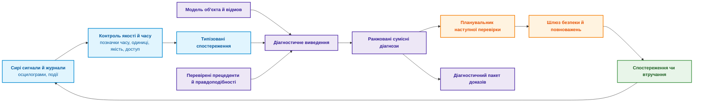
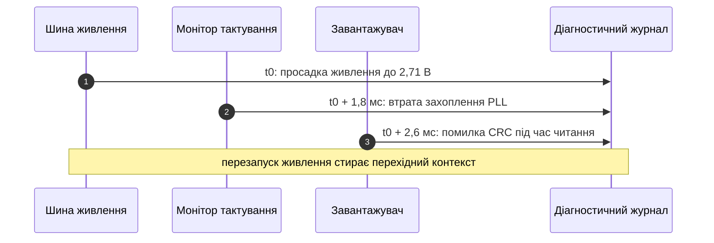
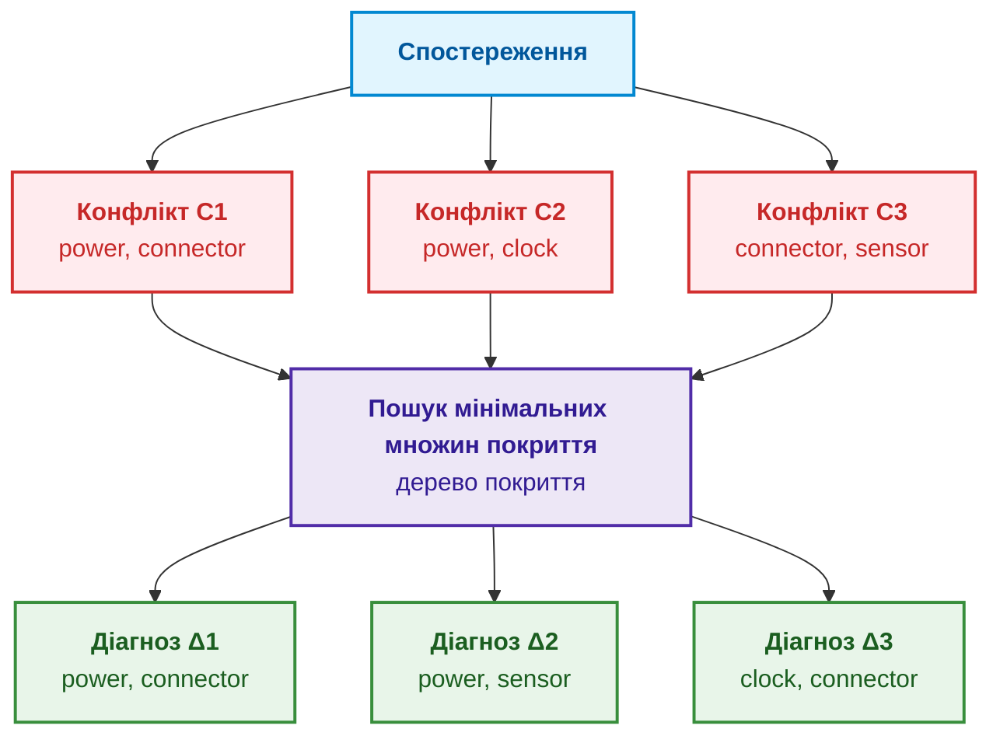
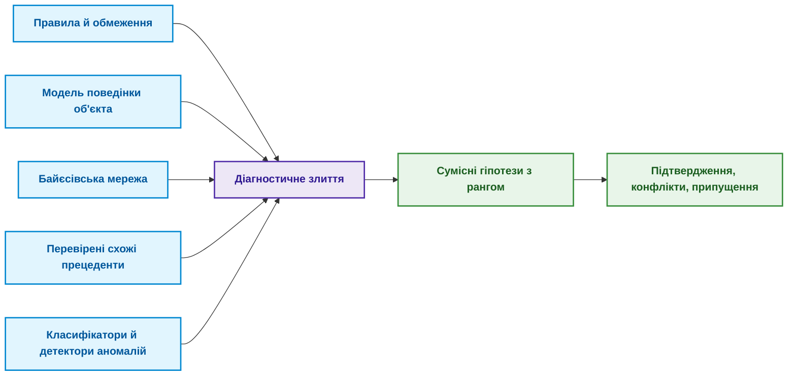
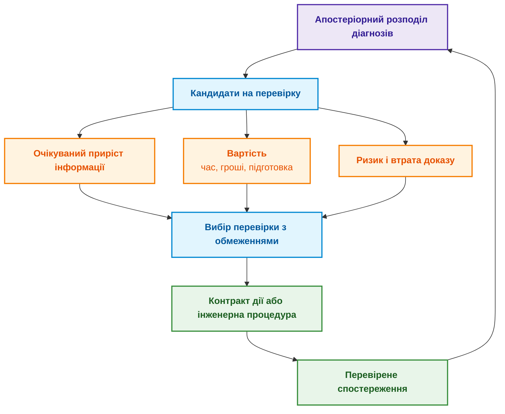
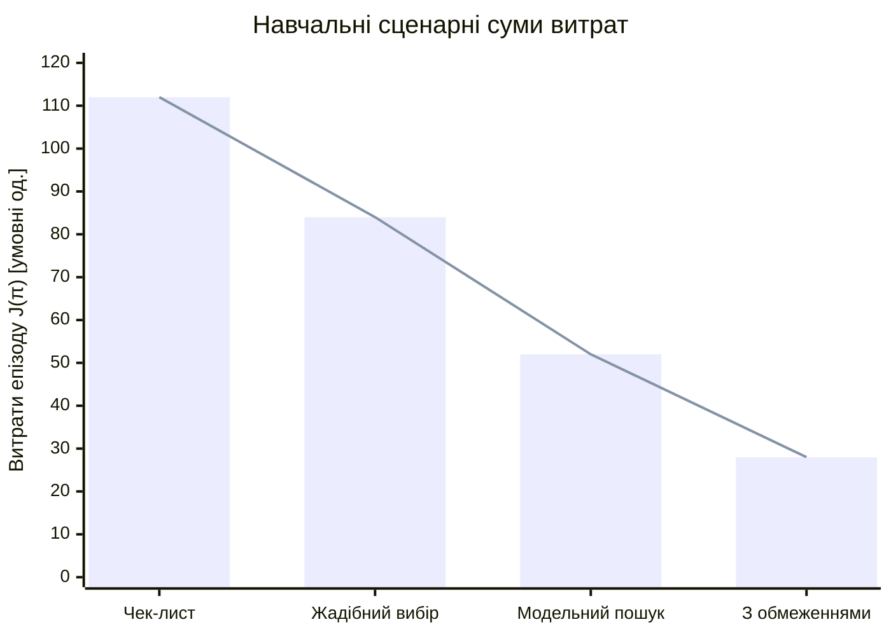

# Глава 24. Технічна діагностика: як не сплутати симптом із першопричиною в умовах неповноти

> **Книга:** [Архітектура доказових експертних систем](README.md) · [Частина IV: Архітектура системи, нормативне виведення, діагностика та пояснення](part-04-architecture-and-inference.md)  
> **Попередня глава:** [Глава 31. Виведення за нормами: ієрархії предикатів, винятки та чинність](ch31-syllogistic-reasoning-and-relation-lattices.md)  
> **Наступна глава:** [Глава 20. Рушій пояснень: рішення, відмова та межі компетентності](ch20-explanation-engine.md)  
> **Зміст книги:** [README.md](README.md)  
> **Автор:** [Микола Мартинович Федчик](about-the-author.md)  
> **Передумови й маршрут:** множини, логічне «якщо, то», умовна ймовірність; потрібні означення нагадано в тексті. Від простого прикладу холодного старту до пошуку конфліктів і планування перевірок; практикум: [Лабораторна робота №4](learning/LABS.md).  
> **Очікувані результати:** розрізняти симптом, діагноз і першопричину; описувати спостереження з часом, одиницями й якістю; будувати діагнози на основі моделі за Райтером через конфлікти й мінімальні множини покриття; ранжувати діагнози ймовірностями з урахуванням надійності датчиків; обирати наступну перевірку за цінністю інформації з урахуванням чутливості й специфічності перевірки, вартістю, ризиком і втратою доказу; відрізняти спостереження від втручання; визначати, які результати засобів аналізу журналів, детекторів аномалій і причинного виявлення є спостереженнями чи кандидатами, а не діагнозом; відмовлятися від діагнозу, коли даних недостатньо.  

## Анотація

У главі досліджено архітектурні принципи, формальні методи та математичний апарат технічної діагностики в доказових експертних системах. Модельно-орієнтоване діагностичне виведення (*Model-Based Diagnosis*) використано для пошуку й зіставлення гіпотез відмов, сумісних із закодованою моделлю та якісними спостереженнями. Така сумісність звужує простір кандидатів, але сама не доводить, що кандидат є фізичною першопричиною; причинне твердження потребує окремих припущень і перевірки.

Розглянемо навчальний, не документальний випадок: після холодної ночі пристрій не запускається. Журнал фіксує збій тактування, а осцилограф один раз показує коротку просадку живлення. Після перезапуску проблема зникає. Класифікатор називає причиною тактування, технік замінює генератор, і несправність повертається. Припустімо, подальше незалежне дослідження виявило ненадійний контакт роз'єму. На початку розслідування ця розв'язка ще невідома: діагностична система не має права успадковувати знання оповідача.

Ця історія показує, чому діагностика не зводиться до пошуку схожої поломки. Ця глава відповідає на запитання: **як із неповних і ненадійних спостережень отримати сумісні пояснення несправності й обрати наступну перевірку, не сплутавши симптом із першопричиною?**

У цій монографії запропоновано **проєкт діагностичної демаркації**: статистична подібність допомагає шукати кандидата, а модельна діагностика перевіряє сумісність припущень про відмови з описом об'єкта та спостереженнями. Результат є кандидатом у межах моделі, а не підтвердженою фізичною першопричиною. У межах цього проєкту пошук конфліктів, побудова мінімальних за включенням кандидатів, умовне ймовірнісне ранжування та вибір наступної допустимої перевірки поєднано в один процес. Повноту пошуку можна заявляти лише щодо заданої моделі й завершеного алгоритму, а вибір перевірки залежить від явно заданих витрат і ризику. За неповноти спостережень `REFUSAL` супроводжується відомими кандидатами, межами пошуку й переліком відсутніх даних, а не приховує їх; це проєктна політика безпеки, а не новий діагностичний метод.

Глава описує навчальну модель, а не сертифікований діагностичний засіб. Формальні висновки чинні лише в межах описаної моделі, відомих відмов і якості даних. Там, де помилка може зашкодити людям чи обладнанню, потрібні галузеві процедури, кваліфіковані вимірювання й відповідальний фахівець. У наскрізному прикладі можливі кілька версій: нестабільне живлення, несправне тактування, помилка прошивки, поганий контакт роз'єму або похибка вимірювання, а іноді дві несправності одночасно. Експертна система має повернути не одну мітку, а пояснення: які версії сумісні з фактами, чого бракує і яку перевірку варто зробити далі.

## 1. Симптом, діагноз і першопричина: понятійне розмежування

Розмежування симптому, діагнозу й першопричини потрібне, щоб відповісти на практичне питання: чи достатньо повідомлення «збій тактування» для заміни генератора? Симптом є тим, що спостерігали; діагноз моделі називає припущення, за яких ці дані можливі; першопричина описує підтверджений механізм виникнення інциденту. Для початку достатньо розуміти різницю між виміром і поясненням. Байєсівські оцінки та цінність інформації з [глави 6](ch06-applied-mathematics-for-expert-systems.md) знадобляться пізніше, коли сумісних пояснень буде кілька. Шість задач нижче мають різні результати:

<a id="obj-24-1"></a>

**Таблиця 24.1. Шість задач діагностичного простору.**

| Задача | Запитання | Результат |
|---|---|---|
| Виявлення аномалій | Чи відхилилася поведінка від норми? | Оцінка аномальності чи подія |
| Класифікація | На який відомий клас схожий випадок? | Мітка й впевненість |
| Діагностика | Які припущення про несправності узгоджують модель зі спостереженнями? | Одна чи кілька гіпотез |
| Аналіз першопричини | Який причинний механізм породив інцидент? | Причинне твердження з припущеннями |
| Пошук несправності | Що перевірити чи виправити далі? | Політика перевірок і ремонтних дій |
| Прогнозування | Як і коли стан погіршиться? | Прогноз траєкторії, залишковий ресурс |

Таблиця пояснює помилку з початку глави: класифікатор розв'язав другу задачу, а технікові потрібні третя й п'ята. Оцінка класифікатора сама по собі не встановлює першопричини. Умовна оцінка «ймовірність класу тактування 0,72» є безрозмірним числом від 0 до 1; без опису навчальної сукупності й калібрування це навіть не гарантована частота правильних відповідей. Внесок ознаки в передбачення характеризує модель класифікації, а не сам собою напрям фізичної дії. Так само одноразове відновлення після ремонту могло бути наслідком скидання стану. Шість рівнів нижче є навчальною систематизацією задач, а не новою формальною моделлю чи обов'язковою лінійною ієрархією:

> [!NOTE]
> **Шість рівнів навчальної систематизації діагностичних задач**
> 1. Детекція аномалій: фіксація відхилення метрик від допустимого профілю норми без визначення характеру збою.
> 2. Симптоматична класифікація: зіставлення сигнатурного відбитка з відомим класом за статистичною подібністю.
> 3. Модельна діагностика: знаходження несуперечливих гіпотез відмов компонентів, що узгоджують модель з даними.
> 4. Причинний аналіз першопричини (RCA): виявлення базового структурного механізму та ланцюга поширення дефекту.
> 5. Пошук несправностей (Troubleshooting): вибір допустимих перевірок і ремонтних дій за заданим критерієм; оптимальність потребує окремого обґрунтування.
> 6. Прогнозування надійності: оцінка залишкового ресурсу (RUL) та прогнозування подальшої деградації об'єкта.
> *Керування рантаймом:* Діагностичний планувальник блокує видачу ремонтної директиви, якщо висновок сформовано лише класифікатором без проходження причинного доведення.

Діаграма ілюструє запропонований автором **архітектурний патерн замкненого циклу діагностичного виведення та планування перевірок**. У випадку холодного старту новий запис осцилографа повертається до перевірки якості, а не відразу перетворюється на причину.

<a id="obj-24-2"></a>

**Діаграма 24.2. Цикл від спостереження до наступної перевірки.**



Цикл замикається: перевірка дає нові дані або повідомлення про неможливість вимірювання. Авторський **принцип первинного контролю якості та часу вхідних спостережень** вимагає перевіряти одиниці, час, стан приладу, застосовність калібрування й допуск даних. Невідоме значення не стає нулем, а наявність сертифіката не робить датчик безпомилковим. Отже, до пошуку причин потрібен паспорт самого виміру; це задача наступного розділу.

## 2. Структура вхідних даних для надійного діагностичного висновку

Структура вхідних даних має відповісти: що саме означає запис `voltage low` і чи можна порівняти його з іншим виміром? Потрібні значення, одиниця, час і спосіб отримання; без них два різні режими легко зливаються в один симптом. У цій главі запропоновано дванадцятипараметричну специфікацію типізованого спостереження: ідентифікатор, об'єкт, змінна, значення з одиницею, час події, вікно вимірювання, прилад, калібрування, частота дискретизації, якість, хеш джерела й контекст. Це запропонований формат, не зовнішній стандарт; достатність і сумісність полів з різними сенсорами потребують окремої перевірки. Значення з одиницею розкладено на `value` та `unit`, тому YAML має 13 ключів верхнього рівня. Умовний запис нижче реалізує цей формат; перевіряються синтаксис, наявність полів і відповідність одиниці змінній, але не достовірність фізичного виміру:

<details>
<summary>Приклад спостереження у форматі YAML</summary>

```yaml
observation_id: obs-boot17-vrail-003
subject: ecu:prototype-17
variable: vrail_3v3
value: 2.71
unit: V
event_time: 2026-08-26T03:14:15.104Z
window: 4.0ms
sensor: scope:lab-2/channel-1
calibration_ref: cal-2026-071
sampling_rate: 100MHz
quality: accepted
source_hash: sha256:<хеш файлу осцилограми>
context:
  temperature: -18degC
  board_revision: D
  firmware: 9f12c7a
```

</details>

Кожне поле має окреме призначення. 2,71 В є мінімумом напруги в умовному вікні 4 мс, а 100 МГц означає крок дискретизації 10 нс, не точність годинника чи амплітуди. Без ревізії плати модель може застосувати неправильний поріг. `quality: accepted` посилається на процедуру допуску, а заповнювач `source_hash` у прикладі ще не є хешем реального файла. Діаграма реалізує авторський **принцип хронологічної декомпозиції відмов та збереження перехідного контексту** на умовних подіях:

<a id="obj-24-3"></a>

**Діаграма 24.3. Зареєстровані події холодного старту.**



Чи справді просадка була раніше? Годинники можуть бути розсинхронізовані, а час запису в журнал відрізнятися від часу події. Авторське **правило врахування доменів годинників і допусків часових міток** використовує неперетинні інтервали можливого часу. За симетричних меж похибки достатня умова передування першої події другій така:

<a id="obj-24-4"></a>

**Формула (24.4). Напрям часового передування за обмежених похибок.**

```math
t_2-t_1 > \Delta\tau_{\mathrm{clock}}(S_1) + \Delta\tau_{\mathrm{clock}}(S_2) + \tau_{\mathrm{buf}}
```

де:
- $`t_1, t_2`$ — часові мітки реєстрації подій у журналах відповідних сенсорів $`S_1`$ та $`S_2`$, с;
- $`\Delta\tau_{\mathrm{clock}}(S_1), \Delta\tau_{\mathrm{clock}}(S_2)`$ — максимальні похибки синхронізації годинникових доменів відповідних приладів (дрейф та джитер локального кварцового генератора чи похибка протоколів NTP/PTP), с;
- $`\tau_{\mathrm{buf}}`$ — невід'ємна верхня межа додаткової похибки різниці через буферизацію, с; якщо позначено час події до буфера, цей внесок може дорівнювати нулю.

Усі часові мітки є дійсними числами в спільній шкалі секунд; межі похибки невід'ємні й мають бути підтверджені для цього запису. Для міток 0 та 1,8 мс і умовних похибок 50, 50 та 100 мкс різниця становить 1800 мкс, межа становить 200 мкс: перша подія передує другій. Якщо поміняти мітки місцями, ліва частина стане від'ємною; модуль різниці помилково дав би той самий напрям. За різниці рівно 200 мкс строгого передування не встановлено. За перекриття інтервалів статус є `ORDER_UNKNOWN`, не доказ одночасності. Ці числа є навчальним профілем, а не нормативною точністю PTP чи NTP.

**Використання й межа:** встановлений порядок дозволяє перевірити сумісність конкретного причинного шляху з його затримками. Він не виключає генератор із причин автоматично: можливі прихована спільна причина, ненаблюдуваний ранній дефект або зворотний вплив. Тепер є придатні дані; наступне питання — які припущення про справність із ними несумісні?

## 3. Діагностика на основі моделі (MBD): формалізація об'єкта та альтернатив

Діагностика на основі моделі відповідає на питання: які припущення про справність доведеться послабити, щоб пояснити дані холодного старту? Перед формалізацією потрібні лише скінченна множина компонентів і логічна імплікація: якщо її передумова істинна, має виконуватися наслідок. Нижче наведено навчальну булеву абстракцію, не електричну схему й не виміряний стенд.

Компоненти `power`, `connector`, `clock`, `sensor` означають вузол живлення, роз'єм, генератор і вимірювальний канал. Три ознаки кодують результати окремих процедур у тому самому режимі: $v$ — напруга в допуску; $l$ — є захоплення PLL; $r$ — вимірювальний канал пройшов звірку через контрольний контакт роз'єму. Усі ознаки булеві; тут спостерігаються їхні заперечення. Позначення $AB(c)$ означає, що штатний опис компонента $c$ не застосовується. Модель накладає лише три наведені обмеження:

<a id="obj-24-5"></a>

**Формула (24.5). Навчальна модель холодного старту та її дані.**

```math
\begin{aligned}
SD=\{& (\neg AB(\mathrm{power})\land\neg AB(\mathrm{connector}))\Rightarrow v,\\
& (\neg AB(\mathrm{power})\land\neg AB(\mathrm{clock}))\Rightarrow l,\\
& (\neg AB(\mathrm{connector})\land\neg AB(\mathrm{sensor}))\Rightarrow r\},\\
\mathrm{OBS}&=\{\neg v,\neg l,\neg r\}.
\end{aligned}
```

Тут $SD$ — скінченна множина правил; $`\mathrm{OBS}`$ — множина прийнятих результатів; $\neg$ означає «не», $\land$ — «і», $\Rightarrow$ — «якщо, то». Логічні значення не мають фізичних одиниць; пороги напруги в вольтах і процедура звірки мають бути визначені до їх кодування. Зокрема, $r$ не означає істинність самого виміру напруги. Якщо звірка недоступна, $\neg r$ не додають: «невідомо» є відсутністю обмеження, а не негативним результатом. Реальна схема може мати інші залежності; тоді зміняться й конфлікти.

Реймонд Райтер запропонував загальну постановку діагностики від перших принципів [[1]](#src-1). $`\mathrm{COMP}`$ — скінченна множина чотирьох компонентів; за припущення їхньої повної справності модель (24.5) виводить $v$, хоча дані містять $\neg v$. Це конкретне свідчення суперечності:

<a id="obj-24-6"></a>

**Формула (24.6). Суперечність припущення про повну справність.**

```math
SD \cup \mathrm{OBS} \cup \{\neg AB(c) \mid c \in \mathrm{COMP}\} \models \bot
```

Позначення:

- $SD$ є описом об'єкта, $`\mathrm{OBS}`$ є множиною спостережень, а $`\mathrm{COMP}`$ є множиною компонентів;
- $AB(c)$ означає, що компонент $c$ несправний, а $\neg AB(c)$ припускає його справність;
- $\cup$ об'єднує множини, фігурні дужки з умовою $`c\in \mathrm{COMP}`$ задають всі припущення про справність компонентів;
- $\models$ означає логічний наслідок, а $\bot$ позначає суперечність.

Діагнозом $`\Delta \subseteq \mathrm{COMP}`$ називають множину компонентів, припущення про ненормальність яких відновлює несуперечливість. Використаємо семантичне означення через існування моделі, а не через нездатність обмеженого розв'язувача знайти суперечність:

<a id="obj-24-7"></a>

**Формула (24.7). Сумісний діагноз як виконувана множина припущень.**

```math
SD \cup \mathrm{OBS} \cup \{AB(c) \mid c \in \Delta\} \cup \{\neg AB(c) \mid c \in \mathrm{COMP} \setminus \Delta\} \not\models \bot
```

Умова діагнозу:

- $\Delta$ є підмножиною компонентів $`\mathrm{COMP}`$, $AB(c)$ припускає несправність компонента з діагнозу, а $\neg AB(c)$ припускає справність решти;
- $SD$ є описом об'єкта, $`\mathrm{OBS}`$ є спостереженнями, а $\cup$ додає ці множини припущень;
- $`\mathrm{COMP}\setminus\Delta`$ означає компоненти поза діагнозом, а $\not\models\bot$ означає існування хоча б одного логічного стану, який задовольняє всі припущення.

Для $\Delta$ = {power, connector} перші два правила (24.5) вимкнено припущенням про `power`, третє — припущенням про `connector`; стан із трьома хибними ознаками задовольняє модель. Для {power} третє правило все ще вимагає $r$, отже виникає суперечність із $\neg r$. Це перевірка кандидата, не підтвердження двох фізичних поломок. Одиниці тут — компоненти, не ймовірності. Зазвичай шукають мінімальні за включенням діагнози, з яких не можна вилучити жодного елемента:

<a id="obj-24-8"></a>

**Формула (24.8). Мінімальність діагнозу за включенням.**

```math
\Delta \text{ несуперечливий} \;\land\; \forall \Delta' \subsetneq \Delta:\ \Delta' \text{ суперечливий}
```

- Для мінімальності $\Delta$ має бути несуперечливим діагнозом, а $\Delta'$ позначає будь-яку його власну підмножину;
- $\land$ означає «і», $\forall$ означає «для кожної», а $\subsetneq$ означає «є власною підмножиною»;
- Суперечливість кожної меншої множини задає мінімальність за включенням, а не найменшу кількість компонентів.

У нашій моделі видалення `power` із {power, connector} залишає суперечність другого правила, а видалення `connector` — третього: пара мінімальна. Мінімальність не означає найменшу кількість, найбільшу ймовірність чи найменшу вартість. Для контрприкладу в іншій моделі з конфліктами {a,b} і {a,c} мінімальними є {a} та {b,c}; найменшу кількість має лише {a}. Якщо вартості a, b, c дорівнюють 10, 1, 1 умовним одиницям, найдешевша мінімальна множина — {b,c} вартістю 2, а не {a}. Ці три задачі не можна підміняти одна одною.

Припущення про кардинальність відмов потрібно записувати явно: горизонт $k$ — ціле число від нуля до кількості компонентів — і обмеження $`\lvert\Delta\rvert\le k`$ вносять до паспорта моделі. Шукати лише одну відмову означає обмежити задачу, а не довести, що інших немає. Наступний розділ показує, як знаходити кандидати без повторної перевірки всіх підмножин.

## 4. Обчислення конфліктів та звуження простору гіпотез

Обчислення конфліктів має відповісти: які саме групи припущень про справність породили суперечність (24.6)? У моделі (24.5) для виведення $v$ достатньо справності `power` і `connector`; через $\neg v$ ці два припущення не можуть бути істинними разом. Таку множину називають конфліктом. Знання операцій над множинами з попереднього розділу достатнє для означення:

<a id="obj-24-9"></a>

**Формула (24.9). Конфлікт припущень про справність.**

```math
SD \cup \mathrm{OBS} \cup \{\neg AB(c) \mid c \in C\} \models \bot
```

де:

- $C$ є множиною компонентів-кандидатів на конфлікт, $c$ є одним компонентом, а $AB(c)$ означає його несправність;
- $SD$ є описом об'єкта, $`\mathrm{OBS}`$ є спостереженнями, а $\neg AB(c)$ припускає справність кожного компонента з $C$;
- $\cup$ об'єднує припущення, $\models$ означає логічний наслідок, а $\bot$ означає суперечність.

Конфлікт не означає, що несправні всі його компоненти: достатньо відмовитися від справності хоча б одного. Тому кожен діагноз мусить «влучити» в кожен конфлікт, тобто містити хоча б один його компонент:

<a id="obj-24-10"></a>

**Формула (24.10). Покриття кожного конфлікту кандидатом.**

```math
\forall C_i \in \mathcal{C}:\quad \Delta \cap C_i \neq \varnothing
```

- Кожна множина $`C_i`$ є одним конфліктом у сукупності $`\mathcal{C}`$, а $\Delta$ є кандидатом на діагноз;
- $\forall$ означає «для кожного», $\in$ означає належність до множини, а $\cap$ є перетином множин;
- $\neq\varnothing$ означає, що перетин не порожній, тобто діагноз містить хоча б один компонент кожного конфлікту.

**Твердження Райтера й умови застосування.** Для скінченної множини компонентів, виконуваного фону $`SD\cup\mathrm{OBS}`$ і слабкої моделі відмов мінімальні діагнози є мінімальними множинами покриття сімейства всіх мінімальних конфліктів [[1]](#src-1). Слабка модель обмежує лише справну поведінку: зняття припущення про справність не додає вимоги до відмови. Обґрунтування має два напрями. Непокритий конфлікт залишає суперечність, отже діагноз мусить покривати всі конфлікти. Якщо ж покриття всіх конфліктів не відновило сумісності, серед решти скінченних припущень існувала б суперечлива підмножина — ще один непокритий конфлікт. Це суперечить повноті сімейства. Мінімальність зберігається при вилученні зайвих припущень.

За неповного списку конфліктів покриття є лише кандидатом і потребує повної перевірки (24.7). За сильних моделей конкретних режимів відмов надмножина діагнозу може вже не бути діагнозом, тому цей аргумент не переноситься автоматично. GDE (*General Diagnostic Engine*) поєднує кілька відмов із ймовірностями кандидатів [[2]](#src-2), використовуючи ATMS — механізм обліку залежності висновків від припущень [[3]](#src-3).

У наскрізному навчальному прикладі побудовано дерево покриття конфліктів. Кожне з трьох правил (24.5) разом із відповідним негативним результатом дає конфлікт; вилучення будь-якого з двох припущень вимикає правило, тому конфлікти мінімальні:

<a id="obj-24-11"></a>

**Формула (24.11). Три конфлікти навчальної моделі.**

```math
C_1 = \{\text{power}, \text{connector}\}, \qquad C_2 = \{\text{power}, \text{clock}\}, \qquad C_3 = \{\text{connector}, \text{sensor}\}
```

- У прикладі $`C_1`$, $`C_2`$ і $`C_3`$ є трьома множинами конфліктів, а фігурні дужки перелічують компоненти кожної множини;
- `power` позначає живлення, `connector` роз'єм, `clock` тактування, а `sensor` датчик;
- $=$ задає рівність множин, а коми розділяють компоненти в кожному конфлікті.

Мінімальні покриття — {power, connector}, {power, sensor} і {clock, connector}. Перевіримо останнє: `connector` покриває перший і третій конфлікти, `clock` — другий. Без `connector` залишиться непокритим перший, без `clock` — другий. Інші пари {power, clock}, {connector, sensor}, {clock, sensor} не покривають відповідно третій, другий і перший конфлікти; будь-яка трійка містить одну з прийнятих пар і не мінімальна. Отже, перелік вичерпний для цієї моделі. Діаграма є схемою залежностей, не фактичною трасою роботи HS-DAG.

<a id="obj-24-12"></a>

**Діаграма 24.12. Від трьох конфліктів до трьох мінімальних кандидатів.**



Жоден одиночний компонент не покриває всіх трьох конфліктів. Це виключає одиночні діагнози **в моделі (24.5)**, а не фізичну можливість однієї прихованої спільної причини. Зокрема, якщо реальний роз'єм впливає також на PLL, друге правило потребує уточнення: навчальна модель не може спростувати відому лише оповідачеві розв'язку вступу. Після такого уточнення треба заново вивести конфлікти. Кандидати не є планами заміни деталей. Для великих моделей застосовують інкрементні конфлікти, горизонт кратності й ієрархію, але кожне відсікання явно входить до паспорта.

Навіть класичний алгоритм потребує перевірки. Райтер шукав множини покриття деревом (*hitting set tree*), гілки якого відсікаються спеціальними правилами. Грайнер, Сміт і Вілкерсон показали, що за певних умов, зокрема коли перевірка несуперечливості повертає не мінімальні конфлікти, ці правила відсікають гілку з мінімальним діагнозом. Вони запропонували виправлену структуру HS-DAG (*hitting set directed acyclic graph*, орієнтований ациклічний граф множин покриття) і довели її коректність [[4]](#src-4). Практичний висновок для реалізації такий: пошук діагнозів для великих моделей перевіряють на малих моделях повним перебором, і розбіжність двох відповідей означає помилку реалізації, а не новий діагноз.

> [!NOTE]
> **Три кроки модельного пошуку кандидатів на несправність**
> 1. Математична формалізація конфліктів: перехід від сліпої заміни вузлів за симптомами до детермінованого виділення мінімальних конфліктних множин $`\{C_1, C_2, \dots, C_k\}`$.
> 2. Теоретико-множинна фільтрація гіпотез: за умов твердження Райтера діагноз моделі перетинає кожен конфлікт; це не критерій підтвердження фізичної першопричини.
> 3. Відсікання несумісних кандидатів: гіпотезу з непокритим дійсним конфліктом вилучають із поточного модельного пошуку, зберігаючи можливість перегляду моделі.
> *Керування рантаймом:* Мінімальність покриття не дозволяє ремонту; потрібні обґрунтування дії, повноваження та перевірка безпеки.

### 4.1. Фіксовано-параметрична розв'язність (FPT) та ієрархічне стиснення простору HS-DAG

Керованість HS-DAG потрібно оцінити до запуску: скільки вузлів породить пошук і що означатиме його передчасна зупинка? У попередньому прикладі досить перебрати 16 підмножин чотирьох компонентів, але для сотень компонентів це неприйнятно. HS-DAG зберігає множину вже припущених відмов як шлях, запитує конфлікт серед решти справних компонентів і розгалужується по його елементах; однакові множини шляхів можна зливати в один вузол. Перед оцінкою потрібні чотири окремі умови:

- **(У1) Слабка семантика відмов.** $SD$ обмежує лише поведінку справних компонентів, а $AB(c)$ не фіксує поведінки несправного компонента. Тоді надмножина діагнозу теж є діагнозом, а мінімальні діагнози є мінімальними множинами покриття конфліктів [[1]](#src-1).
- **(У2) Застосовність до об'єкта.** Включені компоненти й справні режими відповідають конфігурації та умовам вимірювання. Це умова фізичної інтерпретації, не передумова логічного перелічення. Наявність усіх можливих несправностей не можна встановити самим пошуком; невідомі причини залишаються поза його гарантією.
- **(У3) Дійсні конфлікти й повний верифікатор.** Для запиту з множиною $`S = \mathrm{COMP} \setminus H`$ верифікатор повертає або конфлікт $`C \subseteq S`$, для якого $`SD \cup \mathrm{OBS} \cup \{\neg AB(c) \mid c \in C\}`$ справді суперечлива, або відповідь «сумісно» лише тоді, коли $`SD \cup \mathrm{OBS} \cup \{\neg AB(c) \mid c \in S\}`$ справді несуперечлива. «Невідомо» й тайм-аут не є відповіддю «сумісно»: вузол не стає діагнозом, а паспорт діагностики позначає пошук як неповний. Мінімальність конфлікту зменшує кількість вузлів, але не впливає на коректність.
- **(У4) Горизонт кратності.** Шукаються мінімальні діагнози з $`\lvert\Delta\rvert \le k_{\max}`$. `HorizonTruncated = true` встановлюють, якщо є вузол глибини $`k_{\max}`$, який не є діагнозом, не закритий як надмножина вже знайденого діагнозу та має конфлікт, що потребував би розгалуження; інакше встановлюють `false`.

Для виправленого HS-DAG [[4]](#src-4), повного обходу й дотримання (У1), (У3), (У4) перелік мінімальних діагнозів у горизонті є повним. Відсутність обрізання горизонтом означає відсутність більших мінімальних діагнозів лише якщо чергу вичерпано й немає тайм-аутів, невідомих відповідей або іншого відсікання. Сам прапорець `HorizonTruncated = false` цього не засвідчує. Також повнота діагнозів не означає повноту фізичних причин або перелік усіх немінімальних сумісних множин.

**Як обрати горизонт.** Паспорт моделі зберігає $`k_{\max}`$ і допустиму залишкову ймовірність $`P_{\mathrm{res}}`$ як налаштування, відповідальність за які визначається проєктом. Це не універсальні константи. Якщо компонент має експоненційний час до першої відмови зі сталою інтенсивністю, його ймовірність відмови за інтервал оцінюють так:

<a id="obj-24-13"></a>

**Формула (24.13). Ймовірність першої відмови за сталої інтенсивності.**

```math
p_i=1-\exp(-\lambda_i T_{\mathrm{inspect}}).
```

Тут $i$ індексує компонент; $`\lambda_i\ge0`$ вимірюється у відмовах за годину; $`T_{\mathrm{inspect}}\ge0`$ — інтервал у годинах; $`p_i\in[0,1]`$ — безрозмірна ймовірність. Припущено відсутність ремонту й старіння в цьому інтервалі. За інтенсивності 0,001 на годину та інтервалу 10 годин результат приблизно 0,00995, а не 0,1. Для незалежних компонентів хвіст розподілу кількості відмов обчислюють із **усіх** цих ймовірностей (пуассон-біноміальний розподіл). Простий контроль: для трьох незалежних компонентів з однаковою ймовірністю 0,01 ймовірність понад однієї відмови дорівнює сумі трьох випадків із двома відмовами та випадку з трьома: 0,000298. За умовного допуску 0,001 горизонт 1 придатний, але тільки в цій моделі. Спільна причина руйнує це обґрунтування.

**Добутки ймовірностей.** Не можна оцінювати спільний пропуск каналів їх добутком без незалежності. Без неї ймовірність перетину не більша за меншу з двох маргінальних імовірностей: за значень 0,1 та 0,2 верхня межа 0,1, а добуток 0,02 потребує додаткового припущення. Це консервативна межа, не виміряна ймовірність.

**Що саме означає FPT.** Фіксовано-параметричний час має вигляд «функція параметрів, помножена на поліном розміру входу зі сталим степенем». Тут параметри — максимальна ширина повернутого конфлікту $w$ та горизонт $`k_{\max}`$. Для довільної пропозиційної моделі навіть один запит сумісності може бути складним; мала кількість запитів не робить увесь розв'язувач FPT. Нижче оцінено дерево пошуку **за умови поліноміального верифікатора**, наприклад для належно обмеженої хорнівської теорії. Загальне перелічення може мати експоненційно великий вихід. Ширина $w$ залежить від моделі, даних і верифікатора; вона може дорівнювати кількості компонентів.

1. **Обмеження горизонту та ширини конфліктів.** На глибині $d$ є не більше $`w^d`$ шляхів: кожен попередній вузол породжує не більше $w$ дочірніх. Тому для одного неієрархічного пошуку верхні межі такі:

<a id="obj-24-14"></a>

**Формула (24.14). Межі кількості викликів і породжених вузлів.**

```math
N_{\mathrm{calls}}(w, k_{\max}) \le \sum_{d=0}^{k_{\max}} w^d, \qquad N_{\mathrm{nodes}}(w, k_{\max}) \le \sum_{d=0}^{k_{\max}+1} w^d
```

Тут $`N_{\mathrm{calls}}`$ та $`N_{\mathrm{nodes}}`$ — цілі невід'ємні лічильники, не секунди; $d$ — глибина; $w$ — ціла верхня межа ширини конфлікту; $`k_{\max}`$ — цілий невід'ємний горизонт. Для $w=0$ корінь рахується як один вузол, розгалужень немає. Вузли глибини на одиницю понад горизонт у грубій оцінці лише породжено й закрито; реалізація може не створювати їх узагалі. За $w=2$ і горизонту 2 маємо не більше 7 викликів та 15 вузлів; за $w=1$ — 3 та 4. Це не оцінка мілісекунд.

Час включає вартість кожного запиту, копіювання множин, пошук дублікатів і перевірку мінімальності. Якщо запит поліноміальний за розміром входу й ці операції також обмежені функцією параметрів, помноженою на поліном, маємо FPT за парою параметрів. Лінійний хорнівський запит не доводить лінійного часу всієї реалізації, а зовнішній часовий ліміт не є доведеним WCET. Межа (24.14) також не описує перелічення всіх макрокандидатів у каскаді нижче.

2. **Ієрархічна структурна декомпозиція (*Hierarchical Structural Zooming*).** У запропонованій евристиці спершу впорядковуються підозрілі блоки, потім уточнюються компоненти. Наприклад, 100 компонентів можна згрупувати у п'ять блоків по 20; це навчальний вибір, не рекомендований універсальний розмір. Скорочення простору пошуку залежить від зв'язків між блоками й не доводиться самим групуванням. Алгоритм Г подано як проєктний метод із фінальною перевіркою, а не як автоматичний наслідок теореми про звичайний HS-DAG.

* **Алгоритм Г (Двокаскадне ієрархічне впорядкування кандидатів HS-DAG із фінальною перевіркою).** Задано ієрархічний опис системи $`SD = \langle SD_{\mathrm{macro}}, \{SD_m\}_{m=1}^M \rangle`$, спостереження $`\mathrm{OBS}`$ та поріг кратності $`k_{\max}`$. Відображення $`\pi: \mathrm{COMP} \to \{B_1, \dots, B_M\}`$ ставить кожному компоненту його макроблок; $`SD_{\mathrm{macro}}`$ описує макроблоки через їхні граничні порти; $`\mathrm{OBS}_m`$ — спостереження на граничних портах блока $`B_m`$ (неспостережувані порти не обмежені). Бюджет кратності глобальний: кратність кожного кандидата, тобто $`\sum_m \lvert\Delta_m\rvert`$, не перевищує $`k_{\max}`$. Повнота каскаду вимагає, крім (У1)–(У4) (зокрема повного верифікатора за (У3) на макрорівні й у фінальній перевірці), адекватності абстракції: для кожного діагнозу $\Delta$ повної моделі $`\pi(\Delta)`$ сумісний із $`SD_{\mathrm{macro}} \cup \mathrm{OBS}`$, а $`\Delta \cap B_m`$ сумісний із $`SD_m \cup \mathrm{OBS}_m`$. Для розкладеного пошуку кроку Г4 кожен мінімальний конфлікт повної моделі має лежати в межах одного блока. Без цих умов каскад лише впорядковує кандидатів: конфлікт, що перетинає межі блоків, може лишитися невидимим для локальних моделей, а добуток локальних діагнозів може перевищити $`k_{\max}`$.

*Вправа.* (а) Конфлікти $`\{a_1\}, \{a_2\}, \{b_1\}, \{b_2\}`$, блоки $`A=\{a_1,a_2\}`$, $`B=\{b_1,b_2\}`$, $`k_{\max}=2`$: каскад без глобального бюджету видає діагноз кратності 4 без прапорця. (б) Конфлікти $`\{a_1,b_2\}, \{b_1,a_2\}`$: відсікання надмножин і закриття сумісних вузлів на макрорівні пропускають мінімальні діагнози $`\{a_1,b_1\}`$ і $`\{a_2,b_2\}`$; розклад на незалежні локальні пошуки цю вправу теж не розв'язує, бо обидва конфлікти перетинають межу блоків. Пошук на моделі, обмеженій блоками $`\{A,B\}`$ (крок Г4), знаходить обидва діагнози.

* **Крок Г1 [Ініціалізація черги завширшки]:** Створити кореневий вузол $`v_0`$ з міткою шляху $`H(v_0) \leftarrow \varnothing`$ на рівні макропідсистем $`SD_{\mathrm{macro}}`$, покласти $`v_0`$ у чергу $Q$ та ініціалізувати список кандидатів $`\mathcal{D} \leftarrow \varnothing`$.
* **Крок Г2 [Відсікання на рівні компонентів і перевірка глибини]:** Вилучити вузол $v$ з початку $Q$. На рівні компонентів, якщо існує вже знайдений діагноз $`\Delta \in \mathcal{D}`$ такий, що $`\Delta \subseteq H(v)`$, закрити вузол (*Pruning by Minimality*) і перейти до Г2. На макрорівні відсікання надмножин не застосовувати. Вузли глибини понад $`k_{\max}`$ не розгортати. На макрорівні саме досягнення межі кратності не піднімає `HorizonTruncated`; на рівні компонентів граничний вузол перевіряє крок Г3.
* **Крок Г3 [Виклик верифікатора та розгалуження]:** На рівні компонентів перевірити запит за (У3): $`S = \mathrm{COMP} \setminus H(v)`$. На макрорівні перевірити сумісність $`SD_{\mathrm{macro}} \cup \mathrm{OBS}`$ за умовами повноти абстракції; контракт (У3) тут застосовується до множини макроблоків, тому конфлікт $C$ містить блоки, а не внутрішні компоненти. Верифікатор повертає дійсний конфлікт або відповідь «сумісно» лише за (У3). Якщо конфлікт порожній, $`SD \cup \mathrm{OBS}`$ суперечлива незалежно від припущень про відмови: зупинити пошук зі статусом `MODEL_INCONSISTENT`, відмінним від `HorizonTruncated`. Якщо повернуто конфлікт $C$, на рівні компонентів породити вузол $`H(v') = H(v) \cup \{c\}`$ для кожного $`c \in C`$; коли $`\lvert H(v)\rvert = k_{\max}`$, замість розгалуження встановити `HorizonTruncated = true`. Мінімальний конфлікт рекомендований, бо зменшує кількість вузлів, але не впливає на коректність. Якщо верифікатор повернув «невідомо» чи тайм-аут, позначити пошук неповним і не приймати вузол за діагноз. На макрорівні сумісний вузол додати до $`\mathcal{D}`$ як макрокандидат, не закривати його та продовжити розгалуження, додаючи кожен ще не включений блок, доки кратність не досягне $`k_{\max}`$; так перелічуються всі макромножини покриття в межах бюджету. Макророзгалуження за конфліктом також додає по одному блоку з $C$. Макрокандидати не є мінімальними діагнозами.
* **Крок Г4 [Ієрархічне впорядкування кандидатів (Structural Zoom)]:** Для кожного макрокандидата $`\Delta_{\mathrm{macro}} \in \mathcal{D}`$ виконати кроки Г1–Г3 на моделі $SD$, обмеженій компонентами блоків $`\Delta_{\mathrm{macro}}`$ (компоненти інших блоків вважаються справними), з горизонтом $`k_{\max}`$; кандидатами є знайдені діагнози, що зачіпають кожен блок $`\Delta_{\mathrm{macro}}`$. Якщо кожен мінімальний конфлікт лежить у межах одного блока, цей пошук можна розкласти на незалежні пошуки на внутрішніх моделях $`SD_m`$ із граничними спостереженнями $`\mathrm{OBS}_m`$ і локальним горизонтом $`k_{\max} - \lvert\Delta_{\mathrm{macro}}\rvert + 1`$; тоді кандидатами є об'єднання $`\bigcup_{B_m \in \Delta_{\mathrm{macro}}} \Delta_m`$ локальних діагнозів, для яких $`\sum_m \lvert\Delta_m\rvert \le k_{\max}`$. Об'єднання, що перевищують бюджет, не формуються, а прапорець `HorizonTruncated` піднімається. Прапорець результату кроку Г4 є диз'юнкцією прапорців усіх локальних пошуків.
* **Крок Г5 [Фінальна перевірка]:** Кожного кандидата перевірити на повній моделі за (24.7). «Невідомо» чи тайм-аут не приймають як сумісність. За слабкої семантики перевірити також вилучення кожного елемента: якщо менша множина сумісна, продовжувати зменшення. Просте порівняння лише з уже знайденими кандидатами не гарантує глобальної мінімальності. Роздільно зберегти обрізання горизонту, невичерпану чергу й невідомі відповіді; диз'юнкція локальних прапорців сама не засвідчує повноти каскаду.

**Розбір вправи й межа каскаду.** У випадку (а) всі чотири одиночні конфлікти вимагають чотирьох компонентів, тому за глобального горизонту 2 діагнозів немає; об'єднання двох локальних пар порушило б бюджет. У випадку (б) пари {a1,b1} і {a2,b2} кожна перетинають обидва міжблокові конфлікти, тому незалежні внутрішні пошуки непридатні. Це негативні контроли для ієрархічної реалізації. Фінальна перевірка захищає від хибного прийняття, але не від пропуску кандидата: без окремого доказу збереження всіх діагнозів абстракцією потрібен повний пошук або явний статус неповноти. Щоб завершити навчальний крок, розрізняймо «перевірені знайдені кандидати» й «усі мінімальні діагнози»; тепер розглянемо зміну самого опису об'єкта через версії специфікацій.

### 4.2. Конфлікти між різними рівнями специфікацій

У протокольних системах і шлюзах інтеграції часто трапляється «хибна несправність»: обладнання справне, але відкидає пакети чи розриває з'єднання. Причиною може бути конфлікт між специфікаціями, які реалізували різні виробники. Діагностика тоді працює не з компонентами, а з документами й нормами.

Перший випадок пов'язаний з версіями. Бібліографічні відношення RFC 9293, RFC 793 і RFC 5961 наведено в картці RFC 9293 [[5]](#src-5); вони підказують, які тексти порівнювати. Саме відношення заміни документа не доводить несумісності двох реалізацій і не скасовує кожне окреме технічне твердження. Запропонований у главі граф версій позначає потребу повторної перевірки застосовності норми; правила такого перегляду й тестові випадки мають бути визначені окремо:

<a id="obj-24-15"></a>

**Формула (24.15). Заміна документа як привід перевірити норму.**

```math
\mathrm{Obsoletes}(D_2,D_1)\Rightarrow\mathrm{ReviewApplicability}(n,D_1,D_2).
```

- У цьому відношенні $`D_1`$ і $`D_2`$ є ідентифікаторами документів, а $n$ — ідентифікатором перевірюваного положення першого документа;
- $`\mathrm{Obsoletes}(D_2,D_1)`$ означає, що документ $`D_2`$ скасовує документ $`D_1`$;
- $\Rightarrow$ читається як «якщо, то», а булевий предикат $`\mathrm{ReviewApplicability}`$ означає завдання перевірити чинність і зміст; усі позначення не мають фізичних одиниць.

Наприклад, отримане ребро заміни породжує завдання зіставити точні пункти й профілі обох вузлів. Якщо обидва реалізують однакову дозволену поведінку, несумісності немає. У цій редакційній перевірці тексти нормативних пунктів не звірено; приклад не є висновком про відповідність TCP.

Другий випадок охоплює авторський **патерн виявлення нормативних деонтичних колізій та законних винятків**. $p$ означає конкретну дію, $`\mathcal{O}(p)`$ — зобов'язання її виконати, $`\mathcal{F}(p)`$ — заборону. Колізію перевіряють лише для однакових адресата, часу, умов і сфери; різні профілі або пріоритетний виняток можуть її усунути. Для холодного старту це аналог питання, чи мав завантажувач право припинити запуск після просадки. Невідоме виконання умови винятку не прирівнюють до доведеного. Цитати й застосовність оформлюють за [главою 15](ch15-knowledge-extraction-and-kb-construction.md). Після узгодження моделі лишається питання: як порівняти кілька сумісних кандидатів?

## 5. Ймовірнісне ранжування сумісних діагнозів

Ймовірнісне ранжування відповідає на питання, який із сумісних кандидатів перевіряти раніше; воно не змінює означення діагнозу. Потрібні умовні ймовірності й явно задана сукупність гіпотез. Якщо гіпотези взаємовиключні та вичерпні, а свідчення мають ненульову ймовірність, правило Байєса дає:

<a id="obj-24-16"></a>

**Формула (24.16). Оновлення ймовірностей за свідченнями.**

```math
P(H_i \mid E) = \frac{P(E \mid H_i)\, P(H_i)}{\sum_j P(E \mid H_j)\, P(H_j)}
```

- У формулі Байєса $`H_i`$ є i-ю гіпотезою несправності, а $E$ є наявними спостереженнями;
- $`P(H_i)`$ є апріорною ймовірністю гіпотези у визначеній сукупності виробів, а $`P(E\mid H_i)`$ є правдоподібністю спостережень за цієї гіпотези;
- $`P(H_i\mid E)`$ є апостеріорною ймовірністю після спостережень; кожна ймовірність має значення від 0 до 1;
- $`\sum_j`$ додає внески всіх гіпотез $`H_j`$; сума апріорних імовірностей дорівнює 1, знаменник строго додатний, усі величини безрозмірні.

Навчальний приклад: $H$ означає дефект живлення, $E$ — результат окремої перевірки; припустімо апріорну ймовірність 0,1, чутливість 0,8 і частоту хибної тривоги 0,2. Внесок дефекту — 0,08, відсутності дефекту — 0,18, разом — 0,26. Частка 0,08 у цій сумі приблизно 0,308. Тривога підвищила оцінку, але не встановила дефект. За нульового знаменника спостереження неможливе в моделі: слід переглянути її, а не ділити на нуль.

У наскрізному прикладі мінімальні діагнози самі по собі не вичерпують простір станів: сумісні й надмножини пар. Тому нормування ваг лише трьох пар дає розподіл **за додаткової умови, що істинною є одна з цих трьох точних конфігурацій**, а не повний розподіл після всіх фізичних вимірів. Потрібна також модель правдоподібності даних; просте покриття конфліктів її не задає. Програма розділу 8 навмисно використовує цей обмежений навчальний простір.

Апріорні розподіли не можна мовчки переносити між контекстами: дані іншої ревізії друкованої плати, партії компонентів чи кліматичного поясу потребують обґрунтування застосовності до поточного $P(H)$.

Для двох незалежних подій відмов спільну ймовірність можна обчислити як добуток. Це не дві взаємовиключні гіпотези з формули (24.16), а два компоненти, які можуть відмовити разом. Добуток маргінальних оцінок допустимий лише за обґрунтованого припущення незалежності:

<a id="obj-24-17"></a>

**Формула (24.17). Спільна відмова за незалежності двох подій.**

```math
P(H_a \land H_b) = P(H_a)\, P(H_b)
```

- Незалежність тут є припущенням про дві гіпотези несправності $`H_a`$ і $`H_b`$;
- $\land$ означає одночасне настання обох гіпотез, а $P(\cdot)$ є ймовірністю від 0 до 1;
- $=$ задає спільну ймовірність як добуток окремих лише за умови незалежності.

Ілюстративний приклад: за умовних незалежних імовірностей $`P(H_a)=0{,}1`$ та $`P(H_b)=0{,}2`$ спільна ймовірність становить $`0{,}1\cdot0{,}2=0{,}02`$. За спільної фізичної причини (вологи чи термоудару) це значення може бути неточним. Навіть незалежні апріорні відмови після відбору за спільним симптомом загалом стають залежними. Наступне уточнення стосується самого джерела симптомів — вимірювального каналу.

### 5.1. Діагностика з урахуванням похибок та відмов вимірювального каналу

Врахування вимірювального каналу потрібне, щоб не оголосити дефект живлення лише через тривогу пробника. Спочатку розрізнімо факт запису `alarm = 1` та подію фізичної відмови $F$: перше може бути достовірно збережено, навіть якщо датчик помилився щодо другого. Для фіксованих процедури, порога й умов вводять дві ймовірності:

<a id="obj-24-18"></a>

**Формула (24.18). Чутливість і хибна тривога вимірювального каналу.**

```math
P(\mathrm{alarm} = 1 \mid F) = \text{чутливість}, \qquad P(\mathrm{alarm} = 1 \mid \neg F) = 1 - \text{специфічність}
```

- Для сенсора $F$ означає реальну несправність, $`\mathrm{alarm}=1`$ означає тривогу, а $\neg F$ означає справний стан;
- $P(A\mid B)$ є ймовірністю події $A$ за умови $B$, зі значенням від 0 до 1;
- чутливість є часткою тривог за наявної несправності, а специфічність є часткою відсутніх тривог за справного стану;
- $`1-\text{специфічність}`$ є частотою хибної тривоги серед справних станів, а $\mid$ читається як «за умови».

За умовних чутливості 0,9 і специфічності 0,95 серед 100 дефектних станів очікуються 90 тривог, а серед 100 справних — 5 хибних. Це частоти за умови стану, не ймовірність дефекту після тривоги; останню обчислюють за (24.16). Без розмічених контрольних випадків ці параметри невідомі, не нульові й не одиничні.

Якщо відмова сенсорного каналу може пояснювати дані, її моделюють окремо. У слабкій моделі ненормальність каналу знімає гарантію справної поведінки, але не стверджує конкретного шуму. Не слід водночас жорстко кодувати «напруга справді низька» й потім намагатися виправити це ймовірністю похибки пробника: треба кодувати його показання та зв'язок із напругою. Пропущений пакет через відмову живлення також не є випадковим пропуском. У моделі (24.5) відсутність звірки просто вилучає $\neg r$, а не додає його; тоді змінюється сімейство конфліктів.

Як перевірити якість числового прогнозу? На незалежних випадках із відомою правильною **точною конфігурацією** можна обчислити оцінку Браєра [[6]](#src-6). Вона вимірює загальну квадратичну помилку ймовірностей, не лише калібрування:

<a id="obj-24-19"></a>

**Формула (24.19). Багатокласова оцінка Браєра.**

```math
BS = \frac{1}{N} \sum_{n=1}^{N} \sum_{k=1}^{K} (p_{nk} - y_{nk})^2
```

Величини оцінки:

- $BS$ є оцінкою Браєра, а менше значення означає меншу квадратичну помилку прогнозів;
- $N$ є додатною цілою кількістю випадків, $K\ge2$ — кількістю взаємовиключних класів; $n$ індексує випадок, а $k$ — клас;
- $`p_{nk}\in[0,1]`$ є прогнозом класу $k$ у випадку $n$, сума прогнозів за класами дорівнює 1; $`y_{nk}`$ дорівнює одиниці для єдиного правильного класу й нулю для решти;
- $\sum$ додає квадрати різниць для всіх випадків і діагнозів, а ділення на $N$ усереднює суму за випадками; для взаємовиключних класів оцінка безрозмірна й лежить від 0 до 2.

Для одного випадку з прогнозом (0,7; 0,2; 0,1) і правильним першим класом квадрати помилок дорівнюють 0,09, 0,04 та 0,01; сума — 0,14. Для другого випадку (0,2; 0,6; 0,2) із правильним другим класом сума — 0,24. Середня оцінка за двома випадками — 0,19. Вона не оцінюється онлайн без відкладеної еталонної мітки; для кількох одночасно істинних класів потрібне інше означення метрики.

> [!NOTE]
> **Три кандидатні рівні калібрувального допуску діагностичних оцінок**
> 1. Умовний профіль із оцінкою не вище 0,10: кандидат на подальшу перевірку числових прогнозів, а не автоматичний доказ каліброваності чи автономного допуску.
> 2. Проміжна зона понад 0,10 і до 0,25 включно: дослідження похибок і можливого калібрування, зокрема ізотонічною регресією, на окремій вибірці з повторним незалежним оцінюванням.
> 3. Зона понад 0,25: у цьому авторському профілі числові ваги приховують, зберігаючи сумісні гіпотези й причину обмеження.
> *Керування рантаймом:* Межі є навчальною пропозицією, не стандартом; до встановлення еталонів і застосовності профілю жодна зона не дає дозволу на дію.

У наведеному прикладі 0,19 потрапляє в проміжну зону профілю, але два випадки замалі для надійного рішення. Авторська **епістемічна межа калібрування Браєра щодо неповноти простору відмов** полягає в тому, що добра оцінка на відомих класах не доводить їх вичерпності. Саме додавання мітки «невідома несправність» теж не створює моделі її правдоподібності. Отже, ранжування придатне лише з описаними межами; далі потрібно узгодити, хто постачає моделі, кандидати й дані.

## 6. Комбінування правил, прецедентів та машинного навчання в діагностиці

Комбінування знань має відповісти: що робити, якщо правило вказує на живлення, прецедент — на роз'єм, а класифікатор — на генератор? Потрібно не голосувати між ними, а розділити їхні ролі. Уже відомі модельна сумісність і ймовірнісне ранжування; авторський **патерн гібридного злиття діагностичних знань** з'єднує їх зі сховищем прецедентів і засобами розпізнавання.

<a id="obj-24-20"></a>

**Діаграма 24.20. Різні ролі джерел у діагностичному пакеті.**



Кожне джерело на діаграмі має власну роль і власну межу:

- **Правило** кодує інваріант або відомий шаблон симптомів.
- **Модель поведінки** породжує очікувані спостереження й конфлікти.
- **Байєсівська мережа** враховує невизначеність і залежності між несправностями [[7]](#src-7).
- **Міркування за прецедентами** (*case-based reasoning*) дає схожий перевірений досвід, але потребує адаптації до поточного випадку: цикл «знайти, повторно використати, переглянути, зберегти» описали Аамодт і Плаза [[8]](#src-8).
- **Машинне навчання** знаходить шаблон у сигналі чи журналі, але його оцінка не є причинним доказом.
- **Граф знань** зберігає топологію, версії й походження.

У холодному старті класифікатор може поставити `clock` першим у черзі, але одиночна множина {clock} не покриває перший конфлікт. Модельна перевірка відхилить її незалежно від бала. Два результати з того самого журналу не стають незалежними свідченнями через різні назви алгоритмів.

FTA може постачати MBD кандидатні режими відмов: дерево пов'язує базові події з небажаною верхньою подією через логічні вентилі [[9]](#src-9). Наприклад, OR між відмовою живлення й роз'єму дає два кандидати для відсутності напруги. Це звичне поєднання методів, а не окремо підтверджений новий алгоритм. Не можна просто обернути будь-яку імплікацію: дерево достатніх причин може бути неповним. Базова подія може позначати режим, спільну причину чи зовнішню умову, а не рівно один $AB(c)$. Тому відповідність подій компонентам, напрям правил і повноту режимів перевіряють окремо; автоматичної еквівалентності FTA та $SD$ не заявлено.

При взаємодії зі статистичними модулями діє авторський **запобіжний принцип обмеження повноважень генеративних мовних моделей у діагностиці**: мовна модель має право застосовуватися виключно для нормалізації розповідного тексту скарг інженера, семантичного пошуку фрагментів технологічних інструкцій та фінального вербального оформлення діагностичного пакета. Вона категорично позбавлена повноважень самостійно вводити нові режими відмов, обчислювати ймовірності чи проголошувати першопричину. Будь-який кандидат із неструктурованого тексту проходить обов'язкову верифікацію та прив'язку до першоджерела, як описано в [Главі 19](ch19-from-question-to-evidence.md).

## 7. Темпоральна динаміка та послідовність подій у діагностичному виведенні

Темпоральна діагностика потрібна, коли те саме обладнання то запускається, то ні: чи змінився компонент, чи лише його режим? Статична модель (24.5) описує один зріз, а повторні старти утворюють послідовність. Перед HMM достатньо знати умовні ймовірності: прихований стан $`z_t`$ може бути «холодний», «прогрітий», «нестабільний» чи «нормальний», тоді як $`o_t`$ є видимим результатом запуску. Прихована марковська модель задає спільний розподіл [[10]](#src-10):

<a id="obj-24-21"></a>

**Формула (24.21). Ймовірність траєкторії прихованих станів і спостережень.**

```math
P(z_{1:T}, o_{1:T}) = P(z_1) \prod_{t=2}^{T} P(z_t \mid z_{t-1}) \prod_{t=1}^{T} P(o_t \mid z_t)
```

Часові позначення:

- $`z_t`$ є прихованим станом у момент $t$, $`o_t`$ є спостереженням у цей момент, а $1:T$ охоплює моменти від 1 до $T$;
- $`P(z_{1:T},o_{1:T})`$ є спільною ймовірністю послідовностей станів і спостережень, а $`P(z_1)`$ задає початковий розподіл станів;
- $`P(z_t\mid z_{t-1})`$ є ймовірністю переходу між сусідніми станами, $`P(o_t\mid z_t)`$ є ймовірністю спостереження за стану $`z_t`$; обидві величини лежать від 0 до 1;
- $\prod$ означає добуток множників у заданому діапазоні індексів, а $t$ є порядковим номером кроку.

Тут $T\ge1$ — ціла кількість дискретних кроків, не температура й не тривалість у секундах; крок має заданий інтервал або номер спроби. Стани та результати належать скінченним алфавітам. Початковий розподіл і кожен рядок переходів та спостережень нормовано до 1. Припущено залежність наступного стану лише від поточного та умовну незалежність спостережень за станами; для наведеної однорідної моделі параметри не змінюються між кроками.

Розрахуємо одну двокрокову траєкторію: імовірність початкового холодного стану 0,6, переходу в прогрітий 0,8, невдалого старту в холодному 0,7 та успіху в прогрітому 0,9. Добуток чотирьох множників — 0,3024. Це ймовірність **одного** шляху разом із двома результатами, не апостеріорна ймовірність причини. Для ймовірності самих спостережень треба підсумувати всі шляхи. Вітербі знаходить найімовірніший шлях динамічним програмуванням: для кожного кінцевого стану зберігають найкращий попередній шлях і множать на ймовірність переходу та спостереження. Згладжування натомість підсумовує альтернативні шляхи для оцінки стану в момент $t$ з урахуванням пізніших даних. Найкращий шлях не тотожний послідовності найімовірніших окремих станів. Асинхронні події й невідомі часові похибки можуть вимагати іншої моделі.

Для аналізу динамічних процесів автором регламентовано **правило темпорального диференційного аналізу причин, перехідних завад та режимних перегонів**: діагностичне виведення зобов'язане враховувати чотири темпоральні диференціації: (1) первинну причину, що передує тривозі на нижчих рівнях, від вторинного аварійного наслідку; (2) стійку несправність від перехідної завади; (3) несправність, що проявляється лише під час динамічного переходу між режимами; (4) наслідок успішної відновлювальної дії від спонтанного затухання симптому.

Авторський **інваріант збереження доказового контексту до скидання живлення (Evidence Preservation Invariant)** вимагає зберігати доступну телеметрію перед плановим перезапуском у межах безпечного часу. Однак аварійний захист не можна затримувати заради повного дампа: за небезпеки перегріву чи пошкодження пріоритет має визначена для об'єкта захисна дія, а пакет фіксує втрату частини доказів. Зникнення симптому після перезапуску не видаляє альтернатив. Отримано часову модель і межі збереження даних; тепер потрібно вирішити, яке нове спостереження варте витрат.

## 8. Оптимізація наступної перевірки за цінністю інформації (VOI)

Оптимізація наступної перевірки відповідає на питання: чи варто спочатку повторити вимір живлення, замінити пробник або дослідити роз'єм? Уже відомі сумісні діагнози та умовні ваги; тепер потрібна модель результатів кожної процедури. Спочатку виміряємо невизначеність ентропією Шеннона [[11]](#src-11), а потім відділимо інформаційну користь від безпеки дії:

<a id="obj-24-22"></a>

**Формула (24.22). Ентропія розподілу діагностичних гіпотез.**

```math
H(\mathcal{H} \mid E) = -\sum_i P(H_i \mid E) \log_2 P(H_i \mid E)
```

- Ентропія $`H(\mathcal{H}\mid E)`$ вимірює невизначеність щодо множини гіпотез $`\mathcal{H}`$ після спостережень $E$;
- $`P(H_i\mid E)`$ є апостеріорною ймовірністю гіпотези $`H_i`$, а $`\sum_i`$ додає внески всіх гіпотез;
- $`\log_2`$ є логарифмом за основою 2; скінченний розподіл нормовано до 1, внесок нульової ймовірності приймають рівним нулю за границею; результат лежить від 0 до логарифма кількості гіпотез у бітах.

Ілюстративний приклад: якщо дві гіпотези мають імовірності по 0,5, ентропія дорівнює $`-2\cdot0{,}5\log_2(0{,}5)=1`$ біт. Це відповідає невизначеності між двома однаково правдоподібними варіантами.

Очікуваний приріст інформації від перевірки $T$ з можливими результатами $o$ дорівнює середньому зменшенню ентропії. Тут $T$ — процедура, не кількість кроків HMM:

<a id="obj-24-23"></a>

**Формула (24.23). Очікуваний приріст інформації від процедури.**

```math
IG(T) = H(\mathcal{H} \mid E) - \sum_o P(o \mid E, T)\, H(\mathcal{H} \mid E, o, T)
```

- Для перевірки $T$ величина $IG(T)$ є очікуваним приростом інформації в бітах;
- $o$ перебирає можливі результати перевірки, а $P(o\mid E,T)$ є ймовірністю результату за наявних спостережень і запланованої перевірки;
- $`H(\mathcal{H}\mid E)`$ є поточною ентропією, а $`H(\mathcal{H}\mid E,o,T)`$ є ентропією після результату $o$;
- $`\sum_o`$ обчислює середню залишкову ентропію, яку віднімають від початкової.

Ілюстративний приклад: якщо початкова ентропія дорівнює 1 біту, а перевірка безпомилково розділяє дві гіпотези й зводить залишкову ентропію до нуля, приріст становить $1-0=1$ біт. За узгодженої моделі середній приріст невід'ємний і не перевищує початкової ентропії; окремий несподіваний результат може збільшити невизначеність. Кожний можливий результат має задану ймовірність, а умовні розподіли для неможливого результату не обчислюють. Модель тесту припускає, що прихована конфігурація не змінюється під час вимірювання; для ремонту це вже потребує моделі переходу.

Перевірка з найбільшим приростом інформації може бути дорогою чи небезпечною. У теорії рішень потрібне очікуване зменшення втрат від обраного після неї рішення. Авторський функціонал додатково враховує втрату доказу:

<a id="obj-24-24"></a>

**Формула (24.24). Чиста корисність перевірки у спільній шкалі втрат.**

```math
U(T) = \mathbb{E}[\Delta L_{\text{decision}} \mid T] - C_{\text{time}}(T) - C_{\text{money}}(T) - C_{\text{risk}}(T) - C_{\text{evidence loss}}(T)
```

- У корисності $U(T)$ є оцінкою користі перевірки $T$, а $`\mathbb{E}[\Delta L_{\text{decision}}\mid T]`$ є очікуваним зменшенням втрат рішення після перевірки;
- $`C_{\text{time}}`$, $`C_{\text{money}}`$, $`C_{\text{risk}}`$ і $`C_{\text{evidence loss}}`$ є витратами часу, грошей, ризику й утрати доказу;
- $`\mathbb{E}`$ означає математичне сподівання, а кожен мінус віднімає вартість у спільній шкалі корисності;
- Зменшення втрат і всі витрати оцінюють у спільній шкалі, наприклад гривнях чи явно визначених балах; час у секундах не віднімають безпосередньо від грошей. Витрати невід'ємні, розподіли мають скінченне сподівання, подвійне врахування ризику в кількох складниках виключено.

Наприклад, очікуване зменшення втрат 12 балів за витрат 2, 1, 3 і 1 дає чисту користь 5 балів. Якщо ризик перевищує жорстку межу безпеки, тест не дозволений незалежно від цих 5 балів: спочатку формується скінченна множина дозволених процедур $`T_{\text{allowed}}`$, потім порівнюється корисність. Оптимальність тут однокрокова й лише серед заданих альтернатив.

> [!NOTE]
> **Два правила застосування VOI для вибору діагностичної перевірки**
> 1. Схвалення зондування: серед дозволених процедур обирають ту, що має найбільшу строго додатну чисту користь; рівність оцінок розв'язують за заздалегідь заданим правилом.
> 2. Умова зупинки: якщо дозволених процедур немає або всі їхні оцінки непозитивні, зберігають невизначеність та ескалують випадок; зупинка не підтверджує причину й не скасовує обов'язкової захисної дії.
> *Керування рантаймом:* Наведений навчальний профіль є однокроковим; дві послідовні перевірки можуть бути корисними разом, навіть якщо перша окремо невигідна.

Такий підхід до пошуку несправностей, що поєднує ймовірності, вартості дій і цінність спостережень, розвинули Гекерман, Бріз і Роммелс [[12]](#src-12), а Бріз і Гекерман поширили його на вибір між ремонтом і експериментом [[13]](#src-13). Вибір наступного вимірювання за очікуваною ентропією використовував і GDE [[2]](#src-2).

Реальна перевірка рідко буває безпомилковою. Для навчального бінарного тесту припустімо, що результат залежить від діагнозу лише через стан одного компонента, як у (24.18):

<a id="obj-24-25"></a>

**Формула (24.25). Модель результату однокомпонентної перевірки.**

```math
P(o = + \mid \Delta, T) = \begin{cases} s_T, & c_T \in \Delta \\ 1 - q_T, & c_T \notin \Delta \end{cases}
```

- Для перевірки $T$ символ $`c_T`$ позначає компонент, який вона перевіряє, а $\Delta$ є діагнозом;
- $o=+$ означає результат «несправний», $`s_T`$ є чутливістю перевірки, а $`q_T`$ є її специфічністю; обидві величини лежать від 0 до 1;
- фігурна дужка задає два випадки: компонент входить до діагнозу ($\in$) або не входить ($\notin$).

Ілюстративний приклад: чутливість 0,9 і специфічність 0,95 означають імовірність «+» 0,9 для конфігурацій із дефектним компонентом і 0,05 для решти; імовірність «−» доповнює її до 1. Щоб порахувати ентропію після результату, спочатку треба знайти сам розподіл результатів і оновлені ваги:

<a id="obj-24-26"></a>

**Формула (24.26). Імовірність результату й оновлення після перевірки.**

```math
\begin{aligned}
P(o\mid E,T)&=\sum_{\Delta\in\mathcal D}P(o\mid\Delta,T)P(\Delta\mid E),\\
P(\Delta\mid E,o,T)&=\frac{P(o\mid\Delta,T)P(\Delta\mid E)}{P(o\mid E,T)}.
\end{aligned}
```

Тут $`\mathcal D`$ — фіксований простір взаємовиключних конфігурацій, $E$ — попередні дані, $T$ — нова процедура, $o$ — її результат. Усі ймовірності безрозмірні, знаменник строго додатний. Припущено умовну незалежність нового результату від старих даних за конфігурації та процедурою; повторне використання того самого запису не є незалежним тестом. Якщо дві рівноймовірні гіпотези розрізняються станом компонента, імовірність «+» — 0,475; вага дефектного стану після «+» — приблизно 0,9474. Результат зсуває ваги, але не доводить стану.

Для виконуваного прикладу нижче автором використано спрощену інформаційну ціль, відмінну від повного грошового VOI (24.24):

<a id="obj-24-27"></a>

**Формула (24.27). Навчальна інформаційна оцінка процедури.**

```math
U_{\mathrm{proxy}}(T)=\alpha\,IG(T)-C(T).
```

Тут $`\alpha>0`$ перетворює біти на умовні бали, $`C(T)\ge0`$ — задані витрати в балах, $`U_{\mathrm{proxy}}`$ — чистий бал. У програмі коефіцієнт дорівнює одному балу за біт. Приріст 0,614 біта й витрати 0,10 бала дають 0,514 бала. Така шкала дозволяє порівняння в прикладі, але не доводить мінімізації очікуваного збитку реального об'єкта.

Програма мовою Go реалізує (24.10), (24.22), (24.23), (24.25)–(24.27) для чотирьох компонентів. Входи — три конфлікти, умовні незалежні апріорні частоти 2 %, 5 %, 3 %, 4 % та список **вже дозволених** тестів. Це повний перебір для малого прикладу, не реалізація HS-DAG чи алгоритму Г. `minimalDiagnoses` перебирає всі підмножини, включно з порожньою; `posterior` нормує ваги точних конфігурацій лише серед знайдених мінімальних діагнозів. Для {power, connector} вага приблизно 0,0009312: дві ймовірності відмов множаться на ймовірності справності решти. Сума ваг трьох пар — 0,0030796; їхні частки дають наведені нижче умовні оцінки. Надмножини, невідома причина й правдоподібності фізичних вимірів у це нормування не входять.

`infoGain` виконує оновлення (24.26) для обох результатів і усереднює ентропію. Механічній перевірці роз'єму умовно задано чутливість 0,70: дефект не щоразу відтворюється. Для порівняння процедуру вважають спостереженням стабільного дефекту; якщо нагрів змінює сам дефект, потрібна інша модель. Перезапуск умовно не розрізняє конфігурацій і має штраф втрати доказів. `nextTest` реалізує лише однокроковий вибір (24.27), не шлюз безпеки. Очікувані результати — три пари та синхронний запис як найкраща процедура в цій моделі. Окремий тестовий блок перевіряє і ці результати, і граничні випадки.

<details>
<summary>Приклад мовою Go: мінімальні діагнози й вибір наступної перевірки</summary>

```go
package main

import (
	"fmt"
	"math"
	"sort"
	"strings"
)

var comps = []string{"power", "connector", "clock", "sensor"}

// conflicts: множини компонентів, які не можуть усі бути справними.
var conflicts = [][]string{{"power", "connector"}, {"power", "clock"}, {"connector", "sensor"}}

// prior: апріорна ймовірність несправності кожного компонента (умовні значення).
var prior = map[string]float64{"power": 0.02, "connector": 0.05, "clock": 0.03, "sensor": 0.04}

type Diagnosis map[string]bool

func hits(d Diagnosis) bool {
	for _, c := range conflicts {
		ok := false
		for _, x := range c {
			ok = ok || d[x]
		}
		if !ok {
			return false
		}
	}
	return true
}

// minimalDiagnoses перебирає всі підмножини компонентів і залишає мінімальні множини покриття.
func minimalDiagnoses() []Diagnosis {
	var all []Diagnosis
	for mask := 0; mask < 1<<len(comps); mask++ {
		d := Diagnosis{}
		for i, c := range comps {
			if mask&(1<<i) != 0 {
				d[c] = true
			}
		}
		if hits(d) {
			all = append(all, d)
		}
	}
	var min []Diagnosis
	for _, d := range all {
		minimal := true
		for _, e := range all {
			if len(e) < len(d) && subset(e, d) {
				minimal = false
			}
		}
		if minimal {
			min = append(min, d)
		}
	}
	return min
}

func subset(a, b Diagnosis) bool {
	for k := range a {
		if !b[k] {
			return false
		}
	}
	return true
}

func name(d Diagnosis) string {
	var s []string
	for _, c := range comps {
		if d[c] {
			s = append(s, c)
		}
	}
	return "{" + strings.Join(s, ", ") + "}"
}

func entropy(p []float64) float64 {
	h := 0.0
	for _, x := range p {
		if x > 0 {
			h -= x * math.Log2(x)
		}
	}
	return h
}

func posterior(diags []Diagnosis) []float64 {
	post := make([]float64, len(diags))
	sum := 0.0
	for i, d := range diags {
		p := 1.0
		for _, c := range comps {
			if d[c] {
				p *= prior[c]
			} else {
				p *= 1 - prior[c]
			}
		}
		post[i] = p
		sum += p
	}
	if sum == 0 {
		return nil
	}
	for i := range post {
		post[i] /= sum
	}
	return post
}

type Test struct {
	name        string
	reveals     string  // компонент, який перевіряє тест; "" означає, що тест нічого не розрізняє
	sensitivity float64 // P(результат «несправний» | компонент несправний)
	specificity float64 // P(результат «справний» | компонент справний)
	cost        float64 // час, гроші, ризик і втрата доказу в тих самих умовних одиницях, що й біти
}

// infoGain рахує очікуване зменшення ентропії з урахуванням похибок тесту.
func infoGain(diags []Diagnosis, post []float64, t Test) float64 {
	if t.reveals == "" {
		return 0
	}
	h0 := entropy(post)
	expected := 0.0
	for _, positive := range []bool{true, false} {
		joint := make([]float64, len(diags))
		pOutcome := 0.0
		for i, d := range diags {
			like := 1 - t.specificity
			if d[t.reveals] {
				like = t.sensitivity
			}
			if !positive {
				like = 1 - like
			}
			joint[i] = post[i] * like
			pOutcome += joint[i]
		}
		if pOutcome == 0 {
			continue
		}
		for i := range joint {
			joint[i] /= pOutcome
		}
		expected += pOutcome * entropy(joint)
	}
	return h0 - expected
}

func nextTest(diags []Diagnosis, post []float64, tests []Test) (string, bool) {
	if len(diags) == 0 || len(post) != len(diags) {
		return "", false
	}
	best, bestUtility := "", 0.0
	for _, candidate := range tests {
		utility := infoGain(diags, post, candidate) - candidate.cost
		if utility > bestUtility {
			best, bestUtility = candidate.name, utility
		}
	}
	return best, best != ""
}

func main() {
	diags := minimalDiagnoses()
	post := posterior(diags)
	if len(post) == 0 {
		fmt.Println("REFUSAL: немає кандидатів із ненульовою вагою")
		return
	}
	order := make([]int, len(diags))
	for i := range order {
		order[i] = i
	}
	sort.Slice(order, func(a, b int) bool { return post[order[a]] > post[order[b]] })
	for _, i := range order {
		fmt.Printf("кандидат %-20s умовна вага %.3f\n", name(diags[i]), post[i])
	}
	fmt.Printf("ентропія до тесту: %.3f біт\n\n", entropy(post))

	tests := []Test{
		{"синхронний запис живлення й тактування", "power", 0.90, 0.95, 0.10},
		{"заміна вимірювального пробника", "sensor", 0.95, 0.95, 0.08},
		{"механічна перевірка роз'єму з нагрівом", "connector", 0.70, 0.97, 0.20},
		{"перезапуск пристрою", "", 0, 0, 0.51},
	}
	fmt.Printf("%-40s %9s %9s %9s %11s\n", "перевірка", "IG ідеал", "IG реал", "вартість", "корисність")
	for _, t := range tests {
		ideal := t
		ideal.sensitivity, ideal.specificity = 1, 1
		ig := infoGain(diags, post, t)
		u := ig - t.cost
		fmt.Printf("%-40s %9.3f %9.3f %9.2f %+11.3f\n", t.name, infoGain(diags, post, ideal), ig, t.cost, u)
	}
	if best, ok := nextTest(diags, post, tests); ok {
		fmt.Println("\nнаступна перевірка:", best)
	} else {
		fmt.Println("\nREFUSAL: немає вигідної допустимої перевірки")
	}
}
```

Другий блок є тестами тієї самої програми, а не самостійною програмою для `go run`. У навчальному каталозі з модулем Go його виконують разом із першим блоком через `go test -v .`; залежності обмежені стандартною бібліотекою.

```go
package main

import (
	"math"
	"testing"
)

func TestDiagnosesAndInformationGain(t *testing.T) {
	diags := minimalDiagnoses()
	if len(diags) != 3 {
		t.Fatalf("expected 3 minimal diagnoses, got %d", len(diags))
	}
	for _, d := range diags {
		if len(d) != 2 || !hits(d) {
			t.Fatalf("diagnosis %s is not a two-fault hitting set", name(d))
		}
	}
	post := posterior(diags)
	ideal := map[string]float64{"power": 0.995, "sensor": 0.794, "connector": 0.794}
	for comp, want := range ideal {
		perfect := Test{reveals: comp, sensitivity: 1, specificity: 1}
		noisy := Test{reveals: comp, sensitivity: 0.9, specificity: 0.9}
		gotIdeal := infoGain(diags, post, perfect)
		if math.Abs(gotIdeal-want) > 0.001 {
			t.Fatalf("%s: ideal IG %.3f, want %.3f", comp, gotIdeal, want)
		}
		if gotNoisy := infoGain(diags, post, noisy); gotNoisy >= gotIdeal || gotNoisy <= 0 {
			t.Fatalf("%s: noisy IG %.3f must be in (0, %.3f)", comp, gotNoisy, gotIdeal)
		}
	}
	if ig := infoGain(diags, post, Test{reveals: ""}); ig != 0 {
		t.Fatalf("restart must not separate diagnoses, IG %.3f", ig)
	}
	coin := Test{reveals: "power", sensitivity: 0.5, specificity: 0.5}
	if ig := infoGain(diags, post, coin); math.Abs(ig) > 1e-12 {
		t.Fatalf("uninformative test must give zero IG, got %.3g", ig)
	}
}

func TestEmptyAndImpossibleConflicts(t *testing.T) {
	saved := conflicts
	defer func() { conflicts = saved }()
	conflicts = nil
	diags := minimalDiagnoses()
	if len(diags) != 1 || len(diags[0]) != 0 {
		t.Fatal("no conflicts must yield the empty diagnosis")
	}
	conflicts = [][]string{{}}
	if len(minimalDiagnoses()) != 0 {
		t.Fatal("an empty conflict has no hitting set")
	}
	if posterior(nil) != nil {
		t.Fatal("no candidates must not yield a distribution")
	}
}

func TestMinimalIsNotMinimumCardinality(t *testing.T) {
	savedComps, savedConflicts := comps, conflicts
	defer func() { comps, conflicts = savedComps, savedConflicts }()
	comps = []string{"a", "b", "c"}
	conflicts = [][]string{{"a", "b"}, {"a", "c"}}
	diags := minimalDiagnoses()
	if len(diags) != 2 || name(diags[0]) != "{a}" || name(diags[1]) != "{b, c}" {
		t.Fatalf("expected {a} and {b, c}, got %v", diags)
	}
}

func TestNextTestAbstains(t *testing.T) {
	diags := minimalDiagnoses()
	post := posterior(diags)
	for _, tests := range [][]Test{nil, {{name: "costly", reveals: "power", sensitivity: 1, specificity: 1, cost: 2}}, {{name: "zero", cost: 0}}} {
		if _, ok := nextTest(diags, post, tests); ok {
			t.Fatal("empty or nonpositive choices must not schedule a test")
		}
	}
	if _, ok := nextTest(nil, nil, []Test{{name: "invalid"}}); ok {
		t.Fatal("no diagnoses must not schedule a test")
	}
	if best, ok := nextTest(diags, post, []Test{{name: "capture", reveals: "power", sensitivity: 0.9, specificity: 0.95, cost: 0.1}}); !ok || best != "capture" {
		t.Fatal("positive useful capture must be selected")
	}
}
```

</details>

Запуск `go run .` у каталозі з файлом `go.mod` (його створює команда `go mod init ch24diag`) дає:

<details>
<summary>Вивід програми</summary>

```text
кандидат {connector, clock}   умовна вага 0.458
кандидат {power, connector}   умовна вага 0.302
кандидат {power, sensor}      умовна вага 0.239
ентропія до тесту: 1.531 біт

перевірка                                 IG ідеал   IG реал  вартість  корисність
синхронний запис живлення й тактування       0.995     0.614      0.10      +0.514
заміна вимірювального пробника               0.794     0.548      0.08      +0.468
механічна перевірка роз'єму з нагрівом       0.794     0.279      0.20      +0.079
перезапуск пристрою                          0.000     0.000      0.51      -0.510

наступна перевірка: синхронний запис живлення й тактування
```

</details>

Програма знайшла ті самі три мінімальні діагнози, що й ручний аналіз. Найвища умовна вага 0,458 належить {connector, clock}, але це не ймовірність фізичної першопричини поза трьома парами. Стовпець «IG ідеал» відтворює безпомилкові однокомпонентні перевірки; «IG реал» означає враховану **задану** похибку, не виміряну реальну точність. Для синхронного запису приріст зменшився з 0,995 до 0,614 біта, для роз'єму — з 0,794 до 0,279. Після витрат 0,20 бала чиста оцінка останнього становить 0,079; за вартості понад 0,279 бала вона вже від'ємна. Це обґрунтовує чергу перевірок, не заміну деталі.

Нерівність обробки даних [[14]](#src-14) застосовна тут за конкретної умови: результат залежить від діагнозу тільки через булевий стан перевіреного компонента; за фіксованих даних і процедури це марковський ланцюг «діагноз — стан — результат». Тоді додатковий шум не збільшує взаємної інформації, але нерівність не обов'язково строга. Тест, що спостерігає інші компоненти або змінює об'єкт, цим порівнянням не охоплений. Перезапуск має нульовий приріст і від'ємний бал лише за заданою тут моделлю результатів; в іншій системі він може бути необхідною захисною дією.

**Коли можна зупинити оцінювання тестів раніше.** Це інша задача, ніж завершити перелічення діагнозів. Для інформаційної цілі (24.27) відома верхня межа приросту — поточна ентропія. Якщо для ще не оціненого тесту є доведена нижня межа вартості, маємо:

<a id="obj-24-28"></a>

**Формула (24.28). Верхня межа бала ще не оціненого тесту.**

```math
U_{\mathrm{proxy}}(T)\le\alpha H(\mathcal H\mid E)-C_{\min}(T).
```

Тут $`C_{\min}(T)\ge0`$ — підтверджена нижня межа витрат тесту в балах, решта позначень і одиниць — як у (24.22), (24.27). Якщо найкращий уже обчислений допустимий бал 0,514, ентропія 1,531 біта, коефіцієнт 1 бал/біт, а кожен решта тест коштує щонайменше 1,10 бала, їхня верхня межа 0,431: пошук кращого тесту можна зупинити. Для дешевшого тесту за 0,08 бала межа 1,451, тому зупинка не обґрунтована.

Така зупинка засвідчує лише відсутність **строго кращого** тесту в заданому скінченному переліку за точних меж; для всіх співоптимальних тестів рівність потребує продовження. Вона не доводить причини, не підтверджує фізичної безпеки й не переноситься на (24.24) без окремої межі втрат. За неповного або неправильно нормованого простору гіпотез ентропія не обмежує пропущену інформацію. Так само перший знайдений дешевий діагноз не засвідчує ані всі мінімальні діагнози, ані мінімальну вартість: для останньої потрібні допустимі нижні межі всіх незавершених гілок. Програма вище не використовує ранньої зупинки й оцінює всі чотири тести.

Межі прикладу: усі параметри умовні; незалежними є апріорні компонентні відмови; нормування обмежено трьома точними парами; кожну перевірку оцінено на один крок. Чутливість і специфічність реальної процедури потребують розмічених випадків. Діаграма підсумовує авторський **цикл контрактного планування наступної діагностичної перевірки**. Отримано план нового виміру, не доведений діагноз; далі важливо відрізнити вимір від зміни об'єкта.

<a id="obj-24-29"></a>

**Діаграма 24.29. Вибір процедури й повернення до даних.**



## 9. Причинний аналіз: розмежування спостережень та активних втручань

Причинний аналіз має відповісти: якщо після заміни роз'єму пристрій запрацював, що саме доведено? Потрібна різниця між спостереженням та втручанням, а не лише умовна ймовірність. Виміряти напругу без істотного впливу на схему означає спостерігати; замінити роз'єм, нагріти плату чи змінити прошивку — змінити об'єкт. У причинній моделі Перла це різні запити [[15]](#src-15):

<a id="obj-24-30"></a>

**Формула (24.30). Спостережний та інтервенційний запити.**

```math
P(Y \mid X = x) \qquad \text{і} \qquad P(Y \mid do(X = x))
```

- У першому виразі $P(Y\mid X=x)$ є розподілом результату $Y$ за спостереження $X=x$;
- У другому виразі $P(Y\mid do(X=x))$ є розподілом $Y$ після контрольованого втручання, що встановлює $X=x$;
- Вертикальна риска $\mid$ означає «за умови», а оператор $do(\cdot)$ позначає втручання, не звичайне спостереження;
- $Y$ є результатом, $X$ є змінною-впливом, а $x$ є її заданим значенням; у прикладі вони булеві (успішний запуск і виконана заміна), ймовірності безрозмірні. Для неперервного впливу потрібні його фізичні одиниці й допустимий діапазон.

Уявімо контрольний приклад: пристрій запускається після прогріву незалежно від заміни, а технік завжди замінює роз'єм лише після прогріву. Серед випадків заміни частка успіху дорівнюватиме 1, хоча заміна не має причинного впливу; примусова заміна холодного пристрою його не прогріє. Щоб оцінити саме ефект заміни, потрібні структурна модель, контроль спільних причин та дані з порівнюваними умовами; для неекспериментальної оцінки — умови ідентифікації. Дві величини (24.30) можуть і збігатися, тому їхня відмінність не є універсальною нерівністю.

Авторська **концепція ілюзії успішного ремонту (Repair Fallacy)** застерігає: тимчасове зникнення симптому не встановлює першопричини. Одне втручання могло охолодити плату, притиснути контакт і скинути лічильник одночасно.

Тому ремонт супроводжують доступними знімками до й після, контрольованими змінними й альтернативами. Авторський **принцип контрактного виконання активних втручань** підпорядковує діагностичні дії дозволам і захисним умовам [глави 21](ch21-from-recommendation-to-action.md). Контракт фіксує очікувану післяумову та її перевірку; він не створює причинного доказу самим фактом виконання. Тепер можна сформувати пакет, де план дії та підтвердження причини не змішані.

## 10. Формування доказового діагностичного пояснення для інженера

Формування діагностичного пояснення має відповісти: що саме з результату можна перевірити й відтворити іншому читачеві чи інженеру? Для цього потрібні вже введені модель, дані, кандидати, межі пошуку та оцінка тесту. Авторський **контракт діагностичного пакета доказів** розділяє ці відомості. JSON нижче є навчальним екземпляром формату, не підписаним сертифікатом: хеші-заповнювачі мають бути замінені реальними значеннями. Масив містить усі три мінімальні кандидати прикладу:

<details>
<summary>Приклад діагностичного пакета у форматі JSON</summary>

```json
{
  "case": "cold-start-failure",
  "snapshot": "sha256:<хеш зрізу спостережень>",
  "model": "ecu-boot-model@4.2",
  "observations": ["obs:vrail:003", "obs:clock:011"],
  "diagnoses": [
    {
      "hypothesis": ["clock", "connector"],
      "status": "compatible_minimal",
	"conditional_weight": 0.458,
      "conflicts_hit": ["C1", "C2", "C3"],
			"assumptions": ["weak_fault_model", "independent_component_priors"]
		},
		{
			"hypothesis": ["power", "connector"],
			"status": "compatible_minimal",
			"conditional_weight": 0.302,
			"conflicts_hit": ["C1", "C2", "C3"]
		},
		{
			"hypothesis": ["power", "sensor"],
			"status": "compatible_minimal",
			"conditional_weight": 0.239,
			"conflicts_hit": ["C1", "C2", "C3"]
    }
  ],
	"weight_scope": "conditioned_on_these_three_exact_configurations",
	"weight_precision": "rounded_to_3_decimals",
	"search": {"method": "exhaustive_subsets", "queue_exhausted": true, "unknown_results": 0, "all_minimal_in_model": true},
	"physical_root_cause": "unconfirmed",
  "not_ruled_out": ["unknown_fault"],
  "next_test": "synchronized_rail_clock_capture",
  "test_utility_components": {"information_bits": 0.614, "information_bits_if_perfect": 0.995, "sensitivity": 0.90, "specificity": 0.95, "cost": 0.10},
	"abstention": "REFUSAL_TO_ASSERT_UNIQUE_PHYSICAL_CAUSE"
}
```

</details>

Авторський **принцип розділення ймовірності та сумісності** реалізовано окремими полями: `compatible_minimal` означає логічну властивість, `conditional_weight` — оцінку в явно обмеженому просторі, `physical_root_cause` — стан фізичного підтвердження. Ваги округлено, тому їхня сума в JSON дорівнює 0,999, а не рівно 1; обчислення використовує неокруглені числа. Повнота всіх мінімальних діагнозів не означає перелічення всіх сумісних конфігурацій. Хеш може підтвердити незмінність зрізу, але не його фізичну істинність.

Поле `not_ruled_out` фіксує межу моделі, не числову ймовірність невідомої відмови. У повному робочому пакеті також потрібні похибки датчиків, відхилені кандидати та недоступні докази. Авторський **чотирикомпонентний протокол пояснення** використовує [рушій пояснень глави 20](ch20-explanation-engine.md): WHY — чому роз'єм входить до двох кандидатів; WHY NOT — чому {clock} не покриває перший конфлікт; WHAT IF — як зміниться перелік без непевної звірки $r$; WHAT NEXT — чому синхронний запис отримав 0,514 бала. Пакет дозволяє дати корисну відповідь без заяви про унікальну причину. Наступний розділ уточнює, від якої саме заяви система повинна утриматися.

## 11. Алгоритмічний скепсис: критерії відмови за неповноти спостережень

Алгоритмічний скепсис має відповісти: коли коректно повернути кандидати, але відмовитися назвати підтверджену причину чи виконати дію? Неповний пошук, невідомий датчик і небезпечний тест — різні підстави відмови, а не одна порожня відповідь. Авторська **септада діагностичного скепсису** розрізняє сім випадків:

1. Якість даних недостатня для запитуваного твердження: результат утримують, а відсутні виміри називають.
2. Модель не відповідає конфігурації: не видають її результат як висновок про об'єкт.
3. Кожен кандидат несумісний із даними: перевіряють фон, спостереження та модель; це не означає «гіпотези суперечать одна одній», бо альтернативи й мають бути взаємовиключними.
4. Лишається кілька кандидатів і вичерпано бюджет: зберігають перелік, але відмовляються від унікальної причини.
5. Розв'язувач повернув тайм-аут або «невідомо»: не заявляють завершення пошуку; заданий ліміт часу не називають доведеним WCET.
6. Не можна отримати необхідні докази через права доступу: явно називають обмеження без розкриття закритих даних.
7. Дія небезпечна чи немає уповноваженого оператора: блокують дію, а не вже відомі діагностичні факти; захисна система працює за власним регламентом.

Якість політики відмови оцінюють на багатьох незалежних випадках кривою «ризик-покриття». Це оцінка системи, не відсоток повноти причин поточного інциденту. Для наперед заданого правила приймання:

<a id="obj-24-31"></a>

**Формула (24.31). Вибірковий ризик прийнятих відповідей.**

```math
R_{\text{sel}}(c) = \mathbb{E}\left[L(\hat{H}, H) \mid \text{прийнято за покриття } c\right]
```

- Для цієї оцінки $`R_{\text{sel}}(c)`$ є середнім ризиком за фіксованого правила відбору з покриттям $c$, де $`0<c\le1`$; за нульового покриття умовний ризик не визначено;
- $`\mathbb{E}`$ означає середнє очікуване значення, а $L$ є функцією втрат від хибного діагнозу;
- $`\hat{H}`$ є виданою конфігурацією, $H$ — незалежним еталоном, а риска $\mid$ обмежує усереднення прийнятими випадками; для бінарної помилки $L$ дорівнює 0 чи 1, тому ризик безрозмірний від 0 до 1.

Приклад: із 100 випадків прийнято 80, у двох із них конфігурація хибна. Покриття 0,8, вибіркова частота помилки 0,025. Це оцінка на скінченній вибірці, не гарантія майбутнього ризику: для допуску потрібні невизначеність оцінки, незалежність даних і застосовність популяції. Однакове покриття за іншого правила відбору може дати інший ризик.

Нижче для навчального прикладу задано профіль із порогом ризику 0,02 та межами покриття 0,70/0,85. Він не є вимогою стандарту й не задає автоматичного правила для окремого пацієнта чи пристрою. Кандидатний режим оцінюють лише після всіх перевірок застосовності та встановлення прийнятної верхньої межі ризику:

> [!NOTE]
> **Три кандидатні критерії селективного допуску діагнозу**
> 1. Кандидат на режим `ACCEPT`: покриття не нижче 0,85 за підтвердженої межі ризику не вище 0,02. Це характеристика перевіреної політики, не дозвіл на ремонт і не доказ причини окремого випадку.
> 2. Кандидат на режим `QUALIFIED`: покриття від 0,70 включно до 0,85 невключно за тієї самої межі ризику; потрібна людська перевірка без автоматичної дії.
> 3. `REFUSAL`: покриття нижче 0,70, ризик перевищує профіль або немає даних для його оцінювання; пакет зберігає відомі кандидати та підставу відмови.
> *Керування рантаймом:* Поточний запит додатково перевіряється на достатність свідчень; статистичний профіль не усуває семи локальних підстав відмови.

Для вибіркової класифікації є теоретичний базис [[16]](#src-16), але його припущення не встановлюють наведені пороги для технічного об'єкта. Надійність потрібно звітувати разом із покриттям і розбиттям за критичністю, інакше відмова від складних випадків маскує слабкість методу. У прикладі 0,025 вже перевищує профіль 0,02, навіть без урахування невизначеності. Отримано правило чесної відмови; наступне питання — як перевірити всю політику, а не окремий вердикт.

## 12. Верифікація діагностичної експертної системи та оцінка ефективності

Для оцінювання в цій главі запропоновано **батарею десяти метрик якості діагностики**: (1) частка еталонних конфігурацій серед перших $k$ кандидатів, де $k$ — додатний розмір виданого списку; (2) точність повної конфігурації кількох відмов; (3) Brier score й окремі перевірки калібрування; (4) покриття тестами конфліктів і відомих режимів; (5) частка незалежно виявлених випадків поза моделлю; (6) середня вартість і ризик перевірок; (7) час до безпечного стану та діагнозу; (8) частка зайвих замін і руйнівних дій; (9) відтворюваність сліду, походження даних і перевірка витоків; (10) стійкість до шумів, часових похибок і пропусків. Це запропонований контрольний перелік, не перевірений стандарт чи валідована батарея; для кожної частки потрібні незалежні еталони, знаменник, протокол і правила розмітки.

Щоб порівнювати не лише першу перевірку, а всю послідовність до зупинки, вводять політику $\pi$: правило вибору дії за накопиченими результатами. Сумарна очікувана вартість епізоду така:

<a id="obj-24-32"></a>

**Формула (24.32). Очікувана вартість скінченного діагностичного епізоду.**

```math
J(\pi) = \mathbb{E}_{\pi}\left[\sum_{t=1}^{\tau} \left(c_{\text{test},t} + c_{\text{repair},t} + c_{\text{downtime},t} + c_{\text{risk},t}\right) + c_{\text{misdiagnosis}}\right]
```

- У цій функції $J(\pi)$ є сумарною очікуваною вартістю політики $\pi$, а $`\mathbb{E}_{\pi}`$ усереднює результати її виконання;
- $t$ індексує кроки епізоду, $\tau$ — скінченна ціла кількість кроків до зупинки, а $`\sum_{t=1}^{\tau}`$ додає витрати за всі кроки;
- $`c_{\text{test},t}`$, $`c_{\text{repair},t}`$, $`c_{\text{downtime},t}`$ і $`c_{\text{risk},t}`$ є витратами перевірки, ремонту, простою й ризику на кроці $t$;
- $`c_{\text{misdiagnosis}}`$ є кінцевим штрафом хибного діагнозу; усі складники невід'ємні, мають спільну шкалу (далі умовні бали), скінченне сподівання й не дублюють один і той самий збиток.

Наприклад, дві перевірки коштують 2 та 3 бали, ремонт — 4, простій — 5, ризик — 1, кінцевий штраф у цьому епізоді нульовий: разом 15 балів. Для сподівання потрібно усереднити таку суму за можливими результатами й переходами. Мінімізація середньої вартості не обмежує автоматично рідкісний катастрофічний наслідок; вимоги безпеки залишаються жорсткими передумовами.

> [!NOTE]
> **Два критерії оцінювання вартості діагностичного епізоду**
> 1. Мінімізація сумарних витрат: серед скінченного переліку допустимих політик обирають найменшу оцінку (24.32), явно задаючи поведінку за рівності. Це не доказ глобальної оптимальності серед усіх можливих послідовностей.
> 2. Захисне блокування: перевищення окремого профільного бюджету витрат спричиняє перегляд чи ескалацію; фізична небезпека активує незалежно визначену для об'єкта захисну дію, а не універсальне вимкнення за очікуваною вартістю.
> *Керування рантаймом:* Економічний критерій не може дозволити небезпечну маніпуляцію чи зупинити необхідне охолодження.

Запропоновано **авторський протокол валідації політики на незалежних виробах та інцидентах**: порівнювати її з чинною процедурою й експертними діями на однакових еталонних кейсах. Сам запис «ремонт завершено» не підтверджує причини. Випробування розділяють за фізичними виробами й інцидентами, щоб різні сліди одного дефекту не потрапляли водночас у навчання та тест. Протокол тут запропоновано, не заявлено виконаним промисловим експериментом.

Числа наступної діаграми — **навчальні сценарні суми, не емпіричний бенчмарк**. Вони показують лише спосіб читання (24.32). Умовно задано по одному детермінованому епізоду для чотирьох політик, тому сподівання дорівнює сумі його складників. Останній сценарій названо «політика з обмеженнями», а не доведено оптимальним:

<a id="obj-24-33"></a>

**Таблиця 24.33. Задані складники чотирьох навчальних епізодів, балів.**

| Сценарій | Перевірки | Ремонт | Простій | Ризик | Помилковий діагноз | Разом |
|---|---:|---:|---:|---:|---:|---:|
| Чек-лист | 20 | 40 | 40 | 10 | 2 | 112 |
| Жадібний вибір | 14 | 30 | 30 | 8 | 2 | 84 |
| Модельний пошук | 10 | 20 | 15 | 5 | 2 | 52 |
| Політика з обмеженнями | 6 | 10 | 8 | 2 | 2 | 28 |

<a id="obj-24-34"></a>

**Діаграма 24.34. Візуалізація заданих сценарних сум, не вимірювання переваги.**



Наприклад, останній стовпчик отримано додаванням 6, 10, 8, 2 та 2. Менше число за заданих входів не доводить переваги методу на реальних виробах. Для цього потрібні розподіл кейсів, повтори, невизначеність і незалежний еталон. Тепер є критерії оцінки; наступний розділ визначає, які інструменти можуть постачати дані для такої перевірки.

## 13. Інтеграція засобів Data Mining, Process Mining та телеметрії

Інтеграція засобів аналізу даних потрібна, коли ручний розбір трьох подій уже не масштабується до журналу багатьох запусків. Який результат можна передати в описану модель без підміни спостереження діагнозом? Передумова — знати різницю між даними, кандидатом правила й логічним висновком. *Data mining* шукає структури в даних, *process mining* відновлює або перевіряє моделі процесів за журналами подій. Наведені нижче засоби виконують різні, не взаємозамінні частини цієї роботи:

<a id="obj-24-35"></a>

**Таблиця 24.35. Виходи й межі аналітичних засобів.**

| Крок діагностики | Метод або засіб | Що дає | Межа |
|---|---|---|---|
| Перетворення журналу на спостереження | Розбір журналів алгоритмом Drain [[17]](#src-17) | Шаблони подій із параметрами замість сирих рядків | Шаблон не має змісту; помилка розбору зливає різні події в одну |
| Пошук часових шаблонів | Пошук частих епізодів за Маннілою, Тойвоненом і Веркамо [[18]](#src-18) | Послідовності подій, що часто трапляються в межах часового вікна | Частий порядок не доводить причинності |
| Виявлення симптомів у сигналах | Ізолювальний ліс (*isolation forest*) Лю, Тінга й Чжоу [[19]](#src-19) | Оцінку аномальності без розмічених відмов | Детектор є ще одним датчиком із власними чутливістю й специфічністю |
| Пошук мінімальних діагнозів | Виправлений алгоритм HS-DAG [[4]](#src-4), розв'язувачі задач виконуваності | Мінімальні діагнози за контрактом верифікатора | Повнота лише за завершеного пошуку й умов §4.1, не від самого вибору алгоритму |
| Ранжування залежних несправностей | Байєсівські мережі в бібліотеці pgmpy [[20]](#src-20) | Вивчення структури й параметрів, точне й наближене виведення | Вивчена з даних структура є кандидатом, а не знанням |
| Кандидати причинних зв'язків | Бібліотека причинного виявлення causal-learn [[21]](#src-21) | Ребра-кандидати причинного графа з даних спостережень | Результат спирається на припущення, зокрема про відсутність прихованих спільних причин |
| Атрибуція аномалії | Метод Будатокі, Мінорікса, Блебаума й Янцінга [[22]](#src-22), реалізований у бібліотеці DoWhy | Внесок кожної змінної в оцінку аномальності цільової змінної | Потрібні відомий причинний граф і навчена на нормальних даних функціональна модель |

Таблиця ділить засоби на дві групи, реалізуючи сформульований автором **принцип дворівневого розділення повноважень алгоритмів Data Mining та MBD-рушія**: методи аналізу даних виконують виключно роль постачальників типізованих спостережень та кандидатів у знання; вони категорично позбавлені повноважень самостійно формувати чи затверджувати діагностичні вердикти. Засоби першої групи не ставлять діагнозу. Їхній результат входить у модель як спостереження з якістю, а детектор аномалій входить як ще одна ненадійна перевірка з чутливістю й специфічністю, оціненими на розмічених випадках. Це та сама структура `Test`, що й у програмі вище: оцінка ізолювального лісу, яка перевищила поріг, є результатом «несправний» із відомою частотою хибних тривог, а не фактом.

Засоби другої групи діють лише в межах моделі. Атрибуція аномалії за Будатокі та співавторами розподіляє оцінку аномальності між вузлами заданого причинного графа. Якщо граф не містить роз'єму, метод ніколи не назве роз'єм причиною, хоч би якою точною була оцінка решти вузлів. Тому результат атрибуції в діагностичному пакеті супроводжують версією графа й переліком змінних, яких граф не охоплює.

Пошук частих епізодів і причинне виявлення дають кандидатів у знання. Припустімо, у 30 зі 100 холодних стартів знайдено послідовність «просадка — втрата PLL — CRC» у вікні 5 мс. Частка 0,30 описує цей корпус і це вікно, не ймовірність причинного впливу. Авторський **протокол допуску кандидатів причинних ребер через перевірку фізичного зв'язку** вимагає зіставлення зі схемою, часовими межами, альтернативами й контрольованими випробуваннями. Сам синхронний осцилографічний запис або схвалення експерта не усуває прихованої спільної причини. Походження, межі й версію кандидата фіксують за [главою 15](ch15-knowledge-extraction-and-kb-construction.md); без потрібних контролів статус лишається гіпотезним.

Отже, сучасні засоби прискорюють кожен крок, але не змінюють розподілу повноважень. Алгоритми аналізу даних пропонують спостереження й кандидатів, модель за Райтером визначає сумісні діагнози, а шлюз допуску вирішує, що з кандидатів стає знанням. Наступний розділ збирає помилки, які виникають, коли цей розподіл порушено.

## 14. Каталог типових діагностичних помилок та архітектурні запобіжники

Каталог помилок допомагає перевірити власний проєкт: де саме можна непомітно підсилити модельного кандидата до фізичного висновку? Він спирається на вже розібрані конфлікти, часову похибку, тест і втручання, а не вводить нові діагностичні методи. Для кожного рядка варто відтворити негативний випадок, як перестановку часових міток або заміну мінімальності найменшою кількістю.

<a id="obj-24-36"></a>

**Таблиця 24.36. Типові підміни діагностичного результату.**

| Помилка | Наслідок | Протидія |
|---|---|---|
| Мітку класифікатора названо діагнозом | Схожість замінює несуперечливість із моделлю | Конфлікти моделі й явне покриття моделі |
| Найраніший запис журналу названо першопричиною | Буферизація й розсинхронізація створюють хибний порядок | Домени годинників, невизначеність і причинна перевірка |
| Приховане припущення про одну несправність | Пропущено кілька несправностей і спільні причини | Явна кількість несправностей, залежності, тести з кількома несправностями |
| Тривогу прийнято за безпомилкову | Несправність датчика виключено з гіпотез | Правдоподібність датчика й походження калібрування |
| Першою виконано найдешевшу перевірку | Втрачено перехідний доказ | Вартість утрати доказу й інваріант безпеки |
| Успішний ремонт названо доказом | Втручання змінило кілька змінних | Контрольовані знімки до й після, повторюваність, альтернативи |
| Усі відомі діагнози суперечливі | Експертна система все одно обирає першу гіпотезу | Гіпотеза «невідома несправність» і відмова |
| Мовна модель додала правдоподібну причину | Немає режиму відмови чи ребра доказу | Мовна модель лише пропонує, рішення за перевіркою |
| Перевірку вважають безпомилковою | Переоцінено приріст інформації, обрано хибну перевірку | Чутливість і специфічність кожної перевірки, оцінені на розмічених випадках |
| Оцінку детектора аномалій чи частий епізод названо причиною | Кореляція замінює причинний зв'язок | Результат аналізу даних входить як спостереження чи кандидат і проходить шлюз допуску |

Для систематичного запобігання цим відхиленням нижче подано каталог архітектурних запобіжників:

> [!NOTE]
> **Десять архітектурних запобіжників діагностичного тракту**
> 1. Захист від заміни діагнозу класифікатором: обов'язкове доведення несуперечливості гіпотези з моделлю поведінки об'єкта.
> 2. Подолання хронологічних викривлень: використання доменів годинників і допусків часових штампів замість сліпої довіри до черговості в логах.
> 3. Виявлення множинних дефектів: явне врахування конфігурацій комбінованих відмов без неявного припущення про єдину несправність.
> 4. Врахування дефектів вимірювального тракту: моделювання несправності сенсора як окремої рівноправної діагностичної гіпотези.
> 5. Збереження перехідних доказів: фіксація доступних слідів перед плановими руйнівними перевірками без затримки необхідного аварійного захисту.
> 6. Верифікація наслідків ремонту: обов'язкова фіксація контрольованих зрізів до й після втручання для усунення вторинних факторів.
> 7. Обробка повної суперечливості: виділення гіпотези «невідома відмова» та алгоритмічна відмова замість нав'язування найменш суперечливого варіанта.
> 8. Стримування генеративних галюцинацій: використання LLM виключно для висування кандидатів із жорсткою фільтрацією символьним ядром.
> 9. Калібрування похибок тестування: врахування чутливості та специфічності кожної вимірювальної процедури в розрахунку ентропії.
> 10. Фільтрація кореляційних кандидатів: обов'язковий пропуск результатів Data/Process Mining через детермінований шлюз допуску знань.
> *Керування рантаймом:* Запобіжники перевіряють на межах діагностичного рушія; перелік вимог не доводить їх реалізації чи повного захисту від помилок.

Для холодного старту три короткі перевірки вже виявили ризики: {clock} не покриває конфлікт, протилежний часовий порядок не проходить (24.4), перезапуск не отримує додатного бала в навчальній моделі. Ці контрприклади можна перенести в регресійні тести. Залишається організувати впровадження так, щоб межі не загубилися між формалізацією та експлуатацією.

## 15. Практичний алгоритм впровадження діагностики для цільового об'єкта

Практичне впровадження має відповісти: яку найменшу версію діагностичної системи можна перевірити до розширення на весь об'єкт? Уже відомі модель, конфлікти, оцінка тестів і критерії відмови; тепер їх потрібно з'єднати у відтворюваний процес. Поетапний запуск на обмеженій підсистемі дає змогу перевірити модель до розширення. Діапазони 5–15 режимів і 3–5 перевірок нижче є орієнтирами навчального проєкту, не нормою чи гарантією складності. Для нашого прикладу достатньо чотирьох компонентів; додавання нових режимів має виправляти конкретну прогалину моделі.

> [!NOTE]
> **Десять кроків запропонованого плану впровадження технічної діагностики**
> 1. Декомпозиція та фокусування: виділення однієї обмеженої підсистеми та формалізація 5–15 базових режимів відмов.
> 2. Формалізація моделі об'єкта: опис компонентів, обмежень поведінки, спостережень, одиниць і годинників.
> 3. Моделювання вимірювального тракту: додавання станів якості сенсорів та тризначної логіки зі станом «невідомо».
> 4. Обчислення конфліктів: перевірка контракту верифікатора, пошук HS-DAG і звірення на малих моделях повним перебором; фіксація обрізання й невідомих відповідей.
> 5. Калібрування ймовірностей: внесення апріорних ймовірностей і правдоподібностей виключно з версіонованих історичних даних.
> 6. Специфікація дозволених дій: опис 3–5 перевірок із результатами, вартістю, ризиком і втратою доказу.
> 7. Формування доказового пакета: генерація діагностичного пакета й відтворюваного пояснення замість скалярної мітки.
> 8. Стрес-тестування ядра: перевірка на одиночних, кількох і невідомих несправностях, відмовах датчиків і часових перегонах.
> 9. Тіньове випробування: запуск тіньового порівняння з чинною процедурою пошуку несправностей.
> 10. Контрактне виконання дій: дозвіл активних втручань виключно через контракт дії та шлюзи оператора й безпеки.
> *Керування рантаймом:* Запропонований у главі порядок є інженерним планом, не нормативною процедурою сертифікації; галузеві вимоги встановлюються окремо для конкретного застосування.

Для холодного старту перша версія має відтворити три мінімальні пари, показати обмежене нормування ваг, відмовитися від підтвердження єдиної причини й запропонувати допустимий синхронний запис. Якщо контрольні виміри вкажуть, що роз'єм впливає також на PLL, треба переглянути (24.5), а не примусово вибрати одну з колишніх пар. Це завершує навчальний шлях від симптому до перевірюваного плану. Зменшення реальних витрат чи кількості зайвих замін залишається завданням незалежних випробувань.

## Висновки
У главі запропоновано **архітектурний принцип модельної діагностики**: спочатку формують множину гіпотез, сумісних із моделлю об'єкта та перевіреними спостереженнями, а потім оцінюють кандидатів і наступні перевірки з урахуванням каліброваних імовірностей та цінності інформації. Конфлікти моделі звужують множину сумісних кандидатів, але не доводять фізичної причинності чи встановлення єдиної першопричини. За браку даних система має зберегти невизначеність і відмовитися від такого висновку.

У навчальній моделі холодного старту три правила й три результати дали три мінімальні пари. Програма Go відтворила їх, умовні ваги й однокрокові інформаційні оцінки: для синхронного запису 0,614 біта та 0,514 бала після витрат. Це не повний апостеріорний розподіл усіх станів, не доведення фізичної першопричини й не виміряна перевага над іншими політиками. Мінімальність за включенням відділено від найменшої кількості та найменшої вартості. Кількість викликів відділено від часу, умови FPT — від припущень про верифікатор, а пошук кращого тесту — від завершення діагностики. Різниця між спостереженням і втручанням пояснила, чому успішна заміна деталі не доводить причини; пакет може чесно зберігати кандидати та відмову від сильнішого твердження.

Межі глави такі. Несуперечливість із моделлю не доводить причинності; ймовірності чинні лише для сукупності, з якої їх оцінено; незалежність несправностей є припущенням; приклад використовує умовні частоти й вартості. [Глава 25](ch25-how-expert-systems-learn.md) пояснює, як експертна система може навчатися на перевірених випадках, не перетворюючи власних припущень на беззаперечну істину.

## Словник

<a id="obj-24-37"></a>

**Таблиця 24.37. Поняття для повторного читання глави.**

| Український термін | Англійський відповідник | Коротке пояснення |
|---|---|---|
| Симптом | Symptom | Спостережуване відхилення поведінки |
| Діагноз | Diagnosis | Множина припущень про несправності, сумісна з моделлю й спостереженнями |
| Першопричина | Root cause | Причинний механізм, що породив інцидент |
| Діагностика на основі моделі | Model-based diagnosis | Пошук діагнозів через несуперечливість моделі об'єкта зі спостереженнями |
| Конфлікт | Conflict | Множина компонентів, які не можуть бути всі справними |
| Мінімальна множина покриття | Minimal hitting set | Мінімальна множина, що перетинається з кожним конфліктом |
| Апріорна ймовірність | Prior probability | Ймовірність гіпотези до врахування нових спостережень |
| Правдоподібність | Likelihood | Ймовірність спостережень за умови гіпотези |
| Чутливість | Sensitivity | Ймовірність тривоги за наявної несправності |
| Специфічність | Specificity | Ймовірність відсутності тривоги за відсутньої несправності |
| Оцінка Браєра | Brier score | Середній квадрат різниці між ймовірностями й фактичними результатами |
| Прихована марковська модель | Hidden Markov model | Модель прихованих станів і спостережень, що від них залежать |
| Приріст інформації | Information gain | Очікуване зменшення ентропії після перевірки |
| Втручання | Intervention | Дія, що змінює об'єкт, на відміну від спостереження |
| Дерево відмов | Fault tree | Логічна схема комбінацій відмов, що ведуть до небажаної події |
| Вибірковий ризик | Selective risk | Середні втрати на прийнятих, тобто невідмовлених, випадках |
| Нерівність обробки даних | Data processing inequality | Обробка чи зашумлення сигналу не збільшує взаємної інформації з джерелом |
| Шаблон журналу | Log template | Постійна частина рядка журналу, відокремлена від змінних параметрів |
| Частий епізод | Frequent episode | Послідовність подій, що часто трапляється в межах заданого часового вікна |
| Атрибуція аномалії | Anomaly attribution | Розподіл оцінки аномальності між вузлами заданого причинного графа |

## Абревіатури

<a id="obj-24-38"></a>

**Таблиця 24.38. Скорочення діагностичних методів.**

| Скорочення | Розшифрування | Значення |
|---|---|---|
| ATMS | Assumption-based Truth Maintenance System | підтримання істинності на основі припущень |
| CRC | Cyclic Redundancy Check | циклічна контрольна сума |
| GDE | General Diagnostic Engine | загальний механізм діагностики де Клеєра й Вільямса |
| HMM | Hidden Markov Model | прихована марковська модель |
| HS-DAG | Hitting Set Directed Acyclic Graph | орієнтований ациклічний граф множин покриття, виправлення алгоритму Райтера |
| IG | Information Gain | очікуваний приріст інформації від перевірки |
| PLL | Phase-Locked Loop | система фазового автопідлаштування частоти |
| RFC | Request for Comments | серія документів зі специфікаціями інтернету |
| TCN | Temporal Causal Network | темпоральна причинна мережа: граф шляхів поширення збурень зі структурними зв'язками та інтервалами затримки (авторська гіпотеза; не плутати з Temporal Constraint Network) |
| TCP | Transmission Control Protocol | протокол керування передаванням |

## Джерела
1. <a id="src-1"></a>Raymond Reiter. [*A Theory of Diagnosis from First Principles*](https://doi.org/10.1016/0004-3702(87)90062-2). *Artificial Intelligence*, 32(1), 57–95, 1987.
2. <a id="src-2"></a>Johan de Kleer, Brian C. Williams. [*Diagnosing Multiple Faults*](https://doi.org/10.1016/0004-3702(87)90063-4). *Artificial Intelligence*, 32(1), 97–130, 1987.
3. <a id="src-3"></a>Johan de Kleer. [*An Assumption-Based TMS*](https://doi.org/10.1016/0004-3702(86)90080-9). *Artificial Intelligence*, 28(2), 127–162, 1986.
4. <a id="src-4"></a>Russell Greiner, Barbara A. Smith, Ralph W. Wilkerson. [*A Correction to the Algorithm in Reiter's Theory of Diagnosis*](https://doi.org/10.1016/0004-3702(89)90079-9). *Artificial Intelligence*, 41(1), 79–88, 1989.
5. <a id="src-5"></a>W. Eddy (ред.). [*RFC 9293: Transmission Control Protocol (TCP)*](https://www.rfc-editor.org/info/rfc9293). IETF, 2022.
6. <a id="src-6"></a>Glenn W. Brier. [*Verification of Forecasts Expressed in Terms of Probability*](https://doi.org/10.1175/1520-0493%281950%29078%3C0001:VOFEIT%3E2.0.CO;2). *Monthly Weather Review*, 78(1), 1–3, 1950.
7. <a id="src-7"></a>Finn V. Jensen, Thomas D. Nielsen. [*Bayesian Networks and Decision Graphs*](https://doi.org/10.1007/978-0-387-68282-2). 2nd edition, Springer, 2007.
8. <a id="src-8"></a>Agnar Aamodt, Enric Plaza. [*Case-Based Reasoning: Foundational Issues, Methodological Variations, and System Approaches*](https://doi.org/10.3233/AIC-1994-7104). *AI Communications*, 7(1), 39–59, 1994.
9. <a id="src-9"></a>NASA Office of Safety and Mission Assurance. [*Fault Tree Handbook with Aerospace Applications*](https://extapps.ksc.nasa.gov/Reliability/Documents/Fault_Tree_Handbook_with_Aerospace_Applications_August_2002.pdf). Version 1.1, 2002.
10. <a id="src-10"></a>L. R. Rabiner. [*A Tutorial on Hidden Markov Models and Selected Applications in Speech Recognition*](https://doi.org/10.1109/5.18626). *Proceedings of the IEEE*, 77(2), 257–286, 1989.
11. <a id="src-11"></a>C. E. Shannon. [*A Mathematical Theory of Communication*](https://doi.org/10.1002/j.1538-7305.1948.tb01338.x). *Bell System Technical Journal*, 27(3), 379–423, 1948.
12. <a id="src-12"></a>David Heckerman, John S. Breese, Koos Rommelse. [*Decision-Theoretic Troubleshooting*](https://doi.org/10.1145/203330.203341). *Communications of the ACM*, 38(3), 49–57, 1995.
13. <a id="src-13"></a>John S. Breese, David Heckerman. [*Decision-Theoretic Troubleshooting: A Framework for Repair and Experiment*](https://arxiv.org/abs/1302.3563). arXiv:1302.3563.
14. <a id="src-14"></a>Thomas M. Cover, Joy A. Thomas. [*Elements of Information Theory*](https://doi.org/10.1002/047174882X). 2nd edition, Wiley, 2006.
15. <a id="src-15"></a>Judea Pearl. [*Causality: Models, Reasoning, and Inference*](https://doi.org/10.1017/CBO9780511803161). 2nd edition, Cambridge University Press, 2009.
16. <a id="src-16"></a>Ran El-Yaniv, Yair Wiener. [*On the Foundations of Noise-free Selective Classification*](https://www.jmlr.org/papers/v11/el-yaniv10a.html). *Journal of Machine Learning Research*, 11, 2010.
17. <a id="src-17"></a>Pinjia He, Jieming Zhu, Zibin Zheng, Michael R. Lyu. [*Drain: An Online Log Parsing Approach with Fixed Depth Tree*](https://doi.org/10.1109/ICWS.2017.13). IEEE International Conference on Web Services (ICWS), 33–40, 2017.
18. <a id="src-18"></a>Heikki Mannila, Hannu Toivonen, A. Inkeri Verkamo. [*Discovery of Frequent Episodes in Event Sequences*](https://doi.org/10.1023/A:1009748302351). *Data Mining and Knowledge Discovery*, 1(3), 259–289, 1997.
19. <a id="src-19"></a>Fei Tony Liu, Kai Ming Ting, Zhi-Hua Zhou. [*Isolation Forest*](https://doi.org/10.1109/ICDM.2008.17). IEEE International Conference on Data Mining (ICDM), 413–422, 2008.
20. <a id="src-20"></a>Ankur Ankan, Johannes Textor. [*pgmpy: A Python Toolkit for Bayesian Networks*](https://www.jmlr.org/papers/v25/23-0487.html). *Journal of Machine Learning Research*, 25(265), 1–8, 2024.
21. <a id="src-21"></a>Yujia Zheng, Biwei Huang, Wei Chen, Joseph Ramsey, Mingming Gong, Ruichu Cai, Shohei Shimizu, Peter Spirtes, Kun Zhang. [*Causal-learn: Causal Discovery in Python*](https://www.jmlr.org/papers/v25/23-0970.html). *Journal of Machine Learning Research*, 25(60), 1–8, 2024.
22. <a id="src-22"></a>Kailash Budhathoki, Lenon Minorics, Patrick Blöbaum, Dominik Janzing. [*Causal Structure-Based Root Cause Analysis of Outliers*](https://proceedings.mlr.press/v162/budhathoki22a.html). *Proceedings of the 39th International Conference on Machine Learning*, PMLR 162, 2357–2369, 2022.

---

[← Глава 31](ch31-syllogistic-reasoning-and-relation-lattices.md) | [Зміст книги](README.md) | [Частина IV](part-04-architecture-and-inference.md) | [Глава 20 →](ch20-explanation-engine.md)
