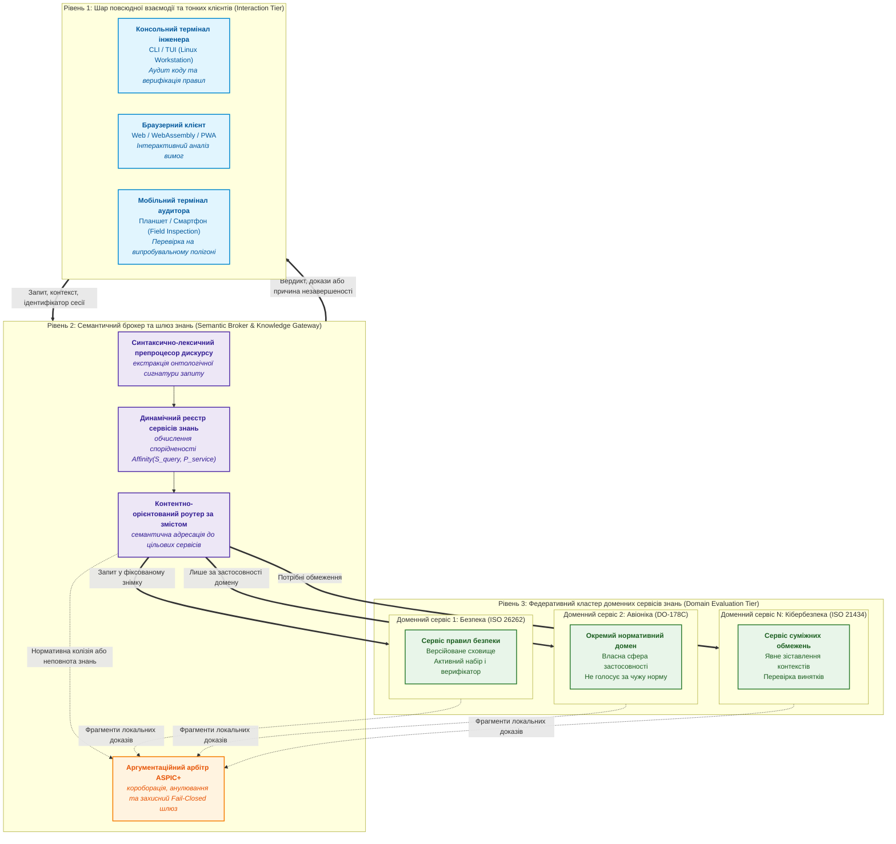
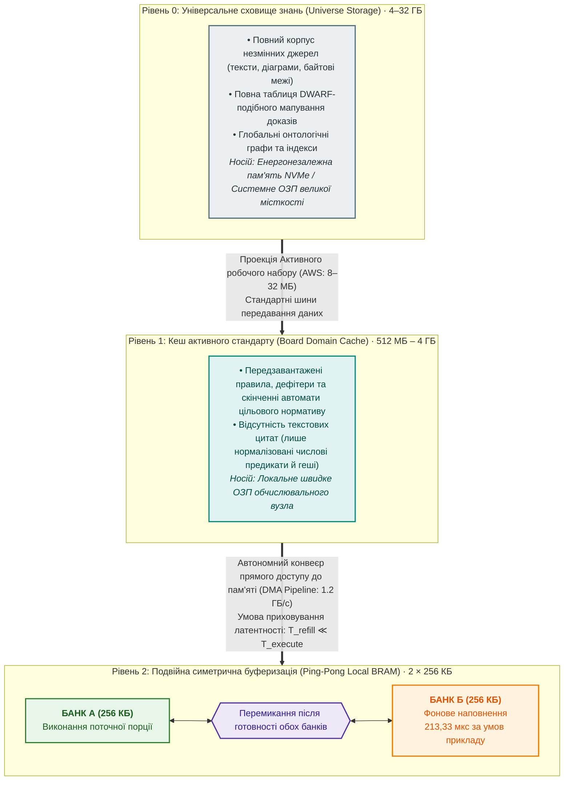
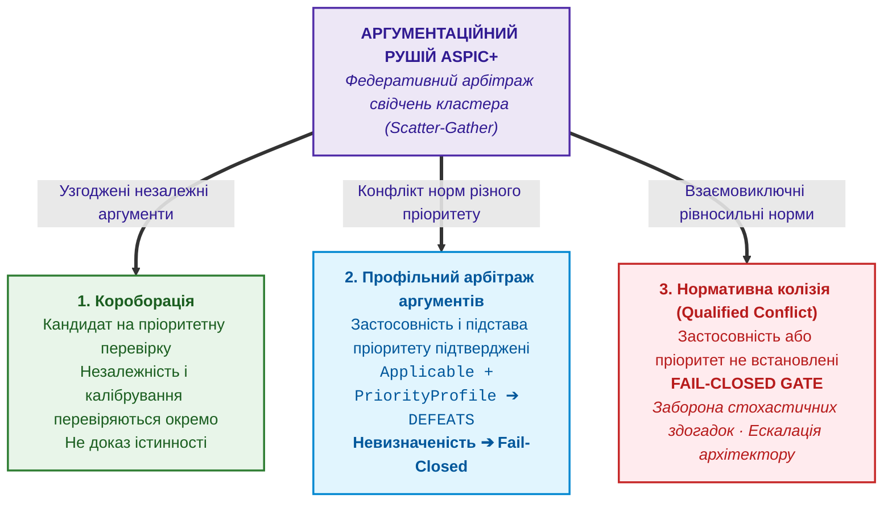
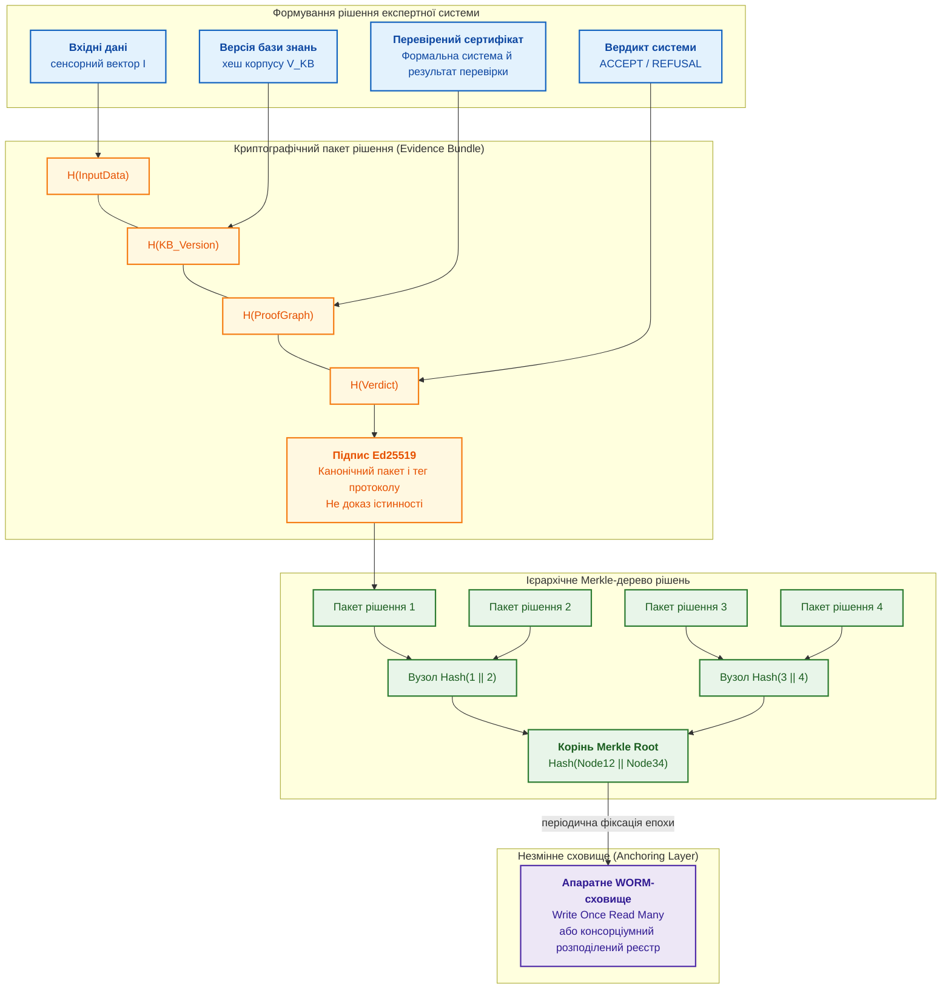
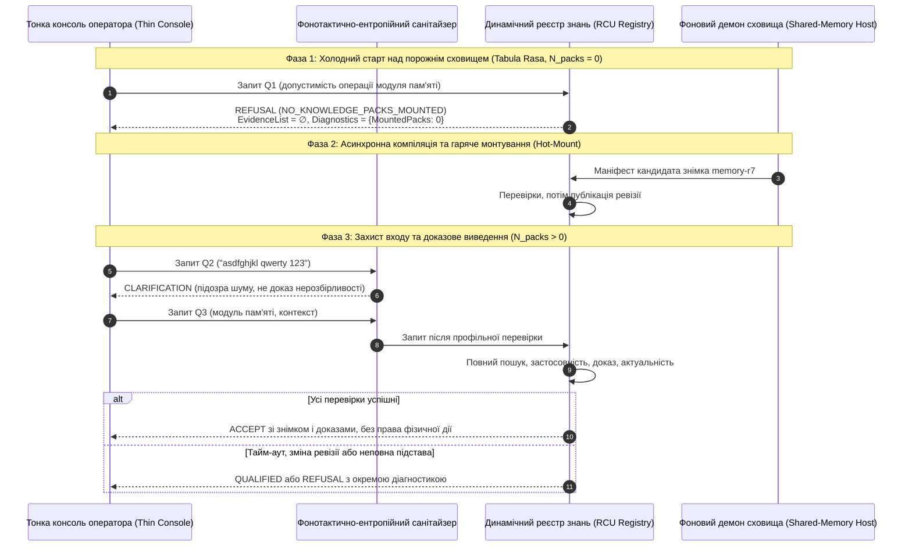

# Глава 40. Розподілена архітектура доказової експертної системи: епістемічна SOA, семантична маршрутизація, ієрархія пам'яті та багатоджерельний дефезитивний арбітраж

> **Книга:** [Архітектура доказових експертних систем](README.md) · [Частина VII: Технологічний стек, апаратна інфраструктура, кібернетичне виконання та розподілена SOA](part-07-runtime-and-knowledge-exchange.md)  
> **Попередня глава:** [Глава 33. Міжсистемний обмін знаннями: постачання правил стороннім системам, навчання моделей і захищений зворотний зв'язок](ch33-inter-system-knowledge-exchange-and-model-teaching.md)  
> **Завершення основного тексту:** [Зміст монографії](README.md)  
> **Автор:** [Микола Мартинович Федчик](about-the-author.md)  
> **Передумови й маршрут:** множини, логічна імплікація, відношення обсягу до швидкості та основи ймовірності. Базові задачі пояснено від першого курсу; для відтворення лістингів потрібні основи Go. Спочатку розподіляються обов'язки, потім обчислюються ресурси й перевіряються межі допуску.  
> **Очікувані результати:** відрізняти доступність сервісу від доведеності відповіді; обрати сервіс за змістом запиту; розрахувати буфер, пропускну здатність і резерв кластера; виявити неповний пошук або застарілу ревізію; пояснити, чого не доводять кворум, SimHash, підпис і Merkle-шлях; відокремити доказ висновку від повноваження виконати дію.  

---

## Анотація

Розподілена експертна система потрібна тоді, коли одна перевірка спирається на знання й обчислення кількох вузлів. Як додати користувачів і бази правил, не сплутавши швидко отриману відповідь із правильною? У цій главі локальні механізми перевірки джерел і доведень поєднано з доставкою запитів, керуванням пам'яттю та журналом рішень. Мережеві затримки, відсутній шард або зміна редакції правила мають бути видимими причинами незавершеності, а не прихованими підставами дозволу.

Наскрізний навчальний сценарій: команда перевіряє модуль керування пам'яттю за зафіксованим профілем вимог. Правила, їхні передумови й винятки можуть бути розміщені окремо; назва стандарту в запиті ще не підтверджує його застосовності. На цьому сценарії розібрано авторську Epistemic SOA, семантичне ранжування сервісів, повне замикання активного набору правил, подвійну буферизацію, аргументаційний арбітраж, тріаж прогалин і перевірку цілісності журналу. Навчальні числа задано як припущення, а непідтверджені архівні апаратні числа вилучено, не перейменовано на навчальні дані. Перспективні апаратні моделі залишено прогнозами. Розподіленість не доводить істинності, підпис не замінює доказу, а доказ не надає права фізичної дії.

---

## 1. Синтез монографії: від локальної моделі до референсного архітектурного прототипу

Перехід від локальної моделі до розподіленої архітектури починається з питання: які обов'язки можна рознести між машинами, не втративши підстав висновку? Локальне виведення вже розглянуто в [Главі 16](ch16-expert-systems-architecture.md), джерельний контроль у [Главі 38](ch38-curing-machine-hallucinations-and-knowledge-deficits.md), перевірку контрприкладами у [Главі 39](ch39-active-compliance-auditor-and-popperian-testing.md). Тут достатньо нагадати: правило має передумови й можливі винятки, а доказ указує, які саме факти та правила використано.

Однак у практичній інженерії виникає закономірне запитання: **як зібрати всі ці теоретичні концепції в єдину працюючу систему корпоративного рівня?**

У реальних високотехнологічних R&D проєктах (автомобілебудування, авіоніка, медичне приладобудування) нормативна база налічує десятки чинних стандартів (ISO, IEC, DO, IEEE, RFC), які разом із вербатім-першоджерелами, таблицями відповідності та дефітерами займають десятки гігабайтів інформації. Водночас інженерам-дослідникам, аудиторам і розробникам необхідний повсякденний доступ до системи:
- на робочому місці за десктопом під час проєктування архітектури;
- у випробувальній лабораторії чи на полігоні з планшета або смартфона;
- в автоматизованому конвеєрі неперервної інтеграції (CI/CD) під час нічних аудитів коду.

Локальний моноліт і хмарний сервіс мають різні обмеження, але жоден варіант не є непридатним за означенням. На мобільному пристрої велика локальна база знань може перевищити доступний бюджет пам'яті й затримки; хмарна мовна модель без окремих механізмів не забезпечує детермінізму, перевірки джерел або захисту даних. Прийнятне розміщення компонентів визначають вимогами до доступності, ресурсів, приватності, затримки та доказового контролю конкретного виробу.

У цій монографії автором запропоновано **референсну архітектурну модель**, яка спеціалізує відомий поділ клієнтських і сервісних обов'язків для доказового оцінювання. Це не свідчення завершеного промислового прототипу чи підтвердженої світової новизни; працездатність і масштабування мають бути підтверджені реалізацією та випробуваннями. У навчальному прикладі браузер передає запит про модуль пам'яті, брокер знаходить потрібні сервіси, а верифікатор перевіряє відповідь за конкретним знімком знань. Якщо сервіс винятків недоступний, система залишається доступною для діагностики, але не видає позитивного допуску.

<a id="obj-40-1"></a>

**Діаграма 40.1. Триланкова архітектура та межі відповідальності**



---

## 2. Епістемічна сервіс-орієнтована архітектура (Epistemic SOA) та тонкі клієнти

Епістемічна SOA відповідає на питання, що саме можна довірити клієнту, брокеру й сервісу знань. Сервіс тут є окремо доступною програмою з явним контрактом; розподіл сам по собі не усуває суперечностей. Архітектурні стилі мережевих систем розглянуто у Філдінга [[4]](#src-4), але авторська спеціалізація полягає у збереженні контексту правила: джерела, редакції, передумов і сфери застосовності. Для модуля пам'яті це означає, що відповідь із довідкового сервісу не підмінює перевірку застосовної вимоги.

### 2.1. Концепція тонкого клієнта (Thin Interaction Client)

Тонкий клієнт потрібний, щоб один і той самий перевірений пакет можна було показати у браузері й терміналі без повторного локального виведення. У цьому профілі він є **ультратонким агентом взаємодії**:
1. **Нульове сховище знань:** клієнт не утримує авторитетної локальної бази правил. Це не забороняє зберігати історичні відповіді й не робить серверний знімок автоматично свіжим.
2. **Абстрагування від обчислювачів:** Клієнту не потрібні апаратні прискорювачі нейромереж (NPU/GPU) чи спеціалізовані процесори правил. Завдяки цьому клієнтський інтерфейс експертної системи легко функціонує на звичайних смартфонах під керуванням мобільних ОС, у веб-браузерах через WebAssembly/PWA або у текстовому терміналі інженерної робочої станції.
3. **Строга типізація запитів та відповідей:** Обмін здійснюється через високоефективні бінарні RPC-контракти (наприклад, Protocol Buffers над gRPC чи захищені WebSockets):
   - Запит від клієнта: текст або структурований ідентифікатор артефакту з контекстом оцінювання. Обмеження, наприклад 4 КБ для короткого запиту, задає контракт; вкладення передаються окремо, а перевищення не обрізається мовчки.
   - Відповідь клієнту: структурований доказовий кортеж, що містить вердикт (`ACCEPT`, `REFUSAL`, `QUALIFIED`), ідентифікатори застосованих правил, дослівні цитати з байтовими координатами у першоджерелі та 256-бітні криптографічні геші кустодії.

> [!NOTE]
> **Три характеристики профілю тонкого клієнта**
> 1. *Нульове авторитетне сховище правил*: клієнт не підмінює серверну базу локальним виведенням; актуальність серверного знімка перевіряється окремо.
> 2. *Абстрагування від апаратних обчислювачів*: клієнту не потрібні прискорювачі NPU/GPU чи процесори правил, що дозволяє запуск на мобільних пристроях, браузерах та CLI.
> 3. *Строга типізація RPC-контрактів*: явні межі розміру, версія схеми, ідентифікатор знімка та структурований доказовий пакет; підпис перевіряють за довіреним ключем.
> *Практичне застосування:* Тонкий клієнт не додає тверджень до серверного пакета. Підпис перевіряє походження й цілісність за довіреного ключа, а не правильність висновку; для застарілої чи недоступної відповіді потрібен явний статус.

### 2.2. Збереження інваріанта $ZHR = 1.00$ на клієнті

Збереження шлюзового інваріанта на клієнті означає, що інтерфейс не додає до серверного висновку нових тверджень. Як показати відповідь, не перетворивши `QUALIFIED` на дозвіл? Для вже перевіреного пакета контракт відображення має вигляд:

<a id="obj-40-2"></a>

**Формула (40.2). Контракт відображення перевіреного пакета**

```math
\text{Display}(\text{Response}) = \text{Render}(\text{Verdict}, \text{EvidenceMap}, \text{Signature})
```

де:
- $`\text{Verdict} \in \{\text{ACCEPT}, \text{REFUSAL}, \text{QUALIFIED}\}`$ — зовнішній вердикт сервера за контрактом глави 16 §1.1; він не підміняє окремий логічний стан твердження або повноваження на дію;
- $`\text{EvidenceMap}`$ — локальне відображення термів виведення на версію джерела, його геш і напіввідкриті байтові межі цитати; однаковий зсув у різних документах не є тією самою цитатою;
- $`\text{Signature}`$ — підпис Ed25519 серіалізованого пакета; усі аргументи тут структуровані дані без фізичних одиниць.

Наприклад, сервер повернув `QUALIFIED` із причиною «не перевірено виняток». Клієнт показує саме цей статус і підстави, не перефразовуючи його як «переважно безпечно». Зміна тексту цитати порушить перевірку гешу, але навіть незмінна цитата може бути непридатною до поточного виробу. Отже, відображення зберігає зміст пакета, а не доводить його заново.

Перед показом пакета клієнт повинен перевірити його схему, підпис і довірений ключ; це вимога до адаптера, не твердження про вже атестовану реалізацію. Розрив зв'язку не змінює раніше отриманих байтів, але не підтверджує чинності джерел або дозволу дії в новий момент часу. Історичний пакет зберігається з версією та строком чинності; якщо актуальність неможливо перевірити, це не дає нового виконавчого дозволу. Правила нормативного допуску й повноважень залишаються за Главою 16 §1.1.

Водночас у метрології розподіленої системи строго розрізняються два поняття ([Глава 36](ch36-knowledge-testing-pyramid-and-variational-calibration.md), §5.5; [Глава 38](ch38-curing-machine-hallucinations-and-knowledge-deficits.md), §2.2):
1. **Конструктивний шлюзовий інваріант ($`\mathrm{ZHR}_{\mathrm{gate}} = 1{,}00`$ або $`\tau_{\mathrm{ZHR\_gate}} = 1`$):** структурне правило, за яким кожне допущене шлюзом і передане на тонкий клієнт твердження має верифіковану побайтову цитату з першоджерела за SHA-256.
2. **Емпірична межа помилок:** навіть нуль помилок на скінченній вибірці не доводить нульової частоти в експлуатації. Для незалежних однаково розподілених випробувань із двійковим результатом і нулем помилок однобічну верхню 95-відсоткову межу отримують із імовірності не побачити жодної помилки:

<a id="obj-40-3"></a>

**Формула (40.3). Верхня межа частоти помилок за нульового результату вибірки**

$$
p_U=1-0{,}05^{1/N}.

$$

Тут $N$ є додатною цілою кількістю випробувань, а $`p_U\in[0,1]`$ є безрозмірною верхньою межею частоти, не оцінкою істинності окремої відповіді. За 1000 випробувань спочатку обчислюють корінь степеня 1000 з 0,05, потім віднімають його від одиниці: отримують приблизно 0,002991, тобто 0,2991%. Це межа лише для заданого розподілу тестів, не гарантія для всіх запитів. Далі потрібно визначити, хто шукатиме джерела для конкретного запиту.

---

## 3. Семантичний брокер, препроцесор дискурсу та маршрутизація за змістом

Коли в інженерній екосистемі функціонує не одна база знань, а кластер спеціалізованих сервісів, виникає ключове завдання координації: **хто і як визначає, куди саме спрямувати запит інженера?**

Мережева адреса відповідає на питання «як доставити», а **семантична маршрутизація** на питання «у кого шукати». Вони доповнюють одна одну. У прикладі брокер виділяє з запиту маркери модуля пам'яті й заданої редакції вимог; невизначену редакцію уточнює, а не вигадує. Ранжування є пропозицією місця пошуку, не нормативним допуском.

### 3.1. Синтаксично-лексичний препроцесор дискурсу

Препроцесор потрібний, щоб перетворити питання людини на дані для пошуку. Він спочатку визначає намір, потім об'єкт і дію, нарешті маркери домену. Наведений запит про динамічну пам'ять є запитанням до джерела, не твердженням, що ISO 26262 містить безумовну заборону такої пам'яті.

<a id="obj-40-4"></a>

**Діаграма 40.4. Підготовка запиту до маршрутизації**

```mermaid
flowchart TD
    accTitle: Конвеєр синтаксично-лексичного розбору дискурсу в Семантичному Брокері
    accDescr: Поетапна трансформація природномовного запиту інженера у структуровану онтологічну сигнатуру для маршрутизації доменних правил.

    IN["&emsp;&emsp;&emsp;&emsp; <b>ВХІДНИЙ ІНЖЕНЕРНИЙ ЗАПИТ НА АУДИТ ВІДПОВІДНОСТІ (Natural Language Query)</b> &emsp;&emsp;&emsp;&emsp;<br><i>«Чи дозволено використовувати динамічне виділення пам'яті для модуля ASIL-D згідно з ISO 26262-6?»</i><br><i>Джерело надходження: робоча станція інженера / конвеєр неперервної інтеграції (CI/CD Quality Gate)</i>"]

    STEP1["&emsp;&emsp;&emsp;&emsp; <b>1. КЛАСИФІКАЦІЯ ДИСКУРСУ (Discourse Qualification)</b> &emsp;&emsp;&emsp;&emsp;<br>• Прагматичний тип: <code>NORMATIVE_COMPLIANCE_QUERY</code> &emsp;·&emsp; • Цільова модальність: <code>DEONTIC_PROHIBITION_OR_PERMISSION</code><br><i>Семантичний намір: формальна верифікація допустимості архітектурного рішення проти сертифікаційного стандарту</i>"]

    STEP2["&emsp;&emsp;&emsp;&emsp; <b>2. СИНТАКСИЧНО-ФРЕЙМОВИЙ РОЗБІР (Syntactic Frame Parsing)</b> &emsp;&emsp;&emsp;&emsp;<br>• Актор: <i>«модуль програмного забезпечення»</i> &emsp;·&emsp; • Дія: <i>«динамічне виділення пам'яті» (Dynamic Allocation)</i> &emsp;·&emsp; • Атрибут: <code>ASIL_Level = 'D'</code><br><i>Вилучення предикатно-аргументної структури вимоги для детермінованого зіставлення з онтологічними аксіомами</i>"]

    STEP3["&emsp;&emsp;&emsp;&emsp; <b>3. ЕКСТРАКЦІЯ ОНТОЛОГІЧНОЇ СИГНАТУРИ (Domain Signature Extraction)</b> &emsp;&emsp;&emsp;&emsp;<br>• Доменні маркери: <code>{ISO-26262, ASIL-D, Software-Architecture, Memory-Management}</code><br>• Профіль запиту: <code>TargetDomain = 'Automotive-Safety'</code> &emsp;·&emsp; • Норматив: <code>Standard = 'ISO-26262-6:2018'</code><br><i>Формування сигнатурного вектора запиту для обчислення коефіцієнтів спорідненості в динамічному реєстрі сервісів</i>"]

   OUT["<b>Кандидат сервісу для пошуку</b><br>Спочатку перевірити редакцію, сферу та маніфест<br>Порожня сигнатура або невідомий домен: уточнення"]

    IN ==> STEP1
    STEP1 ==> STEP2
    STEP2 ==> STEP3
    STEP3 ==> OUT

    classDef query fill:#e3f2fd,stroke:#1565c0,stroke-width:2px,color:#0d47a1;
    classDef step1 fill:#ede7f6,stroke:#5e35b1,stroke-width:2px,color:#311b92;
    classDef step2 fill:#fff8e1,stroke:#ffa000,stroke-width:2px,color:#e65100;
    classDef step3 fill:#e8f5e9,stroke:#2e7d32,stroke-width:2px,color:#1b5e20;
    classDef target fill:#f3e5f5,stroke:#7b1fa2,stroke-width:2px,color:#4a148c;

    class IN query;
    class STEP1 step1;
    class STEP2 step2;
    class STEP3 step3;
    class OUT target;
```



### 3.2. Динамічний реєстр сервісів знань (Knowledge Service Registry)

Реєстр сервісів дає брокеру перелік кандидатів, але запис «вузол живий» не доводить свіжості його знань. Кожен сервіс публікує маніфест із такими полями:
- **Ідентифікатор та ендпоінт:** Мережева адреса (IP/порт або черга повідомлень);
- **Простір знань (Knowledge Domain):** Набір обслуговуваних стандартів та версій онтологій (відповідно до вимог SemVer 2.0.0);
- **Клас обчислювача:** Програмний CPU, масив векторних процесорів або спеціалізоване апаратне ядро детермінованого виведення;
- **Метрики пропускної здатності:** Поточна глибина черги запитів та оцінка затримки обчислення.
- **Доказовий знімок:** ідентифікатори шардів, ревізія й геш маніфесту, час перевірки актуальності, стан відкликання та підтверджена сфера обслуговування. Версія програмного API за SemVer не є редакцією стандарту.

Брокер обчислює функцію відповідності між онтологічною сигнатурою запиту $`\mathcal{S}_{\mathrm{query}}`$ та простором знань $`\mathcal{P}_{\mathrm{domain}}`$ у паспорті сервісу $`\mathcal{P}_{\mathrm{service}}`$:

<a id="obj-40-5"></a>

**Формула (40.5). Частка покритих маркерів запиту**

```math
\mathrm{Affinity}(\mathcal{S}_{\mathrm{query}}, \mathcal{P}_{\mathrm{service}}) = \frac{\lvert\mathcal{S}_{\mathrm{query}} \cap \mathcal{P}_{\mathrm{domain}}\rvert}{\lvert\mathcal{S}_{\mathrm{query}}\rvert}
```

де:
- $`\mathcal{S}_{\mathrm{query}}`$ — множина онтологічних концептів і доменних маркерів, екстрагованих із запиту інженера;
- $`\mathcal{P}_{\mathrm{domain}}`$ — множина підтримуваних стандартів та версій онтологій у паспорті сервісу $`\mathcal{P}_{\mathrm{service}}`$;
- $`\lvert \mathcal{S}_{\mathrm{query}} \cap \mathcal{P}_{\mathrm{domain}} \rvert`$ — потужність перетину онтологічних сигнатур (число зіставлених концептів);
- $`\lvert \mathcal{S}_{\mathrm{query}} \rvert`$ — загальна кількість онтологічних маркерів у вхідному запиті;
- $`\mathrm{Affinity}(\mathcal{S}_{\mathrm{query}}, \mathcal{P}_{\mathrm{service}}) \in [0, 1]`$ — нормований коефіцієнт семантичної спорідненості (значення $1.0$ відповідає повному охопленню домену запиту).

Множини скінченні, маркери мають однакову канонічну схему, а знаменник додатний; для порожньої сигнатури ділення не визначено й потрібне уточнення. Це частка покритих маркерів, не імовірність правильності. Нехай у запиті чотири маркери: «пам'ять», «виділення», «модуль», «редакція-7». Сервіс A підтримує три з них, сервіс B два: ділення дає 0,75 і 0,50. A стає головним виконавцем лише серед придатних за редакцією й сферою сервісів; однакові бали розв'язує визначене правило порядку, а не випадковий вибір. Високий бал не дозволяє пропустити шард винятків. Наступне питання: як доставити повний потрібний набір у пам'ять обчислювача?

---

## 4. Теоретична модель багаторівневої ієрархії пам'яті та подвійної буферизації

Ієрархія пам'яті відповідає на питання, як перевірити багато правил, якщо біля обчислювача вміщується лише невелика їх частина. Потрібно розрізняти місткість у байтах, затримку першого доступу в секундах і смугу передавання в байтах за секунду. Практичні компроміси між ними описано в [[3]](#src-3); універсального закону «більше пам'яті завжди повільніше» немає.

Для наскрізного прикладу прийнято корпус 32 ГБ, активний набір 16 МБ і два банки по 256 КБ. Це навчальна конфігурація, не характеристика всіх експертних систем. Тут і далі КБ, МБ і ГБ означають відповідно 1000, мільйон і мільярд байтів; КіБ означає 1024 байти. Передавання всього корпусу за смуги 1,2 ГБ/с тривало б приблизно 26,7 с без накладних витрат, активного набору 16 МБ лише 13,33 мс. Проте скорочення обсягу без перевірки логічного замикання могло б вилучити саме заборонний виняток.

<a id="obj-40-6"></a>

**Діаграма 40.6. Ієрархія пам’яті навчального прикладу**



### 4.1. Концепція Активного робочого набору (Active Working Set — AWS)

Активний робочий набір потрібний не для довільного скорочення знань, а для відбору всіх залежностей запиту в одному знімку. Якщо правило потребує передумови, а та має власний виняток, одного кроку об'єднання недостатньо. У авторській моделі оператори нижче означають **повні транзитивні залежності**, включно із залежностями дефітерів; еквівалентно, додавання повторюють до незмінності скінченної множини:

<a id="obj-40-7"></a>

**Формула (40.7). Повне замикання активного робочого набору**

```math
\mathrm{AWS} = \mathrm{Closure}(\mathcal{R}_{\mathrm{target}}) = \mathcal{R}_{\mathrm{target}} \cup \mathrm{Prerequisites}(\mathcal{R}_{\mathrm{target}}) \cup \mathrm{Defeaters}(\mathcal{R}_{\mathrm{target}})
```

де:
- $`\mathcal{R}_{\mathrm{target}}`$ — множина цільових правил, активована онтологічною сигнатурою запиту;
- $`\mathrm{Prerequisites}(\mathcal{R}_{\mathrm{target}})`$ — предикати-передумови, необхідні для детермінованого розв'язання залежностей;
- $`\mathrm{Defeaters}(\mathcal{R}_{\mathrm{target}})`$ — множина асоційованих дефітерів (винятків і контрправил);
- $`\mathrm{AWS}`$ — скінченне замикання правил у зафіксованому знімку; всі елементи формули є множинами без фізичних одиниць. Завершення означає, що чергове додавання вже не змінює множину, а не що сплив бюджет часу.

Наприклад, цільове правило дозволяє операцію за доведеної межі пам'яті. Перший крок додає правило перевірки межі й виняток «межу перевищено», другий додає потрібні спостереження та умови їхньої придатності, третій більше нічого не додає. Якщо стан винятку невідомий, замикання може бути повним структурно, але дозвіл усе одно не доведено. Якщо пошук залежностей не завершено, повертають `INCOMPLETE_SEARCH`.

У швидку пам'ять передають числові умови, ідентифікатори й локальні посилання на джерела; цитати залишаються у сховищі та доступні перевіряльнику. Обсяг 8–32 МБ є припущенням прикладу, не гарантованим коефіцієнтом стискання. Як перекрити передавання наступної порції виконанням поточної?

> [!NOTE]
> **Три складники профілю активного робочого набору (AWS)**
> 1. *Цільовий пул правил ($`\mathcal{R}_{\mathrm{target}}`$)*: множина актуальних нормативних вимог, активованих онтологічною сигнатурою запиту.
> 2. *Транзитивні передумови ($`\mathrm{Prerequisites}`$)*: предикати та залежності, необхідні для замкненого детермінованого логічного виведення.
> 3. *Асоційовані дефітери ($`\mathrm{Defeaters}`$)*: повний перелік винятків і контрправил, що можуть підірвати або обмежити застосування цільової норми.
> *Практичне застосування:* Повноту замикання перевіряють в одному знімку; за браку пам'яті повертають `INCOMPLETE_SEARCH`, а не вилучають потрібні дефітери чи видають частковий допуск. Обсяг і час передавання вимірюють для конкретного набору.

### 4.2. Математична умова безперервності конвеєра подвійної буферизації (Ping-Pong Pipeline)

Подвійна буферизація приховує очікування наступної порції: поки ядро читає банк A, DMA заповнює банк B. Простій сам по собі не робить висновок хибним, але може порушити строк відповіді. Перед розрахунком припускається, що обидві операції справді можуть працювати паралельно, а правила не читають ще не завантажені дані.

Час заповнення одного банку даними з локального системного ОЗП ($`T_{\mathrm{refill}}`$) визначається відношенням місткості банку до реальної пропускної здатності шини передавання:

<a id="obj-40-8"></a>

**Формула (40.8). Час наповнення банку за ефективною смугою**

```math
T_{\mathrm{refill}} = \frac{V_{\mathrm{bank}}}{B_{\mathrm{bus}}}
```

де:
- $`V_{\mathrm{bank}}`$ — місткість одного банку швидкої внутрішньокристальної пам'яті (наприклад, $`256\,\text{КБ}`$ Block RAM на FPGA або виділеного статичного ОЗП SRAM у кристалі);
- $`B_{\mathrm{bus}}>0`$ — ефективна смуга в байтах/с, не паспортна швидкість інтерфейсу; 1,2 ГБ/с є припущенням прикладу;
- $`T_{\mathrm{refill}}`$ — розрахунковий час фонового наповнення банку даними без участі процесора правил;
- $`T_{\mathrm{execute}}`$ — час, необхідний процесору правил для повного систолічного зіставлення вхідного пакета вимог із блоком знань місткістю $`V_{\mathrm{bank}}`$.

**Умова безперервності ідеалізованої моделі подвійної буферизації:**
Якщо читання активного банку й DMA-заповнення пасивного банку повністю перекриваються, банки перемикаються без додаткової затримки, а інших причин простою немає, модель дає максимальне використання обчислювального ресурсу ($\eta = 1.00$) тоді й тільки тоді, коли час наповнення не перевищує час виконання порції правил:

<a id="obj-40-9"></a>

**Формула (40.9). Умова перекриття в ідеалізованій моделі**

```math
T_{\mathrm{refill}} \le T_{\mathrm{execute}}
```

Тут обидва часи додатні й вимірюються у секундах. Доведення коротке: наступна порція потрібна в момент закінчення поточної; якщо наповнення завершено не пізніше, очікування немає, інакше ядро чекає різницю часів. Це твердження про усталений режим моделі, без першого завантаження, останнього вивантаження й накладних витрат. Для реальної системи треба додати арбітраж, перевірку цілісності та перемикання і задати їхні верхні межі; середня смуга не доводить WCET.

Помноживши нерівність на додатну смугу, отримують допустимий обсяг у байтах:

<a id="obj-40-10"></a>

**Формула (40.10). Місткість банку за заданого часу виконання**

```math
V_{\mathrm{bank}} \le B_{\mathrm{bus}} \cdot T_{\mathrm{execute}}
```

За незалежно заданого часу виконання 2 мс добуток 1,2 мільярда байтів/с на 0,002 с дає **2,4 МБ**. Отже, з цих умов не випливає універсальна межа 256–512 КБ. Банк 256 КБ наповнюється за 213,33 мкс; це менше за 2 мс. Для порівняння банк 16 МБ потребує:

<a id="obj-40-11"></a>

**Формула (40.11). Час наповнення надмірного банку**

```math
T_{\mathrm{refill}} = \frac{16\,\text{МБ}}{1.2\,\text{ГБ/с}} \approx 13.3\,\text{мс}
```

За тих самих 2 мс виконання очікування становить приблизно 11,33 мс, а частка зайнятості ядра:

<a id="obj-40-12"></a>

**Формула (40.12). Частка зайнятості ядра за дефіциту смуги**

```math
\eta = \frac{T_{\mathrm{execute}}}{T_{\mathrm{refill}}} = \frac{2.0\,\text{мс}}{13.3\,\text{мс}} \approx 0.15
```

Це 15% зайнятості, а не зміна тактової частоти. Оцінка припускає незмінний час виконання при зміні обсягу; у реальному пакуванні він теж залежить від кількості й структури правил. Якщо обидва часи пропорційні кількості правил, просте подрібнення не змінить їхнього відношення. Адаптивний розмір порції тому перевіряють разом зі складністю й накладними витратами.

Для цієї умовної моделі розрізняються три режими: достатній запас для перекриття; малий запас, що потребує перевірки конкуренції за шину; дефіцит смуги з очікуванням або типізованою відмовою за дедлайном. Поріг запасу задає профіль. Підвищення пріоритету DMA може допомогти, але не гарантує результату без аналізу інших споживачів. **Вилучати потрібні дефітери заради швидкодії заборонено**: обмежують прийом нових запитів або повертають незавершеність, не послаблюють зміст перевірки.

<a id="421-емпірична-верифікація-теореми-приховування-затримок-та-аналіз-ккд-конвеєра-на-стенді-pynq-z1"></a>
#### 4.2.1. Модельний розрахунок зайнятості конвеєра та межі емпіричної перевірки

Модельний розрахунок потрібний, щоб оцінити перекриття часу виконання порції та її підкачування перед плануванням вимірювань на PYNQ-Z1. Емпіричного підтвердження тут не заявлено: для нього потрібний протокол із конфігурацією, сирими трасами й повтореннями. Архівні числові характеристики стенда вилучено. Для збереження методу нижче задано **окремий новий навчальний сценарій** з незалежно обраною круглою смугою DMA 400 МБ/с та умовними 20 нс на інструкцію. Ці припущення не описують минулий дослід і не встановлюють частоти чи швидкодії PYNQ-Z1.

Частка часу зайнятості ядра $\eta$ в усталеному ідеалізованому режимі є безрозмірною величиною від нуля до одиниці. Цикл триває довший із двох часів, тому:

<a id="obj-40-13"></a>

**Формула (40.13). Зайнятість ядра в усталеному режимі**

$$
\eta = \frac{T_{\mathrm{execute}}}{\max(T_{\mathrm{execute}}, T_{\mathrm{refill}})} = \begin{cases} 1{,}00, & \text{якщо } T_{\mathrm{refill}} \le T_{\mathrm{execute}} \\ \dfrac{T_{\mathrm{execute}}}{T_{\mathrm{refill}}}, & \text{якщо } T_{\mathrm{refill}} > T_{\mathrm{execute}} \end{cases}

$$

Обидва часи додатні; функція стала до межі рівності, а далі спадає обернено пропорційно відношенню часів, не кусково-лінійно. Для таблиці час виконання обчислено множенням кількості інструкцій на 20 нс, час наповнення діленням байтів на 400 мільйонів байтів/с. КіБ тут навмисно відрізняються від десяткових КБ попереднього прикладу.

<a id="obj-40-14"></a>

**Таблиця 40.14. Розрахунок часу порцій у новому навчальному сценарії, не стендові вимірювання**

| Порція | Інструкцій | Виконання, мкс | Наповнення, мкс | Розрахункова $\eta$ | Висновок моделі |
| :--- | ---: | ---: | ---: | ---: | :--- |
| 16 КіБ | 2048 | 40,96 | 40,96 | 1,000 | Перекриття на межі, без запасу |
| 32 КіБ | 4096 | 81,92 | 81,92 | 1,000 | Те саме відношення часів |
| 64 КіБ | 8192 | 163,84 | 163,84 | 1,000 | Не доказ WCET |
| 128 КіБ, розріджені правила | 4096 | 81,92 | 327,68 | 0,250 | Очікування 245,76 мкс |
| 256 КіБ, інша щільність | 5000 | 100,00 | 655,36 | 0,153 | Очікування 555,36 мкс |

Для 64 КіБ обсяг 65536 байтів ділимо на 400 мільйонів байтів/с: отримуємо 163,84 мкс, рівно стільки ж, скільки умовне виконання. Будь-які додаткові витрати порушать перекриття цього рядка. Таблиця дозволяє відкинути невдалу конфігурацію, але не підтверджує реальну затримку, спрацювання сторожового таймера чи сертифікаційний статус плати. Для цього потрібні окремі вимірювання під конкуренцією й у граничних режимах.

> [!NOTE]
> **Чотири інженерні критерії подвійної буферизації**
> 1. *Сайзинг*: застосування умови перекриття використовує ефективну смугу й час конкретної порції, не універсальний розмір BRAM.
> 2. *Адаптивне пакування*: зменшення порції перевіряється разом зі зміною часу виконання, без вилучення необхідних винятків.
> 3. *Три режими*: достатній запас, конкуренція за смугу та очікування/відмова за дедлайном; час перемикання залежить від реалізації.
> 4. *Перевірність*: новий модельний розрахунок не є реконструкцією архівного досліду; підтвердження на PYNQ-Z1 потребує доступного протоколу.
> *Межа моделі:* Нерівність задає умову перекриття в ідеалізованому режимі, а не теорему про продуктивність реальної системи. Реальну смугу, WCET та витрати перемикання вимірюють на цільовій апаратурі.

### 4.3. Систолічний пакетний аудит (Batch Compliance Sweeps)

Пакетний аудит потрібний, коли той самий набір правил застосовують до багатьох вимог. Систолічна організація передає дані послідовно між обчислювальними елементами; для першої оцінки достатньо порахувати роботу й темп її виконання:

<a id="obj-40-15"></a>

**Формула (40.15). Час порівняння пар за заданого темпу**

$$
T_{\mathrm{pairs}}=\frac{c}{f}\left\lceil\frac{MK}{p}\right\rceil.

$$

Тут $M,K$ є додатними цілими кількостями вимог і правил; $c>0$ є однаковою фіксованою кількістю тактів на неподільне порівняння пари; $p\ge1$ є цілою кількістю незалежних ліній, $f>0$ є частотою в тактах/с; результат у секундах. Округлення вгору враховує останню неповну групу пар: одна пара на двох лініях усе одно потребує часу одного порівняння, а не його половини. Це модель без конфліктів доступу, з рівномірним розподілом, без початкового наповнення конвеєра; різні вартості пар потребують окремої оцінки розкладу. Для 1500 вимог, 500 правил, 4 тактів на пару, однієї лінії та 100 МГц: спочатку 750000 пар, потім 3000000 тактів, нарешті 0,03 с, тобто 30 мс.

Порівняння пар не дорівнює всьому доведенню: залишаються пошук залежностей, обробка атак і винятків, передавання та черги. Тому 30 мс не доводить наскрізного дедлайну 1 с. Після локального розрахунку постає наступне питання: як звести правила й винятки з кількох вузлів без втрати повноти?

---

## 5. Багатоджерельна дефезитивна агрегація знань (ASPIC+ / Dung)

Багатоджерельна агрегація потрібна, коли перевірку модуля пам'яті неможливо завершити одним локальним набором правил. Чи означають дві однакові відповіді, що висновок правильний? Ні: вони можуть бути копіями одного джерела або не враховувати винятку. Передумовами зведення є фіксований знімок, повний перелік потрібних шардів і однаковий контекст виробу. Лише після збору перевіряють застосовність засновків і логічну прийнятність аргументів.

### 5.1. Тригери неповноти знань (Uncertainty Triggers)

Тригери неповноти відповідають на питання, коли локальної відповіді недостатньо. У авторській класифікації три початкові ознаки: низький бал якості джерела за заданою рубрикою, невідповідний запиту нормативний статус і невідомий стан винятку. Межа 70 зі 100 є параметром діагностики, не стандартом і не ймовірністю. `MAY` не означає автоматично «довідковий додаток»: модальність і статус частини документа перевіряють окремо.

Для модуля пам'яті правило може мати виняток «якщо неможливо довести верхню межу». Відсутність такого факту не є доведенням його хибності. Брокер запитує додаткову підставу; якщо її не знайдено або пошук не завершено, відповідь залишається кваліфікованою. Тригер допомагає шукати далі, але не гарантує, що додатковий сервіс розв'яже питання.

### 5.2. Федеративний запит (Scatter-Gather) та аргументаційний арбітраж

Перед розсиланням брокер фіксує незмінний маніфест запиту: ідентифікатор знімка, його ревізію, перелік потрібних шардів і строк відповіді. Репліки одного шарда є копіями, а не незалежними джерелами. Повна відповідь означає, що кожен потрібний шард завершив пошук у тому самому знімку; кворум реплік може засвідчувати узгоджене читання лише за умов конкретного протоколу, але не повноту міжшардового пошуку й не істинність.

У навчальному сценарії три шарди зберігають правила, передумови та винятки для перевірки модуля пам'яті. Відповіді лише перших двох дають `INCOMPLETE_SEARCH`, навіть якщо обидві підтримують дозвіл: третій може містити заборонний виняток. Тайм-аут, незавершений пошук, невідповідність ревізії чи відкликання знімка не перетворюються на `ACCEPT`. Після зміни ревізії поточне оцінювання починається заново; історичний результат можна відтворювати окремо, з явною датою та без нового дозволу дії.

Навіть повний набір відповідей є лише входом до перевірки цілісності, нормативної застосовності та логічного доведення. Фізичну дію окремо дозволяє виконавчий шлюз за актуальними повноваженнями й станом об'єкта. Нижче арбітраж розглядається після цих перевірок доставки, а не замість них.

Лістинг реалізує **метод повного збору у фіксованому знімку**. Вхід `Snapshot` є маніфестом, `Reply` є звітом одного шарда, `Checks` містить уже отримані результати незалежних перевіряльників. Нульове значення будь-якої перевірки блокує допуск. Усі часові значення є цілими секундами однієї довіреної шкали; рівність строку чинності вже означає прострочення. Код не реалізує консенсус, криптографію чи доказовий рушій і не атомарно перевіряє зовнішній світ; після нього перед дією потрібне повторне підтвердження ревізії та окремі повноваження.

<details><summary>Go: метод повного збору та доказового шлюзу</summary>

```go
package chapter40

type Snapshot struct {
   ID string
   Revision uint64
   Shards []string
   Expires int64
   Revoked bool
}

type Reply struct {
   SnapshotID string
   Revision uint64
   Shard string
   Complete bool
}

type Checks struct { Integrity, Fresh, Applicable, Proof bool }
type Result struct { Status string; ActionAuthorized bool }

func Gather(snapshot Snapshot, replies []Reply, now int64, currentRevision uint64, checks Checks) Result {
   blocked := func(status string) Result { return Result{Status: status} }
   if snapshot.ID == "" || snapshot.Revision == 0 || len(snapshot.Shards) == 0 {
      return blocked("INVALID_MANIFEST")
   }
   if snapshot.Revoked || snapshot.Revision != currentRevision || now >= snapshot.Expires {
      return blocked("STALE_OR_REVOKED")
   }
   expected := make(map[string]bool)
   for _, shard := range snapshot.Shards {
      if shard == "" || expected[shard] { return blocked("INVALID_MANIFEST") }
      expected[shard] = true
   }
   seen := make(map[string]bool)
   for _, reply := range replies {
      if !expected[reply.Shard] || seen[reply.Shard] { return blocked("INVALID_REPLY") }
      if reply.SnapshotID != snapshot.ID || reply.Revision != snapshot.Revision {
         return blocked("MIXED_SNAPSHOT")
      }
      if !reply.Complete { return blocked("INCOMPLETE_SEARCH") }
      seen[reply.Shard] = true
   }
   if len(seen) != len(expected) { return blocked("INCOMPLETE_SEARCH") }
   if !checks.Integrity || !checks.Fresh || !checks.Applicable || !checks.Proof {
      return blocked("QUALIFIED")
   }
   return Result{Status: "ACCEPT"}
}
```

</details>

Позитивний приклад: три різні потрібні шарди завершили пошук у знімку `memory-r7`, поточна ревізія 7, строк ще не минув, усі чотири перевірки позитивні: `ACCEPT`, але `ActionAuthorized` залишається `false`. Негативні приклади: два з трьох шардів дають `INCOMPLETE_SEARCH`, дубль замість третього дає `INVALID_REPLY`, ревізія 8 замість 7 блокується. Граничний випадок: відповідь точно в момент `Expires` уже не допускається. Ці випадки перевіряються контекстними тестами разом із другим лістингом нижче.

Виявивши дефіцит, Брокер ініціює паралельне опитування (**Scatter**) суміжних сервісів кластера (наприклад, сервісу галузевих прецедентів чи загальних стандартів надійності). Отримані від різних сервісів фрагменти доказів зводяться (**Gather**) у формальну аргументаційну систему **ASPIC+** [[2]](#src-2) на базі абстрактних аргументаційних структур Дунга [[1]](#src-1):

<a id="obj-40-16"></a>

**Діаграма 40.16. Гілки арбітражу після повного збору**



#### 5.2.1. Короборація свідчень (Corroboration)

Короборація відповідає на питання, чи варто додатково перевірити гіпотезу, підтриману кількома каналами. Перед множенням потрібно визначити події. У навчальній моделі $`A_1`$ і $`A_2`$ означають успіх двох незалежних каналів виявлення потрібного свідчення, а не дві події «твердження є істинним». Для незалежних подій імовірність, що не спрацював жоден канал, є добутком імовірностей їхніх відмов. Звідси:

<a id="obj-40-17"></a>

**Формула (40.17). Успіх хоча б одного незалежного каналу**

```math
\mathrm{Conf}(A_1 \cup A_2) = 1 - (1 - \mathrm{Cred}(A_1)) \cdot (1 - \mathrm{Cred}(A_2))
```

де:
- $`\mathrm{Cred}(A_i)\in[0,1]`$ — безрозмірна калібрована ймовірність успіху каналу $i$, де індекс є 1 або 2; довільний бал авторитетності джерела не є такою ймовірністю;
- $`\mathrm{Conf}(A_1\cup A_2)\in[0,1]`$ — у цій інтерпретації ймовірність успіху хоча б одного каналу;
- $`A_1\perp A_2`$ — статистична незалежність у заданому експерименті. Графи походження допомагають виявляти копії та спільні причини помилок, але наявність чи відсутність спільного документа сама по собі не встановлює статистичної залежності або незалежності подій успіху каналів. Потрібна модель саме цих подій, не лише різні ідентифікатори джерел.

Авторські пороги 0,95 і 0,80 можна досліджувати як політику черги перевірки, але не як вимоги ISO 26262 [[5]](#src-5), DO-178C [[6]](#src-6) чи IEC 61508. Нехай у навчальному експерименті канали пошуку для модуля пам'яті мають імовірності успіху 0,85 і 0,80, а незалежність задана припущенням. Спочатку отримують імовірності невдачі 0,15 і 0,20, потім їхній добуток 0,03, нарешті доповнення:

<a id="obj-40-18"></a>

**Формула (40.18). Числовий приклад незалежних каналів**

```math
\mathrm{Conf}(A_1 \cup A_2) = 1 - (1 - 0{,}85) \cdot (1 - 0{,}80) = 1 - (0{,}15 \cdot 0{,}20) = 1 - 0{,}03 = 0{,}97
```

Число 0,97 підвищує пріоритет перевірки за цим профілем, але не встановлює правильності знайденого правила, його застосовності чи істинності висновку. Якщо два канали є копіями одного пошуку з успіхом 0,85, об'єднання має ту саму ймовірність 0,85, а не 0,9775. Без калібрування й незалежності формулу взагалі не застосовують. Для доказової відповіді і в критичному, і в некритичному запиті потрібні окремі джерельні та логічні підстави; `QUALIFIED` не є умовним виконавчим дозволом.

#### 5.2.2. Анулювання слабких тверджень (Defeat / Undercutting)

Анулювання слабкого аргументу потрібне, якщо для того самого виробу отримано несумісні приписи. Спочатку з'ясовують, чи обидва приписи застосовні. `SHALL/MUST` за конвенцією документа можуть задавати вимогу, `SHOULD` рекомендацію, `MAY` дозвіл; останній не тотожний довідковому статусу всього пункту.

Якщо під час федеративного пошуку виявляється конфлікт між висновками сервісів, система не застосовує ймовірнісне зважування. До порівняння арбітр перевіряє версію, чинність, сферу, юрисдикцію та нормативний статус кожного пункту. Слова `SHALL/MUST` і `SHOULD/MAY` зберігають різну модальну силу за конвенцією документа, але самі по собі не доводять застосовності чи відношення пріоритету між різними джерелами. Лише коли затверджений профіль для цієї колізії підтверджує застосовність обох норм і визначає перевагу, система застосовує відповідне правило перемоги аргументу та зберігає обидві підстави в аудиторському протоколі. Якщо сфера чи пріоритет невідомі, автоматичне анулювання заборонено: активується `REFUSAL_NORMATIVE_CONFLICT` або `QUALIFIED_CONFLICT` за Главою 16 §1.1.

#### 5.2.3. Кваліфікована відмова при нормативній колізії (Qualified Conflict)

Критична ситуація виникає, якщо для визначених виробу, юрисдикції, версій і періоду підтверджено застосовність двох норм та профіль оцінювання встановив їхню однакову нормативну силу, але приписи взаємовиключні. Назви стандартів або однакова модальність *Shall* окремо не доводять ані однакової юридичної сили, ані застосовності; зіставлення ISO 26262 та ISO/SAE 21434 тут є умовним сценарієм для такого профілю.

У авторському профілі така ситуація не розв'язується вгадуванням. NIST AI RMF 1.0 [[7]](#src-7) наведено як загальну рамку управління ризиками, не як перевірену вимогу саме цих статусів. Система активує **Fail-Closed**:
1. Формує типізований вердикт `QUALIFIED_CONFLICT`;
2. Генерує двостороннє дерево колізії із зазначенням конкретних пунктів обох стандартів;
3. Блокує автоматичний випуск і передає колізію уповноваженому рецензенту. Саме пояснення винятку не скасовує обов'язкової норми; потрібна підтверджена процедура й повноваження.

Наприклад, застосовні вимоги одного профілю вимагають зберегти журнал, а іншого забороняють зберігати певні дані у запропонованому вигляді. Дві справжні цитати не усувають конфлікту: потрібно змінити проєкт або отримати належне рішення за визначеною процедурою. Після розв'язання колізії постає питання, що станеться зі старими рішеннями після оновлення правил.

#### 5.2.4. Бітемпоральна модель безконфліктного оновлення нормативної бази та аргументаційне розв'язання колізій поколінь стандартів

Бітемпоральність потрібна, щоб відповісти на два різні питання: «що діяло на дату оцінювання?» і «що тоді було відомо системі?». Нове видання стандарту не скасовує автоматично старої базової версії для кожного виробу. У прикладі модуля пам'яті правило могло набути чинності 1 червня, а потрапити до бази 3 червня; аудит станом на 2 червня та відтворення обізнаності системи 2 червня є різними запитами.

У цьому розділі застосовано відому **бітемпоральну модель** до нормативних версій і аргументаційного профілю: для вимоги $`C\in\mathcal{KB}`$ фіксують окремо інтервал чинності й інтервал її присутності в реєстрі. Межі задають у спільній часовій шкалі як початок включно, кінець виключно; невідомий кінець позначають окремо. Правила заміщення та сфери застосовності мають бути визначені окремим профілем. Іменований зв'язок заміщення має вигляд:

<a id="obj-40-19"></a>

**Формула (40.19). Іменований зв’язок заміщення редакцій**

```math
\mathrm{SUPERSEDED\_BY}(S_{\mathrm{new}}, C_{\mathrm{new}}, S_{\mathrm{old}}, C_{\mathrm{old}})
```

де $`S_{\mathrm{new}}, S_{\mathrm{old}}`$ — ідентифікатори поколінь стандарту; $`C_{\mathrm{new}}, C_{\mathrm{old}}`$ — відповідні пункти вимог.

Коли експертна система проводить аудит проєкту на дату $`t_{\mathrm{eval}}`$, аргументаційний рушій ASPIC+ генерує недемонстративне анулювання за правилом:

<a id="obj-40-20"></a>

**Формула (40.20). Умовне анулювання з перевіркою застосовності**

$$
\mathrm{Undercuts}(A_{\mathrm{new}}, A_{\mathrm{old}}) \iff \mathrm{SUPERSEDED\_BY}(S_{\mathrm{new}}, C_{\mathrm{new}}, S_{\mathrm{old}}, C_{\mathrm{old}}) \land \mathrm{Applicable}(S_{\mathrm{new}}, C_{\mathrm{new}}, q, t_{\mathrm{eval}}) \land (t_{\mathrm{eval}} \ge t_{\mathrm{valid\_start}}(S_{\mathrm{new}}))

$$

**Параметри та умови функціонування моделі:**
- $`A_{\mathrm{new}}, A_{\mathrm{old}}`$ — аргументи логічного виведення, сформовані на основі вимог нового та попереднього видання стандарту;
- $q$ — контекст оцінювання: виріб, конфігурація, юрисдикція, реліз і мета запиту (поточний допуск або історичне відтворення);
- $`\mathrm{Applicable}(S,C,q,t)`$ — підтвердження, що пункт $C$ редакції $S$ застосовується до контексту $q$ на час $t$ з урахуванням перехідних положень і дозволених старих базових версій;
- $`t_{\mathrm{eval}}`$ — дата цільового проєктного або аудиторського зрізу системи;
- $`t_{\mathrm{valid\_start}}(S_{\mathrm{new}})`$ — дата офіційного набуття чинності новою редакцією стандарту;
- $`\mathrm{Undercuts}(\cdot)`$ — оператор анулювання зв'язку обґрунтування аргументу в абстрактній системі аргументації Дунга.

**Імператив замкненого циклу розрахунку (Actionable Closed Loop):**
1. **Керування рантаймом і потоком обчислень (Control Flow & Runtime Decisions):**
   Для визначеного контексту брокер спершу перевіряє область, юрисдикцію, продукт і перехідні умови. Анулювання спрацьовує лише коли $`\mathrm{Applicable}(S_{\mathrm{new}}, C_{\mathrm{new}}, q, t_{\mathrm{eval}})=1`$ і $`t_{\mathrm{eval}} \ge t_{\mathrm{valid\_start}}(S_{\mathrm{new}})`$; тоді стара норма вилучається з поточного розрахунку, а нові критерії переходять на перевірку. Якщо застосовність невідома, система повертає `QUALIFIED`; якщо профіль дозволяє стару базову версію, дата сама по собі не запускає анулювання. Для історичного аудиту зберігають стару підставу й контекст сертифіката, не роблячи висновку про його поточну юридичну чинність.
2. **Версійоване зберігання:**
    Індекс часу дозволяє вибрати потрібний зріз, але його формат, обсяг і затримка залежать від реалізації. Кількість статей, обсяг метаданих і час селекції визначають на зафіксованому корпусі з протоколом вимірювання. Історичний запис не переписують; відкликання чи виправлення додають новою подією й перевіряють їхній вплив на попередні висновки.
3. **Практичний числовий приклад (Worked Numerical Example):**
   У навчальному прикладі оцінюється проєктна специфікація мікроконтролера для автопілота на дату $`t_{\mathrm{eval}} = \text{2024-05-15}`$. До виконання формули профіль має підтвердити застосовність відповідних вимог Part 11:2018 до виробу та відсутність перехідного дозволу на стару базову версію. За цього припущення стара норма не використовується в поточному розрахунку й запускається перевірка нових критеріїв. Сам факт переходу дати через $`t_{\mathrm{valid\_start}}`$ не доводить їх виконання; без результатів перевірки система повертає `QUALIFIED`, а не `ACCEPT_MIGRATED_EDITION`.

> [!NOTE]
> **Авторська чотиригілкова модель федеративного аргументаційного арбітражу ASPIC+ та бітемпоральної міграції стандартів (Чотири гілки арбітражу)**
> 1. *Короборація*: у моделі автора допомагає ранжувати подальшу перевірку; імовірність успіху каналу не є імовірністю істинності висновку.
> 2. *Анулювання тверджень*: потребує підтвердженої застосовності обох норм і явної підстави пріоритету в затвердженому профілі; модальність сама цього не встановлює.
> 3. *Кваліфікована відмова при нормативній колізії (Qualified Conflict)*: блокування виведення через захисний шлюз Fail-Closed при взаємовиключних імперативах однакової сили без права стохастичного вгадування.
> 4. *Бітемпоральна міграція*: заміщення застосовується за підтвердженої сфери й перехідних умов; історію зберігають, але не оголошують автоматично юридично чинною.
> *Керування рантаймом / Інженерний інваріант:* жодна гілка не обходить повноти пошуку, актуальності ревізії й перевірки доказу. Невизначеність породжує діагностику, яку потрібно доставити без втрат; це задача наступного розділу.

---

## 6. Розподілений тріаж дефіцитів знань: кластеризація SimHash, захист від виродження та автономний WAL-буфер

Розподілений тріаж розв'язує наступну задачу: як зберегти повідомлення про прогалини, якщо тисячі перевірок знаходять ту саму проблему? Для нашого модуля пам'яті відсутній доказ верхньої межі може повторитися у багатьох збірках. Кожне повідомлення має власний ідентифікатор, контекст і причину; групування зменшує чергу роботи рецензента, але не закриває прогалини. Спочатку шукають схожі повідомлення, потім перевіряють контракт і нарешті забезпечують доставку під час мережевого розриву.

### 6.1. Математична модель 64-бітної кластеризації SimHash та BK-дерева

Модель SimHash потрібна для пошуку схожих тікетів без порівняння всіх текстів. Тікет токенізують і згортають у 64-бітний локально-чутливий відбиток (*Locality-Sensitive Hash, LSH*) [[8]](#src-8). У SHA-256 мала зміна входу зазвичай змінює багато вихідних бітів; у SimHash близькі вектори ознак можуть давати близькі відбитки. Це наближене групування за визначеними ознаками, не гарантія семантичної тотожності природномовних формулювань.

Кожен $i$-й біт 64-бітного відбитка $`h(\mathbf{t}) \in \{0, 1\}^{64}`$ тікета $`\mathbf{t}`$ обчислюється як зважена сума проекцій ознак:

<a id="obj-40-21"></a>

**Формула (40.21). Біт SimHash зі зважених ознак**

```math
h_i(\mathbf{t}) = \frac{1 + \mathrm{sign}\left(\sum_{w \in \mathbf{t}} \mathrm{weight}(w) \cdot \bigl(2 \cdot b_i(w) - 1\bigr)\right)}{2}, \quad i \in [0, 63]
```

де:
- $`\mathbf{t} = \{w_1, w_2, \dots, w_k\}`$ — множина токенів (предикатів, ідентифікаторів стандартів, семантичних лексем контексту дефіциту);
- $`\mathrm{weight}(w)`$ — ваговий коефіцієнт токена (наприклад, оцінка TF-IDF або інформаційна вага онтологічного концепту, $`\mathrm{weight}(w) > 0`$);
- $`b_i(w) \in \{0, 1\}`$ — $i$-й біт 64-бітного базового гешу токена $w$ (отриманий швидкою некриптографічною функцією xxHash64);
- $`\mathrm{sign}(x)`$ — функція знака ($+1$ при $x \ge 0$ та $-1$ при $x < 0$).

Два дефіцитні тікети $`\mathbf{t}_1`$ та $`\mathbf{t}_2`$ стають кандидатами одного кластера, якщо їхня бітова відстань Геммінга не перевищує поріг:

<a id="obj-40-22"></a>

**Формула (40.22). Кандидат групування за відстанню Геммінга**

```math
D_{\mathrm{Hamming}}\bigl(h(\mathbf{t}_1), h(\mathbf{t}_2)\bigr) = \sum_{i=0}^{63} \Bigl(h_i(\mathbf{t}_1) \oplus h_i(\mathbf{t}_2)\Bigr) \le \tau_{\mathrm{gap\_cluster}} = 3
```

Тут $\oplus$ є XOR: внесок біта дорівнює одиниці, якщо біти різні. Відстань є цілим числом від 0 до 64, поріг 3 є параметром профілю. Три різні біти означають збіг 61 з 64 позицій, тобто 95,3125% бітів, **не 95% змісту**. Два тікети з одним лише зміненим запереченням можуть мати близькі відбитки, але несумісні причини. Тому відбиток породжує кандидата групування; перед злиттям перевіряють знімок, код прогалини й контекст, зберігаючи вихідні тікети.

Наприклад, в одному біті токен із вагою 2 має базовий біт 1, токен із вагою 1 має біт 0: зважена сума дорівнює 1, отже вихідний біт 1. За рівних ваг сума нуль і за наведеною конвенцією теж дає 1. Відбитки `1010` і `1111` відрізняються у двох із показаних чотирьох позицій. У реальному прикладі решта 60 бітів однакові, тому відстань також 2.

BK-дерево [[9]](#src-9) відсікає гілки за нерівністю трикутника: якщо відстань до поточного вузла 10, а радіус 3, перевіряють дочірні ребра з відстанями від 7 до 13 включно. Це коректне відсікання для метрики, але не гарантія логарифмічного часу. За невдалого розподілу відбитків пошук відвідує всі $N$ вузлів і має найгіршу складність $O(N)$. Швидкість та якість групування треба вимірювати на власному корпусі.

#### 6.1.1. Замкнений цикл інженерного розрахунку SimHash-кластеризації

Замкнений розрахунок тріажу починається з перевірного припущення: 50000 тікетів модуля пам'яті після аналізу контексту справді належать двом групам. Тоді дві підсумкові задачі замість 50000 зменшують кількість задач на 99,996%. Сам поріг відстані не доводить, що груп буде саме дві; лічильники, ідентифікатори й первинні записи зберігаються окремо, тому це також не оцінка всього мережевого трафіку.

Якщо прийняти 64 байти **фіксованих метаданих** вузла, множення на 100000 дає 6,4 МБ. У цей бюджет не входять тексти, алокатор та індекс ребер: 65 окремих 64-бітних покажчиків самі потребували б 520 байтів на вузол. Придатність до L3-кешу не гарантовано. Наступний крок перед індексацією: перевірити, що вхід узагалі містить потрібні поля й ознаки.

### 6.2. Захист від виродження простору ознак (SimHash Degeneracy Guard) та сувора валідація контрактів

Перевірка контракту потрібна, коли різні версії клієнта й приймача не погоджуються щодо схеми тікета. Невідоме або пропущене поле може залишити текст порожнім. Наведені перевірки відсікають такі помилки до індексації, але не аналізують розподіл SimHash і не гарантують захисту від колізій чи вироджених ознак. Це дефект контракту застосунку, а не специфічна властивість NATS чи Kafka й не встановлена вимога NIST; причину відмови зберігають у карантині.

Без захисту векторизатор отримує порожній вхід. За **саме наведеною** конвенцією знака кожна нульова сума дає біт 1:

<a id="obj-40-23"></a>

**Формула (40.23). Порожній вхід за обраною конвенцією знака**

```math
\mathrm{SimHash}(\emptyset) = \texttt{0xFFFFFFFFFFFFFFFF}.
```

Інша реалізація може обирати нульовий вектор для порожнього вводу; універсальною є проблема однакового відбитка, не його значення. Відстань між такими відбитками нуль, тому без перевірки контексту непов'язані тікети помилково групуються.

Для усунення цієї вразливості запроваджується комбінований архітектурний захист (*Degeneracy Guard*):

1. **Інваріант мінімальної лексичної складності (Distinct Tokens Invariant):**
    Перед обчисленням SimHash перевіряється мінімальна кількість різних токенів, не достатність ентропії:
<a id="obj-40-24"></a>

**Формула (40.24). Мінімальна кількість різних токенів профілю**

```math
\mathrm{DistinctTokens}(T) \ge K_{\mathrm{min}} \quad (K_{\mathrm{min}} = 2)
```
   Тут $T$ є скінченною множиною нормалізованих токенів, результат є цілою кількістю, а $`K_{\mathrm{min}}=2`$ є параметром прикладу. За одного токена тікет не індексують автоматично, за двох переходять до наступних перевірок. Два токени не гарантують високої ентропії; крайні відбитки можуть виникати і на непорожньому вході. Їх можна карантинувати за профілем, але не оголошувати доказом порожнечі.

2. **Суворе двостороннє узгодження контрактів (Strict Unmarshal):**
   `DisallowUnknownFields` для структури Go відкидає невідомі поля, але не вимагає присутності обов'язкових і не забезпечує точного регістру чи унікальності ключів. Метод нижче тому явно перевіряє ключі, типи, дублікати, кінець документа й мінімальні ознаки. Помилка означає карантинну чергу DLQ, не новий доказ.

3. **Стандартизація багатотокенових ієрархічних масок шини:**
      У синтаксисі NATS `epistemic.tasks.*` відповідає одному наступному токену, а `epistemic.tasks.>` одному або більше. Наприклад, тема `epistemic.tasks.memory.gap` не відповідає першій масці, але відповідає другій. Саме `epistemic.tasks` не відповідає жодній. Обирають потрібну глибину й права доступу, не розширюють усі підписки безумовно. Маска не гарантує доставки без підтверджень і політики зберігання.

<!-- end contract list -->

Лістинг реалізує **метод точного контракту тікета**. У навчальній схемі дозволено лише два рядкові поля: непорожній `ticket_id` і `query` з принаймні двома різними токенами після розділення пробілами й зведення регістру. Межа 4096 байтів обмежує читання; це не універсальна лінгвістична перевірка. Лістинг є другим файлом того самого пакета Go, що й метод `Gather`.

<details><summary>Go: точний JSON-контракт перед SimHash</summary>

```go
package chapter40

import (
    "encoding/json"
    "errors"
    "io"
    "strings"
)

type Ticket struct { ID, Query string }

func DecodeTicket(reader io.Reader) (Ticket, error) {
    fail := func() (Ticket, error) { return Ticket{}, errors.New("INVALID_TICKET") }
    data, err := io.ReadAll(io.LimitReader(reader, 4097))
    if err != nil || len(data) > 4096 { return fail() }
    decoder := json.NewDecoder(strings.NewReader(string(data)))
    token, err := decoder.Token()
    if err != nil || token != json.Delim('{') { return fail() }
    values := make(map[string]string)
    for decoder.More() {
        token, err = decoder.Token()
        if err != nil { return fail() }
        key, valid := token.(string)
        if !valid || (key != "ticket_id" && key != "query") { return fail() }
        if _, exists := values[key]; exists { return fail() }
        var value string
        if err = decoder.Decode(&value); err != nil { return fail() }
        values[key] = strings.TrimSpace(value)
    }
    token, err = decoder.Token()
    if err != nil || token != json.Delim('}') { return fail() }
    var extra any
    if err = decoder.Decode(&extra); err != io.EOF { return fail() }
    if values["ticket_id"] == "" || values["query"] == "" { return fail() }
    distinct := make(map[string]bool)
    for _, word := range strings.Fields(strings.ToLower(values["query"])) {
        distinct[word] = true
    }
    if len(distinct) < 2 { return fail() }
    return Ticket{ID: values["ticket_id"], Query: values["query"]}, nil
}
```

</details>

Вхід `{"ticket_id":"g7","query":"memory bound"}` дає тікет `g7`. Відсутній `query`, помилковий `Query`, дубль `query` або два послідовні документи дають `INVALID_TICKET`; `memory memory` не проходить порогу різних токенів. Рівно 4096 байтів дозволено, 4097 ні. Тестують ці випадки разом із шлюзом збору; правильний контракт ще не означає змістовно правильного тікета.

> [!NOTE]
> **Три контрактні перевірки вхідного тікета**
> 1. *Мінімальні ознаки*: поріг різних токенів перевіряється до SimHash, але не доводить семантичної різноманітності й не виявляє колізій хешу.
> 2. *Точний контракт*: обов'язкові поля, дублікати, типи й завершеність документа перевіряються явно, не лише через `DisallowUnknownFields`.
> 3. *Адресація подій*: маску підписки обирають за реальною ієрархією та правами; її коректність не підмінює підтвердження доставки.
> *Межа перевірки:* Наведений код перевіряє форму тікета, а не виродження SimHash чи різноманітність ознак. Для такої заяви потрібні окремий алгоритм і тести колізій та одноманітних входів.

#### 6.2.1. Замкнений цикл інженерного розрахунку захисту від виродження

Припустімо, після оновлення клієнта 15000 тікетів модуля пам'яті містять `Query` замість `query`. Лістинг відхиляє їх до хешування, а система записує причину й ідентифікатори в DLQ. Якщо карантин має квоту 10 ГБ, поріг сповіщення 50% означає 5 ГБ зайнятого простору; конкретний строк до переповнення залежить від темпу й розміру повідомлень. Це навчальна політика, не універсальний розмір SSD.

Тест контракту перевіряє відмову, а вимірювання затримки й пропускної здатності потребує окремого корпусу, версії Go, процесора й розподілу розмірів. Якщо навіть коректний тікет не можна доставити через мережу, потрібний локальний журнал.

### 6.3. Автономний локальний WAL-буфер та протокол виведення з експлуатації (Lame Duck Mode)

У промислових розподілених системах зв'язок між периферійними вузлами (робочими станціями, бортовими комп'ютерами) та центральним брокером знань не є абсолютно надійним: електромагнітні завади, перепідключення мережі або технічне обслуговування серверів спричиняють тимчасову ізоляцію вузлів (*Network Partitions*). Якщо в цей момент граничний агент виявляє дефіцит знань, відсутність буферизації призводить або до аварійного зависання робочого процесу, або до тихої втрати інформації про прогалини в безпеці.

Для забезпечення безперервності аудиту граничний вузол оснащується автономним локальним журналом випереджального запису (*Write-Ahead Log, WAL*):
1. **Квотований захищений WAL:** запис вважають локально збереженим лише після підтвердженого стійкого запису. Шифрування потребує визначеної схеми керування ключами; слово «асиметричний» саме її не задає. Непідтверджені унікальні записи не витісняють кільцевою ротацією: за вичерпання квоти обмежують прийом, сигналізують про переповнення й не обіцяють необмеженого збереження;
2. **Відновлення зв'язку й дренаж:** запис має стабільний ID, повторне надсилання допускає дублікати, а приймач обробляє той самий ID ідемпотентно. Видалення з WAL дозволене після стійкого підтвердження приймача, не після самого виклику публікації. FIFO стосується порядку одного журналу, не глобального порядку всіх вузлів;
3. **Режим контрольованого виведення з експлуатації (Lame Duck Mode):**
   Під час планового оновлення або вимкнення вузла кластера активується двоетапний протокол безпечної зупинки:
   - Вузол негайно знімає себе з реєстрації в динамічному реєстрі брокера (`UNREGISTER_PENDING`), припиняючи прийом нових запитів від тонких клієнтів;
   - Усі активні сесії логічного виведення доводяться до завершення, а проміжні черги дефіцитів повністю синхронізуються на диск у WAL і передаються на сусідній резервний вузол;
   - Лише після підтвердження скидання буферів процес коректно завершує роботу (`SHUTDOWN_CLEAN`).

Для оцінки тривалості ізоляції потрібні квота й темп запису:

<a id="obj-40-25"></a>

**Формула (40.25). Час до заповнення локального WAL**

$$
T_{\mathrm{offline}}=\frac{Q_{\mathrm{free}}}{\lambda s}.

$$

Тут $`Q_{\mathrm{free}}>0`$ є вільною квотою у байтах, $\lambda>0$ темпом тікетів за секунду, $s>0$ середнім розміром запису з метаданими у байтах. За сталого темпу, без дренажу й додаткових витрат результат є секундами до заповнення. За 500 МБ, 20 тікетів/с і 1000 байтів/тікет спочатку отримують 20000 байтів/с, потім 25000 с, тобто близько 6,94 год. Запас потрібний на піки й варіацію розміру.

Після відновлення за швидкості відправлення 200000 байтів/с і незмінного надходження 20000 байтів/с чистий дренаж становить 180000 байтів/с: 500 МБ спорожніють приблизно за 2778 с, або 46,3 хв. Якщо відправлення не швидше за надходження, черга не скорочується. До цього локальна відмова залишається відмовою, не автономним дозволом. Після доставки потрібно захистити історію вже ухвалених рішень від непомітної зміни.

## 7. Незмінний журнал рішень (Immutable Decision Ledger) на Merkle-деревах

Незмінний журнал потрібний для питання, як відтворити перевірку модуля пам'яті через кілька місяців і помітити зміну запису. Звичайна база даних може бути частиною рішення, але без окремого захисту привілейований доступ дозволяє змінити історію. Merkle-дерево додає перевірку цілісності відносно незалежно збереженого кореня, а підпис зв'язує пакет із ключем. У главі ці відомі механізми інтегровано з доказовим пакетом; це схема аудиту й виявлення підміни за довіреного кореня, ключів і сховища, а не гарантія істинності висновку, повноти журналу чи юридичної неспростовності. Потрібно визначити канонізацію, ротацію та відкликання ключів, незалежне закріплення кореня, контроль пропусків і відновлення.

<a id="obj-40-26"></a>

**Діаграма 40.26. Пакет рішення та незалежно зафіксований корінь**



### 7.1. Структура криптографічного пакета рішення (Decision Evidence Bundle)

Пакет рішення потрібний, щоб одночасно зафіксувати вхід, знімок знань, перевірений сертифікат і вердикт. Окремий підпис не є всім пакетом: аудитор також має отримати підписані дані й посилання на збережені об'єкти. У навчальній схемі чотири геші мають сталу довжину 32 байти:

<a id="obj-40-27"></a>

**Формула (40.27). Підписаний кортеж гешів із тегом протоколу**

```math
M=H(I)\mathbin{\Vert}H(V_{\mathrm{KB}})\mathbin{\Vert}H(G_{\mathrm{proof}})\mathbin{\Vert}H(\mathrm{Verdict}),\qquad
\mathrm{EvidenceBundle}=\bigl(M,\mathrm{Sign}_{sk}(\mathrm{tag}\mathbin{\Vert}M)\bigr).
```

де:
- $H$ — SHA-256 над канонічними байтами; $I$ включає запит, унікальний ID, контекст виробу, мету, час і межі чинності відповіді, щоб не використати стару відповідь як нову;
- $`V_{\mathrm{KB}}`$ — незмінний маніфест знімка з ревізіями, гешами й переліком потрібних шардів;
- $`G_{\mathrm{proof}}`$ — сертифікат з названою логічною системою й версією перевіряльника. GSN структурує обґрунтування, але сама нотація не є формальним доказом;
- $`H(\mathrm{Verdict})`$ — хеш результуючого вердикту (`ACCEPT`, `REFUSAL`, `QUALIFIED`);
- $`\mathbin{\Vert}`$ — операція двійкової конкатенації;
- $M$ — 128-байтне повідомлення з чотирьох гешів; $`sk`$ — секретний ключ підписанта Ed25519 (RFC 8032), $`\mathrm{tag}`$ — фіксований ідентифікатор версії протоколу. Публічний ключ, його довіра й статус відкликання перевіряються окремо. Формула оперує байтовими рядками, не фізичними величинами.

Наприклад, змінено `QUALIFIED` на `ACCEPT`: перерахований геш вердикту змінить $M$, тому підпис старого повідомлення не пройде перевірки за незмінного довіреного ключа. Якщо ж легітимний підписант підписав хибний висновок, перевірка підпису пройде. Отже, потрібні і перевірка сертифіката, і захист ключа, і перевірка актуальності; підпис не замінює жодної з них.

### 7.2. Ієрархічне Merkle-дерево та WORM-анкоринг

Merkle-дерево [[10]](#src-10) потрібне, щоб перевірити один пакет, не передаючи аудитору всі пакети епохи. Спочатку лист утворюють гешуванням канонічного пакета з однобайтним префіксом `0x00`. Для двох 32-байтних дочірніх гешів внутрішній вузол обчислюють з іншим префіксом:

<a id="obj-40-28"></a>

**Формула (40.28). Внутрішній вузол дерева з розділенням доменів**

```math
\mathrm{Node}=H\bigl(\texttt{0x01}\mathbin{\Vert}\mathrm{Node}_{\mathrm{left}}\mathbin{\Vert}\mathrm{Node}_{\mathrm{right}}\bigr).
```

Тут $H$ знову SHA-256, а лівий і правий вузли є впорядкованими байтовими рядками, не числами для додавання. Повторення операції до одного гешу дає корінь. Наприклад, для чотирьох листів спочатку обчислюють двох батьків, потім корінь; для підтвердження першого листа потрібні його сусід і правий батько. Зміна листа дасть інший корінь за звичайних криптографічних припущень.

Кожні $`T_{\mathrm{epoch}}>0`$ секунд або після $`K_{\mathrm{batch}}\ge1`$ пакетів корінь, ID епохи, кількість листів і правило побудови фіксують у захищеному сховищі WORM. До незалежної фіксації кореня локальний адміністратор може перебудувати все дерево; аварія до стійкого запису також може втратити дані. Строк зберігання, права й підтвердження запису є частиною протоколу, не наслідком самого слова WORM.

Для оцінки трафіку зафіксуємо збалансоване дерево, доповнене копією останнього листа до найближчого степеня двійки; початкова кількість листів зберігається в якорі. Довжина шляху в гешах і його байтовий обсяг:

<a id="obj-40-29"></a>

**Формула (40.29). Довжина та обсяг Merkle-шляху**

$$
L=\lceil\log_2 N\rceil,\qquad V_{\mathrm{path}}=32L.

$$

Тут $N\ge1$ є цілим числом справжніх листів, $L\ge0$ кількістю сусідніх гешів, $`V_{\mathrm{path}}`$ обсягом лише цих гешів у байтах, без індексу листа, підпису й заголовків. За одного листа $L=0$: корінь уже є гешем листа. Інша домовленість для незбалансованого дерева може дати іншу довжину.

Збіг шляху підтверджує цілісність пакета відносно цього кореня за умови надійності хеш-функції та сховища якоря. Він сам по собі не доводить істинності первинних даних, особи автора, повноважень підписанта чи юридичної допустимості запису; ці властивості потребують окремих джерельних, криптографічних, процедурних і правових перевірок.

#### 7.2.1. Замкнений цикл інженерного розрахунку та верифікації незмінного журналу

1. **Керування рантаймом і потоком обчислень (Control Flow & Runtime Decisions):**
   - Після формування вердикту сервіс знань створює `EvidenceBundle` і додає його як лист у поточне дерево епохи;
   - Якщо під час валідації історичного запиту розрахований хеш $`\mathrm{Root}_{\mathrm{computed}} \ne \mathrm{Root}_{\mathrm{WORM}}`$, система генерує тривогу першого пріоритету `AUDIT_CORRUPTION_DETECTED` та блокує сертифікаційний статус вузла до з'ясування причин підробки даних;
   - Якщо корені збігаються, аудиторський інспектор видає статус цілісності пакета відносно довіреного кореня (`MERKLE_INTEGRITY_VERIFIED`); цей статус не є висновком про істинність чи юридичну неспростовність вердикту.
2. **Апаратний сайзинг та інфраструктурні обмеження (Hardware Dimensioning):**
   - Для кластера з інтенсивністю $10\,000$ рішень/сек епоха $`T_{\mathrm{epoch}} = 10\,\text{с}`$ генерує Merkle-дерево з $100\,000$ листів. Розмір аудиторського шляху становить лише $`\lceil \log_2 100\,000 \rceil = 17`$ хешів ($`17 \times 32 = 544\,\text{байти}`$), що мінімізує трафік сертифікаційного аудиту.
3. **Практичний числовий приклад (Worked Numerical Example):**
   - Під час навчального аудиту модуля пам'яті перевіряється пакет, збережений 6 місяців тому.
   - Експертна система надала криптографічний пакет рішення із 17 хешами Merkle-шляху.
   - Незалежний перевіряльник спочатку обчислює геш листа, потім 17 внутрішніх гешів шляху та звіряє корінь. Час без протоколу не заявляється. Збіг підтверджує включення пакета до зафіксованої епохи, але не повноту всього журналу, істинність джерел чи поточну чинність старого дозволу. Чи достатньо для останнього одночасності роботи реплік?

### 7.3. Контроль синхронності реплікації епох, кворумний перетин та запобігання розколу версій (Split-Brain Prevention)

У розподіленому кластері експертної системи вузли обслуговують запити паралельно, але регулярно отримують оновлення пакетів знань, списків відкликання (`CRL`) та коренів аудиту `Merkle-WORM`. Якщо частина реплік через мережеву затримку або розділення мережі працює зі застарілою епохою або приймає записи незалежно від лідера, виникає **епістемічний розкол (`split-brain`)** — ситуація, коли різні вузли кластера на один і той самий запит повертають несумісні нормативні вердикти.

Для кількісного контролю актуальності кожної $i$-ї репліки ($`i \in \{1,\dots,N\}`$) у момент часу $t$ вимірюють її дискретне відставання за номером зафіксованої епохи $`\Delta e_i(t)`$ та вік останнього підтвердженого пакета синхронізації $`\Delta\tau_i(t)`$:

<a id="obj-40-30"></a>

**Формула (40.30). Відставання репліки за номером епохи та віком підтвердження**

$$
\Delta e_i(t) = e_{\mathrm{leader}}(t) - e_i(t) \ge 0, \qquad \Delta\tau_i(t) = t - t_{\mathrm{ack},i} \le \tau_{\mathrm{lease}}.
$$

Тут $N \ge 1$ — загальна кількість вузлів кластера; $`e_{\mathrm{leader}}(t) \in \mathbb{N}_0`$ — поточний монотонно зростаючий номер затвердженої епохи бази знань на вузлі-координаторі; $`e_i(t) \in \mathbb{N}_0`$ — номер епохи, змонтованої на $i$-й репліці; $`t_{\mathrm{ack},i}`$ — момент останнього криптографічно підтвердженого heartbeat-пакета репліки (с); $`\tau_{\mathrm{lease}} > 0`$ — максимальний строк дії оренди повноважень (`lease time`) у секундах. Якщо $`\Delta\tau_i(t) > \tau_{\mathrm{lease}}`$, репліка автоматично втрачає право видавати вердикти `ACCEPT` і переходить у безпечний стан відмови (`LEASE_EXPIRED_REFUSAL`).

Частка вузлів кластера, які одночасно перебувають на поточній епосі лідера та мають чинну оренду свіжості, визначає коефіцієнт операційної синхронності кластера:

<a id="obj-40-31"></a>

**Формула (40.31). Частка актуально синхронізованих реплік кластера**

$$
R_{\mathrm{sync}}(t) = \frac{1}{N}\sum_{i=1}^{N} \mathbb{I}\bigl(\Delta e_i(t) = 0 \;\land\; \Delta\tau_i(t) \le \tau_{\mathrm{lease}}\bigr) \in [0, 1].
$$

Тут $`\mathbb{I}(\cdot) \in \{0, 1\}`$ — булевий індикатор актуальності $i$-го вузла, а $`R_{\mathrm{sync}}(t)`$ — безрозмірна частка готових реплік. Якщо всі $N$ вузлів підтвердили поточну епоху в межах оренди, $`R_{\mathrm{sync}}(t) = 1`$; якщо половина вузлів відстала на одну епоху ($`\Delta e_i \ge 1`$), $`R_{\mathrm{sync}}(t) = 0{,}5`$.

Щоб унеможливити читання застарілої ревізії або запис у відірваному сегменті мережі, розміри кворуму запису нової епохи $`Q_W`$ та кворуму перевірки читання $`Q_R`$ повинні задовольняти класичну умову строгого перетину кворумів:

<a id="obj-40-32"></a>

**Формула (40.32). Умова строгого перетину кворумів запису та читання**

$$
Q_W + Q_R > N, \qquad Q_W \ge \left\lfloor \frac{N}{2} \right\rfloor + 1, \qquad R_{\mathrm{sync}}(t) \ge \frac{Q_W}{N}.
$$

Тут $`Q_W, Q_R \in \{1,\dots,N\}`$ — цілі кількості вузлів, згода яких обов'язкова відповідно для фіксації нової ревізії бази знань і для підтвердження актуальності під час критичного запиту. За принципом Діріхле нерівність $`Q_W + Q_R > N`$ гарантує, що будь-яка підмножина з $`Q_W`$ вузлів і будь-яка підмножина з $`Q_R`$ вузлів мають щонайменше $`Q_W + Q_R - N \ge 1`$ спільний вузол, який зберігає найновіший номер епохи. Зокрема, для $N=5$ реплік вибір кворуму більшості $`Q_W = Q_R = 3`$ дає $3 + 3 = 6 > 5$ і вимагає частки синхронних вузлів $`R_{\mathrm{sync}}(t) \ge 3/5 = 0{,}60`$.

> [!NOTE]
> **Авторська трирівнева схема моніторингу синхронності реплік кластера (три операційні режими)**
> 1. **Повна синхронність ($`R_{\mathrm{sync}} \ge 0{,}85`$, $`\Delta e_i = 0`$):** кластер обслуговує запити на повному пулі реплік із локальною перевіркою оренди $`\Delta\tau_i \le \tau_{\mathrm{lease}}`$.
> 2. **Часткова деградація реплік ($`Q_W / N \le R_{\mathrm{sync}} < 0{,}85`$):** кворум зберігається, але балансувальник виводить відсталі вузли ($`\Delta e_i > 0`$) з ротації до завершення довантаження дельти пакета знань.
> 3. **Втрата кворуму ($`R_{\mathrm{sync}} < Q_W / N`$):** блокування публікації нових епох і переведення ізольованих вузлів у режим `Fail-Closed` після закінчення локального інтервалу $`\tau_{\mathrm{lease}}`$.

**Імператив замкненого циклу розрахунку (Actionable Closed Loop):**

Для оцінки службового трафіку перевірки епох припустімо кластер із $N = 64$ вузлів, кожен із яких кожні $`0{,}05\,\text{с}`$ надсилає координатору пакет статусу розміром $16$ байтів (номер епохи `uint64` та мітка часу `uint64`). Потік корисних даних становить $`64 \times 16 / 0{,}05 = 20\,480\,\text{байтів/с}`$ ($`163\,840\,\text{біт/с}`$), або приблизно $`0{,}0164\%`$ пропускної здатності каналу $`1\,\text{Гбіт/с}`$ без урахування мережевих заголовків.

Практична перевірка під час кожного перемикання покоління охоплює чотири поля: ідентифікатор і SHA-256 геш маніфесту, номер епохи $`e_i`$, статус списку відкликання та залишок оренди $`\tau_{\mathrm{lease}} - \Delta\tau_i`$. У моделі відмов зупинки (`crash-fault`) для $N=3$ реплік мінімальний кворум становить $`Q_W = Q_R = 2`$; це гарантує неможливість одночасного затвердження двох різних епох у різних частинах мережі.

Отже, **доступність** означає можливість отримати відповідь, **властивість прогресу** (*liveness*) просування до завершення за заявлених мережевих умов, **консистентність** узгодженість реплік за моделлю читання, **свіжість** відповідність потрібному моменту й політиці відкликання. Типізована відмова може бути коректною операційною відповіддю, але не означає доступності позитивного висновку. Жодна з цих властивостей окремо не є доказом висновку. Далі розрахуємо, скільки ресурсів потрібно для цього розподілу обов'язків.

---

## 8. Інженерна матриця вибору технологій та масштабування за бюджетом проєкту

Інженерна матриця потрібна для питання, коли додавати вузли й коли це не допоможе. Перш ніж купувати прискорювач, вимірюють повний запит на заданому знімку: доставка, пошук, перевірка й журналювання. Нижче йдеться про навчальний профіль, не цінову пропозицію чи апаратну вимогу стандарту. Реплікація копіює дані для стійкості, шардінг ділить їх; три копії одного шарда не замінюють трьох різних шардів.

Для однакових взаємозамінних виконавців оцінка кількості вузлів із резервом має вигляд:

<a id="obj-40-33"></a>

**Формула (40.33). Кількість виконавців із резервом відмов**

$$
n=r_{\mathrm{fail}}+\left\lceil\frac{\lambda}{\mu u}\right\rceil.

$$

Тут $\lambda>0$ є плановою інтенсивністю запитів/с, $\mu>0$ сталою пропускною здатністю одного вузла в запитах/с для **того самого** навантаження, $u\in(0,1)$ плановою часткою використання, $`r_{\mathrm{fail}}\ge0`$ цілим числом одночасно недоступних виконавців, $n$ цілою кількістю встановлених вузлів. Дробовий результат округлюють угору. Модель припускає збалансоване навантаження, доступність усіх потрібних даних решті вузлів і відсутність спільного вузького місця; вона не визначає хвостових затримок.

При 120 запитах/с, 40 запитах/с на вузол і плановому використанні 0,60 один вузол бере 24 запити/с. Ділення 120 на 24 дає п'ять робочих вузлів. Резерв на одну відмову додає шостий. За втрати вузла залишаються п'ять, але за втрати унікального шарда обчислювальний резерв без копії даних не допоможе: відповідь буде неповною. Якщо кожен запит звертається до трьох шардів, окремо перевіряють потік підзапитів і найповільніший шард.

Окремо оцінюють сукупну місткість сховища:

<a id="obj-40-34"></a>

**Формула (40.34). Сукупна місткість реплікованого сховища**

$$
C_{\mathrm{physical}}\ge\frac{r_{\mathrm{copy}}V_{\mathrm{logical}}}{u_{\mathrm{storage}}}.

$$

Тут $`V_{\mathrm{logical}}>0`$ є обсягом одного повного логічного знімка у байтах, $`r_{\mathrm{copy}}\ge1`$ цілою кількістю копій, $`u_{\mathrm{storage}}\in(0,1]`$ допустимою часткою зайнятого простору, $`C_{\mathrm{physical}}`$ сумарною фізичною місткістю у байтах. Стиснення й метадані тут не враховано. Корпус 32 ГБ у трьох копіях займає 96 ГБ; за частки 0,75 потрібно не менше 128 ГБ сукупно. Для одночасного зберігання двох повних ревізій базова оцінка подвоюється; журнали й індекси додаються окремо. Копії розміщують у незалежних доменах відмов, інакше їхня кількість не забезпечить потрібної стійкості.

<a id="obj-40-35"></a>

**Таблиця 40.35. Три рівні розгортання за перевірними потребами**

| Рівень інфраструктури | Клас обладнання | Семантичний брокер і System 1 | Ядро детермінованого виведення (System 2) | Сховище та ієрархія пам'яті | Бюджетний контекст і застосування |
| :--- | :--- | :--- | :--- | :--- | :--- |
| **Рівень 1: Лабораторний стенд** | Один ПК | Детермінований розбір або необов'язкова локальна модель | Програмний перевіряльник | Один версійований корпус | Відтворити правильні й хибні приклади; не обіцяти стійкості до відмови ПК |
| **Рівень 2: Робоча група** | Сервер і тонкі клієнти | Черга й реєстр сервісів | Ізольовані програмні виконавці | Репліки, індекси й WAL за розрахунком | Виміряти навантаження й поведінку за недоступності шарда |
| **Рівень 3: Масштабований комплекс** | Вузли в кількох доменах відмов | Балансування, обмеження прийому | Апаратне прискорення лише виміряного вузького місця | Копії ревізій, запас на оновлення, незалежний якір журналу | Підтвердити відновлення, повноту й строки; назва обладнання не надає ASIL/DAL |

Для нашого сценарію шість виконавців є лише стартовою оцінкою потужності, а не підтвердженням часу відповіді чи сертифікації. Перевіряють піки, неоднорідність запитів, ціну мережевого обміну та відновлення. Далі залишається питання, як поводитися під час запуску й оновлення, коли потрібного знімка ще немає.

---

## 9. Холодна готовність динамічного реєстру знань (Tabula Rasa), чистота діагностичних доказів та субмілісекундний фонотактично-ентропійний санітайзер входу

Холодна готовність означає, що оператор може побачити стан системи ще до завантаження знань. Як відрізнити працездатний сервіс без знань від сервісу, готового доводити відповідь? У профілі автора **Tabula Rasa** є першим станом: процес приймає запити й чесно повідомляє відсутність пакетів. Це операційна доступність, не готовність до позитивного висновку. Далі послідовно розглянуто монтування знімка, захист запиту, міжпакетний кандидат і межі дослідницьких пропозицій.

### 9.1. Реактивний життєвий цикл динамічного реєстру знань та біфуркація телеметрії

Життєвий цикл реєстру потрібний, щоб гаряче оновлення не змішало правила різних ревізій. Подія монтування повідомляє про кандидата знімка; перед публікацією перевіряють маніфест, цілісність і стан відкликання. Читач закріплює одну ревізію до завершення оцінювання. Схема показує той самий запит про модуль пам'яті:

<a id="obj-40-36"></a>

**Діаграма 40.36. Запуск і оновлення без автоматичного допуску**



Для запобігання підміні понять між реальними доказами першоджерела та внутрішньою системною діагностикою в цьому контракті діє **інваріант структури доказів**:

<a id="obj-40-37"></a>

**Формула (40.37). Локальне відображення та байтова перевірка цитати**

$$
\forall r\in\mathrm{EvidenceList}:\quad
\mathcal{G}(r)\ne\varnothing\ \land\
0\le b_{\mathrm{start}}<b_{\mathrm{end}}\le\lvert\mathrm{Source}_r\rvert\ \land\
\mathrm{SHA256}\bigl(\mathrm{Source}_r[b_{\mathrm{start}}:b_{\mathrm{end}}]\bigr)=r.\mathrm{QuoteHash}.

$$

Тут $r$ є записом цитати; $`\mathcal{G}(r)`$ його непорожнім локальним відображенням на ID, версію та геш джерела; $`\mathrm{Source}_r`$ саме цими незмінними байтами; $`b_{\mathrm{start}},b_{\mathrm{end}}`$ цілими байтовими зсувами напіввідкритого інтервалу; $`r.\mathrm{QuoteHash}`$ 32-байтним гешем. Для джерела з ASCII-байтами `rule` діапазон `[0:4]` дає всі чотири байти, `[0:0]` не є цитатою, а `[0:5]` виходить за межі. Для українського UTF-8 зсуви теж рахують у байтах, не символах. Успішна перевірка доводить відповідність фрагмента джерелу, не його нормативну застосовність.

За відмови в цьому профілі поле `EvidenceList` для ствердної відповіді залишається порожнім; справжні свідчення причини відмови можна зберігати окремо в аудиторському пакеті. Це контракт полів, не твердження, що відмови ніколи не мають доказів. Системний рядок із фіктивним `[0:0]` не можна видавати за цитату. Телеметрія передається в `Diagnostics`; авторська **когнітивно-криміналістична біфуркація** розділяє представлення:
- **Когнітивний потік чату** містить лаконічну природномовну відповідь або чітке пояснення причини відмови для оператора;
- **Інспекційна панель аудитора** відображає криптографічні хеші змонтованих пакетів, байтові зміщення цитат та телеметрію співпроцесорів без засмічення діалогового вікна.

### 9.2. Математична модель субмілісекундного фонотактично-ентропійного санітайзера входу

Перш ніж запит потрапить до брокера, SLM або ядра виведення, профіль може застосувати **фонотактично-ентропійний фільтр входу** (*Phonotactic-Entropic Input Filter*). Це евристичний спосіб позначити ймовірний клавіатурний шум, пошкоджене кодування чи підозріло довгі кластери до дорожчого аналізу; жодна з ознак сама по собі не доводить нерозбірливості. Бюджет $`t < 50\,\mu\text{s}`$ є проєктною ціллю, яку треба виміряти на цільовій платформі.

Спираючись на теорію інформаційної ентропії Шеннона [[11]](#src-11) та методи лексичної валідації вхідних потоків [[12]](#src-12), вхідний шлюз обчислює три швидкі детерміновані ознаки для токенізованого запиту $`Q=(w_1,\dots,w_m)`$ ($m \ge 1$) перед тим, як витрачати ресурси федеративної арени:

1. **Частка словникового та термінологічного покриття ($`\rho_{\mathrm{vocab}}`$):** частка токенів запиту, які належать базовому словнику мови $`\mathcal{V}_{\mathrm{lang}}`$, білому списку технічних термінів і абревіатур домену $`\mathcal{A}_{\mathrm{tech}}`$ або відповідають регулярним шаблонам числових констант із одиницями СІ $`\mathcal{P}_{\mathrm{num}}`$:

<a id="obj-40-38"></a>

**Формула (40.38). Частка розпізнаних словникових і доменних токенів запиту**

$$
\rho_{\mathrm{vocab}}(Q)=\frac{\bigl\lvert\bigl\{i\in\{1,\dots,m\}\ \big|\ w_i\in\mathcal{V}_{\mathrm{lang}}\cup\mathcal{A}_{\mathrm{tech}}\cup\mathcal{P}_{\mathrm{num}}\bigr\}\bigr\rvert}{m}.
$$

Тут $m \ge 1$ — загальна кількість непорожніх токенів у запиті, а чисельник рахує токени, підтверджені префіксним деревом (`trie`) словника або лексером констант; частка безрозмірна й належить відрізку $[0, 1]$. Наприклад, у запиті з чотирьох токенів `["перевірити", "напругу", "BRAM", "20мс"]` усі чотири елементи розпізнаються (два словникові слова, технічна абревіатура `BRAM` із $`\mathcal{A}_{\mathrm{tech}}`$ та числова константа `20мс`), що дає $`\rho_{\mathrm{vocab}}(Q) = 4/4 = 1{,}00`$. Якщо в запиті з чотирьох токенів три є випадковими пошкодженими рядками, отримуємо $`1/4 = 0{,}25`$, що нижче порогу прямого допуску.

2. **Максимальна довжина нерозпізнаного сегмента ($`L_{\mathrm{unk}}`$):** щоб вчасно виявити склеєні бінарні дампи, Base64-вставки або спроби переповнення буфера парсера, обчислюється максимальна символьна довжина токена, який не увійшов до жодного з дозволених словників:

<a id="obj-40-39"></a>

**Формула (40.39). Максимальна довжина несловникового токена із нульовим випадком**

$$
L_{\mathrm{unk}}(Q)=\max\left(\{0\}\cup\left\{\lvert w_i\rvert\ \middle|\ 1\le i\le m,\ w_i\notin\mathcal{V}_{\mathrm{lang}}\cup\mathcal{A}_{\mathrm{tech}}\cup\mathcal{P}_{\mathrm{num}}\right\}\right).
$$

Тут $`\lvert w_i\rvert`$ — довжина $i$-го токена в символах Unicode; доданий елемент $`\{0\}`$ забезпечує коректне значення $`L_{\mathrm{unk}}(Q) = 0`$, коли всі токени запиту розпізнані. Легітимна абревіатура `BRAM` належить $`\mathcal{A}_{\mathrm{tech}}`$ і не збільшує $`L_{\mathrm{unk}}`$, тоді як невідомий 64-символьний шестнадцятковий або шумовий рядок дає $`L_{\mathrm{unk}} = 64`$ і перевищує профільний ліміт нерозпізнаного слова.

3. **Ознака символьної ентропії ($`H_1`$):** для виявлення одноманітного повтору символів або рівномірного псевдовипадкового шуму додатково обчислюється емпірична ентропія нульового порядку:

<a id="obj-40-40"></a>

**Формула (40.40). Емпірична ентропія символів запиту**

$$
H_1(Q)=-\sum_{c\in\Sigma}p(c)\log_2 p(c).
$$

Тут $Q$ є непорожнім рядком у визначеному способі підрахунку, $\Sigma$ його скінченним алфавітом, $p(c)$ часткою входжень символу $c$, від 0 до 1, із сумою часток 1; нульовий доданок приймають рівним нулю. Результат у бітах на символ лежить між нулем і логарифмом числа символів алфавіту. Для навчального `abcdabcd` кожен із чотирьох символів має частку 1/4: чотири доданки по 0,5 дають 2 біти/символ. Для `aaaaaaaa` ентропія нуль.

Поєднання цих трьох простих перевірок ($`\rho_{\mathrm{vocab}}`$, $`L_{\mathrm{unk}}`$, $`H_1`$) дозволяє вхідному шлюзу відсіяти пошкоджені пакети або скерувати запит із невідомими термінами на уточнення ще до запуску федеративного пошуку. Наступний крок після прийнятного запиту: як поєднати правила різних пакетів знань в єдиній арені?

> [!NOTE]
> **Три контракти й параметри профілю запуску та вхідної фільтрації**
> 1. **Контракт холодного запуску:** у цьому профілі вузол може стартувати без змонтованих пакетів, повернути `NO_KNOWLEDGE_PACKS_MOUNTED` і перейти до робочого режиму після події монтування.
> 2. **Інваріант структури відповіді:** діагностика не підмінює цитату; за відмови поле ствердної відповіді `EvidenceList` порожнє, а справжні підстави відмови лишаються в окремому аудиторському пакеті.
> 3. **Параметри вхідного лексичного шлюзу:** ознаки словникового покриття $`\rho_{\mathrm{vocab}}`$, довжини невідомого токена $`L_{\mathrm{unk}}`$ та ентропії $`H_1`$ обчислюються за один лінійний прохід над байтами запиту з цільовим бюджетом затримки $`<50\,\mu\text{s}`$.
> *Керування рантаймом / Інженерний інваріант:* RCU [[13]](#src-13) відокремлює публікацію нового вказівника пакета від звільнення старого після завершення активних читачів.

### 9.3. Федеративна Zero-Copy Арена міжпакетного виведення та три покоління апаратних прискорювачів синтезу

Коли у динамічному реєстрі одночасно змонтовано $m \ge 2$ пакетів знань $`\mathcal{P} = \{P_1, P_2, \dots, P_m\}`$, послідовне опитування кожного пакета в ізольованому циклі (`Single-Pack Evaluation Silo`) унеможливлює побудову наскрізних логічних ланцюгів, де передумова $A \to B$ міститься в пакеті $`P_1`$, проміжний перехід $B \to C$ — у пакеті $`P_2`$, а нормативне обмеження безпеки — у пакеті $`P_3`$. Щоб забезпечити **доказовий міжпакетний синтез** без порушення інваріанта нульового копіювання (`Zero-Copy Invariant`), у розподіленому рантаймі запроваджується **Федеративна Арена Виведення** (*Federated Zero-Copy Reasoning Arena*).

Федеративна Арена відображає бінарні секції активних контейнерів у спільний віртуальний адресний простір через `mmap(MAP_SHARED)` та використовує відображення канонічних ідентичностей $`\Phi:\bigcup_{i=1}^m A_i\to\mathcal{G}_{\mathrm{canon}}`$. Тут $`A_i`$ — поняття пакета $`P_i`$, $m$ — кількість підключених пакетів, а $`\mathcal{G}_{\mathrm{canon}}`$ — канонічний граф ідентичностей; збіг назв не встановлює $\Phi$ без джерельної підстановки. Множину перевірених кандидатів для запиту формують через спільний сертифікат, а не через один перетин інтервалів усіх правил:

<a id="obj-40-41"></a>

**Формула (40.41). Кандидати федеративної арени за повним сертифікатом**

$$
\mathcal{S}^*(Q;\Gamma)=
\left\{\pi\ \middle|\ \pi\text{ запропоновано для }Q,
\mathrm{Cert}_{\Gamma}(\pi)=\mathrm{true}\right\}.

$$

Тут $Q$ — формалізований запит; $\pi$ — скінченний кандидат ланцюга з $k$ правил; $\Gamma$ — зафіксований baseline і маніфест хешів усіх підключених пакетів; $`\mathrm{Cert}_{\Gamma}(\pi)`$ — результат усіх восьми перевірок Глави 25 §12.1, позитивний лише за їх успішного завершення. Невідомість, помилка чи вичерпання бюджету не є `true`. Множина $`\mathcal{S}^*(Q;\Gamma)`$ містить кандидатів, не автоматично доведені відповіді. Наприклад, обмеження струму $`x<5\,\text{А}`$ і $`x>5\,\text{А}`$ не дозволять додати ланцюг до цієї множини, навіть коли байти обох цитат справжні. Межі пам'яті й часу перевірки задають за кількістю пакетів, правил і величин кандидата; за нестачі ресурсів Арена повідомляє причину, а не пропускає частину сертифіката.

Якщо знайдений ланцюг $\pi$ використовує щонайменше два контейнери з незалежними ланцюгами походження й незалежний перевіряльник підтвердив усі вісім умов за [Главою 25 §12.1](ch25-how-expert-systems-learn.md#121-синтетичні-машинні-міркування-дистиляція-векторних-припущень-у-верифіковані-правила), Арена реєструє кандидата **`SYNTHESIZED`** з підстатусом `QUALIFIED_PROVISIONAL`, векторним побайтовим паспортом $`\vec{E}(\pi)`$ і перетинами, обчисленими окремо для кожної величини. Різні назви пакетів або різні копії одного першоджерела не встановлюють незалежності. Сертифікат сумісності та спосіб доступу `mmap` не доводять вивідності й не надають допуску до baseline.

Пошук кандидатів може бути неповним через бюджет часу; це не дає права оголосити відсутність допустимого ланцюга або прийняти неперевірений. Наприклад, пакет із правилом «виділення потребує межі» й інший із методом обчислення межі можна поєднати лише за явного відображення понять: «байт» не дорівнює «сторінці», а одинакові назви «межа» не гарантують однакового змісту. За ревізії 7 кандидат перевіряють у її маніфесті; перехід до ревізії 8 потребує нового сертифіката. Фізичне копіювання між вузлами все одно існує: `mmap` усуває певні локальні копії, не мережеве передавання.

Нижче окреслено **дослідницький прогноз трьох поколінь апаратних засобів федеративного синтезу**. Це сценарії для формування перевірних гіпотез про вузькі місця, а не підтверджений roadmap чи апаратний результат; продуктивність кожної платформи потребує вимірювання:

<a id="obj-40-42"></a>

**Таблиця 40.42. Три покоління апаратури як дослідницький прогноз**

| Покоління апаратури | Базова обчислювальна платформа | Ємність активного поля правил | Пропускна здатність селектора | Цільовий клас задач синтезу |
|---|---|---|---|---|
| **Покоління I: локальний гетерогенний стенд** | CPU/UMA та необов'язкова BRAM FPGA | Визначається байтами на правило й місткістю вікна | Вимірюється на фіксованих ланцюгах | Перевірити функціональність і ціну передавання |
| **Покоління II: пам'ять високої смуги** | Прискорювач із HBM | Враховуються індекси, свідчення й версії | Не дорівнює паспортній смузі HBM | Зменшити виміряний дефіцит смуги |
| **Покоління III: когерентна фабрика й спеціалізовані розв'язувачі** | Пул пам'яті CXL, можливий Ising-прискорювач | Потребує бюджету адресації й обміну | Пошук евристичний або доказовий за конкретним методом | Дослідити масштабування; глобальний оптимум не гарантовано |

> [!NOTE]
> **Три апаратні сценарії для дослідницької перевірки**
> 1. **UMA + BRAM:** зафіксувати baseline локального стенда та виміряти вартість передавання й перевірки.
> 2. **HBM-прискорювач:** перевірити, чи зменшується саме виміряний дефіцит смуги; інші затримки та залежності графа можуть лишитися.
> 3. **CXL та Ising-розв'язувачі:** дослідити адресацію й пошук кандидатів; для Max-SAT не припускати миттєвих розв'язків або гарантованого глобального мінімуму.
> *Межа висновку:* Це план досліджень, не roadmap чи результат. `SYNTHESIZED` потребує повного незалежно перевіреного сертифіката; допуск знання, доказ висновку та право виконати дію залишаються окремими перевірками.

### 9.4. Маніфест конструктивного наукового оптимізму: математичне та алгоритмічне розв'язання п'яти викликів переднього краю

Конструктивний оптимізм у завершенні глави означає перетворення відкритої проблеми на перевірне дослідницьке питання, а не проголошення її розв'язаною. Після масштабування залишаються п'ять ризиків: помилкова формалізація правила, вибух кількості кандидатів, дефект перевіряльника, вихід спостережень за межі моделі та надмірна довіра до автоматизації. Авторські моделі нижче збережено як напрями роботи з умовами й контрприкладами.

1. **Двосторонній семантичний контроль.** Як перевірити, що фраза про заборону виділення пам'яті стала саме забороною з тими самими умовами? У контрольованій граматиці зіставляють заздалегідь визначені ознаки джерела $s$ і правила $r$; зворотний текст допомагає рецензенту побачити втрати:

<a id="obj-40-43"></a>

**Формула (40.43). Контроль визначених полів формалізації**

$$
\mathcal{I}_{\mathrm{sem}}(s,r)=\prod_{f\in F}\mathbb{I}\bigl(f(s)\equiv f(r)\bigr).

$$

Тут $F$ є скінченним переліком перевірок полярності, модальності, чисел з одиницями, кванторів, умов і посилань на об'єкти; $f$ повертає відповідне нормалізоване поле. Індикатор $`\mathbb{I}`$ дорівнює 1 лише за підтвердженої еквівалентності, інакше 0, зокрема за невідомості. Добуток безрозмірний і належить множині 0, 1. Якщо всі шість полів збігаються, результат 1; якщо втрачено `NOT` або умову «після ініціалізації», один множник стає нулем і правило блокується. Значення 1 підтверджує лише задані перевірки контрольованої граматики, не ізоморфізм довільної природної мови. Помилки видобування самих полів також потребують перевірки.

2. **Індекс розмірнісних морфізмів.** Як не перебирати безглузді композиції? Авторська індексація пропонує з'єднувати виходи й входи лише після перевірки розмірності, одиниць, типу величини та явного відображення понять. Інформаційна розмірність є розширенням моделі, а не восьмою базовою одиницею СІ. У прикладі «байти» не можна без перетворення підставити замість «сторінок»; навіть однакові одиниці не доводять однаковості семантики.

За трьох допустимих наступних кроків і глибини чотири перебір може дати 81 ланцюг останнього рівня. Індекс може скоротити цю кількість, але якщо всі кроки мають сумісні розмірності, нічого не відсіє. Оцінка $`\mathcal{O}(k\log N)`$ може стосуватися $k$ звернень до конкретного індексу з $N$ записів, не загального повного синтезу. Розмірнісна сумісність і непорожній інтервал є фільтрами кандидатів, не доказом поліноміальності задачі чи вивідності відповіді.

3. **Мале ядро перевірки сертифікатів.** Як перевіряти результати складного пошуку без довіри до всього пошукового коду? Proof-Carrying Code є відомим підходом до такого розділення; тут запропоновано його спеціалізацію для перевірки синтезованого кандидата малим $`\mathrm{TCB}_{\pi}`$, тобто довіреною обчислювальною базою перевірки $\pi$. Потрібні визначена логічна система, мова сертифіката, коректний перевіряльник, контроль засновків і ресурсний профіль. Для трьох правил ланцюга можна перевірити кожне застосування; відсутня передумова другого правила блокує весь кандидат, навіть коли три цитати автентичні. Відсутність знайденого кандидата відрізняють від неповного пошуку.

Лінійний прохід по сертифікату можливий для конкретної системи й формату, але читання та гешування цитат залежить також від кількості байтів. Складність перевірки обмежень і аргументаційної прийнятності потребує власної оцінки. Малий код легше рецензувати, проте його розмір або відсутність алокацій не доводять коректності.

4. **Дискримінатор невідомого режиму.** Як не застосувати верифіковане правило поза межами його моделі? Авторська пропозиція зіставляє розбіжність двох каналів і нев'язку балансової моделі:

<a id="obj-40-44"></a>

**Формула (40.44). Дві нев’язки заданої моделі спостережень**

$$
\varepsilon_{\mathrm{parity}}=\lvert y_A-y_B\rvert,\qquad
\varepsilon_{\mathrm{cons}}=\lvert\mathcal{L}(\mathbf{x},\mathbf{u})\rvert.

$$

Тут $`y_A,y_B`$ є синхронізованими спостереженнями тієї самої величини в однакових одиницях; $`\mathbf{x},\mathbf{u}`$ станом і входами; $`\mathcal{L}`$ заданою балансовою моделлю з нульовою очікуваною нев'язкою. Обидві невід'ємні нев'язки мають одиниці відповідних величин і порівнюються з окремими додатними порогами, які враховують похибки. У фізичній системі це може бути баланс маси чи енергії, а для нашого модуля пам'яті аналогом є облік виділених і звільнених байтів, не фундаментальний фізичний закон.

Два канали показали 1000 і 1002 байти, отже розбіжність 2 байти за порога 5. Нев'язка балансу 20 байтів перевищує свій поріг 10: канали погоджуються, але модель не пояснює дані. Можливі відомий витік, спільна помилка каналів або невідомий режим. Стани `REGIME_SENSOR_FAULT`, `REGIME_KNOWN_COMPONENT_FAULT` і `REGIME_OUT_OF_DOMAIN_SHIFT` є кандидатними гіпотезами; два числа самі не розрізняють усіх причин. Передбачають також нормальний і невизначений стани. До з'ясування застосовують заздалегідь перевірену захисну політику, а не генерують нову команду виконавчому пристрою.

5. **Співпраця дослідника з агентними інструментами.** Як не сплутати автоматично запропоноване зі встановленим? За позицією автора людина визначає дослідницьке питання й приймає межі висновку, а інструмент допомагає формалізувати й шукати контрприклади. У нашому прикладі автоматична пропозиція «менший банк усуває простій» спростовується випадком пропорційної зміни обох часів. Корисним результатом є виправлена умова, не сама кількість згенерованих гіпотез. Прогноз апаратної перевірки у форматі Q16.16 потребує окремого аналізу діапазону, округлення, переповнення й протоколу затримки; час і прискорення встановлюють лише за результатами вимірювання.

> [!NOTE]
> **П'ять дослідницьких напрямів із перевірними гіпотезами**
> 1. **Перевірювана гіпотеза round-trip контролю:** зворотне перетворення у контрольовану природну мову може виявляти інверсії полярності та втрату кванторів у межах визначеної граматики й тестового набору. Рівність $`\mathcal{I}_{\mathrm{sem}}(s, r)=1`$ є критерієм конкретного тесту, а не гарантією для всіх висловлювань.
> 2. **Архітектурна гіпотеза індексації розмірностей:** за наявності індексу й обмеженого правилами пошуку графова навігація може скоротити перелік кандидатів. Оцінка $`\mathcal{O}(k\log N)`$ потребує заданої структури індексу та меж $k$; вона не доводить поліноміальності загального міждоменного синтезу.
> 3. **Принцип зменшення довіреної обчислювальної бази:** малий верифікатор сертифікатів $`\mathrm{TCB}_{\pi}`$ може звузити поверхню довіри. Коректність висновку все одно залежить від повноти кодування, soundness чекера, засновків і джерел; сам розмір верифікатора не гарантує $`\mathrm{ZHR}=1{,}00`$.
> 4. **Кандидатний критерій розрізнення режимів:** спільний аналіз нев'язки паритету давачів $`\varepsilon_{\mathrm{parity}}`$ та нев'язки моделі збереження $`\varepsilon_{\mathrm{cons}}`$ може допомогти розрізняти сенсорні збої й вихід за межі моделі. Класифікація залежить від валідованої фізичної моделі, порогів і покриття сенсорів.
> 5. **Роль дослідника:** людина визначає питання й межі висновку; інструмент може допомогти формалізувати й шукати контрприклади. Це не встановлює винятковості конкретного розподілу творчої праці.
> *Межа висновку:* Це програма досліджень, не завершена теорія чи повний перелік умов. Для кожного пункту треба визначити альтернативу й перевірку; сертифікат, модельний статус і фізичний дозвіл лишаються окремими.

---

## Висновки

Розподілена архітектура завершила наскрізну перевірку модуля пам'яті не універсальним дозволом, а послідовністю окремих перевірок. Їх можна відтворити на невеликому стенді до вибору апаратного масштабу:

1. **Клієнт, брокер і верифікатор:** авторська Epistemic SOA розподіляє обов'язки, але не робить джерела істинними за фактом розміщення у сервісах.
2. **Локальне відображення доказів:** цитата зв'язується з ID, версією, гешем і байтовими межами саме свого джерела. Діагностика не підмінює цитати.
3. **Маршрутизація:** Affinity ранжує пошук серед придатних сервісів; порожній запит, невідома редакція чи сфера потребують уточнення.
4. **Повнота:** усі потрібні шарди завершують пошук у фіксованому знімку. Тайм-аут, зміна ревізії та відкликання не перетворюються на допуск; кворум реплік не є повнотою міжшардового пошуку.
5. **Застосовність і доказ:** модальна сила, профільний пріоритет та логічна прийнятність перевіряються окремо. Імовірнісний показник короборації не є імовірністю істинності чи нормативним порогом.
6. **Пам'ять і швидкість:** перекриття буферів є умовною властивістю заданої моделі. Корисні винятки не відкидають заради швидкодії; реальні строки потребують вимірювання.
7. **Місткість і стійкість:** резерв обчислювачів, копії даних, мережа й журнал мають різні бюджети. У прикладі отримано шість виконавців і не менше 128 ГБ сукупного сховища за конкретних припущень.
8. **Тріаж і доставка:** SimHash пропонує групи, BK-дерево не гарантує логарифмічного часу, а WAL має скінченну квоту й потребує підтвердженої доставки перед видаленням.
9. **Історія й оновлення:** підпис і Merkle-шлях підтверджують визначені властивості цілісності. Вони не доводять свіжості; RCU й фазова телеметрія не замінюють протоколу реплік і відкликання.
10. **Межі автоматизації:** авторські дослідницькі напрями зберігають статус гіпотез і принципів. `ACCEPT` є результатом доказової перевірки в контексті, а фізичну дію окремо дозволяє уповноважений виконавчий механізм.

Для самоперевірки змініть у прикладі одну умову: вилучіть відповідь шарда винятків, збережіть лише дві репліки одного джерела або відкличте ревізію після оцінювання. У кожному випадку поясніть, яка саме перевірка блокує новий допуск і чому незмінний історичний пакет усе ще не дає нового права дії. Це завершує маршрут книги: від формалізації людського знання до відтворюваного рішення з явними межами.

---

## Словник

<a id="obj-40-45"></a>

**Таблиця 40.45. Словник термінів і меж гарантій**

| Український термін | Англійський відповідник | Коротке пояснення |
|---|---|---|
| Епістемічна SOA | Epistemic Service-Oriented Architecture | Розподілена архітектура експертної системи з ізоляцією контекстів істинності між незалежними сервісами знань |
| Тонкий клієнт взаємодії | Thin Interaction Client | Клієнтський інтерфейс з нульовим локальним сховищем знань, призначений виключно для рендерингу підписаних доказів |
| Семантичний брокер | Semantic Broker | Центральний координатор кластера, що виконує синтаксичний препроцесинг і контентно-орієнтовану маршрутизацію запитів |
| Маршрутизація за змістом | Content-Based Semantic Routing | Спрямування запитів до сервісів знань на основі аналізу онтологічної сигнатури понять і цільових нормативів |
| Активний робочий набір | Active Working Set (AWS) | Компактне транзитивне логічне замикання цільових правил і дефітерів без текстових першоджерел |
| Подвійна буферизація Ping-Pong | Ping-Pong Double Buffering | Симетрична архітектура пам'яті з чергуванням фонового наповнення одного банку та паралельного виконання правил з іншого |
| Приховування затримок | Latency Hiding | Стан конвеєра виведення ($`T_{\mathrm{refill}} \le T_{\mathrm{execute}}`$), за якого час підкачування даних повністю маскується часом обчислення |
| Шаблон Scatter-Gather | Scatter-Gather Pattern | Паралельне опитування пулу розподілених сервісів кластера з подальшим зведенням результатів у єдиний аргументаційний висновок |
| Короборація свідчень | Corroboration | Зіставлення незалежних підстав; умовна ймовірнісна модель каналів не є доказом істинності спільного висновку |
| Анулювання правила | Undercutting Defeat | Механізм аргументаційного арбітражу, за якого аргумент перемагає лише за підтвердженої застосовності й профільної підстави пріоритету; інакше колізія ескалується |
| Кваліфікована колізія Fail-Closed | Fail-Closed Qualified Conflict Gate | Захисне блокування автоматичного компромісу при взаємовиключних вимогах рівносильних норм з ескалацією на архітектора |
| Тріаж дефіциту знань | Knowledge Gap Triage | Алгоритмічна кластеризація та дедуплікація виявлених відсутніх фактів у розподіленому середовищі |
| Відбиток SimHash | SimHash Fingerprint | 64-бітний локально-чутливий відбиток ознак; відстань у бітах не є відсотком змістової подібності |
| Дерево Буркхарда-Келлера | Burkhard-Keller Tree (BK-Tree) | Метричний індекс із відсіканням за нерівністю трикутника; найгірший пошук може бути лінійним |
| Бар'єр дегенерації ознак | Feature Degeneracy Guard | Механізм валідації вхідних потоків, що відсікає тривіальні та аномальні вектори за ентропійними порогами |
| Доказовий пакет рішення | Decision Evidence Bundle | Криптографічний кортеж із гешів вхідних даних, версії бази знань, графа доказу та підпису Ed25519 |
| Незмінний реєстр рішень | Immutable Decision Ledger | Журнал із перевіркою включення й цілісності відносно незалежного якоря; не гарантія юридичної сили або повноти журналу |
| Стан Tabula Rasa | Tabula Rasa Cold-Readiness State | Режим холодної готовності системи за відсутності змонтованих пакетів знань ($`N_{\mathrm{packs}} = 0`$) із поверненням чесної типізованої відмови |
| Фонотактично-ентропійний санітайзер | Phonotactic-Entropic Input Sanitizer | Евристичні ознаки для профільного уточнення запиту; не універсальний тест осмисленості |
| Когнітивно-криміналістична біфуркація | Cognitive-Forensic UI Bifurcation | Розділення операторського інтерфейсу на чистий діалоговий потік та інспекційну панель криптографічного аудиту й телеметрії |

---

## Абревіатури

<a id="obj-40-46"></a>

**Таблиця 40.46. Абревіатури глави**

| Скорочення | Розшифрування | Значення |
|---|---|---|
| ASIL | Automotive Safety Integrity Level | Рівень повноти безпеки автомобільної електроніки за стандартом ISO 26262 (від A до D) |
| ASPIC+ | Argumentation Service Platform with Incomplete and Conflicting Information | Формальний апарат структурування аргументів, презумпцій та правил атаки/дефіту |
| AWS | Active Working Set | Активний робочий набір знань, мінімально необхідний для обчислення запиту |
| BK-Tree | Burkhard-Keller Tree | Метричне дерево для пошуку найближчих сусідів у просторах із дискретною метрикою |
| BRAM | Block Random Access Memory | Внутрішньокристальна швидка пам'ять апаратного процесора правил з фіксованим часом доступу |
| DLQ | Dead-Letter Queue | Черга недоставлених чи аномальних повідомлень для ізоляції збійних пакетів |
| DMA | Direct Memory Access | Прямий доступ до пам'яті для фонового апаратного перенесення даних повз ядро процесора |
| VM | Virtual Machine | Віртуальна машина виведення; конкретна формальна система та її перевіряльник задаються окремо |
| gRPC | Google Remote Procedure Call | Високопродуктивний бінарний RPC-фреймворк на базі HTTP/2 та Protocol Buffers |
| IPC | Inter-Process Communication | Комплекс системних механізмів обміну даними між процесами на одній машині |
| KTP | Knowledge Testing Pyramid | Багаторівнева методологія тестування баз знань від атомарних фактів до цілісних сценаріїв |
| LSH | Locality-Sensitive Hashing | Хешування, чутливе до локальності, для швидкого групування схожих об'єктів |
| NPU | Neural Processing Unit | Спеціалізований апаратний прискорювач тензорних операцій для штучних нейромереж |
| PWA | Progressive Web Application | Технологія створення веб-застосунків з можливістю автономного кешування інтерфейсу |
| RCU | Read-Copy-Update | Механізм неблокувальної синхронізації читачів під час гарячого оновлення вказівників на структури знань |
| RPC | Remote Procedure Call | Парадигма взаємодії розподілених компонентів через віддалений виклик процедур |
| SLM | Small Language Model | Компактна спеціалізована мовна модель (1B-7B) для лінгвістичного аналізу та класифікації |
| SOA | Service-Oriented Architecture | Сервіс-орієнтована архітектура програмного комплексу зі слабким зв'язуванням компонентів |
| TARA | Threat Analysis and Risk Assessment | Методологія оцінювання загроз і кібербезпекових ризиків за стандартом ISO/SAE 21434 |
| WAL | Write-Ahead Log | Журнал випереджального запису на диск для забезпечення атомарності та довговічності |
| WORM | Write Once, Read Many | Апаратний або програмний носій із однократним записом і багаторазовим зчитуванням без можливості модифікації |
| ZHR | Zero-Hallucination Rate | Шлюзовий інваріант джерельного покриття; емпірична частота помилок на вибірці обліковується окремо |

---

## Джерела

<a id="src-1"></a>[1] Dung, P. M. (1995). On the acceptability of arguments and its fundamental role in nonmonotonic reasoning, logic programming and n-person games. *Artificial Intelligence*, 77(2), 321–357.  
<a id="src-2"></a>[2] Prakken, H. (2010). An abstract framework for argumentation with structured arguments. *Argument & Computation*, 1(2), 93–124.  
<a id="src-3"></a>[3] Hennessy, J. L., & Patterson, D. A. (2019). *Computer Architecture: A Quantitative Approach* (6th ed.). Morgan Kaufmann. (Розділи про ієрархію пам'яті та приховування латентності).  
<a id="src-4"></a>[4] Fielding, R. T. (2000). *Architectural Styles and the Design of Network-based Software Architectures*. Doctoral dissertation, University of California, Irvine.  
<a id="src-5"></a>[5] ISO 26262:2018. *Road vehicles — Functional safety* (Parts 1–12). International Organization for Standardization.  
<a id="src-6"></a>[6] RTCA DO-178C / EUROCAE ED-12C (2011). *Software Considerations in Airborne Systems and Equipment Certification*. RTCA.  
<a id="src-7"></a>[7] NIST AI 100-1 (2023). *Artificial Intelligence Risk Management Framework (AI RMF 1.0)*. National Institute of Standards and Technology.  
<a id="src-8"></a>[8] Charikar, M. S. (2002). Similarity estimation techniques from rounding algorithms. *Proceedings of the thirtieth annual ACM symposium on Theory of computing*, 380–388.  
<a id="src-9"></a>[9] Burkhard, W. A., & Keller, R. M. (1973). Some approaches to best-match file searching. *Communications of the ACM*, 16(4), 230–236.  
<a id="src-10"></a>[10] Merkle, R. C. (1987). A digital signature based on a conventional encryption function. *Advances in Cryptology — CRYPTO ’87*, LNCS 293, 369–378.  
<a id="src-11"></a>[11] Shannon, C. E. (1948). A Mathematical Theory of Communication. *The Bell System Technical Journal*, 27(3), 379–423; 27(4), 623–656.  
<a id="src-12"></a>[12] Chomsky, N., & Halle, M. (1968). *The Sound Pattern of English*. Harper & Row, New York.  
<a id="src-13"></a>[13] McKenney, P. E., & Slingwine, J. D. (1998). Read-Copy Update: Using Execution History to Solve Concurrency Problems. *Parallel and Distributed Computing and Systems*, 509–518.

---

[← Глава 33](ch33-inter-system-knowledge-exchange-and-model-teaching.md) | [Зміст книги](README.md) | [Частина VII](part-07-runtime-and-knowledge-exchange.md)
