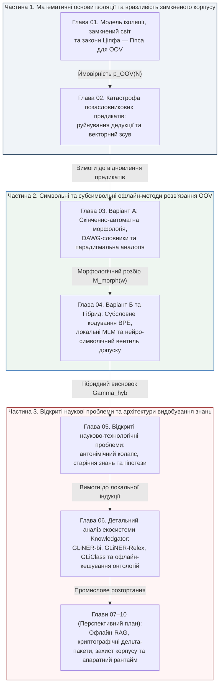

# Ізольовані експертні системи: Математичні моделі замкнених корпусів знань, офлайн-розв'язання позасловникової невизначеності та гарантованого виведення без зовнішніх мереж

> **Автор:** Георгій Федчик  
> **Мова оригіналу:** Українська  
> **Статус документа:** Генеральний план та архітектурний паспорт наукової монографії

---

## 1. Предметна область та термінологічна класифікація

У критичній інфраструктурі, оборонній промисловості, атомній енергетиці, банківському секторі та медицині дедалі більша частка інтелектуальних систем експлуатується в умовах **повної фізичної та логічної ізоляції від глобальної мережі Інтернет**. Такі системи не мають доступу до зовнішніх хмарних прикладних програмних інтерфейсів, пошукових систем чи надвеликих віддалених мовних моделей і вимушені здійснювати логічне виведення виключно над фіксованим локальним корпусом нормативних документів та на обмежених обчислювальних ресурсах.

У сучасній комп'ютерній науці, інженерії знань та комп'ютерній лінгвістиці цей клас систем описується системою взаємопов'язаних термінів залежно від архітектурного та математичного виміру.

**Таблиця 0.1.** Багатовимірна класифікація ізольованих та корпусно-обмежених експертних систем.

| Вимір класифікації | Канонічний український термін | Міжнародний науковий еквівалент | Математичний та інженерний зміст обмеження |
| :--- | :--- | :--- | :--- |
| **1. Фізична та мережева ізоляція** | **Повністю ізольована система («повітряний проміжок»)** | *Air-Gapped Expert System* | Відсутність неавторизованих потоків між системою та зовнішніми мережами; обмін можливий лише контрольованими каналами — запити оператора, підписані пакети оновлень і імпорт ваг моделей через шлюз допуску (модель контрольованих каналів, формула 1.1). |
| **1. Фізична та мережева ізоляція** | **Автономна самодостатня система** | *Isolated / Standalone Expert System* | Система виконує всі етапи токенізації, парсингу, пошуку та дедукції локально без жодних викликів зовнішніх вебсервісів. |
| **2. Архітектура розгортання** | **Локальна (внутрішньопериметрова) експертна система** | *On-Premise / Self-Hosted Expert System* | Розгортання на власних локальних серверах організації; оновлення баз знань і словників можливе лише дискретними верифікованими пакетами. |
| **2. Архітектура розгортання** | **Замкнена корпоративна інтелектуальна система** | *Closed-Loop Private Corporate System* | Обробляє виключно внутрішні регламенти та телеметрію підприємства в межах захищеного периметра безпеки. |
| **3. Специфіка даних та домену** | **Корпусно-обмежена (замкнена на корпусі) система** | *Corpus-Bound / Data-Confined Expert System* | Універсум знань системи вичерпується скінченним корпусом документів $`\mathcal{K}_0`$ обсягом $`N < \infty`$ токенів; твердження, що не виводиться з $`\mathcal{K}_0`$, отримує статус «недоведено», а не «хибно». |
| **3. Специфіка даних та домену** | **Вузькодоменна експертна система** | *Closed-Domain / Narrow-Domain System* | Словник $`V(\mathcal{K}_0)`$ і онтологія обмежені термінологією однієї спеціалізованої предметної галузі. |
| **4. Лінгвістична та лексична вразливість** | **Проблема слів поза словником (позасловникова невизначеність)** | *Out-of-Vocabulary (OOV) Problem* | Поява у вхідному запиті або новому документі лексеми чи словоформи $`w \notin V(\mathcal{K}_0)`$, відсутньої в індексованому словнику. |
| **4. Лінгвістична та лексична вразливість** | **Розрідженість даних і неповнота знань** | *Data Sparsity & Knowledge Incompleteness* | Наслідок законів Ціпфа та Гіпса в скінченному корпусі: значна частка морфологічних форм дієслів і рідкісних термінів має нульову частоту в $`\mathcal{K}_0`$. |

Узагальнюючим науковим терміном для цього класу систем є **«Ізольована корпусно-обмежена вузькодоменна експертна система»** (*Air-Gapped Corpus-Bound Closed-Domain Expert System*).

---

## 2. Історична генеза та математичний фундамент (1949–2026 рр.)

Теорія ізольованих експертних систем сформувалася на перетині чотирьох класичних математичних дисциплін: моделей безпеки інформаційних потоків, квантитативної лінгвістики скінченних корпусів, скінченно-автоматної морфології та субсимвольної дистрибутивної семантики.

**Таблиця 0.2.** Історична еволюція математичного апарату ізольованих експертних систем.

| Етап | Період | Ключові вчені та праці | Внесок у теорію ізольованих систем | Виявлене обмеження |
| :-: | :---: | :--- | :--- | :--- |
| **I** | **1949–1978** | Дж. Ціпф (1949), Б. Мандельброт (1953), Г. Хердан (1960), Г. Гіпс (1978), Р. Рейтер (1978) | Закон розподілу частот слів Ціпфа — Мандельброта; емпіричний степеневий закон росту словника Хердана — Гіпса ($`\lvert V(N) \rvert = K N^\beta`$); припущення замкненого світу (*Closed-World Assumption*, CWA) Рейтера | За моделлю Гіпса ймовірність появи нових слів ($`p_{\mathrm{OOV}} > 0`$) залишається ненульовою при будь-якому скінченному обсязі корпусу $`N`$; CWA виводить хибність недоведеного, що небезпечно для неповного корпусу |
| **II** | **1973–1982** | Д. Белл і Л. ЛаПадула (1973), К. Біба (1977), Дж. Гоген і Х. Месегер (1982) | Мандатні моделі керування доступом (*Bell–LaPadula*, *Biba Integrity*) та означення політики невтручання (*Non-Interference*) | Формалізують політики доступу, але не описують контрольованого імпорту оновлень і не виключають прихованих каналів; реальна ізоляція регламентується галузевими нормами (IEC 62443, NRC RG 5.71, IAEA NSS 17-T) |
| **III** | **1968–2002** | Дж. Ловінс (1968), К. Д. Джонсон (1972), М. Портер (1980), К. Коскенніємі (1983), Р. Каплан і М. Кей (1994), М. Морі (1997), Я. Дацюк та ін. (2000), К. Шульц і С. Міхов (2002) | Регулярність правил переписування (Джонсон; Каплан і Кей), дворівнева морфологія Коскенніємі, зважені трансдьюсери Морі (`WFST`), мінімальні ациклічні словникові автомати (`DAWG`) та автомати Левенштейна | Символьна морфологія надійно зводить словникові словоформи до відомих коренів, але не визначає семантики нових запозичень і неологізмів, а для невідомих коренів дає лише ймовірнісне передбачення тегів |
| **IV** | **1994–2019** | Ф. Гейдж (1994), Р. Сеннріх (2016), П. Бояновські (`FastText`, 2017), Т. Кудо (2018), Дж. Девлін (`BERT`, 2019) | Субсловна токенізація `BPE`, `WordPiece`, `Unigram LM`; композиційні символьні $`n`$-грамні ембедінги та локальне масковане мовне моделювання (`MLM`) | Усувають синтаксичний `OOV` на рівні підслів, але породжують семантичні галюцинації та змішування антонімів у малих замкнених корпусах |
| **V** | **2020–2026** | У. Заратіана та ін. (`GLiNER`, 2024), І. Степанов, М. Штопко та ін. (`Knowledgator`: `GLiClass`, 2025; `GLiNER-bi`, 2026), Р. Ель-Янів | Локальні двоенкодерні архітектури видобування сутностей і відношень без навчання (`Zero-Shot IE`) з попереднім офлайн-кешуванням онтології (`Knowledgator`), гібридні схеми `WFST + BPE` та вентиль Чоу — Ель-Яніва | Потреба морфологічної інваріантності для флективних мов, оцінка деградації семантичної актуальності (*knowledge staleness*) та розрізнення антонімічних предикатів |

---

## 3. Дидактична архітектура монографії (Принцип систематичності і послідовності)

Монографія побудована за послідовним дидактичним ланцюгом (від моделі контрольованих каналів ізоляції та законів розрідженості скінченного корпусу — через символьні та субсимвольні офлайн-методи — до гібридного синтезу, відкритих наукових проблем та промислових двоенкодерних архітектур видобування знань):

$$
\underbrace{\text{Ізоляція та закон Гіпса}}_{\text{Глава 01}} \longrightarrow \underbrace{\text{Вплив OOV на логіку}}_{\text{Глава 02}} \longrightarrow \underbrace{\text{Символьна морфологія (Варіант А)}}_{\text{Глава 03}} \longrightarrow \underbrace{\text{Субслова, MLM і Гібрид (Варіант Б + А)}}_{\text{Глава 04}} \longrightarrow \underbrace{\text{Відкриті проблеми та гіпотези}}_{\text{Глава 05}} \longrightarrow \underbrace{\text{Двоенкодерні системи Knowledgator}}_{\text{Глава 06}}
$$

Наскрізним математичним об'єктом книги є **п'ятикомпонентний вектор стану ізольованої експертної системи** $`\Xi(\mathcal{K}_0, q)`$:

$$
\Xi(\mathcal{K}_0, q) = \left\langle \mathcal{I}_{\mathrm{sec}}, \ p_{\mathrm{OOV}}(N), \ \mathcal{M}_{\mathrm{morph}}(w), \ \mathbf{z}_{\mathrm{sub}}(w \mid C), \ \Gamma_{\mathrm{hyb}}(q, \mathcal{K}_0) \right\rangle
$$

---

## 4. Центральна інженерна гіпотеза та протокол її експериментальної перевірки

### 4.1. Формулювання інженерної гіпотези

> **Центральна інженерна гіпотеза монографії:**
> В ізольованій корпусно-обмеженій експертній системі з контрольованими каналами обміну (формула 1.1) **гібридний нейро-символічний офлайн-тракт** (поєднання скінченно-автоматного морфологічного трансдьюсера `WFST`/`DAWG` для граматичної лематизації та валентної типізації предикатів із субсловним кодуванням `BPE`/символьними $`n`$-грамами, калібруванням і селективним вентилем відмови Чоу — Ель-Яніва):
> 1. Збільшує частку успішно побудованих багатоходових дедуктивних ланцюжків на запитах із новими дієслівними словоформами щонайменше у **2,5–4,0 рази** порівняно із суто символьним точним словниковим пошуком (`B1`);
> 2. Знижує частоту хибних предикатних підстановок (семантичних галюцинацій на найближчих сусідах у розрідженому просторі ембедінгів) щонайменше на **порядок величини** порівняно із суто нейромережевим субсловним відображенням без морфологічного та селективного контролю (`B3`);
> 3. Утримує латентність розбору на центральному процесорі в межах **одиниць мілісекунд** і споживання оперативної пам'яті в межах **десятків мегабайтів** без звернення до зовнішніх мереж.

### 4.2. Базові архітектури для порівняння

- **`B1` (Strict Exact-Lexicon Symbolic System):** класична продукційна експертна система з фіксованим словником точних форм або простих основ без морфологічного автомата та без субсловних векторів.
- **`B2` (Pure Rule-Based Morphological Stemmer / FST — Варіант А):** система з локальним морфологічним аналізатором (`Porter` / `DAWG` / `WFST`), яка відновлює граматичні ознаки та відомі корені, але не має дистрибутивного контекстного модуля для синонімічних чи позакореневих заміщень.
- **`B3` (Pure Subsymbolic BPE + Nearest-Embedding Matcher — Варіант Б без символьного контролю):** локальна нейромережева модель із `BPE`-токенізацією, яка примусово відображає кожне невідоме слово на найближчий за косинусною близькістю предикат онтології без перевірки частиномовної валентності та порогу відмови.
- **`B4` (Proposed Hybrid Neuro-Symbolic Offline Architecture — Гібрид А + Б із вентилем селективної відмови):** композиція `WFST`-морфології, перевіреного лексикону валентності й полярності, субсловного/контекстного векторного оцінювання, калібрування та порогу селективної класифікації.

### 4.3. Експериментальний протокол верифікації

1. **Експеримент `E1` (Стійкість логічного ланцюжка при контрольованій частці OOV-дієслів):** вимірювання ймовірності успішного виведення $`P_{\mathrm{chain}}(L)`$ для глибини правил $`L \in \{1, 2, 3, 5\}`$ при частці морфологічних та лексичних інновацій $`\eta_{\mathrm{OOV}} \in [0{,}01; \ 0{,}25]`$ для архітектур `B1`–`B4`.
2. **Експеримент `E2` (Частота семантичного зсуву та антонімічних галюцинацій):** подача контрольної вибірки позасловникових та антонімічних дієслів (наприклад, *«деактивувати»* vs *«активувати»*, *«розблоковуватиметься»* vs *«блокуватиметься»*) та вимірювання частоти хибного спрацювання правил безпеки (*False Predicate Activation Rate*, `FPAR`).
3. **Експеримент `E3` (Апаратна ефективність в ізольованому середовищі):** вимірювання пікового споживання оперативної пам'яті (МБ), розміру образу на диску та 99-го перцентиля часу обробки запиту на локальному процесорі без графічного прискорювача.
4. **Експеримент `E4` (Крива селективного покриття та ризику — Risk-Coverage Curve):** побудова залежності залишкової похибки від частки прийнятих запитів при варіації порогу впевненості $`\tau_{\mathrm{reject}}`$ за теорією Ель-Яніва.
5. **Експеримент `E5` (Калібрування та навантаження на оператора):** вимірювання якості калібрування оцінок (діаграма надійності), частки відмов $`\bot_{\mathrm{OOV}}`$ і хибних відмов вентиля `2oo2` на зміну та часу, який оператор витрачає на запити уточнення.

> [!IMPORTANT]
> **Статус гібридної гіпотези та вимоги до перевірки**
> 1. Числові пороги гіпотези (2,5–4,0 рази, порядок величини) є цільовими значеннями, а не отриманими результатами: відкритого розміченого тестового корпусу для їхньої перевірки поки немає, а числа в главах 01–06 є навчальними ілюстраціями або результатами малого пілотного стенда.
> 2. Для перевірки потрібні корпус запитів і документів цільової галузі, інструкція з розмітки, оцінка узгодженості анотаторів (наприклад, $`\kappa`$ Коена), звітування частот із довірчими інтервалами (наприклад, Вілсона) і окремі набори для заперечень, модальності, умов і чисел з одиницями.
> 3. Відмови мовного компонента мають бути пов'язані з аналізом небезпек установки (`HAZOP`, `STPA`) і галузевими нормами (для АЕС — IEC 61513, IEC 60880, IEC 62138); кваліфікація компонентів машинного навчання за цими нормами залишається відкритим питанням (Глава 05, розділ 2.3).

---

## 5. Поглавний план монографії (Глави 01–10)

### Частина 1. Математичні основи ізоляції та вразливість замкненого корпусу (Повні базові глави)
1. **[Глава 01. Модель ізоляції, припущення замкненого світу та квантитативні закони позасловникової невизначеності](ch01-isolation-models-closed-world-and-oov-laws.md)**
   - Таксономія ізольованих систем (*air-gapped*, *on-premise*, *corpus-bound*, *closed-domain*).
   - Модель контрольованих каналів ізоляції (формула 1.1); політика невтручання Гогена — Месегера та моделі Белла — ЛаПадули і Біби як аналогії; відмінність припущення замкненого світу Рейтера (`CWA`) від стратегії відмови.
   - Закон Ціпфа — Мандельброта та степеневий закон Хердана — Гіпса ($`\lvert V(N) \rvert = K N^\beta`$); межі співвідношення $`\beta = 1/s`$.
   - **Модель 1.1 (Наближення інтенсивності позасловникових слів і частки слів-одинаків у замкненому корпусі):** наближення $`p_{\mathrm{OOV}}(N) \approx \beta K N^{\beta - 1}`$ за моделлю Гіпса, асимптотична частка слів-одинаків (*hapax legomena*) та межі застосування до запитів оператора.
2. **[Глава 02. Катастрофа позасловникових предикатів у нейро-символічних системах: руйнування дедукції та векторний зсув](ch02-oov-catastrophe-logic-collapse-and-semantic-drift.md)**
   - Формалізація трьох механізмів руйнування ізольованої системи при появі невідомого дієслова: (а) обрив хорнівського ланцюжка виведення, (б) втрата зв'язності графа «суб'єкт — предикат — об'єкт», (в) семантичний зсув найближчого сусіда у розрідженому векторному просторі.
   - **Твердження 2.1 (Модель повного розбору тексту та наближена нижня межа семантичного зсуву):** $`P_{\mathrm{chain}}(L) = (1 - p_E)[(1 - p_V)(1 - p_E)]^L`$ за явних припущень і межа хибної підстановки через відстань $`\theta(p^*)`$ від істинного предиката до його найближчого сусіда.
   - Помилки розбору, небезпечніші за `OOV`: заперечення, модальність, умови, кореферентність, числа й одиниці.

### Частина 2. Символьні та субсимвольні офлайн-методи розв'язання позасловникової невизначеності (Повні базові глави)
3. **[Глава 03. Варіант А — Локальні морфологічні модулі: скінченно-автоматні трансдьюсери, словники основ і парадигмальна аналогія](ch03-symbolic-morphology-fst-and-paradigm-analogy.md)**
   - Алгоритми стеммінгу (Ловінс, Портер) проти повноцінної лематизації для високофлективних (слов'янських) мов.
   - Регулярність правил переписування (Джонсон; Каплан і Кей), дворівнева морфологія Коскенніємі та зважені скінченно-автоматні трансдьюсери Морі (`WFST`) над тропічним напівкільцем.
   - Мінімальні детерміновані ациклічні автомати слів (`DAWG`, Дацюк та ін., Коробов), що об'єднують спільні суфікси, та ймовірнісне передбачення за парадигмальною суфіксальною аналогією; багатозначність постфікса `-ся`.
   - Відкриті ресурси для української мови (ВЕСУМ / `dict_uk`, `pymorphy3`, UD Ukrainian-IU) та коди обладнання `KKS` / `RDS-PP`.
   - **Теорема 3.1 (Про лінійну часову складність $`\mathcal{O}(\lvert w \rvert)`$ та коефіцієнт стиснення морфологічного розбору на базі DAWG і про границю повноти префіксально-парадигмальної аналогії).**
4. **[Глава 04. Варіант Б та Гібридна архітектура: субсловна токенізація, локальні масковані моделі та нейро-символічний вентиль допуску](ch04-subsymbolic-bpe-local-mlm-and-hybrid-architecture.md)**
   - Інформаційно-теоретичний синтез словника підслів: алгоритми `BPE` (Гейдж, Сеннріх), максимізація правдоподібності `WordPiece` та `Unigram LM` (Кудо).
   - Композиційні символьні $`n`$-грамні ембедінги Бояновські (`FastText`) та локальне контекстне масковане моделювання (`MLM`).
   - Порівняльна аналітична матриця Варіанта А та Варіанта Б; синтез гібридного оператора $`\Gamma_{\mathrm{hyb}}`$.
   - Фільтр допустимості на основі перевіреного лексикону полярності й валентності та моделювання дій як переходів станів; імпорт попередньо навчених ваг через контрольований канал.
   - **Твердження 4.1 (Умови, за яких гібридний оператор не гірший за чисті Варіанти А і Б):** перенормування підвищує впевненість усіх кандидатів, тому перед порогом Чоу потрібне калібрування; порівняння з варіантом «Б + поріг».
   - Теорія N-версійного програмування (Авізієніс — Чен, 1977), коваріаційний розклад Екгардта — Лі (1985) та експеримент Найта — Левесон (1986).
   - **Твердження 4.2 (Від'ємна коваріація помилок у моделі ідеального символьного каналу):** умова $`\varepsilon q_{\mathrm{reg}} < (\beta - \varepsilon) q_{\mathrm{ant}}`$ та ціна кон'юнктивного вентиля `2oo2` у вигляді хибних відмов.

### Частина 3. Відкриті наукові проблеми та прикладні архітектури видобування знань (Повні глави 05–06 + план Глав 07–10)
5. **[Глава 05. Відкриті науково-технологічні проблеми ізольованих експертних систем та дослідницькі гіпотези](ch05-open-scientific-problems-and-research-hypotheses.md)**
   - **Проблема 1:** Парадокс дистрибутивної близькості антонімів і ко-гіпонімів у локальних `MLM` (*Distributional Antonym Collapse*) — **Теорема 5.1**.
   - **Проблема 2:** Агресивна овер-сегментація рідкісних доменних термінів алгоритмами `BPE` та руйнування морфемних меж (*Morphological-Unaware Subword Fragmentation*).
   - **Проблема 3:** Епістемічне старіння знань (*Epistemic Staleness*) та семантичний дрейф між дискретними циклами оновлення ізольованого корпусу — **Модель 5.2**.
   - **Проблема 4:** Верифікація несуперечності та безпеки пакетів дельта-оновлень (`Air-Gap Delta-Patching`) перед імпортом у захищений периметр.
   - **Проблема 5:** Апаратні обмеження локальних обчислень (квантування ваг до `INT4`/`INT8` без втрати точності рідкісних предикатів).
   - Зв'язок з аналізом небезпек (`HAZOP`, `STPA`), калібруванням і навантаженням на оператора.
   - **Чотири фальсифіковні дослідницькі гіпотези (Гіпотези 5.1–5.4).**
6. **[Глава 06. Детальний аналіз архітектур видобування знань Knowledgator: двоенкодерні моделі, офлайн-кешування онтологій та межі нульового навчання](ch06-knowledgator-zero-shot-ie-and-biencoder-architectures.md)**
   - Науково-інженерна еволюція стека `Knowledgator` (`https://www.knowledgator.com`, І. Степанов, М. Штопко та ін.): від універсальної класифікації токенів (`UTC`) до екосистеми `GLiNER`, `GLiNER-bi`, `GLiNER-Relex`, `GLiClass` та `GLiNKER`.
   - Математична модель спанового розпізнавання сутностей і предикатів без донавчання (*Zero-Shot Span & Relation Extraction*): квадратичне вузьке місце одноенкодерної конкатенації (`Uni-Encoder`) проти двоенкодерного розщеплення (`Bi-Encoder`) з попереднім офлайн-кешуванням векторів онтології.
   - **Теорема 6.1 (Про асимптотичне прискорення двоенкодерної архітектури з попереднім кешуванням онтології):** прискорення $`S_{\mathrm{bi}}(m, C) = \Theta(C)`$ при фіксованій довжині тексту $`m`$ відносно одноенкодерної схеми без пакетування та насичення на сталій відносно схеми з пакетуванням міток; підрахунок $`\approx 24 n d^2 + 4 n^2 d`$ `FLOPs` на шар.
   - Критичний аналіз меж застосовності суто субсимвольних моделей `Knowledgator` на позасловникових флективних дієсловах і безпрефіксних антонімах та архітектура їх інтеграції з морфологічним трансдьюсером `DAWG` (Глава 03) і каліброваним вентилем Чоу (Глава 04).
   - Попередній пілотний стенд ($`n = 15 \dots 16`$) з інтервалами Вілсона та явно названими обмеженнями.
7. **Глава 07 (План). Локальні гібридні індекси пошуку (лексичний інвертований індекс BM25 + квантований векторний індекс HNSW) без зовнішніх серверів.**
8. **Глава 08 (План). Криптографічно верифіковані пакети оновлення знань та інкрементальна перекомпіляція словникових автоматів.**
9. **Глава 09 (План). Стійкість ізольованих систем до троянського отруєння локального корпусу (Corpus Poisoning Defense).**
10. **Глава 10 (План). Проектування апаратно-програмних комплексів автономних експертних систем для критичної інфраструктури.**

---

## 6. Зведений термінологічний словник монографії

| Український термін | Англійський еквівалент | Канонічне визначення у монографії |
| :--- | :--- | :--- |
| **Ізольована експертна система («повітряний проміжок»)** | *Air-Gapped Expert System* | Експертна система, фізично та логічно відокремлена від зовнішніх мереж, у якій розбір запитів і дедуктивне виведення виконуються над локально збереженим корпусом $`\mathcal{K}_0`$, а обмін із середовищем іде лише контрольованими каналами (запити оператора, підписані пакети оновлень, імпорт ваг). |
| **Корпусно-обмежена система** | *Corpus-Bound System* | Система, база знань і лексикон якої вичерпуються скінченною множиною завантажених документів $`\mathcal{K}_0`$; будь-яке твердження поза $`\mathcal{K}_0`$ вважається недоведеним. |
| **Слово поза словником (ефект OOV)** | *Out-of-Vocabulary (OOV) Word* | Токен або словоформа $`w`$ у вхідному тексті, яка не належить до індексованого словника системи $`V(\mathcal{K}_0)`$. |
| **Скінченно-автоматний трансдьюсер** | *Finite-State Transducer (FST)* | Скінченний автомат із двома стрічками (поверхневою та лексичною), що здійснює двонаправлене відображення між словоформою та її канонічною лемою й граматичними тегами. |
| **Спрямований ациклічний граф слів** | *Directed Acyclic Word Graph (DAWG)* | Мінімізований детермінований скінченний автомат для компактного зберігання словника, у якому об'єднано стани зі спільними продовженнями (спільні суфікси та таблиці закінчень). |
| **Кодування пар байтів** | *Byte-Pair Encoding (BPE)* | Ітеративний алгоритм стиснення та субсловної токенізації, який послідовно об'єднує найчастотніші пари сусідніх символів або символьних послідовностей корпусу. |
| **Дистрибутивний колапс антонімів** | *Distributional Antonym Collapse* | Явище зближення векторних репрезентацій протилежних за змістом предикатів (наприклад, *«дозволити»* і *«заборонити»*) через схожість їхнього синтаксичного оточення в корпусі. |
| **Селективна класифікація з порогом відмови** | *Selective Classification with Abstention* | Математична схема прийняття рішень (Чоу — Ель-Янів), у якій система утримується від підстановки предиката і повертає формальну відмову $`\bot_{\mathrm{OOV}}`$, якщо калібрована оцінка впевненості нижча за поріг $`\tau_{\mathrm{reject}}`$. |
| **Ортогональне нейро-символічне N-версійне програмування** | *Orthogonal Neuro-Symbolic N-Version Programming* | Схема резервування з кон'юнктивним вентилем допуску над парадигмально різнорідними каналами (символьним автоматом `DAWG` та субсимвольним бі-енкодером), функції складності яких за умов Твердження 4.2 мають від'ємну коваріацію $`\mathbf{Cov}_X(\theta_{\mathrm{sym}}, \theta_{\mathrm{sub}}) < 0`$; ціною є зростання хибних відмов. |
