# Глава 01. Модель ізоляції, припущення замкненого світу та квантитативні закони позасловникової невизначеності

> **Автор:** Георгій Федчик  
> **Мова оригіналу:** Українська  
> **Дидактичний рівень:** Базовий (аксіоматика фізичної ізоляції, замкненість корпусу та статистичні закони розрідженості словника)

---

## Вступ

Сучасні хмарні мовні системи спираються на припущення про практично необмежений доступ до трильйонів токенів глобальної мережі Інтернет та про можливість динамічного підвантаження відсутніх знань через зовнішні пошукові сервіси. Проте для критичних галузей — атомної та теплової енергетики, авіакосмічного комплексу, оборонних систем керування, клінічної медицини та банківського ядра — підключення експертної системи до публічних мереж є категорично неприпустимим через загрози витоку державної чи комерційної таємниці, підміни зовнішніх відповідей та порушення суверенітету даних.

Унаслідок цього виникає фундаментальний клас **ізольованих корпусно-обмежених експертних систем** (*Air-Gapped Corpus-Bound Expert Systems*). Такі системи розгортаються виключно на локальному обладнанні (*on-premise*) без фізичного чи логічного зв'язку із зовнішнім світом (*air-gapped*) і оперують скінченним, заздалегідь завантаженим корпусом нормативно-технічної документації $`\mathcal{K}_0`$. Скінченність корпусу $`\mathcal{K}_0`$ неминуче породжує центральну лінгвістичну й алгоритмічну перешкоду для таких систем — **проблему слів поза словником** (*Out-of-Vocabulary*, `OOV`) та розрідженості знань (*Data Sparsity*). У цій першій главі ми введемо строгу таксономію ізольованих систем, формалізуємо умову інформаційного невтручання та доведемо фундаментальну теорему про асимптотичну неминучість появи позасловникових слів у будь-якому скінченному корпусі.

---

## 1. Архітектурна та лінгвістична класифікація ізольованих систем

Для точного математичного моделювання розмежуємо три ортогональні осі, за якими класифікуються автономні експертні системи:

```mermaid
flowchart LR
    subgraph Axis1["1. Вісь мережевої безпеки"]
        A1["Повністю ізольовані (Air-Gapped)<br/>Фізичний розрив каналів"]
        A2["Локальні периметрові (On-Premise)<br/>Внутрішня інфраструктура"]
        A3["Автономні вузлові (Standalone)<br/>Один обчислювальний модуль"]
    end

    subgraph Axis2["2. Вісь обмеження знань і даних"]
        B1["Корпусно-обмежені (Corpus-Bound)<br/>Фіксований корпус документів K_0"]
        B2["Вузькодоменні (Closed-Domain)<br/>Спеціалізована термінологія галузі"]
        B3["Локально-замкнені (Data-Confined)<br/>Заборона зовнішнього збагачення"]
    end

    subgraph Axis3["3. Вісь лінгвістичної вразливості"]
        C1["Ефект слів поза словником (OOV)<br/>Невідомі дієслова й терміни w ∉ V(K_0)"]
        C2["Морфологічна розрідженість<br/>Відсутність відмінкових і часових форм"]
    end

    Axis1 --> Axis2 --> Axis3

    style Axis1 fill:#f0f4f8,stroke:#334e68,stroke-width:1.5px
    style Axis2 fill:#eef6f0,stroke:#2b6cb0,stroke-width:1.5px
    style Axis3 fill:#fff5f5,stroke:#9b2c2c,stroke-width:1.5px
```

1. **За архітектурою розгортання та мережевою ізоляцією:**
   - **Повністю ізольовані системи («повітряний проміжок» — *Air-Gapped Expert Systems*):** фізично та гальванічно (або оптично через однонаправлені діоди даних) відокремлені від публічних мереж.
   - **Локальні внутрішньопериметрові системи (*On-Premise / Self-Hosted Expert Systems*):** функціонують на виділених серверах підприємства, де оновлення лінгвістичних словників та онтологій відбувається лише через дискретні криптографічно підписані пакети.
   - **Замкнені корпоративні системи (*Closed-Loop Private Systems*):** обробляють виключно внутрішні нормативні акти та телеметрію організації без звернення до зовнішніх хмарних API.
2. **За специфікою роботи з текстом та межами знань:**
   - **Корпусно-обмежені системи (*Corpus-Bound / Data-Confined Systems*):** універсум дискурсу системи обмежений скінченним корпусом текстів $`\mathcal{K}_0 = \{d_1, d_2, \dots, d_M\}`$ сумарною довжиною $`N`$ слововживань (токенів).
   - **Вузькодоменні системи (*Closed-Domain / Narrow-Domain Systems*):** словник $`V(\mathcal{K}_0)`$ і система продукційних правил охоплюють лише одну спеціалізовану інженерну, фінансову чи медичну дисципліну.

---

## 2. Математична модель ізоляції та канонічний вектор стану системи

Сформулюємо строгі математичні інваріанти, що відрізняють ізольовану корпусно-обмежену систему від відкритих мережевих систем.

### 2.1. Інформаційно-теоретична умова невтручання та замкненість світу

За теоремою **Джозефа Гогена та Хосе Месегера (1982)** про інформаційне невтручання (*Non-Interference*) [[1]](#src-1) та мандатними моделями безпеки **Девіда Белла — Леонарда ЛаПадули (1973)** [[2]](#src-2) і цілісності **Кеннета Бії (1977)** [[3]](#src-3), система задовольняє строгий інваріант «повітряного проміжку» ($`\mathcal{I}_{\mathrm{sec}} = 1`$), якщо для будь-якого вхідного запиту $`Q`$, локального корпусу $`\mathcal{K}_0`$ та зовнішнього інформаційного середовища $`E_{\mathrm{ext}}`$ виконуються дві умови:
1. **Конфіденційність (заборона витоку назовні — Bell–LaPadula `*`-property):** взаємна інформація Шеннона між потоком запитів $`Q`$ та спостережуваним станом зовнішньої мережі $`E_{\mathrm{ext}}`$ тотожно дорівнює нулю:

$$
I\left(Q, \mathcal{K}_0; \ E_{\mathrm{ext}}\right) = 0
$$

2. **Цілісність та автономність виведення (заборона підвантаження ззовні — Biba strict integrity):** вихідна відповідь експертної системи $`Y`$ є детермінованою функцією виключно локального корпусу $`\mathcal{K}_0`$ та вхідного запиту $`Q`$, тобто умовна взаємна інформація з будь-яким зовнішнім джерелом дорівнює нулю:

$$
I\left(Y; \ E_{\mathrm{ext}} \;\middle|\; Q, \mathcal{K}_0\right) = 0
$$

**Формула (1.1).** Двостороння інформаційно-теоретична аксіома фізично та логічно ізольованої (*air-gapped*) експертної системи.

На логічному рівні формула (1.1) індукує **релятивізоване припущення замкненого світу Рейтера (1978)** (*Corpus-Relativized Closed-World Assumption*, `CWA`) [[4]](#src-4): жоден факт або семантичне відношення $`R(a, b)`$, яке не виводиться дедуктивно з істинного вмісту локального корпусу $`\mathcal{K}_0`$, не може бути прийняте як доведене:

$$
\mathcal{K}_0 \not\vdash R(a, b) \implies \text{Статус}\left(R(a, b)\right) \in \left\{\text{Недоведено (Refusal)}, \ \bot_{\mathrm{OOV}}\right\}
$$

### 2.2. Канонічний п'ятикомпонентний вектор стану ізольованої експертної системи

Для наскрізного математичного опису роботи ізольованої системи над корпусом $`\mathcal{K}_0`$ при обробці запиту $`q = (w_1, w_2, \dots, w_m)`$ введемо **канонічний вектор стану ізольованої експертної системи** $`\Xi(\mathcal{K}_0, q)`$:

$$
\Xi(\mathcal{K}_0, q) = \left\langle \mathcal{I}_{\mathrm{sec}}, \ p_{\mathrm{OOV}}(N), \ \mathcal{M}_{\mathrm{morph}}(w), \ \mathbf{z}_{\mathrm{sub}}(w \mid C), \ \Gamma_{\mathrm{hyb}}(q, \mathcal{K}_0) \right\rangle
$$

**Формула (1.2).** Канонічний п'ятикомпонентний вектор стану ізольованої корпусно-обмеженої експертної системи, де:
1. $`\mathcal{I}_{\mathrm{sec}} \in \{0, 1\}`$ — булевий індикатор виконання аксіоми двосторонньої ізоляції (1.1) (розглядається в цій главі);
2. $`p_{\mathrm{OOV}}(N) \in (0, 1)`$ — апріорна ймовірність появи позасловникової словоформи $`w \notin V(\mathcal{K}_0)`$ у скінченному корпусі обсягом $`N`$ токенів (виводиться в розділі 3 цієї глави, а її руйнівний вплив на логіку досліджується в Главі 02);
3. $`\mathcal{M}_{\mathrm{morph}}(w) = \langle \ell(w), \tau_{\mathrm{POS}}(w), \mathcal{A}_{\mathrm{val}}(w) \rangle`$ — результат символьного морфологічного розбору слова $`w`$ локальним скінченним трансдьюсером: канонічна лема $`\ell`$, граматичні ознаки частини мови $`\tau_{\mathrm{POS}}`$ та синтаксична валентна рамка $`\mathcal{A}_{\mathrm{val}}`$ (Глава 03 — Варіант А);
4. $`\mathbf{z}_{\mathrm{sub}}(w \mid C) \in \mathbb{R}^d`$ — субсимвольний контекстно-субсловний вектор слова $`w`$, сконструйований із символьних $`n`$-грам / `BPE`-підслів та локальної маскованої моделі в реченнєвому контексті $`C`$ (Глава 04 — Варіант Б);
5. $`\Gamma_{\mathrm{hyb}}(q, \mathcal{K}_0)`$ — результуючий оператор гібридного нейро-символічного виведення з порогом селективної відмови Чоу — Ель-Яніва (Глава 04 та Глава 05).

---

## 3. Квантитативні закони скінченного корпусу та теорема про неминучість слів поза словником

Чому не можна просто «записати в локальний словник усі слова мови» і назавжди позбутися проблеми `OOV`? Відповідь дають фундаментальні закони квантитативної лінгвістики **Джорджа Ціпфа (1949)**, **Бенуа Мандельброта (1953)** [[5]](#src-5) та **Гарольда Гіпса (1978)** [[6]](#src-6).

Нехай усі унікальні словоформи (типи) корпусу $`V(\mathcal{K}_0)`$ впорядковані за спаданням їхньої частоти появи: ранг $`r = 1`$ має найчастіше слово, ранг $`r = 2`$ — друге за частотою і т. д. Тоді відносна частота слова рангу $`r`$ підпорядковується **закону Ціпфа — Мандельброта**:

$$
P(r) = \frac{C_{\mathrm{ZM}}}{(r + q_0)^s}, \qquad s \approx 1{,}0 \dots 1{,}2, \quad q_0 \ge 0
$$

Наслідком важкого степеневого хвоста розподілу Ціпфа — Мандельброта є **емпіричний та аналітичний закон Гіпса (Хердана — Гіпса)** [[6]](#src-6): обсяг унікального словника $`\lvert V(N) \rvert`$ як функція сумарної кількості токенів у корпусі $`N`$ не виходить на горизонтальну асимптоту, а необмежено зростає за степеневим законом:

$$
\lvert V(N) \rvert = K \cdot N^\beta, \qquad K > 0, \quad \beta = \frac{1}{s} \in (0{,}40; \ 0{,}65)
$$

**Формула (1.3).** Степеневий закон росту словника Гіпса залежно від обсягу корпусу $`N`$.

Важливо підкреслити фундаментальну різницю між аналітичними мовами (наприклад, англійською, де одне дієслово має 4–5 граматичних форм: *format, formats, formatted, formatting*) та синтетичними флективними мовами (зокрема українською, де одне дієслово з префіксальними дериватами налічує від $`M_{\mathrm{infl}} = 30`$ до $`120`$ особових, часових, видових і дієприкметникових словоформ: *форматувати, переформатовуватимемо, відформатований* тощо). У флективних мовах показник росту словника словоформ $`\beta`$ є суттєво вищим ($`\beta \approx 0{,}50 \dots 0{,}60`$), ніж у аналітичних ($`\beta \approx 0{,}40 \dots 0{,}45`$).

### Теорема 1.1 (Про асимптотичну неминучість позасловникових слів та інтенсивність лексичних інновацій у замкненому корпусі)

> **Формулювання теореми:**  
> Нехай локальний корпус ізольованої експертної системи $`\mathcal{K}_0`$ містить $`N`$ токенів, а ріст кількості унікальних словоформ $`\lvert V(N) \rvert`$ описується гладким асимптотичним законом Гіпса (1.3) із параметрами $`K > 0`$ та $`\beta \in (0, 1)`$ (що відповідає розподілу Ціпфа з показником $`s = 1/\beta > 1`$). Тоді:
> 1. Миттєва ймовірність $`p_{\mathrm{OOV}}(N)`$ того, що наступний ($`N+1`$-й) токен із тієї самої предметної області виявиться словом поза словником $`w \notin V(\mathcal{K}_0)`$, дорівнює швидкості приросту словника і визначається точною формулою:
>
> $$
> p_{\mathrm{OOV}}(N) = \frac{d\lvert V(N) \rvert}{dN} = \beta K \cdot N^{\beta - 1} = \beta \cdot \frac{\lvert V(N) \rvert}{N}
> $$
>
> **Формула (1.4).** Точна аналітична оцінка ймовірності появи позасловникового слова (`OOV`) у корпусі обсягом $`N`$.
> 2. Неповна оцінка Гуда — Тюрінга для ймовірності зустріти раніше не бачене слово збігається з часткою слів-одинаків (*hapax legomena* $`V_1(N)`$, що трапилися в корпусі рівно один раз), причому в режимі Ціпфа ($`s = 1/\beta`$) відношення кількості слів-одинаків до всього обсягу словника прямує до ненульової константи:
>
> $$
> \lim_{N \to \infty} \frac{V_1(N)}{\lvert V(N) \rvert} = \beta \in (0{,}40; \ 0{,}65)
> $$
>
> тобто в будь-якому замкненому корпусі від $`40\%`$ до $`65\%`$ усіх відомих системі слів трапляються лише по одному разу, а решта їхніх граматичних словоформ залишаються поза словником ($`\text{OOV}`$).

### Доведення Теореми 1.1

1. Розглянемо випадковий процес послідовного формування корпусу $`\mathcal{K}_0`$ довжиною $`N`$. Нехай $`\mathbb{I}_{\mathrm{new}}(k) \in \{0, 1\}`$ — індикаторна випадкова величина, яка дорівнює $`1`$, якщо $`k`$-й токен не зустрічався серед попередніх $`k-1`$ токенів. Тоді математичне сподівання обсягу словника після $`N`$ токенів становить $`\lvert V(N) \rvert = \sum_{k=1}^N \mathbb{P}(\mathbb{I}_{\mathrm{new}}(k) = 1)`$.
2. Переходячи до неперервної асимптотики при великих $`N`$ і диференціюючи степеневий закон Гіпса (1.3) за обсягом корпусу $`N`$, отримуємо ймовірність появи нового типу на кроці $`N`$:

$$
p_{\mathrm{OOV}}(N) = \mathbb{P}\left(w_{N+1} \notin V(\mathcal{K}_0)\right) = \frac{d}{dN}\left(K N^\beta\right) = \beta K N^{\beta - 1} = \beta \cdot \frac{K N^\beta}{N} = \beta \cdot \frac{\lvert V(N) \rvert}{N}
$$

3. З іншого боку, за класичною формулою **Ірвінга Гуда та Алана Тюрінга (1953)** [[7]](#src-7), сумарна ймовірність усіх подій, які мають нульову частоту у вибірці обсягу $`N`$, оцінюється відношенням кількості типів $`V_1(N)`$, що з'явилися рівно один раз (*hapax legomena*), до обсягу вибірки $`N`$:

$$
\hat{p}_{\mathrm{OOV}}^{\mathrm{GT}}(N) = \frac{V_1(N)}{N}
$$

4. Прирівнюючи асимптотичну швидкість росту словника (1.4) та оцінку Гуда — Тюрінга $`V_1(N)/N = \beta \lvert V(N) \rvert / N`$, негайно одержуємо $`V_1(N) / \lvert V(N) \rvert \to \beta`$. Оскільки $`0 < \beta < 1`$, функція $`p_{\mathrm{OOV}}(N) = \beta K N^{\beta-1}`$ спадає дуже повільно (за степеневим, а не експоненційним законом!): щоб зменшити частку позасловникових слів у 10 разів при $`\beta = 0{,}50`$, обсяг локального корпусу $`N`$ необхідно збільшити у $`10^{1/(1-\beta)} = 10^2 = 100`$ разів. ∎

---

## 4. Навчальний інженерний приклад: оцінка позасловникової вразливості ізольованої експертної системи енергоблока

Започаткуємо наскрізний інженерний приклад, який послідовно пройде через усі п'ять базових глав монографії.

### 4.1. Вихідні інженерні дані

На ізольованому сервері (*air-gapped on-premise server*, $`\mathcal{I}_{\mathrm{sec}} = 1`$) атомної електростанції розгорнуто вузькодоменну експертну систему технічного обслуговування та ремонту (`ТОР`) турбінного відділення:
1. **Обсяг локального замкненого корпусу регламентів та інструкцій $`\mathcal{K}_0`$:** $`N = 100\,000 = 10^5`$ слововживань (токенів), що відповідає приблизно $`400`$ сторінкам технічної документації українською мовою.
2. **Параметри закону Гіпса для нелематизованих словоформ української технічної мови:** через багату дієслівну та іменникову словозміну емпіричні коефіцієнти становлять $`K_{\mathrm{form}} = 35{,}0`$ та $`\beta_{\mathrm{form}} = 0{,}50`$.
3. **Параметри закону Гіпса після ідеальної морфологічної нормалізації (лематизації до канонічних основ):** коефіцієнти становлять $`K_{\mathrm{lem}} = 25{,}0`$ та $`\beta_{\mathrm{lem}} = 0{,}40`$.

### 4.2. Покроковий розрахунок

**Крок 1. Обчислення обсягу словника словоформ та ймовірності `OOV` без морфологічного модуля:**
Підставляємо $`N = 10^5`$, $`K_{\mathrm{form}} = 35{,}0`$ та $`\beta_{\mathrm{form}} = 0{,}50`$ у формули (1.3) та (1.4):

$$
\lvert V_{\mathrm{form}}(10^5) \rvert = 35{,}0 \times \left(10^5\right)^{0{,}50} = 35{,}0 \times 316{,}23 \approx 11\,068\text{ унікальних словоформ}
$$

$$
p_{\mathrm{OOV, form}}(10^5) = \beta_{\mathrm{form}} \cdot \frac{\lvert V_{\mathrm{form}}(10^5) \rvert}{N} = 0{,}50 \times \frac{11\,068}{100\,000} \approx 0{,}0553 \quad (5{,}53\%)
$$

Кількість слів-одинаків (*hapax legomena*) за Теоремою 1.1 становить:

$$
V_1(10^5) \approx 0{,}50 \times 11\,068 = 5\,534\text{ словоформи}
$$

Отже, без локального морфологічного аналізатора **кожне вісімнадцяте слово** ($`5{,}53\%`$) у запиті інженера-оператора (наприклад, дієслівна форма майбутнього часу *«перекомутовуватимуться»* або *«розгерметизовуватиметься»*, якої не було в такій граматичній формі в тексті інструкції) виявляється невідомим для системи (`OOV`)!

**Крок 2. Оцінка ефекту морфологічної лематизації:**
Якщо система зводить словоформи до канонічних лем ($`K_{\mathrm{lem}} = 25{,}0`$, $`\beta_{\mathrm{lem}} = 0{,}40`$), то при тому самому корпусі $`N = 10^5`$:

$$
\lvert V_{\mathrm{lem}}(10^5) \rvert = 25{,}0 \times \left(10^5\right)^{0{,}40} = 25{,}0 \times 100{,}0 = 2\,500\text{ унікальних лем}
$$

$$
p_{\mathrm{OOV, lem}}(10^5) = 0{,}40 \times \frac{2\,500}{100\,000} = 0{,}0100 \quad (1{,}00\%)
$$

Імовірність `OOV` знижується з $`5{,}53\%`$ до $`1{,}00\%`$ (у $`5{,}53`$ раза!), проте все одно залишається ненульовою ($`1\%`$) через появу нових префіксальних утворень, рідкісних галузевих термінів і синонімів. До яких саме катастрофічних наслідків призводить ця ймовірність $`p_{\mathrm{OOV}}`$ під час логічного виведення у нейро-символічній системі — ми строго доведемо в наступній [Главі 02](ch02-oov-catastrophe-logic-collapse-and-semantic-drift.md).

---

## Висновки

1. Ізольовані корпусно-обмежені експертні системи (*Air-Gapped Corpus-Bound Expert Systems*) функціонують за строгої умови двостороннього інформаційного невтручання $`I(Q, \mathcal{K}_0; E_{\mathrm{ext}}) = 0`$ та релятивізованого припущення замкненого світу Рейтера відносно скінченного локального корпусу $`\mathcal{K}_0`$.
2. За законами Ціпфа — Мандельброта та Гіпса в будь-якому скінченному корпусі обсягом $`N`$ частка слів-одинаків (*hapax legomena*) становить $`40\% \dots 65\%`$ словника, а ймовірність появи позасловникової словоформи визначається формулою $`p_{\mathrm{OOV}}(N) = \beta K N^{\beta-1}`$ (Теорема 1.1).
3. У синтетичних флективних мовах (зокрема українській) морфологічна комбінаторика дієслівних префіксів, суфіксів та флексій збільшує імовірність поверхневого `OOV` у $`4\dots 6`$ разів порівняно з рівнем базових лем.

---

## Словник

| Термін | Англійський еквівалент | Визначення |
| :--- | :--- | :--- |
| **Інформаційне невтручання** | *Non-Interference* | Властивість безпеки автомата (Гоген — Месегер), за якої дії або входи одного домену безпеки не мають жодного впливу на спостережувані виходи іншого домену. |
| **Закон Гіпса (Хердана — Гіпса)** | *Heaps' Law* | Степеневий закон зростання кількості унікальних слів у словнику $`\lvert V(N) \rvert = K N^\beta`$ зі збільшенням загального обсягу тексту $`N`$. |
| **Слово-одинак (гапакс)** | *Hapax Legomenon* | Слово або словоформа, яка зустрічається у всьому досліджуваному корпусі текстів рівно один раз ($`f = 1`$). |
| **Припущення замкненого світу** | *Closed-World Assumption (CWA)* | Логічний принцип (Рейтер, 1978), згідно з яким будь-яке атомарне твердження, що не може бути доведене з наявної бази знань, вважається хибним або недопустимим. |

---

## Список позначень та скорочень

- **Абревіатури:**
  - `CWA` (*Closed-World Assumption*) — припущення замкненого світу.
  - `OOV` (*Out-of-Vocabulary*) — слово поза словником (позасловникова одиниця).
  - `ТОР` — технічне обслуговування та ремонт.
- **Математичні символи:**
  - $`\mathcal{K}_0`$ — локальний замкнений корпус документів.
  - $`N`$ — сумарна кількість слововживань (токенів) у корпусі $`\mathcal{K}_0`$.
  - $`\lvert V(N) \rvert`$ — потужність словника (кількість унікальних типів слів).
  - $`p_{\mathrm{OOV}}(N)`$ — імовірність появи позасловникового слова на кроці $`N+1`$.
  - $`\Xi(\mathcal{K}_0, q)`$ — канонічний п'ятикомпонентний вектор стану ізольованої експертної системи.

---

## Бібліографія

1. **Goguen J. A., Meseguer J.** Security Policies and Security Models // *Proceedings of the 1982 IEEE Symposium on Security and Privacy*. — Oakland, CA: IEEE, 1982. — P. 11–20.
2. **Bell D. E., LaPadula L. J.** Secure Computer Systems: Mathematical Foundations : Technical Report MTR-2547, Vol. I. — Bedford, MA : MITRE Corporation, 1973.
3. **Biba K. J.** Integrity Considerations for Secure Computer Systems : Technical Report MTR-3153. — Bedford, MA : MITRE Corporation, 1977.
4. **Reiter R.** On Closed World Data Bases // *Logic and Data Bases* / ed. by H. Gallaire, J. Minker. — Boston, MA : Springer, 1978. — P. 55–76.
5. **Mandelbrot B.** An Informational Theory of the Statistical Structure of Language // *Communication Theory* / ed. by W. Jackson. — London : Butterworths, 1953. — P. 486–502.
6. **Heaps H. S.** Information Retrieval: Computational and Theoretical Aspects. — Orlando, FL : Academic Press, 1978. — 344 p.
7. **Good I. J.** The Population Frequencies of Species and the Estimation of Population Parameters // *Biometrika*. — 1953. — Vol. 40, No. 3–4. — P. 237–264.
