# Глава 01. Модель ізоляції, припущення замкненого світу та квантитативні закони позасловникової невизначеності

> **Автор:** Георгій Федчик  
> **Мова оригіналу:** Українська  
> **Дидактичний рівень:** Базовий (модель контрольованих каналів ізоляції, замкненість корпусу та статистичні закони розрідженості словника)

---

## Вступ

Сучасні хмарні мовні системи спираються на припущення про практично необмежений доступ до трильйонів токенів глобальної мережі Інтернет та про можливість динамічного підвантаження відсутніх знань через зовнішні пошукові сервіси. Проте для критичних галузей — атомної та теплової енергетики, авіакосмічного комплексу, оборонних систем керування, клінічної медицини та банківського ядра — підключення експертної системи до публічних мереж зазвичай неприпустиме через загрози витоку державної чи комерційної таємниці, підміни зовнішніх відповідей та порушення суверенітету даних.

Унаслідок цього виникає окремий клас **ізольованих корпусно-обмежених експертних систем** (*Air-Gapped Corpus-Bound Expert Systems*). Такі системи розгортаються на локальному обладнанні (*on-premise*) без неконтрольованого зв'язку із зовнішнім світом і оперують скінченним, заздалегідь завантаженим корпусом нормативно-технічної документації $`\mathcal{K}_0`$. Зовнішня інформація все ж потрапляє всередину — через запити оператора, підписані пакети оновлень і імпортовані ваги моделей, — але лише через явно дозволені й перевірені канали. Скінченність корпусу $`\mathcal{K}_0`$ породжує центральну лінгвістичну й алгоритмічну перешкоду для таких систем — **проблему слів поза словником** (*Out-of-Vocabulary*, `OOV`) та розрідженості знань (*Data Sparsity*). У цій першій главі введено таксономію ізольованих систем, сформульовано модель контрольованих каналів обміну інформацією та на основі закону Гіпса пояснено, чому поява позасловникових слів у скінченному корпусі неминуча і як оцінити її інтенсивність.

---

## 1. Архітектурна та лінгвістична класифікація ізольованих систем

Для точного математичного моделювання розмежуємо три ортогональні осі, за якими класифікуються автономні експертні системи:

```mermaid
flowchart LR
    subgraph Axis1["1. Вісь мережевої безпеки"]
        A1["Повністю ізольовані (Air-Gapped)<br/>Фізичний розрив каналів"]
        A2["Локальні периметрові (On-Premise)<br/>Внутрішня інфраструктура"]
        A3["Автономні вузлові (Standalone)<br/>Один обчислювальний модуль"]
    end

    subgraph Axis2["2. Вісь обмеження знань і даних"]
        B1["Корпусно-обмежені (Corpus-Bound)<br/>Фіксований корпус документів K_0"]
        B2["Вузькодоменні (Closed-Domain)<br/>Спеціалізована термінологія галузі"]
        B3["Локально-замкнені (Data-Confined)<br/>Заборона зовнішнього збагачення"]
    end

    subgraph Axis3["3. Вісь лінгвістичної вразливості"]
        C1["Ефект слів поза словником (OOV)<br/>Невідомі дієслова й терміни w ∉ V(K_0)"]
        C2["Морфологічна розрідженість<br/>Відсутність відмінкових і часових форм"]
    end

    Axis1 --> Axis2 --> Axis3

    style Axis1 fill:#f0f4f8,stroke:#334e68,stroke-width:1.5px
    style Axis2 fill:#eef6f0,stroke:#2b6cb0,stroke-width:1.5px
    style Axis3 fill:#fff5f5,stroke:#9b2c2c,stroke-width:1.5px
```

1. **За архітектурою розгортання та мережевою ізоляцією:**
   - **Повністю ізольовані системи («повітряний проміжок» — *Air-Gapped Expert Systems*):** фізично та гальванічно відокремлені від публічних мереж; дозволений обмін іде лише контрольованими каналами, наприклад через однонаправлені діоди даних або перевірені носії.
   - **Локальні внутрішньопериметрові системи (*On-Premise / Self-Hosted Expert Systems*):** функціонують на виділених серверах підприємства, де оновлення лінгвістичних словників та онтологій відбувається лише через дискретні криптографічно підписані пакети.
   - **Замкнені корпоративні системи (*Closed-Loop Private Systems*):** обробляють виключно внутрішні нормативні акти та телеметрію організації без звернення до зовнішніх хмарних API.
2. **За специфікою роботи з текстом та межами знань:**
   - **Корпусно-обмежені системи (*Corpus-Bound / Data-Confined Systems*):** універсум дискурсу системи обмежений скінченним корпусом текстів $`\mathcal{K}_0 = \{d_1, d_2, \dots, d_M\}`$ сумарною довжиною $`N`$ слововживань (токенів).
   - **Вузькодоменні системи (*Closed-Domain / Narrow-Domain Systems*):** словник $`V(\mathcal{K}_0)`$ і система продукційних правил охоплюють лише одну спеціалізовану інженерну, фінансову чи медичну дисципліну.

---

## 2. Математична модель ізоляції та канонічний вектор стану системи

Ізольованість системи потрібно описати так, щоб подальша математика спиралася на перевірювані припущення, а не на недосяжну абсолютну замкненість. Нижче сформульовано модель, яка фіксує, які саме потоки інформації дозволені і що з цього випливає для логічного виведення.

### 2.1. Модель контрольованих каналів і припущення замкненого світу

Буквальна вимога «жодної інформації ззовні» суперечила б призначенню експертної системи: корпус $`\mathcal{K}_0`$ описує реальний фізичний об'єкт, оператор запитує про його поточний стан, а оновлення документації, словників і ваг моделей за визначенням приходять ззовні. Навіть однонаправлений діод даних не усуває інформаційний зв'язок — він лише робить його контрольованим. Тому інженерно коректною є **модель контрольованих каналів**: перелічуються дозволені канали, а всі інші потоки заборонено.

Нехай $`S`$ — експертна система, $`E_{\mathrm{ext}}`$ — зовнішнє середовище, а $`\mathcal{C}_{\mathrm{auth}} = \{c_{\mathrm{op}}, c_{\mathrm{upd}}, c_{\mathrm{wt}}\}`$ — множина авторизованих каналів: $`c_{\mathrm{op}}`$ — запит і відповідь оператора, $`c_{\mathrm{upd}}`$ — підписані пакети оновлення корпусу, словників і онтології, $`c_{\mathrm{wt}}`$ — імпорт попередньо навчених ваг моделей. Шлюз допуску $`G(\pi) \in \{0, 1\}`$ приймає пакет $`\pi`$ лише тоді, коли перевірено підпис, збіг хешу з маніфестом і пройдено регресійні тести. Система задовольняє інваріант ізоляції ($`\mathcal{I}_{\mathrm{sec}} = 1`$), якщо:

$$
\mathcal{I}_{\mathrm{sec}} = 1 \iff \mathrm{Flows}(S, E_{\mathrm{ext}}) \subseteq \mathcal{C}_{\mathrm{auth}} \ \land \ \left( \mathcal{K}_{t+1} = \mathcal{K}_t \oplus \pi \implies G(\pi) = 1 \right) \ \land \ Y = f(Q, \mathcal{K}_t)
$$

**Формула (1.1).** Модель контрольованих каналів ізольованої експертної системи, де:
1. $`\mathrm{Flows}(S, E_{\mathrm{ext}})`$ — множина фактичних каналів обміну між системою і середовищем; умова вимагає відсутності неавторизованих потоків (мережевих з'єднань, неконтрольованих носіїв, прихованих каналів);
2. $`\mathcal{K}_t`$ — знімок бази знань між оновленнями, $`\oplus`$ — застосування пакета; стан знань змінюється лише через пакети, що пройшли шлюз $`G`$;
3. $`Y = f(Q, \mathcal{K}_t)`$ — відповідь визначається лише запитом і поточним знімком, тобто система відтворювана: той самий запит до того самого знімка дає ту саму відповідь.

Модель не доводить безпеку, а фіксує, що саме мусить забезпечити фізична й організаційна реалізація. Ранні редакції цієї глави подавали ізоляцію як дві інформаційно-теоретичні умови: $`I(Q, \mathcal{K}_0; E_{\mathrm{ext}}) = 0`$ та $`I(Y; E_{\mathrm{ext}} \mid Q, \mathcal{K}_0) = 0`$. Перша умова є ідеалізацією, яка буквально не виконується, бо корпус і запити несуть інформацію про реальний об'єкт; змістовною вона стає лише як вимога нульового потоку через **неавторизовані** канали. Друга умова тривіально виконується для будь-якої детермінованої функції $`Y = f(Q, \mathcal{K}_0)`$ і означає лише детермінованість відносно знімка, а не властивість безпеки. Саме тому у (1.1) її записано як вимогу відтворюваності.

Класичні моделі безпеки використано тут як аналогії, а не як теореми, з яких випливає (1.1). **Джозеф Гоген і Хосе Месегер (1982)** [[1]](#src-1) дали *означення* політики невтручання (*Non-Interference*): дії одного домену не впливають на спостережувані виходи іншого; перевірка цієї властивості для конкретної системи є окремою задачею. Модель **Девіда Белла — Леонарда ЛаПадули (1973)** [[2]](#src-2) з правилом `*`-property і модель цілісності **Кеннета Біби (1977)** [[3]](#src-3) є моделями керування доступом із мітками суб'єктів і об'єктів; вони не зводяться до нульової взаємної інформації, бо не виключають прихованих каналів. Канал $`c_{\mathrm{upd}}`$ разом зі шлюзом $`G`$ відповідає «довіреному суб'єкту» моделі Біби, що підвищує рівень цілісності даних лише після перевірки.

Реальні засоби ізоляції — зони й канали (*zones and conduits*), однонаправлені шлюзи, контроль змінних носіїв — регламентуються галузевими нормами, зокрема серією IEC 62443 [[10]](#src-10), настановою NRC RG 5.71 [[11]](#src-11) і документом МАГАТЕ NSS 17-T [[12]](#src-12). Їхні вимоги в цій книзі не відтворюються і перебувають поза її обсягом; модель (1.1) лише фіксує припущення, на які спираються подальші розрахунки.

На логічному рівні слід розрізняти **припущення замкненого світу Рейтера (1978)** (*Closed-World Assumption*, `CWA`) [[4]](#src-4) і стратегію відмови, яку використовує ця книга. За CWA недоведене атомарне твердження вважається **хибним**:

$$
\text{CWA:} \quad \mathcal{K}_0 \not\vdash R(a, b) \implies \mathcal{K}_0 \vdash_{\mathrm{CWA}} \lnot R(a, b)
$$

Для неповного технічного корпусу це небезпечно: відсутність у регламенті згадки про те, що засувку відкрито, не означає, що її закрито. Тому за замовчуванням застосовується **стратегія відмови**: твердження, яке не виводиться ні позитивно, ні негативно, отримує статус «недоведено», а система запитує уточнення:

$$
\mathcal{K}_0 \not\vdash R(a, b) \ \land \ \mathcal{K}_0 \not\vdash \lnot R(a, b) \implies \text{Статус}\left(R(a, b)\right) \in \left\{\text{Недоведено (Refusal)}, \ \bot_{\mathrm{OOV}}\right\}
$$

CWA допустиме лише локально — для предикатів, повноту переліку яких інженер знань задекларував явно (наприклад, вичерпний перелік дозволених режимів роботи агрегату).

### 2.2. Канонічний п'ятикомпонентний вектор стану ізольованої експертної системи

Для наскрізного математичного опису роботи ізольованої системи над корпусом $`\mathcal{K}_0`$ при обробці запиту $`q = (w_1, w_2, \dots, w_m)`$ введемо **канонічний вектор стану ізольованої експертної системи** $`\Xi(\mathcal{K}_0, q)`$:

$$
\Xi(\mathcal{K}_0, q) = \left\langle \mathcal{I}_{\mathrm{sec}}, \ p_{\mathrm{OOV}}(N), \ \mathcal{M}_{\mathrm{morph}}(w), \ \mathbf{z}_{\mathrm{sub}}(w \mid C), \ \Gamma_{\mathrm{hyb}}(q, \mathcal{K}_0) \right\rangle
$$

**Формула (1.2).** Канонічний п'ятикомпонентний вектор стану ізольованої корпусно-обмеженої експертної системи, де:
1. $`\mathcal{I}_{\mathrm{sec}} \in \{0, 1\}`$ — булевий індикатор виконання моделі контрольованих каналів (1.1) (розглядається в цій главі);
2. $`p_{\mathrm{OOV}}(N) \in (0, 1)`$ — модельна ймовірність появи позасловникової словоформи $`w \notin V(\mathcal{K}_0)`$ після скінченного корпусу обсягом $`N`$ токенів (оцінюється в розділі 3 цієї глави, а її вплив на логіку розглядається в Главі 02);
3. $`\mathcal{M}_{\mathrm{morph}}(w) = \langle \ell(w), \tau_{\mathrm{POS}}(w), \mathcal{A}_{\mathrm{val}}(w) \rangle`$ — результат символьного морфологічного розбору слова $`w`$ локальним скінченним трансдьюсером: канонічна лема $`\ell`$, граматичні ознаки частини мови $`\tau_{\mathrm{POS}}`$ та синтаксична валентна рамка $`\mathcal{A}_{\mathrm{val}}`$ (Глава 03 — Варіант А);
4. $`\mathbf{z}_{\mathrm{sub}}(w \mid C) \in \mathbb{R}^d`$ — субсимвольний контекстно-субсловний вектор слова $`w`$, сконструйований із символьних $`n`$-грам / `BPE`-підслів та локальної маскованої моделі в реченнєвому контексті $`C`$ (Глава 04 — Варіант Б);
5. $`\Gamma_{\mathrm{hyb}}(q, \mathcal{K}_0)`$ — результуючий оператор гібридного нейро-символічного виведення з порогом селективної відмови Чоу — Ель-Яніва (Глава 04 та Глава 05).

---

## 3. Квантитативні закони скінченного корпусу та модель неминучості слів поза словником

Чому не можна просто «записати в локальний словник усі слова мови» і назавжди позбутися проблеми `OOV`? Відповідь дають емпіричні закони квантитативної лінгвістики **Джорджа Ціпфа (1949)** [[8]](#src-8), **Бенуа Мандельброта (1953)** [[5]](#src-5), **Густава Хердана (1960)** [[9]](#src-9) та **Гарольда Гіпса (1978)** [[6]](#src-6). Це не закони природи, а добре відтворювані статистичні закономірності, параметри яких оцінюються на конкретному корпусі.

Нехай усі унікальні словоформи (типи) корпусу $`V(\mathcal{K}_0)`$ впорядковані за спаданням їхньої частоти появи: ранг $`r = 1`$ має найчастіше слово, ранг $`r = 2`$ — друге за частотою і т. д. Тоді відносна частота слова рангу $`r`$ наближено підпорядковується **закону Ціпфа — Мандельброта**:

$$
P(r) = \frac{C_{\mathrm{ZM}}}{(r + q_0)^s}, \qquad s \approx 1{,}0 \dots 1{,}2 \ \text{(для голови розподілу)}, \quad q_0 \ge 0
$$

Наслідком важкого степеневого хвоста частот є **закон Хердана — Гіпса** [[6]](#src-6), [[9]](#src-9): обсяг унікального словника $`\lvert V(N) \rvert`$ як функція кількості токенів у корпусі $`N`$ не виходить на горизонтальну асимптоту, а зростає за степеневим законом:

$$
\lvert V(N) \rvert = K \cdot N^\beta, \qquad K > 0, \quad 0 < \beta < 1
$$

**Формула (1.3).** Степеневий закон росту словника Гіпса залежно від обсягу корпусу $`N`$; $`K`$ і $`\beta`$ оцінюються лінійною регресією $`\ln \lvert V(N) \rvert`$ на $`\ln N`$ за префіксами корпусу.

**Зв'язок показників Ціпфа і Гіпса та межі цього зв'язку.** Для ідеалізованого джерела незалежних токенів із законом Ціпфа з показником $`s > 1`$ і необмеженим словником асимптотично $`\beta = 1/s`$. За $`s \approx 1{,}0 \dots 1{,}2`$ це дало б $`\beta \approx 0{,}83 \dots 1{,}0`$. Натомість для реальних корпусів у літературі з інформаційного пошуку часто наводять безпосередньо виміряні значення $`\beta \approx 0{,}40 \dots 0{,}65`$, що в цій простій моделі відповідало б $`s \approx 1{,}54 \dots 2{,}5`$. Розбіжність пояснюється тим, що реальний текст не є незалежною вибіркою з одного закону Ціпфа: хвіст розподілу частот крутіший за голову, словник скінченний, а слова з'являються «пачками». Тому в цій книзі $`K`$ і $`\beta`$ розглядаються як параметри, що оцінюються безпосередньо на корпусі, а співвідношення $`\beta = 1/s`$ — лише як якісне пояснення.

Важливо підкреслити різницю між аналітичними мовами (наприклад, англійською, де одне дієслово має 4–5 граматичних форм: *format, formats, formatted, formatting*) та синтетичними флективними мовами (зокрема українською, де одне дієслово разом із префіксальними дериватами може мати орієнтовно від $`M_{\mathrm{infl}} = 30`$ до $`120`$ особових, часових, видових і дієприкметникових словоформ: *форматувати, переформатовуватимемо, відформатований* тощо). Тому для словоформ флективної мови очікується вищий показник росту словника $`\beta`$, ніж для лем. Конкретні діапазони (наприклад, $`\beta \approx 0{,}50 \dots 0{,}60`$ для українських словоформ проти $`\beta \approx 0{,}40 \dots 0{,}45`$ для англійських) у цій книзі є навчальними припущеннями і мають бути перевірені на цільовому корпусі.

### Модель 1.1 (Наближення інтенсивності позасловникових слів і частки слів-одинаків у замкненому корпусі)

**Припущення моделі.**
1. Токени корпусу $`\mathcal{K}_0`$ і нові токени, для яких оцінюється ймовірність `OOV`, походять з одного стаціонарного джерела (однаковий розподіл, та сама предметна область і стиль).
2. Ріст словника на цьому джерелі достатньо точно описується законом Гіпса (1.3) з параметрами $`K > 0`$ та $`\beta \in (0, 1)`$, оціненими на корпусі.
3. Обсяг $`N`$ достатньо великий, щоб дискретний приріст словника можна було замінити похідною.

**Твердження.** За цих припущень:
1. Імовірність $`p_{\mathrm{OOV}}(N)`$ того, що наступний ($`N+1`$-й) токен з того самого джерела виявиться словом поза словником $`w \notin V(\mathcal{K}_0)`$, наближено дорівнює швидкості приросту словника:

$$
p_{\mathrm{OOV}}(N) \approx \frac{d\lvert V(N) \rvert}{dN} = \beta K \cdot N^{\beta - 1} = \beta \cdot \frac{\lvert V(N) \rvert}{N}
$$

**Формула (1.4).** Наближення ймовірності появи позасловникового слова (`OOV`) у корпусі обсягом $`N`$ за моделлю Гіпса. Це не точна формула: її похибка визначається якістю підгонки (1.3).

2. Оцінка Гуда — Тюрінга для ймовірності зустріти раніше не бачене слово дорівнює $`V_1(N)/N`$, де $`V_1(N)`$ — кількість слів-одинаків (*hapax legomena*). Порівнюючи її з (1.4), одержуємо для модельного джерела асимптотичне співвідношення:

$$
\lim_{N \to \infty} \frac{V_1(N)}{\lvert V(N) \rvert} = \beta
$$

Це асимптотичний результат для модельного джерела. Для конкретного скінченного корпусу частка слів-одинаків є емпіричною величиною, яку потрібно виміряти; з моделі не випливає, що вона обов'язково лежить у певному інтервалі.

**Межа застосування до запитів оператора.** Формула (1.4) описує поповнення **корпусу** зі стаціонарного джерела. Запити оператора мають інший розподіл: вони коротші, містять розмовні форми, майбутній час і наказовий спосіб, яких мало в регламентах. Тому частку `OOV` у запитах $`p_{\mathrm{OOV}}^{\mathrm{query}}`$ слід вимірювати на журналі запитів, а (1.4) використовувати лише як орієнтир для однорідних текстів, наприклад нових документів того самого типу.

### Обґрунтування Моделі 1.1

1. Розглянемо випадковий процес послідовного формування корпусу $`\mathcal{K}_0`$ довжиною $`N`$. Нехай $`\mathbb{I}_{\mathrm{new}}(k) \in \{0, 1\}`$ — індикаторна випадкова величина, яка дорівнює $`1`$, якщо $`k`$-й токен не зустрічався серед попередніх $`k-1`$ токенів. Тоді математичне сподівання обсягу словника після $`N`$ токенів становить $`\mathbb{E}\lvert V(N) \rvert = \sum_{k=1}^N \mathbb{P}(\mathbb{I}_{\mathrm{new}}(k) = 1)`$.
2. Переходячи до неперервного наближення при великих $`N`$ і диференціюючи закон Гіпса (1.3), отримуємо ймовірність появи нового типу на кроці $`N`$:

$$
p_{\mathrm{OOV}}(N) = \mathbb{P}\left(w_{N+1} \notin V(\mathcal{K}_0)\right) \approx \frac{d}{dN}\left(K N^\beta\right) = \beta K N^{\beta - 1} = \beta \cdot \frac{K N^\beta}{N} = \beta \cdot \frac{\lvert V(N) \rvert}{N}
$$

3. З іншого боку, за формулою **Ірвінга Гуда (1953)**, який спирався на ідею **Алана Тюрінга** [[7]](#src-7), сумарна ймовірність усіх подій, які мають нульову частоту у вибірці обсягу $`N`$, оцінюється відношенням кількості типів $`V_1(N)`$, що з'явилися рівно один раз, до обсягу вибірки $`N`$:

$$
\hat{p}_{\mathrm{OOV}}^{\mathrm{GT}}(N) = \frac{V_1(N)}{N}
$$

4. Обидві величини оцінюють ту саму ймовірність появи нового типу, тому для модельного джерела $`V_1(N)/N \approx \beta \lvert V(N) \rvert / N`$, звідки $`V_1(N) / \lvert V(N) \rvert \to \beta`$. Оскільки $`0 < \beta < 1`$, функція $`p_{\mathrm{OOV}}(N) = \beta K N^{\beta-1}`$ спадає повільно (за степеневим, а не експоненційним законом): щоб зменшити частку позасловникових слів у 10 разів при $`\beta = 0{,}50`$, обсяг корпусу $`N`$ необхідно збільшити у $`10^{1/(1-\beta)} = 10^2 = 100`$ разів. ∎

---

## 4. Навчальний інженерний приклад: оцінка позасловникової вразливості ізольованої експертної системи енергоблока

Започаткуємо наскрізний інженерний приклад, який послідовно пройде через усі п'ять базових глав монографії.

### 4.1. Вихідні інженерні дані

На ізольованому сервері (*air-gapped on-premise server*, $`\mathcal{I}_{\mathrm{sec}} = 1`$) атомної електростанції розгорнуто вузькодоменну експертну систему технічного обслуговування та ремонту (`ТОР`) турбінного відділення:
1. **Обсяг локального замкненого корпусу регламентів та інструкцій $`\mathcal{K}_0`$:** $`N = 100\,000 = 10^5`$ слововживань (токенів), що відповідає приблизно $`400`$ сторінкам технічної документації українською мовою.
2. **Параметри закону Гіпса для нелематизованих словоформ української технічної мови:** $`K_{\mathrm{form}} = 35{,}0`$ та $`\beta_{\mathrm{form}} = 0{,}50`$. Це **навчальні ілюстративні значення**, а не результат вимірювання на реальному корпусі АЕС; для реальної системи їх оцінюють регресією за формулою (1.3).
3. **Параметри закону Гіпса після морфологічної нормалізації (лематизації до канонічних форм):** $`K_{\mathrm{lem}} = 25{,}0`$ та $`\beta_{\mathrm{lem}} = 0{,}40`$ (також навчальні ілюстративні значення).

### 4.2. Покроковий розрахунок

**Крок 1. Обчислення обсягу словника словоформ та ймовірності `OOV` без морфологічного модуля:**
Підставляємо $`N = 10^5`$, $`K_{\mathrm{form}} = 35{,}0`$ та $`\beta_{\mathrm{form}} = 0{,}50`$ у формули (1.3) та (1.4):

$$
\lvert V_{\mathrm{form}}(10^5) \rvert = 35{,}0 \times \left(10^5\right)^{0{,}50} = 35{,}0 \times 316{,}23 \approx 11\,068\text{ унікальних словоформ}
$$

$$
p_{\mathrm{OOV, form}}(10^5) = \beta_{\mathrm{form}} \cdot \frac{\lvert V_{\mathrm{form}}(10^5) \rvert}{N} = 0{,}50 \times \frac{11\,068}{100\,000} \approx 0{,}0553 \quad (5{,}53\%)
$$

Кількість слів-одинаків (*hapax legomena*) за Моделлю 1.1 наближено становить:

$$
V_1(10^5) \approx 0{,}50 \times 11\,068 = 5\,534\text{ словоформи}
$$

Отже, за цих ілюстративних параметрів без локального морфологічного аналізатора приблизно **кожне вісімнадцяте слово** ($`5{,}53\%`$) **нового тексту того самого типу** виявляється невідомим для системи (`OOV`), наприклад дієслівна форма *«перекомутовуватимуться»* або *«розгерметизовуватиметься»*, якої не було в такій граматичній формі в інструкціях. Для запитів оператора частку `OOV` потрібно вимірювати окремо (див. межу застосування Моделі 1.1).

**Крок 2. Оцінка ефекту морфологічної лематизації:**
Якщо система зводить словоформи до канонічних лем ($`K_{\mathrm{lem}} = 25{,}0`$, $`\beta_{\mathrm{lem}} = 0{,}40`$), то при тому самому корпусі $`N = 10^5`$:

$$
\lvert V_{\mathrm{lem}}(10^5) \rvert = 25{,}0 \times \left(10^5\right)^{0{,}40} = 25{,}0 \times 100{,}0 = 2\,500\text{ унікальних лем}
$$

$$
p_{\mathrm{OOV, lem}}(10^5) = 0{,}40 \times \frac{2\,500}{100\,000} = 0{,}0100 \quad (1{,}00\%)
$$

Модельна ймовірність `OOV` знижується з $`5{,}53\%`$ до $`1{,}00\%`$, тобто у $`5{,}53`$ раза. Цей коефіцієнт є прямим наслідком вибраних ілюстративних параметрів $`K`$ і $`\beta`$, а не виміряною властивістю української мови. Ймовірність залишається ненульовою через нові префіксальні утворення, рідкісні галузеві терміни і синоніми. Як ця ймовірність $`p_{\mathrm{OOV}}`$ впливає на логічне виведення в нейро-символічній системі, розглянуто в наступній [Главі 02](ch02-oov-catastrophe-logic-collapse-and-semantic-drift.md).

---

## Висновки

1. Ізольовану корпусно-обмежену експертну систему коректно описувати не як інформаційно замкнену, а як систему з **контрольованими каналами** (1.1): неавторизовані потоки заборонено, знання змінюються лише через перевірені й підписані пакети, а відповідь детермінована відносно знімка бази знань. Недоведені твердження за замовчуванням отримують статус «недоведено», а не «хибно», як за CWA Рейтера.
2. За моделлю Гіпса ймовірність появи позасловникової словоформи наближено дорівнює $`p_{\mathrm{OOV}}(N) = \beta K N^{\beta-1}`$ і спадає лише степенево зі зростанням корпусу (Модель 1.1); частка слів-одинаків асимптотично прямує до $`\beta`$, але в конкретному корпусі її потрібно вимірювати.
3. У навчальному прикладі лематизація зменшує модельну ймовірність `OOV` у $`5{,}5`$ раза; це наслідок вибраних ілюстративних параметрів $`K`$ і $`\beta`$, а реальний виграш для конкретного корпусу і для запитів оператора необхідно вимірювати.

---

## Словник

| Термін | Англійський еквівалент | Визначення |
| :--- | :--- | :--- |
| **Модель контрольованих каналів** | *Controlled-Channel Model* | Опис ізольованої системи через перелік авторизованих каналів обміну (запити оператора, підписані пакети оновлень, імпорт ваг) і заборону всіх інших потоків (формула 1.1). |
| **Інформаційне невтручання** | *Non-Interference* | Означення політики безпеки (Гоген — Месегер, 1982), за якої дії одного домену безпеки не впливають на спостережувані виходи іншого домену; виконання політики для конкретної системи потребує окремої перевірки. |
| **Закон Гіпса (Хердана — Гіпса)** | *Heaps' Law* | Емпіричний степеневий закон зростання кількості унікальних слів у словнику $`\lvert V(N) \rvert = K N^\beta`$ зі збільшенням загального обсягу тексту $`N`$. |
| **Слово-одинак (гапакс)** | *Hapax Legomenon* | Слово або словоформа, яка зустрічається у всьому досліджуваному корпусі текстів рівно один раз ($`f = 1`$). |
| **Припущення замкненого світу** | *Closed-World Assumption (CWA)* | Логічний принцип (Рейтер, 1978), згідно з яким атомарне твердження, що не може бути доведене з бази знань, вважається хибним. У цій книзі CWA застосовується лише до предикатів із задекларованою повнотою; в інших випадках недоведене твердження отримує статус «недоведено» (відмова). |
| **Стратегія відмови** | *Abstention / Refusal Strategy* | Правило, за яким система не приймає ні твердження, ні його заперечення без доведення і повертає статус «недоведено» із запитом уточнення. |

---

## Список позначень та скорочень

- **Абревіатури:**
  - `CWA` (*Closed-World Assumption*) — припущення замкненого світу.
  - `OOV` (*Out-of-Vocabulary*) — слово поза словником (позасловникова одиниця).
  - `ТОР` — технічне обслуговування та ремонт.
- **Математичні символи:**
  - $`\mathcal{K}_0`$ — локальний замкнений корпус документів.
  - $`N`$ — сумарна кількість слововживань (токенів) у корпусі $`\mathcal{K}_0`$.
  - $`\lvert V(N) \rvert`$ — потужність словника (кількість унікальних типів слів).
  - $`p_{\mathrm{OOV}}(N)`$ — імовірність появи позасловникового слова на кроці $`N+1`$.
  - $`\Xi(\mathcal{K}_0, q)`$ — канонічний п'ятикомпонентний вектор стану ізольованої експертної системи.

---

## Бібліографія

1. **Goguen J. A., Meseguer J.** Security Policies and Security Models // *Proceedings of the 1982 IEEE Symposium on Security and Privacy*. — Oakland, CA: IEEE, 1982. — P. 11–20.
2. **Bell D. E., LaPadula L. J.** Secure Computer Systems: Mathematical Foundations : Technical Report MTR-2547, Vol. I. — Bedford, MA : MITRE Corporation, 1973.
3. **Biba K. J.** Integrity Considerations for Secure Computer Systems : Technical Report MTR-3153. — Bedford, MA : MITRE Corporation, 1977.
4. **Reiter R.** On Closed World Data Bases // *Logic and Data Bases* / ed. by H. Gallaire, J. Minker. — Boston, MA : Springer, 1978. — P. 55–76.
5. **Mandelbrot B.** An Informational Theory of the Statistical Structure of Language // *Communication Theory* / ed. by W. Jackson. — London : Butterworths, 1953. — P. 486–502.
6. **Heaps H. S.** Information Retrieval: Computational and Theoretical Aspects. — Orlando, FL : Academic Press, 1978. — 344 p.
7. **Good I. J.** The Population Frequencies of Species and the Estimation of Population Parameters // *Biometrika*. — 1953. — Vol. 40, No. 3–4. — P. 237–264.
8. **Zipf G. K.** Human Behavior and the Principle of Least Effort. — Cambridge, MA : Addison-Wesley, 1949.
9. **Herdan G.** Type-Token Mathematics: A Textbook of Mathematical Linguistics. — The Hague : Mouton, 1960.
10. **IEC 62443 (series).** Industrial communication networks — Security for industrial automation and control systems. — Geneva : International Electrotechnical Commission.
11. **U.S. Nuclear Regulatory Commission.** Regulatory Guide 5.71: Cyber Security Programs for Nuclear Power Reactors. — Washington, DC : U.S. NRC.
12. **International Atomic Energy Agency.** Computer Security Techniques for Nuclear Facilities : IAEA Nuclear Security Series No. 17-T (Rev. 1). — Vienna : IAEA, 2021.
