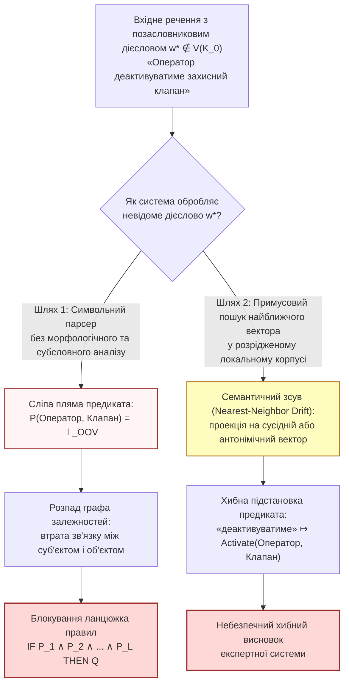

# Глава 02. Катастрофа позасловникових предикатів у нейро-символічних системах: руйнування дедукції та векторний зсув

> **Автор:** Георгій Федчик  
> **Мова оригіналу:** Українська  
> **Дидактичний рівень:** Базово-аналітичний (формалізація деградації логічного виведення, втрати зв'язності графа та семантичного зсуву при OOV; опирається на Главу 01)

---

## Вступ

У [Главі 01](ch01-isolation-models-closed-world-and-oov-laws.md) показано, що в ізольованій експертній системі (*air-gapped corpus-bound system*) зі скінченним корпусом $`\mathcal{K}_0`$ обсягом $`N`$ токенів за моделлю Гіпса неминуче виникає потік слів поза словником (`OOV`) з інтенсивністю $`p_{\mathrm{OOV}}(N) \approx \beta K N^{\beta - 1} > 0`$ (Модель 1.1). У звичайних системах інформаційного пошуку невідоме слово лише знижує повноту видачі. Для **нейро-символічних експертних систем**, які поєднують нейромережевий розбір тексту з дедуктивним виведенням над правилами та онтологіями [[4]](#src-4), [[5]](#src-5), наслідки серйозніші: невідоме дієслово може або обірвати ланцюжок виведення, або, що небезпечніше, бути підмінене хибним предикатом.

У цій главі кількісно оцінено, чому проблема `OOV` є загрозою для працездатності та безпеки ізольованих експертних систем, і розглянуто три механізми відмови:
1. **Обрив символьного ланцюжка дедукції** через «сліпі плями» у предикатах правил;
2. **Втрата реляційного контексту** через розпад графа «суб'єкт — дія — об'єкт»;
3. **Семантичний зсув нейрокомпонента** при примусовому проектуванні невідомого слова на найближчий наявний вектор у розрідженому локальному просторі ембедінгів.

Окремо наголошено, що існують помилки розбору, небезпечніші за `OOV`, які виникають і зі знайомими словами (підрозділ 1.4).

---

## 1. Три механізми відмови через позасловникові слова у нейро-символічному тракті

Розглянемо типову архітектуру нейро-символічної експертної системи: вхідне повідомлення або пункт регламенту природною мовою $`q = (w_1, w_2, \dots, w_m)`$ подається на лінгвістичний парсер, який видобуває з нього множину атомарних фактів вигляду $`P(s, o)`$, де $`s`$ — суб'єкт (актор або агрегат), $`o`$ — об'єкт дії, а $`P \in \mathcal{P}(\mathcal{K}_0)`$ — бінарний предикат онтології, породжений дієсловом $`v`$. Після цього машина логічного виведення застосовує продукційні правила Хорна ($`\text{IF } P_1 \land P_2 \dots \text{ THEN } Q`$).

### 1.1. Перший механізм: обрив символьного логічного виведення

Нехай база знань містить ланцюжок із $`L`$ імплікативних правил Хорна (або правило з $`L`$ кон'юнктивними передумовами):

$$
R_{\mathrm{chain}}: \quad P_1(x_0, x_1) \ \land \ P_2(x_1, x_2) \ \land \ \dots \ \land \ P_L(x_{L-1}, x_L) \implies Q_{\mathrm{goal}}(x_0, x_L)
$$

У тризначній логіці Кліні $`K_3`$ [[1]](#src-1), якщо хоча б одне дієслово $`v_k`$, що відповідає предикату $`P_k`$, не розпізнано парсером через відсутність словоформи у словнику ($`v_k \notin V(\mathcal{K}_0)`$), предикат $`P_k(x_{k-1}, x_k)`$ отримує статус невизначеності $`\bot_{\mathrm{OOV}}`$. Оскільки сильна кон'юнкція Кліні задовольняє $`1 \land 1 \land \bot_{\mathrm{OOV}} = \bot_{\mathrm{OOV}}`$, єдина нерозпізнана дієслівна форма робить невизначеним весь ланцюжок доведення. Це безпечна, але дорога відмова: правило не спрацьовує, і рішення переходить до оператора.

### 1.2. Другий механізм: втрата реляційного контексту в графі залежностей

За структурною теорією синтаксичних залежностей **Люсьєна Теньєра (1959)** [[2]](#src-2) та відмінковою граматикою **Чарльза Філлмора (1968)** [[3]](#src-3), дієслово є центральним вузлом речення, який утримує актанти (суб'єкт $`s`$, прямий об'єкт $`o`$, інструмент $`z`$).

Нехай семантичний граф документа $`\mathcal{G} = (\mathcal{E}, \mathcal{R})`$ складається з множини розпізнаних іменованих сутностей $`\mathcal{E}`$ та спрямованих ребер-відношень $`\mathcal{R}`$, індукованих дієсловами: $`e = (s \xrightarrow{v} o)`$. Якщо іменники $`s`$ («адміністратор») та $`o`$ («база даних») присутні у словнику $`V(\mathcal{K}_0)`$, але дієслово $`v`$ між ними («реіндексовуватиме», «деактивує», «експортує») є позасловниковим ($`v \notin V(\mathcal{K}_0)`$), то ребро $`e`$ зникає з графа $`\mathcal{G}`$. Кількість зв'язних компонент графа (нульове число Бетті $`\beta_0(\mathcal{G})`$) зростає на одиницю лише тоді, коли $`e`$ було **мостом**, тобто іншого шляху між $`s`$ і $`o`$ не існує. Якщо такий шлях є, зв'язність зберігається, але втрачається конкретне відношення між суб'єктом і об'єктом, і правила, що на нього посилаються, не спрацьовують.

### 1.3. Третій механізм: семантичний зсув нейрокомпонента в малому корпусі

Щоб уникнути обриву виведення (першого механізму), розробники часто налаштовують нейромережевий компонент на примусовий пошук найближчого сусіда (*Nearest-Neighbor Projection*): для невідомого або слабко представленого в корпусі слова $`w^*`$ обчислюється наближений контекстний вектор $`\hat{\mathbf{e}}(w^*) \in \mathbb{R}^d`$, після чого обирається той предикат онтології $`p^{\mathrm{NN}} \in \mathcal{P}(\mathcal{K}_0)`$, вектор якого має максимальну косинусну подібність:

$$
p^{\mathrm{NN}}(w^*) = \arg\max_{p \in \mathcal{P}(\mathcal{K}_0)} \frac{\langle \hat{\mathbf{e}}(w^*), \ \mathbf{e}(p) \rangle}{\lVert \hat{\mathbf{e}}(w^*) \rVert_2 \cdot \lVert \mathbf{e}(p) \rVert_2}
$$

**Формула (2.1).** Примусове проектування позасловникового слова на найближчий предикат онтології за косинусною близькістю.

У моделі, навченій на дуже великих загальних корпусах, векторний простір щільніший. Натомість в **ізольованому малому корпусі** $`\mathcal{K}_0`$ простір ембедінгів розріджений, а оцінка вектора $`\hat{\mathbf{e}}(w^*)`$ містить значну стохастичну похибку $`\boldsymbol{\xi}`$. У результаті примусова проекція (2.1) може прив'язати невідоме слово до сусіднього предиката або до його антоніма, оскільки антоніми («дозволити / заборонити», «ввімкнути / вимкнути») часто вживаються в дуже схожих синтаксичних контекстах.

### 1.4. Помилки розбору, небезпечніші за позасловникові слова

Механізми 1.1–1.3 пов'язані з невідомими словами, але для безпеки експертної системи не менш небезпечні помилки, що виникають і зі знайомою лексикою. Вони не перехоплюються жодним детектором `OOV`, тому потребують окремих правил і тестів:
1. **Синтаксичне заперечення:** «не відкривати засувку до зниження тиску» — пропущена частка «не» інвертує дію, хоча всі слова відомі.
2. **Модальність:** «дозволяється», «забороняється», «слід», «може» змінюють деонтичний статус дії (`SHALL` / `SHALL NOT` / `MAY`), а не саму дію.
3. **Умови та часові обмеження:** «якщо…, то…», «після», «не раніше ніж через 10 хв» задають передумови, які не можна втратити під час видобування триплетів.
4. **Кореферентність:** «його», «зазначений агрегат» потребують зв'язування з конкретним об'єктом; помилка переносить дію на інший агрегат.
5. **Числа й одиниці:** «не менше 2,5 МПа», «кгс/см²», діапазони і знаки нерівностей; помилка порядку величини чи знака є критичною.

Ці класи доцільно перевіряти окремими наборами тестів (регресійними прикладами із запереченнями, модальністю й числами) і вимагати для них відмови, а не вгадування, якщо розбір неоднозначний.

---

## 2. Модель деградації виведення та семантичного зсуву

Три механізми розділу 1 можна оцінити кількісно, якщо явно перелічити припущення, за яких оцінка має сенс. Нижче вони об'єднані в одне твердження, яке є моделлю, а не теоремою про будь-яку нейро-символічну систему.

### Твердження 2.1 (Модель повного розбору тексту та наближена нижня межа семантичного зсуву)

**Припущення.**
1. **Модель повного розбору:** кожна з $`L`$ передумов ланцюжка видобувається парсером заново з тексту (нового документа або наряду), а не зіставляється з уже скомпільованими й перевіреними фактами бази знань.
2. Події «дієслівна форма поза словником» та «іменниковий термін поза словником» у різних позиціях ланцюжка незалежні з ймовірностями $`p_V = p_{\mathrm{OOV}, V}(N)`$ та $`p_E = p_{\mathrm{OOV}, E}(N)`$.
3. Для пункту 2: проекція кутової похибки оцінювання вектора $`\hat{\mathbf{e}}(w^*)`$ на геодезичну дугу до найближчого сусіднього предиката наближено нормальна з нульовим середнім і середньоквадратичним відхиленням $`\sigma_\theta`$.

**Твердження.** За цих припущень:
1. **Для символьного виведення без морфологічного розширення** ймовірність $`P_{\mathrm{chain}}(L)`$ успішного завершення ланцюжка з $`L`$ кроків спадає експоненційно з $`L`$:

$$
P_{\mathrm{chain}}(L) = (1 - p_E) \cdot \left[ (1 - p_V)(1 - p_E) \right]^L \le \exp\left( -L (p_V + p_E) - p_E \right)
$$

**Формула (2.2).** Модель експоненційного обриву багатоходового логічного виведення за наявності позасловникових предикатів і сутностей.

У реальній експертній системі більшість передумов зазвичай зіставляється зі скомпільованими фактами, і з природної мови розбирається передусім запит. Тоді у (2.2) замість $`L`$ слід підставляти лише кількість $`L_{\mathrm{text}} \le L`$ передумов, які залежать від щойно розібраного тексту, і оцінка відповідно пом'якшується.

2. **Для нейромережевого компонента з примусовим пошуком найближчого вектора (2.1) без порогу відмови:** нехай $`p^*`$ — істинний предикат, а $`\theta(p^*) = \min_{q \ne p^*} \arccos\langle \mathbf{e}(p^*), \mathbf{e}(q) \rangle`$ — кутова відстань від $`p^*`$ до **його** найближчого сусіда. Тоді ймовірність семантичного зсуву (хибної підстановки $`p^{\mathrm{NN}}(w^*) \ne p^*`$) у гауссовому наближенні обмежена знизу:

$$
P_{\mathrm{drift}}(w^*) = \mathbb{P}\left( p^{\mathrm{NN}}(w^*) \ne p^* \right) \ge 1 - \Phi_{\mathcal{N}}\left( \frac{\theta(p^*)}{2\sigma_\theta} \right)
$$

**Формула (2.3).** Наближена нижня межа ймовірності семантичного зсуву при проекції невідомого слова в розрідженому векторному просторі, де $`\Phi_{\mathcal{N}}`$ — функція стандартного нормального розподілу.

Мінімальна відстань між будь-якими двома предикатами онтології $`\theta_{\min} = \min_{p \ne q} \arccos\langle \mathbf{e}(p), \mathbf{e}(q) \rangle`$ задовольняє $`\theta_{\min} \le \theta(p^*)`$. Тому вираз $`1 - \Phi_{\mathcal{N}}(\theta_{\min}/(2\sigma_\theta))`$ **не є** нижньою межею для конкретного $`p^*`$: він більший або рівний правій частині (2.3) і дає лише песимістичну оцінку для найгіршого розташованого предиката. Якщо слово $`w^*`$ взагалі не має істинного еквівалента в онтології ($`p^* \notin \mathcal{P}(\mathcal{K}_0)`$), то за відсутності порогу відмови будь-яка підстановка є хибною: $`P_{\mathrm{drift}}(w^*) = 1`$.

### Обґрунтування Твердження 2.1

1. **Пункт 1 (формула 2.2):** Ланцюжок із $`L`$ зв'язаних триплетів $`(x_0 \xrightarrow{v_1} x_1 \xrightarrow{v_2} x_2 \dots \xrightarrow{v_L} x_L)`$ містить $`L`$ дієслівних предикатів $`v_1, \dots, v_L`$ та $`L + 1`$ вузлових сутностей $`x_0, x_1, \dots, x_L`$. За припущенням 1 усі вони розбираються з тексту, тому для уніфікації всіх $`L`$ передумов жодне з $`L`$ дієслів і жодна з $`L + 1`$ сутностей не повинні опинитися поза словником. За припущенням 2:

$$
P_{\mathrm{chain}}(L) = (1 - p_E)^{L+1} (1 - p_V)^L = (1 - p_E)\left[(1 - p_V)(1 - p_E)\right]^L
$$

Використовуючи нерівність $`1 - u \le e^{-u}`$ для всіх $`u \in [0, 1]`$, одержуємо верхню експоненційну границю $`P_{\mathrm{chain}}(L) \le \exp(-L(p_V + p_E) - p_E)`$.
2. **Пункт 2 (формула 2.3):** Нехай найближчий до $`p^*`$ конкуруючий предикат $`p_{\mathrm{alt}}`$ розташований під кутом $`\theta(p^*)`$ до $`\mathbf{e}(p^*)`$. Межа комірки Вороного між $`p^*`$ та $`p_{\mathrm{alt}}`$ на сфері $`\mathbb{S}^{d-1}`$ проходить на кутовій відстані $`\theta(p^*) / 2`$ від $`\mathbf{e}(p^*)`$.
3. Якщо проекція кутової похибки $`\vartheta_{\parallel}`$ вздовж геодезичної дуги від $`\mathbf{e}(p^*)`$ до $`\mathbf{e}(p_{\mathrm{alt}})`$ перевищує $`\theta(p^*)/2`$, то правило (2.1) обирає $`p_{\mathrm{alt}}`$. За припущенням 3 ймовірність цієї події дорівнює $`1 - \Phi_{\mathcal{N}}(\theta(p^*) / (2\sigma_\theta))`$. Перетин цієї межі достатній для помилки, а інші сусідні комірки Вороного лише додають шляхів до помилки, тому $`P_{\mathrm{drift}}(w^*)`$ не менша за ймовірність перетину однієї межі. Межа є наближеною в тій мірі, в якій наближеним є припущення 3. Якщо істинне поняття $`p^*`$ відсутнє в $`\mathcal{P}(\mathcal{K}_0)`$, то оператор $`\arg\max`$ у (2.1) завжди повертає один із наявних предикатів, тобто підміну. ∎

---

## 3. Навчальний інженерний приклад: розрахунок обриву дедукції та семантичного зсуву в експертній системі енергоблока

*Дидактична наступність наскрізного прикладу:* У [Главі 01](ch01-isolation-models-closed-world-and-oov-laws.md) (розділ 4) встановлено перші дві компоненти вектора стану $`\Xi(\mathcal{K}_0, q)`$ для ізольованої експертної системи технічного обслуговування турбінного відділення ($`\mathcal{I}_{\mathrm{sec}} = 1`$, обсяг корпусу $`N = 10^5`$ токенів, модельна позасловниковість словоформ без морфології $`p_{\mathrm{OOV, form}} = 5{,}53\%`$). Тепер за Твердженням 2.1 оцінимо, як ця позасловниковість впливає на трикроковий ланцюжок правил безпеки в моделі повного розбору тексту і до якої частоти семантичних підмін може призвести наївна векторна підстановка.

### 3.1. Вихідні інженерні дані

1. **Диференційовані показники `OOV` за частинами мови (без морфологічного аналізатора)** — **навчальні припущення**, а не виміряні величини:
   - для іменникових термінів обладнання (які найчастіше стоять у називному або родовому відмінку): $`p_E = 3{,}50\% = 0{,}035`$;
   - для дієслівних предикатів технологічних дій (які мають десятки часових, видових і префіксальних форм): $`p_V = 8{,}50\% = 0{,}085`$.

   Ці значення не виведено із середнього $`5{,}53\%`$ Глави 01. Якби корпус складався лише з дієслів та іменників, узгодженість із середнім вимагала б частки дієслівних токенів $`f_V = (0{,}0553 - 0{,}035)/(0{,}085 - 0{,}035) \approx 0{,}41`$; це лише перевірка порядку величин, а для реальної системи $`p_V`$ і $`p_E`$ слід вимірювати окремо за частинами мови.
2. **Структура перевірочного правила безпеки глибиною $`L = 3`$ кроки:**
   Щоб дозволити виведення теплообмінника в ремонт, система повинна верифікувати в тексті наряду-допуску три послідовні дії:
   - $`P_1`$: персонал *відсікає* подачу пари на засувці;
   - $`P_2`$: дренажний клапан *скидає* залишковий тиск у магістралі;
   - $`P_3`$: черговий електромонтер *знеструмлює* привід насоса.
   У тексті нового наряду використано префіксально-часову форму *«перекомутовуватимуться»* / *«розблоковуватиметься»*, відсутню в корпусі $`\mathcal{K}_0`$. Усі три передумови розбираються з тексту наряду, тому застосовна модель повного розбору ($`L_{\mathrm{text}} = L = 3`$).
3. **Параметри локального векторного простору ембедінгів (для формули 2.3)** — також навчальні ілюстративні значення: кутова похибка оцінки вектора рідкісного слова $`\sigma_\theta = 0{,}40\text{ рад}`$; мінімальна кутова відстань між предикатами онтології $`\theta_{\min} = 0{,}60\text{ рад}`$ ($`\approx 34{,}4^\circ`$).

### 3.2. Покроковий розрахунок

**Крок 1. Обчислення ймовірності успішного проходження символьного ланцюжка глибиною $`L = 3`$ за формулою (2.2):**
Підставляємо $`p_E = 0{,}035`$, $`p_V = 0{,}085`$ та $`L = 3`$ у формулу (2.2):

$$
(1 - p_V)(1 - p_E) = (1 - 0{,}085) \times (1 - 0{,}035) = 0{,}915 \times 0{,}965 \approx 0{,}88298
$$

$$
P_{\mathrm{chain}}(3) = (1 - 0{,}035) \times \left(0{,}88298\right)^3 = 0{,}965 \times 0{,}6884 \approx 0{,}6643 \quad (66{,}43\%)
$$

А для глибшого регламентного ланцюжка з $`L = 5`$ технологічних операцій:

$$
P_{\mathrm{chain}}(5) = 0{,}965 \times \left(0{,}88298\right)^5 = 0{,}965 \times 0{,}5367 \approx 0{,}5179 \quad (51{,}79\%)
$$

**Висновок за Кроком 1:** За вибраних навчальних параметрів і в моделі повного розбору приблизно третина ($`33{,}57\%`$) трикрокових і майже половина ($`48{,}21\%`$) п'ятикрокових ланцюжків обривається через нерозпізнані граматичні форми. Ці обриви є безпечними відмовами (правило не спрацьовує), але роблять систему малокорисною й перевантажують оператора запитами на уточнення.

**Крок 2. Умовна ілюстрація семантичного зсуву за формулою (2.3):**
Межа (2.3) залежить від відстані $`\theta(p^*)`$ від **конкретного** істинного предиката до його найближчого сусіда, тому результат подано для кількох можливих значень при $`\sigma_\theta = 0{,}40\text{ рад}`$:

**Таблиця 2.1.** Наближена нижня межа ймовірності семантичного зсуву залежно від кутової відстані $`\theta(p^*)`$ до найближчого сусіда (навчальна ілюстрація).

| $`\theta(p^*)`$, рад | $`z = \theta(p^*)/(2\sigma_\theta)`$ | $`1 - \Phi_{\mathcal{N}}(z)`$ |
| :---: | :---: | :---: |
| $`0{,}60`$ (дорівнює $`\theta_{\min}`$) | $`0{,}75`$ | $`0{,}2266`$ |
| $`0{,}80`$ | $`1{,}00`$ | $`0{,}1587`$ |
| $`1{,}00`$ | $`1{,}25`$ | $`0{,}1056`$ |
| $`1{,}20`$ | $`1{,}50`$ | $`0{,}0668`$ |

Наприклад, для пари близьких предикатів *«блокувати»* / *«розблокувати»*, якщо в ембедінгах їх розділяє саме $`\theta(p^*) = \theta_{\min} = 0{,}60\text{ рад}`$, наївний векторний пошук помилятиметься щонайменше приблизно у $`22{,}7\%`$ випадків. Для предиката, найближчий сусід якого розташований на відстані $`1{,}20\text{ рад}`$, та сама модель дає нижню межу лише $`6{,}7\%`$. Отже, $`22{,}7\%`$ — це умовна ілюстрація для найтісніше розташованих предикатів, а не оцінка для всієї онтології. **Дія для інженера:** виміряти розподіл $`\theta(p^*)`$ для предикатів онтології та $`\sigma_\theta`$ на розмічених рідкісних словах і для предикатів із малим $`\theta(p^*)`$ обов'язково застосовувати поріг відмови (Глава 04). Щоб зменшити як обриви виведення (Крок 1), так і небезпечні векторні підміни (Крок 2), у [Главі 03](ch03-symbolic-morphology-fst-and-paradigm-analogy.md) побудовано перший рівень захисту — офлайн-морфологію на базі скінченних трансдьюсерів (`Варіант А`).

---

## Висновки

1. У нейро-символічних експертних системах позасловникові дієслова (`OOV`) уражають обидва рівні архітектури: на символьному рівні вони створюють невідомі предикати $`\bot_{\mathrm{OOV}}`$ і можуть розірвати граф залежностей (зв'язність втрачається, лише якщо зникле ребро було мостом), а на субсимвольному рівні провокують семантичний зсув до хибних сусідів.
2. У моделі повного розбору тексту (Твердження 2.1) ймовірність успішного виведення ланцюжка з $`L`$ передумов спадає за показниковим законом $`P_{\mathrm{chain}}(L) = (1 - p_E)[(1 - p_V)(1 - p_E)]^L`$; за навчальних значень $`p_V = 8{,}5\%`$ і $`p_E = 3{,}5\%`$ обривається від $`34\%`$ (трикрокових) до $`48\%`$ (п'ятикрокових) ланцюжків. Якщо більшість передумов зіставляється зі скомпільованими фактами, у формулу підставляється лише $`L_{\mathrm{text}} \le L`$.
3. Примусове проектування позасловникового токена на найближчий вектор онтології без порогу відмови породжує семантичні підміни з імовірністю, яка в гауссовому наближенні не менша за $`1 - \Phi_{\mathcal{N}}(\theta(p^*)/(2\sigma_\theta))`$; ця межа визначається відстанню від істинного предиката до його найближчого сусіда, а не мінімальною відстанню в усій онтології.
4. Заперечення, модальність, умови, кореферентність і числа з одиницями є класами помилок розбору, небезпечнішими за `OOV`, і потребують окремих тестів і правил відмови.

---

## Словник

| Термін | Англійський еквівалент | Визначення |
| :--- | :--- | :--- |
| **Сліпа пляма предиката** | *Predicate Blind Spot* | Неможливість відобразити дієслово вхідного тексту на жодне формальне відношення онтології $`P \in \mathcal{P}(\mathcal{K}_0)`$, що блокує застосування правил виведення. |
| **Актантна рамка (валентність)** | *Actant / Valence Frame* | Введена Л. Теньєром структура обов'язкових синтаксичних і семантичних аргументів (суб'єкт, об'єкт, адресат, інструмент), якими керує дієслово. |
| **Семантичний зсув найближчого сусіда** | *Nearest-Neighbor Semantic Drift* | Помилкове ототожнення вектора невідомого слова з вектором семантично відмінного або протилежного поняття в розрідженому просторі ембедінгів. |
| **Комірка Вороного на гіперсфері** | *Spherical Voronoi Cell* | Область одиничної сфери $`\mathbb{S}^{d-1}`$, усі точки якої мають меншу кутову відстань до даного еталонного вектора предиката $`\mathbf{e}(p^*)`$, ніж до будь-якого іншого еталона. |

---

## Список позначень та скорочень

- **Математичні символи:**
  - $`L`$ — довжина (кількість кон'юнктивних кроків) ланцюжка логічного виведення.
  - $`p_V, p_E`$ — імовірності появи позасловникової дієслівної форми та іменникової сутності.
  - $`P_{\mathrm{chain}}(L)`$ — імовірність безвідмовного проходження дедуктивного ланцюжка довжиною $`L`$.
  - $`\theta(p^*)`$ — кутова відстань від вектора істинного предиката $`p^*`$ до його найближчого сусіда в онтології.
  - $`\theta_{\min}`$ — мінімальна кутова відстань між будь-якими двома векторами предикатів в онтології ($`\theta_{\min} \le \theta(p^*)`$).
  - $`L_{\mathrm{text}}`$ — кількість передумов ланцюжка, які залежать від щойно розібраного тексту.
  - $`\sigma_\theta`$ — середньоквадратична кутова похибка оцінювання вектора рідкісного або невідомого слова.
  - $`\Phi_{\mathcal{N}}(\cdot)`$ — інтегральна функція стандартного нормального розподілу.

---

## Бібліографія

1. **Kleene S. C.** Introduction to Metamathematics. — Amsterdam : North-Holland Publishing, 1952. — 550 p.
2. **Tesnière L.** Éléments de syntaxe structurale. — Paris : Klincksieck, 1959. — 670 p.
3. **Fillmore C. J.** The Case for Case // *Universals in Linguistic Theory* / ed. by E. Bach, R. T. Harms. — New York : Holt, Rinehart and Winston, 1968. — P. 1–88.
4. **Marcus G.** The Next Decade in AI: Four Steps Towards Robust Artificial Intelligence : arXiv preprint arXiv:2002.06177. — 2020.
5. **Garcez A. d'Avila, Lamb L. C.** Neurosymbolic AI: The 3rd Wave // *Artificial Intelligence Review*. — 2023. — Vol. 56, No. 11. — P. 12387–12406.
