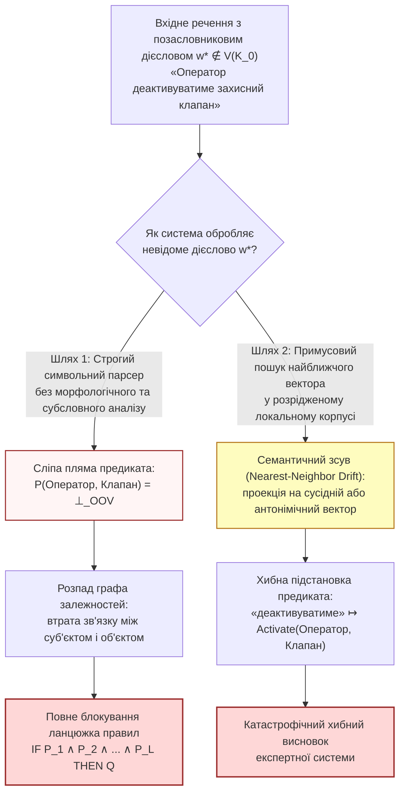

# Глава 02. Катастрофа позасловникових предикатів у нейро-символічних системах: руйнування дедукції та векторний зсув

> **Автор:** Георгій Федчик  
> **Мова оригіналу:** Українська  
> **Дидактичний рівень:** Базово-аналітичний (формалізація деградації логічного виведення, втрати зв'язності графа та семантичного зсуву при OOV; опирається на Главу 01)

---

## Вступ

У [Главі 01](ch01-isolation-models-closed-world-and-oov-laws.md) ми встановили, що в будь-якій фізично ізольованій експертній системі (*air-gapped corpus-bound system*) зі скінченним корпусом $`\mathcal{K}_0`$ обсягом $`N`$ токенів неминуче виникає потік слів поза словником (`OOV`) з інтенсивністю $`p_{\mathrm{OOV}}(N) = \beta K N^{\beta - 1} > 0`$ (Теорема 1.1). У звичайних системах інформаційного пошуку невідоме слово лише незначно знижує повноту видачі. Проте для **нейро-символічних експертних систем**, які поєднують нейромережевий парсинг тексту зі строгим дедуктивним виведенням над правилами та онтологіями, поява позасловникового терміна — а особливо **невідомого дієслова** — має катастрофічний характер.

У цій главі ми дамо строге математичне обґрунтування того, чому проблема `OOV` є критичною загрозою для працездатності та безпеки ізольованих експертних систем, розкривши три фундаментальні механізми відмови:
1. **Руйнування символьного ланцюжка дедукції** через утворення «сліпих плям» у предикатах правил;
2. **Каскадна втрата реляційного контексту** через розпад двочасткового графа «суб'єкт — дія — об'єкт»;
3. **Семантичний зсув (галюцинації) нейрокомпонента** при спробі примусово спроектувати невідоме слово на найближчий наявний вектор у розрідженому локальному просторі ембедінгів.

---

## 1. Три механізми катастрофи позасловникових слів у нейро-символічному тракті

Розглянемо стандартну архітектуру нейро-символічної експертної системи: вхідне повідомлення або пункт регламенту природною мовою $`q = (w_1, w_2, \dots, w_m)`$ подається на лінгвістичний парсер, який видобуває з нього множину атомарних фактів вигляду $`P(s, o)`$, де $`s`$ — суб'єкт (актор або агрегат), $`o`$ — об'єкт дії, а $`P \in \mathcal{P}(\mathcal{K}_0)`$ — бінарний предикат онтології, породжений дієсловом $`v`$. Після цього машина логічного виведення застосовує продукційні правила Хорна ($`\text{IF } P_1 \land P_2 \dots \text{ THEN } Q`$).

### 1.1. Перший механізм: руйнування символьного логічного виведення

Нехай база знань містить ланцюжок із $`L`$ імплікативних правил Хорна (або правило з $`L`$ кон'юнктивними передумовами):

$$
R_{\mathrm{chain}}: \quad P_1(x_0, x_1) \ \land \ P_2(x_1, x_2) \ \land \ \dots \ \land \ P_L(x_{L-1}, x_L) \implies Q_{\mathrm{goal}}(x_0, x_L)
$$

У класичній булевій або тризначній логіці Кліні $`K_3`$ [[1]](#src-1), якщо хоча б одне дієслово $`v_k`$, що відповідає предикату $`P_k`$, не розпізнано парсером через відсутність словоформи у словнику ($`v_k \notin V(\mathcal{K}_0)`$), предикат $`P_k(x_{k-1}, x_k)`$ отримує статус невизначеності $`\bot_{\mathrm{OOV}}`$. Оскільки кон'юнкція в логіці Кліні задовольняє тотожність $`1 \land 1 \land \bot_{\mathrm{OOV}} = \bot_{\mathrm{OOV}}`$, єдина нерозпізнана дієслівна форма обнуляє істинність усього ланцюжка доведення.

### 1.2. Другий механізм: каскадна втрата реляційного контексту в графі залежностей

За структурною теорією синтаксичних залежностей **Люсьєна Теньєра (1959)** [[2]](#src-2) та відмінковою граматикою **Чарльза Філлмора (1968)** [[3]](#src-3), дієслово є центральним кореневим вузлом (*structural governor*) речення, який утримує актанти (суб'єкт $`s`$, прямий об'єкт $`o`$, інструмент $`z`$).

Нехай семантичний граф документа $`\mathcal{G} = (\mathcal{E}, \mathcal{R})`$ складається з множини розпізнаних іменованих сутностей $`\mathcal{E}`$ та спрямованих ребер-відношень $`\mathcal{R}`$, індукованих дієсловами: $`e = (s \xrightarrow{v} o)`$. Якщо іменники $`s`$ («адміністратор») та $`o`$ («база даних») присутні у словнику $`V(\mathcal{K}_0)`$, але дієслово $`v`$ між ними («реіндексовуватиме», «деактивує», «експортує») є позасловниковим ($`v \notin V(\mathcal{K}_0)`$), то ребро $`e`$ зникає з графа $`\mathcal{G}`$. Кількість зв'язних компонент графа (перше число Бетті $`\beta_0(\mathcal{G})`$) зростає на одиницю, а взаємна інформація між станом суб'єкта та станом об'єкта падає до нуля.

### 1.3. Третій механізм: ефект галюцинацій нейрокомпонента (семантичний зсув у малому корпусі)

Щоб уникнути обриву виведення (першого механізму), розробники часто налаштовують нейромережевий компонент на примусовий пошук найближчого сусіда (*Nearest-Neighbor Projection*): для невідомого або слабко представленого в корпусі слова $`w^*`$ обчислюється наближений контекстний вектор $`\hat{\mathbf{e}}(w^*) \in \mathbb{R}^d`$, після чого обирається той предикат онтології $`p^{\mathrm{NN}} \in \mathcal{P}(\mathcal{K}_0)`$, вектор якого має максимальну косинусну подібність:

$$
p^{\mathrm{NN}}(w^*) = \arg\max_{p \in \mathcal{P}(\mathcal{K}_0)} \frac{\langle \hat{\mathbf{e}}(w^*), \ \mathbf{e}(p) \rangle}{\lVert \hat{\mathbf{e}}(w^*) \rVert_2 \cdot \lVert \mathbf{e}(p) \rVert_2}
$$

**Формула (2.1).** Примусове проектування позасловникового слова на найближчий предикат онтології за косинусною близькістю.

У відкритій хмарній системі, навченій на трильйонах слів, щільність векторного простору є високою. Натомість в **ізольованому малому корпусі** $`\mathcal{K}_0`$ простір ембедінгів є вкрай розрідженим, а оцінка вектора $`\hat{\mathbf{e}}(w^*)`$ містить високу стохастичну похибку $`\boldsymbol{\xi}`$. У результаті примусова проекція (2.1) прив'язує невідоме слово до випадкового сусіднього предиката або до його прямого антоніма (оскільки антоніми «дозволити / заборонити», «ввімкнути / вимкнути» стоять в абсолютно однакових синтаксичних контекстах!).

---

## 2. Математична теорема про деградацію виведення та семантичний зсув

Об'єднаємо три розглянуті ефекти в єдину кількісну теорему, яка встановлює залежність надійності нейро-символічної системи від частки позасловникових слів $`p_{\mathrm{OOV}}(N)`$.

### Теорема 2.1 (Про експоненційне затухання ймовірності багатоходового виведення та нижню межу хибної активації при примусовому векторному проектуванні)

> **Формулювання теореми:**  
> Розглянемо ізольовану нейро-символічну експертну систему над замкненим корпусом $`\mathcal{K}_0`$ обсягом $`N`$ токенів. Нехай кожен елементарний крок логічного виведення спирається на триплет «суб'єкт — дієслово-предикат — об'єкт» $`(s_k, v_k, o_k)`$, де ймовірність позасловниковості дієслівної форми дорівнює $`p_V = p_{\mathrm{OOV}, V}(N)`$, а ймовірність позасловниковості іменникового терміна дорівнює $`p_E = p_{\mathrm{OOV}, E}(N)`$. Тоді:
> 1. **Для строгого символьного виведення без морфологічного розширення:** ймовірність $`P_{\mathrm{chain}}(L)`$ успішного завершення дедуктивного ланцюжка довжиною $`L`$ кроків експоненційно спадає з ростом глибини міркувань $`L`$:
>
> $$
> P_{\mathrm{chain}}(L) = (1 - p_E) \cdot \left[ (1 - p_V)(1 - p_E) \right]^L \le \exp\left( -L (p_V + p_E) - p_E \right)
> $$
>
> **Формула (2.2).** Закон експоненційного руйнування багатоходового логічного виведення при наявності позасловникових предикатів і сутностей.
> 2. **Для нейромережевого компонента з примусовим пошуком найближчого вектора (2.1) без порогу відмови:** нехай одиничні вектори предикатів онтології на сфері $`\mathbb{S}^{d-1}`$ мають мінімальну кутову відстань між сусідніми предикатами $`\theta_{\min} = \min_{p \ne q} \arccos\langle \mathbf{e}(p), \mathbf{e}(q) \rangle`$, а вектор позасловникового слова $`w^*`$ у розрідженому корпусі оцінюється зі середньоквадратичним кутовим відхиленням $`\sigma_\theta`$. Тоді ймовірність семантичної галюцинації (хибної підстановки сусіднього предиката $`p_{\mathrm{false}} \ne p^*`$) обмежена знизу величиною:
>
> $$
> P_{\mathrm{drift}}(w^*) = \mathbb{P}\left( p^{\mathrm{NN}}(w^*) \ne p^* \right) \ge 1 - \Phi_{\mathcal{N}}\left( \frac{\theta_{\min}}{2\sigma_\theta} \right)
> $$
>
> **Формула (2.3).** Нижня межа ймовірності семантичного зсуву (галюцинації нейрокомпонента) при проекції невідомого слова в розрідженому векторному просторі, де $`\Phi_{\mathcal{N}}`$ — функція стандартного нормального розподілу. Якщо слово $`w^*`$ взагалі не має істинного еквівалента в онтології ($`p^* \notin \mathcal{P}(\mathcal{K}_0)`$), то за відсутності порогу відмови ймовірність галюцинації тотожно дорівнює одиниці: $`P_{\mathrm{drift}}(w^*) = 1`$.

### Доведення Теореми 2.1

1. **Доведення пункту 1 (формула 2.2):** Ланцюжок із $`L`$ зв'язаних триплетів $`(x_0 \xrightarrow{v_1} x_1 \xrightarrow{v_2} x_2 \dots \xrightarrow{v_L} x_L)`$ містить рівно $`L`$ дієслівних предикатів $`v_1, \dots, v_L`$ та $`L + 1`$ вузлових сутностей $`x_0, x_1, \dots, x_L`$. Для того щоб машина виведення змогла уніфікувати всі $`L`$ передумов правила Хорна, жодне з $`L`$ дієслів і жодна з $`L + 1`$ сутностей не повинні опинитися поза словником $`V(\mathcal{K}_0)`$. За незалежності лексичних появ у різних позиціях ланцюжка ймовірність повної ідентифікації становить:

$$
P_{\mathrm{chain}}(L) = (1 - p_E)^{L+1} (1 - p_V)^L = (1 - p_E)\left[(1 - p_V)(1 - p_E)\right]^L
$$

Використовуючи елементарну нерівність $`1 - u \le e^{-u}`$ для всіх $`u \in [0, 1]`$, одержуємо верхню експоненційну границю $`P_{\mathrm{chain}}(L) \le \exp(-L(p_V + p_E) - p_E)`$.
2. **Доведення пункту 2 (формула 2.3):** Нехай істинний семантичний напрямок слова $`w^*`$ відповідає предикату $`p^*`$ з одиничним вектором $`\mathbf{e}(p^*) \in \mathbb{S}^{d-1}`$, а найближчий конкуруючий предикат $`p_{\mathrm{alt}} \in \mathcal{P}(\mathcal{K}_0)`$ розташований під кутом $`\theta_{\min}`$ до $`\mathbf{e}(p^*)`$. Межа комірки Вороного між $`p^*`$ та $`p_{\mathrm{alt}}`$ на сфері $`\mathbb{S}^{d-1}`$ проходить на кутовій відстані рівно $`\theta_{\min} / 2`$ від $`\mathbf{e}(p^*)`$.
3. Якщо проекція кутової похибки оцінювання $`\vartheta_{\parallel}`$ вздовж геодезичної дуги від $`\mathbf{e}(p^*)`$ до $`\mathbf{e}(p_{\mathrm{alt}})`$ має дисперсію $`\sigma_\theta^2`$ і перевищує половину кутової відстані $`\theta_{\min} / 2`$, то скалярний добуток $`\langle \hat{\mathbf{e}}(w^*), \mathbf{e}(p_{\mathrm{alt}}) \rangle`$ стає більшим за $`\langle \hat{\mathbf{e}}(w^*), \mathbf{e}(p^*) \rangle`$, і правило (2.1) обирає хибний предикат $`p_{\mathrm{alt}}`$. Ймовірність цього перетину в гауссовому наближенні дорівнює $`\mathbb{P}(\vartheta_{\parallel} > \theta_{\min}/2) = 1 - \Phi_{\mathcal{N}}(\theta_{\min} / (2\sigma_\theta))`$. Оскільки існують також інші сусідні комірки Вороного, загальна ймовірність помилки $`P_{\mathrm{drift}}(w^*)`$ є не меншою за ймовірність перетину цієї однієї межі. А якщо істинне поняття $`p^*`$ відсутнє в $`\mathcal{P}(\mathcal{K}_0)`$, то оператор $`\arg\max`$ у формулі (2.1) примусово повертає один із наявних предикатів $`p \in \mathcal{P}(\mathcal{K}_0)`$, що з імовірністю $`1{,}00`$ є семантичною підміною. ∎

---

## 3. Навчальний інженерний приклад: розрахунок руйнування дедукції та семантичного зсуву в експертній системі енергоблока

*Дидактична наступність наскрізного прикладу:* У [Главі 01](ch01-isolation-models-closed-world-and-oov-laws.md) (розділ 4) ми встановили перші дві компоненти вектора стану $`\Xi(\mathcal{K}_0, q)`$ для ізольованої експертної системи технічного обслуговування турбінного відділення ($`\mathcal{I}_{\mathrm{sec}} = 1`$, обсяг корпусу $`N = 10^5`$ токенів, середня позасловниковість словоформ без морфології $`p_{\mathrm{OOV, form}} = 5{,}53\%`$). Тепер кількісно розрахуємо за Теоремою 2.1, як ця позасловниковість руйнує трикроковий ланцюжок правил безпеки та до якої частоти галюцинацій призводить наївна векторна підстановка.

### 3.1. Вихідні інженерні дані

1. **Диференційовані показники `OOV` за частинами мови (без морфологічного аналізатора):**
   - Для іменникових термінів обладнання (які найчастіше стоять у називному або родовому відмінку): $`p_E = 3{,}50\% = 0{,}035`$.
   - Для дієслівних предикатів технологічних дій (які мають десятки часових, видових і префіксальних форм): $`p_V = 8{,}50\% = 0{,}085`$.
2. **Структура перевірочного правила безпеки глибиною $`L = 3`$ кроки:**
   Щоб дозволити виведення теплообмінника в ремонт, система повинна верифікувати в тексті наряду-допуску три послідовні дії:
   - $`P_1`$: персонал *відсікає* подачу пари на засувці;
   - $`P_2`$: дренажний клапан *скидає* залишковий тиск у магістралі;
   - $`P_3`$: черговий електромонтер *знеструмлює* привід насоса.
   У тексті нового наряду використано префіксально-часову форму *«перекомутовуватимуться»* / *«розблоковуватиметься»*, відсутню в корпусі $`\mathcal{K}_0`$.
3. **Параметри локального векторного простору ембедінгів (для перевірки формули 2.3):**
   У розрідженому корпусі кутова відстань між сусідніми технологічними предикатами (*«блокувати»*, *«розблокувати»*, *«комутувати»*) становить $`\theta_{\min} = 0{,}60\text{ рад}`$ ($`\approx 34{,}4^\circ`$), а кутове середньоквадратичне відхилення оцінки вектора рідкісного слова дорівнює $`\sigma_\theta = 0{,}40\text{ рад}`$.

### 3.2. Покроковий розрахунок

**Крок 1. Обчислення ймовірності успішного проходження символьного ланцюжка глибиною $`L = 3`$ за формулою (2.2):**
Підставляємо $`p_E = 0{,}035`$, $`p_V = 0{,}085`$ та $`L = 3`$ у формулу (2.2):

$$
(1 - p_V)(1 - p_E) = (1 - 0{,}085) \times (1 - 0{,}035) = 0{,}915 \times 0{,}965 \approx 0{,}88298
$$

$$
P_{\mathrm{chain}}(3) = (1 - 0{,}035) \times \left(0{,}88298\right)^3 = 0{,}965 \times 0{,}6884 \approx 0{,}6643 \quad (66{,}43\%)
$$

А для глибшого регламентного ланцюжка з $`L = 5`$ технологічних операцій:

$$
P_{\mathrm{chain}}(5) = 0{,}965 \times \left(0{,}88298\right)^5 = 0{,}965 \times 0{,}5366 \approx 0{,}5178 \quad (51{,}78\%)
$$

**Висновок за Кроком 1:** Навіть при здавалося б невеликій середній частці позасловникових слів ($`5{,}53\%`$), майже **половина ($`48{,}22\%`$) п'ятикрокових логічних ланцюжків руйнується** через нерозпізнані граматичні форми дієслів та іменників!

**Крок 2. Обчислення нижньої межі ймовірності семантичної галюцинації нейрокомпонента за формулою (2.3):**
Якщо система намагається врятувати обірваний ланцюжок примусовим пошуком найближчого вектора (2.1) при $`\theta_{\min} = 0{,}60\text{ рад}`$ та $`\sigma_\theta = 0{,}40\text{ рад}`$:

$$
z = \frac{\theta_{\min}}{2\sigma_\theta} = \frac{0{,}60}{2 \times 0{,}40} = \frac{0{,}60}{0{,}80} = 0{,}75
$$

За таблицею стандартного нормального розподілу $`\Phi_{\mathcal{N}}(0{,}75) \approx 0{,}7734`$, звідки нижня межа ймовірності хибної підстановки предиката становить:

$$
P_{\mathrm{drift}}(w^*) \ge 1 - 0{,}7734 = 0{,}2266 \quad (22{,}66\%)
$$

Отже, у понад **$22{,}6\%$ випадків** наївний векторний пошук у малому корпусі підміняє невідоме дієслово хибним сусіднім предикатом (наприклад, трактує *«розкомутовувати»* як *«комутувати»*). Щоб усунути як обрив логічного виведення (Крок 1), так і небезпечні векторні галюцинації (Крок 2), у наступній [Главі 03](ch03-symbolic-morphology-fst-and-paradigm-analogy.md) ми побудуємо перший рубіж захисту — детерміновану офлайн-морфологію на базі скінченних трансдьюсерів (`Варіант А`).

---

## Висновки

1. У нейро-символічних експертних системах позасловникові дієслова (`OOV`) уражають одночасно обидва рівні архітектури: на символьному рівні вони створюють невідомі предикати $`\bot_{\mathrm{OOV}}`$ і розривають граф залежностей між суб'єктом та об'єктом, а на субсимвольному рівні провокують семантичний зсув до хибних сусідів.
2. За доведеною Теоремою 2.1, імовірність успішного дедуктивного виведення ланцюжка з $`L`$ передумов спадає за показниковим законом $`P_{\mathrm{chain}}(L) = (1 - p_E)[(1 - p_V)(1 - p_E)]^L`$, через що навіть $`5\dots 8\%`$ позасловникових дієслів блокують від $`33\%`$ до $`48\%`$ багатоходових правил.
3. Примусове проектування позасловникового токена на найближчий вектор онтології без символьного контролю та порогу селективної відмови неминуче породжує семантичні галюцинації з імовірністю $`P_{\mathrm{drift}} \ge 1 - \Phi_{\mathcal{N}}(\theta_{\min}/(2\sigma_\theta))`$.

---

## Словник

| Термін | Англійський еквівалент | Визначення |
| :--- | :--- | :--- |
| **Сліпа пляма предиката** | *Predicate Blind Spot* | Неможливість відобразити дієслово вхідного тексту на жодне формальне відношення онтології $`P \in \mathcal{P}(\mathcal{K}_0)`$, що блокує застосування правил виведення. |
| **Актантна рамка (валентність)** | *Actant / Valence Frame* | Введена Л. Теньєром структура обов'язкових синтаксичних і семантичних аргументів (суб'єкт, об'єкт, адресат, інструмент), якими керує дієслово. |
| **Семантичний зсув найближчого сусіда** | *Nearest-Neighbor Semantic Drift* | Помилкове ототожнення вектора невідомого слова з вектором семантично відмінного або протилежного поняття в розрідженому просторі ембедінгів. |
| **Комірка Вороного на гіперсфері** | *Spherical Voronoi Cell* | Область одиничної сфери $`\mathbb{S}^{d-1}`$, усі точки якої мають меншу кутову відстань до даного еталонного вектора предиката $`\mathbf{e}(p^*)`$, ніж до будь-якого іншого еталона. |

---

## Список позначень та скорочень

- **Математичні символи:**
  - $`L`$ — довжина (кількість кон'юнктивних кроків) ланцюжка логічного виведення.
  - $`p_V, p_E`$ — імовірності появи позасловникової дієслівної форми та іменникової сутності.
  - $`P_{\mathrm{chain}}(L)`$ — імовірність безвідмовного проходження дедуктивного ланцюжка довжиною $`L`$.
  - $`\theta_{\min}`$ — мінімальна кутова відстань між сусідніми векторами предикатів в онтології.
  - $`\sigma_\theta`$ — середньоквадратична кутова похибка оцінювання вектора рідкісного або невідомого слова.
  - $`\Phi_{\mathcal{N}}(\cdot)`$ — інтегральна функція стандартного нормального розподілу.

---

## Бібліографія

1. **Kleene S. C.** Introduction to Metamathematics. — Amsterdam : North-Holland Publishing, 1952. — 550 p.
2. **Tesnière L.** Éléments de syntaxe structurale. — Paris : Klincksieck, 1959. — 670 p.
3. **Fillmore C. J.** The Case for Case // *Universals in Linguistic Theory* / ed. by E. Bach, R. T. Harms. — New York : Holt, Rinehart and Winston, 1968. — P. 1–88.
4. **Marcus G.** The Next Decade in AI: Four Steps Towards Robust Artificial Intelligence : arXiv preprint arXiv:2002.06177. — 2020.
5. **Garcez A. d'Avila, Lamb L. C.** Neurosymbolic AI: The 3rd Wave // *Artificial Intelligence Review*. — 2023. — Vol. 56. — P. 12387–12406.
