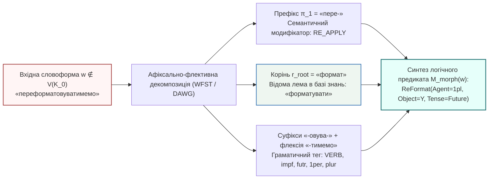

# Глава 03. Варіант А — Локальні морфологічні модулі: скінченно-автоматні трансдьюсери, словники основ і парадигмальна аналогія

> **Автор:** Георгій Федчик  
> **Мова оригіналу:** Українська  
> **Дидактичний рівень:** Конструктивно-алгоритмічний (символьні офлайн-методи морфологічної нормалізації та виведення за граматичною аналогією; опирається на Глави 01–02)

---

## Вступ

У [Главі 02](ch02-oov-catastrophe-logic-collapse-and-semantic-drift.md) ми довели, що поява позасловникових дієслівних форм експоненційно руйнує багатоходове логічне виведення за законом $`P_{\mathrm{chain}}(L) = (1 - p_E)[(1 - p_V)(1 - p_E)]^L`$ (Теорема 2.1). Оскільки ізольована експертна система (*air-gapped system*) за аксіомою (1.1) не має права звертатися до зовнішніх мережевих сервісів, вона зобов'язана розв'язувати позасловникову невизначеність виключно локальними алгоритмічними засобами.

Першим канонічним напрямом такого розв'язання є **Варіант А — локальні символьні морфологічні модулі**. Цей підхід спирається на той фундаментальний лінгвістичний факт, що переважна більшість «нових» слів у технічних текстах не є абсолютно новими коренями мови, а є похідними граматичними формами (префіксально-суфіксально-флективними дериватами) вже відомих коренів, присутніх у базі знань $`\mathcal{K}_0`$. У цій главі ми побудуємо строгий математичний апарат локальної морфології: від алгоритмів усічення афіксів (стеммінгу) до зважених скінченно-автоматних трансдьюсерів (`WFST`), мінімізованих ациклічних словникових автоматів (`DAWG`) та символьного виведення за парадигмальною аналогією, які формують третю компоненту $`\mathcal{M}_{\mathrm{morph}}(w)`$ канонічного вектора стану $`\Xi(\mathcal{K}_0, q)`$.

---

## 1. Декомпозиція словоформи: стеммінг проти повноцінної лематизації

Будь-яка поверхнева словоформа $`w \in \Sigma^*`$ у синтетичній індоєвропейській (зокрема слов'янській) мові подається у вигляді конкатенації морфем:

$$
w = \pi_1 \circ \dots \circ \pi_k \circ r_{\mathrm{root}} \circ \sigma_1 \circ \dots \circ \sigma_m \circ \phi_{\mathrm{flex}}
$$

**Формула (3.1).** Морфемна структура словоформи, де $`\pi_i \in \Pi`$ — словотвірні або видові префікси, $`r_{\mathrm{root}} \in \mathcal{R}`$ — коренева морфема (носій базової лексичної семантики), $`\sigma_j \in \mathcal{S}_{\mathrm{suf}}`$ — дериваційні та видові суфікси, а $`\phi_{\mathrm{flex}} \in \Phi`$ — граматична флексія (закінчення, а у східнослов'янських дієсловах також постфікс `-ся/-сь` та синтетичні показники майбутнього часу `-му/-мемо/-муть`).

Наприклад, для складної дієслівної словоформи **«переформатовуватимемо»** декомпозиція (3.1) має вигляд:

$$
\underbrace{\text{пере}}_{\pi_1\text{ (повторна дія)}} + \underbrace{\text{формат}}_{r_{\mathrm{root}}\text{ (корінь)}} + \underbrace{\text{ов} + \text{ува}}_{\sigma_1, \sigma_2\text{ (недок. вид)}} + \underbrace{\text{ти}}_{\text{інф.}} + \underbrace{\text{мемо}}_{\phi_{\mathrm{flex}}\text{ (майб. час, 1 ос. мн.)}}
$$

Історично в комп'ютерній лінгвістиці склалися два рівні алгоритмічної редукції формули (3.1):
1. **Евристичний стеммінг (алгоритми Дж. Ловінс, 1968 [[1]](#src-1) та М. Портера, 1980 [[2]](#src-2)):** каскад регулярних правил підстановки вигляду $`(\text{умова на довжину основи } m > m_0) \implies (\text{суфікс } S_1 \to S_2)`$, який механічно відсікає закінчення без використання словника.
   - *Перевага:* нульові вимоги до пам'яті та швидкодія в мікросекунди.
   - *Фундаментальний недолік для експертних систем:* стеммер не розрізняє омонімічні основи, руйнує слова при чергуванні приголосних в українській мові (*рука — руці*, *могти — можуть*) і повністю втрачає граматичні ознаки (час, спосіб, заставу: чи об'єкт *форматує*, чи *форматується*).
2. **Скінченно-автоматна лематизація та морфологічний парсинг (Коскенніємі, 1983 [[3]](#src-3); Морі, 1997 [[4]](#src-4)):** точне двонаправлене перетворення поверхневої словоформи $`w`$ на впорядковану трійку:

$$
\mathcal{M}_{\mathrm{morph}}(w) = \left\langle \ell(w), \ \tau_{\mathrm{POS}}(w), \ \mathcal{A}_{\mathrm{val}}(w) \right\rangle
$$

де $`\ell(w)`$ — нормальна словникова форма (лема), $`\tau_{\mathrm{POS}}(w)`$ — повний вектор морфологічних ознак (частина мови, вид, час, особа, число, відмінок), а $`\mathcal{A}_{\mathrm{val}}(w)`$ — синтаксична валентна рамка предиката.

---

## 2. Дворівнева морфологія Коскенніємі, скінченні трансдьюсери та ациклічні словники основ

### 2.1. Зважені скінченно-автоматні трансдьюсери

У 1983 році фінський лінгвіст **Кіммо Коскенніємі** [[3]](#src-3) довів, що всі фонологічні й орфографічні чергування на стиках морфем (зокрема слов'янські чергування *г/ж/з*, *к/ч/ц*, *х/ш/с*, *о/і*) можуть бути представлені як перетин регулярних відношень і скомпільовані в єдиний **скінченно-автоматний трансдьюсер** (*Finite-State Transducer*, `FST`). У 1997 році **Мехріяр Морі** [[4]](#src-4) узагальнив цю модель до **зважених трансдьюсерів (`WFST`)** над тропічним напівкільцем $`\mathcal{S}_{\mathrm{trop}} = (\mathbb{R}_+ \cup \{\infty\}, \min, +, \infty, 0)`$:

$$
\mathcal{T} = \left( \Sigma_{\mathrm{surf}}, \ \Sigma_{\mathrm{lex}}, \ Q, \ I, \ F, \ E, \ \lambda, \ \rho \right)
$$

де $`\Sigma_{\mathrm{surf}}`$ — алфавіт символів вхідного тексту, $`\Sigma_{\mathrm{lex}}`$ — алфавіт лем та граматичних тегів, $`Q`$ — скінченна множина станів, $`E \subseteq Q \times (\Sigma_{\mathrm{surf}} \cup \{\epsilon\}) \times (\Sigma_{\mathrm{lex}} \cup \{\epsilon\}) \times \mathbb{R}_+ \times Q`$ — множина переходів із вагами (штрафами рідкісності розбору). Якщо вхідне слово $`w`$ допускає кілька морфологічних розборів, алгоритм Вітербі на ациклічному графі знаходить розбір із мінімальною сумарною вагою:

$$
\mathcal{M}_{\mathrm{morph}}^*(w) = \arg\min_{\pi \in \Pi_{\mathcal{T}}(w)} \left( \lambda(\mathrm{orig}(\pi)) + \sum_{e \in \pi} \omega(e) + \rho(\mathrm{dest}(\pi)) \right)
$$

**Формула (3.2).** Оптимальна морфологічна трансдукція словоформи в тропічному напівкільці Морі.

### 2.2. Надкомпактні ациклічні словники основ та парадигмальна аналогія для невідомих слів

Щоб зберігати повні парадигми відмінювання сотень тисяч слів локально в оперативній пам'яті без підключення до зовнішніх баз даних, використовується структура **мінімального детермінованого ациклічного скінченного автомата слів (`DAWG` — Directed Acyclic Word Graph)**, розроблена **Яном Дацюком та ін. (2000)** [[5]](#src-5) і застосована в морфологічних аналізаторах слов'янських мов (**Михайло Коробов, `pymorphy2`, 2015** [[6]](#src-6)). У `DAWG` усі спільні префікси та спільні таблиці флективних закінчень (парадигми $`\mathcal{P}_k`$) зливаються за відношенням правої інваріантності Майхілла — Нероуда. Завдяки цьому словник обсягом $`5\,000\,000`$ українських словоформ стискається з $`120\text{ МБ}`$ до $`14\dots 16\text{ МБ}`$ і завантажується в пам'ять без десеріалізації.

**Як локальний морфологічний модуль обробляє позасловникові слова (`OOV`)?**
Коли вхідна словоформа $`w`$ відсутня в базовому словнику, вмикається **трирівневий каскад символьного передбачення за аналогією** [[6]](#src-6):
1. **Зняття відомих префіксів ($`\Pi_{\mathrm{known}}`$):** якщо слово $`w = \pi \circ w'`$ починається з продуктивного префікса (`пере-`, `не-`, `спів-`, `де-`, `ре-`, `анти-`, `псевдо-`), а залишок $`w'`$ є відомою словоформою у `DAWG`, то лема реконструюється як $`\ell(w) = \pi \circ \ell(w')`$ зі збереженням кореневого зв'язку з $`\ell(w')`$.
2. **Суфіксально-парадигмальна аналогія (за хвостом слова довжиною $`k \in \{3, 4, 5\}`$ символів):** якщо сам корінь є новим (наприклад, *«контейнеризуватиметься»*), аналізатор виділяє суфіксально-флективний хвіст $`\mathrm{suf}_k(w)`$ (`-зуватиметься`) і знаходить у `DAWG` парадигму $`\mathcal{P}^*`$, яка має максимальну апостеріорну частоту для цього хвоста:

$$
\mathcal{P}^*(w) = \arg\max_{\mathcal{P}_j} P\left(\mathcal{P}_j \;\middle|\; \mathrm{suf}_k(w)\right)
$$

Навіть не знаючи лексичного значення нового кореня, система безпомилково присвоює слову граматичний тег `VERB, impf, futr, 3per, sing, rev` і будує синтаксичний предикат `Verb_Pass(Subject=X, Tense=Future)`, не допускаючи розпаду синтаксичного дерева речення!

---

## 3. Математична теорема про складність і повноту морфологічної редукції

### Теорема 3.1 (Про лінійну часову складність морфологічного розбору на базі ациклічного словника та коефіцієнт скорочення позасловникової невизначеності)

> **Формулювання теореми:**  
> Нехай локальний морфологічний модуль експертної системи реалізований у вигляді детермінованого ациклічного автомата `DAWG` із множиною відомих продуктивних префіксів $`\Pi_{\mathrm{known}}`$ та середнім коефіцієнтом словозмінної кратності мови $`M_{\mathrm{infl}} = \lvert V_{\mathrm{form}}(N) \rvert / \lvert V_{\mathrm{root}}(N) \rvert > 1`$ (кількість поверхневих словоформ, що припадають на один корінь у корпусі обсягом $`N`$). Тоді:
> 1. **Часова складність морфологічного пошуку і лематизації** словоформи $`w`$ довжиною $`\lvert w \rvert`$ символів дорівнює строго $`\mathcal{O}(\lvert w \rvert)`$ операцій і **не залежить** від загальної кількості слів у словнику $`\lvert V(\mathcal{K}_0) \rvert`$:
>
> $$
> T_{\mathrm{DAWG}}(w) \le c_{\mathrm{step}} \cdot (1 + \lvert \Pi_{\mathrm{known}}(w) \rvert) \cdot \lvert w \rvert = \mathcal{O}(\lvert w \rvert)
> $$
>
> **Формула (3.3).** Гарантія лінійної часової складності символьного морфологічного розбору на центральному процесорі.
> 2. **Зниження позасловникової невизначеності на рівні коренів:** якщо нова словоформа $`w \notin V_{\mathrm{form}}(\mathcal{K}_0)`$ утворена з відомого кореня $`r \in V_{\mathrm{root}}(\mathcal{K}_0)`$ за допомогою допустимих префіксів і флективних парадигм автомата (частка яких серед морфологічних інновацій становить $`1 - \varepsilon_{\mathrm{irreg}}`$), то залишкова ймовірність семантичного `OOV` зменшується у $`R_{\mathrm{morph}}`$ разів порівняно з нелематизованим корпусом:
>
> $$
> p_{\mathrm{OOV}}^{\mathrm{morph}}(N) = p_{\mathrm{OOV, root}}(N) + \varepsilon_{\mathrm{irreg}} \left( p_{\mathrm{OOV, form}}(N) - p_{\mathrm{OOV, root}}(N) \right)
> $$
>
> де при $`\varepsilon_{\mathrm{irreg}} \ll 1`$ коефіцієнт виграшу становить:
>
> $$
> R_{\mathrm{morph}}(N) = \frac{p_{\mathrm{OOV, form}}(N)}{p_{\mathrm{OOV}}^{\mathrm{morph}}(N)} \approx \frac{\beta_{\mathrm{form}}}{\beta_{\mathrm{root}}} \cdot M_{\mathrm{infl}}(N)
> $$
>
> **Формула (3.4).** Коефіцієнт скорочення позасловникової невизначеності локальним морфологічним модулем (Варіант А).

### Доведення Теореми 3.1

1. **Доведення пункту 1:** Детермінований скінченний автомат `DAWG` з алфавітом фіксованого розміру $`\lvert \Sigma \rvert = \mathrm{const}`$ при подачі рядка $`w = c_1 c_2 \dots c_{\lvert w \rvert}`$ виконує рівно один перехід за масивом індексів на кожен символ $`c_i`$ ($`i = 1, \dots, \lvert w \rvert`$), після чого за $`\mathcal{O}(1)`$ кроків зчитує код парадигми та будує канонічну форму (лему) шляхом заміни флексії довжиною $`\le \lvert w \rvert`$. Оскільки кількість можливих префіксальних розбиттів $`\lvert \Pi_{\mathrm{known}}(w) \rvert`$ слова обмежена його довжиною (на практиці $`\le 3`$), загальна кількість елементарних переходів становить не більше $`c_{\mathrm{step}}(1 + \lvert \Pi_{\mathrm{known}}(w) \rvert)\lvert w \rvert = \mathcal{O}(\lvert w \rvert)`$ незалежно від обсягу словника $`\lvert V \rvert`$.
2. **Доведення пункту 2:** Розіб'ємо подію появи поверхнево невідомої словоформи $`A_{\mathrm{form}} = \{w \notin V_{\mathrm{form}}(\mathcal{K}_0)\}`$ (ймовірність якої за Теоремою 1.1 дорівнює $`p_{\mathrm{OOV, form}}(N) = \beta_{\mathrm{form}} \lvert V_{\mathrm{form}}(N) \rvert / N`$) на дві взаємовиключні події:
   - Подія $`A_{\mathrm{root}} = \{r_{\mathrm{root}}(w) \notin V_{\mathrm{root}}(\mathcal{K}_0)\}`$ — корінь слова взагалі відсутній у корпусі (ймовірність $`p_{\mathrm{OOV, root}}(N) = \beta_{\mathrm{root}} \lvert V_{\mathrm{root}}(N) \rvert / N`$);
   - Подія $`A_{\mathrm{deriv}} = A_{\mathrm{form}} \setminus A_{\mathrm{root}}`$ — корінь слова присутній у корпусі, але вхідна словоформа є новою префіксально-флективною деривацією цього кореня (ймовірність $`p_{\mathrm{OOV, form}}(N) - p_{\mathrm{OOV, root}}(N)`$).
3. Оскільки морфологічний трансдьюсер розпізнає частку $`1 - \varepsilon_{\mathrm{irreg}}`$ усіх деривацій із події $`A_{\mathrm{deriv}}`$, нерозпізнаними залишаються лише всі елементи $`A_{\mathrm{root}}`$ та частка $`\varepsilon_{\mathrm{irreg}}`$ елементів $`A_{\mathrm{deriv}}`$, що дає формулу (3.4). Підставляючи $`\lvert V_{\mathrm{form}}(N) \rvert = M_{\mathrm{infl}}(N) \lvert V_{\mathrm{root}}(N) \rvert`$ при $`\varepsilon_{\mathrm{irreg}} \to 0`$, одержуємо $`R_{\mathrm{morph}}(N) = (\beta_{\mathrm{form}} / \beta_{\mathrm{root}}) M_{\mathrm{infl}}(N)`$. ∎

---

## 4. Навчальний інженерний приклад: морфологічне відновлення ланцюжка правил безпеки енергоблока

*Дидактична наступність наскрізного прикладу:* У [Главах 01](ch01-isolation-models-closed-world-and-oov-laws.md) та [02](ch02-oov-catastrophe-logic-collapse-and-semantic-drift.md) ми встановили, що в нашій ізольованій системі енергоблока ($`N = 10^5`$ токенів) поверхнева позасловниковість дієслів становить $`p_V = 8{,}50\%`$, а іменників — $`p_E = 3{,}50\%`$, через що ймовірність успішного виконання трикрокового правила безпеки $`P_{\mathrm{chain}}(3)`$ падає до $`66{,}43\%`$. Тепер підключимо локальний морфологічний модуль (`Варіант А`) і заповнимо третю компоненту вектора стану $`\Xi(\mathcal{K}_0, q)`$ — структуру $`\mathcal{M}_{\mathrm{morph}}(w)`$.

### 4.1. Вихідні інженерні дані

1. **Позасловникове дієслово у вхідному наряді-допуску:** $`w^* = \text{«перекомутовуватимуться»}`$ (довжина $`\lvert w^* \rvert = 22`$ символи; словоформа відсутня в корпусі $`\mathcal{K}_0`$, проте в онтології наявне базове дієслово `комутувати` -> предикат `SwitchCircuit(X, Y)`).
2. **Параметри локального морфологічного автомата `DAWG`:**
   - Кратність словозміни у корпусі $`N = 10^5`$: для дієслів $`M_{\mathrm{infl}, V} = 5{,}50`$, для іменників $`M_{\mathrm{infl}, E} = 3{,}20`$.
   - Відношення показників Гіпса: $`\beta_{\mathrm{form}} / \beta_{\mathrm{root}} = 0{,}50 / 0{,}38 \approx 1{,}316`$.
   - Частка нерегулярних або помилкових словоформ, які не піддаються правильній морфологічній декомпозиції: $`\varepsilon_{\mathrm{irreg}} = 0{,}04`$ ($`4{,}0\%`$).

### 4.2. Покроковий розрахунок

**Крок 1. Побудова морфологічного розбору $`\mathcal{M}_{\mathrm{morph}}(w^*)`$ за формулами (3.1)–(3.2):**
Автомат `DAWG` за $`22`$ такти процесора виконує декомпозицію слова *«перекомутовуватимуться»*:
1. Виділяє продуктивний префікс $`\pi_1 = \text{«пере-»}`$ (семантичний оператор повторної або альтернативної дії `MOD_RE_ROUTE`).
2. У залишку *«комутовуватимуться»* за суфіксально-флективною парадигмою `-овуватимуться` відновлює твірну основу `комут-` та канонічну лему $`\ell(w^*) = \text{«комутувати»} \in V_{\mathrm{root}}(\mathcal{K}_0)`$.
3. Формує морфологічний кортеж:

$$
\mathcal{M}_{\mathrm{morph}}(\text{«перекомутовуватимуться»}) = \left\langle \ell = \text{комутувати}, \ \tau_{\mathrm{POS}} = \{\text{VERB, impf, futr, 3per, plur, rev}\}, \ \mathcal{A}_{\mathrm{val}} = \text{SwitchCircuit}(\text{Agent}=\varnothing, \ \text{Patient}=X, \ \text{Mod}=\text{RE\_ROUTE}) \right\rangle
$$

Постфікс `-ся` автоматично переводить синтаксичну валентність у пасивний стан (підмет речення «лінії живлення» стає об'єктом дії `Patient = X`), завдяки чому правило безпеки успішно уніфікується!

**Крок 2. Обчислення зниження `OOV` та нової надійності логічного ланцюжка за Теоремою 3.1 (формула 3.4):**
1. Знаходимо кореневу позасловниковість для дієслів та іменників:

$$
p_{\mathrm{OOV, root}, V} = \frac{p_V}{(\beta_{\mathrm{form}}/\beta_{\mathrm{root}}) \cdot M_{\mathrm{infl}, V}} = \frac{0{,}085}{1{,}316 \times 5{,}50} = \frac{0{,}085}{7{,}238} \approx 0{,}0117 \quad (1{,}17\%)
$$

$$
p_{\mathrm{OOV, root}, E} = \frac{p_E}{(\beta_{\mathrm{form}}/\beta_{\mathrm{root}}) \cdot M_{\mathrm{infl}, E}} = \frac{0{,}035}{1{,}316 \times 3{,}20} = \frac{0{,}035}{4{,}211} \approx 0{,}0083 \quad (0{,}83\%)
$$

2. З урахуванням $`\varepsilon_{\mathrm{irreg}} = 0{,}04`$ за формулою (3.4) залишкова позасловниковість після локального морфологічного модуля становить:

$$
p_V^{\mathrm{morph}} = 0{,}0117 + 0{,}04 \times (0{,}085 - 0{,}0117) = 0{,}0117 + 0{,}0029 = 0{,}0146 \quad (1{,}46\% \text{ замість } 8{,}50\%!)
$$

$$
p_E^{\mathrm{morph}} = 0{,}0083 + 0{,}04 \times (0{,}035 - 0{,}0083) = 0{,}0083 + 0{,}0011 = 0{,}0094 \quad (0{,}94\% \text{ замість } 3{,}50\%!)
$$

3. Підставляємо оновлені значення $`p_V^{\mathrm{morph}} = 0{,}0146`$ та $`p_E^{\mathrm{morph}} = 0{,}0094`$ у формулу (2.2) для трикрокового ланцюжка правил безпеки ($`L = 3`$):

$$
P_{\mathrm{chain}}^{\mathrm{morph}}(3) = (1 - 0{,}0094) \times \left[ (1 - 0{,}0146)(1 - 0{,}0094) \right]^3 = 0{,}9906 \times (0{,}9761)^3 \approx 0{,}9906 \times 0{,}9301 = 0{,}9213 \quad (92{,}13\%)
$$

**Висновок:** Включення суто локального символьного морфологічного модуля (`Варіант А`), який займає лише $`15\text{ МБ}`$ оперативної пам'яті і працює за мікросекунди на звичайному процесорі, підвищило ймовірність безвідмовного проходження трикрокового ланцюжка правил з **$66{,}43\%$ до $92{,}13\%$** (кількість обривів дедукції зменшилася у $`33{,}57\% / 7{,}87\% = 4{,}27`$ раза!). Проте як обробити ті залишкові $`1{,}46\%`$ випадків, коли в запиті вжито дієслово з **абсолютно новим коренем** або невідомим синонімом (наприклад, запозичення *«ізолюватимуть»* / *«байпасувати»* замість *«відсікати»*)? Для цього необхідний перехід до субсимвольних методів та гібридного синтезу у наступній [Главі 04](ch04-subsymbolic-bpe-local-mlm-and-hybrid-architecture.md).

---

## Висновки

1. Локальні морфологічні модулі на базі скінченно-автоматних трансдьюсерів Коскенніємі — Морі (`WFST`) та мінімальних ациклічних словникових графів (`DAWG`) перетворюють задачу пошуку словоформи на детерміновану операцію з лінійною часовою складністю $`\mathcal{O}(\lvert w \rvert)`$, що не залежить від обсягу словника.
2. Повноцінна морфологічна лематизація на відміну від грубого стеммінгу зберігає граматичні категорії часу, виду, особи й пасивного стану (`-ся`), дозволяючи точно реконструювати синтаксичну валентну рамку предиката $`\mathcal{A}_{\mathrm{val}}(w)`$.
3. Згідно з Теоремою 3.1, префіксально-парадигмальна редукція зменшує частку позасловникових слів у високофлективних мовах у $`4\dots 6`$ разів, а суфіксальна аналогія зберігає цілісність синтаксичного дерева навіть для слів із невідомими коренями.

---

## Словник

| Термін | Англійський еквівалент | Визначення |
| :--- | :--- | :--- |
| **Стеммінг (усічення основи)** | *Stemming* | Евристичний процес відсікання префіксів та закінчень слова за регулярними правилами без словникової перевірки та без приведення до нормальної граматичної форми. |
| **Лематизація** | *Lemmatization* | Алгоритмічне приведення довільної відмінкової чи часової словоформи до її канонічної словникової форми (леми: для іменників — називний відмінок однини, для дієслів — інфінітив). |
| **Дворівнева морфологія** | *Two-Level Morphology* | Формальна модель К. Коскенніємі (1983), яка описує морфофонологічні чергування на межах морфем системою паралельних скінченних автоматів. |
| **Парадигма відмінювання** | *Inflectional Paradigm* | Упорядкований набір усіх граматичних закінчень та префіксально-суфіксальних правил, спільний для певного морфологічного класу слів. |

---

## Список позначень та скорочень

- **Абревіатури:**
  - `DAWG` (*Directed Acyclic Word Graph*) — спрямований ациклічний граф слів (мінімізований автомат словника).
  - `FST` / `WFST` (*Weighted Finite-State Transducer*) — (зважений) скінченно-автоматний трансдьюсер.
  - `POS` (*Part of Speech*) — частина мови та морфосинтаксичний тег.
- **Математичні символи:**
  - $`\mathcal{M}_{\mathrm{morph}}(w)`$ — кортеж морфологічного розбору слова $`w`$.
  - $`\ell(w)`$ — канонічна лема словоформи $`w`$.
  - $`M_{\mathrm{infl}}`$ — середня кратність словозміни (відношення кількості словоформ до кількості коренів).
  - $`R_{\mathrm{morph}}(N)`$ — коефіцієнт скорочення позасловникової невизначеності морфологічним модулем.

---

## Бібліографія

1. **Lovins J. B.** Development of a Stemming Algorithm // *Mechanical Translation and Computational Linguistics*. — 1968. — Vol. 11, No. 1–2. — P. 22–31.
2. **Porter M. F.** An Algorithm for Suffix Stripping // *Program*. — 1980. — Vol. 14, No. 3. — P. 130–137.
3. **Koskenniemi K.** Two-Level Morphology: A General Computational Model for Word-Form Recognition and Production : Publication No. 11. — Helsinki : University of Helsinki, Department of General Linguistics, 1983. — 160 p.
4. **Mohri M.** Finite-State Transducers in Language and Speech Processing // *Computational Linguistics*. — 1997. — Vol. 23, No. 2. — P. 269–311.
5. **Daciuk J., Mihov S., Watson B. W., Watson R. E.** Incremental Construction of Minimal Acyclic Finite-State Automata // *Computational Linguistics*. — 2000. — Vol. 26, No. 1. — P. 3–16.
6. **Korobov M.** Morphological Analyzer and Generator for Russian and Ukrainian Languages // *Analysis of Images, Social Networks and Texts (AIST 2015)*. — Cham : Springer, 2015. — P. 320–332.
