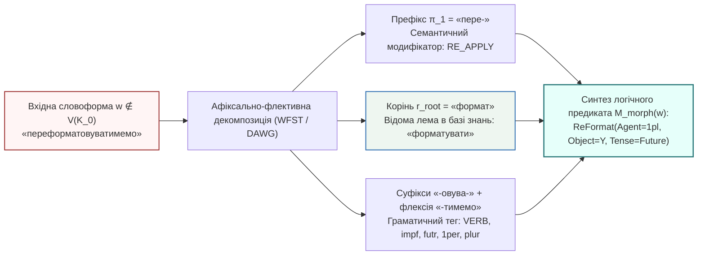

# Глава 03. Варіант А — Локальні морфологічні модулі: скінченно-автоматні трансдьюсери, словники основ і парадигмальна аналогія

> **Автор:** Георгій Федчик  
> **Мова оригіналу:** Українська  
> **Дидактичний рівень:** Конструктивно-алгоритмічний (символьні офлайн-методи морфологічної нормалізації та виведення за граматичною аналогією; опирається на Глави 01–02)

---

## Вступ

У [Главі 02](ch02-oov-catastrophe-logic-collapse-and-semantic-drift.md) показано, що в моделі повного розбору тексту поява позасловникових дієслівних форм експоненційно знижує ймовірність успішного багатоходового виведення за законом $`P_{\mathrm{chain}}(L) = (1 - p_E)[(1 - p_V)(1 - p_E)]^L`$ (Твердження 2.1). Оскільки ізольована експертна система (*air-gapped system*) за моделлю контрольованих каналів (1.1) не звертається під час роботи до зовнішніх мережевих сервісів, вона мусить розв'язувати позасловникову невизначеність локальними алгоритмічними засобами.

Першим канонічним напрямом такого розв'язання є **Варіант А — локальні символьні морфологічні модулі**. Цей підхід спирається на спостереження, що значна частина «нових» слів у технічних текстах не є новими коренями мови, а є похідними граматичними формами (префіксально-суфіксально-флективними дериватами) вже відомих коренів, присутніх у базі знань $`\mathcal{K}_0`$. У цій главі побудовано математичний апарат локальної морфології: від алгоритмів усічення афіксів (стеммінгу) до зважених скінченно-автоматних трансдьюсерів (`WFST`), мінімізованих ациклічних словникових автоматів (`DAWG`) та символьного виведення за парадигмальною аналогією, які формують третю компоненту $`\mathcal{M}_{\mathrm{morph}}(w)`$ канонічного вектора стану $`\Xi(\mathcal{K}_0, q)`$.

---

## 1. Декомпозиція словоформи: стеммінг проти повноцінної лематизації

Будь-яка поверхнева словоформа $`w \in \Sigma^*`$ у синтетичній індоєвропейській (зокрема слов'янській) мові подається у вигляді конкатенації морфем:

$$
w = \pi_1 \circ \dots \circ \pi_k \circ r_{\mathrm{root}} \circ \sigma_1 \circ \dots \circ \sigma_m \circ \phi_{\mathrm{flex}}
$$

**Формула (3.1).** Морфемна структура словоформи, де $`\pi_i \in \Pi`$ — словотвірні або видові префікси, $`r_{\mathrm{root}} \in \mathcal{R}`$ — коренева морфема (носій базової лексичної семантики), $`\sigma_j \in \mathcal{S}_{\mathrm{suf}}`$ — дериваційні та видові суфікси, а $`\phi_{\mathrm{flex}} \in \Phi`$ — граматична флексія (закінчення, а у східнослов'янських дієсловах також постфікс `-ся/-сь` та синтетичні показники майбутнього часу `-му/-мемо/-муть`).

Наприклад, для складної дієслівної словоформи **«переформатовуватимемо»** декомпозиція (3.1) має вигляд:

$$
\underbrace{\text{пере}}_{\pi_1\text{ (повторна дія)}} + \underbrace{\text{формат}}_{r_{\mathrm{root}}\text{ (корінь)}} + \underbrace{\text{ов} + \text{ува}}_{\sigma_1, \sigma_2\text{ (недок. вид)}} + \underbrace{\text{ти}}_{\text{інф.}} + \underbrace{\text{мемо}}_{\phi_{\mathrm{flex}}\text{ (майб. час, 1 ос. мн.)}}
$$

Історично в комп'ютерній лінгвістиці склалися два рівні алгоритмічної редукції формули (3.1):
1. **Евристичний стеммінг (алгоритми Дж. Ловінс, 1968 [[1]](#src-1) та М. Портера, 1980 [[2]](#src-2)):** каскад регулярних правил підстановки вигляду $`(\text{умова на довжину основи } m > m_0) \implies (\text{суфікс } S_1 \to S_2)`$, який механічно відсікає закінчення без використання словника.
   - *Перевага:* нульові вимоги до пам'яті та швидкодія в мікросекунди.
   - *Недолік для експертних систем:* стеммер не розрізняє омонімічні основи, руйнує слова при чергуванні приголосних в українській мові (*рука — руці*, *могти — можуть*) і повністю втрачає граматичні ознаки (час, спосіб, заставу: чи об'єкт *форматує*, чи *форматується*).
2. **Скінченно-автоматна лематизація та морфологічний парсинг (Коскенніємі, 1983 [[3]](#src-3); Морі, 1997 [[4]](#src-4)):** двонаправлене перетворення поверхневої словоформи $`w`$ на впорядковану трійку:

$$
\mathcal{M}_{\mathrm{morph}}(w) = \left\langle \ell(w), \ \tau_{\mathrm{POS}}(w), \ \mathcal{A}_{\mathrm{val}}(w) \right\rangle
$$

де $`\ell(w)`$ — нормальна словникова форма (лема), $`\tau_{\mathrm{POS}}(w)`$ — повний вектор морфологічних ознак (частина мови, вид, час, особа, число, відмінок), а $`\mathcal{A}_{\mathrm{val}}(w)`$ — синтаксична валентна рамка предиката.

---

## 2. Дворівнева морфологія Коскенніємі, скінченні трансдьюсери та ациклічні словники основ

Морфологічний модуль Варіанта А мусить за мікросекунди зводити довільну словоформу до леми й тегів, не звертаючись до зовнішніх сервісів. Нижче показано, які формальні результати роблять це можливим і де їхні межі.

### 2.1. Регулярність правил переписування та зважені скінченно-автоматні трансдьюсери

Те, що системи фонологічних і орфографічних правил переписування можна виразити скінченними автоматами, довів **К. Дуглас Джонсон (1972)** [[7]](#src-7): якщо правило не застосовується повторно до власного виходу, каскад таких правил задає регулярне відношення. **Рональд Каплан і Мартін Кей** [[8]](#src-8) розробили алгоритм компіляції правил переписування у скінченно-автоматні трансдьюсери (*Finite-State Transducer*, `FST`) та їхньої композиції. **Кімо Коскенніємі (1983)** [[3]](#src-3) запропонував дворівневу модель, у якій чергування на стиках морфем (зокрема слов'янські чергування *г/ж/з*, *к/ч/ц*, *х/ш/с*, *о/і*) описуються паралельними автоматами-обмеженнями між лексичним і поверхневим рівнями. **Мехріяр Морі (1997)** [[4]](#src-4) систематизував теорію та алгоритми **зважених трансдьюсерів (`WFST`)** над напівкільцями, зокрема над тропічним напівкільцем $`\mathcal{S}_{\mathrm{trop}} = (\mathbb{R}_+ \cup \{\infty\}, \min, +, \infty, 0)`$:

$$
\mathcal{T} = \left( \Sigma_{\mathrm{surf}}, \ \Sigma_{\mathrm{lex}}, \ Q, \ I, \ F, \ E, \ \lambda, \ \rho \right)
$$

де $`\Sigma_{\mathrm{surf}}`$ — алфавіт символів вхідного тексту, $`\Sigma_{\mathrm{lex}}`$ — алфавіт лем та граматичних тегів, $`Q`$ — скінченна множина станів, $`I, F \subseteq Q`$ — початкові та кінцеві стани, $`E \subseteq Q \times (\Sigma_{\mathrm{surf}} \cup \{\epsilon\}) \times (\Sigma_{\mathrm{lex}} \cup \{\epsilon\}) \times \mathbb{R}_+ \times Q`$ — множина переходів із вагами (штрафами рідкісності розбору), $`\lambda`$ і $`\rho`$ — початкові та кінцеві ваги. Якщо вхідне слово $`w`$ допускає кілька морфологічних розборів, пошук найкоротшого шляху в ациклічному графі розборів знаходить розбір із мінімальною сумарною вагою:

$$
\mathcal{M}_{\mathrm{morph}}^*(w) = \arg\min_{\pi \in \Pi_{\mathcal{T}}(w)} \left( \lambda(\mathrm{orig}(\pi)) + \sum_{e \in \pi} \omega(e) + \rho(\mathrm{dest}(\pi)) \right)
$$

**Формула (3.2).** Оптимальна морфологічна трансдукція словоформи в тропічному напівкільці, де $`\Pi_{\mathcal{T}}(w)`$ — множина успішних шляхів трансдьюсера для $`w`$, а $`\omega(e)`$ — вага переходу $`e`$. Мінімальна вага відповідає найімовірнішому розбору, але не гарантує його правильності: неоднозначні словоформи потребують контексту.

### 2.2. Ациклічні словники основ та парадигмальна аналогія для невідомих слів

Щоб зберігати повні парадигми відмінювання сотень тисяч слів локально в оперативній пам'яті, використовується **мінімальний детермінований ациклічний скінченний автомат слів** (`DAWG` — *Directed Acyclic Word Graph*). Алгоритм його інкрементальної побудови запропонували **Ян Дацюк та ін. (2000)** [[5]](#src-5); такі автомати застосовано, зокрема, в морфологічному аналізаторі `pymorphy2` для російської та української мов (**Михайло Коробов, 2015** [[6]](#src-6)). У префіксному дереві (*trie*) спільні префікси слів уже представлено спільними шляхами. Мінімізація `DAWG` додатково об'єднує стани з однаковою **правою мовою** (множиною можливих продовжень) за відношенням Майхілла — Нероуда, тобто зливає спільні **суфікси**, зокрема однакові таблиці флективних закінчень (парадигми $`\mathcal{P}_k`$). Завдяки цьому словник займає в рази менше пам'яті, ніж список словоформ, і може відображатися в пам'ять без десеріалізації. Конкретний обсяг залежить від реалізації і кодування тегів; у цій книзі його не вимірювано, тому орієнтовні значення порядку десятка мегабайтів для повного словника мови слід перевіряти на вибраній реалізації.

**Як локальний морфологічний модуль обробляє позасловникові слова (`OOV`)?**
Коли вхідна словоформа $`w`$ відсутня в базовому словнику, вмикається **трирівневий каскад передбачення за аналогією** [[6]](#src-6):
1. **Зняття відомих префіксів ($`\Pi_{\mathrm{known}}`$):** якщо слово $`w = \pi \circ w'`$ починається з продуктивного дієслівного префікса (`пере-`, `роз-`, `від-`, `де-`, `ре-`), а залишок $`w'`$ є відомою словоформою у `DAWG`, то лема реконструюється як $`\ell(w) = \pi \circ \ell(w')`$ зі збереженням зв'язку з $`\ell(w')`$. Заперечне «не» при дієсловах в українській мові пишеться окремо і є часткою, а не префіксом; префікс `не-` властивий іменникам і прикметникам (*неробочий*). Префікси на кшталт `спів-`, `анти-`, `псевдо-` продуктивні переважно в іменниках і прикметниках.
2. **Суфіксально-парадигмальна аналогія (за хвостом слова довжиною $`k \in \{3, 4, 5\}`$ символів):** якщо сам корінь є новим (наприклад, *«контейнеризуватиметься»*), аналізатор виділяє суфіксально-флективний хвіст $`\mathrm{suf}_k(w)`$ (`-зуватиметься`) і знаходить у `DAWG` парадигму $`\mathcal{P}^*`$, яка має максимальну апостеріорну частоту для цього хвоста:

$$
\mathcal{P}^*(w) = \arg\max_{\mathcal{P}_j} P\left(\mathcal{P}_j \;\middle|\; \mathrm{suf}_k(w)\right)
$$

**Формула (3.2а).** Вибір парадигми за суфіксальною аналогією. Імовірність помилки для конкретного хвоста дорівнює $`1 - \max_j P(\mathcal{P}_j \mid \mathrm{suf}_k(w))`$; її слід оцінювати на відкладених словах словника.

Навіть не знаючи лексичного значення нового кореня, система **з певною ймовірністю помилки** присвоює слову найімовірніший тег, наприклад `VERB, impf, futr, 3per, sing`, і зберігає синтаксичну структуру речення. Передбачення за суфіксом є ймовірнісним: омонімічні закінчення, нерегулярні дієслова й запозичення дають помилки, частку яких треба вимірювати. Окремо слід розглядати постфікс `-ся`: він може мати зворотне (*митися*), взаємне (*зустрічатися*), антикаузативне (*двері відчиняються*) або пасивне значення (*план виконується бригадою*). Тому аналізатор позначає заставу як неоднозначну, а остаточну валентну рамку визначає лексикон дієслова або синтаксичний аналіз речення, а не сам суфікс.

### 2.3. Наявні відкриті ресурси для української мови та галузеві коди обладнання

Будувати морфологічний словник з нуля для ізольованої системи недоцільно: існують відкриті ресурси, які можна імпортувати через контрольований канал оновлень (1.1) і перевірити перед використанням.
1. **ВЕСУМ / `dict_uk`** [[9]](#src-9) — великий електронний словник української мови з парадигмами і граматичними тегами; на ньому побудовано українські словники для морфологічних аналізаторів.
2. **`pymorphy3` з пакетом словників `pymorphy3-dicts-uk`** [[10]](#src-10) — продовження `pymorphy2` [[6]](#src-6) з тим самим підходом на основі `DAWG` і передбаченням для невідомих слів.
3. **Дерево залежностей UD Ukrainian-IU** [[11]](#src-11) і інструменти, навчені на ньому, зокрема `Stanza` [[12]](#src-12) та `UDPipe`, — для лематизації, морфологічної розмітки і синтаксичного аналізу, які потрібні для визначення валентності, заперечення та кореферентності.
4. **Коди ідентифікації обладнання електростанцій `KKS` та `RDS-PP`** (останній базується на принципах серії ISO/IEC 81346) — мовно-незалежні ідентифікатори агрегатів. Прив'язка іменникових термінів до таких кодів зменшує залежність від словоформ: «засувка 1LAB10AA001» розпізнається за кодом, навіть якщо назва записана нестандартно.

Перед використанням ці ресурси потрібно перевірити на корпусі цільової галузі: їхнє покриття технічної лексики і точність на ній невідомі заздалегідь.

---

## 3. Теорема про складність і повноту морфологічної редукції

Щоб вирішити, чи окупається морфологічний модуль, потрібні дві оцінки: скільки часу займає розбір одного слова і наскільки він зменшує частку `OOV`. Перша оцінка є строгим результатом теорії автоматів, друга — розкладом імовірностей, числові значення якого залежать від виміряних параметрів.

### Теорема 3.1 (Про лінійну часову складність морфологічного розбору на базі ациклічного словника та коефіцієнт скорочення позасловникової невизначеності)

**Умови.** Нехай локальний морфологічний модуль експертної системи реалізовано у вигляді детермінованого ациклічного автомата `DAWG` із множиною відомих продуктивних префіксів $`\Pi_{\mathrm{known}}`$ та середнім коефіцієнтом словозмінної кратності $`M_{\mathrm{infl}} = \lvert V_{\mathrm{form}}(N) \rvert / \lvert V_{\mathrm{root}}(N) \rvert > 1`$ (кількість поверхневих словоформ, що припадають на один корінь у корпусі обсягом $`N`$). Тоді:
1. **Часова складність морфологічного пошуку і лематизації** словоформи $`w`$ довжиною $`\lvert w \rvert`$ символів становить $`\mathcal{O}(\lvert w \rvert)`$ переходів автомата і **не залежить** від загальної кількості слів у словнику $`\lvert V(\mathcal{K}_0) \rvert`$:

$$
T_{\mathrm{DAWG}}(w) \le c_{\mathrm{step}} \cdot (1 + \lvert \Pi_{\mathrm{known}}(w) \rvert) \cdot \lvert w \rvert = \mathcal{O}(\lvert w \rvert)
$$

**Формула (3.3).** Лінійна часова складність символьного морфологічного розбору, де $`c_{\mathrm{step}}`$ — вартість одного переходу (кілька машинних інструкцій і звернень до пам'яті, а не один такт процесора).

2. **Зниження позасловникової невизначеності на рівні коренів:** якщо нова словоформа $`w \notin V_{\mathrm{form}}(\mathcal{K}_0)`$ утворена з відомого кореня $`r \in V_{\mathrm{root}}(\mathcal{K}_0)`$ за допомогою префіксів і флективних парадигм автомата, які правильно розпізнаються в частці $`1 - \varepsilon_{\mathrm{irreg}}`$ випадків, то залишкова ймовірність семантичного `OOV` дорівнює:

$$
p_{\mathrm{OOV}}^{\mathrm{morph}}(N) = p_{\mathrm{OOV, root}}(N) + \varepsilon_{\mathrm{irreg}} \left( p_{\mathrm{OOV, form}}(N) - p_{\mathrm{OOV, root}}(N) \right)
$$

а при $`\varepsilon_{\mathrm{irreg}} \ll 1`$ коефіцієнт виграшу за моделлю Гіпса наближено становить:

$$
R_{\mathrm{morph}}(N) = \frac{p_{\mathrm{OOV, form}}(N)}{p_{\mathrm{OOV}}^{\mathrm{morph}}(N)} \approx \frac{\beta_{\mathrm{form}}}{\beta_{\mathrm{root}}} \cdot M_{\mathrm{infl}}(N)
$$

**Формула (3.4).** Коефіцієнт скорочення позасловникової невизначеності локальним морфологічним модулем (Варіант А).

### Доведення Теореми 3.1

1. **Пункт 1:** Детермінований скінченний автомат `DAWG` з алфавітом фіксованого розміру $`\lvert \Sigma \rvert = \mathrm{const}`$ при подачі рядка $`w = c_1 c_2 \dots c_{\lvert w \rvert}`$ виконує один перехід на кожен символ $`c_i`$ ($`i = 1, \dots, \lvert w \rvert`$), після чого за $`\mathcal{O}(1)`$ кроків зчитує код парадигми та будує лему заміною флексії довжиною $`\le \lvert w \rvert`$. Кількість префіксальних розбиттів $`\lvert \Pi_{\mathrm{known}}(w) \rvert`$ обмежена довжиною слова (на практиці $`\le 3`$), тому загальна кількість переходів не перевищує $`c_{\mathrm{step}}(1 + \lvert \Pi_{\mathrm{known}}(w) \rvert)\lvert w \rvert = \mathcal{O}(\lvert w \rvert)`$ незалежно від обсягу словника $`\lvert V \rvert`$.
2. **Пункт 2:** Розіб'ємо подію появи поверхнево невідомої словоформи $`A_{\mathrm{form}} = \{w \notin V_{\mathrm{form}}(\mathcal{K}_0)\}`$ (ймовірність якої за Моделлю 1.1 наближено дорівнює $`p_{\mathrm{OOV, form}}(N) = \beta_{\mathrm{form}} \lvert V_{\mathrm{form}}(N) \rvert / N`$) на дві взаємовиключні події:
   - подія $`A_{\mathrm{root}} = \{r_{\mathrm{root}}(w) \notin V_{\mathrm{root}}(\mathcal{K}_0)\}`$ — корінь слова відсутній у корпусі (ймовірність $`p_{\mathrm{OOV, root}}(N) = \beta_{\mathrm{root}} \lvert V_{\mathrm{root}}(N) \rvert / N`$);
   - подія $`A_{\mathrm{deriv}} = A_{\mathrm{form}} \setminus A_{\mathrm{root}}`$ — корінь присутній, але словоформа є новою деривацією цього кореня (ймовірність $`p_{\mathrm{OOV, form}}(N) - p_{\mathrm{OOV, root}}(N)`$).
3. Морфологічний трансдьюсер розпізнає частку $`1 - \varepsilon_{\mathrm{irreg}}`$ деривацій із події $`A_{\mathrm{deriv}}`$, тому нерозпізнаними залишаються всі елементи $`A_{\mathrm{root}}`$ та частка $`\varepsilon_{\mathrm{irreg}}`$ елементів $`A_{\mathrm{deriv}}`$, що дає першу формулу пункту 2. Підставляючи $`\lvert V_{\mathrm{form}}(N) \rvert = M_{\mathrm{infl}}(N) \lvert V_{\mathrm{root}}(N) \rvert`$ при $`\varepsilon_{\mathrm{irreg}} \to 0`$, одержуємо $`R_{\mathrm{morph}}(N) \approx (\beta_{\mathrm{form}} / \beta_{\mathrm{root}}) M_{\mathrm{infl}}(N)`$. ∎

---

## 4. Навчальний інженерний приклад: морфологічне відновлення ланцюжка правил безпеки енергоблока

*Дидактична наступність наскрізного прикладу:* У [Главах 01](ch01-isolation-models-closed-world-and-oov-laws.md) та [02](ch02-oov-catastrophe-logic-collapse-and-semantic-drift.md) прийнято навчальні значення поверхневої позасловниковості дієслів $`p_V = 8{,}50\%`$ та іменників $`p_E = 3{,}50\%`$, за яких у моделі повного розбору ймовірність успішного виконання трикрокового правила безпеки $`P_{\mathrm{chain}}(3)`$ становить $`66{,}43\%`$. Тепер підключимо локальний морфологічний модуль (`Варіант А`) і заповнимо третю компоненту вектора стану $`\Xi(\mathcal{K}_0, q)`$ — структуру $`\mathcal{M}_{\mathrm{morph}}(w)`$.

### 4.1. Вихідні інженерні дані

1. **Позасловникове дієслово у вхідному наряді-допуску:** $`w^* = \text{«перекомутовуватимуться»}`$ (довжина $`\lvert w^* \rvert = 22`$ символи; словоформа відсутня в корпусі $`\mathcal{K}_0`$, проте в онтології наявне базове дієслово `комутувати` -> предикат `SwitchCircuit(X, Y)`).
2. **Параметри локального морфологічного автомата `DAWG`** — **навчальні ілюстративні значення**, які для реальної системи треба виміряти на корпусі:
   - кратність словозміни у корпусі $`N = 10^5`$: для дієслів $`M_{\mathrm{infl}, V} = 5{,}50`$, для іменників $`M_{\mathrm{infl}, E} = 3{,}20`$;
   - відношення показників Гіпса: $`\beta_{\mathrm{form}} / \beta_{\mathrm{root}} = 0{,}50 / 0{,}38 \approx 1{,}316`$ (показник для коренів $`\beta_{\mathrm{root}} = 0{,}38`$ взято дещо меншим за $`\beta_{\mathrm{lem}} = 0{,}40`$ Глави 01, бо одному кореню може відповідати кілька лем);
   - частка нерегулярних або помилково розібраних словоформ: $`\varepsilon_{\mathrm{irreg}} = 0{,}04`$ ($`4{,}0\%`$).

### 4.2. Покроковий розрахунок

**Крок 1. Побудова морфологічного розбору $`\mathcal{M}_{\mathrm{morph}}(w^*)`$ за формулами (3.1)–(3.2):**
Автомат `DAWG` за $`22`$ переходи (по одному на символ; кожен перехід — кілька машинних інструкцій) виконує декомпозицію слова *«перекомутовуватимуться»*:
1. Виділяє продуктивний префікс $`\pi_1 = \text{«пере-»}`$ (семантичний модифікатор повторної або альтернативної дії `MOD_RE_ROUTE`).
2. У залишку *«комутовуватимуться»* за суфіксально-флективною парадигмою `-овуватимуться` відновлює твірну основу `комут-` та лему $`\ell(w^*) = \text{«комутувати»} \in V_{\mathrm{root}}(\mathcal{K}_0)`$.
3. Формує морфологічний кортеж:

$$
\mathcal{M}_{\mathrm{morph}}(\text{«перекомутовуватимуться»}) = \left\langle \ell = \text{комутувати}, \ \tau_{\mathrm{POS}} = \{\text{VERB, impf, futr, 3per, plur, -ся}\}, \ \mathcal{A}_{\mathrm{val}} = \text{SwitchCircuit}(\text{Agent}=\varnothing, \ \text{Patient}=X, \ \text{Mod}=\text{RE\_ROUTE}) \right\rangle
$$

Постфікс `-ся` сам по собі не визначає заставу. Валентну рамку з підметом у ролі об'єкта дії (`Patient = X` для «лінії живлення перекомутовуватимуться») обрано тому, що лексикон галузевих дієслів для `комутуватися` містить лише антикаузативне або пасивне прочитання з неживим підметом. Якщо такого запису в лексиконі немає, аналізатор повертає неоднозначність, і правило не уніфікується автоматично.

**Крок 2. Обчислення зниження `OOV` та нової надійності логічного ланцюжка за Теоремою 3.1 (формула 3.4):**
1. Знаходимо кореневу позасловниковість для дієслів та іменників:

$$
p_{\mathrm{OOV, root}, V} = \frac{p_V}{(\beta_{\mathrm{form}}/\beta_{\mathrm{root}}) \cdot M_{\mathrm{infl}, V}} = \frac{0{,}085}{1{,}316 \times 5{,}50} = \frac{0{,}085}{7{,}237} \approx 0{,}0117 \quad (1{,}17\%)
$$

$$
p_{\mathrm{OOV, root}, E} = \frac{p_E}{(\beta_{\mathrm{form}}/\beta_{\mathrm{root}}) \cdot M_{\mathrm{infl}, E}} = \frac{0{,}035}{1{,}316 \times 3{,}20} = \frac{0{,}035}{4{,}211} \approx 0{,}0083 \quad (0{,}83\%)
$$

2. З урахуванням $`\varepsilon_{\mathrm{irreg}} = 0{,}04`$ залишкова позасловниковість після локального морфологічного модуля становить:

$$
p_V^{\mathrm{morph}} = 0{,}0117 + 0{,}04 \times (0{,}085 - 0{,}0117) \approx 0{,}0117 + 0{,}0029 = 0{,}0147 \quad (1{,}47\% \text{ замість } 8{,}50\%)
$$

$$
p_E^{\mathrm{morph}} = 0{,}0083 + 0{,}04 \times (0{,}035 - 0{,}0083) \approx 0{,}0083 + 0{,}0011 = 0{,}0094 \quad (0{,}94\% \text{ замість } 3{,}50\%)
$$

3. Підставляємо оновлені значення $`p_V^{\mathrm{morph}} = 0{,}0147`$ та $`p_E^{\mathrm{morph}} = 0{,}0094`$ у формулу (2.2) для трикрокового ланцюжка правил безпеки ($`L = 3`$):

$$
P_{\mathrm{chain}}^{\mathrm{morph}}(3) = (1 - 0{,}0094) \times \left[ (1 - 0{,}0147)(1 - 0{,}0094) \right]^3 = 0{,}9906 \times (0{,}9761)^3 \approx 0{,}9906 \times 0{,}9299 = 0{,}9212 \quad (92{,}12\%)
$$

**Висновок:** За вибраних навчальних параметрів локальний символьний морфологічний модуль (`Варіант А`) підвищує модельну ймовірність безвідмовного проходження трикрокового ланцюжка правил з $`66{,}43\%`$ до $`92{,}12\%`$, тобто частка обривів дедукції зменшується з $`33{,}57\%`$ до $`7{,}88\%`$ — у $`4{,}26`$ раза. Ці числа ілюструють механізм, а не виміряну ефективність: їх треба перевірити на розміченому корпусі запитів. Залишкові $`1{,}47\%`$ дієслів — це переважно слова з **новим коренем** або невідомі синоніми (наприклад, запозичення *«байпасувати»* замість *«відсікати»*). Для них потрібен перехід до субсимвольних методів та гібридного синтезу в [Главі 04](ch04-subsymbolic-bpe-local-mlm-and-hybrid-architecture.md).

---

## Висновки

1. Локальні морфологічні модулі на базі скінченно-автоматних трансдьюсерів (`FST` / `WFST`, теоретичні основи яких заклали Джонсон, Каплан і Кей, Коскенніємі та Морі) і мінімальних ациклічних словникових графів (`DAWG`) виконують пошук словоформи за час $`\mathcal{O}(\lvert w \rvert)`$, що не залежить від обсягу словника; мінімізація `DAWG` об'єднує спільні суфікси, зокрема таблиці закінчень.
2. Лематизація, на відміну від стеммінгу, зберігає граматичні категорії часу, виду, особи й числа. Застава дієслів на `-ся` не визначається суфіксом автоматично: зворотне, взаємне, антикаузативне і пасивне прочитання розрізняються лише лексиконом або синтаксисом.
3. Передбачення тегів для невідомих коренів за суфіксальною аналогією є ймовірнісним і дає помилки, частку яких треба вимірювати. У навчальному прикладі Теореми 3.1 морфологічна редукція зменшує частку позасловникових дієслів у $`5{,}8`$ раза, а іменників — у $`3{,}7`$ раза; реальні коефіцієнти залежать від корпусу та словника.
4. Для української мови доцільно використовувати наявні відкриті ресурси (ВЕСУМ / `dict_uk`, `pymorphy3`, UD Ukrainian-IU) і прив'язувати терміни обладнання до кодів `KKS` / `RDS-PP`, перевіривши їхнє покриття на корпусі галузі.

---

## Словник

| Термін | Англійський еквівалент | Визначення |
| :--- | :--- | :--- |
| **Стеммінг (усічення основи)** | *Stemming* | Евристичний процес відсікання префіксів та закінчень слова за регулярними правилами без словникової перевірки та без приведення до нормальної граматичної форми. |
| **Лематизація** | *Lemmatization* | Алгоритмічне приведення довільної відмінкової чи часової словоформи до її канонічної словникової форми (леми: для іменників — називний відмінок однини, для дієслів — інфінітив). |
| **Дворівнева морфологія** | *Two-Level Morphology* | Формальна модель К. Коскенніємі (1983), яка описує морфофонологічні чергування на межах морфем системою паралельних скінченних автоматів-обмежень між лексичним і поверхневим рівнями. Регулярність каскадів правил переписування довели Джонсон (1972) та Каплан і Кей (1994). |
| **Парадигма відмінювання** | *Inflectional Paradigm* | Упорядкований набір усіх граматичних закінчень та префіксально-суфіксальних правил, спільний для певного морфологічного класу слів. |

---

## Список позначень та скорочень

- **Абревіатури:**
  - `DAWG` (*Directed Acyclic Word Graph*) — спрямований ациклічний граф слів (мінімізований автомат словника, у якому об'єднано спільні суфікси).
  - `KKS` / `RDS-PP` — системи кодування обладнання електростанцій.
  - `UD` (*Universal Dependencies*) — міжмовний стандарт розмітки синтаксичних залежностей.
  - `FST` / `WFST` (*Weighted Finite-State Transducer*) — (зважений) скінченно-автоматний трансдьюсер.
  - `POS` (*Part of Speech*) — частина мови та морфосинтаксичний тег.
- **Математичні символи:**
  - $`\mathcal{M}_{\mathrm{morph}}(w)`$ — кортеж морфологічного розбору слова $`w`$.
  - $`\ell(w)`$ — канонічна лема словоформи $`w`$.
  - $`M_{\mathrm{infl}}`$ — середня кратність словозміни (відношення кількості словоформ до кількості коренів).
  - $`R_{\mathrm{morph}}(N)`$ — коефіцієнт скорочення позасловникової невизначеності морфологічним модулем.

---

## Бібліографія

1. **Lovins J. B.** Development of a Stemming Algorithm // *Mechanical Translation and Computational Linguistics*. — 1968. — Vol. 11, No. 1–2. — P. 22–31.
2. **Porter M. F.** An Algorithm for Suffix Stripping // *Program*. — 1980. — Vol. 14, No. 3. — P. 130–137.
3. **Koskenniemi K.** Two-Level Morphology: A General Computational Model for Word-Form Recognition and Production : Publication No. 11. — Helsinki : University of Helsinki, Department of General Linguistics, 1983. — 160 p.
4. **Mohri M.** Finite-State Transducers in Language and Speech Processing // *Computational Linguistics*. — 1997. — Vol. 23, No. 2. — P. 269–311.
5. **Daciuk J., Mihov S., Watson B. W., Watson R. E.** Incremental Construction of Minimal Acyclic Finite-State Automata // *Computational Linguistics*. — 2000. — Vol. 26, No. 1. — P. 3–16.
6. **Korobov M.** Morphological Analyzer and Generator for Russian and Ukrainian Languages // *Analysis of Images, Social Networks and Texts (AIST 2015)*. — Cham : Springer, 2015. — P. 320–332.
7. **Johnson C. D.** Formal Aspects of Phonological Description. — The Hague : Mouton, 1972.
8. **Kaplan R. M., Kay M.** Regular Models of Phonological Rule Systems // *Computational Linguistics*. — 1994. — Vol. 20, No. 3. — P. 331–378.
9. **ВЕСУМ (великий електронний словник української мови) / dict_uk.** — URL: `https://github.com/brown-uk/dict_uk` (дата звернення: 2026).
10. **pymorphy3 та pymorphy3-dicts-uk.** Морфологічний аналізатор і українські словники. — URL: `https://github.com/no-plagiarism/pymorphy3` (дата звернення: 2026).
11. **Universal Dependencies.** UD Ukrainian-IU treebank. — URL: `https://universaldependencies.org/treebanks/uk_iu/index.html` (дата звернення: 2026).
12. **Qi P., Zhang Y., Zhang Y., Bolton J., Manning C. D.** Stanza: A Python Natural Language Processing Toolkit for Many Human Languages // *Proceedings of the 58th Annual Meeting of the Association for Computational Linguistics: System Demonstrations*. — Online : ACL, 2020. — P. 101–108.
