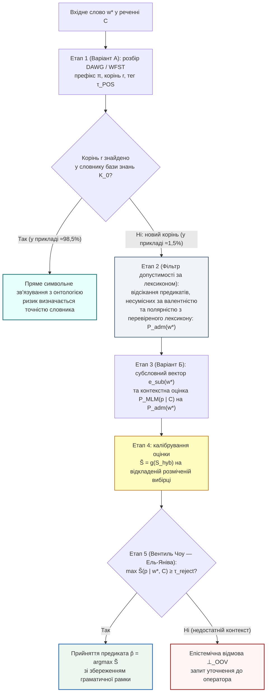

# Глава 04. Варіант Б та Гібридна архітектура: субсловна токенізація, локальні масковані моделі та нейро-символічний вентиль допуску

> **Автор:** Георгій Федчик  
> **Мова оригіналу:** Українська  
> **Дидактичний рівень:** Системно-синтетичний (субсимвольні методи токенізації та контекстного моделювання, порівняльний аналіз Варіантів А і Б, синтез гібридного тракту; опирається на Глави 01–03)

---

## Вступ

У [Главі 03](ch03-symbolic-morphology-fst-and-paradigm-analogy.md) побудовано символьний морфологічний модуль (**Варіант А** на базі `WFST` та `DAWG`), який у навчальному прикладі скоротив частку позасловникових дієслів у 5,8 раза за рахунок зведення похідних словоформ до відомих коренів. Проте правила Варіанта А не допомагають у двох ситуаціях:
1. Коли у вхідному тексті з'являється слово з **новим коренем**, відсутнім у словнику основ (наприклад, вузькогалузевий неологізм, абревіатурне дієслово або іншомовне запозичення *«байпасувати»*, *«деаерувати»*, *«контейнеризувати»*);
2. Коли коренева морфема вхідного слова спотворена друкарською помилкою або оптичним розпізнаванням (`OCR`).

Для подолання цього бар'єра без виходу в зовнішню мережу застосовується **Варіант Б — локальні субсимвольні (нейромережеві) методи**, що спираються на субсловну декомпозицію та дистрибутивну гіпотезу контекстного оточення. У цій главі викладено математичний апарат субсловної токенізації (`BPE`, `WordPiece`, символьні $`n`$-грами) і локального маскованого мовного моделювання (`MLM`), порівняно Варіанти А і Б, а потім їх об'єднано в **гібридну нейро-символічну офлайн-архітектуру** з кроком калібрування та порогом селективної відмови Чоу — Ель-Яніва. Окремо показано, за яких явних припущень гібрид не гірший за кожен із чистих варіантів і чим доводиться платити за дворівневий шлюз допуску.

---

## 1. Варіант Б: субсловна токенізація та локальні контекстні моделі

### 1.1. Кодування пар байтів, максимізація взаємної інформації та символьні грами

У 1994 році **Філіп Гейдж** [[1]](#src-1) запропонував алгоритм стиснення даних **Byte-Pair Encoding (`BPE`)**, який у 2016 році **Ріко Сеннріх, Баррі Геддоу та Александра Бірч** [[2]](#src-2) адаптували для відкритословникової токенізації природної мови.

Нехай початковий словник підслів $`V^{(0)} = \Sigma_{\mathrm{char}}`$ складається з усіх елементарних символів (літер та байтів) алфавіту. На кожному кроці ітерації $`t = 1, \dots, K_{\mathrm{merges}}`$ алгоритм `BPE` знаходить у корпусі пару сусідніх токенів $`(u^*, v^*) \in V^{(t-1)} \times V^{(t-1)}`$, яка має найбільшу абсолютну частоту спільної появи $`f(u \circ v)`$, і додає їхню конкатенацію $`w_{\mathrm{new}} = u^* \circ v^*`$ до словника $`V^{(t)}`$.

У модифікації **WordPiece** (**Майк Шустер і Кайсуке Накадзіма, 2012** [[3]](#src-3)) замість абсолютної частоти максимізується приріст логарифмічної правдоподібності корпусу, що для пари сусідніх одиниць зводиться до критерію поточкової взаємної інформації (`PMI`):

$$
(u^*, v^*) = \arg\max_{(u, v) \in V^{(t-1)} \times V^{(t-1)}} \frac{P(u \circ v)}{P(u) \cdot P(v)}
$$

**Формула (4.1).** Критерій об'єднання підслів у токенізаторі `WordPiece`.

Оскільки базовий алфавіт символів входить до фінального словника підслів ($`\Sigma_{\mathrm{char}} \subset V_{\mathrm{sub}}`$), будь-яке невідоме слово $`w^* \notin V(\mathcal{K}_0)`$ розкладається на послідовність відомих субсловних одиниць $`w^* = s_1 \circ s_2 \circ \dots \circ s_r`$ ($`s_i \in V_{\mathrm{sub}}`$). Далі, за моделлю композиційних ембедінгів **Пйотра Бояновські та ін. (`FastText`, 2017)** [[4]](#src-4), вектор невідомого слова $`\mathbf{e}_{\mathrm{sub}}(w^*) \in \mathbb{R}^d`$ конструюється як усереднена сума векторів його символьних $`n`$-грам $`\mathcal{G}(w^*)`$ ($`n \in \{3, 4, 5, 6\}`$):

$$
\mathbf{e}_{\mathrm{sub}}(w^*) = \frac{1}{\lvert \mathcal{G}(w^*) \rvert} \sum_{g \in \mathcal{G}(w^*)} \mathbf{u}_g
$$

**Формула (4.2).** Адитивна субсловна композиція вектора позасловникового слова без звернення до зовнішніх словників.

### 1.2. Локальне масковане мовне моделювання та дистрибутивна семантика

Коли в нового слова $`w^*`$ невідомий сам корінь (наприклад, іншомовне дієслово *«байпасуватиме»* у реченні *«Черговий інженер байпасуватиме аварійну заслінку турбіни»*), субсловні $`n`$-грами кореня `байпас` не мають спільних фрагментів із питомим словом *«обводити / шунтувати»*. Тут застосовується **дистрибутивна гіпотеза Зелліга Гарріса (1954)** [[5]](#src-5): значення невідомого дієслова частково обмежується його лівим і правим синтаксичним контекстом $`C_{\setminus w^*} = (w_1, \dots, [\text{MASK}], \dots, w_m)`$.

Компактна модель **маскованого мовного моделювання (`MLM`)** (наприклад, квантований 6-шаровий енкодер архітектури **Дж. Девліна та ін., 2019** [[6]](#src-6)) обчислює контекстний вектор позиції $`\mathbf{h}_{\mathrm{ctx}}(C_{\setminus w^*}) \in \mathbb{R}^d`$. Важливо розуміти два обмеження.

1. **Ваги не можна навчити на локальному корпусі.** Навчити шестишаровий енкодер з нуля на корпусі $`10^5`$ токенів неможливо: оригінальну модель `BERT` попередньо навчали на корпусах обсягом понад три мільярди слів [[6]](#src-6). Тому попередньо навчені ваги **імпортуються ззовні** через окремий контрольований канал $`c_{\mathrm{wt}}`$ моделі (1.1): перевіряються хеш і походження, фіксується версія, виконуються регресійні тести на локальних прикладах. Це ризик ланцюга постачання (зокрема навмисно спотворених ваг), який шлюз допуску $`G`$ мусить перевіряти так само ретельно, як пакети оновлення корпусу. На локальному корпусі можливе лише донавчання або адаптація попередньо навченої моделі.
2. **`MLM` прогнозує токени, а не предикати.** Вихідна голова `MLM` дає розподіл над словником підслів. Щоб отримати розподіл над предикатами онтології, для кожного предиката $`p`$ інженер знань задає набір лексикалізацій (дієслівних форм, що виражають $`p`$), а вектор-прототип $`\mathbf{e}(p)`$ обчислюється як середнє контекстних векторів $`\mathbf{h}_{\mathrm{ctx}}`$ цих лексикалізацій у реченнях корпусу. Тоді апостеріорний розподіл предикатів у позиції невідомого слова задає softmax-класифікатор над прототипами:

$$
P_{\mathrm{MLM}}\left(p \;\middle|\; C_{\setminus w^*}\right) = \frac{\exp\left(\langle \mathbf{h}_{\mathrm{ctx}}(C_{\setminus w^*}), \ \mathbf{e}(p) \rangle / T_{\mathrm{temp}}\right)}{\sum_{q \in \mathcal{P}(\mathcal{K}_0)} \exp\left(\langle \mathbf{h}_{\mathrm{ctx}}(C_{\setminus w^*}), \ \mathbf{e}(q) \rangle / T_{\mathrm{temp}}\right)}
$$

**Формула (4.3).** Контекстна оцінка ймовірності предиката за прототипами, побудованими з контекстних векторів локальної маскованої моделі (`MLM`); $`T_{\mathrm{temp}} > 0`$ — температура. Ці ймовірності є оцінками моделі, а не каліброваними апостеріорними ймовірностями.

---

## 2. Порівняльна аналітична матриця Варіанта А та Варіанта Б

Перед синтезом гібриду корисно зіставити, що кожен варіант дає експертній системі і як саме він помиляється. Оцінки часу й пам'яті в таблиці є орієнтовними порядками величин, а не вимірюваннями цієї книги.

**Таблиця 4.1.** Порівняльна матриця локальної символьної морфології (Варіант А) та субсимвольних нейромережевих методів (Варіант Б) для ізольованої нейро-символічної експертної системи.

| Критерій порівняння | Варіант А: Локальна символьна морфологія (`WFST` / `DAWG`) | Варіант Б: Субсимвольні нейромережі (`BPE` + локальна `MLM`) | Гібридний синтез (Варіант А + Варіант Б із вентилем відмови) |
| :--- | :--- | :--- | :--- |
| **Точність для символьної логіки та правил** | **Висока для словникових слів:** граматичні мітки (частина мови, час, особа) і лема; для невідомих коренів — імовірнісне передбачення за суфіксом | **Середня (імовірнісна):** вектор близькості без гарантії граматичної та валентної сумісності | **Потенційно вища за кожен варіант окремо:** лексикон фіксує валентність і полярність, векторний модуль ранжує лише допустимі предикати; потребує перевірки кривою ризику–покриття |
| **Обчислювальна складність на CPU** | **Мінімальна:** $`\mathcal{O}(\lvert w \rvert)`$, орієнтовно мікросекунди на слово | **Середня:** $`\mathcal{O}(m^2 d)`$ для `MLM`, орієнтовно мілісекунди на речення | **Каскадна:** `MLM` викликається лише тоді, коли корінь після `DAWG` залишився невідомим (у навчальному прикладі $`\approx 1{,}5\%`$ слів) |
| **Споживання оперативної пам'яті (RAM)** | **Низьке:** орієнтовно десятки мегабайтів для повного словника мови | **Помірне:** орієнтовно сотні мегабайтів для квантованої моделі (`INT8`) | **Сума обох компонентів** |
| **Гнучкість до слів із новим коренем** | **Обмежена:** розпізнає граматичну роль за суфіксом, але не знає семантики нового кореня | **Висока:** розбиває будь-яку послідовність символів через `BPE` та оцінює зміст за контекстом | **Висока з контролем через відмову:** приймає новий корінь лише за достатньої каліброваної впевненості, інакше повертає $`\bot_{\mathrm{OOV}}`$ |
| **Головний вид помилки (Failure Mode)** | **Неповнота (False Negative):** відмова розпізнати семантику неологізму чи синоніма | **Хибна підстановка (False Positive):** антонім або сусідній предикат у малому корпусі | **Хибні відмови та залишкові підстановки:** придушення підстановок фільтром валентності та порогом $`\tau_{\mathrm{reject}}`$ ціною частих запитів уточнення |

---

## 3. Синтез гібридної нейро-символічної архітектури та оцінка селективного ризику

Побудуємо гібридний оператор $`\Gamma_{\mathrm{hyb}}(w^*, C)`$ (п'яту компоненту вектора стану $`\Xi(\mathcal{K}_0, q)`$), у якому Варіант А та Варіант Б використовують різні ознаки слова: А — внутрішню будову і лексикон, Б — контекст. Головна вимога безпеки полягає в тому, щоб на поріг подавалася **калібрована** оцінка, інакше правило Чоу втрачає свій зміст.

### 3.1. Фільтр допустимості на основі перевіреного лексикону полярності та валентності

Звуження множини кандидатів має сенс лише тоді, коли фільтр сам не відкидає істинний предикат. Ранні редакції цієї книги визначали полярність дії за префіксом (`роз-`, `від-`, `де-` — «інверсія»), а перехідність — за суфіксом. Обидва правила хибні як детерміновані закони:
1. **Префікс не визначає полярність однозначно:** *розігріти* підсилює дію *гріти*, а не інвертує її; *відкрити* не є запереченням *крити*; *від-* у *відремонтувати* означає завершеність, а не протилежність; *розблокувати* справді інвертує *блокувати*. Заперечне «не» при дієсловах — окрема частка, а не префікс.
2. **Перехідність лексична, а не суфіксальна:** *ночуватиме* і *вирушатиме* неперехідні, хоча мають той самий суфікс `-уватиме`/`-атиме`, що й перехідні *обслуговуватиме* чи *перемикатиме*.

Тому фільтр будується не на правилах префіксів, а на **перевіреному лексиконі** $`\mathcal{L}`$: для кожного дієслова (і для продуктивних словотвірних моделей, перевірених на прикладах) інженер знань і лінгвіст розмічають полярність щодо базової дії $`\mathrm{pol} \in \{+1, -1, 0\}`$ та валентну рамку $`\mathrm{val}`$. Для слова з новим коренем лексикон зазвичай не має запису; тоді фільтр використовує лише ті ознаки, що надійно визначаються формою (частина мови), а полярність лишає невизначеною і **не відкидає** кандидатів за нею:

$$
\mathcal{P}_{\mathrm{adm}}(w^*) = \left\{ p \in \mathcal{P}(\mathcal{K}_0) \;\middle|\; \mathrm{val}(p) \sim \mathcal{A}_{\mathrm{val}}(w^*) \ \land \ \left( \mathrm{pol}_{\mathcal{L}}(w^*) = \text{невідомо} \ \lor \ \mathrm{pol}(p) = \mathrm{pol}_{\mathcal{L}}(w^*) \right) \right\}
$$

**Формула (4.4а).** Допустима підмножина предикатів за перевіреним лексиконом, де $`\mathrm{val}(p) \sim \mathcal{A}_{\mathrm{val}}(w^*)`$ означає сумісність валентних рамок, а $`\mathrm{pol}_{\mathcal{L}}(w^*)`$ — полярність із лексикону або «невідомо». Фільтр має виміряну частоту помилок $`\delta_{\mathrm{filt}} = \mathbb{P}(p^* \notin \mathcal{P}_{\mathrm{adm}}(w^*))`$, яку оцінюють на розмічених прикладах і повідомляють разом з результатами.

Ще надійніше моделювати технологічні дії не через полярність слова, а як **переходи станів об'єкта** з передумовами й ефектами: *заблокувати* має передумову `Unlocked(X)` та ефект `Locked(X)`, *розблокувати* — навпаки. Тоді кандидат, ефект якого суперечить відомому стану об'єкта або меті правила, відкидається перевіркою за моделлю об'єкта, а не за морфологією.

### 3.2. Гібридна оцінка, калібрування та вентиль Чоу

На допустимій підмножині $`\mathcal{P}_{\mathrm{adm}}(w^*)`$ субсимвольний модуль Варіанта Б обчислює комбіновану оцінку відповідності $`S_{\mathrm{hyb}}(p \mid w^*, C) \in [0, 1]`$:

$$
S_{\mathrm{hyb}}(p \mid w^*, C) = \gamma \cdot \cos_{+}\left(\mathbf{e}_{\mathrm{sub}}(w^*), \ \mathbf{e}(p)\right) + (1 - \gamma) \cdot P_{\mathrm{MLM}}\left(p \;\middle|\; C_{\setminus w^*}, \ \mathcal{P}_{\mathrm{adm}}(w^*)\right), \qquad \gamma \in [0, 1]
$$

**Формула (4.4).** Гібридна функція оцінювання предиката на допустимій підмножині онтології, де $`\cos_{+} = \max(0, \cos)`$.

Ця оцінка **не є каліброваною ймовірністю**: суміш косинуса і перенормованої ймовірності не має сенсу «частки правильних рішень». Тому перед порогом застосовується крок калібрування $`\tilde{S} = g(S_{\mathrm{hyb}})`$, де монотонне відображення $`g`$ підбирають на відкладеній розміченій вибірці позасловникових слів, пропущених через той самий фільтр: масштабування температурою (*temperature scaling*) [[12]](#src-12), ізотонічна регресія або конформне передбачення [[13]](#src-13). Якість калібрування перевіряють діаграмою надійності та кривою ризику–покриття [[8]](#src-8), [[14]](#src-14).

Далі застосовується **правило селективної класифікації з відмовою Чоу (1970)** [[7]](#src-7) з ціною помилки $`c_{\mathrm{err}} > 0`$ та ціною відмови від автоматичної підстановки $`c_{\mathrm{abs}} \in (0, c_{\mathrm{err}})`$:

$$
\Gamma_{\mathrm{hyb}}(w^*, C) = \begin{cases} \hat{p} = \arg\max_{p \in \mathcal{P}_{\mathrm{adm}}(w^*)} \tilde{S}(p \mid w^*, C), & \text{якщо } \tilde{S}(\hat{p} \mid w^*, C) \ge \tau_{\mathrm{reject}} = 1 - \frac{c_{\mathrm{abs}}}{c_{\mathrm{err}}}, \\ \bot_{\mathrm{OOV}} \ (\text{запит уточнення}), & \text{інакше.} \end{cases}
$$

**Формула (4.5).** Селективний вентиль допуску Чоу в гібридній нейро-символічній системі. Правило Чоу оптимальне лише тоді, коли $`\tilde{S}`$ дорівнює ймовірності правильності рішення; на некаліброваній оцінці поріг $`\tau_{\mathrm{reject}}`$ не має гарантованого змісту.

### 3.3. Твердження 4.1 (Умови, за яких гібридний оператор не гірший за чисті Варіанти А і Б)

**Припущення.**
1. **(П1) Ціни рішень:** втрата від запиту уточнення $`\bot_{\mathrm{OOV}}`$ дорівнює $`c_{\mathrm{abs}} > 0`$, а втрата від хибної підстановки $`\hat{p} \ne p^*`$ — $`c_{\mathrm{err}} > c_{\mathrm{abs}}`$.
2. **(П2) Калібрування:** оцінка на вході вентиля відкалібрована, $`\mathbb{P}(\hat{p} = p^* \mid \tilde{S} = s) = s`$.
3. **(П3) Точні апостеріорні ймовірності** (сильніше за П2, використовується лише в пункті 3): оцінки є точними апостеріорними ймовірностями з урахуванням тієї інформації, яку бачить відповідний оператор.
4. **(П4) Коректність фільтра:** $`\delta_{\mathrm{filt}} = 0`$, тобто $`p^* \in \mathcal{P}_{\mathrm{adm}}(w^*)`$.

Позначимо через $`\mathcal{R}(\mathrm{A})`$, $`\mathcal{R}(\mathrm{B}{+}\tau)`$ та $`\mathcal{R}(\mathrm{Hyb})`$ сподіваний ризик на потоці слів із новим коренем для чистого Варіанта А (завжди відмова), Варіанта Б без фільтра, але з тим самим порогом, та гібридного оператора (4.4)–(4.5). Тоді:
1. **Перенормування підвищує впевненість усіх кандидатів, що залишилися.** Для $`p \in \mathcal{P}_{\mathrm{adm}}(w^*)`$:

$$
P_{\mathrm{MLM}}\left(p \;\middle|\; C, \ \mathcal{P}_{\mathrm{adm}}(w^*)\right) = \kappa_{\mathrm{adm}}(w^*) \cdot P_{\mathrm{MLM}}(p \mid C), \qquad \kappa_{\mathrm{adm}}(w^*) = \left( \sum_{q \in \mathcal{P}_{\mathrm{adm}}(w^*)} P_{\mathrm{MLM}}(q \mid C) \right)^{-1} \ge 1
$$

Множник $`\kappa_{\mathrm{adm}}`$ однаковий для **всіх** кандидатів, зокрема хибних, тому порядок кандидатів не змінюється. Точність вибору $`\arg\max`$ змінюється лише тоді, коли фільтр відкинув попередній $`\arg\max`$; вона зростає, якщо це був хибний кандидат, і падає, якщо фільтр помилково відкинув істинний. Якщо $`P_{\mathrm{MLM}}`$ — точна апостеріорна ймовірність і виконується П4, перенормована величина є точною апостеріорною ймовірністю з урахуванням виходу фільтра. Для реальної моделі, оцінки якої не калібровані, а фільтр має $`\delta_{\mathrm{filt}} > 0`$, перенормування систематично завищує впевненість, тому без нового калібрування вентиль Чоу приймав би занадто багато.
2. **Порівняння з Варіантом А (за П1–П2):** $`\mathcal{R}(\mathrm{Hyb}) \le \mathcal{R}(\mathrm{A})`$.
3. **Порівняння з «Варіантом Б + поріг» (за П1, П3):** $`\mathcal{R}(\mathrm{Hyb}) \le \mathcal{R}(\mathrm{B}{+}\tau)`$. Разом:

$$
\mathcal{R}(\mathrm{Hyb}) \le \min\left\{ \mathcal{R}(\mathrm{A}), \ \mathcal{R}(\mathrm{B}{+}\tau) \right\}
$$

**Формула (4.6).** Нерівність ризиків гібридної архітектури за ідеалізованих припущень П1–П3. Для реальних, лише наближено каліброваних оцінок друга половина нерівності є гіпотезою, яку перевіряють порівнянням кривих ризику–покриття гібриду і варіанта «Б + поріг» на одному тестовому наборі.

**Обґрунтування Твердження 4.1.**
1. **Пункт 1** випливає з означення умовної ймовірності: знаменник формули (4.3) зменшується на суму доданків відкинутих кандидатів, а чисельники залишених не змінюються.
2. **Пункт 2:** для каліброваної оцінки $`s`$ прийняття дає сподівану втрату $`c_{\mathrm{err}}(1 - s)`$, а відмова — $`c_{\mathrm{abs}}`$; правило (4.5) обирає меншу з них, тому умовний ризик дорівнює $`\min\{c_{\mathrm{err}}(1 - s), c_{\mathrm{abs}}\} \le c_{\mathrm{abs}}`$. Чистий Варіант А на словах із новим коренем завжди відмовляє з втратою $`c_{\mathrm{abs}}`$. Інтегруючи за розподілом $`s`$, маємо $`\mathcal{R}(\mathrm{Hyb}) \le \mathcal{R}(\mathrm{A})`$.
3. **Пункт 3:** за П3 обидва оператори застосовують байєсівське правило з відмовою, але гібрид спирається на більшу інформацію — контекст і вихід фільтра, тоді як Варіант Б — лише контекст. Байєсівський ризик $`\mathbb{E}[\min\{c_{\mathrm{err}}(1 - \max_p \mathbb{P}(p \mid \mathcal{F})), c_{\mathrm{abs}}\}]`$ не зростає при розширенні інформації $`\mathcal{F}`$, бо мінімум сподівань не менший за сподівання мінімуму (нерівність Єнсена для угнутої функції). ∎

---

### 3.4. Теорія N-версійного програмування, тотожність Екгардта — Лі та ортогональна нейро-символічна диверсифікація

#### 3.4.1. Для чого теорія N-версійного програмування потрібна в ізольованих експертних системах

На перший погляд може здатися, що теорія відмовостійкого резервування ПЗ стосується лише апаратних обчислювачів авіоніки чи АЕС. Проте під час проєктування ізольованої експертної системи архітектор стикається з трьома прикладними питаннями, на які корисно відповідати мовою N-версійного програмування:

1. **Чому мажоритарний ансамбль локальних мовних моделей (`2-з-3`) не дає очікуваного виграшу:**
   Поширеною спокусою є запуск у локальному середовищі не однієї, а трьох різних малих мовних або векторних моделей із мажоритарним голосуванням `2oo3`. Якщо кожна модель помиляється з імовірністю $`10\%`$ і помилки незалежні, голосування знизило б помилку до $`\approx 2{,}8\%`$. Проте всі дистрибутивні моделі навчаються за тим самим принципом контекстної близькості Гарріса, тому їхні помилки на антонімах (*«включити / виключити»*, *«дозволити / заборонити»*) та на протилежних протокольних ролях, імовірно, **додатно корельовані** ($`\mathbf{Cov}_X > 0`$). Три такі моделі можуть синхронно голосувати за хибний антонім і створювати ілюзію впевненості.
2. **Чому поєднання Варіанта А (`DAWG` + лексикон) і Варіанта Б (`BPE/MLM/Bi-Encoder`) може давати диверсифікацію:**
   Символьний аналізатор ([Глава 03](ch03-symbolic-morphology-fst-and-paradigm-analogy.md)) і субсимвольна модель (ця глава) спираються на різні інформаційні ознаки слова: Варіант А — на внутрішню будову і перевірений лексикон, Варіант Б — на зовнішній дистрибутивний контекст. Тому можна очікувати, що їхні області відмов перетинаються мало і коваріація помилок буде близькою до нуля або від'ємною. Це гіпотеза, яку потрібно перевіряти вимірюванням (Крок I підрозділу 3.4.4), а не властивість, гарантована самим поєднанням.
3. **Автономний взаємний контроль під час офлайн-компіляції словників і правил:**
   В ізольованому середовищі немає зовнішнього арбітра, який би в реальному часі перевіряв кожен видобутий з документації синонім або правило. N-версійна диверсифікація дає механізм взаємного контролю під час компіляції баз знань і поповнення словників, а остаточне рішення про спірні випадки залишається за експертом.

---

#### 3.4.2. Математичний апарат: тотожність Екгардта — Лі

У критичних системах керування та авіоніки одним із методів боротьби з програмними помилками є **N-версійне програмування (N-Version Programming, NVP)**, запропоноване Альгірдасом Авізієнісом та Лімінгом Ченом у 1977 році [[9]](#src-9). Початкова гіпотеза NVP спиралася на припущення статистичної незалежності помилок: якщо $`N`$ різних версій алгоритму $`V_1, \dots, V_N`$ мають індивідуальну ймовірність відмови $`\bar{p}_k = \mathbb{P}(V_k(X) \ne y^*(X))`$, то голосування мало б знижувати ймовірність спільної помилки до добутку $`\prod_{k=1}^N \bar{p}_k`$.

У 1985 році Дейв Екгардт і Ларрі Лі [[10]](#src-10) теоретично показали, а у 1986 році Джон Найт і Ненсі Левесон [[11]](#src-11) експериментально підтвердили (на $`27`$ незалежно розроблених версіях однієї програми), що припущення незалежності помилок незалежно розроблених версій не виконується.

Введемо на просторі вхідних прикладів $`(\mathcal{X}, P_X)`$ **функцію локальної складності входу** (*difficulty function*) $`\theta_k : \mathcal{X} \to [0, 1]`$ для $`k`$-ї версії системи:

$$
\theta_k(x) = \mathbb{P}\left( V_k(x) \ne y^*(x) \;\middle|\; X = x \right), \qquad \bar{p}_k = \mathbb{E}_X\left[\theta_k(X)\right] = \int_{\mathcal{X}} \theta_k(x) \, dP_X(x)
$$

**Формула (4.7).** Функція локальної складності входу та середня ймовірність помилки $`k`$-го каналу.

Для двох версій $`V_1`$ та $`V_2`$, які умовно незалежні при фіксованому вході $`X = x`$, імовірність їхньої одночасної помилки $`E_1 \wedge E_2`$ на випадковому вході $`X \sim P_X`$ розкладається на добуток середніх похибок плюс **коваріацію функцій складності** [[10]](#src-10):

$$
\mathbb{P}(E_1 \wedge E_2) = \int_{\mathcal{X}} \theta_1(x)\theta_2(x) \, dP_X(x) = \bar{p}_1 \bar{p}_2 + \mathbf{Cov}_X\left(\theta_1(X), \ \theta_2(X)\right)
$$

**Формула (4.8).** Коваріаційний розклад Екгардта — Лі для спільної відмови двоверсійної системи.

З формули (4.8) випливає розмежування між **гомогенним ансамблюванням** і **різнорідною нейро-символічною парою**:
1. **Ансамбль однотипних мовних моделей має, імовірно, додатну коваріацію ($`\mathbf{Cov}_X(\theta_1, \theta_2) > 0`$):** моделі, побудовані на дистрибутивній гіпотезі Гарріса [[5]](#src-5), мають схожі «сліпі плями»: їхні функції складності одночасно зростають на антонімах і протилежних протокольних ролях (*«активувати / деактивувати»*, *«клієнт / сервер»*), бо ці слова мають схожі контекстні вікна. У граничному випадку однакових функцій $`\theta_1(x) = \theta_2(x) = \theta(x)`$ коваріація дорівнює дисперсії $`\mathrm{Var}_X[\theta(X)] \ge 0`$, і голосування лише закріплює спільну помилку (*Common-Mode Failure*).
2. **Різнорідна пара «символьний аналізатор $`V_{\mathrm{sym}}`$ + субсимвольний бі-енкодер $`V_{\mathrm{sub}}`$» може мати від'ємну коваріацію:** якщо області високої складності двох каналів лежать у різних частинах простору входів $`\mathcal{X}`$. Нижче це сформульовано як твердження в явно ідеалізованій моделі.

---

#### 3.4.3. Твердження 4.2 (Від'ємна коваріація помилок і придушення небезпечних підстановок у моделі ідеального символьного каналу)

**Модель.** Розглянемо двоканальну систему розпізнавання предикатів над простором входів $`\mathcal{X} = \mathcal{X}_{\mathrm{reg}} \sqcup \mathcal{X}_{\mathrm{ant}} \sqcup \mathcal{X}_{\mathrm{nov}}`$ з мірами $`q_{\mathrm{reg}}, q_{\mathrm{ant}}, q_{\mathrm{nov}} > 0`$ ($`q_{\mathrm{reg}} + q_{\mathrm{ant}} + q_{\mathrm{nov}} = 1`$):
- $`\mathcal{X}_{\mathrm{reg}}`$ — регулярні словникові словоформи;
- $`\mathcal{X}_{\mathrm{ant}}`$ — антоніми й інверсні ролі, **розмічені в перевіреному лексиконі**, з високою дистрибутивною близькістю;
- $`\mathcal{X}_{\mathrm{nov}}`$ — позасловникові синоніми й деривати з новим коренем.

Функції $`\theta`$ тут означають ймовірність **хибного допуску** (пропуску неправильного предиката) кожним каналом. Припускається:
1. символьний канал $`V_{\mathrm{sym}}`$ має $`\theta_{\mathrm{sym}}(x) = 0`$ на $`\mathcal{X}_{\mathrm{reg}} \sqcup \mathcal{X}_{\mathrm{ant}}`$ та $`\theta_{\mathrm{sym}}(x) = \alpha \in (0, 1]`$ на $`\mathcal{X}_{\mathrm{nov}}`$. Рівність $`\theta_{\mathrm{sym}} = 0`$ на всіх антонімах — **ідеалізація**: вона виконується лише для антонімів, правильно розмічених у лексиконі, і саме з неї випливає знак коваріації нижче;
2. субсимвольний канал $`V_{\mathrm{sub}}`$ (бі-енкодер із порогом Чоу) має $`\theta_{\mathrm{sub}}(x) = 0`$ на $`\mathcal{X}_{\mathrm{reg}}`$, $`\theta_{\mathrm{sub}}(x) = \beta \in (0, 1]`$ на $`\mathcal{X}_{\mathrm{ant}}`$ та $`\theta_{\mathrm{sub}}(x) = \varepsilon \in [0, \beta)`$ на $`\mathcal{X}_{\mathrm{nov}}`$;
3. за фіксованого входу помилки каналів умовно незалежні.

**Твердження.**
1. Коваріація функцій складності двох каналів дорівнює:

$$
\mathbf{Cov}_X\left(\theta_{\mathrm{sym}}(X), \ \theta_{\mathrm{sub}}(X)\right) = \alpha q_{\mathrm{nov}}\left( \varepsilon q_{\mathrm{reg}} - (\beta - \varepsilon) q_{\mathrm{ant}} \right)
$$

і є від'ємною тоді й лише тоді, коли

$$
\varepsilon \, q_{\mathrm{reg}} < (\beta - \varepsilon) \, q_{\mathrm{ant}}
$$

Зокрема, при $`\varepsilon = 0`$ коваріація від'ємна для будь-яких $`q_{\mathrm{ant}}, q_{\mathrm{nov}} > 0`$. Ранні редакції наводили достатню умову $`q_{\mathrm{ant}}\beta > q_{\mathrm{reg}}\varepsilon`$; вона хибна. Контрприклад: $`q_{\mathrm{reg}} = 0{,}8`$, $`q_{\mathrm{ant}} = q_{\mathrm{nov}} = 0{,}1`$, $`\alpha = 0{,}2`$, $`\beta = 0{,}5`$, $`\varepsilon = 0{,}06`$ задовольняють стару умову ($`0{,}05 > 0{,}048`$), але дають $`\varepsilon q_{\mathrm{reg}} = 0{,}048 > (\beta - \varepsilon) q_{\mathrm{ant}} = 0{,}044`$ і коваріацію $`+8 \cdot 10^{-5}`$.

2. За кон'юнктивного правила допуску (`2-of-2 Fail-Closed`: предикат допускається лише при одночасному проходженні обох каналів) ймовірність невиявленої небезпечної підстановки дорівнює

$$
P_{\mathrm{UHR}}\left(V_{\mathrm{sym}} \wedge V_{\mathrm{sub}}\right) = \alpha \varepsilon q_{\mathrm{nov}}
$$

і менша за оцінку гіпотези незалежності $`\bar{p}_{\mathrm{sym}}\bar{p}_{\mathrm{sub}}`$ тоді й лише тоді, коли коваріація від'ємна. При $`\varepsilon = 0`$ у цій моделі $`P_{\mathrm{UHR}} = 0`$.

**Формула (4.9).** Коваріація помилок і ймовірність невиявленої небезпечної підстановки в моделі ідеального символьного каналу.

3. **Ціна кон'юнктивного допуску — хибні відмови.** Вентиль `2oo2` відмовляє, якщо **будь-який** канал відхиляє правильний предикат. Якщо $`r_{\mathrm{sym}}(x)`$ і $`r_{\mathrm{sub}}(x)`$ — імовірності хибного відхилення правильного предиката каналами, то частота хибних відмов:

$$
P_{\mathrm{FR}}\left(V_{\mathrm{sym}} \wedge V_{\mathrm{sub}}\right) = 1 - \mathbb{E}_X\left[ \left(1 - r_{\mathrm{sym}}(X)\right)\left(1 - r_{\mathrm{sub}}(X)\right) \right] \ge \max\left\{ \bar{r}_{\mathrm{sym}}, \ \bar{r}_{\mathrm{sub}} \right\}
$$

**Формула (4.9а).** Частота хибних відмов кон'юнктивного вентиля. Наприклад, за ілюстративних $`\bar{r}_{\mathrm{sym}} = 0{,}03`$ і $`\bar{r}_{\mathrm{sub}} = 0{,}10`$ та незалежних відхилень $`P_{\mathrm{FR}} = 1 - 0{,}97 \times 0{,}90 = 0{,}127`$: кожен восьмий правильний предикат іде на уточнення до оператора. Зниження $`P_{\mathrm{UHR}}`$ завжди оплачується зростанням $`P_{\mathrm{FR}}`$ і навантаження на оператора, тому обидві величини треба звітувати разом.

**Обґрунтування Твердження 4.2.**
1. Середні функції помилки каналів:

$$
\bar{p}_{\mathrm{sym}} = \mathbb{E}_X[\theta_{\mathrm{sym}}(X)] = \alpha q_{\mathrm{nov}}, \qquad \bar{p}_{\mathrm{sub}} = \mathbb{E}_X[\theta_{\mathrm{sub}}(X)] = \beta q_{\mathrm{ant}} + \varepsilon q_{\mathrm{nov}}
$$

2. Сподівання добутку, яке за кон'юнктивного вентиля та припущення 3 дорівнює $`P_{\mathrm{UHR}}`$: на $`\mathcal{X}_{\mathrm{reg}}`$ добуток дорівнює $`0`$; на $`\mathcal{X}_{\mathrm{ant}}`$ — $`0 \cdot \beta = 0`$ (за ідеалізацією припущення 1); на $`\mathcal{X}_{\mathrm{nov}}`$ — $`\alpha \varepsilon`$. Звідси $`P_{\mathrm{UHR}} = \alpha \varepsilon q_{\mathrm{nov}}`$.
3. Підставляючи в означення коваріації (4.8):

$$
\mathbf{Cov}_X\left(\theta_{\mathrm{sym}}, \ \theta_{\mathrm{sub}}\right) = \alpha \varepsilon q_{\mathrm{nov}} - \alpha q_{\mathrm{nov}}(\beta q_{\mathrm{ant}} + \varepsilon q_{\mathrm{nov}}) = \alpha q_{\mathrm{nov}}\left( \varepsilon (q_{\mathrm{reg}} + q_{\mathrm{ant}}) - \beta q_{\mathrm{ant}} \right) = \alpha q_{\mathrm{nov}}\left( \varepsilon q_{\mathrm{reg}} - (\beta - \varepsilon) q_{\mathrm{ant}} \right)
$$

Оскільки $`\alpha q_{\mathrm{nov}} > 0`$, знак коваріації збігається зі знаком виразу в дужках, що дає умову пункту 1; $`P_{\mathrm{UHR}} - \bar{p}_{\mathrm{sym}}\bar{p}_{\mathrm{sub}} = \mathbf{Cov}_X`$ дає пункт 2. Для пункту 3 ймовірність прийняття правильного предиката за фіксованого входу дорівнює $`(1 - r_{\mathrm{sym}})(1 - r_{\mathrm{sub}}) \le 1 - \max\{r_{\mathrm{sym}}, r_{\mathrm{sub}}\}`$; усереднення дає нерівність (4.9а). ∎

Від'ємна коваріація в цьому твердженні є наслідком припущення $`\theta_{\mathrm{sym}} = 0`$ на $`\mathcal{X}_{\mathrm{ant}}`$, а не незалежним відкриттям. Практичний зміст твердження інший: воно показує, **яку** властивість символьного каналу треба забезпечити й виміряти (повноту розмітки антонімів у лексиконі), щоб диверсифікація давала виграш.

**Таблиця 4.2.** Систематизація архітектур N-версійного резервування за знаком коваріації Екгардта — Лі та їхня застосовність в ізольованих експертних системах.

| Схема резервування | Склад каналів $`V_1, \dots, V_N`$ | Правило агрегації | Знак коваріації $`\mathbf{Cov}_X(\theta_i, \theta_j)`$ | Від яких відмов захищає (та де не допомагає) |
| :--- | :--- | :--- | :---: | :--- |
| **1. Апаратний гомогенний Lockstep (`1-Version 2oo2 DMR`)** | Два ідентичні екземпляри одного логічного ядра на кристалі | Побітовий компаратор станів (`XOR != 0 -> Fault`) | $`+\mathrm{Var}[\theta] \ge 0`$ (повна кореляція логіки) | Захищає від фізичних збоїв (`SEU`), але не від помилок у логіці або скомпільованих правилах. |
| **2. Гомогенний ансамбль мовних моделей (`N-Model Majority 2oo3`)** | $`N = 3`$ генеративні або ембедінгові моделі одного класу | Мажоритарне голосування (`2-з-3`) | імовірно $`> 0`$ на антонімах і ко-гіпонімах | Зменшує випадковий шум генерації, але може колективно помилятися на антонімах зі схожим контекстом (Теорема 5.1). |
| **3. Міжсімейний кворум перетину при компіляції словників (`N-Family Intersection`)** | $`N \ge 2`$ моделі різних архітектурних сімейств + символьний фільтр ролей | Перетин множин кандидатів $`\bigcap_{k=1}^N A_k`$ | невідомо; треба вимірювати | Відсікає специфічні помилки окремого токенізатора/корпусу під час офлайн-збору синонімів перед записом у карантинний словник. |
| **4. Різнорідний нейро-символічний вентиль (`DAWG + лексикон + Bi-Encoder 2oo2`)** | $`V_{\mathrm{sym}}`$ (автомат `DAWG` з лексиконом) + $`V_{\mathrm{sub}}`$ (`Bi-Encoder` із порогом Чоу) | Кон'юнктивний вентиль $`M_{\mathrm{adm}}(V_{\mathrm{sym}}) \cdot \tilde{S}(V_{\mathrm{sub}}) \ge \tau_{\mathrm{reject}}`$ | $`< 0`$ за умови (4.9) у моделі Твердження 4.2 | Блокує полярні та валентні помилки векторної моделі для пар, розмічених у лексиконі; ціна — хибні відмови (4.9а). |
| **5. Двоканальний диверсифікований компілятор знань (`2-Version Diverse Compiler`)** | Канал А: граматично-шаблонний парсер; Канал Б: спаново-реляційний бі-енкодер | Узгодження суб'єкта, полярності та числових меж | треба вимірювати; очікується $`\le 0`$ | Зменшує систематичні помилки компілятора знань (класифікація впевненості в інструменті, зокрема `TCL3`, за ISO 26262-8, розділ 11) до підписання пакета. |

---

#### 3.4.4. Інженерна методика: як практично користуватися апаратом N-версійної диверсифікації

Щоб тотожність Екгардта — Лі та Твердження 4.2 працювали як інструмент під час проєктування, калібрування й експлуатації ізольованої експертної системи, застосовується такий чотирикроковий регламент:

1. **Крок I. Передпроєктний тест коваріації Екгардта — Лі (відбракування псевдодиверсифікованих модулів):**
   Перш ніж об'єднувати два модулі розпізнавання $`V_1`$ та $`V_2`$, інженер формує контрольний набір із $`M`$ тестових прикладів, стратифікованих за трьома кошиками: регулярні форми $`\mathcal{X}_{\mathrm{reg}}`$, антоніми $`\mathcal{X}_{\mathrm{ant}}`$ та позасловникові неологізми $`\mathcal{X}_{\mathrm{nov}}`$. На кожному прикладі $`x_m`$ фіксуються бінарні індикатори помилки $`e_{1,m}, e_{2,m} \in \{0, 1\}`$ і обчислюється вибіркова коваріація:

$$
\widehat{\mathbf{Cov}}_X(V_1, V_2) = \frac{1}{M}\sum_{m=1}^{M} e_{1,m} e_{2,m} - \left(\frac{1}{M}\sum_{m=1}^{M} e_{1,m}\right)\left(\frac{1}{M}\sum_{m=1}^{M} e_{2,m}\right)
$$

   - **Правило прийняття архітектурного рішення:** якщо $`\widehat{\mathbf{Cov}}_X(V_1, V_2) > 0`$ і довірчий інтервал (наприклад, бутстреп-інтервал) не містить нуля, об'єднувати модулі через голосування не слід — другий модуль лише дублює обчислювальні витрати без усунення відмови спільного режиму (*Common-Mode Failure*). Перевага надається парам із $`\widehat{\mathbf{Cov}}_X(V_1, V_2) \le 0`$. За малих $`M`$ оцінка коваріації дуже шумна, тому обсяг набору визначають заздалегідь.
2. **Крок II. Конфігурація рантайм-тракту розбору запитів (схема `2-of-2 Fail-Closed Gate` замість мажоритарного `2-of-3`):**
   Під час обробки запиту система не усереднює оцінки символьного і векторного каналів арифметично. Натомість застосовується **кон'юнктивна таблиця рішень** (`Таблиця 4.3`): символьний канал $`V_{\mathrm{sym}}`$ формує булевий вектор допуску $`M_{\mathrm{adm}}(w^*, p) \in \{0, 1\}`$ за лексиконом, а субсимвольний канал $`V_{\mathrm{sub}}`$ — калібровану оцінку $`\tilde{S}(w^*, p) \in [0, 1]`$ із порогом Чоу $`\tau_{\mathrm{reject}}`$. Будь-яка розбіжність між каналами переводить систему не у «вгадування за більшістю», а у стан `CLARIFICATION`. Частоту таких станів відстежують як показник навантаження на оператора.
3. **Крок III. Конфігурація офлайн-конвеєра поповнення словника синонімів (`N-Family Intersection Quorum`):**
   Коли в ізольованому середовищі накопичуються нерозпізнані слова з журналів (`OOV`), у фоновому офлайн-режимі запускаються $`N \ge 2`$ моделі з **різними токенізаторами та архітектурами**. До карантинного словника-кандидата потрапляє лише перетин їхніх пропозицій $`\bigcap_{k=1}^N A_k(w^*)`$, який додатково пройшов символьний фільтр $`M_{\mathrm{adm}}(w^*, p) = 1`$; остаточне включення до лексикону затверджує експерт.
4. **Крок IV. Двоканальна перевірка під час компіляції нормативних документів у базу знань (`2-Version Diverse Compiler`):**
   Під час первинної індексації регламентів документ розбирається двома незалежними парсерами: граматично-шаблонним аналізатором (Канал А) і реляційним бі-енкодером (Канал Б). Правило записується до бінарного пакета знань лише тоді, коли обидва канали виділили однаковий суб'єкт, об'єкт, модальність (`SHALL` / `SHALL NOT`) і числові допуски; розбіжності йдуть на ручний розгляд.

**Таблиця 4.3.** Операційна таблиця прийняття рішень двоверсійного вентиля (`Варіант А: DAWG + лексикон` $`\otimes`$ `Варіант Б: MLM / Bi-Encoder`) у реальному часі.

| Статус у словнику `DAWG` | Допуск за лексиконом $`M_{\mathrm{adm}}(w^*, p)`$ (`Канал А`) | Калібрована оцінка $`\tilde{S}(w^*, p)`$ (`Канал Б`) | Підсумкове рішення вентиля `2oo2` | Інженерне трактування стану |
| :--- | :---: | :---: | :--- | :--- |
| **Точний збіг (`In-Vocab`)** | $`1`$ (словникова лема) | Не викликається (або $`\ge \tau_{\mathrm{reject}}`$) | **`ACCEPT` (швидкий шлях $`\mathcal{O}(\lvert w \rvert)`$)** | Символьний допуск без витрат на векторну модель. |
| **Позасловникове (`OOV`)** | $`1`$ (валентність і полярність сумісні або полярність невідома) | $`\tilde{S} \ge \tau_{\mathrm{reject}}`$ | **`ACCEPT` (гібридний допуск)** | Обидва канали узгоджено підтвердили предикат $`p`$. |
| **Позасловникове (`OOV`) — антонім / інверсія з лексикону** | **`0` (конфлікт полярності або валентності за лексиконом)** | $`\tilde{S} \ge \tau_{\mathrm{reject}}`$ *(хибний високий бал векторної моделі)* | **`BLOCK / REFUSE`** | Канал Б введено в оману контекстною схожістю, але Канал А блокує підстановку; захист діє лише для пар, розмічених у лексиконі. |
| **Позасловникове (`OOV`) — низька впевненість** | $`1`$ | $`\tilde{S} < \tau_{\mathrm{reject}}`$ | **`ABSTAIN / CLARIFICATION`** | Слово граматично коректне, але контекст недостатній — запит уточнення в оператора. |
| **Некоректний токен / шум** | **`0`** | $`\tilde{S} < \tau_{\mathrm{reject}}`$ | **`REJECT`** | Одночасна відмова обох каналів. |

---

## 4. Навчальний інженерний приклад: розбір іншомовного позасловникового дієслова гібридною системою енергоблока

*Дидактична наступність наскрізного прикладу:* У [Главах 01–03](ch03-symbolic-morphology-fst-and-paradigm-analogy.md) побудовано перші три компоненти вектора стану $`\Xi(\mathcal{K}_0, q)`$; у навчальному прикладі морфологічний модуль (`Варіант А`) підвищив модельну надійність трикрокового ланцюжка правил безпеки до $`92{,}12\%`$. Тепер розглянемо випадок із тих залишкових $`1{,}47\%`$ позасловникових дієслів, де в оперативному журналі вжито професійне запозичення з **новим коренем**, відсутнім у словнику `DAWG`: *«Оператор байпасуватиме аварійний клапан підігрівача»* (тоді як онтологічний предикат `BypassValve(Agent, Object)` прив'язаний лише до питомих лексем *«шунтувати»* та *«пускати в обхід»*). Усі числові параметри нижче є **навчальними ілюстративними значеннями**.

### 4.1. Вихідні інженерні дані

1. **Вхідне позасловникове дієслово з новим коренем:** $`w^* = \text{«байпасуватиме»}`$ у контексті $`C = \text{«Оператор [MASK] аварійний клапан підігрівача»}`$.
2. **Розподіл імовірностей чистої локальної моделі `MLM` (Варіант Б без фільтра) за формулою (4.3):**
   - $`p_1 = \text{BypassValve}`$ (*шунтувати / обводити*, перехідне дієслово, полярність $`0`$ за лексиконом): $`P_{\mathrm{MLM}}(p_1 \mid C) = 0{,}48`$;
   - $`p_2 = \text{UnblockValve}`$ (*розблоковувати*, полярність $`-1`$ щодо `BlockValve` за лексиконом): $`P_{\mathrm{MLM}}(p_2 \mid C) = 0{,}27`$;
   - $`p_3 = \text{ValveIsClosed}`$ (*закритий*, предикат стану, неперехідний): $`P_{\mathrm{MLM}}(p_3 \mid C) = 0{,}15`$;
   - $`p_4 = \text{InspectSensor}`$ (*оглядати давач*, інший клас об'єкта): $`P_{\mathrm{MLM}}(p_4 \mid C) = 0{,}10`$.
3. **Ціни помилки та поріг селективної відмови Чоу (формула 4.5):**
   - ціна хибної підстановки предиката у правилі безпеки: $`c_{\mathrm{err}} = 10{,}0`$;
   - ціна відмови (перепитування в оператора): $`c_{\mathrm{abs}} = 2{,}0`$;
   - поріг селективного допуску: $`\tau_{\mathrm{reject}} = 1 - \frac{2{,}0}{10{,}0} = 0{,}80`$.

### 4.2. Покроковий розрахунок

**Крок 1. Робота фільтра допустимості (Варіант А + лексикон):**
Хоча корінь `байпас-` відсутній у `DAWG`, суфіксально-флективний аналізатор за хвостом `-уватиме` з високою ймовірністю визначає частину мови `VERB, impf, futr, 3per, sing`. Перехідність за суфіксом визначити не можна (розділ 3.1), але в контексті є прямий додаток у знахідному відмінку («клапан»), що вказує на перехідне вживання; тому відсікається неперехідний предикат стану $`p_3 = \text{ValveIsClosed}`$. Полярність нового дієслова лексикону невідома, тому за формулою (4.4а) вона **не** може бути підставою для відсікання $`p_2`$. Відсікання $`p_2 = \text{UnblockValve}`$ тут обґрунтоване іншим: за моделлю станів об'єкта клапан у цей момент не заблоковано (припущення прикладу), тому передумова `Blocked(X)` дії *розблокувати* не виконується. У допустимій множині залишаються $`\{p_1, p_4\}`$.

**Крок 2. Перенормування, калібрування та рішення вентиля (Твердження 4.1, формула 4.5):**
1. Коефіцієнт перенормування:

$$
\kappa_{\mathrm{adm}}(w^*) = \frac{1}{P_{\mathrm{MLM}}(p_1 \mid C) + P_{\mathrm{MLM}}(p_4 \mid C)} = \frac{1}{0{,}48 + 0{,}10} = \frac{1}{0{,}58} \approx 1{,}724
$$

2. Перенормовані оцінки зростають для **обох** кандидатів, що залишилися: $`p_1`$ — з $`0{,}48`$ до $`1{,}724 \times 0{,}48 = 0{,}8276`$, а хибний $`p_4`$ — з $`0{,}10`$ до $`1{,}724 \times 0{,}10 = 0{,}1724`$. Порядок кандидатів не змінився: $`p_1`$ був лідером і до фільтрації.
3. Значення $`0{,}8276 > 0{,}80`$ ще не дає права приймати рішення: перенормована оцінка некалібрована. Припустимо, що на відкладеній розміченій вибірці підібрано температуру $`T = 1{,}5`$ для логарифмів відфільтрованих оцінок (ілюстративне значення). Тоді калібрована впевненість:

$$
\tilde{S}(p_1) = \frac{0{,}48^{1/T}}{0{,}48^{1/T} + 0{,}10^{1/T}} = \frac{0{,}48^{0{,}667}}{0{,}48^{0{,}667} + 0{,}10^{0{,}667}} \approx 0{,}740 < \tau_{\mathrm{reject}} = 0{,}80
$$

4. **Рішення системи:** вентиль повертає $`\bot_{\mathrm{OOV}}`$, але запит уточнення вже адресний: «Чи означає *байпасуватиме* дію `BypassValve`?». Для порівняння, варіант «Б + поріг» без фільтра має найвищу оцінку $`0{,}48 < 0{,}80`$ і також відмовляє, але пропонує оператору ширший перелік кандидатів. Гібрид прийняв би $`p_1`$ автоматично лише тоді, коли калібрування на реальних даних показало б, що серед відфільтрованих рішень з оцінкою близько $`0{,}83`$ частка правильних не менша за $`0{,}80`$ (наприклад, при $`T \approx 1`$). Висновок про перевагу гібриду в цьому прикладі залежить від калібрування і не випливає з самого перенормування.

**Крок 3. Розрахунок коваріації помилок за Твердженням 4.2: порівняння різнорідної пари `DAWG + MLM` з парою однотипних моделей:**
Припустимо, головний інженер АСУ ТП пропонує альтернативу: замість розроблення лексикону і символьного фільтра поставити дві різні локальні моделі `MLM-1` та `MLM-2` і пропускати рішення лише при їхній згоді. Порівняємо обидва варіанти за методикою підрозділу 3.4.4 на ілюстративному потоці запитів:
- частки входів: $`q_{\mathrm{reg}} = 0{,}85`$, $`q_{\mathrm{ant}} = 0{,}05`$ (антоніми, розмічені в лексиконі), $`q_{\mathrm{nov}} = 0{,}10`$;
- похибка хибного допуску символьного каналу на нових коренях: $`\alpha = 0{,}20`$;
- похибка дистрибутивної моделі на антонімах: $`\beta = 0{,}40`$; на нових синонімах: $`\varepsilon = 0{,}02`$.

1. **Варіант «Гомогенна пара `MLM-1 + MLM-2`»:**
   Середня похибка кожної моделі $`\bar{p}_{\mathrm{sub}} = \beta q_{\mathrm{ant}} + \varepsilon q_{\mathrm{nov}} = 0{,}40 \times 0{,}05 + 0{,}02 \times 0{,}10 = 0{,}022`$ ($`2{,}2\%`$). За незалежності помилок спільна похибка становила б $`\bar{p}_{\mathrm{sub}}^2 = 0{,}000484`$ ($`0{,}048\%`$). Розглянемо граничний випадок, коли обидві моделі мають **однакову** функцію складності (по суті, порівняння моделі з її копією — верхня межа кореляції). Тоді за (4.8):

$$
\mathbf{Cov}_X(\theta_{\mathrm{sub},1}, \theta_{\mathrm{sub},2}) = \mathbb{E}[\theta_{\mathrm{sub}}^2] - \bar{p}_{\mathrm{sub}}^2 = \left(0{,}40^2 \times 0{,}05 + 0{,}02^2 \times 0{,}10\right) - 0{,}000484 = 0{,}00804 - 0{,}000484 = +0{,}007556
$$

   і частота спільних хибних допусків $`\mathbb{P}(E_1 \wedge E_2) = 0{,}00804`$ ($`0{,}804\%`$), що у $`16{,}6`$ раза більше за оцінку незалежності. Для двох реально різних моделей кореляція буде частковою, а результат — між $`0{,}048\%`$ і $`0{,}804\%`$; його треба вимірювати.
2. **Варіант «Різнорідна пара `DAWG + MLM`» (Твердження 4.2):**
   $`\bar{p}_{\mathrm{sym}} = \alpha q_{\mathrm{nov}} = 0{,}20 \times 0{,}10 = 0{,}020`$. Перевіряємо умову (4.9): $`\varepsilon q_{\mathrm{reg}} = 0{,}017 < (\beta - \varepsilon) q_{\mathrm{ant}} = 0{,}019`$, тому коваріація від'ємна:

$$
\mathbf{Cov}_X(\theta_{\mathrm{sym}}, \theta_{\mathrm{sub}}) = 0{,}20 \times 0{,}10 \times \left(0{,}02 \times 0{,}85 - 0{,}38 \times 0{,}05\right) = 0{,}02 \times (0{,}017 - 0{,}019) = -0{,}00004
$$

$$
P_{\mathrm{UHR}}(V_{\mathrm{sym}} \wedge V_{\mathrm{sub}}) = \alpha \varepsilon q_{\mathrm{nov}} = 0{,}20 \times 0{,}02 \times 0{,}10 = 0{,}0004 \quad (0{,}04\%)
$$

   Запас умови малий: вже при $`\varepsilon > \beta q_{\mathrm{ant}}/(q_{\mathrm{reg}} + q_{\mathrm{ant}}) \approx 0{,}022`$ коваріація стає додатною. Порівняно з граничним випадком ідентичних моделей частота небезпечних допусків у цій моделі менша приблизно у $`0{,}00804 / 0{,}0004 \approx 20`$ разів, а порівняно з оцінкою незалежності ($`\bar{p}_{\mathrm{sym}}\bar{p}_{\mathrm{sub}} = 0{,}00044`$) — лише на $`10\%`$. На антонімах, розмічених у лексиконі, модельна частота небезпечних допусків дорівнює нулю, бо так задано припущенням $`\theta_{\mathrm{sym}} = 0`$; для антонімів поза лексиконом цей захист не діє. Водночас вентиль `2oo2` збільшує частку хибних відмов (формула 4.9а).
3. **Підсумковий ланцюжок.** Нехай гібрид правильно і автоматично приймає частку $`\rho = 0{,}8`$ залишкових дієслів із новим коренем, а решту передає оператору (ілюстративне припущення, яке треба вимірювати). Тоді частка дієслів, що лишаються нерозпізнаними автоматично, $`p_V^{\mathrm{hyb}} = 0{,}0147 \times (1 - 0{,}8) \approx 0{,}0029`$, а для іменників залишається $`p_E^{\mathrm{morph}} = 0{,}0094`$, бо цей приклад їх не покращує. За формулою (2.2):

$$
P_{\mathrm{chain}}^{\mathrm{hyb}}(3) = (1 - 0{,}0094) \times \left[ (1 - 0{,}0029)(1 - 0{,}0094) \right]^3 \approx 0{,}9545 \quad (95{,}45\%)
$$

   за модельної частоти невиявлених небезпечних підстановок $`0{,}04\%`$. Які наукові проблеми залишаються відкритими навіть у такій гібридній архітектурі, розглянуто в [Главі 05](ch05-open-scientific-problems-and-research-hypotheses.md).

---

## Висновки

1. Субсимвольні офлайн-методи (`Варіант Б` — токенізація `BPE`/`WordPiece`, символьні $`n`$-грами `FastText` та локальні моделі `MLM`) усувають синтаксичну проблему `OOV` на рівні підслів і дозволяють оцінювати семантику слів із новими коренями за контекстом. Попередньо навчені ваги таких моделей не можна отримати з малого локального корпусу: вони імпортуються через контрольований канал і є ризиком ланцюга постачання.
2. Жоден із чистих підходів не є достатнім окремо: Варіант А не розуміє семантики нового кореня, а Варіант Б розподіляє ймовірність між граматично несумісними кандидатами й може підставити хибний предикат.
3. Фільтр допустимості має спиратися на перевірений лексикон полярності й валентності або на модель станів об'єкта, а не на префікси й суфікси, і мати виміряну частоту помилок. Перенормування після фільтра підвищує впевненість усіх залишених кандидатів, тому перед порогом Чоу потрібне калібрування. За припущень Твердження 4.1 (калібровані оцінки, для порівняння з Б — точні апостеріорні ймовірності) гібрид не гірший за чисті Варіанти А і «Б + поріг»; для реальних систем це перевіряється кривими ризику–покриття.
4. Тотожність Екгардта — Лі (4.8) пояснює, чому ансамблі однотипних дистрибутивних моделей мало знижують ризик спільних помилок. У моделі Твердження 4.2 різнорідна пара з кон'юнктивним вентилем має від'ємну коваріацію тоді й лише тоді, коли $`\varepsilon q_{\mathrm{reg}} < (\beta - \varepsilon) q_{\mathrm{ant}}`$; цей результат спирається на ідеалізацію безпомилкового символьного каналу на розмічених антонімах, а ціною вентиля є зростання хибних відмов і навантаження на оператора.

---

## Словник

| Термін | Англійський еквівалент | Визначення |
| :--- | :--- | :--- |
| **Субсловна токенізація** | *Subword Tokenization* | Алгоритмічне розбиття слів на часті кореневі, префіксальні та суфіксальні фрагменти (підслова), що забезпечує скінченний словник без невідомих символів. |
| **Дистрибутивна гіпотеза** | *Distributional Hypothesis* | Принцип лінгвістики (Гарріс, 1954; Ферт, 1957), згідно з яким слова, що зустрічаються в однакових синтаксичних контекстах, мають близьку семантичну роль. |
| **Масковане мовне моделювання** | *Masked Language Modeling (MLM)* | Задача самокерованого навчання, у якій модель відновлює прихований токен речення на основі його двостороннього лівого і правого оточення. |
| **Поріг селективної відмови Чоу** | *Chow's Rejection Threshold* | Правило прийняття рішень ($`\tau_{\mathrm{reject}} = 1 - c_{\mathrm{abs}}/c_{\mathrm{err}}`$), за яким класифікатор утримується від відповіді, якщо сподівана втрата від помилки перевищує ціну відмови; оптимальне лише для каліброваних імовірностей. |
| **Калібрування оцінок** | *Confidence Calibration* | Підбір монотонного перетворення оцінки моделі (масштабування температурою, ізотонічна регресія, конформне передбачення) так, щоб оцінка $`s`$ відповідала частці $`s`$ правильних рішень. |
| **Крива ризику–покриття** | *Risk–Coverage Curve* | Залежність частки помилок серед прийнятих рішень від частки прийнятих запитів при зміні порогу відмови. |
| **N-версійне програмування** | *N-Version Programming (NVP)* | Метод забезпечення відмовостійкості (Авізієніс — Чен, 1977) шляхом паралельного виконання $`N \ge 2`$ незалежно реалізованих версій алгоритму над спільним входом із порівнянням результатів. |
| **Функція локальної складності входу** | *Input Difficulty Function* | Умовна ймовірність помилки алгоритму $`\theta_k(x) = \mathbb{P}(V_k(x) \ne y^*(x) \mid X = x)`$ на конкретному вхідному прикладі $`x`$ у теорії корельованих відмов Екгардта — Лі. |

---

## Список позначень та скорочень

- **Абревіатури:**
  - `BPE` (*Byte-Pair Encoding*) — кодування пар байтів (ітеративний алгоритм субсловної сегментації).
  - `DMR` (*Dual Modular Redundancy*) — подвійне модульне резервування (зокрема апаратний Lockstep `2oo2`).
  - `MLM` (*Masked Language Model*) — маскована мовна модель.
  - `NVP` (*N-Version Programming*) — N-версійне програмування.
  - `PMI` (*Pointwise Mutual Information*) — поточкова взаємна інформація.
- **Математичні символи:**
  - $`\mathbf{e}_{\mathrm{sub}}(w^*)`$ — композиційний вектор слова з його субсловних $`n`$-грам.
  - $`\mathcal{P}_{\mathrm{adm}}(w^*)`$ — підмножина предикатів онтології, допустимих за лексиконом валентності та полярності.
  - $`\delta_{\mathrm{filt}}`$ — частота помилок фільтра (імовірність відкинути істинний предикат).
  - $`\kappa_{\mathrm{adm}}(w^*)`$ — коефіцієнт перенормування оцінок після фільтрації.
  - $`\tilde{S}`$ — калібрована оцінка впевненості на вході вентиля Чоу.
  - $`\tau_{\mathrm{reject}}`$ — поріг селективної відмови Чоу — Ель-Яніва.
  - $`\Gamma_{\mathrm{hyb}}(w^*, C)`$ — результуючий оператор гібридного нейро-символічного виведення.
  - $`\theta_k(x)`$ — функція локальної складності вхідного прикладу $`x`$ для $`k`$-ї версії системи.
  - $`P_{\mathrm{UHR}}`$ — імовірність невиявленої небезпечної підстановки предиката (*Undetected Hazard Rate*).
  - $`P_{\mathrm{FR}}`$ — частота хибних відмов кон'юнктивного вентиля.

---

## Бібліографія

1. **Gage P.** A New Algorithm for Data Compression // *The C Users Journal*. — 1994. — Vol. 12, No. 2. — P. 23–38.
2. **Sennrich R., Haddow B., Birch A.** Neural Machine Translation of Rare Words with Subword Units // *Proceedings of the 54th Annual Meeting of the Association for Computational Linguistics (ACL 2016)*. — Berlin : ACL, 2016. — P. 1715–1725.
3. **Schuster M., Nakajima K.** Japanese and Korean Voice Search // *2012 IEEE International Conference on Acoustics, Speech and Signal Processing (ICASSP)*. — Kyoto : IEEE, 2012. — P. 5149–5152.
4. **Bojanowski P., Grave E., Joulin A., Mikolov T.** Enriching Word Vectors with Subword Information // *Transactions of the Association for Computational Linguistics (TACL)*. — 2017. — Vol. 5. — P. 135–146.
5. **Harris Z. S.** Distributional Structure // *Word*. — 1954. — Vol. 10, No. 2–3. — P. 146–162.
6. **Devlin J., Chang M.-W., Lee K., Toutanova K.** BERT: Pre-training of Deep Bidirectional Transformers for Language Understanding // *Proceedings of NAACL-HLT 2019*. — Minneapolis : ACL, 2019. — P. 4171–4186.
7. **Chow C. K.** On Optimum Recognition Error and Reject Tradeoff // *IEEE Transactions on Information Theory*. — 1970. — Vol. 16, No. 1. — P. 41–46.
8. **El-Yaniv R., Wiener Y.** On the Foundations of Noise-Free Selective Classification // *Journal of Machine Learning Research (JMLR)*. — 2010. — Vol. 11. — P. 1605–1641.
9. **Avizienis A., Chen L.** On the Implementation of N-Version Programming for Software Fault-Tolerance During Execution // *Proceedings of the IEEE International Computer Software and Applications Conference (COMPSAC 1977)*. — Chicago : IEEE, 1977. — P. 149–155.
10. **Eckhardt D. E., Lee L. D.** A Theoretical Basis for the Analysis of Multiversion Software Subject to Coincident Errors // *IEEE Transactions on Software Engineering*. — 1985. — Vol. SE-11, No. 12. — P. 1511–1517.
11. **Knight J. C., Leveson N. G.** An Experimental Evaluation of the Assumption of Independence in Multiversion Programming // *IEEE Transactions on Software Engineering*. — 1986. — Vol. SE-12, No. 1. — P. 96–109.
12. **Guo C., Pleiss G., Sun Y., Weinberger K. Q.** On Calibration of Modern Neural Networks // *Proceedings of the 34th International Conference on Machine Learning (ICML 2017)*. — PMLR, 2017. — Vol. 70. — P. 1321–1330.
13. **Angelopoulos A. N., Bates S.** A Gentle Introduction to Conformal Prediction and Distribution-Free Uncertainty Quantification : arXiv preprint arXiv:2107.07511. — 2021.
14. **Geifman Y., El-Yaniv R.** SelectiveNet: A Deep Neural Network with an Integrated Reject Option // *Proceedings of the 36th International Conference on Machine Learning (ICML 2019)*. — PMLR, 2019. — Vol. 97. — P. 2151–2159.
