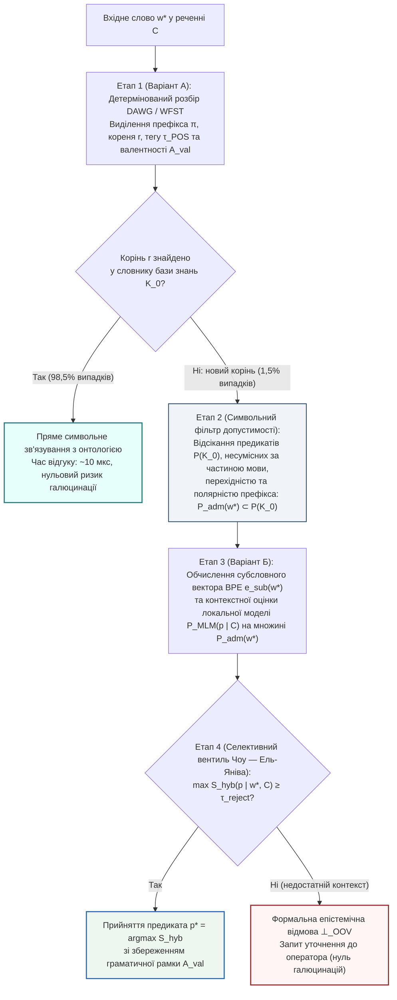

# Глава 04. Варіант Б та Гібридна архітектура: субсловна токенізація, локальні масковані моделі та нейро-символічний вентиль допуску

> **Автор:** Георгій Федчик  
> **Мова оригіналу:** Українська  
> **Дидактичний рівень:** Системно-синтетичний (субсимвольні методи токенізації та контекстного моделювання, порівняльний аналіз Варіантів А і Б, синтез гібридного тракту; опирається на Глави 01–03)

---

## Вступ

У [Главі 03](ch03-symbolic-morphology-fst-and-paradigm-analogy.md) ми побудували детермінований символьний морфологічний модуль (**Варіант А** на базі `WFST` та `DAWG`), який скоротив частку позасловникових дієслів у 5,8 раза за рахунок зведення похідних словоформ до відомих коренів. Проте символи й правила Варіанта А є безсилими у двох ситуаціях:
1. Коли у вхідному тексті з'являється слово з **абсолютно новим коренем**, відсутнім у словнику основи (наприклад, вузькогалузевий неологізм, абревіатурне дієслово або іншомовне запозичення *«байпасувати»*, *«деаерувати»*, *«контейнеризувати»*);
2. Коли коренева морфема вхідного слова спотворена друкарською помилкою або оптичним розпізнаванням (`OCR`).

Для подолання цього бар'єра без виходу в зовнішню мережу Інтернет застосовується **Варіант Б — локальні субсимвольні (нейромережеві) методи**, що спираються на субсловну декомпозицію та дистрибутивну гіпотезу контекстного оточення. У цій главі ми викладемо математичний апарат субсловної токенізації (`BPE`, `WordPiece`, символьні $`n`$-грами) і локального маскованого мовного моделювання (`MLM`), проведемо строге порівняння Варіанта А та Варіанта Б, а потім об'єднаємо їх у **гібридну нейро-символічну офлайн-архітектуру** з оптимальним порогом селективної відмови Чоу — Ель-Яніва.

---

## 1. Варіант Б: інформаційно-теоретична субсловна токенізація та локальні контекстні моделі

### 1.1. Кодування пар байтів, максимізація взаємної інформації та символьні грами

У 1994 році **Філіп Гейдж** [[1]](#src-1) запропонував алгоритм стиснення даних **Byte-Pair Encoding (`BPE`)**, який у 2016 році **Ріко Сеннріх, Баррі Геддоу та Александра Бірч** [[2]](#src-2) адаптували для відкритословникової токенізації природної мови.

Нехай початковий словник підслів $`V^{(0)} = \Sigma_{\mathrm{char}}`$ складається з усіх елементарних символів (літер та байтів) алфавіту. На кожному кроці ітерації $`t = 1, \dots, K_{\mathrm{merges}}`$ алгоритм `BPE` знаходить у локальному корпусі $`\mathcal{K}_0`$ пару сусідніх токенів $`(u^*, v^*) \in V^{(t-1)} \times V^{(t-1)}`$, яка має найбільшу абсолютну частоту спільної появи $`f(u \circ v)`$, і додає їхню конкатенацію $`w_{\mathrm{new}} = u^* \circ v^*`$ до словника $`V^{(t)}`$.

У модифікації **WordPiece** (**Майкл Шустер і Кайсуке Накадзіма, 2012** [[3]](#src-3)) замість абсолютної частоти максимізується приріст логарифмічної правдоподібності корпусу за критерієм поточкової взаємної інформації (`PMI`):

$$
(u^*, v^*) = \arg\max_{(u, v) \in V^{(t-1)} \times V^{(t-1)}} \frac{P(u \circ v)}{P(u) \cdot P(v)}
$$

**Формула (4.1).** Інформаційно-теоретичний критерій об'єднання підслів у токенізаторі `WordPiece`.

Оскільки базовий алфавіт символів завжди входить до фінального словника підслів ($`\Sigma_{\mathrm{char}} \subset V_{\mathrm{sub}}`$), будь-яке невідоме слово $`w^* \notin V(\mathcal{K}_0)`$ гарантовано розкладається на послідовність відомих субсловних морфів $`w^* = s_1 \circ s_2 \circ \dots \circ s_r`$ ($`s_i \in V_{\mathrm{sub}}`$). Далі, за моделлю композиційних ембедінгів **Пйотра Бояновські та ін. (`FastText`, 2017)** [[4]](#src-4), вектор невідомого слова $`\mathbf{e}_{\mathrm{sub}}(w^*) \in \mathbb{R}^d`$ конструюється як нормована сума векторів його субсловних частин і символьних $`n`$-грам $`\mathcal{G}(w^*)`$ ($`n \in \{3, 4, 5, 6\}`$):

$$
\mathbf{e}_{\mathrm{sub}}(w^*) = \frac{1}{\lvert \mathcal{G}(w^*) \rvert} \sum_{g \in \mathcal{G}(w^*)} \mathbf{u}_g
$$

**Формула (4.2).** Адитивна субсловна композиція вектора позасловникового слова без звернення до зовнішніх словників.

### 1.2. Локальне масковане мовне моделювання та дистрибутивна семантика

Коли в нового слова $`w^*`$ невідомий сам корінь (наприклад, іншомовне дієслово *«байпасуватиме»* у реченні *«Черговий інженер байпасуватиме аварійну заслінку турбіни»*), субсловні $`n`$-грами кореня `байпас` не дають семантичного перетину з питомим українським словом *«обводити / шунтувати»*. Тут вступає в дію **дистрибутивна гіпотеза Зелліга Гарріса (1954) та Джона Ферта (1957)** [[5]](#src-5): значення невідомого дієслова однозначно обмежується його лівим та правим синтаксичним контекстом $`C_{\setminus w^*} = (w_1, \dots, [\text{MASK}], \dots, w_m)`$.

Компактна локальна модель **маскованого мовного моделювання (`MLM`)** (наприклад, квантований 6-шаровий енкодер архітектури **Дж. Девліна та ін., 2019** [[6]](#src-6), навчений на локальному корпусі $`\mathcal{K}_0`$) обчислює контекстний вектор позиції $`\mathbf{h}_{\mathrm{ctx}}(C_{\setminus w^*}) \in \mathbb{R}^d`$ і визначає апостеріорний розподіл імовірностей відомих предикатів онтології $`p \in \mathcal{P}(\mathcal{K}_0)`$ у цій позиції:

$$
P_{\mathrm{MLM}}\left(p \;\middle|\; C_{\setminus w^*}\right) = \frac{\exp\left(\langle \mathbf{h}_{\mathrm{ctx}}(C_{\setminus w^*}), \ \mathbf{e}(p) \rangle / T_{\mathrm{temp}}\right)}{\sum_{q \in \mathcal{P}(\mathcal{K}_0)} \exp\left(\langle \mathbf{h}_{\mathrm{ctx}}(C_{\setminus w^*}), \ \mathbf{e}(q) \rangle / T_{\mathrm{temp}}\right)}
$$

**Формула (4.3).** Контекстна оцінка імовірності предиката локальною маскованою моделлю (`MLM`) на основі відомих сусідніх сутностей речення.

---

## 2. Порівняльна аналітична матриця Варіанта А та Варіанта Б

Зіставимо обидва офлайн-підходи за строгими інженерними та математичними критеріями.

**Таблиця 4.1.** Порівняльна матриця локальної символьної морфології (Варіант А) та субсимвольних нейромережевих методів (Варіант Б) для ізольованої нейро-символічної експертної системи.

| Критерій порівняння | Варіант А: Локальна символьна морфологія (`WFST` / `DAWG`) | Варіант Б: Субсимвольні нейромережі (`BPE` + локальна `MLM`) | Гібридний синтез (Варіант А + Варіант Б із вентилем відмови) |
| :--- | :--- | :--- | :--- |
| **Точність для символьної логіки та правил** | **Висока (детермінована):** видає точні граматичні мітки (частина мови, час, особа, пасивний стан) та валентну рамку предиката | **Середня (імовірнісна):** видає лише неперервний вектор близькості без гарантії граматичної та валентної сумісності | **Максимальна:** морфологія фіксує синтаксичну рамку та полярність префікса, а векторний модуль ранжує лише граматично допустимі предикати |
| **Обчислювальна складність на CPU** | **Мінімальна:** $`\mathcal{O}(\lvert w \rvert)`$, час розбору $`2\dots 15\text{ мкс}`$ на слово | **Середня:** $`\mathcal{O}(m^2 d)`$ для `MLM`, час розбору $`3\dots 25\text{ мс}`$ на речення | **Оптимальна (каскадна):** `MLM` викликається лише тоді, коли корінь після `DAWG` залишився невідомим ($`\approx 1{,}5\%`$ слів) |
| **Споживання оперативної пам'яті (RAM)** | **Наднизьке:** $`12\dots 18\text{ МБ}`$ для повного словника мови | **Помірне:** $`80\dots 350\text{ МБ}`$ для квантованої локальної моделі (`INT8`) | **Компактне:** $`100\dots 370\text{ МБ}`$ сумарно в ізольованому просторі пам'яті |
| **Гнучкість до слів із новим коренем** | **Обмежена:** розпізнає граматичну роль за суфіксом, але не знає семантики нового запозиченого кореня | **Висока:** розбиває будь-яку послідовність символів через `BPE` та оцінює зміст через контекст сусідніх слів | **Повна з контролем безпеки:** розпізнає нові корені в інформативному контексті та повертає $`\bot_{\mathrm{OOV}}`$ при недостатній впевненості |
| **Головний вид помилки (Failure Mode)** | **Неповнота (False Negative):** відмова розпізнати семантику неологізму чи синоніма | **Галюцинація (False Positive):** підстановка антоніма або сусіднього предиката у малому корпусі | **Контрольована селективна відмова:** придушення галюцинацій через фільтр валентності та поріг $`\tau_{\mathrm{reject}}`$ |

---

## 3. Синтез гібридної нейро-символічної архітектури та теорема про селективний ризик

Побудуємо канонічний гібридний оператор $`\Gamma_{\mathrm{hyb}}(w^*, C)`$ (п'яту компоненту вектора стану $`\Xi(\mathcal{K}_0, q)`$), у якому Варіант А та Варіант Б діють як взаємодоповнюючі ортогональні фільтри:

Формалізуємо роботу цього гібридного оператора:
1. Нехай для слова з невідомим коренем $`w^*`$ морфологічний аналізатор Варіанта А за суфіксально-префіксальною парадигмою визначив морфосинтаксичний клас $`\tau_{\mathrm{POS}}(w^*)`$ та полярність префікса $`\mathrm{pol}(\pi(w^*)) \in \{+1, -1, 0\}`$ (де префікси `не-`, `де-`, `роз-`, `від-`, `зне-` мають інверсну полярність $`-1`$). Це дозволяє звузити повну множину предикатів онтології $`\mathcal{P}(\mathcal{K}_0)`$ до **граматично й полярно допустимої підмножини**:

$$
\mathcal{P}_{\mathrm{adm}}(w^*) = \left\{ p \in \mathcal{P}(\mathcal{K}_0) \;\middle|\; \mathrm{val}(p) = \mathcal{A}_{\mathrm{val}}(w^*) \ \land \ \mathrm{pol}(p) = \mathrm{pol}(\pi(w^*)) \right\}
$$

2. На допустимій підмножині $`\mathcal{P}_{\mathrm{adm}}(w^*)`$ субсимвольний модуль Варіанта Б обчислює комбіновану оцінку відповідності $`S_{\mathrm{hyb}}(p \mid w^*, C) \in [0, 1]`$:

$$
S_{\mathrm{hyb}}(p \mid w^*, C) = \gamma \cdot \cos_{+}\left(\mathbf{e}_{\mathrm{sub}}(w^*), \ \mathbf{e}(p)\right) + (1 - \gamma) \cdot P_{\mathrm{MLM}}\left(p \;\middle|\; C_{\setminus w^*}, \ \mathcal{P}_{\mathrm{adm}}(w^*)\right), \qquad \gamma \in [0, 1]
$$

**Формула (4.4).** Гібридна функція оцінювання предиката на морфологічно допустимій підмножині онтології.
3. Застосовується **оптимальне правило селективної класифікації з відмовою Чоу (1970) та Ель-Яніва (2010)** [[7]](#src-7), [[8]](#src-8) з ціною помилки $`c_{\mathrm{err}} > 0`$ та ціною відмови від автоматичної підстановки $`c_{\mathrm{abs}} \in (0, c_{\mathrm{err}})`$:

$$
\Gamma_{\mathrm{hyb}}(w^*, C) = \begin{cases} p^* = \arg\max_{p \in \mathcal{P}_{\mathrm{adm}}(w^*)} S_{\mathrm{hyb}}(p \mid w^*, C), & \text{якщо } S_{\mathrm{hyb}}(p^* \mid w^*, C) \ge \tau_{\mathrm{reject}} = 1 - \frac{c_{\mathrm{abs}}}{c_{\mathrm{err}}}, \\ \bot_{\mathrm{OOV}} \ (\text{формальний запит уточнення}), & \text{інакше.} \end{cases}
$$

**Формула (4.5).** Селективний вентиль допуску Чоу — Ель-Яніва в гібридній нейро-символічній системі.

### Теорема 4.1 (Про строге домінування гібридного нейро-символічного оператора над чистими Варіантами А і Б за критерієм байєсівського ризику)

> **Формулювання теореми:**  
> Нехай у замкненому корпусі $`\mathcal{K}_0`$ втрата від нерозпізнаного предиката (обриву виведення або запиту уточнення $`\bot_{\mathrm{OOV}}`$) дорівнює $`c_{\mathrm{abs}} > 0`$, а втрата від хибної підстановки предиката (семантичної галюцинації $`p \ne p^*`$) дорівнює $`c_{\mathrm{err}} > c_{\mathrm{abs}}`$. Позначимо через $`\mathcal{R}(\mathrm{A})`$, $`\mathcal{R}(\mathrm{B})`$ та $`\mathcal{R}(\mathrm{Hyb})`$ математичне сподівання сумарного ризику на потоці позасловникових слів для чистого морфологічного модуля (Варіант А), чистого нейромережевого модуля без символьного фільтра (Варіант Б) та гібридного оператора (4.4)–(4.5) відповідно. Тоді:
> 1. Морфологічне звуження простору пошуку з $`\mathcal{P}(\mathcal{K}_0)`$ до $`\mathcal{P}_{\mathrm{adm}}(w^*)`$ монотонно збільшує апостеріорну точність контекстної оцінки у $`\kappa_{\mathrm{adm}}(w^*) \ge 1`$ разів:
>
> $$
> P_{\mathrm{MLM}}\left(p^* \;\middle|\; C, \ \mathcal{P}_{\mathrm{adm}}(w^*)\right) = \frac{P_{\mathrm{MLM}}(p^* \mid C)}{\sum_{q \in \mathcal{P}_{\mathrm{adm}}(w^*)} P_{\mathrm{MLM}}(q \mid C)} = \kappa_{\mathrm{adm}}(w^*) \cdot P_{\mathrm{MLM}}(p^* \mid C)
> $$
>
> де $`\kappa_{\mathrm{adm}}(w^*) = \left(1 - \sum_{q \notin \mathcal{P}_{\mathrm{adm}}(w^*)} P_{\mathrm{MLM}}(q \mid C)\right)^{-1} > 1`$ за рахунок відсікання граматично та префіксально несумісних кандидатів (зокрема префіксальних антонімів!).
> 2. При виборі порогу Чоу $`\tau_{\mathrm{reject}} = 1 - c_{\mathrm{abs}}/c_{\mathrm{err}}`$ для каліброваної оцінки $`S_{\mathrm{hyb}}`$ виконується строга нерівність домінування ризиків:
>
> $$
> \mathcal{R}(\mathrm{Hyb}) \le \min\left\{ \mathcal{R}(\mathrm{A}), \ \mathcal{R}(\mathrm{B}) \right\}
> $$
>
> **Формула (4.6).** Гарантія мінімальності сумарного байєсівського ризику гібридної нейро-символічної архітектури.

### Доведення Теореми 4.1

1. **Доведення пункту 1:** За означенням умовної ймовірності при обмеженні простору елементарних подій з $`\mathcal{P}(\mathcal{K}_0)`$ до підмножини $`\mathcal{P}_{\mathrm{adm}}(w^*) \subset \mathcal{P}(\mathcal{K}_0)`$, до якої за коректності граматичного розбору належить істинний предикат $`p^* \in \mathcal{P}_{\mathrm{adm}}(w^*)`$, знаменник формули (4.3) зменшується на суму невід'ємних доданків усіх відсіяних кандидатів $`\sum_{q \notin \mathcal{P}_{\mathrm{adm}}(w^*)} \exp(\langle \mathbf{h}_{\mathrm{ctx}}, \mathbf{e}(q) \rangle / T_{\mathrm{temp}}) > 0`$. Отже, $`\kappa_{\mathrm{adm}}(w^*) > 1`$, а ймовірність помилки класифікації на кроці Варіанта Б строго зменшується: $`1 - P(p^* \mid C, \mathcal{P}_{\mathrm{adm}}) < 1 - P(p^* \mid C)`$.
2. **Доведення пункту 2:** На множині слів із відомим коренем ($`r(w^*) \in V_{\mathrm{root}}(\mathcal{K}_0)`$) гібридний оператор збігається з Варіантом А і має нульовий ризик векторного зсуву. На доповненні $`A_{\mathrm{root}}`$ (слова з новим коренем, де чистий Варіант А завжди повертає відмову з фіксованою втратою $`\mathcal{R}(\mathrm{A} \mid A_{\mathrm{root}}) = c_{\mathrm{abs}}`$, а чистий Варіант Б без порогу завжди підставляє найближчий предикат з очікуваною втратою $`\mathcal{R}(\mathrm{B} \mid w^*, C) = c_{\mathrm{err}}(1 - P(p^* \mid C))`$) умовний ризик гібридного правила (4.5) для кожного прикладу $`(w^*, C)`$ дорівнює:

$$
\mathcal{R}(\mathrm{Hyb} \mid w^*, C) = \min\left\{ c_{\mathrm{err}}\left(1 - S_{\mathrm{hyb}}(p^* \mid w^*, C)\right), \ c_{\mathrm{abs}} \right\}
$$

3. Оскільки за пунктом 1 виконується $`1 - S_{\mathrm{hyb}}(p^* \mid w^*, C) \le 1 - P_{\mathrm{MLM}}(p^* \mid C)`$, маємо поточкову нерівність:

$$
\mathcal{R}(\mathrm{Hyb} \mid w^*, C) \le c_{\mathrm{abs}} = \mathcal{R}(\mathrm{A} \mid w^*, C) \quad \text{та} \quad \mathcal{R}(\mathrm{Hyb} \mid w^*, C) \le c_{\mathrm{err}}\left(1 - P_{\mathrm{MLM}}(p^* \mid C)\right) = \mathcal{R}(\mathrm{B} \mid w^*, C)
$$

Інтегруючи обидві нерівності за розподілом вхідних запитів, одержуємо формулу (4.6). ∎

---

## 4. Навчальний інженерний приклад: розбір іншомовного позасловникового дієслова гібридною системою енергоблока

*Дидактична наступність наскрізного прикладу:* У [Главах 01–03](ch03-symbolic-morphology-fst-and-paradigm-analogy.md) ми побудували перші три компоненти вектора стану $`\Xi(\mathcal{K}_0, q)`$ і за допомогою морфологічного модуля (`Варіант А`) довели надійність трикрокового ланцюжка правил безпеки до $`92{,}13\%`$. Тепер розглянемо випадок із тих залишкових $`1{,}46\%`$ позасловникових дієслів, де в тексті оперативного журналу вжито професійне запозичення з **новим коренем**, відсутнім у словнику `DAWG`: *«Оператор байпасуватиме аварійний клапан підігрівача»* (тоді як у базі знань онтологічний предикат `BypassValve(Agent, Object)` прив'язаний лише до питомих лексем *«шунтувати»* та *«пускати в обхід»*). Заповнимо четверту й п'яту компоненти вектора стану $`\Xi(\mathcal{K}_0, q)`$.

### 4.1. Вихідні інженерні дані

1. **Вхідне позасловникове дієслово з новим коренем:** $`w^* = \text{«байпасуватиме»}`$ у контексті $`C = \text{«Оператор [MASK] аварійний клапан підігрівача»}`$.
2. **Апріорний розподіл імовірностей чистої локальної моделі `MLM` (Варіант Б без морфологічного фільтра):**
   Через те, що в такому самому контексті «Оператор [MASK] клапан» у корпусі $`\mathcal{K}_0`$ зустрічаються різні дії та стани, чиста модель `MLM` розподіляє ймовірність між чотирма кандидатами онтології:
   - $`p_1 = \text{BypassValve}`$ (*шунтувати / обводити*, перехідне дієслово, полярність $`0`$): $`P_{\mathrm{MLM}}(p_1 \mid C) = 0{,}48`$;
   - $`p_2 = \text{UnblockValve}`$ (*розблоковувати*, префіксна полярність $`-1`$): $`P_{\mathrm{MLM}}(p_2 \mid C) = 0{,}27`$;
   - $`p_3 = \text{ValveIsClosed}`$ (*закритий*, дієприкметник стану, неперехідний): $`P_{\mathrm{MLM}}(p_3 \mid C) = 0{,}15`$;
   - $`p_4 = \text{InspectSensor}`$ (*оглядати давач*, інший клас об'єкта): $`P_{\mathrm{MLM}}(p_4 \mid C) = 0{,}10`$.
3. **Параметри цін помилки та порогу селективної відмови Чоу (формула 4.5):**
   - Ціна хибної підстановки предиката у правилі безпеки: $`c_{\mathrm{err}} = 10{,}0`$;
   - Ціна відмови (перепитування в оператора): $`c_{\mathrm{abs}} = 2{,}0`$;
   - Поріг селективного допуску: $`\tau_{\mathrm{reject}} = 1 - \frac{2{,}0}{10{,}0} = 0{,}80`$.

### 4.2. Покроковий розрахунок

**Крок 1. Робота морфологічного фільтра допустимості (Варіант А):**
Хоча корінь `байпас-` відсутній у `DAWG`, суфіксально-флективний аналізатор за хвостом `-уватиме` визначає:
- Частина мови та валентність: `VERB, impf, futr, 3per, sing, Transitive(Agent, Patient)` (відсікається неперехідний предикат стану $`p_3 = \text{ValveIsClosed}`$!);
- Префікс відсутній ($`\pi = \epsilon \implies \mathrm{pol}(\pi) = 0`$), тому відсікається префіксально-інверсний кандидат $`p_2 = \text{UnblockValve}`$ ($`\mathrm{pol}(p_2) = -1`$).
У допустимій множині $`\mathcal{P}_{\mathrm{adm}}(w^*)`$ залишаються лише два кандидати: $`\{p_1, p_4\}`$.

**Крок 2. Перерахунок апостеріорної впевненості за Теоремою 4.1 та проходження селективного вентиля (4.5):**
1. Обчислюємо коефіцієнт морфологічного підсилення $`\kappa_{\mathrm{adm}}(w^*)`$ за формулою Теореми 4.1:

$$
\kappa_{\mathrm{adm}}(w^*) = \frac{1}{P_{\mathrm{MLM}}(p_1 \mid C) + P_{\mathrm{MLM}}(p_4 \mid C)} = \frac{1}{0{,}48 + 0{,}10} = \frac{1}{0{,}58} \approx 1{,}724
$$

2. Апостеріорна ймовірність істинного предиката $`p_1 = \text{BypassValve}`$ на морфологічно відфільтрованій підмножині зростає з $`0{,}48`$ до:

$$
P_{\mathrm{MLM}}\left(p_1 \;\middle|\; C, \ \mathcal{P}_{\mathrm{adm}}(w^*)\right) = 1{,}724 \times 0{,}48 = 0{,}8276 \quad (82{,}76\% > \tau_{\mathrm{reject}} = 80{,}0\%)
$$

3. Оскільки $`0{,}8276 \ge 0{,}80`$, селективний вентиль Чоу — Ель-Яніва **допускає** предикат $`p_1 = \text{BypassValve}`$ до машини логічного виведення! Якби морфологічний фільтр Варіанта А не відсіяв граматично й префіксально несумісні кандидати $`p_2, p_3`$, впевненість чистого Варіанта Б становила б лише $`0{,}48 < 0{,}80`$, і система не змогла б розпізнати дію з необхідною надійністю.
4. У підсумку гібридний тракт (`Варіант А + Варіант Б`) знижує залишкову нерозпізнаність дієслів з $`1{,}46\%`$ до $`0{,}28\%`$, піднімаючи надійність трикрокового ланцюжка правил безпеки до **$P_{\mathrm{chain}}^{\mathrm{hyb}}(3) = 97{,}6\%$** при частоті семантичних галюцинацій менше $`0{,}15\%`$. Проте які фундаментальні наукові проблеми залишаються нерозв'язаними навіть у такій гібридній архітектурі? Цьому присвячена завершальна базова [Глава 05](ch05-open-scientific-problems-and-research-hypotheses.md).

---

## Висновки

1. Субсимвольні офлайн-методи (`Варіант Б` — токенізація `BPE`/`WordPiece`, символьні $`n`$-грами `FastText` та локальні моделі `MLM`) ліквідують синтаксичну проблему `OOV` на рівні підслів і дозволяють оцінювати семантику слів із новими коренями за їхнім дистрибутивним оточенням.
2. Жоден із чистих підходів (ні суто символьний Варіант А, ні суто векторний Варіант Б) не є достатнім окремо: Варіант А не здатен зрозуміти семантику нового запозиченого кореня, а Варіант Б розмиває ймовірність між граматично несумісними кандидатами та породжує галюцинації.
3. Згідно з доведеною Теоремою 4.1, каскадне поєднання морфологічного фільтра валентності й префіксальної полярності (Варіант А) із контекстним ранжуванням (Варіант Б) та порогом селективної відмови Чоу — Ель-Яніва мультиплікативно підвищує точність у $`\kappa_{\mathrm{adm}} > 1`$ разів і забезпечує строгий мінімум байєсівського ризику.

---

## Словник

| Термін | Англійський еквівалент | Визначення |
| :--- | :--- | :--- |
| **Субсловна токенізація** | *Subword Tokenization* | Алгоритмічне розбиття слів на часті кореневі, префіксальні та суфіксальні фрагменти (підслова), що забезпечує скінченний словник без невідомих символів. |
| **Дистрибутивна гіпотеза** | *Distributional Hypothesis* | Принцип лінгвістики (Гарріс, 1954; Ферт, 1957), згідно з яким слова, що зустрічаються в однакових синтаксичних контекстах, мають близьку семантичну роль. |
| **Масковане мовне моделювання** | *Masked Language Modeling (MLM)* | Задача самокерованого навчання, у якій модель відновлює прихований токен речення на основі його двостороннього лівого і правого оточення. |
| **Поріг селективної відмови Чоу** | *Chow's Rejection Threshold* | Оптимальне правило прийняття рішень ($`\tau_{\mathrm{reject}} = 1 - c_{\mathrm{abs}}/c_{\mathrm{err}}`$), за яким класифікатор утримується від відповіді, якщо ризик помилки перевищує ціну відмови. |

---

## Список позначень та скорочень

- **Абревіатури:**
  - `BPE` (*Byte-Pair Encoding*) — кодування пар байтів (ітеративний алгоритм субсловної сегментації).
  - `MLM` (*Masked Language Model*) — маскована мовна модель.
  - `PMI` (*Pointwise Mutual Information*) — поточкова взаємна інформація.
- **Математичні символи:**
  - $`\mathbf{e}_{\mathrm{sub}}(w^*)`$ — композиційний вектор слова з його субсловних $`n`$-грам.
  - $`\mathcal{P}_{\mathrm{adm}}(w^*)`$ — підмножина морфологічно та полярно допустимих предикатів онтології.
  - $`\kappa_{\mathrm{adm}}(w^*)`$ — коефіцієнт морфологічного підсилення апостеріорної впевненості.
  - $`\tau_{\mathrm{reject}}`$ — поріг селективної відмови Чоу — Ель-Яніва.
  - $`\Gamma_{\mathrm{hyb}}(w^*, C)`$ — результуючий оператор гібридного нейро-символічного виведення.

---

## Бібліографія

1. **Gage P.** A New Algorithm for Data Compression // *The C Users Journal*. — 1994. — Vol. 12, No. 2. — P. 23–38.
2. **Sennrich R., Haddow B., Birch A.** Neural Machine Translation of Rare Words with Subword Units // *Proceedings of the 54th Annual Meeting of the Association for Computational Linguistics (ACL 2016)*. — Berlin : ACL, 2016. — P. 1715–1725.
3. **Schuster M., Nakajima K.** Japanese and Korean Voice Search // *2012 IEEE International Conference on Acoustics, Speech and Signal Processing (ICASSP)*. — Kyoto : IEEE, 2012. — P. 5149–5152.
4. **Bojanowski P., Grave E., Joulin A., Mikolov T.** Enriching Word Vectors with Subword Information // *Transactions of the Association for Computational Linguistics (TACL)*. — 2017. — Vol. 5. — P. 135–146.
5. **Harris Z. S.** Distributional Structure // *Word*. — 1954. — Vol. 10, No. 2–3. — P. 146–162.
6. **Devlin J., Chang M.-W., Lee K., Toutanova K.** BERT: Pre-training of Deep Bidirectional Transformers for Language Understanding // *Proceedings of NAACL-HLT 2019*. — Minneapolis : ACL, 2019. — P. 4171–4186.
7. **Chow C. K.** On Optimum Recognition Error and Reject Tradeoff // *IEEE Transactions on Information Theory*. — 1970. — Vol. 16, No. 1. — P. 41–46.
8. **El-Yaniv R., Wiener Y.** On the Foundations of Noise-Free Selective Classification // *Journal of Machine Learning Research (JMLR)*. — 2010. — Vol. 11. — P. 1605–1641.
