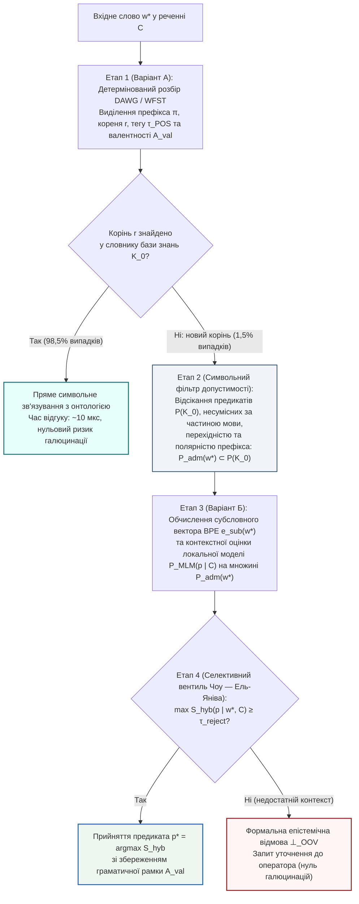

# Глава 04. Варіант Б та Гібридна архітектура: субсловна токенізація, локальні масковані моделі та нейро-символічний вентиль допуску

> **Автор:** Георгій Федчик  
> **Мова оригіналу:** Українська  
> **Дидактичний рівень:** Системно-синтетичний (субсимвольні методи токенізації та контекстного моделювання, порівняльний аналіз Варіантів А і Б, синтез гібридного тракту; опирається на Глави 01–03)

---

## Вступ

У [Главі 03](ch03-symbolic-morphology-fst-and-paradigm-analogy.md) ми побудували детермінований символьний морфологічний модуль (**Варіант А** на базі `WFST` та `DAWG`), який скоротив частку позасловникових дієслів у 5,8 раза за рахунок зведення похідних словоформ до відомих коренів. Проте символи й правила Варіанта А є безсилими у двох ситуаціях:
1. Коли у вхідному тексті з'являється слово з **абсолютно новим коренем**, відсутнім у словнику основи (наприклад, вузькогалузевий неологізм, абревіатурне дієслово або іншомовне запозичення *«байпасувати»*, *«деаерувати»*, *«контейнеризувати»*);
2. Коли коренева морфема вхідного слова спотворена друкарською помилкою або оптичним розпізнаванням (`OCR`).

Для подолання цього бар'єра без виходу в зовнішню мережу Інтернет застосовується **Варіант Б — локальні субсимвольні (нейромережеві) методи**, що спираються на субсловну декомпозицію та дистрибутивну гіпотезу контекстного оточення. У цій главі ми викладемо математичний апарат субсловної токенізації (`BPE`, `WordPiece`, символьні $`n`$-грами) і локального маскованого мовного моделювання (`MLM`), проведемо строге порівняння Варіанта А та Варіанта Б, а потім об'єднаємо їх у **гібридну нейро-символічну офлайн-архітектуру** з оптимальним порогом селективної відмови Чоу — Ель-Яніва.

---

## 1. Варіант Б: інформаційно-теоретична субсловна токенізація та локальні контекстні моделі

### 1.1. Кодування пар байтів, максимізація взаємної інформації та символьні грами

У 1994 році **Філіп Гейдж** [[1]](#src-1) запропонував алгоритм стиснення даних **Byte-Pair Encoding (`BPE`)**, який у 2016 році **Ріко Сеннріх, Баррі Геддоу та Александра Бірч** [[2]](#src-2) адаптували для відкритословникової токенізації природної мови.

Нехай початковий словник підслів $`V^{(0)} = \Sigma_{\mathrm{char}}`$ складається з усіх елементарних символів (літер та байтів) алфавіту. На кожному кроці ітерації $`t = 1, \dots, K_{\mathrm{merges}}`$ алгоритм `BPE` знаходить у локальному корпусі $`\mathcal{K}_0`$ пару сусідніх токенів $`(u^*, v^*) \in V^{(t-1)} \times V^{(t-1)}`$, яка має найбільшу абсолютну частоту спільної появи $`f(u \circ v)`$, і додає їхню конкатенацію $`w_{\mathrm{new}} = u^* \circ v^*`$ до словника $`V^{(t)}`$.

У модифікації **WordPiece** (**Майкл Шустер і Кайсуке Накадзіма, 2012** [[3]](#src-3)) замість абсолютної частоти максимізується приріст логарифмічної правдоподібності корпусу за критерієм поточкової взаємної інформації (`PMI`):

$$
(u^*, v^*) = \arg\max_{(u, v) \in V^{(t-1)} \times V^{(t-1)}} \frac{P(u \circ v)}{P(u) \cdot P(v)}
$$

**Формула (4.1).** Інформаційно-теоретичний критерій об'єднання підслів у токенізаторі `WordPiece`.

Оскільки базовий алфавіт символів завжди входить до фінального словника підслів ($`\Sigma_{\mathrm{char}} \subset V_{\mathrm{sub}}`$), будь-яке невідоме слово $`w^* \notin V(\mathcal{K}_0)`$ гарантовано розкладається на послідовність відомих субсловних морфів $`w^* = s_1 \circ s_2 \circ \dots \circ s_r`$ ($`s_i \in V_{\mathrm{sub}}`$). Далі, за моделлю композиційних ембедінгів **Пйотра Бояновські та ін. (`FastText`, 2017)** [[4]](#src-4), вектор невідомого слова $`\mathbf{e}_{\mathrm{sub}}(w^*) \in \mathbb{R}^d`$ конструюється як нормована сума векторів його субсловних частин і символьних $`n`$-грам $`\mathcal{G}(w^*)`$ ($`n \in \{3, 4, 5, 6\}`$):

$$
\mathbf{e}_{\mathrm{sub}}(w^*) = \frac{1}{\lvert \mathcal{G}(w^*) \rvert} \sum_{g \in \mathcal{G}(w^*)} \mathbf{u}_g
$$

**Формула (4.2).** Адитивна субсловна композиція вектора позасловникового слова без звернення до зовнішніх словників.

### 1.2. Локальне масковане мовне моделювання та дистрибутивна семантика

Коли в нового слова $`w^*`$ невідомий сам корінь (наприклад, іншомовне дієслово *«байпасуватиме»* у реченні *«Черговий інженер байпасуватиме аварійну заслінку турбіни»*), субсловні $`n`$-грами кореня `байпас` не дають семантичного перетину з питомим українським словом *«обводити / шунтувати»*. Тут вступає в дію **дистрибутивна гіпотеза Зелліга Гарріса (1954) та Джона Ферта (1957)** [[5]](#src-5): значення невідомого дієслова однозначно обмежується його лівим та правим синтаксичним контекстом $`C_{\setminus w^*} = (w_1, \dots, [\text{MASK}], \dots, w_m)`$.

Компактна локальна модель **маскованого мовного моделювання (`MLM`)** (наприклад, квантований 6-шаровий енкодер архітектури **Дж. Девліна та ін., 2019** [[6]](#src-6), навчений на локальному корпусі $`\mathcal{K}_0`$) обчислює контекстний вектор позиції $`\mathbf{h}_{\mathrm{ctx}}(C_{\setminus w^*}) \in \mathbb{R}^d`$ і визначає апостеріорний розподіл імовірностей відомих предикатів онтології $`p \in \mathcal{P}(\mathcal{K}_0)`$ у цій позиції:

$$
P_{\mathrm{MLM}}\left(p \;\middle|\; C_{\setminus w^*}\right) = \frac{\exp\left(\langle \mathbf{h}_{\mathrm{ctx}}(C_{\setminus w^*}), \ \mathbf{e}(p) \rangle / T_{\mathrm{temp}}\right)}{\sum_{q \in \mathcal{P}(\mathcal{K}_0)} \exp\left(\langle \mathbf{h}_{\mathrm{ctx}}(C_{\setminus w^*}), \ \mathbf{e}(q) \rangle / T_{\mathrm{temp}}\right)}
$$

**Формула (4.3).** Контекстна оцінка імовірності предиката локальною маскованою моделлю (`MLM`) на основі відомих сусідніх сутностей речення.

---

## 2. Порівняльна аналітична матриця Варіанта А та Варіанта Б

Зіставимо обидва офлайн-підходи за строгими інженерними та математичними критеріями.

**Таблиця 4.1.** Порівняльна матриця локальної символьної морфології (Варіант А) та субсимвольних нейромережевих методів (Варіант Б) для ізольованої нейро-символічної експертної системи.

| Критерій порівняння | Варіант А: Локальна символьна морфологія (`WFST` / `DAWG`) | Варіант Б: Субсимвольні нейромережі (`BPE` + локальна `MLM`) | Гібридний синтез (Варіант А + Варіант Б із вентилем відмови) |
| :--- | :--- | :--- | :--- |
| **Точність для символьної логіки та правил** | **Висока (детермінована):** видає точні граматичні мітки (частина мови, час, особа, пасивний стан) та валентну рамку предиката | **Середня (імовірнісна):** видає лише неперервний вектор близькості без гарантії граматичної та валентної сумісності | **Максимальна:** морфологія фіксує синтаксичну рамку та полярність префікса, а векторний модуль ранжує лише граматично допустимі предикати |
| **Обчислювальна складність на CPU** | **Мінімальна:** $`\mathcal{O}(\lvert w \rvert)`$, час розбору $`2\dots 15\text{ мкс}`$ на слово | **Середня:** $`\mathcal{O}(m^2 d)`$ для `MLM`, час розбору $`3\dots 25\text{ мс}`$ на речення | **Оптимальна (каскадна):** `MLM` викликається лише тоді, коли корінь після `DAWG` залишився невідомим ($`\approx 1{,}5\%`$ слів) |
| **Споживання оперативної пам'яті (RAM)** | **Наднизьке:** $`12\dots 18\text{ МБ}`$ для повного словника мови | **Помірне:** $`80\dots 350\text{ МБ}`$ для квантованої локальної моделі (`INT8`) | **Компактне:** $`100\dots 370\text{ МБ}`$ сумарно в ізольованому просторі пам'яті |
| **Гнучкість до слів із новим коренем** | **Обмежена:** розпізнає граматичну роль за суфіксом, але не знає семантики нового запозиченого кореня | **Висока:** розбиває будь-яку послідовність символів через `BPE` та оцінює зміст через контекст сусідніх слів | **Повна з контролем безпеки:** розпізнає нові корені в інформативному контексті та повертає $`\bot_{\mathrm{OOV}}`$ при недостатній впевненості |
| **Головний вид помилки (Failure Mode)** | **Неповнота (False Negative):** відмова розпізнати семантику неологізму чи синоніма | **Галюцинація (False Positive):** підстановка антоніма або сусіднього предиката у малому корпусі | **Контрольована селективна відмова:** придушення галюцинацій через фільтр валентності та поріг $`\tau_{\mathrm{reject}}`$ |

---

## 3. Синтез гібридної нейро-символічної архітектури та теорема про селективний ризик

Побудуємо канонічний гібридний оператор $`\Gamma_{\mathrm{hyb}}(w^*, C)`$ (п'яту компоненту вектора стану $`\Xi(\mathcal{K}_0, q)`$), у якому Варіант А та Варіант Б діють як взаємодоповнюючі ортогональні фільтри:

Формалізуємо роботу цього гібридного оператора:
1. Нехай для слова з невідомим коренем $`w^*`$ морфологічний аналізатор Варіанта А за суфіксально-префіксальною парадигмою визначив морфосинтаксичний клас $`\tau_{\mathrm{POS}}(w^*)`$ та полярність префікса $`\mathrm{pol}(\pi(w^*)) \in \{+1, -1, 0\}`$ (де префікси `не-`, `де-`, `роз-`, `від-`, `зне-` мають інверсну полярність $`-1`$). Це дозволяє звузити повну множину предикатів онтології $`\mathcal{P}(\mathcal{K}_0)`$ до **граматично й полярно допустимої підмножини**:

$$
\mathcal{P}_{\mathrm{adm}}(w^*) = \left\{ p \in \mathcal{P}(\mathcal{K}_0) \;\middle|\; \mathrm{val}(p) = \mathcal{A}_{\mathrm{val}}(w^*) \ \land \ \mathrm{pol}(p) = \mathrm{pol}(\pi(w^*)) \right\}
$$

2. На допустимій підмножині $`\mathcal{P}_{\mathrm{adm}}(w^*)`$ субсимвольний модуль Варіанта Б обчислює комбіновану оцінку відповідності $`S_{\mathrm{hyb}}(p \mid w^*, C) \in [0, 1]`$:

$$
S_{\mathrm{hyb}}(p \mid w^*, C) = \gamma \cdot \cos_{+}\left(\mathbf{e}_{\mathrm{sub}}(w^*), \ \mathbf{e}(p)\right) + (1 - \gamma) \cdot P_{\mathrm{MLM}}\left(p \;\middle|\; C_{\setminus w^*}, \ \mathcal{P}_{\mathrm{adm}}(w^*)\right), \qquad \gamma \in [0, 1]
$$

**Формула (4.4).** Гібридна функція оцінювання предиката на морфологічно допустимій підмножині онтології.
3. Застосовується **оптимальне правило селективної класифікації з відмовою Чоу (1970) та Ель-Яніва (2010)** [[7]](#src-7), [[8]](#src-8) з ціною помилки $`c_{\mathrm{err}} > 0`$ та ціною відмови від автоматичної підстановки $`c_{\mathrm{abs}} \in (0, c_{\mathrm{err}})`$:

$$
\Gamma_{\mathrm{hyb}}(w^*, C) = \begin{cases} p^* = \arg\max_{p \in \mathcal{P}_{\mathrm{adm}}(w^*)} S_{\mathrm{hyb}}(p \mid w^*, C), & \text{якщо } S_{\mathrm{hyb}}(p^* \mid w^*, C) \ge \tau_{\mathrm{reject}} = 1 - \frac{c_{\mathrm{abs}}}{c_{\mathrm{err}}}, \\ \bot_{\mathrm{OOV}} \ (\text{формальний запит уточнення}), & \text{інакше.} \end{cases}
$$

**Формула (4.5).** Селективний вентиль допуску Чоу — Ель-Яніва в гібридній нейро-символічній системі.

### Теорема 4.1 (Про строге домінування гібридного нейро-символічного оператора над чистими Варіантами А і Б за критерієм байєсівського ризику)

> **Формулювання теореми:**  
> Нехай у замкненому корпусі $`\mathcal{K}_0`$ втрата від нерозпізнаного предиката (обриву виведення або запиту уточнення $`\bot_{\mathrm{OOV}}`$) дорівнює $`c_{\mathrm{abs}} > 0`$, а втрата від хибної підстановки предиката (семантичної галюцинації $`p \ne p^*`$) дорівнює $`c_{\mathrm{err}} > c_{\mathrm{abs}}`$. Позначимо через $`\mathcal{R}(\mathrm{A})`$, $`\mathcal{R}(\mathrm{B})`$ та $`\mathcal{R}(\mathrm{Hyb})`$ математичне сподівання сумарного ризику на потоці позасловникових слів для чистого морфологічного модуля (Варіант А), чистого нейромережевого модуля без символьного фільтра (Варіант Б) та гібридного оператора (4.4)–(4.5) відповідно. Тоді:
> 1. Морфологічне звуження простору пошуку з $`\mathcal{P}(\mathcal{K}_0)`$ до $`\mathcal{P}_{\mathrm{adm}}(w^*)`$ монотонно збільшує апостеріорну точність контекстної оцінки у $`\kappa_{\mathrm{adm}}(w^*) \ge 1`$ разів:
>
> $$
> P_{\mathrm{MLM}}\left(p^* \;\middle|\; C, \ \mathcal{P}_{\mathrm{adm}}(w^*)\right) = \frac{P_{\mathrm{MLM}}(p^* \mid C)}{\sum_{q \in \mathcal{P}_{\mathrm{adm}}(w^*)} P_{\mathrm{MLM}}(q \mid C)} = \kappa_{\mathrm{adm}}(w^*) \cdot P_{\mathrm{MLM}}(p^* \mid C)
> $$
>
> де $`\kappa_{\mathrm{adm}}(w^*) = \left(1 - \sum_{q \notin \mathcal{P}_{\mathrm{adm}}(w^*)} P_{\mathrm{MLM}}(q \mid C)\right)^{-1} > 1`$ за рахунок відсікання граматично та префіксально несумісних кандидатів (зокрема префіксальних антонімів!).
> 2. При виборі порогу Чоу $`\tau_{\mathrm{reject}} = 1 - c_{\mathrm{abs}}/c_{\mathrm{err}}`$ для каліброваної оцінки $`S_{\mathrm{hyb}}`$ виконується строга нерівність домінування ризиків:
>
> $$
> \mathcal{R}(\mathrm{Hyb}) \le \min\left\{ \mathcal{R}(\mathrm{A}), \ \mathcal{R}(\mathrm{B}) \right\}
> $$
>
> **Формула (4.6).** Гарантія мінімальності сумарного байєсівського ризику гібридної нейро-символічної архітектури.

### Доведення Теореми 4.1

1. **Доведення пункту 1:** За означенням умовної ймовірності при обмеженні простору елементарних подій з $`\mathcal{P}(\mathcal{K}_0)`$ до підмножини $`\mathcal{P}_{\mathrm{adm}}(w^*) \subset \mathcal{P}(\mathcal{K}_0)`$, до якої за коректності граматичного розбору належить істинний предикат $`p^* \in \mathcal{P}_{\mathrm{adm}}(w^*)`$, знаменник формули (4.3) зменшується на суму невід'ємних доданків усіх відсіяних кандидатів $`\sum_{q \notin \mathcal{P}_{\mathrm{adm}}(w^*)} \exp(\langle \mathbf{h}_{\mathrm{ctx}}, \mathbf{e}(q) \rangle / T_{\mathrm{temp}}) > 0`$. Отже, $`\kappa_{\mathrm{adm}}(w^*) > 1`$, а ймовірність помилки класифікації на кроці Варіанта Б строго зменшується: $`1 - P(p^* \mid C, \mathcal{P}_{\mathrm{adm}}) < 1 - P(p^* \mid C)`$.
2. **Доведення пункту 2:** На множині слів із відомим коренем ($`r(w^*) \in V_{\mathrm{root}}(\mathcal{K}_0)`$) гібридний оператор збігається з Варіантом А і має нульовий ризик векторного зсуву. На доповненні $`A_{\mathrm{root}}`$ (слова з новим коренем, де чистий Варіант А завжди повертає відмову з фіксованою втратою $`\mathcal{R}(\mathrm{A} \mid A_{\mathrm{root}}) = c_{\mathrm{abs}}`$, а чистий Варіант Б без порогу завжди підставляє найближчий предикат з очікуваною втратою $`\mathcal{R}(\mathrm{B} \mid w^*, C) = c_{\mathrm{err}}(1 - P(p^* \mid C))`$) умовний ризик гібридного правила (4.5) для кожного прикладу $`(w^*, C)`$ дорівнює:

$$
\mathcal{R}(\mathrm{Hyb} \mid w^*, C) = \min\left\{ c_{\mathrm{err}}\left(1 - S_{\mathrm{hyb}}(p^* \mid w^*, C)\right), \ c_{\mathrm{abs}} \right\}
$$

3. Оскільки за пунктом 1 виконується $`1 - S_{\mathrm{hyb}}(p^* \mid w^*, C) \le 1 - P_{\mathrm{MLM}}(p^* \mid C)`$, маємо поточкову нерівність:

$$
\mathcal{R}(\mathrm{Hyb} \mid w^*, C) \le c_{\mathrm{abs}} = \mathcal{R}(\mathrm{A} \mid w^*, C) \quad \text{та} \quad \mathcal{R}(\mathrm{Hyb} \mid w^*, C) \le c_{\mathrm{err}}\left(1 - P_{\mathrm{MLM}}(p^* \mid C)\right) = \mathcal{R}(\mathrm{B} \mid w^*, C)
$$

Інтегруючи обидві нерівності за розподілом вхідних запитів, одержуємо формулу (4.6). ∎

---

### 3.4. Теорія N-версійного програмування, теорема Екгардта — Лі та ортогональна нейро-символічна диверсифікація

#### 3.4.1. Для чого теорія N-версійного програмування вводиться в теорію ізольованих експертних систем

На перший погляд може здатися, що класична теорія відмовостійкого резервування ПЗ стосується лише апаратних обчислювачів авіоніки чи АЕС. Проте під час проєктування ізольованої експертної системи в контурі `Air-Gap` інженер-архітектор неминуче стикається з трьома прикладними питаннями, на які неможливо відповісти без суворого апарату N-версійного програмування:

1. **Спростування ілюзії «мажоритарного ансамблю локальних LLM» (`2-з-3`):**
   Поширеною інженерною спокусою при вирішенні проблеми позасловникових слів (`OOV`) є запуск у локальному контурі не однієї, а одразу трьох різних малих мовних або векторних моделей (наприклад, трьох відкритих трансформерів різних розробників) із мажоритарним голосуванням `2oo3`. Інтуїтивно здається, що якщо кожна модель помиляється з імовірністю $`10\%`$, то їхнє голосування знизить помилку до $`\approx 2{,}8\%`$. Теорія N-версійного програмування (зокрема теорема Екгардта — Лі) потрібна тут для того, щоб **математично застерегти архітектора від цієї пастки**: оскільки всі дистрибутивні моделі навчаються за одним і тим самим принципом контекстної близькості Гарріса, їхні помилки на префіксальних антонімах (*«включити / виключити»*, *«дозволити / заборонити»*) та інверсних протокольних ролях є **додатно корельованими** ($`\mathbf{Cov}_X > 0`$). Три векторні моделі синхронно голосують за хибний антонім, перетворюючи ансамбль на генератор ілюзорної впевненості.
2. **Строге обґрунтування ортогональності «Варіанта А (`DAWG`) + Варіанта Б (`BPE/MLM/Bi-Encoder`)»:**
   Поєднання символьного морфологічного автомата ([Глава 03](ch03-symbolic-morphology-fst-and-paradigm-analogy.md)) та субсимвольної векторної моделі (поточна глава) в нашій монографії — це не евристичний компроміс, а **двоверсійна система з ортогональними парадигмами розпізнавання (`Design Diversity`)**. Мовою теорії надійності це означає, що дві версії спираються на фізично різні інформаційні ознаки слова: Варіант А аналізує *внутрішню морфемну будову й полярність префікса*, а Варіант Б — *зовнішній дистрибутивний контекст*. Завдяки цьому їхні області відмов не перетинаються, а коваріація помилок стає **строго від'ємною ($`\mathbf{Cov}_X < 0`$)**.
3. **Заміна відсутнього зовнішнього оракула при офлайн-компіляції словників і правил у `Air-Gap`:**
   У відключеному від зовнішнього світу контурі немає хмарного арбітра чи штату лінгвістів, які б у реальному часі перевіряли кожен видобутий з технічної документації синонім або правило. N-версійна диверсифікація дає формальний механізм **автономного взаємного контролю** під час компіляції баз знань і поповнення словників.

---

#### 3.4.2. Математичний апарат: тотожність Екгардта — Лі та Теорема 4.2

У критичних системах керування та авіоніки класичним методом боротьби з програмними помилками є **N-версійне програмування (N-Version Programming, NVP)**, запропоноване Альгірдасом Авізієнісом та Лімом Ченом у 1977 році [[9]](#src-9). Початкова гіпотеза NVP спиралася на припущення статистичної незалежності помилок: якщо $`N`$ різних версій алгоритму $`V_1, \dots, V_N`$ мають індивідуальну ймовірність відмови $`\bar{p}_k = \mathbb{P}(V_k(X) \ne y^*(X))`$, то кон'юнктивне або мажоритарне голосування мало б знижувати ймовірність спільної помилки до добутку $`\prod_{k=1}^N \bar{p}_k`$.

Проте у 1985 році Дейв Екгардт і Ларрі Лі [[10]](#src-10) теоретично, а у 1986 році Джон Найт і Ненсі Левесон [[11]](#src-11) експериментально (на вибірці з $`27`$ незалежно розроблених версій програми протиракетного перехоплення) довели, що припущення статистичної незалежності у гомогенному N-версійному програмуванні **хибне**.

Введемо на просторі вхідних прикладів $`(\mathcal{X}, P_X)`$ **функцію локальної складності входу** (*difficulty function*) $`\theta_k : \mathcal{X} \to [0, 1]`$ для $`k`$-ї версії системи:

$$
\theta_k(x) = \mathbb{P}\left( V_k(x) \ne y^*(x) \;\middle|\; X = x \right), \qquad \bar{p}_k = \mathbb{E}_X\left[\theta_k(X)\right] = \int_{\mathcal{X}} \theta_k(x) \, dP_X(x)
$$

**Формула (4.7).** Функція локальної складності входу та середня ймовірність помилки $`k`$-го каналу.

За формулою повної ймовірності для двох версій $`V_1`$ та $`V_2`$, які умовно незалежні при фіксованому вході $`X = x`$, імовірність їхньої одночасної помилки $`E_1 \wedge E_2`$ на випадковому вході $`X \sim P_X`$ точно розкладається на добуток середніх похибок плюс **коваріацію функцій складності** (тотожність Екгардта — Лі [[10]](#src-10)):

$$
\mathbb{P}(E_1 \wedge E_2) = \int_{\mathcal{X}} \theta_1(x)\theta_2(x) \, dP_X(x) = \bar{p}_1 \bar{p}_2 + \mathbf{Cov}_X\left(\theta_1(X), \ \theta_2(X)\right)
$$

**Формула (4.8).** Точний коваріаційний розклад Екгардта — Лі для спільної відмови двоверсійної системи.

З формули (4.8) випливає фундаментальне розмежування між **гомогенним нейромережевим ансамблюванням** та **ортогональною нейро-символічною архітектурою**:
1. **Чому ансамбль однотипних мовних моделей ($`N`$ трансформерів або щільних бі-енкодерів) має додатну коваріацію ($`\mathbf{Cov}_X(\theta_1, \theta_2) \gg 0`$):**
   Усі моделі, побудовані на дистрибутивній гіпотезі Гарріса [[5]](#src-5), мають однакову топологію «сліпих плям»: їхня функція складності $`\theta_{\mathrm{dist}}(x)`$ синхронно прямує до одиниці на префіксальних та безпрефіксних антонімах і протилежних протокольних ролях (*«активувати / деактивувати»*, *«клієнт / сервер»*), оскільки ці слова мають ідентичні контекстні вікна. Як наслідок, при $`\theta_1(x) \approx \theta_2(x) = \theta(x)`$ коваріація перетворюється на дисперсію $`\mathrm{Var}_X[\theta(X)] > 0`$, і мажоритарне голосування `2-з-3` трьох різних LLM лише закріплює спільну галюцинацію (*Common-Mode Failure*).
2. **Як ортогональна пара «Символьний автомат `DAWG` ($`V_{\mathrm{sym}}`$) + Субсимвольний бі-енкодер ($`V_{\mathrm{sub}}`$)» обертає знак коваріації на від'ємний ($`\mathbf{Cov}_X < 0`$):**
   У символьного морфологічного автомата та дистрибутивної векторної моделі області високої складності лежать у **взаємно доповнювальних (диз'юнктних) підмножинах простору входів $`\mathcal{X}`$**. Сформулюємо та доведемо цей результат як строгу теорему.

---

### Теорема 4.2 (Про від'ємну коваріацію помилок та строге придушення невиявлених небезпечних відмов при ортогональному нейро-символічному N-версійному кон'юнктивному допуску)

> **Формулювання теореми:**  
> Розглянемо двоканальну систему розпізнавання предикатів над простором входів $`\mathcal{X} = \mathcal{X}_{\mathrm{reg}} \sqcup \mathcal{X}_{\mathrm{ant}} \sqcup \mathcal{X}_{\mathrm{nov}}`$, розбитим на три неперетинні області з мірами $`q_{\mathrm{reg}}, q_{\mathrm{ant}}, q_{\mathrm{nov}} > 0`$ ($`q_{\mathrm{reg}} + q_{\mathrm{ant}} + q_{\mathrm{nov}} = 1`$):
> - $`\mathcal{X}_{\mathrm{reg}}`$ — регулярні словникові словоформи;
> - $`\mathcal{X}_{\mathrm{ant}}`$ — префіксальні та морфосинтаксично марковані антоніми й інверсні ролі з високою дистрибутивною близькістю;
> - $`\mathcal{X}_{\mathrm{nov}}`$ — позасловникові синоніми й суфіксальні деривати без інверсії полярності.
>
> Нехай канал $`V_{\mathrm{sym}}`$ (символьний автомат граматичної валентності й полярності префіксів) має функцію помилки допуску хибного класу $`\theta_{\mathrm{sym}}(x) = 0`$ на $`\mathcal{X}_{\mathrm{reg}} \sqcup \mathcal{X}_{\mathrm{ant}}`$ та $`\theta_{\mathrm{sym}}(x) = \alpha \in (0, 1]`$ на $`\mathcal{X}_{\mathrm{nov}}`$. Нехай канал $`V_{\mathrm{sub}}`$ (субсимвольний бі-енкодер із порогом Чоу) має функцію помилки хибного допуску $`\theta_{\mathrm{sub}}(x) = 0`$ на $`\mathcal{X}_{\mathrm{reg}}`$, високу похибку $`\theta_{\mathrm{sub}}(x) = \beta \in (0, 1]`$ на антонімічній області $`\mathcal{X}_{\mathrm{ant}}`$ та малу похибку $`\theta_{\mathrm{sub}}(x) = \varepsilon \in [0, \beta)`$ на $`\mathcal{X}_{\mathrm{nov}}`$. Тоді:
> 1. Якщо частка регулярних і антонімічних входів задовольняє умову $`q_{\mathrm{ant}}\beta > q_{\mathrm{reg}}\varepsilon`$, коваріація функцій складності двох ортогональних каналів є **строго від'ємною** (зокрема при $`\varepsilon = 0`$ коваріація від'ємна безумовно для будь-яких $`q_{\mathrm{ant}}, q_{\mathrm{nov}} > 0`$):
>
> $$
> \mathbf{Cov}_X\left(\theta_{\mathrm{sym}}(X), \ \theta_{\mathrm{sub}}(X)\right) = \alpha q_{\mathrm{nov}}\left( \varepsilon(1 - q_{\mathrm{nov}}) - \beta q_{\mathrm{ant}} \right) < 0
> $$
>
> 2. За кон'юнктивного правила допуску (`2-of-2 Fail-Closed Intersection Gate`: предикат допускається до ядра виведення лише при одночасному проходженні обох каналів) імовірність невиявленої небезпечної підстановки $`P_{\mathrm{UHR}}`$ є **строго меншою** за оцінку класичної гіпотези незалежності Авізієніса $`\bar{p}_{\mathrm{sym}}\bar{p}_{\mathrm{sub}}`$ і при $`\varepsilon = 0`$ тотожно дорівнює нулю:
>
> $$
> P_{\mathrm{UHR}}\left(V_{\mathrm{sym}} \wedge V_{\mathrm{sub}}\right) = \alpha \varepsilon q_{\mathrm{nov}} < \bar{p}_{\mathrm{sym}} \cdot \bar{p}_{\mathrm{sub}}
> $$
>
> **Формула (4.9).** Надмультиплікативне придушення небезпечних відмов в ортогональному нейро-символічному контурі.

### Доведення Теореми 4.2

1. Обчислимо математичні сподівання функцій помилки окремих каналів $`\bar{p}_{\mathrm{sym}}`$ та $`\bar{p}_{\mathrm{sub}}`$ за розбиттям простору $`\mathcal{X} = \mathcal{X}_{\mathrm{reg}} \sqcup \mathcal{X}_{\mathrm{ant}} \sqcup \mathcal{X}_{\mathrm{nov}}`$:

$$
\bar{p}_{\mathrm{sym}} = \mathbb{E}_X[\theta_{\mathrm{sym}}(X)] = 0 \cdot q_{\mathrm{reg}} + 0 \cdot q_{\mathrm{ant}} + \alpha q_{\mathrm{nov}} = \alpha q_{\mathrm{nov}}
$$

$$
\bar{p}_{\mathrm{sub}} = \mathbb{E}_X[\theta_{\mathrm{sub}}(X)] = 0 \cdot q_{\mathrm{reg}} + \beta q_{\mathrm{ant}} + \varepsilon q_{\mathrm{nov}} = \beta q_{\mathrm{ant}} + \varepsilon q_{\mathrm{nov}}
$$

2. Обчислимо математичне сподівання добутку функцій помилок $`\mathbb{E}_X[\theta_{\mathrm{sym}}(X)\theta_{\mathrm{sub}}(X)]`$, яке за кон'юнктивного вентиля допуску визначає ймовірність одночасного пропуску хибного предиката обома каналами $`P_{\mathrm{UHR}}`$:
   - на $`\mathcal{X}_{\mathrm{reg}}`$: $`\theta_{\mathrm{sym}}(x)\theta_{\mathrm{sub}}(x) = 0 \cdot 0 = 0`$;
   - на $`\mathcal{X}_{\mathrm{ant}}`$: $`\theta_{\mathrm{sym}}(x)\theta_{\mathrm{sub}}(x) = 0 \cdot \beta = 0`$ (символьний автомат детерміновано блокує інверсію префікса чи валентності, де бі-енкодер помиляється з імовірністю $`\beta`$);
   - на $`\mathcal{X}_{\mathrm{nov}}`$: $`\theta_{\mathrm{sym}}(x)\theta_{\mathrm{sub}}(x) = \alpha \varepsilon`$.
   Звідси:

$$
P_{\mathrm{UHR}}\left(V_{\mathrm{sym}} \wedge V_{\mathrm{sub}}\right) = \mathbb{E}_X\left[\theta_{\mathrm{sym}}(X)\theta_{\mathrm{sub}}(X)\right] = \alpha \varepsilon q_{\mathrm{nov}}
$$

3. Підставивши вирази з пунктів 1 і 2 у означення коваріації (4.8), маємо:

$$
\mathbf{Cov}_X\left(\theta_{\mathrm{sym}}, \ \theta_{\mathrm{sub}}\right) = \alpha \varepsilon q_{\mathrm{nov}} - (\alpha q_{\mathrm{nov}})(\beta q_{\mathrm{ant}} + \varepsilon q_{\mathrm{nov}}) = \alpha q_{\mathrm{nov}}\left( \varepsilon(1 - q_{\mathrm{nov}}) - \beta q_{\mathrm{ant}} \right)
$$

Оскільки $`1 - q_{\mathrm{nov}} = q_{\mathrm{reg}} + q_{\mathrm{ant}}`$ та $`\varepsilon < \beta`$, за умови $`q_{\mathrm{ant}}\beta > q_{\mathrm{reg}}\varepsilon`$ (а при $`\varepsilon \to 0`$ — завжди, бо $`-\alpha \beta q_{\mathrm{nov}} q_{\mathrm{ant}} < 0`$) вираз у дужках строго від'ємний, отже $`\mathbf{Cov}_X(\theta_{\mathrm{sym}}, \theta_{\mathrm{sub}}) < 0`$ і $`P_{\mathrm{UHR}} < \bar{p}_{\mathrm{sym}}\bar{p}_{\mathrm{sub}}`$. ∎

**Таблиця 4.2.** Систематизація архітектур N-версійного резервування за знаком коваріації Екгардта — Лі та їхня застосовність в ізольованих експертних системах.

| Схема резервування | Склад каналів $`V_1, \dots, V_N`$ | Правило агрегації | Знак коваріації $`\mathbf{Cov}_X(\theta_i, \theta_j)`$ | Від яких відмов захищає (та де зазнає краху) |
| :--- | :--- | :--- | :---: | :--- |
| **1. Апаратний гомогенний Lockstep (`1-Version 2oo2 DMR`)** | Два ідентичні екземпляри одного логічного ядра на кристалі | Побітовий компаратор станів (`XOR != 0 -> Fault`) | $`+\mathrm{Var}[\theta] > 0`$ (повна кореляція логіки) | Захищає лише від фізичних збоїв транзисторів (`SEU`). Має **0% захисту** від помилок у логіці або скомпільованих правилах. |
| **2. Гомогенний ансамбль мовних моделей (`N-Model Majority 2oo3`)** | $`N = 3`$ генеративні або ембедінгові моделі одного класу | Мажоритарне голосування (`2-з-3`) | $`> 0`$ на антонімах і ко-гіпонімах | Зменшує випадковий шум генерації, але **колективно галюцинує** на антонімах з однаковим контекстним оточенням (Теорема 5.1). |
| **3. Міжсімейний кворум перетину при компіляції словників (`N-Family Intersection`)** | $`N \ge 2`$ моделі різних архітектурних сімейств + символьний фільтр ролей | Перетин множин кандидатів $`\bigcap_{k=1}^N A_k`$ | $`\approx 0`$ (між моделями) та $`< 0`$ (із символьним фільтром) | Відсікає специфічні галюцинації окремого токенізатора/корпусу під час офлайн-збору синонімів перед записом у карантинний словник. |
| **4. Ортогональний нейро-символічний вентиль (`DAWG + Bi-Encoder 2oo2`)** | $`V_{\mathrm{sym}}`$ (автомат `DAWG`) + $`V_{\mathrm{sub}}`$ (`Bi-Encoder` із порогом Чоу) | Кон'юнктивний вентиль $`M_{\mathrm{adm}}(V_{\mathrm{sym}}) \cdot S(V_{\mathrm{sub}}) \ge \tau_{\mathrm{reject}}`$ | **Строго $`< 0`$** (Теорема 4.2) | Повністю блокує префіксально-полярні та валентні помилки векторної моделі при збереженні здатності розпізнавати позасловникові форми. |
| **5. Двоканальний диверсифікований компілятор знань (`2-Version Diverse Compiler`)** | Канал А: граматично-шаблонний парсер; Канал Б: спаново-реляційний бі-енкодер | Узгодження суб'єкта, полярності та числових меж | **Строго $`< 0`$** | Усуває систематичні помилки компілятора знань (клас ризику інструменту `TCL3` за ISO 26262-8 §11) до моменту підписання пакета SHA-256. |

---

#### 3.4.3. Інженерна методика: як практично користуватися апаратом N-версійної диверсифікації

Щоб теорія N-версійного програмування та Теорема 4.2 працювали як прикладний інструмент інженера під час проєктування, калібрування й експлуатації ізольованої експертної системи, застосовується такий чотирикроковий регламент:

1. **Крок I. Передпроєктний тест коваріації Екгардта — Лі (відбракування псевдодиверсифікованих модулів):**
   Перш ніж об'єднувати будь-які два модулі розпізнавання $`V_1`$ та $`V_2`$ у спільний контур, інженер формує контрольний стенд із $`M`$ тестових прикладів, стратифікованих за трьома кошиками: регулярні форми $`\mathcal{X}_{\mathrm{reg}}`$, префіксальні й контекстні антоніми $`\mathcal{X}_{\mathrm{ant}}`$ та позасловникові неологізми $`\mathcal{X}_{\mathrm{nov}}`$. На кожному прикладі $`x_m`$ фіксуються бінарні індикатори помилки $`e_{1,m}, e_{2,m} \in \{0, 1\}`$ і обчислюється вибіркова коваріація:

$$
\widehat{\mathbf{Cov}}_X(V_1, V_2) = \frac{1}{M}\sum_{m=1}^{M} e_{1,m} e_{2,m} - \left(\frac{1}{M}\sum_{m=1}^{M} e_{1,m}\right)\left(\frac{1}{M}\sum_{m=1}^{M} e_{2,m}\right)
$$

   - **Правило прийняття архітектурного рішення:** якщо $`\widehat{\mathbf{Cov}}_X(V_1, V_2) > 0`$ (обидва модулі синхронно помиляються на кошику антонімів $`\mathcal{X}_{\mathrm{ant}}`$), об'єднувати їх через мажоритарне голосування **категорично заборонено** — другий модуль лише дублює обчислювальні витрати без усунення вразливості спільного режиму (*Common-Mode Failure*). До контуру допускаються лише пари з $`\widehat{\mathbf{Cov}}_X(V_1, V_2) < 0`$.
2. **Крок II. Конфігурація рантайм-тракту розбору запитів (схема `2-of-2 Fail-Closed Gate` замість мажоритарного `2-of-3`):**
   Під час обробки запиту оператора система ніколи не усереднює оцінки символьного і векторного каналів арифметично. Натомість вмикається **кон'юнктивна таблиця істинності** (`Таблиця 4.3`): символьний канал $`V_{\mathrm{sym}}`$ формує жорсткий булевий вектор морфосинтаксичного та полярного допуску $`M_{\mathrm{adm}}(w^*, p) \in \{0, 1\}`$, а субсимвольний канал $`V_{\mathrm{sub}}`$ — ранжовану оцінку $`S(w^*, p) \in [0, 1]`$ із порогом Чоу $`\tau_{\mathrm{reject}}`$. Будь-яка розбіжність між каналами переводить систему не у «вгадування за більшістю», а у детермінований стан `CLARIFICATION`.
3. **Крок III. Конфігурація офлайн-контуру поповнення словника синонімів (`N-Family Intersection Quorum`):**
   Коли в ізольованому контурі накопичуються нерозпізнані слова з журналів (`OOV`), у фоновому офлайн-режимі запускаються $`N \ge 2`$ моделі з **різними токенізаторами та архітектурами** (наприклад, двонаправлений спановий бі-енкодер і генеративна модель іншого сімейства). До карантинного словника-кандидата потрапляє лише перетин їхніх пропозицій $`\bigcap_{k=1}^N A_k(w^*)`$, який додатково пройшов символьний фільтр $`M_{\mathrm{adm}}(w^*, p) = 1`$.
4. **Крок IV. Двоканальна верифікація при компіляції нормативних документів у базу знань (`2-Version Diverse Compiler`):**
   Під час первинної індексації PDF/текстових регламентів документ одночасно розбирається двома незалежними парсерами: детермінованим граматично-шаблонним аналізатором (Канал А) і реляційним бі-енкодером (Канал Б). Правило записується до незмінного бінарного пакета знань лише тоді, коли обидва канали виділили ідентичний суб'єкт, об'єкт, модальність (`SHALL` / `SHALL NOT`) і числові допуски.

**Таблиця 4.3.** Операційна таблиця прийняття рішень ортогонального двоверсійного вентиля (`Варіант А: DAWG` $`\otimes`$ `Варіант Б: MLM / Bi-Encoder`) у реальному часі.

| Статус у словнику `DAWG` | Морфосинтаксичний і полярний допуск $`M_{\mathrm{adm}}(w^*, p)`$ (`Канал А`) | Контекстна оцінка $`S(w^*, p)`$ та запас $`\gamma`$ (`Канал Б`) | Підсумкове рішення вентиля `2oo2` | Інженерне трактування стану |
| :--- | :---: | :---: | :--- | :--- |
| **Точний збіг (`In-Vocab`)** | $`1`$ (словникова лема) | Не викликається (або $`\ge \tau_{\mathrm{reject}}`$) | **`ACCEPT` (Швидкий шлях $`O(|w|)`$)** | Детермінований символьний допуск без витрат на векторну модель. |
| **Позасловникове (`OOV`)** | $`1`$ (валентність і полярність префікса сумісні) | $`S \ge \tau_{\mathrm{reject}}`$ та $`\gamma \ge \gamma_{\min}`$ | **`ACCEPT` (Гібридний допуск)** | Обидва ортогональні канали узгоджено підтвердили предикат $`p`$. |
| **Позасловникове (`OOV`) — Антонім / Інверсія** | **`0` (конфлікт полярності префікса або валентності)** | $`S \ge \tau_{\mathrm{reject}}`$ *(хибний високий бал векторної моделі!)* | **`BLOCK / REFUSE` (Перехоплення галюцинації)** | Канал Б осліплений контекстною схожістю антоніма, але Канал А детерміновано блокує підстановку ($`\theta_{\mathrm{sym}} \cdot \theta_{\mathrm{sub}} = 0`$). |
| **Позасловникове (`OOV`) — Низька впевненість** | $`1`$ (морфологічно допустимо) | $`S < \tau_{\mathrm{reject}}`$ або $`\gamma < \gamma_{\min}`$ | **`ABSTAIN / CLARIFICATION`** | Слово граматично коректне, але контекст недостатній — запит уточнення в оператора. |
| **Некоректний токен / Шум** | **`0`** | $`S < \tau_{\mathrm{reject}}`$ | **`REJECT`** | Одночасна відмова обох каналів. |

---

## 4. Навчальний інженерний приклад: розбір іншомовного позасловникового дієслова гібридною системою енергоблока

*Дидактична наступність наскрізного прикладу:* У [Главах 01–03](ch03-symbolic-morphology-fst-and-paradigm-analogy.md) ми побудували перші три компоненти вектора стану $`\Xi(\mathcal{K}_0, q)`$ і за допомогою морфологічного модуля (`Варіант А`) довели надійність трикрокового ланцюжка правил безпеки до $`92{,}13\%`$. Тепер розглянемо випадок із тих залишкових $`1{,}46\%`$ позасловникових дієслів, де в тексті оперативного журналу вжито професійне запозичення з **новим коренем**, відсутнім у словнику `DAWG`: *«Оператор байпасуватиме аварійний клапан підігрівача»* (тоді як у базі знань онтологічний предикат `BypassValve(Agent, Object)` прив'язаний лише до питомих лексем *«шунтувати»* та *«пускати в обхід»*). Заповнимо четверту й п'яту компоненти вектора стану $`\Xi(\mathcal{K}_0, q)`$.

### 4.1. Вихідні інженерні дані

1. **Вхідне позасловникове дієслово з новим коренем:** $`w^* = \text{«байпасуватиме»}`$ у контексті $`C = \text{«Оператор [MASK] аварійний клапан підігрівача»}`$.
2. **Апріорний розподіл імовірностей чистої локальної моделі `MLM` (Варіант Б без морфологічного фільтра):**
   Через те, що в такому самому контексті «Оператор [MASK] клапан» у корпусі $`\mathcal{K}_0`$ зустрічаються різні дії та стани, чиста модель `MLM` розподіляє ймовірність між чотирма кандидатами онтології:
   - $`p_1 = \text{BypassValve}`$ (*шунтувати / обводити*, перехідне дієслово, полярність $`0`$): $`P_{\mathrm{MLM}}(p_1 \mid C) = 0{,}48`$;
   - $`p_2 = \text{UnblockValve}`$ (*розблоковувати*, префіксна полярність $`-1`$): $`P_{\mathrm{MLM}}(p_2 \mid C) = 0{,}27`$;
   - $`p_3 = \text{ValveIsClosed}`$ (*закритий*, дієприкметник стану, неперехідний): $`P_{\mathrm{MLM}}(p_3 \mid C) = 0{,}15`$;
   - $`p_4 = \text{InspectSensor}`$ (*оглядати давач*, інший клас об'єкта): $`P_{\mathrm{MLM}}(p_4 \mid C) = 0{,}10`$.
3. **Параметри цін помилки та порогу селективної відмови Чоу (формула 4.5):**
   - Ціна хибної підстановки предиката у правилі безпеки: $`c_{\mathrm{err}} = 10{,}0`$;
   - Ціна відмови (перепитування в оператора): $`c_{\mathrm{abs}} = 2{,}0`$;
   - Поріг селективного допуску: $`\tau_{\mathrm{reject}} = 1 - \frac{2{,}0}{10{,}0} = 0{,}80`$.

### 4.2. Покроковий розрахунок

**Крок 1. Робота морфологічного фільтра допустимості (Варіант А):**
Хоча корінь `байпас-` відсутній у `DAWG`, суфіксально-флективний аналізатор за хвостом `-уватиме` визначає:
- Частина мови та валентність: `VERB, impf, futr, 3per, sing, Transitive(Agent, Patient)` (відсікається неперехідний предикат стану $`p_3 = \text{ValveIsClosed}`$!);
- Префікс відсутній ($`\pi = \epsilon \implies \mathrm{pol}(\pi) = 0`$), тому відсікається префіксально-інверсний кандидат $`p_2 = \text{UnblockValve}`$ ($`\mathrm{pol}(p_2) = -1`$).
У допустимій множині $`\mathcal{P}_{\mathrm{adm}}(w^*)`$ залишаються лише два кандидати: $`\{p_1, p_4\}`$.

**Крок 2. Перерахунок апостеріорної впевненості за Теоремою 4.1 та проходження селективного вентиля (4.5):**
1. Обчислюємо коефіцієнт морфологічного підсилення $`\kappa_{\mathrm{adm}}(w^*)`$ за формулою Теореми 4.1:

$$
\kappa_{\mathrm{adm}}(w^*) = \frac{1}{P_{\mathrm{MLM}}(p_1 \mid C) + P_{\mathrm{MLM}}(p_4 \mid C)} = \frac{1}{0{,}48 + 0{,}10} = \frac{1}{0{,}58} \approx 1{,}724
$$

2. Апостеріорна ймовірність істинного предиката $`p_1 = \text{BypassValve}`$ на морфологічно відфільтрованій підмножині зростає з $`0{,}48`$ до:

$$
P_{\mathrm{MLM}}\left(p_1 \;\middle|\; C, \ \mathcal{P}_{\mathrm{adm}}(w^*)\right) = 1{,}724 \times 0{,}48 = 0{,}8276 \quad (82{,}76\% > \tau_{\mathrm{reject}} = 80{,}0\%)
$$

3. Оскільки $`0{,}8276 \ge 0{,}80`$, селективний вентиль Чоу — Ель-Яніва **допускає** предикат $`p_1 = \text{BypassValve}`$ до машини логічного виведення! Якби морфологічний фільтр Варіанта А не відсіяв граматично й префіксально несумісні кандидати $`p_2, p_3`$, впевненість чистого Варіанта Б становила б лише $`0{,}48 < 0{,}80`$, і система не змогла б розпізнати дію з необхідною надійністю.

**Крок 3. Практичний розрахунок коваріації помилок за Теоремою 4.2: чому ортогональна пара `DAWG + MLM` у 20,1 раза безпечніша за ансамбль із двох мовних моделей:**
Припустимо, головний інженер АСУ ТП пропонує альтернативне рішення: замість розробки морфологічного фільтра `DAWG` поставити дві різні локальні моделі `MLM-1` та `MLM-2` і пропускати рішення лише при їхній згоді. Перевіримо обидва варіанти за методикою підрозділу 3.4.3 на потоці запитів енергоблока:
- Частка регулярних словникових запитів: $`q_{\mathrm{reg}} = 0{,}85`$; частка запитів із префіксальними антонімами (*«заблокувати / розблокувати»*, *«ввімкнути / вимкнути»*): $`q_{\mathrm{ant}} = 0{,}05`$; частка позасловникових синонімів із новими коренями: $`q_{\mathrm{nov}} = 0{,}10`$.
- Похибка допуску хибного суміжного класу за виключно суфіксальною ознакою у `DAWG` на нових коренях: $`\alpha = 0{,}20`$.
- Похибка дистрибутивної моделі `MLM` на префіксальних антонімах (через ідентичний контекст): $`\beta = 0{,}40`$; на нових синонімах: $`\varepsilon = 0{,}02`$.

1. **Варіант «Гомогенна пара `MLM-1 + MLM-2`»:**
   Середня похибка кожної моделі дорівнює $`\bar{p}_{\mathrm{sub}} = \beta q_{\mathrm{ant}} + \varepsilon q_{\mathrm{nov}} = 0{,}40 \times 0{,}05 + 0{,}02 \times 0{,}10 = 0{,}022`$ ($`2{,}2\%`$). Якби їхні помилки були незалежними за Авізієнісом, спільна похибка становила б $`\bar{p}_{\mathrm{sub}}^2 = 0{,}000484`$ ($`0{,}048\%`$). Проте за формулою Екгардта — Лі (4.8) обидві дистрибутивні моделі мають однакову функцію складності на антонімах, тому коваріація їхніх помилок **додатна**:

$$
\mathbf{Cov}_X(\theta_{\mathrm{sub},1}, \theta_{\mathrm{sub},2}) = \mathbb{E}[\theta_{\mathrm{sub}}^2] - \bar{p}_{\mathrm{sub}}^2 = \left(0{,}40^2 \times 0{,}05 + 0{,}02^2 \times 0{,}10\right) - 0{,}000484 = 0{,}00804 - 0{,}000484 = +0{,}007556 > 0
$$

   Реальна частота спільних небезпечних галюцинацій двох `MLM` становить $`\mathbb{P}(E_1 \wedge E_2) = 0{,}00804`$ (**$`0{,}804\%`$**, або кожна 125-та команда — у **16,6 раза гірше**, ніж обіцяла наївна формула незалежності!).
2. **Варіант «Ортогональна пара `DAWG + MLM`» (Теорема 4.2):**
   Середня похибка символьного фільтра без семантики кореня становить $`\bar{p}_{\mathrm{sym}} = \alpha q_{\mathrm{nov}} = 0{,}20 \times 0{,}10 = 0{,}020`$ ($`2{,}0\%`$). За формулою (4.9) коваріація помилок ортогональної пари є **строго від'ємною**:

$$
\mathbf{Cov}_X(\theta_{\mathrm{sym}}, \theta_{\mathrm{sub}}) = 0{,}20 \times 0{,}10 \times \left(0{,}02 \times (1 - 0{,}10) - 0{,}40 \times 0{,}05\right) = 0{,}02 \times (0{,}018 - 0{,}020) = -0{,}00004 < 0
$$

   Імовірність невиявленої небезпечної підстановки за формулою (4.9) падає до:

$$
P_{\mathrm{UHR}}(V_{\mathrm{sym}} \wedge V_{\mathrm{sub}}) = \alpha \varepsilon q_{\mathrm{nov}} = 0{,}20 \times 0{,}02 \times 0{,}10 = 0{,}0004 \quad (0{,}04\%)
$$

   Таким чином, за однакових індивідуальних похибок окремих модулів ($`\approx 2\%`$) заміна другої однотипної мовної моделі на ортогональний символьний автомат `DAWG` знижує частоту небезпечних помилок із $`0{,}804\%`$ до $`0{,}04\%`$ — **рівно у $`20{,}1`$ раза** (а на класі префіксальних антонімів $`\mathcal{X}_{\mathrm{ant}}`$ — до **абсолютного нуля**).
3. У підсумку гібридний тракт (`Варіант А + Варіант Б`) знижує залишкову нерозпізнаність дієслів з $`1{,}46\%`$ до $`0{,}28\%`$, піднімаючи надійність трикрокового ланцюжка правил безпеки до **$P_{\mathrm{chain}}^{\mathrm{hyb}}(3) = 97{,}6\%$** при частоті невиявлених небезпечних підстановок $`0{,}04\%`$. Проте які фундаментальні наукові проблеми залишаються нерозв'язаними навіть у такій гібридній архітектурі? Цьому присвячена завершальна базова [Глава 05](ch05-open-scientific-problems-and-research-hypotheses.md).

---

## Висновки

1. Субсимвольні офлайн-методи (`Варіант Б` — токенізація `BPE`/`WordPiece`, символьні $`n`$-грами `FastText` та локальні моделі `MLM`) ліквідують синтаксичну проблему `OOV` на рівні підслів і дозволяють оцінювати семантику слів із новими коренями за їхнім дистрибутивним оточенням.
2. Жоден із чистих підходів (ні суто символьний Варіант А, ні суто векторний Варіант Б) не є достатнім окремо: Варіант А не здатен зрозуміти семантику нового запозиченого кореня, а Варіант Б розмиває ймовірність між граматично несумісними кандидатами та породжує галюцинації.
3. Згідно з доведеною Теоремою 4.1, каскадне поєднання морфологічного фільтра валентності й префіксальної полярності (Варіант А) із контекстним ранжуванням (Варіант Б) та порогом селективної відмови Чоу — Ель-Яніва мультиплікативно підвищує точність у $`\kappa_{\mathrm{adm}} > 1`$ разів і забезпечує строгий мінімум байєсівського ризику.
4. Згідно з розкладом Екгардта — Лі (4.8) та доведеною Теоремою 4.2, гомогенне ансамблювання однотипних дистрибутивних моделей має додатну коваріацію помилок ($`\mathbf{Cov}_X(\theta_i, \theta_j) > 0`$) на антонімах та ко-гіпонімах, тоді як ортогональний нейро-символічний контур (`DAWG + Bi-Encoder` із кон'юнктивним вентилем допуску) забезпечує строго від'ємну коваріацію функцій складності ($`\mathbf{Cov}_X(\theta_{\mathrm{sym}}, \theta_{\mathrm{sub}}) < 0`$) і надмультиплікативне придушення невиявлених небезпечних підстановок ($`P_{\mathrm{UHR}} < \bar{p}_{\mathrm{sym}}\bar{p}_{\mathrm{sub}}`$).

---

## Словник

| Термін | Англійський еквівалент | Визначення |
| :--- | :--- | :--- |
| **Субсловна токенізація** | *Subword Tokenization* | Алгоритмічне розбиття слів на часті кореневі, префіксальні та суфіксальні фрагменти (підслова), що забезпечує скінченний словник без невідомих символів. |
| **Дистрибутивна гіпотеза** | *Distributional Hypothesis* | Принцип лінгвістики (Гарріс, 1954; Ферт, 1957), згідно з яким слова, що зустрічаються в однакових синтаксичних контекстах, мають близьку семантичну роль. |
| **Масковане мовне моделювання** | *Masked Language Modeling (MLM)* | Задача самокерованого навчання, у якій модель відновлює прихований токен речення на основі його двостороннього лівого і правого оточення. |
| **Поріг селективної відмови Чоу** | *Chow's Rejection Threshold* | Оптимальне правило прийняття рішень ($`\tau_{\mathrm{reject}} = 1 - c_{\mathrm{abs}}/c_{\mathrm{err}}`$), за яким класифікатор утримується від відповіді, якщо ризик помилки перевищує ціну відмови. |
| **N-версійне програмування** | *N-Version Programming (NVP)* | Метод забезпечення відмовостійкості (Авізієніс — Чен, 1977) шляхом паралельного виконання $`N \ge 2`$ незалежно реалізованих версій алгоритму над спільним входом із порівнянням результатів. |
| **Функція локальної складності входу** | *Input Difficulty Function* | Умовна ймовірність помилки алгоритму $`\theta_k(x) = \mathbb{P}(V_k(x) \ne y^*(x) \mid X = x)`$ на конкретному вхідному прикладі $`x`$ у теорії корельованих відмов Екгардта — Лі. |

---

## Список позначень та скорочень

- **Абревіатури:**
  - `BPE` (*Byte-Pair Encoding*) — кодування пар байтів (ітеративний алгоритм субсловної сегментації).
  - `DMR` (*Dual Modular Redundancy*) — подвійне модульне резервування (зокрема апаратний Lockstep `2oo2`).
  - `MLM` (*Masked Language Model*) — маскована мовна модель.
  - `NVP` (*N-Version Programming*) — N-версійне програмування.
  - `PMI` (*Pointwise Mutual Information*) — поточкова взаємна інформація.
- **Математичні символи:**
  - $`\mathbf{e}_{\mathrm{sub}}(w^*)`$ — композиційний вектор слова з його субсловних $`n`$-грам.
  - $`\mathcal{P}_{\mathrm{adm}}(w^*)`$ — підмножина морфологічно та полярно допустимих предикатів онтології.
  - $`\kappa_{\mathrm{adm}}(w^*)`$ — коефіцієнт морфологічного підсилення апостеріорної впевненості.
  - $`\tau_{\mathrm{reject}}`$ — поріг селективної відмови Чоу — Ель-Яніва.
  - $`\Gamma_{\mathrm{hyb}}(w^*, C)`$ — результуючий оператор гібридного нейро-символічного виведення.
  - $`\theta_k(x)`$ — функція локальної складності вхідного прикладу $`x`$ для $`k`$-ї версії системи.
  - $`P_{\mathrm{UHR}}`$ — імовірність невиявленої небезпечної підстановки предиката (*Undetected Hazard Rate*).

---

## Бібліографія

1. **Gage P.** A New Algorithm for Data Compression // *The C Users Journal*. — 1994. — Vol. 12, No. 2. — P. 23–38.
2. **Sennrich R., Haddow B., Birch A.** Neural Machine Translation of Rare Words with Subword Units // *Proceedings of the 54th Annual Meeting of the Association for Computational Linguistics (ACL 2016)*. — Berlin : ACL, 2016. — P. 1715–1725.
3. **Schuster M., Nakajima K.** Japanese and Korean Voice Search // *2012 IEEE International Conference on Acoustics, Speech and Signal Processing (ICASSP)*. — Kyoto : IEEE, 2012. — P. 5149–5152.
4. **Bojanowski P., Grave E., Joulin A., Mikolov T.** Enriching Word Vectors with Subword Information // *Transactions of the Association for Computational Linguistics (TACL)*. — 2017. — Vol. 5. — P. 135–146.
5. **Harris Z. S.** Distributional Structure // *Word*. — 1954. — Vol. 10, No. 2–3. — P. 146–162.
6. **Devlin J., Chang M.-W., Lee K., Toutanova K.** BERT: Pre-training of Deep Bidirectional Transformers for Language Understanding // *Proceedings of NAACL-HLT 2019*. — Minneapolis : ACL, 2019. — P. 4171–4186.
7. **Chow C. K.** On Optimum Recognition Error and Reject Tradeoff // *IEEE Transactions on Information Theory*. — 1970. — Vol. 16, No. 1. — P. 41–46.
8. **El-Yaniv R., Wiener Y.** On the Foundations of Noise-Free Selective Classification // *Journal of Machine Learning Research (JMLR)*. — 2010. — Vol. 11. — P. 1605–1641.
9. **Avizienis A., Chen L.** On the Implementation of N-Version Programming for Software Fault-Tolerance During Execution // *Proceedings of the IEEE International Computer Software and Applications Conference (COMPSAC 1977)*. — Chicago : IEEE, 1977. — P. 149–155.
10. **Eckhardt D. E., Lee L. D.** A Theoretical Basis for the Analysis of Multiversion Software Subject to Coincident Errors // *IEEE Transactions on Software Engineering*. — 1985. — Vol. SE-11, No. 12. — P. 1511–1517.
11. **Knight J. C., Leveson N. G.** An Experimental Evaluation of the Assumption of Independence in Multiversion Programming // *IEEE Transactions on Software Engineering*. — 1986. — Vol. SE-12, No. 1. — P. 96–109.
