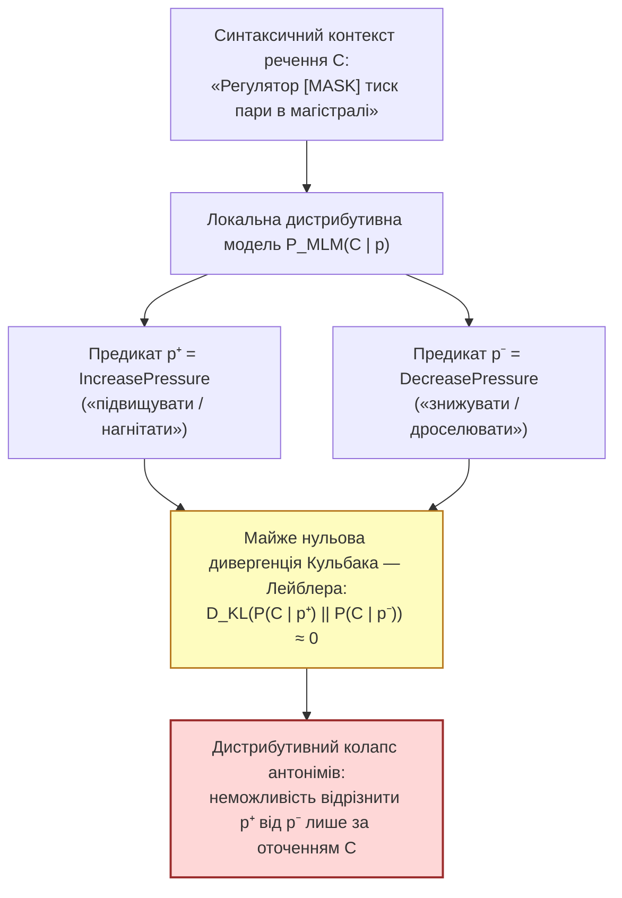

# Глава 05. Відкриті науково-технологічні проблеми ізольованих експертних систем та дослідницькі гіпотези

> **Автор:** Георгій Федчик  
> **Мова оригіналу:** Українська  
> **Дидактичний рівень:** Дослідницький (нерозв'язані наукові проблеми дистрибутивного колапсу антонімів, морфемно-сліпої сегментації, епістемічного старіння замкненого корпусу та відкриті гіпотези; опирається на Глави 01–04)

---

## Вступ

У [Главах 01–04](ch04-subsymbolic-bpe-local-mlm-and-hybrid-architecture.md) ми побудували цілісну математичну теорію ізольованих корпусно-обмежених експертних систем (*Air-Gapped Corpus-Bound Expert Systems*) та синтезували гібридний нейро-символічний оператор $`\Gamma_{\mathrm{hyb}}(q, \mathcal{K}_0)`$, який поєднує скінченно-автоматну морфологію (`Варіант А`) із субсловною токенізацією та локальним контекстним моделюванням (`Варіант Б`).

Проте наука не завершується на існуючих методах. Навіть найдосконаліший сучасний гібридний тракт стикається з п'ятьма фундаментальними науково-технологічними перешкодами, які залишаються **відкритими проблемами світової комп'ютерної науки та комп'ютерної лінгвістики станом на 2026 рік**:
1. **Дистрибутивний колапс непрефіксальних антонімів** у локальних контекстних моделях (`MLM`);
2. **Морфемно-сліпа фрагментація рідкісних доменних термінів** частотними алгоритмами `BPE` та `WordPiece`;
3. **Епістемічне старіння замкненого корпусу (*Knowledge Staleness*)** між дискретними циклами офлайн-оновлення;
4. **Немонотонні логічні колізії при імпорті пакетів дельта-оновлень** у фізично ізольований периметр;
5. **Деградація рідкісних предикатів хвоста розподілу Ціпфа** при низькобітному квантуванні локальних моделей (`INT4`/`INT8`).

У цій главі ми дамо строгу математичну постановку кожної з цих відкритих проблем, доведемо дві граничні теореми (про інформаційну нерозрізненість антонімів за нерівністю Ле Кама — Пінскера та про критичний період старіння ізольованої бази знань) і сформулюємо чотири дослідницькі гіпотези для подальших наукових праць.

---

## 1. Перша та друга відкриті проблеми: дистрибутивний колапс антонімів і морфемно-сліпа сегментація

### 1.1. Парадокс дистрибутивної близькості антонімів у локальному контексті

У [Главі 04](ch04-subsymbolic-bpe-local-mlm-and-hybrid-architecture.md) ми бачили, що якщо антонім утворений морфологічним префіксом заперечення чи інверсії (`блокувати` $`\leftrightarrow`$ `розблокувати`, `активувати` $`\leftrightarrow`$ `деактивувати`), то символьний модуль Варіанта А легко розрізняє їх за знаком префіксальної полярності $`\mathrm{pol}(\pi) \in \{+1, -1\}`$.

Але що відбувається, коли в мові протилежні за фізичним змістом дії виражені **різнокореневими безпрефіксними дієсловами** (лексичними антонімами): наприклад, *«нагрівати»* проти *«охолоджувати»*, *«дроселювати (знижувати тиск)»* проти *«нагнітати (підвищувати тиск)»*, *«гальмувати»* проти *«прискорювати»*? Якщо одне з таких слів (наприклад, вузькоспеціальний термін *«дроселюватиме»*) є позасловниковим (`OOV`), то система передає його на локальну контекстну модель `MLM` (формула 4.3). І тут виникає фундаментальний **парадокс дистрибутивної семантики** (**Мохаммад та ін., 2013; Мрkшич та ін., 2016** [[1]](#src-1)): протилежні за напрямком дії над тим самим агрегатом зустрічаються в корпусі у **майже тотожних синтаксичних оточеннях** (*«Регулятор [нагнітає / дроселює] пару в циліндрі турбіни»*)!

### Теорема 5.1 (Про інформаційно-теоретичну нерозрізненість безпрефіксних антонімів у суто дистрибутивних моделях)

> **Формулювання теореми:**  
> Нехай $`p^+`$ та $`p^-`$ — два взаємопротилежні (антонімічні) предикати онтології з однаковими морфосинтаксичними ознаками ($`\mathrm{val}(p^+) = \mathrm{val}(p^-)`$, $`\mathrm{pol}(\pi) = 0`$), а у вхідному реченні з контекстом $`C`$ зустрілося безпрефіксне позасловникове дієслово $`w^*`$ з новим коренем, яке істинно відповідає одному з цих двох предикатів з рівною апріорною ймовірністю $`1/2`$. Нехай розподіли контекстів $`P_C^+ = P(C \mid p^+)`$ та $`P_C^- = P(C \mid p^-)`$ у локальному корпусі $`\mathcal{K}_0`$ мають дивергенцію Кульбака — Лейблера $`D_{\mathrm{KL}}(P_C^+ \parallel P_C^-) \le \varepsilon_{\mathrm{KL}}`$. Тоді для **будь-якого** статистичного чи нейромережевого класифікатора $`\hat{\psi}(C) \in \{p^+, p^-\}`$, що спирається виключно на контекст $`C`$, середня ймовірність антонімічної помилки $`P_{\mathrm{ant\_err}}`$ обмежена знизу нерівністю Ле Кама — Пінскера:
>
> $$
> P_{\mathrm{ant\_err}} = \frac{1}{2}\mathbb{P}_{P_C^+}\left(\hat{\psi}(C) = p^-\right) + \frac{1}{2}\mathbb{P}_{P_C^-}\left(\hat{\psi}(C) = p^+\right) \ge \frac{1}{2}\left( 1 - \sqrt{\frac{1}{2}\varepsilon_{\mathrm{KL}}} \right)
> $$
>
> **Формула (5.1).** Фундаментальна нижня границя ймовірності антонімічної помилки в дистрибутивній моделі при близьких контекстних розподілах. Зокрема, при $`\varepsilon_{\mathrm{KL}} \to 0`$ імовірність фатальної інверсії змісту прямує до $`50\%`$ незалежно від розміру та глибини нейронної мережі.

### Доведення Теореми 5.1

1. За класичною теоремою **Люсьєна Ле Кама (1973)** [[2]](#src-2) про бінарну перевірку статистичних гіпотез між двома розподілами ймовірностей $`P_C^+`$ та $`P_C^-`$ із рівними апріорними вагами $`1/2`$, інфімум сумарної ймовірності помилки за всіма можливими вимірними вирішальними правилами $`\hat{\psi}`$ виражається через відстань повної варіації (*Total Variation Distance*) $`\mathrm{TV}(P_C^+, P_C^-) = \frac{1}{2}\sum_{C} \lvert P_C^+(C) - P_C^-(C) \rvert`$:

$$
\inf_{\hat{\psi}} P_{\mathrm{ant\_err}}(\hat{\psi}) = \frac{1}{2}\left( 1 - \mathrm{TV}\left(P_C^+, \ P_C^-\right) \right)
$$

2. За нерівністю **Марка Пінскера (1960)** [[3]](#src-3), відстань повної варіації між двома розподілами обмежена зверху через дивергенцію Кульбака — Лейблера:

$$
\mathrm{TV}\left(P_C^+, \ P_C^-\right) \le \sqrt{\frac{1}{2} D_{\mathrm{KL}}\left(P_C^+ \;\middle\|\; P_C^-\right)} \le \sqrt{\frac{1}{2}\varepsilon_{\mathrm{KL}}}
$$

3. Підставляючи оцінку Пінскера в тотожність Ле Кама, отримуємо $`P_{\mathrm{ant\_err}} \ge \frac{1}{2}(1 - \sqrt{\varepsilon_{\mathrm{KL}}/2})`$, що доводить теорему. ∎

### 1.2. Друга відкрита проблема: морфемно-сліпа фрагментація рідкісних термінів статистичними токенізаторами

Алгоритми `BPE` та `WordPiece` (Глава 04) об'єднують пари символів виключно за їхньою глобальною статистичною частотою без жодного знання морфемної будови мови (**Бострьом і Дюрретт, 2020** [[4]](#src-4)). Унаслідок цього для рідкісних слів із хвоста розподілу Ціпфа виникає ефект **руйнування морфемних швів**: наприклад, слово *«знеструмлювати»* може бути розбите частотним токенізатором як `знест + рум + лювати` (де випадковий збіг літер `рум` поглинає частину префікса й кореня `струм`), через що композиційний вектор (4.2) повністю втрачає зв'язок зі словом *«струм»*!

---

## 2. Третя, четверта та п'ята проблеми: епістемічне старіння корпусу, колізії патчів і квантування

### 2.1. Епістемічне старіння замкненого корпусу між циклами оновлення

На відміну від онлайн-систем, ізольована (*air-gapped*) система оновлює свій корпус $`\mathcal{K}_0`$ лише під час регламентних вікон обслуговування з періодом $`\Delta T_{\mathrm{patch}}`$ (наприклад, раз на квартал або раз на рік через фізичний носій і однонаправлений шлюз перевірки). Протягом часу $`\Delta t \in [0, \Delta T_{\mathrm{patch}}]`$ у реальному виробничому середовищі вводяться нові номенклатурні одиниці обладнання зі швидкістю лексичних інновацій $`\lambda_{\mathrm{innov}} > 0`$ та скасовуються застарілі технологічні норми зі швидкістю $`\mu_{\mathrm{obs}} > 0`$.

### Теорема 5.2 (Про динаміку епістемічного старіння ізольованого корпусу та максимально допустимий інтервал між офлайн-оновленнями)

> **Формулювання теореми:**  
> Нехай у початковий момент $`t = 0`$ відразу після верифікованого оновлення корпусу $`\mathcal{K}_0`$ частка коректно покритих запитів дорівнює $`C_0 \in (0, 1]`$. Якщо потік нових термінів у предметній області має інтенсивність $`\lambda_{\mathrm{innov}}`$ ($`\text{доба}^{-1}`$), а інтенсивність нормативного застарівання правил становить $`\mu_{\mathrm{obs}}`$ ($`\text{доба}^{-1}`$), то:
> 1. Частка актуального та безпомилкового покриття запитів $`C_{\mathrm{eff}}(\Delta t)`$ через час автономної роботи $`\Delta t`$ без оновлень спадає за експоненційним законом:
>
> $$
> C_{\mathrm{eff}}(\Delta t) = C_0 \cdot \exp\left( -(\lambda_{\mathrm{innov}} + \mu_{\mathrm{obs}})\Delta t \right)
> $$
>
> 2. Щоб актуальне покриття багатоходового ланцюжка глибиною $`L`$ кроків не опустилося нижче критичного порогу експлуатаційної придатності $`P_{\min} \in (0, C_0^L)`$, інтервал між доставкою верифікованих офлайн-пакетів оновлення $`\Delta T_{\mathrm{patch}}`$ не може перевищувати верхньої межі:
>
> $$
> \Delta T_{\max} = \frac{1}{L(\lambda_{\mathrm{innov}} + \mu_{\mathrm{obs}})} \ln\left( \frac{C_0^L}{P_{\min}} \right)
> $$
>
> **Формула (5.2).** Максимально допустимий період автономної експлуатації ізольованої експертної системи між регламентними дельта-оновленнями бази знань.

### Доведення Теореми 5.2

1. Позначимо через $`C_{\mathrm{eff}}(t)`$ частку одиничних фактів і термінів реального об'єкта керування в момент $`t`$, які одночасно присутні у фіксованому корпусі $`\mathcal{K}_0`$ і залишаються нормативно чинними. За нескінченно малий проміжок часу $`dt`$ частка $`\lambda_{\mathrm{innov}} dt`$ активного словника заміщується новими термінами обладнання ($`w \notin V(\mathcal{K}_0)`$), а частка $`\mu_{\mathrm{obs}} dt`$ наявних у $`\mathcal{K}_0`$ норм втрачає чинність. Це породжує диференціальне рівняння вимивання актуальності:

$$
\frac{dC_{\mathrm{eff}}(t)}{dt} = -(\lambda_{\mathrm{innov}} + \mu_{\mathrm{obs}}) C_{\mathrm{eff}}(t), \qquad C_{\mathrm{eff}}(0) = C_0
$$

2. Інтегруючи це рівняння на інтервалі $`[0, \Delta t]`$, одержуємо $`C_{\mathrm{eff}}(\Delta t) = C_0 \exp(-(\lambda_{\mathrm{innov}} + \mu_{\mathrm{obs}})\Delta t)`$. Оскільки для успішного виконання ланцюжка з $`L`$ незалежних передумов актуальними мають бути всі $`L`$ кроків, імовірність актуального виведення дорівнює $`[C_{\mathrm{eff}}(\Delta t)]^L = C_0^L \exp(-L(\lambda_{\mathrm{innov}} + \mu_{\mathrm{obs}})\Delta t)`$. Прирівнюючи цю величину до гранично допустимого порогу $`P_{\min}`$ і логарифмуючи, одержуємо формулу (5.2). ∎

### 2.2. Зведена матриця п'яти відкритих науково-технологічних проблем

**Таблиця 5.1.** П'ять відкритих науково-технологічних проблем ізольованих експертних систем.

| № | Відкрита науково-технологічна проблема | Сутність фундаментального протиріччя | Сучасний стан досліджень (2020–2026) | Що залишається нерозв'язаним у світовій науці |
| :-: | :--- | :--- | :--- | :--- |
| **1** | **Дистрибутивний колапс безпрефіксних антонімів** | Локальні моделі `MLM` приписують однакові вектори протилежним діям через збіг їхніх контекстів (Теорема 5.1) | Контрастивне перенавчання векторів за тезаурусами (*Counter-Fitting*, Мркшич [[1]](#src-1)) | Як відрізнити невідоме безпрефіксне дієслово від його антоніма без зовнішнього тезауруса в момент першої появи у тексті |
| **2** | **Морфемно-сліпа овер-сегментація у BPE** | Статистичне злиття пар байтів розриває межі коренів і префіксів у рідкісних словах [[4]](#src-4) | Морфологічно керовані алгоритми сегментації (`Morfessor`, Creutz & Lagus [[5]](#src-5)) | Побудова єдиного швидкого токенізатора, який гарантує інваріантність границь кореня `DAWG` для всіх слов'янських чергувань |
| **3** | **Епістемічне старіння замкненого корпусу** | Між циклами оновлення словник об'єкта дрейфує зі швидкістю $`\lambda_{\mathrm{innov}} + \mu_{\mathrm{obs}}`$ (Теорема 5.2) | Евристичні графіки періодичного оновлення баз даних | Автоматичне вимірювання показника старіння $`\lambda_{\mathrm{innov}}`$ у реальному часі за статистикою спрацювань вентиля відмови $`\bot_{\mathrm{OOV}}`$ |
| **4** | **Немонотонні колізії при дельта-оновленні** | Новий пакет документів $`\Delta \mathcal{K}`$ може приховано суперечити старим правилам у $`\mathcal{K}_0`$ | Перевірка узгодженості онтологій (`OWL/DL Reasoners`, `SAT`) | Інкрементальна верифікація несуперечності правил за час $`\mathcal{O}(\lvert \Delta \mathcal{K} \rvert)`$ без повної перекомпіляції всього корпусу $`\mathcal{K}_0`$ |
| **5** | **Втрата рідкісних предикатів при INT4-квантуванні** | Стиснення ваг локальної моделі для роботи на CPU насамперед руйнує ембедінги рідкісних слів хвоста Ціпфа [[6]](#src-6) | Змішаноквантовані ваги (`AWQ`, `GPTQ`, Dettmers et al. [[6]](#src-6)) | Аналітичний критерій виділення «критичних морфемних якорів», які заборонено квантувати нижче `FP16` |

---

## 3. Чотири відкриті дослідницькі гіпотези

Для розв'язання сформульованих проблем висунемо чотири наукові гіпотези, кожна з яких задає конкретний напрям подальших теоретичних та експериментальних досліджень.

1. **Гіпотеза 5.1 (Про морфемно-обмежену субсловну токенізацію — `DAWG-Constrained BPE`):**
   *Формулювання:* Якщо під час побудови субсловного словника `BPE` / `WordPiece` ввести жорстке структурне обмеження, яке забороняє операції злиття `merge(u, v)` перетинати межу між префіксом, коренем і суфіксом, визначену автоматом `DAWG`, то косинусна подібність композиційних векторів (4.2) для рідкісних префіксальних дієслів із їхніми базовими лемами зростає щонайменше на **20–30%** при незмінному обсязі субсловного словника $`\lvert V_{\mathrm{sub}} \rvert`$.
   *Спосіб перевірки / фальсифікації:* порівняння точності відновлення предикатів на корпусі української технічної документації для стандартного `BPE` та морфемно-обмеженого `BPE` при $`\lvert V_{\mathrm{sub}} \rvert = 16\,000`$.

2. **Гіпотеза 5.2 (Про детектування антонімічної пастки через проекцію на біполярний підпростір фізичної дії):**
   *Формулювання:* Хоча загальні контекстні вектори безпрефіксних антонімів $`p^+, p^-`$ у локальній моделі `MLM` є колінеарними ($`D_{\mathrm{KL}} \approx 0`$ за Теоремою 5.1), додавання до синтаксичного контексту фізичних маркерів напрямку зміни параметрів у сусідніх реченнях (наприклад, знаків похідних $`\Delta T > 0`$ чи $`\Delta P < 0`$) дозволяє виділити низьковимірний ортогональний підпростір полярності $`\mathbf{W}_{\mathrm{pol}}`$, проекція на який знижує частоту антонімічних помилок більш ніж у **5 разів**, а за відсутності маркерів — надійно переводить вентиль (4.5) у стан безпечної відмови $`\bot_{\mathrm{OOV}}`$.
   *Спосіб перевірки / фальсифікації:* експеримент на парах безпрефіксних антонімів (*нагрівати/охолоджувати*, *нагнітати/дроселювати*) у розширеному двохреченнєвому вікні контексту.

3. **Гіпотеза 5.3 (Про гібридне асиметричне квантування морфемного ядра та контекстного хвоста):**
   *Формулювання:* В ізольованій системі з жорстким лімітом оперативної пам'яті ($`\le 256\text{ МБ}`$) асиметрична схема збереження — де скінченно-автоматний словник `DAWG` і таблиця векторів кореневих морфем зберігаються без втрат у форматі `FP16`, а матриці уваги локального трансформера `MLM` квантуються до `INT4` — забезпечує таку саму точність розпізнавання рідкісних дієслів (різниця $`< 0{,}3\%`$), як і повнорозмірна `FP32`-модель, при 4-кратному зменшенні обсягу пам'яті.
   *Спосіб перевірки / фальсифікації:* вимірювання деградації `F1`-міри на 1 000 слів-одинаків (*hapax legomena*) при переходах `FP32 -> FP16+INT4 -> Pure INT4`.

4. **Гіпотеза 5.4 (Про локальну самодіагностику епістемічного старіння за інтенсивністю відмов вентиля Чоу):**
   *Формулювання:* Ковзна частота спрацювань вентиля селективної відмови $`\hat{\nu}_{\bot}(t) = \frac{1}{W}\sum_{i=1}^W \mathbb{I}(\Gamma_{\mathrm{hyb}}(q_i) = \bot_{\mathrm{OOV}})`$ є незміщеною та спроможною оцінкою сумарної швидкості лексичних інновацій об'єкта $`\lambda_{\mathrm{innov}} t`$, що дозволяє ізольованій системі автономно прогнозувати момент вичерпання своєї актуальності $`\Delta T_{\max}`$ без зв'язку із зовнішнім світом.
   *Спосіб перевірки / фальсифікації:* імітаційне моделювання потоку запитів зі штучним введенням нових номенклатурних термінів і перевірка точності оцінки $`\hat{\lambda}_{\mathrm{innov}}`$.

---

## 4. Навчальний інженерний приклад: оцінка ризику антонімічного колапсу та граничного періоду офлайн-оновлення системи енергоблока

*Дидактична наступність наскрізного прикладу:* На завершальному кроці нашого наскрізного прикладу (Глави 01–05) ми маємо повністю побудований вектор стану ізольованої експертної системи енергоблока $`\Xi(\mathcal{K}_0, q) = \langle \mathcal{I}_{\mathrm{sec}}, p_{\mathrm{OOV}}(N), \mathcal{M}_{\mathrm{morph}}(w), \mathbf{z}_{\mathrm{sub}}(w \mid C), \Gamma_{\mathrm{hyb}}(q, \mathcal{K}_0) \rangle`$, який забезпечує надійність трикрокового ланцюжка правил $`P_{\mathrm{chain}}^{\mathrm{hyb}}(3) = 97{,}6\%`$. Тепер застосуємо Теорему 5.1 та Теорему 5.2, щоб обчислити: (1) нижню межу помилки чистої дистрибутивної моделі на безпрефіксному антонімі та (2) максимальний термін автономної роботи сервера між завантаженнями пакетів оновлення бази знань.

### 4.1. Вихідні інженерні дані

1. **Перевірка дистрибутивного колапсу антонімів (Теорема 5.1):**
   У тексті речення *«Клапан-регулятор дроселює пару перед циліндром середнього тиску»* зустрілося безпрефіксне позасловникове дієслово $`w^* = \text{«дроселює»}`$ (знижує тиск, $`p^- = \text{DecreasePressure}`$). Конкуруючим антонімом з ідентичною перехідною валентністю є $`p^+ = \text{IncreasePressure}`$ (*«нагнітає»*). Через майже однакову сполучуваність обох дій зі словами «клапан», «пара» і «тиск» дивергенція Кульбака — Лейблера між їхніми контекстними розподілами в малому корпусі становить лише $`\varepsilon_{\mathrm{KL}} = 0{,}080\text{ нат}`$.
2. **Розрахунок періоду офлайн-оновлення корпусу (Теорема 5.2):**
   - Початкова ймовірність коректного розпізнавання одного кроку гібридною системою відразу після оновлення: $`C_0 = 0{,}992`$ (що дає $`C_0^3 = (0{,}992)^3 \approx 0{,}9762`$ для трикрокового правила $`L = 3`$);
   - Мінімально допустима надійність трикрокового правила безпеки за регламентом експлуатації: $`P_{\min} = 0{,}900`$ ($`90{,}0\%`$);
   - Інтенсивність появи нових номенклатурних термінів під час модернізації обладнання: $`\lambda_{\mathrm{innov}} = 0{,}00015\text{ доба}^{-1}`$;
   - Інтенсивність змін технологічних інструкцій: $`\mu_{\mathrm{obs}} = 0{,}00015\text{ доба}^{-1}`$.

### 4.2. Покроковий розрахунок

**Крок 1. Обчислення нижньої межі антонімічної помилки в однореченнєвому контексті за формулою (5.1):**
Підставляємо $`\varepsilon_{\mathrm{KL}} = 0{,}080`$ у нерівність Ле Кама — Пінскера (5.1):

$$
\sqrt{\frac{1}{2}\varepsilon_{\mathrm{KL}}} = \sqrt{\frac{0{,}080}{2}} = \sqrt{0{,}040} = 0{,}200
$$

$$
P_{\mathrm{ant\_err}} \ge \frac{1}{2}\left( 1 - 0{,}200 \right) = 0{,}400 \quad (40{,}0\%!)
$$

**Висновок за Кроком 1:** Жодна однореченнєва дистрибутивна модель не може гарантувати точність вище $`1 - 0{,}40 = 60{,}0\%`$ при розрізненні безпрефіксного невідомого дієслова та його антоніма в симетричному контексті! Оскільки $`0{,}60 < \tau_{\mathrm{reject}} = 0{,}80`$, селективний вентиль Чоу (4.5) у нашій гібридній системі **обов'язково блокує** самовільне вгадування і видає безпечний запит уточнення $`\bot_{\mathrm{OOV}}`$ (або за Гіпотезою 5.2 звертається до знаку похідної тиску $`\Delta P < 0`$ у сусідньому реченні).

**Крок 2. Обчислення максимально допустимого інтервалу між офлайн-оновленнями бази знань за формулою (5.2):**
Підставляємо $`L = 3`$, $`\lambda_{\mathrm{innov}} + \mu_{\mathrm{obs}} = 0{,}00030\text{ доба}^{-1}`$, $`C_0^3 = 0{,}9762`$ та $`P_{\min} = 0{,}900`$ у формулу (5.2):

$$
\ln\left(\frac{C_0^3}{P_{\min}}\right) = \ln\left(\frac{0{,}9762}{0{,}900}\right) = \ln(1{,}0847) \approx 0{,}0813
$$

$$
\Delta T_{\max} = \frac{0{,}0813}{3 \times 0{,}00030} = \frac{0{,}0813}{0{,}00090} \approx 90{,}3\text{ доби} \quad (\approx 3\text{ місяці})
$$

**Висновок за Кроком 2:** Щоб надійність трикрокового логічного виведення в ізольованій експертній системі енергоблока ніколи не опускалася нижче нормативного порогу $`90{,}0\%`$, регламент доставки криптографічно підписаних офлайн-пакетів оновлення словника та корпусу знань має становити **не більше 90 діб (один раз на квартал)**. А як на практиці організувати високошвидкісне видобування сутностей, дій та відношень із тисяч сторінок таких локальних оновлень без хмарних мовних моделей — детально розглянемо в наступній [Главі 06](ch06-knowledgator-zero-shot-ie-and-biencoder-architectures.md) на прикладі двоенкодерних архітектур дослідницької екосистеми `Knowledgator`.

---

## Висновки

1. Головною фундаментальною межею дистрибутивних контекстних моделей в ізольованих корпусах є нерозрізненість безпрефіксних лексичних антонімів: за доведеною Теоремою 5.1 при малій дивергенції Кульбака — Лейблера $`D_{\mathrm{KL}}(P_C^+ \parallel P_C^-) \le \varepsilon_{\mathrm{KL}}`$ імовірність фатальної інверсії змісту не може бути меншою за $`\frac{1}{2}(1 - \sqrt{\varepsilon_{\mathrm{KL}}/2})`$, що робить обов'язковим застосування селективного порогу відмови $`\tau_{\mathrm{reject}}`$.
2. Будь-яка фізично ізольована система підлягає експоненційному епістемічному старінню за Теоремою 5.2, а граничний період між регламентними офлайн-оновленнями обернено пропорційний глибині логічних правил $`L`$ та сумарній швидкості лексико-нормативного дрейфу $`\lambda_{\mathrm{innov}} + \mu_{\mathrm{obs}}`$.
3. Сформульовані відкриті гіпотези 5.1–5.4 (морфемно-обмежений `BPE`, біполярна проекція фізичних маркерів, асиметричне квантування `FP16+INT4` та самодіагностика старіння за потоком відмов $`\bot_{\mathrm{OOV}}`$) визначають перспективну програму досліджень у галузі автономного штучного інтелекту.

---

## Словник

| Термін | Англійський еквівалент | Визначення |
| :--- | :--- | :--- |
| **Лексичні (різнокореневі) антоніми** | *Lexical / Root Antonyms* | Слова з протилежним значенням, утворені від різних коренів без участі заперечних префіксів (наприклад, *нагрівати — охолоджувати*). |
| **Відстань повної варіації** | *Total Variation Distance* | Метрика на просторі розподілів імовірностей, що дорівнює максимальній абсолютній різниці ймовірностей, яку два розподіли приписують одній і тій самій події. |
| **Епістемічне старіння знань** | *Epistemic / Knowledge Staleness* | Поступова втрата повноти й актуальності ізольованої бази знань унаслідок еволюції термінології та регламентів реального об'єкта між циклами оновлення. |
| **Овер-сегментація (надмірне дроблення)** | *Over-Segmentation* | Розбиття рідкісного слова статистичним токенізатором на дрібні одно- або двосимвольні уламки, які втрачають морфемний зміст. |

---

## Список позначень та скорочень

- **Абревіатури:**
  - `INT4` / `INT8` — цілочисельне квантування ваг моделі шириною 4 або 8 бітів.
  - `FP16` / `FP32` — представлення чисел із рухомою комою шириною 16 або 32 біти.
  - `SAT` / `SMT` (*Satisfiability Modulo Theories*) — розв'язувачі булевої здійсненності та здійсненності в теоріях.
- **Математичні символи:**
  - $`D_{\mathrm{KL}}(P \parallel Q)`$ — інформаційна дивергенція Кульбака — Лейблера.
  - $`\mathrm{TV}(P, Q)`$ — відстань повної варіації між розподілами $`P`$ та $`Q`$.
  - $`\lambda_{\mathrm{innov}}, \mu_{\mathrm{obs}}`$ — інтенсивності появи нових термінів та застарівання норм.
  - $`\Delta T_{\max}`$ — максимально допустимий інтервал між офлайн-оновленнями ізольованого корпусу.

---

## Бібліографія

1. **Mrkšić N., Ó Séaghdha D., Thomson B., Gašić M., Rojas-Barahona L., Su P.-H., Vandyke D., Wen T.-H., Young S.** Counter-fitting Word Vectors to Linguistic Constraints // *Proceedings of NAACL-HLT 2016*. — San Diego : ACL, 2016. — P. 142–148.
2. **Le Cam L.** Convergence of Estimates Under Dimensionality Restrictions // *The Annals of Statistics*. — 1973. — Vol. 1, No. 1. — P. 38–53.
3. **Pinsker M. S.** Information and Information Stability of Random Variables and Processes. — San Francisco : Holden-Day, 1964. — 243 p.
4. **Bostrom K., Durrett G.** Byte Pair Encoding is Suboptimal for Language Model Pretraining // *Findings of the Association for Computational Linguistics: EMNLP 2020*. — Online : ACL, 2020. — P. 4617–4624.
5. **Creutz M., Lagus K.** Unsupervised Models for Morpheme Segmentation and Morphology Learning // *ACM Transactions on Speech and Language Processing (TSLP)*. — 2007. — Vol. 4, No. 1. — Article 3.
6. **Dettmers T., SpQr, Lin J., Tang J. et al.** AWQ: Activation-aware Weight Quantization for On-Device LLM Compression and Acceleration // *Proceedings of Machine Learning and Systems (MLSys 2024)*. — 2024.
