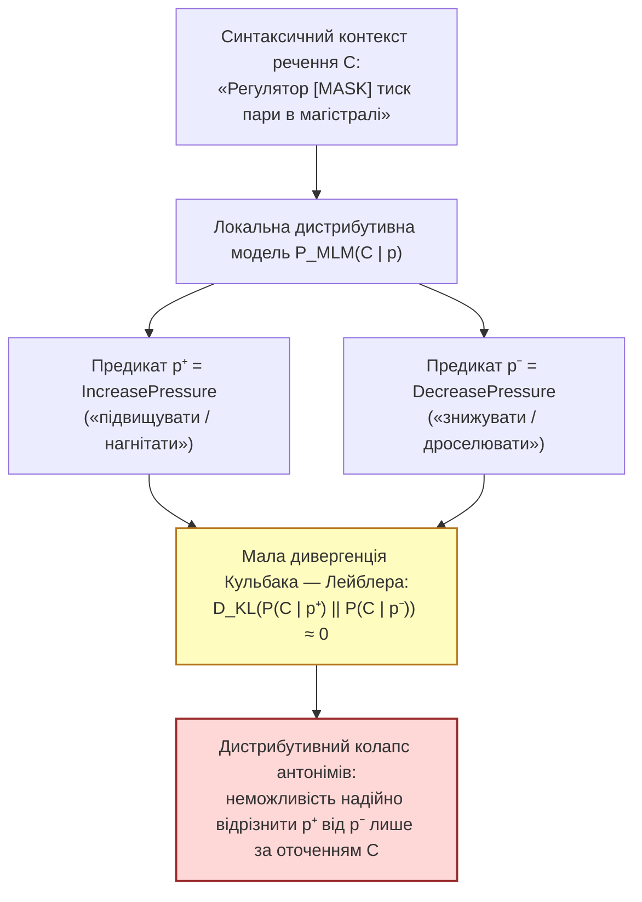

# Глава 05. Відкриті науково-технологічні проблеми ізольованих експертних систем та дослідницькі гіпотези

> **Автор:** Георгій Федчик  
> **Мова оригіналу:** Українська  
> **Дидактичний рівень:** Дослідницький (нерозв'язані наукові проблеми дистрибутивного колапсу антонімів, морфемно-сліпої сегментації, епістемічного старіння замкненого корпусу та відкриті гіпотези; опирається на Глави 01–04)

---

## Вступ

У [Главах 01–04](ch04-subsymbolic-bpe-local-mlm-and-hybrid-architecture.md) побудовано набір математичних моделей ізольованих корпусно-обмежених експертних систем (*Air-Gapped Corpus-Bound Expert Systems*) та синтезовано гібридний нейро-символічний оператор $`\Gamma_{\mathrm{hyb}}(q, \mathcal{K}_0)`$, який поєднує скінченно-автоматну морфологію (`Варіант А`) із субсловною токенізацією та локальним контекстним моделюванням (`Варіант Б`).

Навіть такий гібридний тракт стикається з п'ятьма проблемами, які за оглядом автора залишаються відкритими. Огляд літератури не є вичерпним, тому нижче їх подано як дослідницькі питання, а не як остаточний стан науки:
1. **Дистрибутивний колапс непрефіксальних антонімів** у локальних контекстних моделях (`MLM`);
2. **Морфемно-сліпа фрагментація рідкісних доменних термінів** частотними алгоритмами `BPE` та `WordPiece`;
3. **Епістемічне старіння замкненого корпусу (*Knowledge Staleness*)** між дискретними циклами офлайн-оновлення;
4. **Немонотонні логічні колізії при імпорті пакетів дельта-оновлень** в ізольований периметр;
5. **Деградація рідкісних предикатів хвоста розподілу Ціпфа** при низькобітному квантуванні локальних моделей (`INT4`/`INT8`).

У цій главі дано математичну постановку цих проблем, наведено граничну теорему про інформаційну нерозрізненість антонімів (на основі нерівностей Ле Кама та Пінскера) і модель старіння ізольованої бази знань, окремо розглянуто зв'язок із калібруванням, аналізом небезпек і навантаженням оператора, а також сформульовано чотири фальсифіковні дослідницькі гіпотези.

---

## 1. Перша та друга відкриті проблеми: дистрибутивний колапс антонімів і морфемно-сліпа сегментація

### 1.1. Парадокс дистрибутивної близькості антонімів у локальному контексті

У [Главі 04](ch04-subsymbolic-bpe-local-mlm-and-hybrid-architecture.md) показано, що антонімічні пари на кшталт `блокувати` $`\leftrightarrow`$ `розблокувати`, `активувати` $`\leftrightarrow`$ `деактивувати` символьний модуль може розрізнити лише тоді, коли їх розмічено в перевіреному лексиконі полярності або описано як переходи станів; сам префікс полярності однозначно не визначає.

Складніша ситуація виникає, коли протилежні за фізичним змістом дії виражені **різнокореневими безпрефіксними дієсловами** (лексичними антонімами): *«нагрівати»* проти *«охолоджувати»*, *«дроселювати (знижувати тиск)»* проти *«нагнітати (підвищувати тиск)»*, *«гальмувати»* проти *«прискорювати»*. Якщо одне з таких слів (наприклад, вузькоспеціальний термін *«дроселюватиме»*) є позасловниковим (`OOV`), система передає його на локальну контекстну модель `MLM` (формула 4.3). Тут виникає відомий **парадокс дистрибутивної семантики** (**Мохаммад та ін., 2013** [[7]](#src-7); **Мркшич та ін., 2016** [[1]](#src-1)): протилежні за напрямком дії над тим самим агрегатом зустрічаються в корпусі в дуже схожих синтаксичних оточеннях (*«Регулятор [нагнітає / дроселює] пару в циліндрі турбіни»*).

### Теорема 5.1 (Про інформаційно-теоретичну нерозрізненість безпрефіксних антонімів за контекстом)

**Умови.** Нехай $`p^+`$ та $`p^-`$ — два антонімічні предикати онтології з однаковими морфосинтаксичними ознаками, а у вхідному реченні з контекстом $`C`$ зустрілося безпрефіксне позасловникове дієслово $`w^*`$ з новим коренем, яке з рівною апріорною ймовірністю $`1/2`$ відповідає одному з цих предикатів. Нехай розподіли контекстів $`P_C^+ = P(C \mid p^+)`$ та $`P_C^- = P(C \mid p^-)`$ мають дивергенцію Кульбака — Лейблера $`D_{\mathrm{KL}}(P_C^+ \parallel P_C^-) \le \varepsilon_{\mathrm{KL}}`$. Розглядаються класифікатори $`\hat{\psi}(C) \in \{p^+, p^-\}`$, що спираються лише на контекст $`C`$. Якщо класифікатор бачить і саме слово $`w^*`$, теорема застосовна лише тоді, коли ознаки нового кореня не несуть інформації про напрям дії (наприклад, корінь не має спільних фрагментів із жодним відомим словом); інакше в оцінку треба включити розподіл ознак слова.

**Твердження.** Для **будь-якого** такого класифікатора, зокрема байєсівсько-оптимального, середня ймовірність антонімічної помилки обмежена знизу:

$$
P_{\mathrm{ant\_err}} = \frac{1}{2}\mathbb{P}_{P_C^+}\left(\hat{\psi}(C) = p^-\right) + \frac{1}{2}\mathbb{P}_{P_C^-}\left(\hat{\psi}(C) = p^+\right) \ge \frac{1}{2}\left( 1 - \sqrt{\frac{1}{2}\varepsilon_{\mathrm{KL}}} \right)
$$

**Формула (5.1).** Нижня границя ймовірності антонімічної помилки при близьких контекстних розподілах. При $`\varepsilon_{\mathrm{KL}} \to 0`$ ця межа прямує до $`50\%`$ незалежно від розміру мережі. Межа стосується **частоти помилок**, а не впевненості моделі: некалібрована модель може видавати високі оцінки (наприклад, $`0{,}95`$) і при цьому помилятися з частотою не меншою за (5.1).

### Доведення Теореми 5.1

1. За результатом **Люсьєна Ле Кама** [[2]](#src-2) про бінарну перевірку гіпотез між розподілами $`P_C^+`$ та $`P_C^-`$ із рівними апріорними вагами $`1/2`$, інфімум сумарної ймовірності помилки за всіма вирішальними правилами $`\hat{\psi}`$ виражається через відстань повної варіації $`\mathrm{TV}(P_C^+, P_C^-) = \frac{1}{2}\sum_{C} \lvert P_C^+(C) - P_C^-(C) \rvert`$:

$$
\inf_{\hat{\psi}} P_{\mathrm{ant\_err}}(\hat{\psi}) = \frac{1}{2}\left( 1 - \mathrm{TV}\left(P_C^+, \ P_C^-\right) \right)
$$

2. За нерівністю **Марка Пінскера** [[3]](#src-3) відстань повної варіації обмежена через дивергенцію Кульбака — Лейблера:

$$
\mathrm{TV}\left(P_C^+, \ P_C^-\right) \le \sqrt{\frac{1}{2} D_{\mathrm{KL}}\left(P_C^+ \;\middle\|\; P_C^-\right)} \le \sqrt{\frac{1}{2}\varepsilon_{\mathrm{KL}}}
$$

3. Підставляючи оцінку Пінскера в тотожність Ле Кама, отримуємо $`P_{\mathrm{ant\_err}} \ge \frac{1}{2}(1 - \sqrt{\varepsilon_{\mathrm{KL}}/2})`$. ∎

### 1.2. Друга відкрита проблема: морфемно-сліпа фрагментація рідкісних термінів статистичними токенізаторами

Алгоритми `BPE` та `WordPiece` (Глава 04) об'єднують пари символів за їхньою статистичною частотою без знання морфемної будови мови (**Бостром і Дарретт, 2020** [[4]](#src-4)). Унаслідок цього для рідкісних слів із хвоста розподілу Ціпфа можуть руйнуватися морфемні межі: наприклад, слово *«знеструмлювати»* може бути розбите частотним токенізатором як `знест + рум + лювати` (де випадковий збіг літер `рум` поглинає частину префікса й кореня `струм`), через що композиційний вектор (4.2) може втратити зв'язок зі словом *«струм»*.

---

## 2. Третя, четверта та п'ята проблеми: епістемічне старіння корпусу, колізії пакетів оновлень і квантування

### 2.1. Епістемічне старіння замкненого корпусу між циклами оновлення

На відміну від онлайн-систем, ізольована (*air-gapped*) система оновлює свій корпус $`\mathcal{K}_0`$ лише під час регламентних вікон обслуговування з періодом $`\Delta T_{\mathrm{patch}}`$ (наприклад, раз на квартал або раз на рік через фізичний носій і шлюз перевірки). Протягом часу $`\Delta t \in [0, \Delta T_{\mathrm{patch}}]`$ на реальному об'єкті вводиться нове обладнання з новими назвами, а частина технологічних норм скасовується. Щоб планувати періодичність оновлень, потрібна хоча б груба модель того, як швидко корпус втрачає актуальність.

### Модель 5.2 (Експоненційне епістемічне старіння ізольованого корпусу та допустимий інтервал між офлайн-оновленнями)

**Припущення моделі.** Наведене нижче експоненційне старіння **задається** як модель, а не доводиться:
1. нові терміни з'являються, а норми застарівають з постійними в часі інтенсивностями $`\lambda_{\mathrm{innov}}`$ та $`\mu_{\mathrm{obs}}`$ ($`\text{доба}^{-1}`$), пропорційно до ще актуальної частки знань;
2. між оновленнями корпус не змінюється;
3. актуальність $`L`$ кроків ланцюжка правил незалежна.

**Наслідки.** За цих припущень:
1. Частка актуального покриття запитів $`C_{\mathrm{eff}}(\Delta t)`$ через час $`\Delta t`$ без оновлень:

$$
C_{\mathrm{eff}}(\Delta t) = C_0 \cdot \exp\left( -(\lambda_{\mathrm{innov}} + \mu_{\mathrm{obs}})\Delta t \right)
$$

2. Щоб актуальне покриття ланцюжка глибиною $`L`$ не опустилося нижче порогу експлуатаційної придатності $`P_{\min} \in (0, C_0^L)`$, інтервал між оновленнями не повинен перевищувати:

$$
\Delta T_{\max} = \frac{1}{L(\lambda_{\mathrm{innov}} + \mu_{\mathrm{obs}})} \ln\left( \frac{C_0^L}{P_{\min}} \right)
$$

**Формула (5.2).** Модельний допустимий період автономної роботи ізольованої експертної системи між регламентними оновленнями бази знань, де $`C_0 \in (0, 1]`$ — частка коректно покритих кроків одразу після оновлення.

**Виведення.** За припущенням 1 частка актуальних знань задовольняє рівняння

$$
\frac{dC_{\mathrm{eff}}(t)}{dt} = -(\lambda_{\mathrm{innov}} + \mu_{\mathrm{obs}}) C_{\mathrm{eff}}(t), \qquad C_{\mathrm{eff}}(0) = C_0
$$

розв'язок якого дає пункт 1. За припущенням 3 імовірність актуального виведення ланцюжка дорівнює $`[C_{\mathrm{eff}}(\Delta t)]^L = C_0^L \exp(-L(\lambda_{\mathrm{innov}} + \mu_{\mathrm{obs}})\Delta t)`$; прирівнювання до $`P_{\min}`$ і логарифмування дає (5.2). Реальні інновації відбуваються стрибками (модернізація, нова редакція норм), тому модель придатна лише для порядкових оцінок; параметри треба оцінювати з історії змін документації.

### 2.2. Зведена матриця п'яти відкритих науково-технологічних проблем

**Таблиця 5.1.** П'ять відкритих науково-технологічних проблем ізольованих експертних систем.

| № | Відкрита науково-технологічна проблема | Сутність протиріччя | Наявні підходи (2020–2026) | Що залишається відкритим (за оглядом автора) |
| :-: | :--- | :--- | :--- | :--- |
| **1** | **Дистрибутивний колапс безпрефіксних антонімів** | Локальні моделі `MLM` приписують схожі вектори протилежним діям через збіг їхніх контекстів (Теорема 5.1) | Обчислення лексичного контрасту [[7]](#src-7); контрастивне перенавчання векторів за тезаурусами (*Counter-Fitting* [[1]](#src-1)) | Як відрізнити невідоме безпрефіксне дієслово від його антоніма без зовнішнього тезауруса в момент першої появи у тексті |
| **2** | **Морфемно-сліпа овер-сегментація у BPE** | Статистичне злиття пар байтів розриває межі коренів і префіксів у рідкісних словах [[4]](#src-4) | Морфологічно керовані алгоритми сегментації (`Morfessor` [[5]](#src-5)) | Швидкий токенізатор, що зберігає межі кореня `DAWG` для слов'янських чергувань |
| **3** | **Епістемічне старіння замкненого корпусу** | Між циклами оновлення словник об'єкта дрейфує зі швидкістю $`\lambda_{\mathrm{innov}} + \mu_{\mathrm{obs}}`$ (Модель 5.2) | Евристичні графіки періодичного оновлення баз даних | Оцінювання показника старіння за журналами роботи системи, зокрема за причинами відмов $`\bot_{\mathrm{OOV}}`$ |
| **4** | **Немонотонні колізії при дельта-оновленні** | Новий пакет документів $`\Delta \mathcal{K}`$ може приховано суперечити старим правилам у $`\mathcal{K}_0`$ | Перевірка узгодженості онтологій (`OWL/DL Reasoners`, `SAT`) | Інкрементальна перевірка несуперечності правил за час, близький до $`\mathcal{O}(\lvert \Delta \mathcal{K} \rvert)`$, без повної перекомпіляції корпусу |
| **5** | **Втрата рідкісних предикатів при INT4-квантуванні** | Стиснення ваг локальної моделі для роботи на CPU може насамперед погіршувати представлення рідкісних слів хвоста Ціпфа | Квантування з урахуванням активацій (`AWQ` [[6]](#src-6)), `GPTQ` | Критерій виділення «морфемних якорів», які не слід квантувати нижче `FP16` |

### 2.3. Зв'язок з аналізом небезпек, калібруванням і навантаженням оператора

Кількісні моделі глав 01–05 мають практичну цінність лише тоді, коли вони пов'язані з процесом забезпечення безпеки всієї установки. У поточній редакції книги цей зв'язок окреслено, але не опрацьовано; нижче перелічено, що потрібно для реального застосування.
1. **Тестовий корпус і довірчі інтервали.** Жодна з числових оцінок книги не перевірена на відкритому розміченому корпусі. Потрібні корпус запитів і документів галузі, інструкція з розмітки, оцінка узгодженості анотаторів (наприклад, $`\kappa`$ Коена) і звітування частот із довірчими інтервалами (наприклад, інтервалами Вілсона).
2. **Калібрування і крива ризику–покриття.** Порогові рішення (4.5) мають сенс лише для каліброваних оцінок; калібрування (масштабування температурою, конформне передбачення) і криву ризику–покриття потрібно будувати на даних, відкладених від навчання.
3. **Аналіз небезпек.** Відмови мовного компонента слід вносити до аналізу небезпек установки (`HAZOP`, `STPA` [[8]](#src-8)) і пов'язувати з вимогами до функцій безпеки (`SIL`, `PFD`). Для АЕС контекст задають, зокрема, IEC 61513 [[9]](#src-9) (системи контролю й керування, важливі для безпеки), IEC 60880 [[10]](#src-10) та IEC 62138 [[11]](#src-11) (програмне забезпечення таких систем). Кваліфікація компонентів машинного навчання за цими нормами залишається відкритим питанням; у цій книзі мовний компонент розглядається як дорадчий, що не виконує функцій безпеки самостійно.
4. **Частота відмов і навантаження на оператора.** Кожна відмова $`\bot_{\mathrm{OOV}}`$ і кожна хибна відмова вентиля `2oo2` (формула 4.9а) перетворюється на запит до оператора. Частку таких запитів на зміну, час їх обробки і наслідки режиму Fail-Closed (затримки робіт за нарядом) потрібно оцінювати разом із частотою небезпечних підстановок; система, що відмовляє надто часто, підштовхує персонал до обхідних шляхів.

---

## 3. Чотири відкриті дослідницькі гіпотези

Кожна гіпотеза нижче сформульована так, щоб її можна було спростувати вимірюванням на заздалегідь описаному наборі даних.

1. **Гіпотеза 5.1 (Про морфемно-обмежену субсловну токенізацію — `DAWG-Constrained BPE`):**
   *Формулювання:* Якщо під час побудови субсловного словника `BPE` / `WordPiece` заборонити злиття `merge(u, v)` через межу між префіксом, коренем і суфіксом, визначену автоматом `DAWG`, то косинусна подібність композиційних векторів (4.2) рідкісних префіксальних дієслів із їхніми базовими лемами зростає щонайменше на **20%** при незмінному обсязі субсловного словника $`\lvert V_{\mathrm{sub}} \rvert`$.
   *Спосіб перевірки / фальсифікації:* порівняння середньої подібності та точності відновлення предикатів на корпусі української технічної документації для стандартного `BPE` та морфемно-обмеженого `BPE` при $`\lvert V_{\mathrm{sub}} \rvert = 16\,000`$; гіпотеза спростовується, якщо нижня межа 95% довірчого інтервалу приросту менша за 20%.

2. **Гіпотеза 5.2 (Про розрізнення антонімів за маркерами напрямку зміни параметрів):**
   *Формулювання:* Для пар безпрефіксних антонімів, контекстні розподіли яких в одному реченні близькі (мала $`D_{\mathrm{KL}}(P_C^+ \parallel P_C^-)`$ за Теоремою 5.1), розширення контексту до сусідніх речень із маркерами напрямку зміни параметрів (наприклад, «температура зросла», «тиск знизився») збільшує оцінку $`D_{\mathrm{KL}}`$ між контекстними розподілами і знижує частоту антонімічних помилок класифікатора щонайменше у **5 разів**. Окремо від цього перевіряється, чи стають лінійно розділюваними в просторі ембедінгів вектори контекстів $`p^+`$ і $`p^-`$: колінеарність векторів і близькість розподілів — різні властивості.
   *Спосіб перевірки / фальсифікації:* розмічений набір пар (*нагрівати/охолоджувати*, *нагнітати/дроселювати* тощо) з одно- та двореченнєвим контекстом; гіпотеза спростовується, якщо верхня межа 95% довірчого інтервалу відношення частот помилок менша за 5. Для прикладів без маркерів окремо вимірюється, чи калібрований вентиль (4.5) повертає відмову.

3. **Гіпотеза 5.3 (Про гібридне асиметричне квантування морфемного ядра та контекстного хвоста):**
   *Формулювання:* В ізольованій системі з лімітом оперативної пам'яті ($`\le 256\text{ МБ}`$) асиметрична схема — словник `DAWG` і таблиця векторів кореневих морфем у `FP16`, матриці уваги локального трансформера `MLM` у `INT4` — дає точність розпізнавання рідкісних дієслів, що відрізняється від повнорозмірної `FP32`-моделі менш ніж на $`0{,}3`$ процентного пункту, при приблизно 4-кратному зменшенні обсягу пам'яті.
   *Спосіб перевірки / фальсифікації:* вимірювання `F1`-міри на 1 000 слів-одинаків (*hapax legomena*) при переходах `FP32 -> FP16+INT4 -> Pure INT4` з довірчими інтервалами.

4. **Гіпотеза 5.4 (Про оцінювання швидкості лексичних інновацій за частотою відмов):**
   *Модель:* частка запитів, на які вентиль відповідає відмовою через `OOV`, у вікні з $`W`$ запитів $`\hat{\nu}_{\bot}(t) = \frac{1}{W}\sum_{i=1}^W \mathbb{I}(\Gamma_{\mathrm{hyb}}(q_i) = \bot_{\mathrm{OOV}})`$ — безрозмірна величина, яка складається з базового рівня $`\nu_0`$ (відмови через неоднозначність, рідкісні слова, помилки введення) і внеску нових термінів: $`\nu(t) \approx \nu_0 + \kappa_{\mathrm{q}} (1 - e^{-\lambda_{\mathrm{innov}} t}) \approx \nu_0 + \kappa_{\mathrm{q}} \lambda_{\mathrm{innov}} t`$, де $`\kappa_{\mathrm{q}}`$ — частка запитів, що стосуються оновлюваної частини словника.
   *Формулювання:* Якщо оцінити $`\nu_0`$ одразу після оновлення і класифікувати відмови за причинами (новий корінь проти низької впевненості), то нахил лінійної регресії $`\hat{\nu}_{\bot}(t) - \hat{\nu}_0`$ за часом є спроможною оцінкою добутку $`\kappa_{\mathrm{q}} \lambda_{\mathrm{innov}}`$ (одиниця — $`\text{доба}^{-1}`$), що дозволяє системі прогнозувати $`\Delta T_{\max}`$ за формулою (5.2) без зовнішнього зв'язку.
   *Спосіб перевірки / фальсифікації:* імітаційне моделювання потоку запитів зі штучним введенням нових термінів із відомою інтенсивністю; гіпотеза спростовується, якщо відносна похибка оцінки $`\kappa_{\mathrm{q}} \lambda_{\mathrm{innov}}`$ на заздалегідь заданому горизонті перевищує 25%.

---

## 4. Навчальний інженерний приклад: оцінка ризику антонімічного колапсу та граничного періоду офлайн-оновлення системи енергоблока

*Дидактична наступність наскрізного прикладу:* На завершальному кроці наскрізного прикладу (Глави 01–05) маємо побудований вектор стану ізольованої експертної системи енергоблока $`\Xi(\mathcal{K}_0, q) = \langle \mathcal{I}_{\mathrm{sec}}, p_{\mathrm{OOV}}(N), \mathcal{M}_{\mathrm{morph}}(w), \mathbf{z}_{\mathrm{sub}}(w \mid C), \Gamma_{\mathrm{hyb}}(q, \mathcal{K}_0) \rangle`$, для якого в Главі 04 отримано ілюстративну модельну надійність трикрокового ланцюжка $`P_{\mathrm{chain}}^{\mathrm{hyb}}(3) \approx 95{,}45\%`$. Тепер застосуємо Теорему 5.1 та Модель 5.2, щоб оцінити: (1) нижню межу помилки дистрибутивної моделі на безпрефіксному антонімі та наслідки для вентиля Чоу і (2) допустимий інтервал між завантаженнями пакетів оновлення бази знань. Усі параметри нижче є **навчальними ілюстративними значеннями**, а не вимірюваннями.

### 4.1. Вихідні інженерні дані

1. **Перевірка дистрибутивного колапсу антонімів (Теорема 5.1):**
   У реченні *«Клапан-регулятор дроселює пару перед циліндром середнього тиску»* зустрілося безпрефіксне позасловникове дієслово $`w^* = \text{«дроселює»}`$ (знижує тиск, $`p^- = \text{DecreasePressure}`$). Конкуруючим антонімом з тією самою валентністю є $`p^+ = \text{IncreasePressure}`$ (*«нагнітає»*). Нехай дивергенція Кульбака — Лейблера між їхніми контекстними розподілами становить $`\varepsilon_{\mathrm{KL}} = 0{,}080\text{ нат}`$ (ілюстративне значення; на реальному корпусі його треба оцінювати).
2. **Розрахунок періоду офлайн-оновлення корпусу (Модель 5.2):**
   - частка коректно покритих кроків одразу після оновлення: $`C_0 = 0{,}985`$. Це значення **обрано** так, щоб $`C_0^3 = 0{,}985^3 \approx 0{,}9557`$ приблизно відповідало ілюстративному результату Глави 04 ($`95{,}45\%`$), а не виміряно;
   - мінімально допустима надійність трикрокового правила за регламентом: $`P_{\min} = 0{,}900`$;
   - інтенсивність появи нових номенклатурних термінів: $`\lambda_{\mathrm{innov}} = 0{,}00015\text{ доба}^{-1}`$;
   - інтенсивність змін технологічних інструкцій: $`\mu_{\mathrm{obs}} = 0{,}00015\text{ доба}^{-1}`$.

### 4.2. Покроковий розрахунок

**Крок 1. Нижня межа антонімічної помилки в однореченнєвому контексті за формулою (5.1):**

$$
\sqrt{\frac{1}{2}\varepsilon_{\mathrm{KL}}} = \sqrt{\frac{0{,}080}{2}} = \sqrt{0{,}040} = 0{,}200
$$

$$
P_{\mathrm{ant\_err}} \ge \frac{1}{2}\left( 1 - 0{,}200 \right) = 0{,}400 \quad (40{,}0\%)
$$

**Висновок за Кроком 1:** жоден класифікатор, що спирається лише на однореченнєвий контекст, не може в середньому розрізняти цю пару з точністю вищою за $`60\%`$. Чи заблокує вентиль Чоу (4.5) такі рішення, залежить від калібрування: некалібрована модель може видати оцінку $`0{,}95`$ і пройти поріг $`0{,}80`$. Якщо ж оцінки калібровані, можна оцінити, яку частку таких випадків вентиль здатен пропустити автоматично. Нехай вентиль приймає частку $`c`$ прикладів із точністю не нижче $`0{,}80`$, а на решті найкраща бінарна відповідь помиляється не більше ніж у $`50\%`$ випадків. Загальна частота помилок не може бути меншою за межу (5.1):

$$
0{,}2 \, c + 0{,}5 \, (1 - c) \ge 0{,}4 \quad \implies \quad c \le \frac{0{,}5 - 0{,}4}{0{,}5 - 0{,}2} = \frac{1}{3}
$$

Отже, за каліброваних оцінок не більше третини таких антонімічних випадків може бути прийнято автоматично, а щонайменше дві третини мають перейти в запит уточнення $`\bot_{\mathrm{OOV}}`$ або розв'язуватися додатковою інформацією (Гіпотеза 5.2, модель станів об'єкта).

**Крок 2. Допустимий інтервал між офлайн-оновленнями бази знань за формулою (5.2):**
Підставляємо $`L = 3`$, $`\lambda_{\mathrm{innov}} + \mu_{\mathrm{obs}} = 0{,}00030\text{ доба}^{-1}`$, $`C_0^3 = 0{,}9557`$ та $`P_{\min} = 0{,}900`$:

$$
\ln\left(\frac{C_0^3}{P_{\min}}\right) = \ln\left(\frac{0{,}9557}{0{,}900}\right) = \ln(1{,}0619) \approx 0{,}0600
$$

$$
\Delta T_{\max} = \frac{0{,}0600}{3 \times 0{,}00030} = \frac{0{,}0600}{0{,}00090} \approx 66{,}7\text{ доби} \quad (\approx 2\text{ місяці})
$$

**Висновок за Кроком 2:** у цій моделі і за цих ілюстративних параметрів пакети оновлення слід доставляти не рідше ніж приблизно раз на два місяці. Результат дуже чутливий до $`C_0`$ і до інтенсивностей: наприклад, при $`C_0^3 = 0{,}976`$ той самий розрахунок дав би близько 90 діб. Для реальної системи інтенсивності треба оцінювати з історії змін документації, а $`C_0`$ — на тестовому корпусі. Як організувати видобування сутностей, дій та відношень із великих обсягів локальних оновлень без хмарних мовних моделей, розглянуто в [Главі 06](ch06-knowledgator-zero-shot-ie-and-biencoder-architectures.md) на прикладі двоенкодерних архітектур екосистеми `Knowledgator`.

---

## Висновки

1. Нерозрізненість безпрефіксних лексичних антонімів за контекстом є межею для класифікаторів, що спираються лише на контекст: за Теоремою 5.1 при $`D_{\mathrm{KL}}(P_C^+ \parallel P_C^-) \le \varepsilon_{\mathrm{KL}}`$ частота антонімічних помилок не може бути меншою за $`\frac{1}{2}(1 - \sqrt{\varepsilon_{\mathrm{KL}}/2})`$. Вентиль відмови захищає від цього лише за каліброваних оцінок, і тоді частка автоматично прийнятих рішень обмежена.
2. Модель 5.2 задає експоненційне епістемічне старіння як припущення; за нею допустимий період між оновленнями обернено пропорційний глибині правил $`L`$ і сумарній інтенсивності змін $`\lambda_{\mathrm{innov}} + \mu_{\mathrm{obs}}`$ та дуже чутливий до параметрів, які треба оцінювати з даних.
3. Гіпотези 5.1–5.4 сформульовано як фальсифіковні з критеріями спростування; разом із тестовим корпусом, калібруванням, аналізом небезпек і оцінкою навантаження на оператора вони утворюють програму подальших досліджень, а не завершену теорію.

---

## Словник

| Термін | Англійський еквівалент | Визначення |
| :--- | :--- | :--- |
| **Лексичні (різнокореневі) антоніми** | *Lexical / Root Antonyms* | Слова з протилежним значенням, утворені від різних коренів без участі заперечних префіксів (наприклад, *нагрівати — охолоджувати*). |
| **Відстань повної варіації** | *Total Variation Distance* | Метрика на просторі розподілів імовірностей, що дорівнює максимальній абсолютній різниці ймовірностей, яку два розподіли приписують одній і тій самій події. |
| **Епістемічне старіння знань** | *Epistemic / Knowledge Staleness* | Поступова втрата повноти й актуальності ізольованої бази знань унаслідок еволюції термінології та регламентів реального об'єкта між циклами оновлення. |
| **Овер-сегментація (надмірне дроблення)** | *Over-Segmentation* | Розбиття рідкісного слова статистичним токенізатором на дрібні одно- або двосимвольні уламки, які втрачають морфемний зміст. |

---

## Список позначень та скорочень

- **Абревіатури:**
  - `INT4` / `INT8` — цілочисельне квантування ваг моделі шириною 4 або 8 бітів.
  - `FP16` / `FP32` — представлення чисел із рухомою комою шириною 16 або 32 біти.
  - `SAT` / `SMT` (*Satisfiability Modulo Theories*) — розв'язувачі булевої здійсненності та здійсненності в теоріях.
  - `HAZOP` / `STPA` — методи аналізу небезпек (дослідження відхилень параметрів процесу та системно-теоретичний аналіз процесів).
  - `SIL` / `PFD` — рівень повноти безпеки та ймовірність відмови на вимогу.
- **Математичні символи:**
  - $`D_{\mathrm{KL}}(P \parallel Q)`$ — інформаційна дивергенція Кульбака — Лейблера.
  - $`\mathrm{TV}(P, Q)`$ — відстань повної варіації між розподілами $`P`$ та $`Q`$.
  - $`\lambda_{\mathrm{innov}}, \mu_{\mathrm{obs}}`$ — інтенсивності появи нових термінів та застарівання норм.
  - $`\Delta T_{\max}`$ — модельний допустимий інтервал між офлайн-оновленнями ізольованого корпусу.
  - $`C_0`$ — частка коректно покритих кроків виведення одразу після оновлення.
  - $`\hat{\nu}_{\bot}(t)`$, $`\nu_0`$ — ковзна та базова частки відмов вентиля; $`\kappa_{\mathrm{q}}`$ — частка запитів, що стосуються оновлюваної частини словника.

---

## Бібліографія

1. **Mrkšić N., Ó Séaghdha D., Thomson B., Gašić M., Rojas-Barahona L., Su P.-H., Vandyke D., Wen T.-H., Young S.** Counter-fitting Word Vectors to Linguistic Constraints // *Proceedings of NAACL-HLT 2016*. — San Diego : ACL, 2016. — P. 142–148.
2. **Le Cam L.** Convergence of Estimates Under Dimensionality Restrictions // *The Annals of Statistics*. — 1973. — Vol. 1, No. 1. — P. 38–53.
3. **Pinsker M. S.** Information and Information Stability of Random Variables and Processes. — San Francisco : Holden-Day, 1964. — 243 p.
4. **Bostrom K., Durrett G.** Byte Pair Encoding is Suboptimal for Language Model Pretraining // *Findings of the Association for Computational Linguistics: EMNLP 2020*. — Online : ACL, 2020. — P. 4617–4624.
5. **Creutz M., Lagus K.** Unsupervised Models for Morpheme Segmentation and Morphology Learning // *ACM Transactions on Speech and Language Processing (TSLP)*. — 2007. — Vol. 4, No. 1. — Article 3.
6. **Lin J., Tang J., Tang H., Yang S., Chen W.-M., Wang W.-C., Xiao G., Dang X., Gan C., Han S.** AWQ: Activation-aware Weight Quantization for On-Device LLM Compression and Acceleration // *Proceedings of Machine Learning and Systems (MLSys 2024)*. — 2024. — arXiv:2306.00978.
7. **Mohammad S. M., Dorr B. J., Hirst G., Turney P. D.** Computing Lexical Contrast // *Computational Linguistics*. — 2013. — Vol. 39, No. 3. — P. 555–590. — DOI: 10.1162/COLI_a_00143.
8. **Leveson N. G.** Engineering a Safer World: Systems Thinking Applied to Safety. — Cambridge, MA : MIT Press, 2012.
9. **IEC 61513.** Nuclear power plants — Instrumentation and control important to safety — General requirements for systems. — Geneva : International Electrotechnical Commission.
10. **IEC 60880.** Nuclear power plants — Instrumentation and control systems important to safety — Software aspects for computer-based systems performing category A functions. — Geneva : International Electrotechnical Commission.
11. **IEC 62138.** Nuclear power plants — Instrumentation and control important to safety — Software aspects for computer-based systems performing category B or C functions. — Geneva : International Electrotechnical Commission.
