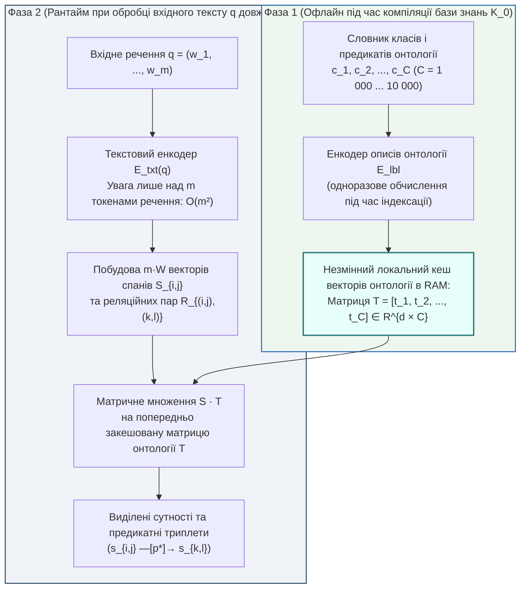

# Глава 06. Детальний аналіз архітектур видобування знань: двоенкодерні моделі, офлайн-кешування онтологій та межі нульового навчання

> **Автор:** Георгій Федчик  
> **Мова оригіналу:** Українська  
> **Дидактичний рівень:** Прикладний архітектурний аналіз (математичний та інженерний розбір відкритих моделей Knowledgator як прикладу для ізольованих експертних систем; опирається на Глави 01–05)

---

## Вступ

У [Главах 01–05](ch05-open-scientific-problems-and-research-hypotheses.md) сформульовано математичні моделі ізольованих корпусно-обмежених експертних систем (*Air-Gapped Corpus-Bound Expert Systems*), оцінено вплив позасловникових предикатів на виведення та синтезовано гібридний оператор виведення $`\Gamma_{\mathrm{hyb}}(q, \mathcal{K}_0)`$. Проте перед кожною реальною ізольованою системою постає технологічна задача, відома в інженерії знань як **вузьке місце набуття знань** (*Knowledge Acquisition Bottleneck*, Е. Фейгенбаум, 1977 [[5]](#src-5)): як автоматично перетворити тисячі сторінок локального неструктурованого корпусу $`\mathcal{K}_0`$ на формальний граф сутностей і предикатів $`(s \xrightarrow{p} o)`$ та розпізнавати нові терміни у вхідних запитах без звернення до великих хмарних генеративних моделей (`GPT-4`, `Claude`) і без дорогих обчислювальних кластерів?

Одним із відкритих прикладів енкодерного підходу до цієї задачі є моделі компанії **Knowledgator** (`https://www.knowledgator.com` [[1]](#src-1)), описані, зокрема, у препринтах І. Степанова, М. Штопка та співавторів [[2]](#src-2), [[4]](#src-4), які розвивають модель `GLiNER` У. Заратіани та ін. [[3]](#src-3). На відміну від авторегресійних генеративних моделей, архітектури `Knowledgator` (`UTC`, `GLiNER-Multitask`, `GLiNER-bi`, `GLiNER-Relex`, `GLiClass`, `GLiNKER`) побудовані на базі **компактних двонаправлених енкодерів**, придатних для локального (*on-premise / air-gapped*) видобування інформації в режимі **нульового навчання** (*Zero-Shot Information Extraction*). Альтернативами є базовий `GLiNER`, крос-енкодерні класифікатори на основі логічного висновку (`NLI`) і локальні генеративні моделі; систематичного порівняння з ними в цій книзі не проведено, тому вибір `Knowledgator` слід розглядати як навчальний приклад, а не як рекомендацію найкращого рішення.

У цій главі проведено математичний і критичний аналіз цих архітектур, оцінено обчислювальний виграш двоенкодерної схеми з попереднім офлайн-кешуванням онтології та показано, як поєднання таких моделей із морфологічним трансдьюсером `DAWG`, лексиконом і каліброваним вентилем Чоу (Глави 03–04) зменшує їхні вразливості на флективних мовах та антонімах. Наприкінці наведено результати попереднього пілотного стенда з явно названими обмеженнями.

---

## 1. Еволюція та архітектурний стек дослідницької екосистеми видобування знань

Модельний стек `Knowledgator` зручно систематизувати за тим, яку задачу ізольованої експертної системи розв'язує кожен компонент. Історію створення компанії тут не розглянуто, оскільки перевіреного джерела про неї не знайдено.

**Таблиця 6.1.** Систематизація модельного стека `Knowledgator` та його роль у векторі стану $`\Xi(\mathcal{K}_0, q)`$. Роки для `GLiClass` і `GLiNER-bi` наведено за препринтами [[2]](#src-2), [[4]](#src-4); роки інших компонентів — за документацією розробника [[1]](#src-1) без незалежної перевірки.

| Компонент екосистеми | Повна назва та наукова парадигма | Математичний механізм роботи | Яку задачу ізольованої експертної системи розв'язує |
| :--- | :--- | :--- | :--- |
| **`UTC`** (2022–2023) | *Universal Token Classification* (Універсальна класифікація токенів) | Спільне кодування інструкції-мітки та вхідного речення для покоординатної розмітки токенів | Перше покоління локального видобування іменованих сутностей без донавчання під нові класи |
| **`GLiNER-Multitask`** (2023–2024) | *Generalist Lightweight Model for Named Entity Recognition* (Розвиток моделі Заратіани та ін. [[3]](#src-3)) | Матричне оцінювання неперервних відрізків тексту (*spans* $`[i, j]`$) відносно векторів типів онтології за один прохід енкодера | Усунення помилок токенної розмітки `BIO` та видобування вкладених багатослівних інженерних термінів |
| **`GLiNER-bi`** (`BiEncoderSpan`, препринт 2026) | *Bi-Encoder Span & Token Architecture* [[1]](#src-1), [[4]](#src-4) | Повне розділення текстового енкодера $`E_{\mathrm{txt}}`$ та енкодера міток онтології $`E_{\mathrm{lbl}}`$ із попереднім офлайн-кешуванням векторів класів | Масштабування локальної системи на $`1\,000 \dots 10\,000`$ понять онтології без квадратичного вибуху часу обчислень |
| **`GLiNER-Relex`** (2024–2025) | *Zero-Shot Joint Entity and Relation Extraction* [[1]](#src-1) | Одночасне виділення пар сутностей $`(s_{i,j}, s_{k,l})`$ та білінійно-конкатенаційне оцінювання спрямованого ребра-предиката $`r_p`$ між ними | Пряме відновлення триплетів «суб'єкт — дієслово-предикат — об'єкт» для правил Хорна (Глава 02) |
| **`GLiClass`** (препринт 2025) | *Generalist Lightweight Model for Sequence Classification* [[2]](#src-2) | Однопрохідна класифікація тексту за довільною множиною текстових описів категорій (заміна повільних NLI крос-енкодерів) | Маршрутизація запитів оператора за розділами регламенту та перевірка застосовності передумов правил |
| **`GLiNKER`** (2025–2026) | *Generalist Lightweight Entity Linking Framework* | Двостадійне зв'язування виділених спанів тексту з канонічними ідентифікаторами вузлів локального графа знань | Канонізація синонімічних та позасловникових назв агрегатів до єдиного ідентифікатора сутності онтології |

---

## 2. Математична модель спанового видобування сутностей і відношень та двоенкодерне розщеплення

Розглянемо математичну будову моделей `GLiNER`, `GLiNER-bi` та `GLiNER-Relex`, які в термінах нашої монографії реалізують субсимвольний контекстний компонент $`\mathbf{z}_{\mathrm{sub}}(w \mid C)`$ (Варіант Б у Главі 04), але не на рівні окремих ізольованих токенів, а на рівні **цілісних синтаксичних відрізків (спанів)** та **парних реляційних предикатів**.

### 2.1. Одноенкодерна схема сумісного кодування та її квадратичне вузьке місце

У базовій архітектурі `GLiNER` (**Уршад Заратіана та ін., NAACL 2024** [[3]](#src-3)) на вхід одного двонаправленого трансформера (зазвичай `DeBERTa-v3`) подається єдина склеєна послідовність, яка складається з текстових назв усіх $`C`$ цільових класів онтології $`\{c_1, c_2, \dots, c_C\}`$ (розділених спеціальним маркером `[ENT]`) та самого вхідного тексту $`q = (w_1, w_2, \dots, w_m)`$:

$$
X_{\mathrm{uni}} = \left( [\text{ENT}], \ c_1, \ [\text{ENT}], \ c_2, \ \dots, \ [\text{ENT}], \ c_C, \ [\text{SEP}], \ w_1, \ w_2, \ \dots, \ w_m \right)
$$

Після проходження $`L_{\mathrm{tr}}`$ шарів самої уваги (*Self-Attention*) для кожного можливого відрізка тексту (спана) від слова $`i`$ до слова $`j`$ довжиною не більше $`W`$ ($`1 \le j - i + 1 \le W`$) будується вектор спана $`\mathbf{s}_{i, j} \in \mathbb{R}^d`$ за допомогою двошарового перцептрона над векторами початку й кінця відрізка:

$$
\mathbf{s}_{i, j} = \mathrm{FFN}_{\mathrm{span}}\left( \mathbf{h}_i \;\Vert\; \mathbf{h}_j \right) \in \mathbb{R}^d
$$

А ймовірність того, що відрізок тексту $`w_{i:j}`$ належить до класу онтології $`c \in \{1, \dots, C\}`$ із вектором маркера $`\mathbf{t}_c \in \mathbb{R}^d`$, обчислюється через сигмоїду скалярного добутку:

$$
P_{\mathrm{span}}\left(w_{i:j} \in c \;\middle|\; q\right) = \sigma\left( \langle \mathbf{s}_{i, j}, \ \mathbf{t}_c \rangle \right) = \frac{1}{1 + \exp\left(-\mathbf{s}_{i, j}^\top \mathbf{t}_c\right)}
$$

**Формула (6.1).** Базова білінійна оцінка відповідності текстового відрізка $`w_{i:j}`$ класу онтології $`c`$.

**Чому одноенкодерна схема (`Uni-Encoder`) погано масштабується на великі онтології?**
Якщо онтологія ізольованого підприємства містить $`C = 1\,000`$ типів обладнання та технологічних предикатів, а кожна назва чи опис класу має середню довжину $`\bar{\ell}`$ підслів (наприклад, $`\bar{\ell} = 4`$), то довжина префікса міток становить $`\bar{\ell} C = 4\,000`$ токенів. Це перевищує вікно контексту типового енкодера ($`512 \dots 2\,048`$ токенів), тому реальні одноенкодерні системи розбивають мітки на пакети по $`B`$ міток, що вміщуються у вікно, і кодують текст повторно для кожного пакета. В обох варіантах вартість запиту зростає разом із $`C`$: без пакетування — квадратично через механізм уваги, з пакетуванням — лінійно через кількість проходів.

### 2.2. Двоенкодерна архітектура з офлайн-кешуванням онтології

Двоенкодерну архітектуру для спанового розпізнавання сутностей (`BiEncoderSpan` / `GLiNER-bi`) описано в препринті Степанова та ін. [[4]](#src-4); близький підхід застосовано і в класифікаторах `GLiClass` [[2]](#src-2). Вона розділяє обчислення на дві незалежні фази:

1. **Офлайн-фаза (під час завантаження замкненого корпусу $`\mathcal{K}_0`$):** окремий текстовий енкодер міток $`E_{\mathrm{lbl}}`$ один раз кодує всі $`C`$ класів сутностей та розгорнуті словесні визначення предикатів онтології у матрицю еталонних ембедінгів:

$$
\mathbf{T}_{\mathrm{cache}} = \left[ \mathbf{t}_1, \ \mathbf{t}_2, \ \dots, \ \mathbf{t}_C \right] \in \mathbb{R}^{d \times C}, \qquad \mathbf{t}_c = E_{\mathrm{lbl}}(\mathrm{desc}(c))
$$

Ця матриця зберігається в оперативній пам'яті ізольованого сервера (для $`C = 10\,000`$ класів при $`d = 768`$ та форматі `FP16` вона займає $`10\,000 \times 768 \times 2\text{ байти} \approx 15{,}36\text{ МБ}`$).
2. **Онлайн-фаза (під час розбору речення $`q`$ довжиною $`m`$ токенів):** текстовий енкодер $`E_{\mathrm{txt}}(q)`$ обробляє **лише саме речення довжиною $`m`$** без конкатенації жодних міток онтології, після чого класифікація всіх $`mW`$ спанів проти всіх $`C`$ класів онтології виконується одним матричним множенням `GEMM`:

$$
\mathbf{P}_{\mathrm{span}} = \sigma\left( \mathbf{S}_{q}^\top \cdot \mathbf{T}_{\mathrm{cache}} \right) \in [0, 1]^{(mW) \times C}
$$

3. **Узагальнення для видобування відношень (`GLiNER-Relex`):** для пари знайдених спанів — суб'єкта $`s_1 = w_{i:j}`$ та об'єкта $`s_2 = w_{k:l}`$ — формується спільне реляційне представлення $`\mathbf{r}_{(i,j)\to(k,l)} = \mathrm{FFN}_{\mathrm{rel}}(\mathbf{s}_{i,j} \;\Vert\; \mathbf{s}_{k,l} \;\Vert\; \mathbf{h}_{\mathrm{ctx}}(i, j, k, l)) \in \mathbb{R}^d`$, яке так само множиться на закешовану матрицю предикатів онтології $`\mathbf{T}_{\mathrm{rel}} \in \mathbb{R}^{d \times \lvert \mathcal{P} \rvert}`$:

$$
P_{\mathrm{relex}}\left(s_1 \xrightarrow{p} s_2 \;\middle|\; q\right) = \sigma\left( \left\langle \mathbf{r}_{(i,j)\to(k,l)}, \ \mathbf{t}_p^{\mathrm{rel}} \right\rangle \right)
$$

**Формула (6.2).** Оцінка спрямованого предиката між суб'єктом і об'єктом у моделі `GLiNER-Relex`.

---

## 3. Теорема про обчислювальне прискорення двоенкодерної схеми з кешуванням онтології

Щоб вирішити, чи можна обслуговувати онтологію з тисячами класів на локальному процесорі, потрібна кількісна оцінка того, як вартість запиту залежить від кількості класів $`C`$. Нижче порівнюються одноенкодерна схема сумісного кодування (`Uni-Encoder`, у тому числі крос-енкодерні класифікатори) і двоенкодерна архітектура з попереднім офлайн-кешуванням онтології.

### Теорема 6.1 (Про асимптотичне прискорення двоенкодерної архітектури з попереднім кешуванням онтології)

**Умови.** Розглянемо видобування сутностей і предикатів із вхідного тексту довжиною $`m`$ токенів відносно онтології з $`C`$ класів (опис кожного класу має середню довжину $`\bar{\ell}`$ токенів) трансформерним енкодером глибиною $`L_{\mathrm{tr}}`$ шарів із прихованою розмірністю $`d`$, проміжною розмірністю блоку прямої передачі $`4d`$ і спановою головою для $`mW`$ спанів. Операції з рухомою комою (`FLOPs`) рахуються як дві операції на одне множення-додавання; нормалізація, softmax і вбудовування не враховуються. Тоді:
1. **Одноенкодерна схема без пакетування** (усі мітки в одному вхідному рядку, $`n = m + \bar{\ell} C`$, якщо це дозволяє вікно контексту):

$$
\mathcal{F}_{\mathrm{uni}}(m, C) = L_{\mathrm{tr}} \left[ 24 n d^2 + 4 n^2 d \right] + 2 m W d (2d + C), \qquad n = m + \bar{\ell} C
$$

2. **Двоенкодерна схема з попередньо закешованою матрицею онтології** $`\mathbf{T}_{\mathrm{cache}}`$ (енкодер обробляє лише $`m`$ токенів тексту; від $`C`$ залежить тільки фінальний матричний добуток):

$$
\mathcal{F}_{\mathrm{bi}}(m, C) = L_{\mathrm{tr}} \left( 24 m d^2 + 4 m^2 d \right) + 2 m W d (2d + C)
$$

3. **Коефіцієнт прискорення** $`S_{\mathrm{bi}}(m, C) = \mathcal{F}_{\mathrm{uni}}(m, C) / \mathcal{F}_{\mathrm{bi}}(m, C)`$ при фіксованих $`m, W, L_{\mathrm{tr}}, d, \bar{\ell}`$ зростає **лінійно** з кількістю класів:

$$
S_{\mathrm{bi}}(m, C) = \frac{L_{\mathrm{tr}}\left[24 n d + 4 n^2\right] + 2 m W (2d + C)}{L_{\mathrm{tr}}(24 m d + 4 m^2) + 2 m W (2d + C)} = \Theta(C), \qquad \lim_{C \to \infty} \frac{S_{\mathrm{bi}}(m, C)}{C} = \frac{2 L_{\mathrm{tr}} \bar{\ell}^2}{m W}
$$

**Формула (6.3).** Коефіцієнт обчислювального прискорення двоенкодерної архітектури з офлайн-кешуванням онтології.

4. **Одноенкодерна схема з пакетуванням міток** (реалістичний варіант, коли $`\bar{\ell} C`$ перевищує вікно контексту $`n_{\mathrm{ctx}}`$): мітки ділять на пакети по $`B = \lfloor (n_{\mathrm{ctx}} - m)/\bar{\ell} \rfloor`$ міток, і текст кодується $`\lceil C/B \rceil`$ разів:

$$
\mathcal{F}_{\mathrm{uni}}^{\mathrm{batch}}(m, C) = \left\lceil \frac{C}{B} \right\rceil L_{\mathrm{tr}} \left[ 24 n_B d^2 + 4 n_B^2 d \right] + 2 m W d (2d + C), \qquad n_B = m + \bar{\ell} B
$$

Тут вартість енкодера зростає лінійно з $`C`$, тому прискорення двоенкодерної схеми відносно пакетованої одноенкодерної спочатку зростає приблизно лінійно, а при дуже великих $`C`$, коли в $`\mathcal{F}_{\mathrm{bi}}`$ домінує спановий добуток, наближається до сталої:

$$
\lim_{C \to \infty} S_{\mathrm{bi}}^{\mathrm{batch}}(m, C) = 1 + \frac{L_{\mathrm{tr}} \left( 24 n_B d + 4 n_B^2 \right)}{2 m W B}
$$

**Формула (6.3а).** Граничне прискорення двоенкодерної схеми відносно одноенкодерної з пакетуванням міток.

### Доведення Теореми 6.1

1. В одному шарі трансформерного енкодера з послідовністю довжиною $`n`$ і розмірністю $`d`$ лінійні проекції запитів, ключів, значень і виходу ($`Q, K, V, O`$) виконують $`4 n d^2`$ множень-додавань, а двошаровий блок прямої передачі з проміжною розмірністю $`4d`$ — ще $`8 n d^2`$; разом $`12 n d^2`$ множень-додавань, тобто $`24 n d^2`$ `FLOPs`. Обчислення $`Q K^\top`$ і множення ваг уваги на $`V`$ потребують $`2 n^2 d`$ множень-додавань, тобто $`4 n^2 d`$ `FLOPs`. Спанова голова для $`mW`$ спанів (проекція $`2d \to d`$ і скалярні добутки з $`C`$ класами) дає $`2 m W d (2d + C)`$ `FLOPs`. Підстановка $`n = m + \bar{\ell} C`$ дає пункт 1.
2. У двоенкодерній схемі вектори міток обчислено до початку експлуатації, тому під час запиту енкодер обробляє лише $`n = m`$ токенів, що дає пункт 2.
3. Поділивши чисельник і знаменник на $`d`$, отримуємо рівність у (6.3). При $`C \to \infty`$ і фіксованих інших параметрах чисельник поводиться як $`4 L_{\mathrm{tr}} \bar{\ell}^2 C^2`$, а знаменник — як $`2 m W C`$ (решта доданків знаменника не залежить від $`C`$). Отже, $`S_{\mathrm{bi}} / C \to 2 L_{\mathrm{tr}} \bar{\ell}^2 / (m W)`$, тобто прискорення лінійне за $`C`$, а не квадратичне: вартість одноенкодерної схеми без пакетування зростає квадратично, але вартість двоенкодерної через спановий добуток теж зростає, лінійно.
4. Для пункту 4 кожен із $`\lceil C/B \rceil`$ проходів має фіксовану довжину $`n_B`$, тому чисельник лінійний за $`C`$ з нахилом $`L_{\mathrm{tr}}(24 n_B d^2 + 4 n_B^2 d)/B + 2 m W d`$, а знаменник — з нахилом $`2 m W d`$. Відношення нахилів дає (6.3а). ∎

---

## 4. Критичний аналіз меж застосовності двоенкодерних моделей в ізольованих системах та їх нейро-символічне підсилення

### 4.1. Три вразливості суто субсимвольних моделей

Попри обчислювальну ефективність двоенкодерного стека, аналіз із [Глав 03–05](ch05-open-scientific-problems-and-research-hypotheses.md) вказує на **три вразливості**, які виникають при спробі використати суто нейромережеві моделі `GLiNER` / `GLiNER-Relex` / `GLiClass` в ізольованій експертній системі без символьного морфологічного модуля (`Варіант А`):

1. **Субсловне дроблення флективних дієслів (Проблема 2 із Глави 05):**
   Моделі `GLiNER` використовують багатомовний або англомовний токенізатор `SentencePiece` / `BPE`. Складну префіксально-суфіксальну форму українського дієслова (наприклад, *«перекомутовуватимуться»*) такий токенізатор може розбити на кілька субсловних фрагментів, що не збігаються з морфемами; граматичні ознаки часу, виду й застави (`-ся`) тоді представлені лише неявно. У результаті модель `GLiNER-Relex` може переплутати напрямок дії (хто є суб'єктом, а хто об'єктом).
2. **Дистрибутивний колапс безпрефіксних антонімів у нульовому навчанні (Теорема 5.1):**
   Вектор реляційного спана $`\mathbf{r}_{(i,j)\to(k,l)}`$ у `GLiNER-Relex` значною мірою формується з контексту сусідніх іменників («клапан», «пара», «тиск»), тому для невідомого безпрефіксного дієслова *«дроселює»* скалярні добутки (6.2) з описами протилежних класів `«підвищення тиску»` та `«зниження тиску»` можуть виявитися близькими.
3. **Відсутність каліброваного вентиля відмови за замовчуванням:**
   Стандартний поріг сигмоїди $`\sigma(\cdot) > 0{,}50`$ у `GLiNER` не враховує асиметрію ціни помилки $`c_{\mathrm{err}} \gg c_{\mathrm{abs}}`$ у системах безпеки, а сигмоїдні оцінки моделі не обов'язково калібровані.

**Як інтегрувати ці моделі в гібридну нейро-символічну архітектуру книги?**
У межах оператора $`\Gamma_{\mathrm{hyb}}(q, \mathcal{K}_0)`$ (Глава 04) моделі `GLiNER-bi`, `GLiNER-Relex` та `GLiClass` можуть виконувати роль субсимвольного модуля Варіанта Б, якщо вони працюють у каскаді з морфологічним автоматом `DAWG` і лексиконом (Варіант А):
- перед подачею в `GLiNER-Relex` автомат `DAWG` виконує морфологічну нормалізацію словоформ речення за $`\mathcal{O}(\lvert w \rvert)`$ переходів на слово, а лексикон валентності й полярності (розділ 3.1 Глави 04) формує маску допустимих предикатів $`\mathbf{M}_{\mathrm{adm}}(w^*) \in \{0, 1\}^C`$;
- матричний добуток `GLiNER-bi` обчислюється лише над дозволеними стовпцями кешованої матриці $`\mathbf{T}_{\mathrm{cache}}`$:

$$
P_{\mathrm{hyb}}\left(w_{i:j} \in c \;\middle|\; q\right) = \mathbf{M}_{\mathrm{adm}}(w_{i:j}, c) \cdot \sigma\left( \left\langle \mathbf{s}_{i, j}, \ \mathbf{t}_c \right\rangle \right)
$$

**Формула (6.4).** Маскована оцінка спана з урахуванням лексикону допустимості.

- оцінки (6.4) калібруються на відкладеній розміченій вибірці (Глава 04, розділ 3.2), після чого рішення приймається через селективний поріг Чоу $`\tau_{\mathrm{reject}} = 1 - c_{\mathrm{abs}}/c_{\mathrm{err}}`$ (формула 4.5).

### 4.2. Системна інтеграція двоенкодерного тракту в статично компільованих мовах програмування

Промислові ізольовані експертні системи високої надійності зазвичай реалізуються не на інтерпретованій мові Python, а на статично типізованих компільованих мовах із контролем пам'яті та багатопотоковості (зокрема на мові **Go** зі статичною збіркою без зовнішніх динамічних залежностей `CGO_ENABLED=0`). Вбудовування інтерпретатора Python або пряме лінкування сторонніх C++-бібліотек (`libonnxruntime.so`) всередину єдиного виконуваного файла експертної системи створює ризики витоків пам'яті поза збирачем сміття, унеможливлює роботу статичного детектора гонитв потоків (*race detector*) і порушує вимогу автономного розгортання одного бінарного файла.

Двоенкодерне розщеплення `GLiNER-bi` / `GLiClass` / `GLiNKER` дозволяє **дворівневе архітектурне рішення** для систем на мові Go:
1. **Чисто-Go ядро часу виконання (Zero-Copy Runtime Core):** оскільки матриця векторів онтології $`\mathbf{T}_{\mathrm{cache}} \in \mathbb{R}^{d \times C}`$ обчислюється один раз на етапі компіляції бази знань, вона записується безпосередньо у вирівняну по 64 байти секцію бінарного контейнера знань і відображається у віртуальну пам'ять Go-процесу через системний виклик `mmap(MAP_SHARED)` з нульовою десеріалізацією. Усі операції першого рівня — морфологічний розбір автоматом `DAWG`, побудова маски валентності $`\mathbf{M}_{\mathrm{adm}}`$, матричний добуток спанів на $`\mathbf{T}_{\mathrm{cache}}`$, трирівнева канонізація `GLinker` та перевірка порогу Чоу — виконуються нативно в чистому Go; орієнтовний час — частки мілісекунди або кілька мілісекунд на запит (у цій книзі не виміряно, оцінка залежить від $`C`$, $`d`$ і процесора).
2. **Ізольований позапроцесний дорадчий воркер компіляції (`GLiNER.cpp` Sidecar):** важкі багатошарові трансформерні моделі (`GLiNER-Relex`, `Opir`, `LiqFit`) запускаються лише під час офлайн-індексації нових документів як окремий ізольований процес (на базі легковагового C++-рушія `GLiNER.cpp` або виділеного обчислювального вузла), який передає Go-компілятору виключно байтові координати спанів `[byte_start, byte_end]` для детермінованої криптографічної верифікації.

---

## 5. Навчальний інженерний приклад: розрахунок прискорення двоенкодерного тракту для онтології енергоблока

*Дидактична наступність наскрізного прикладу:* Завершимо розрахунок для ізольованої експертної системи технічного обслуговування енергоблока (Глави 01–05). Нехай локальна онтологія станції містить $`C = 1\,000`$ класів технологічних вузлів та дій, і на локальному процесорі (*on-premise CPU*) без графічного прискорювача потрібно обробити речення документації або оперативний запит архітектурою `GLiNER-bi` порівняно з одноенкодерним `GLiNER`. Усі параметри є навчальними ілюстративними значеннями.

### 5.1. Вихідні інженерні дані

1. **Параметри вхідного тексту та локальної онтології:**
   - довжина вхідного речення (абзацу інструкції): $`m = 100`$ токенів;
   - максимальна ширина спана терміна: $`W = 8`$ токенів;
   - кількість класів та предикатів в онтології енергоблока: $`C = 1\,000`$;
   - середня довжина текстового опису одного класу (разом із маркером `[ENT]`): $`\bar{\ell} = 4`$ токени ($`\bar{\ell} C = 4\,000`$ токенів).
2. **Параметри умовного локального енкодера** (ілюстративні, близькі за порядком до малих енкодерів класу `DeBERTa-v3-small`):
   - кількість шарів: $`L_{\mathrm{tr}} = 6`$;
   - розмірність прихованого вектора: $`d = 512`$;
   - вікно контексту: $`n_{\mathrm{ctx}} = 512`$ токенів.

### 5.2. Покроковий розрахунок

**Крок 1. Одноенкодерна схема без пакетування (гіпотетичний варіант, бо $`n = 4\,100 > n_{\mathrm{ctx}}`$):**
Сумарна довжина склеєної послідовності $`n_{\mathrm{uni}} = m + \bar{\ell} C = 100 + 4\,000 = 4\,100`$ токенів. За першою формулою Теореми 6.1:

$$
\mathcal{F}_{\mathrm{uni}}^{\mathrm{tr}} = 6 \times \left[ 24 \times 4\,100 \times 512^2 + 4 \times 4\,100^2 \times 512 \right] = 6 \times \left[ 25{,}79 \times 10^9 + 34{,}43 \times 10^9 \right] \approx 361{,}33 \times 10^9\text{ FLOPs}
$$

$$
\mathcal{F}_{\mathrm{span}} = 2 \times 800 \times 512 \times (1\,024 + 1\,000) \approx 1{,}66 \times 10^9\text{ FLOPs}
$$

Разом $`\mathcal{F}_{\mathrm{uni}} \approx 362{,}99\text{ ГФЛОП}`$ на одне речення.

**Крок 2. Одноенкодерна схема з пакетуванням міток (реалістичний варіант):**
У вікно $`n_{\mathrm{ctx}} = 512`$ поміщається $`B = \lfloor (512 - 100)/4 \rfloor = 103`$ мітки, тому потрібно $`\lceil 1\,000/103 \rceil = 10`$ проходів довжиною $`n_B = 512`$:

$$
\mathcal{F}_{\mathrm{uni}}^{\mathrm{batch}} = 10 \times 6 \times \left[ 24 \times 512 \times 512^2 + 4 \times 512^2 \times 512 \right] + 1{,}66 \times 10^9 \approx 227{,}14\text{ ГФЛОП}
$$

**Крок 3. Двоенкодерна схема `GLiNER-bi`:**
1. Обсяг кешу векторів онтології $`\mathbf{T}_{\mathrm{cache}}`$ у форматі `FP16`:

$$
M_{\mathrm{cache}} = C \times d \times 2\text{ байти} = 1\,000 \times 512 \times 2 = 1\,024\,000\text{ байтів} \approx 1{,}0\text{ МБ}
$$

2. Операції в 6 шарах текстового енкодера (лише над $`m = 100`$ токенами):

$$
\mathcal{F}_{\mathrm{bi}}^{\mathrm{tr}} = 6 \times \left[ 24 \times 100 \times 512^2 + 4 \times 100^2 \times 512 \right] = 6 \times \left[ 629{,}1 \times 10^6 + 20{,}5 \times 10^6 \right] \approx 3{,}90 \times 10^9\text{ FLOPs}
$$

3. Разом зі спановим добутком:

$$
\mathcal{F}_{\mathrm{bi}} = 3{,}90 + 1{,}66 = 5{,}56\text{ ГФЛОП}
$$

Якщо лексикон Варіанта А відсікає $`80\%`$ класів як несумісні (ілюстративне припущення), спановий добуток рахується лише для $`200`$ класів і становить $`1{,}00\text{ ГФЛОП}`$, тоді $`\mathcal{F}_{\mathrm{bi}} \approx 4{,}90\text{ ГФЛОП}`$.

4. Коефіцієнти прискорення:

$$
S_{\mathrm{bi}} = \frac{362{,}99}{5{,}56} \approx 65{,}3, \qquad S_{\mathrm{bi}}^{\mathrm{batch}} = \frac{227{,}14}{5{,}56} \approx 40{,}9
$$

а з маскою лексикону — $`74{,}1`$ і $`46{,}4`$ раза відповідно. Для порівняння: за формулою (6.3а) граничне прискорення відносно пакетованої схеми при дуже великих $`C`$ для цих параметрів становить близько $`268`$ разів, а при $`C = 10\,000`$ — близько $`172`$ разів. Автори `GLiNER-bi` повідомляють про зростання пропускної здатності до $`130`$ разів при $`1\,024`$ мітках порівняно з одноенкодерними попередниками [[4]](#src-4); це інша конфігурація вимірювання, але того самого порядку величин.

**Висновок:** у цьому навчальному розрахунку двоенкодерне розщеплення з кешем онтології обсягом близько $`1\text{ МБ}`$ зменшує обчислювальні витрати на речення у $`41`$–$`65`$ разів (з $`227 \dots 363\text{ ГФЛОП}`$ до $`5{,}6\text{ ГФЛОП}`$). Час обробки дорівнює $`t \approx \mathcal{F}/\Pi_{\mathrm{eff}}`$, де $`\Pi_{\mathrm{eff}}`$ — ефективна продуктивність процесора на цьому навантаженні; наприклад, за припущеної $`\Pi_{\mathrm{eff}} = 100\text{ ГФЛОП/с}`$ двоенкодерна схема потребує близько $`56\text{ мс}`$ на речення, а пакетована одноенкодерна — близько $`2{,}3\text{ с}`$. Реальні значення треба вимірювати на цільовому обладнанні.

---

## 6. Чотирирівневий каскад із локальною генеративною LLM та попередні стендові результати

У практиці проєктування ізольованих нейро-символічних систем для високофлективних мов (зокрема української) часто виникає спокуса замінити спеціалізовані морфологічні та спанові екстрактори однією локальною генеративною моделлю класу $`10\text{B}\dots 14\text{B}`$ параметрів. Нижче наведено спостереження, які свідчать проти такої заміни, і попередні вимірювання **чотирирівневої каскадної ієрархії**, де генеративна модель відокремлена двома детермінованими шлюзами. Статус усіх результатів розділу — **попередній пілот** на малій вибірці, а не перевірка ефективності.

### 6.1. Спостережені режими відмов локальної генеративної LLM (клас 12B параметрів, `Q4_K_M`)

Під час автором проведених випробувань україномовної інструктивної моделі обсягом $`11{,}8`$ млрд параметрів (`Q4_K_M`, периферійний обчислювальний вузол ARM64 із 64 ГБ спільної пам'яті LPDDR5) зафіксовано три типи дефектів, які роблять небажаним її пряме використання в ланцюгу прийняття рішень. Наведені приклади є **анекдотичними свідченнями** (поодинокі запити без статистики частоти), а не оцінкою частоти помилок:

1. **Змішування протилежних протокольних ролей під час генерації синонімів:**
   На запит про українські синоніми до терміна `"user agent"` модель повернула перелік `["користувач", "агент", "браузер", "клієнт", "сервер"]`, включивши протилежну сторону взаємодії (`"сервер"`). Це узгоджується з механізмом Теореми 5.1 (схожі контексти ініціатора і респондента), але один приклад цього не доводить.
2. **Вигадування нормативних посилань при переформулюванні розмовних запитів:**
   Навіть за прямої вимоги лише переформулювати запитання (*«Переформулюй розмовне запитання офіційною термінологією технічних стандартів (1 речення, без пояснень)»*) модель переходила до відповіді по суті й посилалася на конкретні статті та пункти:
   - запит *«Хто відповідає за злив секретних даних клієнтів?»* $\to$ *«Згідно з положеннями Закону України «Про захист персональних даних» (стаття 23), відповідальність за несанкціонований витік конфіденційної інформації про клієнтів несе особа...»* (час генерації $`12\,628{,}0\text{ мс}`$ при холодному старті, $`47`$ токенів);
   - запит *«Що має зробити контролер, коли вирубили сторожовий таймер?»* $\to$ *«У разі вимкнення сторожового таймера, контролер повинен виконати дії, визначені в пункті 4.3.2 стандарту ISO 26262:2018...»* (час генерації $`3\,707{,}3\text{ мс}`$, $`44`$ токени); посилання на цей пункт не перевірене і в контексті запиту безпідставне;
   - запит *«Як залочити канал передачі при виявленні збою?»* $\to$ *«У разі виявлення збою в каналі передачі, необхідно виконати процедуру блокування каналу...»* (час генерації $`1\,969{,}4\text{ мс}`$, $`22`$ токени).
3. **Час відгуку на кілька порядків більший:**
   Генерація однієї відповіді тривала $`2{,}0 \dots 12{,}6\text{ с}`$, тоді як обчислення оцінок і вентиля над закешованою матрицею в таблиці 6.4 — $`2{,}1 \dots 68{,}1\text{ мкс}`$. Ці величини вимірюють **різні операції** (генерацію тексту проти скалярних добутків із готовими векторами), тому їх відношення показує лише порядок різниці бюджетів, а не прискорення однієї й тієї самої задачі.

### 6.2. Попередні стендові вимірювання каскаду та асиметричного квантування

**Протокол.** Автором розгорнуто дослідницький стенд на малій контрольній вибірці: $`n = 15 \dots 16`$ прикладів флективних позасловникових дієслівних форм і префіксальних антонімів українською та англійською мовами (`активуватиметься / деактивуватиметься`, `переактивувавши / деактивованими`, `дозволятимуть / заборонятимуть`, `шифруватиме / дешифруватиме / розшифровувати`, `блокуватиметься / розблоковуватиметься`, `монтуватиметься / демонтуватиметься`, `enabling / disabling`) та позадоменний дистрактор `фотосинтезуватиметься`. Знаменник різниться між метриками (15 або 16), бо дистрактор не має антонімічної пари. Довірчі інтервали обчислено методом Вілсона [[6]](#src-6).

**Обмеження, які треба враховувати під час читання результатів:**
1. Вибірка дуже мала: за $`16/16`$ правильних відповідей нижня межа 95% інтервалу Вілсона становить лише $`80{,}6\%`$.
2. **Циркулярність:** тестові пари належать саме до того класу (префіксальні антоніми з лексиконом полярності), під який побудовано маску $`M_{\mathrm{adm}}`$; результати не поширюються на безпрефіксні антоніми, де за Теоремою 5.1 маска не допомагає.
3. Латентності різних рядків вимірюють **різні операції**: для щільних бі-енкодерів — повне обчислення ембедінга тексту моделлю, для гібридних рядків — лише оцінювання і вентиль над попередньо обчисленими векторами. Тому їх не можна порівнювати як прискорення.

**Таблиця 6.4.** Порівняння щільних ембедінгів та гібридного двоенкодера з маскою $`M_{\mathrm{adm}}`$ і вентилем Чоу ($`\tau_{\mathrm{reject}} = 0{,}80`$) на пілотній вибірці; у дужках — 95% інтервали Вілсона.

| Досліджувана архітектура | Точність (`Top-1 Accuracy`) | Частота колапсу антонімів або небезпечного зазору ($`\lvert\Delta\cos\rvert < 0{,}05`$) | Середній зазор між антонімами ($`\Delta S`$) | Середня латентність (що вимірюється) |
| :--- | :--- | :--- | :--- | :--- |
| **Щільний бі-енкодер 768d (`nomic-embed-text`, без маски $`M_{\mathrm{adm}}`$)** | $`80{,}0\%`$ ($`12 / 15`$; $`54{,}8 \dots 93{,}0\%`$) | $`20{,}0\%`$ ($`3 / 15`$; $`7{,}0 \dots 45{,}2\%`$) | $`0{,}1059`$ | $`30{,}82\text{ мс}`$ (ембедінг тексту моделлю) |
| **Щільний бі-енкодер 271M (`embeddinggemma-2`, без маски $`M_{\mathrm{adm}}`$)** | $`86{,}7\%`$ ($`13 / 15`$; $`62{,}1 \dots 96{,}3\%`$) | $`40{,}0\%`$ ($`6 / 15`$; $`19{,}8 \dots 64{,}3\%`$) | $`0{,}0529`$ | $`37{,}26\text{ мс}`$ (ембедінг тексту моделлю) |
| **Гібрид `DAWG + Bi-Encoder + Вентиль Чоу` ($`C = 12`$ класів)** | $`100{,}0\%`$ ($`16 / 16`$; $`80{,}6 \dots 100\%`$) | $`0{,}0\%`$ ($`0 / 15`$; $`0 \dots 20{,}4\%`$) | $`0{,}8950`$ | $`2{,}13\text{ мкс}`$ (маска і вентиль над готовими векторами) |
| **Гібрид `DAWG + Bi-Encoder + Вентиль Чоу` ($`C = 1\,000`$ класів, `INT8`)** | $`100{,}0\%`$ ($`16 / 16`$; $`80{,}6 \dots 100\%`$) | $`0{,}0\%`$ ($`0 / 15`$; $`0 \dots 20{,}4\%`$) | $`0{,}8948`$ | $`68{,}07\text{ мкс}`$ (маска і вентиль над готовими векторами) |

Інтервали першого і третього рядків перекриваються, тому на такій вибірці різниця точності не є статистично встановленою; підтвердити її може лише перевірка на значно більшому незалежному наборі з безпрефіксними антонімами.

**Таблиця 6.5.** Результати асиметричного квантування кешованої матриці онтології $`\mathbf{T}_{\mathrm{cache}}`$ ($`C = 1\,000`$ концептів, $`d = 64`$) на тій самій пілотній вибірці.

| Режим квантування $`\mathbf{T}_{\mathrm{cache}}`$ | Обсяг пам'яті (`Bytes`) | Коефіцієнт стиснення | Збіг класифікації з `FP32` | Середній абсолютний дрейф оцінки $`\lvert\Delta S\rvert`$ | Максимальний дрейф $`\max\lvert\Delta S\rvert`$ | Середня латентність ($`C = 1\,000`$) |
| :--- | :--- | :--- | :--- | :--- | :--- | :--- |
| **`FP32` (базовий еталон)** | $`256\,000\text{ B}`$ | $`1{,}00\times`$ | $`16 / 16`$ | $`0{,}00000`$ | $`0{,}00000`$ | $`69{,}28\text{ мкс}`$ |
| **`FP16` (IEEE 754 Half)** | $`128\,000\text{ B}`$ | $`2{,}00\times`$ | $`16 / 16`$ | $`0{,}00006`$ | $`0{,}00038`$ | $`141{,}04\text{ мкс}`$ |
| **`FP16-Stem + INT8-Cache`** | $`68\,000\text{ B}`$ | $`3{,}76\times`$ | $`16 / 16`$ | $`0{,}00020`$ | $`0{,}00250`$ | $`68{,}07\text{ мкс}`$ |
| **`FP16-Stem + INT4-Cache`** | $`36\,000\text{ B}`$ | $`7{,}11\times`$ | $`16 / 16`$ | $`0{,}00260`$ | $`0{,}02107`$ | $`66{,}07\text{ мкс}`$ |

Вища латентність `FP16`, імовірно, пов'язана з програмним перетворенням половинної точності без апаратної підтримки на стенді; причину не досліджено. На $`16`$ прикладах збіг класифікації не дозволяє судити про точність квантування для рідкісних класів; для цього потрібна окрема вибірка з довірчими інтервалами.

Автором також розроблено експериментальну апаратну модель 16-канального конвеєра скалярного добутку `INT8` з маскою $`M_{\mathrm{adm}}`$ і компаратором Чоу мовою опису апаратури Verilog. Раніше заявлений час відгуку в найгіршому випадку `WCET = 3` такти **не підтверджено** і в цій редакції не стверджується: 16 каналів за 3 такти виконують лише $`16 \times 3 = 48`$ множень-додавань, тоді як скалярний добуток розмірності $`d = 64`$ потребує $`64`$, а для $`C`$ класів — $`64 C`$. Оцінка WCET потребує опису мікроархітектури (кількість паралельних блоків, конвеєризація за класами) і незалежної перевірки.

Отже, локальна генеративна LLM класу 12B може мати обмежену нішу в ізольованій нейро-символічній системі:
1. **Офлайн-генератор синтетичних прикладів і кандидатів у синоніми (`LiqFit` Teacher)** — лише через фільтр лексикону полярності та асиметричних ролей (`RoleInitiator` $\neq$ `RoleResponder`) і з подальшим затвердженням експертом.
2. **Резервний перекладач розмовного сленгу (Pass-2 Fallback)** — викликається лише при відмові перших двох рівнів ($`\tilde{S} < \tau_{\mathrm{reject}}`$), причому з його виводу спановим бі-енкодером вилучаються лише канонічні терміни, а всі згенеровані твердження та номери статей відкидаються.
3. **Вербалізатор доведених графів під контролем зворотної екстракції (Closed-Loop Reverse-IE):** згенероване українське пояснення допускається до виводу лише тоді, коли повторний прохід `GLiNER-Relex` підтверджує збереження всіх предикатів з їхньою полярністю, числових літералів та напрямку ролей суб'єкта й об'єкта.

---

## Висновки

1. Модельний стек `Knowledgator` (`GLiNER-bi`, `GLiNER-Relex`, `GLiClass`, `GLiNKER`) є прикладом заміни генеративних мовних моделей компактними двонаправленими енкодерами спанів, здатними працювати автономно всередині захищеного периметра (*air-gapped / on-premise*). Порівняння з альтернативами (базовий `GLiNER`, крос-енкодери `NLI`, локальні генеративні моделі) в цій книзі не проведено.
2. За Теоремою 6.1 двоенкодерне розщеплення з офлайн-кешуванням матриці онтології $`\mathbf{T}_{\mathrm{cache}}`$ дає прискорення, що зростає **лінійно** за кількістю класів $`C`$ відносно одноенкодерної схеми без пакетування ($`S_{\mathrm{bi}} = \Theta(C)`$ при фіксованому $`m`$), а відносно реалістичної схеми з пакетуванням міток — зростає і насичується на сталій (6.3а). У навчальному прикладі з $`C = 1\,000`$ прискорення становить $`41`$–$`65`$ разів.
3. Для високофлективних мов (зокрема української) доцільний нейро-символічний каскад, у якому `DAWG` і лексикон (Глави 03–04) формують маску допустимості $`\mathbf{M}_{\mathrm{adm}}`$, двоенкодерні моделі виконують контекстне зв'язування спанів і відношень, а калібрований вентиль Чоу переводить низькодовірчі рішення у запит уточнення. Пілотні вимірювання розділу 6 узгоджуються з цією схемою для префіксальних антонімів, але через малу вибірку і циркулярність тестових пар не є доказом її ефективності.

---

## Словник

| Термін | Англійський еквівалент | Визначення |
| :--- | :--- | :--- |
| **Спанове представлення** | *Span Representation* | Векторне кодування неперервного відрізка тексту від $`i`$-го до $`j`$-го слова, що дозволяє виділяти багатослівні та вкладені терміни без посимвольної розмітки `BIO`. |
| **Двоенкодерна архітектура** | *Bi-Encoder Architecture* | Схема з двома незалежними нейромережевими енкодерами для вхідного тексту та для описів класів онтології, що дозволяє заздалегідь обчислити й закешувати вектори всіх класів. |
| **Видобування знань без донавчання** | *Zero-Shot Information Extraction* | Здатність моделі розпізнавати нові типи сутностей і предикатів лише за їхніми словесними назвами чи визначеннями без градієнтного перенавчання ваг. |
| **Спільне видобування сутностей і відношень** | *Joint Entity and Relation Extraction* | Одночасне розпізнавання вузлів графа (суб'єктів та об'єктів) і спрямованих семантичних ребер (предикатів) між ними за один прямий прохід моделі (`GLiNER-Relex`). |

---

## Список позначень та скорочень

- **Абревіатури:**
  - `FLOPs` (*Floating-Point Operations*) — кількість операцій із рухомою комою.
  - `GEMM` (*General Matrix Multiply*) — базова операція множення щільних матриць.
  - `GLiClass` (*Generalist Lightweight Model for Sequence Classification*) — легковагова модель класифікації послідовностей від `Knowledgator`.
  - `GLiNER` (*Generalist and Lightweight Model for Named Entity Recognition*) — узагальнена легковагова модель розпізнавання сутностей.
  - `UTC` (*Universal Token Classification*) — універсальна класифікація токенів.
- **Математичні символи:**
  - $`\mathbf{s}_{i, j} \in \mathbb{R}^d`$ — вектор текстового спана від позиції $`i`$ до позиції $`j`$.
  - $`\mathbf{T}_{\mathrm{cache}} \in \mathbb{R}^{d \times C}`$ — попередньо обчислена матриця векторів класів онтології в оперативній пам'яті.
  - $`S_{\mathrm{bi}}(m, C)`$ — коефіцієнт обчислювального прискорення двоенкодерної архітектури над одноенкодерною.

---

## Бібліографія

1. **Knowledgator.** Open-Source Information Extraction Models: GLiNER-Multitask, GLiNER-bi, GLiNER-Relex, and GLiClass — документація розробника. — URL: `https://www.knowledgator.com` (дата звернення: 2026).
2. **Stepanov I., Shtopko M., Vodianytskyi D., Lukashov O., Yavorskyi A., Yaroshenko M.** GLiClass: Generalist Lightweight Model for Sequence Classification Tasks : arXiv preprint arXiv:2508.07662. — 2025.
3. **Zaratiana U., Tomeh N., Holat P., Charnois T.** GLiNER: Generalist Model for Named Entity Recognition using Bidirectional Transformer // *Proceedings of the 2024 Conference of the North American Chapter of the Association for Computational Linguistics (NAACL 2024)*. — Mexico City : ACL, 2024. — P. 5364–5376.
4. **Stepanov I., Shtopko M., Vodianytskyi D., Lukashov O.** The Million-Label NER: Breaking Scale Barriers with GLiNER bi-encoder : arXiv preprint arXiv:2602.18487. — 2026.
5. **Feigenbaum E. A.** The Art of Artificial Intelligence: Themes and Case Studies of Knowledge Engineering // *Proceedings of the 5th International Joint Conference on Artificial Intelligence (IJCAI-77)*. — Cambridge, MA : MIT, 1977. — Vol. 2. — P. 1014–1029.
6. **Wilson E. B.** Probable Inference, the Law of Succession, and Statistical Inference // *Journal of the American Statistical Association*. — 1927. — Vol. 22, No. 158. — P. 209–212.
