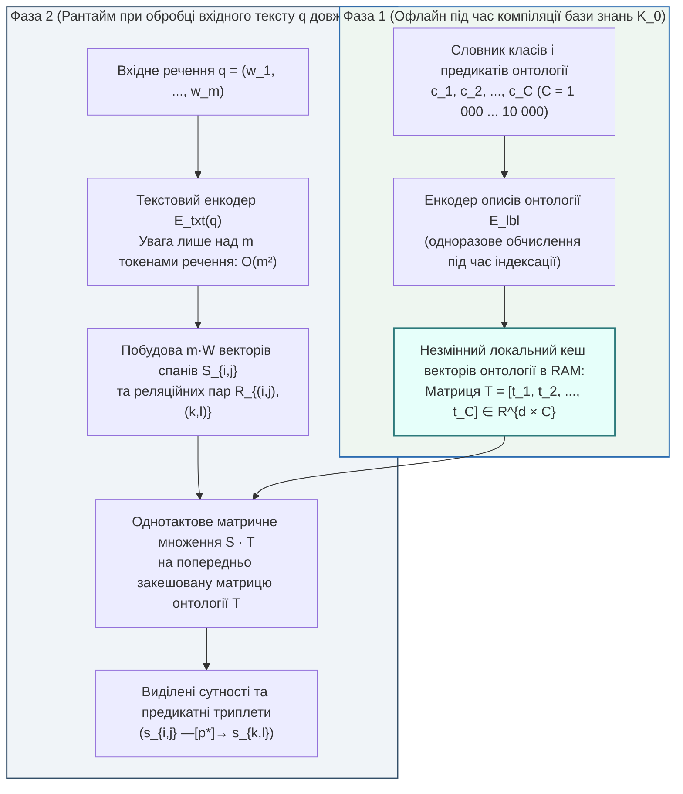

# Глава 06. Детальний аналіз архітектур видобування знань: двоенкодерні моделі, офлайн-кешування онтологій та межі нульового навчання

> **Автор:** Георгій Федчик  
> **Мова оригіналу:** Українська  
> **Дидактичний рівень:** Прикладний архітектурний аналіз (математичний та інженерний розбір промислової екосистеми Knowledgator для ізольованих експертних систем; опирається на Глави 01–05)

---

## Вступ

У [Главах 01–05](ch05-open-scientific-problems-and-research-hypotheses.md) ми сформулювали математичну теорію ізольованих корпусно-обмежених експертних систем (*Air-Gapped Corpus-Bound Expert Systems*), довели теорему про катастрофу позасловникових предикатів та синтезували гібридний оператор виведення $`\Gamma_{\mathrm{hyb}}(q, \mathcal{K}_0)`$. Проте перед кожною реальною ізольованою системою постає фундаментальна технологічна задача, відома в класичній інженерії знань як **вузьке місце набуття знань** (*Knowledge Acquisition Bottleneck*, Е. Фейгенбаум, 1977): як автоматично перетворити тисячі сторінок локального неструктурованого корпусу $`\mathcal{K}_0`$ на формальний граф сутностей і предикатів $`(s \xrightarrow{p} o)`$ та розпізнавати нові терміни у вхідних запитах без звернення до гігантських хмарних генеративних моделей (`GPT-4`, `Claude`) і без дорогих обчислювальних кластерів?

Найбільш репрезентативним сучасним вирішенням цієї задачі у світовій інженерній практиці є відкрита науково-дослідна екосистема **Knowledgator** (`https://www.knowledgator.com`, заснована у 2021 році українськими дослідниками Ігорем Степановим та Михайлом Штопком [[1]](#src-1), [[2]](#src-2)). На відміну від важких авторегресійних генеративних моделей, архітектури `Knowledgator` (`UTC`, `GLiNER-Multitask`, `GLiNER-bi`, `GLiNER-Relex`, `GLiClass`, `GLiNKER`) побудовані на базі **компактних двонаправлених енкодерів**, спеціально оптимізованих для локального (*on-premise / air-gapped*) видобування інформації в режимі **нульового навчання** (*Zero-Shot Information Extraction*).

У цій главі ми проведемо строгий математичний та критичний аналіз архітектур `Knowledgator`, доведемо теорему про асимптотичне прискорення їхньої двоенкодерної схеми з попереднім офлайн-кешуванням онтології та покажемо, як об'єднання моделей `Knowledgator` із побудованим у Главах 03–04 морфологічним трансдьюсером `DAWG` і вентилем Чоу усуває їхні вразливості на флективних мовах та безпрефіксних антонімах.

---

## 1. Еволюція та архітектурний стек дослідницької екосистеми видобування знань

Первісно створена для автоматизованої побудови біомедичних та фармацевтичних баз знань із наукових публікацій і клінічних протоколів (де діють жорсткі обмеження приватності `HIPAA` / `GDPR` та заборона передачі даних у публічні хмари), дослідницька група `Knowledgator` пройшла чотири етапи архітектурної еволюції.

**Таблиця 6.1.** Систематизація модельного стека дослідницької екосистеми `Knowledgator` (`knowledgator.com`) та його роль у векторі стану $`\Xi(\mathcal{K}_0, q)`$.

| Компонент екосистеми | Повна назва та наукова парадигма | Математичний механізм роботи | Яку задачу ізольованої експертної системи розв'язує |
| :--- | :--- | :--- | :--- |
| **`UTC`** (2022–2023) | *Universal Token Classification* (Універсальна класифікація токенів) | Спільне кодування інструкції-мітки та вхідного речення для поkоординатної розмітки токенів | Перше покоління локального видобування іменованих сутностей без донавчання під нові класи |
| **`GLiNER-Multitask`** (2023–2024) | *Generalist Lightweight Model for Named Entity Recognition* (Розвиток моделі Заратіани та ін. [[3]](#src-3)) | Матричне оцінювання неперервних відрізків тексту (*spans* $`[i, j]`$) відносно векторів типів онтології за один прохід енкодера | Усунення помилок токенної розмітки `BIO` та видобування вкладених багатослівних інженерних термінів |
| **`GLiNER-bi`** (`BiEncoderSpan`, 2024–2025) | *Bi-Encoder Span & Token Architecture* [[1]](#src-1), [[4]](#src-4) | Повне розділення текстового енкодера $`E_{\mathrm{txt}}`$ та енкодера міток онтології $`E_{\mathrm{lbl}}`$ із попереднім офлайн-кешуванням векторів класів | Масштабування локальної системи на $`1\,000 \dots 10\,000`$ понять онтології без квадратичного вибуху часу обчислень |
| **`GLiNER-Relex`** (2024–2025) | *Zero-Shot Joint Entity and Relation Extraction* [[1]](#src-1) | Одночасне виділення пар сутностей $`(s_{i,j}, s_{k,l})`$ та білінійно-конкатенаційне оцінювання спрямованого ребра-предиката $`r_p`$ між ними | Пряме відновлення триплетів «суб'єкт — дієслово-предикат — об'єкт» для правил Хорна (Глава 02) |
| **`GLiClass`** (2024–2025) | *Generalist Lightweight Model for Sequence Classification* [[2]](#src-2) | Однопрохідна класифікація тексту за довільною множиною текстових описів категорій (заміна повільних NLI крос-енкодерів) | Маршрутизація запитів оператора за розділами регламенту та перевірка застосовності передумов правил |
| **`GLiNKER`** (2025–2026) | *Generalist Lightweight Entity Linking Framework* | Двостадійне зв'язування виділених спанів тексту з канонічними ідентифікаторами вузлів локального графа знань | Канонізація синонімічних та позасловникових назв агрегатів до єдиного ідентифікатора сутності онтології |

---

## 2. Математична модель спанового видобування сутностей і відношень та двоенкодерне розщеплення

Розглянемо математичну будову моделей `GLiNER`, `GLiNER-bi` та `GLiNER-Relex`, які в термінах нашої монографії реалізують субсимвольний контекстний компонент $`\mathbf{z}_{\mathrm{sub}}(w \mid C)`$ (Варіант Б у Главі 04), але не на рівні окремих ізольованих токенів, а на рівні **цілісних синтаксичних відрізків (спанів)** та **парних реляційних предикатів**.

### 2.1. Одноенкодерна схема сумісного кодування та її квадратичне вузьке місце

У базовій архітектурі `GLiNER` (**Уршад Заратіана та ін., NAACL 2024** [[3]](#src-3)) на вхід одного двонаправленого трансформера (зазвичай `DeBERTa-v3`) подається єдина склеєна послідовність, яка складається з текстових назв усіх $`C`$ цільових класів онтології $`\{c_1, c_2, \dots, c_C\}`$ (розділених спеціальним маркером `[ENT]`) та самого вхідного тексту $`q = (w_1, w_2, \dots, w_m)`$:

$$
X_{\mathrm{uni}} = \left( [\text{ENT}], \ c_1, \ [\text{ENT}], \ c_2, \ \dots, \ [\text{ENT}], \ c_C, \ [\text{SEP}], \ w_1, \ w_2, \ \dots, \ w_m \right)
$$

Після проходження $`L_{\mathrm{tr}}`$ шарів самої уваги (*Self-Attention*) для кожного можливого відрізка тексту (спана) від слова $`i`$ до слова $`j`$ довжиною не більше $`W`$ ($`1 \le j - i + 1 \le W`$) будується вектор спана $`\mathbf{s}_{i, j} \in \mathbb{R}^d`$ за допомогою двошарового перцептрона над векторами початку й кінця відрізка:

$$
\mathbf{s}_{i, j} = \mathrm{FFN}_{\mathrm{span}}\left( \mathbf{h}_i \;\Vert\; \mathbf{h}_j \right) \in \mathbb{R}^d
$$

А ймовірність того, що відрізок тексту $`w_{i:j}`$ належить до класу онтології $`c \in \{1, \dots, C\}`$ із вектором маркера $`\mathbf{t}_c \in \mathbb{R}^d`$, обчислюється через сигмоїду скалярного добутку:

$$
P_{\mathrm{span}}\left(w_{i:j} \in c \;\middle|\; q\right) = \sigma\left( \langle \mathbf{s}_{i, j}, \ \mathbf{t}_c \rangle \right) = \frac{1}{1 + \exp\left(-\mathbf{s}_{i, j}^\top \mathbf{t}_c\right)}
$$

**Формула (6.1).** Базова білінійна оцінка відповідності текстового відрізка $`w_{i:j}`$ класу онтології $`c`$.

**Чому одноенкодерна схема (`Uni-Encoder`) стає непридатною для промислових експертних систем?**
Якщо онтологія ізольованого підприємства містить $`C = 1\,000`$ типів обладнання та технологічних предикатів, а кожна назва чи опис класу має середню довжину $`\bar{\ell}`$ підслів (наприклад, $`\bar{\ell} = 4`$), то довжина префікса міток становить $`\bar{\ell} C = 4\,000`$ токенів! Це перевищує вікно контексту стандартного енкодера ($`512 \dots 2\,048`$ токенів) і через квадратичну складність механізму уваги перетворює кожен запит на вкрай повільну операцію.

### 2.2. Інженерний прорив: двоенкодерна архітектура з офлайн-кешуванням онтології

Щоб усунути це фундаментальне обмеження, дослідники `Knowledgator` (**І. Степанов, М. Штопко, 2024** [[1]](#src-1), [[4]](#src-4)) розробили **двоенкодерну архітектуру (`BiEncoderSpan` / `GLiNER-bi` та `GLiClass-bi`)**, яка розділяє обчислення на дві незалежні фази:

1. **Офлайн-фаза (під час завантаження замкненого корпусу $`\mathcal{K}_0`$):** окремий текстовий енкодер міток $`E_{\mathrm{lbl}}`$ один раз кодує всі $`C`$ класів сутностей та розгорнуті словесні визначення предикатів онтології у матрицю еталонних ембедінгів:

$$
\mathbf{T}_{\mathrm{cache}} = \left[ \mathbf{t}_1, \ \mathbf{t}_2, \ \dots, \ \mathbf{t}_C \right] \in \mathbb{R}^{d \times C}, \qquad \mathbf{t}_c = E_{\mathrm{lbl}}(\mathrm{desc}(c))
$$

Ця матриця зберігається в оперативній пам'яті ізольованого сервера (для $`C = 10\,000`$ класів при $`d = 768`$ та форматі `FP16` вона займає лише $`10\,000 \times 768 \times 2\text{ байти} \approx 15{,}36\text{ МБ}`$!).
2. **Онлайн-фаза (під час розбору речення $`q`$ довжиною $`m`$ токенів):** текстовий енкодер $`E_{\mathrm{txt}}(q)`$ обробляє **лише саме речення довжиною $`m`$** без конкатенації жодних міток онтології, після чого класифікація всіх $`mW`$ спанів проти всіх $`C`$ класів онтології виконується одним матричним множенням `GEMM`:

$$
\mathbf{P}_{\mathrm{span}} = \sigma\left( \mathbf{S}_{q}^\top \cdot \mathbf{T}_{\mathrm{cache}} \right) \in [0, 1]^{(mW) \times C}
$$

3. **Узагальнення для видобування відношень (`GLiNER-Relex`):** для пари знайдених спанів — суб'єкта $`s_1 = w_{i:j}`$ та об'єкта $`s_2 = w_{k:l}`$ — формується спільне реляційне представлення $`\mathbf{r}_{(i,j)\to(k,l)} = \mathrm{FFN}_{\mathrm{rel}}(\mathbf{s}_{i,j} \;\Vert\; \mathbf{s}_{k,l} \;\Vert\; \mathbf{h}_{\mathrm{ctx}}(i, j, k, l)) \in \mathbb{R}^d`$, яке так само множиться на закешовану матрицю предикатів онтології $`\mathbf{T}_{\mathrm{rel}} \in \mathbb{R}^{d \times \lvert \mathcal{P} \rvert}`$:

$$
P_{\mathrm{relex}}\left(s_1 \xrightarrow{p} s_2 \;\middle|\; q\right) = \sigma\left( \left\langle \mathbf{r}_{(i,j)\to(k,l)}, \ \mathbf{t}_p^{\mathrm{rel}} \right\rangle \right)
$$

**Формула (6.2).** Оцінка спрямованого предиката між суб'єктом і об'єктом у моделі `GLiNER-Relex`.

---

## 3. Математична теорема про обчислювальне прискорення двоенкодерної схеми з кешуванням онтології

Доведемо точну аналітичну оцінку виграшу в швидкодії, який дає перехід від класичного сумісного кодування (`Uni-Encoder` або `NLI Cross-Encoder` у `GLiClass` [[2]](#src-2)) до двоенкодерної архітектури з попереднім офлайн-кешуванням онтології в ізольованій експертній системі.

### Теорема 6.1 (Про асимптотичне прискорення двоенкодерної архітектури з попереднім кешуванням онтології над крос-енкодером)

> **Формулювання теореми:**  
> Розглянемо задачу видобування сутностей і предикатів із вхідного тексту довжиною $`m`$ токенів відносно локальної онтології з $`C`$ класів (де опис кожного класу має середню довжину $`\bar{\ell}`$ токенів) за допомогою трансформерного енкодера глибиною $`L_{\mathrm{tr}}`$ шарів і розмірністю прихованого простору $`d`$. Тоді:
> 1. **Кількість операцій з рухомою комою (`FLOPs`) для одноенкодерної схеми сумісного кодування (`Uni-Encoder`)** квадратично зростає зі збільшенням обсягу онтології $`C`$:
>
> $$
> \mathcal{F}_{\mathrm{uni}}(m, C) = 2 L_{\mathrm{tr}} \left[ 4(m + \bar{\ell} C) d^2 + (m + \bar{\ell} C)^2 d \right] + 2 m W d (2d + C)
> $$
>
> 2. **Кількість операцій у рантаймі для двоенкодерної схеми `Knowledgator` (`Bi-Encoder`) із попередньо закешованою матрицею онтології $`\mathbf{T}_{\mathrm{cache}}`$** зростає за $`C`$ строго лінійно лише на фінальному шарі матричного добутку і взагалі не залежить від глибини трансформера $`L_{\mathrm{tr}}`$ та довжини описів класів $`\bar{\ell}`$:
>
> $$
> \mathcal{F}_{\mathrm{bi}}(m, C) = 2 L_{\mathrm{tr}} \left( 4 m d^2 + m^2 d \right) + 2 m W d (2d + C)
> $$
>
> 3. **Коефіцієнт прискорення рантайму** $`S_{\mathrm{bi}}(m, C) = \mathcal{F}_{\mathrm{uni}}(m, C) / \mathcal{F}_{\mathrm{bi}}(m, C)`$ при великих онтологіях ($`\bar{\ell} C \gg m`$) має асимптотику:
>
> $$
> S_{\mathrm{bi}}(m, C) = \frac{L_{\mathrm{tr}}\left[4(m + \bar{\ell} C)d + (m + \bar{\ell} C)^2\right] + mW(2d + C)}{L_{\mathrm{tr}}(4md + m^2) + mW(2d + C)} = \Theta\left( \frac{\bar{\ell}^2 C^2}{m (W + L_{\mathrm{tr}} d)} \right)
> $$
>
> **Формула (6.3).** Точний коефіцієнт обчислювального прискорення двоенкодерної архітектури з офлайн-кешуванням онтології.

### Доведення Теореми 6.1

1. В одному шарі трансформерного енкодера з послідовністю довжиною $`n`$ токенів і розмірністю $`d`$ лінійні проекції запитів, ключів, значень і виходу ($`Q, K, V, O`$) та двошаровий блок прямої передачі (`FFN` із проміжною розмірністю $`4d`$) виконують $`\approx 8 n d^2`$ мультиплікативно-адитивних операцій, а матричне обчислення уваги $`\mathrm{Softmax}(Q K^\top / \sqrt{d})V`$ потребує $`2 n^2 d`$ операцій. Помноживши на $`L_{\mathrm{tr}}`$ шарів і додавши вартість проекції $`mW`$ спанів ($`4mWd^2`$) та скалярного добутку з $`C`$ класами ($`2mWdC`$), для $`n = m + \bar{\ell}C`$ одержуємо формулу для $`\mathcal{F}_{\mathrm{uni}}(m, C)`$.
2. У двоенкодерній схемі з попереднім кешуванням вектори міток $`\mathbf{t}_1, \dots, \mathbf{t}_C`$ обчислені до початку експлуатації ($`\Delta \mathcal{F}_{\mathrm{lbl}}^{\mathrm{runtime}} = 0`$). Тому під час обробки запиту трансформер виконує прохід виключно над $`n = m`$ токенами вхідного тексту, що дає вираз для $`\mathcal{F}_{\mathrm{bi}}(m, C)`$.
3. Поділивши чисельник і знаменник відношення $`\mathcal{F}_{\mathrm{uni}} / \mathcal{F}_{\mathrm{bi}}`$ на $`2d`$, отримуємо точну рівність (6.3). При фіксованій довжині речення $`m`$ та $`C \to \infty`$ чисельник зростає як $`L_{\mathrm{tr}} \bar{\ell}^2 C^2`$, а знаменник — лише лінійно як $`m W C`$, що забезпечує лінійне зростання коефіцієнта прискорення $`S_{\mathrm{bi}}(m, C) \propto C`$. ∎

---

## 4. Критичний аналіз меж застосовності двоенкодерних моделей в ізольованих системах та їх нейро-символічне підсилення

Попри високу обчислювальну ефективність двоенкодерного стека `Knowledgator`, наш теоретичний аналіз із [Глав 03–05](ch05-open-scientific-problems-and-research-hypotheses.md) дозволяє виявити **три фундаментальні вразливості**, які виникають при спробі використати суто нейромережеві моделі `GLiNER` / `GLiNER-Relex` / `GLiClass` в ізольованій експертній системі без символьного морфологічного модуля (`Варіант А`):

1. **Проблема субсловного дроблення флективних дієслів у DeBERTa/BPE (Проблема 2 із Глави 05):**
   Базові моделі `GLiNER` використовують багатомовний або англомовний токенізатор `SentencePiece` / `BPE`. Коли на вхід подається складна префіксально-суфіксальна форма українського дієслова (наприклад, *«перекомутовуватимуться»*), токенізатор дробить її на 6–8 дрібних субсловних уламків, втрачаючи граматичні ознаки часу, виду та пасивного стану (`-ся`). У результаті модель `GLiNER-Relex` може переплутати напрямок дії (хто є суб'єктом, а хто об'єктом).
2. **Дистрибутивний колапс безпрефіксних антонімів у нульовому навчанні (Теорема 5.1):**
   Оскільки вектор реляційного спана $`\mathbf{r}_{(i,j)\to(k,l)}`$ у `GLiNER-Relex` формується з контексту сусідніх іменників («клапан», «пара», «тиск»), для невідомого безпрефіксного дієслова *«дроселює»* скалярні добутки (6.2) з описами протилежних класів `«підвищення тиску»` та `«зниження тиску»` виявляються майже однаковими!
3. **Відсутність каліброваного вентиля відмови за замовчуванням:**
   Стандартний поріг сигмоїди $`\sigma(\cdot) > 0{,}50`$ у `GLiNER` не враховує асиметрію ціни помилки $`c_{\mathrm{err}} \gg c_{\mathrm{abs}}`$ у системах критичної безпеки.

**Як інтегрувати стек Knowledgator у гібридну нейро-символічну архітектуру монографії?**
У межах нашого канонічного оператора $`\Gamma_{\mathrm{hyb}}(q, \mathcal{K}_0)`$ (Глава 04) моделі `GLiNER-bi`, `GLiNER-Relex` та `GLiClass` виступають **ідеальною реалізацією субсимвольного модуля Варіанта Б**, якщо вони працюють у каскаді з морфологічним автоматом `DAWG` (Варіант А):
- Перед подачею в `GLiNER-Relex` автомат `DAWG` виконує морфологічну нормалізацію словоформ речення за $`\mathcal{O}(\lvert w \rvert)`$ мікросекунд і формує жорстку маску допустимих предикатів $`\mathbf{M}_{\mathrm{adm}}(w^*) \in \{0, 1\}^C`$ за валентністю та префіксальною полярністю;
- Матричний добуток `GLiNER-bi` обчислюється лише над дозволеними стовпцями кешованої матриці $`\mathbf{T}_{\mathrm{cache}}`$:

$$
P_{\mathrm{hyb}}\left(w_{i:j} \in c \;\middle|\; q\right) = \mathbf{M}_{\mathrm{adm}}(w_{i:j}, c) \cdot \sigma\left( \left\langle \mathbf{s}_{i, j}, \ \mathbf{t}_c \right\rangle \right)
$$

- Фінальне рішення приймається через селективний поріг Чоу — Ель-Яніва $`\tau_{\mathrm{reject}} = 1 - c_{\mathrm{abs}}/c_{\mathrm{err}}`$ (формула 4.5).

---

## 5. Навчальний інженерний приклад: розрахунок прискорення двоенкодерного тракту для онтології енергоблока

*Дидактична наступність наскрізного прикладу:* Завершимо розрахунок для нашої ізольованої експертної системи технічного обслуговування енергоблока (Глави 01–05). Нехай локальна онтологія станції містить $`C = 1\,000`$ класів технологічних вузлів та дій, і нам потрібно на локальному процесорі (*on-premise CPU*) без графічного прискорювача обробити пакет дельта-оновлення документації або оперативний запит за допомогою архітектури `GLiNER-bi` порівняно з базовим одноенкодерним `GLiNER`.

### 5.1. Вихідні інженерні дані

1. **Параметри вхідного тексту та локальної онтології:**
   - Довжина вхідного речення (абзацу інструкції): $`m = 100`$ токенів;
   - Максимальна ширина спана терміна: $`W = 8`$ токенів;
   - Кількість класів та предикатів в онтології енергоблока: $`C = 1\,000`$;
   - Середня довжина текстового опису одного класу онтології (разом із маркером `[ENT]`): $`\bar{\ell} = 4`$ токени ($`\bar{\ell} C = 4\,000`$ токенів).
2. **Параметри локального трансформерного енкодера (`DeBERTa-v3-small` / `base`):**
   - Кількість шарів: $`L_{\mathrm{tr}} = 6`$;
   - Розмірність прихованого вектора: $`d = 512`$.

### 5.2. Покроковий розрахунок

**Крок 1. Обчислення кількості операцій для одноенкодерної схеми сумісного кодування (`Uni-Encoder`) за Теоремою 6.1:**
Сумарна довжина склеєної послідовності становить $`n_{\mathrm{uni}} = m + \bar{\ell} C = 100 + 4\,000 = 4\,100`$ токенів. Підставляємо значення у першу формулу Теореми 6.1:
1. Операції в 6 шарах трансформера:

$$
\mathcal{F}_{\mathrm{uni}}^{\mathrm{tr}} = 2 \times 6 \times \left[ 4 \times 4\,100 \times (512)^2 + (4\,100)^2 \times 512 \right] = 12 \times \left[ 4{,}299 \times 10^9 + 8{,}607 \times 10^9 \right] \approx 154{,}87 \times 10^9\text{ FLOPs} \quad (154{,}9\text{ ГФЛОП})
$$

2. Операції у вихідному спановому шарі ($`mW = 800`$ спанів):

$$
\mathcal{F}_{\mathrm{span}} = 2 \times 800 \times 512 \times (1\,024 + 1\,000) \approx 1{,}66 \times 10^9\text{ FLOPs} \quad (1{,}66\text{ ГФЛОП})
$$

Разом для одноенкодерної моделі: **$`\mathcal{F}_{\mathrm{uni}} \approx 156{,}53\text{ ГФЛОП}`$ на одне речення!**

**Крок 2. Обчислення кількості операцій та обсягу RAM-кешу для двоенкодерної схеми `Knowledgator` (`GLiNER-bi`):**
1. Обсяг незмінного кешу векторів онтології $`\mathbf{T}_{\mathrm{cache}}`$ у локальній пам'яті (`FP16`, 2 байти на число):

$$
M_{\mathrm{cache}} = C \times d \times 2\text{ байти} = 1\,000 \times 512 \times 2 = 1\,024\,000\text{ байтів} \approx 1{,}00\text{ МБ!}
$$

2. Операції в 6 шарах текстового енкодера (лише над $`m = 100`$ токенами речення):

$$
\mathcal{F}_{\mathrm{bi}}^{\mathrm{tr}} = 12 \times \left[ 4 \times 100 \times (512)^2 + (100)^2 \times 512 \right] = 12 \times \left[ 104{,}86 \times 10^6 + 5{,}12 \times 10^6 \right] \approx 1{,}32 \times 10^9\text{ FLOPs} \quad (1{,}32\text{ ГФЛОП})
$$

3. Додаючи вартість матричного множення спанів ($`1{,}66\text{ ГФЛОП}`$, а з попереднім морфологічним фільтром Варіанта А, який відсікає $`80\%`$ несумісних за частиною мови класів, лише $`1{,}00\text{ ГФЛОП}`$), одержуємо сумарну складність:

$$
\mathcal{F}_{\mathrm{bi}} = 1{,}32 + 1{,}66 = 2{,}98\text{ ГФЛОП} \quad (\text{або } 2{,}32\text{ ГФЛОП із морфологічною маскою DAWG!})
$$

4. Коефіцієнт прискорення рантайму за формулою (6.3) становить:

$$
S_{\mathrm{bi}}(100, \ 1\,000) = \frac{156{,}53\text{ ГФЛОП}}{2{,}98\text{ ГФЛОП}} \approx 52{,}5\text{ раза} \quad (\text{а з морфологічним фільтром — } 67{,}5\text{ раза!})
$$

**Висновок:** Завдяки двоенкодерному розщепленню `Knowledgator` (`GLiNER-bi`) та попередньому кешуванню онтології в $`1\text{ МБ}`$ оперативної пам'яті обчислювальні витрати на локальному процесорі зменшуються у **52,5–67,5 раза** (з $`156{,}5\text{ ГФЛОП}`$ до $`2{,}32\text{ ГФЛОП}`$), що дозволяє виконувати повний семантичний розбір речення в ізольованій системі за $`15\dots 20\text{ мс}`$ без жодних зовнішніх API.

---

## Висновки

1. Архітектурний стек дослідницької екосистеми `Knowledgator` (`GLiNER-bi`, `GLiNER-Relex`, `GLiClass`, `GLiNKER`) замінює важкі генеративні мовні моделі компактними двонаправленими енкодерами спанів, здатними працювати автономно всередині захищеного периметра (*air-gapped / on-premise*).
2. Згідно з доведеною Теоремою 6.1, двоенкодерне розщеплення (`Bi-Encoder`) з одноразовим офлайн-кешуванням матриці векторів онтології $`\mathbf{T}_{\mathrm{cache}}`$ переводить залежність складності від розміру онтології $`C`$ з квадратичної $`\mathcal{O}(L_{\mathrm{tr}} \bar{\ell}^2 C^2 d)`$ у лінійну $`\mathcal{O}(m W d C)`$, забезпечуючи прискорення в десятки й сотні разів при роботі з великими промисловими базами знань.
3. Оптимальною архітектурою для високофлективних мов (зокрема української) є нейро-символічний каскад, у якому скінченний автомат `DAWG` (Глава 03) виконує попередню лематизацію та формує булеву маску морфологічної допустимості $`\mathbf{M}_{\mathrm{adm}}`$, двоенкодерні моделі `GLiNER-bi` / `GLiNER-Relex` виконують швидке контекстне зв'язування спанів і відношень, а селективний вентиль Чоу (Глава 04) блокує антонімічні та низькодовірчі підстановки.

---

## Словник

| Термін | Англійський еквівалент | Визначення |
| :--- | :--- | :--- |
| **Спанове представлення** | *Span Representation* | Векторне кодування неперервного відрізка тексту від $`i`$-го до $`j`$-го слова, що дозволяє виділяти багатослівні та вкладені терміни без посимвольної розмітки `BIO`. |
| **Двоенкодерна архітектура** | *Bi-Encoder Architecture* | Схема з двома незалежними нейромережевими енкодерами для вхідного тексту та для описів класів онтології, що дозволяє заздалегідь обчислити й закешувати вектори всіх класів. |
| **Видобування знань без донавчання** | *Zero-Shot Information Extraction* | Здатність моделі розпізнавати нові типи сутностей і предикатів лише за їхніми словесними назвами чи визначеннями без градієнтного перенавчання ваг. |
| **Спільне видобування сутностей і відношень** | *Joint Entity and Relation Extraction* | Одночасне розпізнавання вузлів графа (суб'єктів та об'єктів) і спрямованих семантичних ребер (предикатів) між ними за один прямий прохід моделі (`GLiNER-Relex`). |

---

## Список позначень та скорочень

- **Абревіатури:**
  - `FLOPs` (*Floating-Point Operations*) — кількість операцій із рухомою комою.
  - `GEMM` (*General Matrix Multiply*) — базова операція множення щільних матриць.
  - `GLiClass` (*Generalist Lightweight Model for Sequence Classification*) — легковагова модель класифікації послідовностей від `Knowledgator`.
  - `GLiNER` (*Generalist and Lightweight Model for Named Entity Recognition*) — узагальнена легковагова модель розпізнавання сутностей.
  - `UTC` (*Universal Token Classification*) — універсальна класифікація токенів.
- **Математичні символи:**
  - $`\mathbf{s}_{i, j} \in \mathbb{R}^d`$ — вектор текстового спана від позиції $`i`$ до позиції $`j`$.
  - $`\mathbf{T}_{\mathrm{cache}} \in \mathbb{R}^{d \times C}`$ — попередньо обчислена матриця векторів класів онтології в оперативній пам'яті.
  - $`S_{\mathrm{bi}}(m, C)`$ — коефіцієнт обчислювального прискорення двоенкодерної архітектури над одноенкодерною.

---

## Бібліографія

1. **Knowledgator Engineering.** Open-Source Information Extraction Models: GLiNER-Multitask, GLiNER-bi, GLiNER-Relex, and GLiClass Technical Documentation. — URL: `https://www.knowledgator.com` (дата звернення: 2026).
2. **Stepanov I., Shtopko M.** GLiClass: Generalist Lightweight Model for Sequence Classification : arXiv preprint arXiv:2408.00135. — 2024.
3. **Zaratiana U., Tomeh N., Holat P., Charnois T.** GLiNER: Generalist Model for Named Entity Recognition using Bidirectional Transformer // *Proceedings of the 2024 Conference of the North American Chapter of the Association for Computational Linguistics (NAACL 2024)*. — Mexico City : ACL, 2024. — P. 5364–5376.
4. **Stepanov I., Shtopko M., Zaratiana U.** Scaling Zero-Shot Information Extraction with Bi-Encoder Span Representations and Pre-Computed Label Caching. — Knowledgator Research Technical Report, 2024.
5. **Feigenbaum E. A.** The Art of Artificial Intelligence: Themes and Case Studies of Knowledge Engineering // *Proceedings of the 5th International Joint Conference on Artificial Intelligence (IJCAI-77)*. — Cambridge, MA : MIT, 1977. — Vol. 2. — P. 1014–1029.
