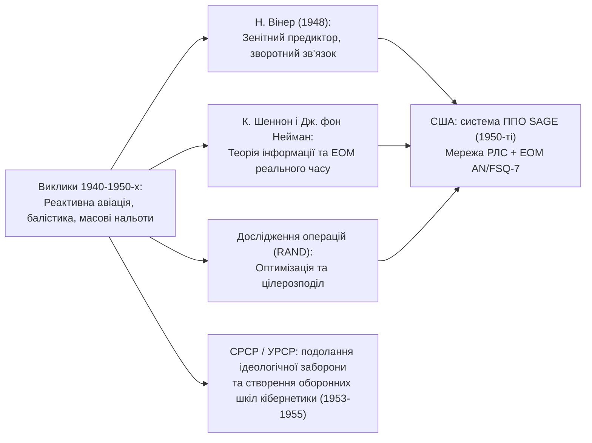
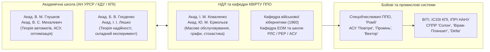
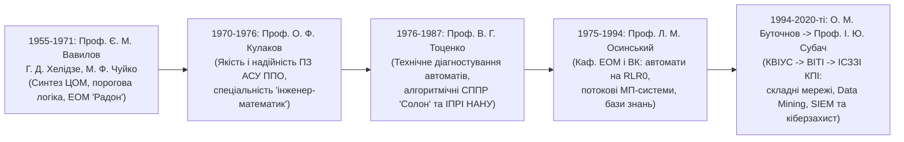
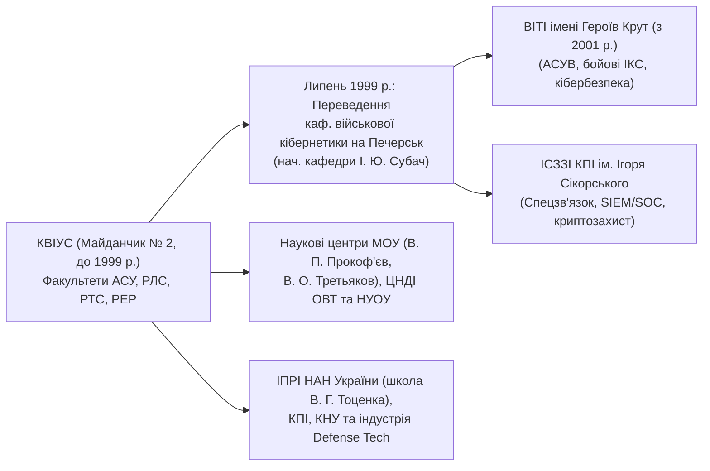
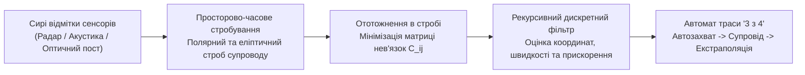
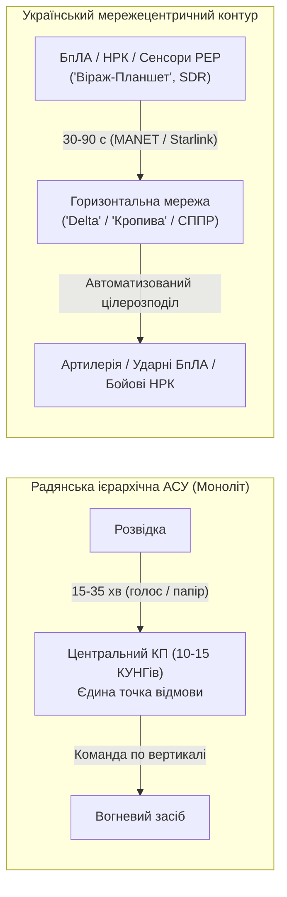
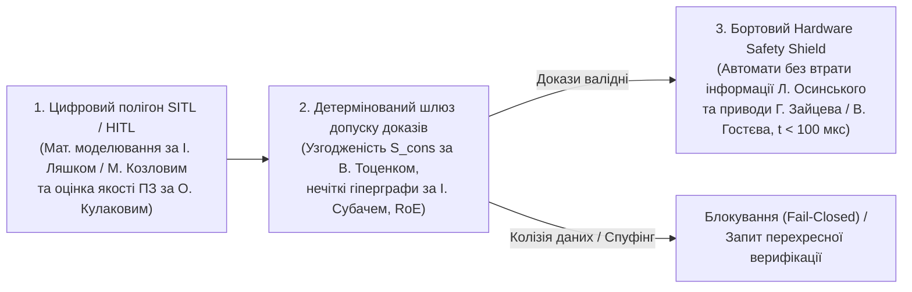

# Українська військова кібернетика: від КВІРТУ ППО до сучасних цифрових систем управління військами та озброєнням

> **Автор:** Микола Федчик (Mykola Fedchyk) · [LinkedIn](https://www.linkedin.com/in/nickfedchik/) · [GitHub](https://github.com/nick-fedchik)  
> **Рубрика:** Статті · **Теги:** miltech, defence tech, історія ІТ, архітектура, embedded, кібербезпека

---

Широко поширена хибна думка, ніби цифровізація Сил оборони України виникла майже на порожньому місці у 2014–2022 роках виключно завдяки волонтерському ентузіазму, цивільним месенджерам і комерційним дронам. Насправді технологічний феномен сучасних українських систем ситуаційної обізнаності, автоматизованого управління вогнем та радіоелектронної боротьби стоїть на плечах потужної інженерно-математичної традиції, яка формувалася в Києві, Харкові, Львові та Запоріжжі понад сімдесят років.

Українська школа військової кібернетики народжувалася не в абстрактних кабінетах, а на перетині статистичної радіолокації, надзвукової аеродинаміки, теорії цифрових автоматів, дослідження операцій та жорстких обмежень бортових і стаціонарних ЕОМ реального часу. У цій статті ми простежимо безперервний інтелектуальний ланцюг: від перших лампових спецобчислювачів, наукових шкіл **Інституту кібернетики імені В. М. Глушкова** та **Київського вищого інженерного радіотехнічного училища ППО (КВІРТУ ППО)** — до сучасних мережецентричних контурів **C4ISTAR**, платформ **«Кропива»**, **«Delta»**, **«Віраж-Планшет»**, наземних роботизованих комплексів і доказових систем підтримки прийняття рішень.

---

## 1. Світові витоки військової кібернетики в середині XX століття

Військова кібернетика виникла у 1940–1950-х роках не як абстрактна філософська теорія, а як пряма відповідь на кризу управління високошвидкісними засобами ураження та масованими операціями індустріальної епохи. До середини XX століття збір і обробка бойової інформації спиралися на людину як проміжну ланку: спостерігач передавав координати телефоном чи радіостанцією, планшетист вручну наносив їх на карту чи скляний планшет, а обчислювачі за логарифмічними лінійками й балістичними таблицями розраховували упередження. З появою швидкісних бомбардувальників, реактивної авіації та керованих ракет такий контур управління фізично не встигав за динамікою бою.

Саме розв'язання задач протиповітряної оборони та балістики сформувало чотири глобальні опори нової науки:

1. **Теорія керування та зворотного зв'язку (Норберт Вінер, 1940–1948):** у роки Другої світової війни американський математик Норберт Вінер працював над задачею автоматичного наведення зенітної артилерії по швидкісній маневреній цілі (*antiaircraft fire-control predictor*). Щоб екстраполювати майбутню позицію літака з урахуванням шумів радара, затримок приводів і поведінки пілота, Вінер об'єднав статистичну фільтрацію сигналів і теорію зворотного зв'язку — і в 1948 році дав цій науці назву **«кібернетика»** (*Cybernetics: Or Control and Communication in the Animal and the Machine*).
2. **Теорія інформації та обчислювальні машини (Клод Шеннон, Джон фон Нейман):** паралельно Клод Шеннон (1948) заклав математичні межі передавання й кодування сигналів у зашумлених каналах, а перші електронні обчислювальні машини (`ENIAC`, `EDVAC`, `Whirlwind`) створювалися передусім для артилерійських балістичних таблиць, ядерного моделювання та радіолокаційної обробки даних у реальному часі.
3. **Дослідження операцій (Operations Research):** у Великій Британії («цирк Блекетта» для оптимізації мережі РЛС *Chain Home* і протичовнових конвоїв) та у США (корпорація `RAND`, лінійне й динамічне програмування Дж. Данціга та Р. Беллмана) сформувався математичний апарат оптимального розподілу обмежених бойових ресурсів, пошуку цілей і теорії ігор.
4. **Перші мережецентричні АСУ реального часу (`SAGE`, 1950-ті):** у США Массачусетський технологічний інститут (`MIT Lincoln Laboratory`) розгорнув систему стратегічної ППО **SAGE (Semi-Automatic Ground Environment)** на базі лампових комп'ютерів `AN/FSQ-7`. Уперше десятки радарів було об'єднано цифровими каналами передавання даних із центральними обчислювачами та векторними дисплеями зі світловим пером, що перевело управління повітряним боєм із голосового режиму в автоматизований цифровий контур.

У Радянському Союзі становлення військової кібернетики відбувалося в умовах гострого ідеологічного парадоксу. Наприкінці 1940-х — на початку 1950-х років офіційна пропаганда оголосила кібернетику «реакційною буржуазною лженаукою». Проте реальність холодної війни — поява надзвукових перехоплювачів, крилатих і міжконтинентальних балістичних ракет — змусила військово-промисловий комплекс де-факто будувати спеціалізовані цифрові обчислювальні комплекси ще до офіційної «реабілітації» терміна в 1955 році (після відомої статті А. І. Кітова, С. Л. Соболєва та О. А. Ляпунова *«Основні риси кібернетики»*). Саме оборонне замовлення — насамперед задачі протиповітряної та протиракетної оборони — стало головним локомотивом розвитку прикладної кібернетики, теорії автоматів і ЕОМ в УРСР.

---

## 2. Зародження військової кібернетики в Україні (УРСР) та створення КВІРТУ ППО

Коли в середині XX століття швидкості реактивної авіації та перших крилатих ракет перетнули рубіж 800–1200 км/год, ручний цикл управління протиповітряною обороною зазнав фізичного краху:

- затримка проходження голосової доповіді через 2–3 телефонні ланки становила 3–5 хвилин;
- за цей час надзвуковий літак долав 40–100 км, повністю виходячи із зони розрахункового перехоплення;
- людина-оператор фізично не могла одночасно супроводжувати понад 3–4 швидкісні маневрені цілі без катастрофічного падіння точності.

Виникла класична кібернетична криза пропускної спроможності людини як ланки в контурі зворотного зв'язку:

$$
\Delta t_{\text{human}} \gg \Delta t_{\text{process}}
$$

де $\Delta t_{\text{human}}$ — сумарний час зняття відмітки, голосового передавання та ручної екстраполяції, а $\Delta t_{\text{process}}$ — гранично допустимий такт оновлення координат для наведення винищувача або зенітної ракети. З погляду теорії автоматичного керування, якщо система прагне компенсувати відхилення стану $x(t)$ за лінійним законом із запізненням інформації на час $\tau$:

$$
\frac{dx(t)}{dt} = -k \cdot x(t - \tau)
$$

то при перевищенні критичного порога $\tau_{\text{crit}} = \frac{\pi}{2k}$ від'ємний зворотний зв'язок перероджується на додатний, і контур управління втрачає стійкість.

Для подолання цієї технологічної кризи та підготовки інженерів принципово нового профілю **1 лютого 1953 року** у Києві (на Лук'янівці, вул. Мельникова, 81) було засноване **Київське вище інженерне радіотехнічне училище протиповітряної оборони (КВІРТУ ППО)** — заклад, який на чотири десятиліття став головним науково-освітнім центром військової кібернетики, статистичної радіолокації та радіоелектронної розвідки в Україні.

Унікальність київської школи військової кібернетики полягала в тому, що вона ніколи не була замкненою казарменою структурою. Вже в 1950-х роках у Києві — місті, де під керівництвом С. О. Лебедєва у Феофанії запрацювала перша в континентальній Європі ЕОМ **МЕСМ** (1950–1951), — сформувався потужний цивільно-військовий інтелектуальний трикутник: **Інститут кібернетики АН УРСР — Київський державний університет імені Т. Г. Шевченка та КПІ — КВІРТУ ППО**.

### 2.1. Внесок академічних вчених у військову кібернетику

1. **Академік Віктор Михайлович Глушков (1923–1982):** засновник Інституту кібернетики АН УРСР створив алгебраїчну теорію дискретних перетворювачів і цифрових автоматів, сформулював принципи побудови розподілених макрорівневих АСУ та особисто керував розробкою спеціалізованих інформаційно-обчислювальних комплексів оборонного призначення (зокрема серії **«Ромб»** для автоматизації випробувань і управління силами флоту та ППО, а також ЕОМ серій **«Київ»**, **«Дніпро»** та **«МИР»**). У концепції Глушкова ЕОМ у контурі управління виступала не сліпим калькулятором, а інтелектуальним партнером командира, здатним у реальному часі прораховувати тисячі варіантів розвитку бою.
2. **Академік Володимир Сергійович Михалевич (1930–1994):** розробив метод послідовного аналізу варіантів, який дозволив відсікати завідомо неперспективні гілки рішень на багатокрокових графах планування операцій і цілерозподілу без повного комбінаторного перебору.
3. **Академік Борис Володимирович Гнєденко (1912–1995):** наприкінці 1950-х років у Києві разом із військовими вченими КВІРТУ ППО заклав математичний фундамент теорії надійності та масового обслуговування для складних радіоелектронних комплексів.
4. **Академіки Ігор Миколайович Коваленко (1935–2015) та Юрій Михайлович Єрмольєв (1936–2022):** обидва всесвітньо відомі математики розпочали свою наукову кар'єру безпосередньо у військовій науково-дослідній лабораторії та на кафедрі вищої математики КВІРТУ ППО наприкінці 1950-х — на початку 1960-х років (де фундаментальну математичну підготовку очолювали професори **С. Д. Ейдельман**, **В. П. Лобанов** та **І. Я. Соколинський**). Саме із задач пропускної спроможності багатоканальних ЗРК і радіолокаційних вузлів виросли класичні праці І. М. Коваленка з теорії масового обслуговування та прикладної теорії надійності, а також піонерські монографії Ю. М. Єрмольєва *«Экстремальные задачи на графах»* (К.: Наукова думка, 1968) і *«Методы стохастического программирования»* (М.: Наука, 1976), що стали світовою класикою оптимізації в умовах невизначеності.
5. **Академік Іван Іванович Ляшко (1922–2008) та професор КВІРТУ Микола Миколайович Козлов:** спільна праця математиків КДУ імені Тараса Шевченка (Ю. А. Бєлова, В. П. Діденка, І. І. Ляшка) та наукової школи полігонних випробувань КВІРТУ ППО на чолі з випускником (1959) і професором училища (1964–1984) М. М. Козловим увінчалася фундаментальною п'ятитомною монографією *«Математическое обеспечение сложного эксперимента: в 5 т.»* (К.: Наукова думка, 1982–1990), створеною для математичної обробки натурних випробувань стратегічних систем ПРО та попередження про ракетний напад (СПРН).
6. **Анатолій Іванович Кітов (1920–2005) та лампова супер-ЕОМ «М-100»:** вже наприкінці 1950-х років на полігоні КВІРТУ ППО випробовувалася унікальна спеціалізована ЕОМ **«М-100»**, створена під керівництвом А. І. Кітова спеціально для бойових розрахунків ППО. Вона стала найшвидкодійнішою у світі ламповою машиною першого покоління (**100 000 операцій за секунду**), у якій уперше в історії обчислювальної техніки було реалізовано **чотиритактний конвеєр команд (instruction pipelining)**, гарвардський поділ пам'яті та дворівневу оперативну пам'ять із надшвидким феритовим кешем.

---

## 3. Ядро школи: Кафедра військової кібернетики (з 1960 р.) та Кафедра ЕОМ

Організаційним та ідейним серцем комп'ютерних наук у КВІРТУ ППО стали створена у **1960 році** на Факультеті № 1 (АСУ) **кафедра військової кібернетики** (згодом — кафедра військової кібернетики та автоматизованих систем управління) та профільна **кафедра електронних обчислювальних машин (ЕОМ)**. Саме тут програмування та схемотехніка розглядалися як точна інженерія жорсткого реального часу (Hard Real-Time): оптимізація алгоритмів під такт феритової й напівпровідникової пам'яті, структурний синтез цифрових автоматів, автоматизована діагностика збоїв і математичне моделювання бою.

### 3.1. Становлення кафедри, Є. М. Вавилов та перші навчально-обчислювальні комплекси

Біля витоків кафедри обчислювальної техніки та кібернетичної школи КВІРТУ ППО стояв полковник **Євген Миколайович Вавилов (1923–1978)** — перший в училищі доктор технічних наук (1966) і професор (1967), який працював у КВІРТУ в 1955–1971 роках, а після звільнення в запас очолив кафедру обчислювальної техніки та заснував кафедру прикладної математики в КПІ.

Науковий доробок Є. М. Вавилова заклав фундамент вітчизняної комп'ютерної інженерії:

- монографія *«Синтез схем электронных цифровых машин»* (спільно з викладачем кафедри **Г. П. Портним**; М.: Советское радио, 1963. — 440 с.; польське видання — Варшава, 1967) стала першим у СРСР систематичним посібником із логічного та структурного проєктування вузлів ЕОМ;
- фундаментальна праця *«Синтез схем на пороговых элементах»* (спільно з **Б. М. Єгоровим**, **В. С. Ланцевим** та **В. Г. Тоценком**; М.: Советское радио, 1970. — 368 с.) розробила математичний апарат порогової логіки — прямого попередника формальних нейронів та сучасних апаратних нейроморфних прискорювачів;
- монографія *«Язык моделирования сложных систем»* (К.: Наукова думка, 1976) формалізувала подієво-часове імітаційне моделювання великих інформаційно-керуючих систем.

Першим начальником кафедри військової кібернетики у **1960–1962 роках** був к.т.н., доцент, інженер-полковник **Георгій Дмитрович Хелідзе** (який у 1962–1974 рр. очолював Факультет № 1 АСУ), а до першого викладацького ядра увійшли Г. П. Портной, О. В. Іванов, Є. А. Самохвалов, А. О. Барков, Л. К. Ларін та Ю. О. Бузунов. У **1962–1967 роках** кафедру очолював к.т.н., с.н.с. **Микола Федорович Чуйко**: саме під його керівництвом у 1965 році колектив кафедри (М. Ф. Чуйко, Ю. О. Бузунов, Ю. І. Жидков, В. І. Водолазький, Л. О. Сидоров) створив перший у СРСР автоматизований навчально-контролюючий комплекс на базі спеціалізованої ЕОМ **«Радон»**, відзначений золотою медаллю ВДНГ. Після керівництва кафедрою к.т.н., доц. **Ю. В. Борисовим** (1967–1969 рр.) настала епоха розквіту трьох великих наукових шкіл кафедри: О. Ф. Кулакова, В. Г. Тоценка та Л. М. Осинського.

### 3.2. Професор О. Ф. Кулаков і заснування інженерії якості ПЗ та спеціальності «інженер-математик»

У **1970–1976 роках** кафедру військової кібернетики очолював доктор технічних наук (1971), професор, полковник-інженер **Олександр Федорович Кулаков**. Він першим у військовій науці усвідомив, що зі зростанням складності бойових алгоритмів АСУ головним джерелом відмов стає не пайка радіодеталей, а логічні дефекти у програмному коді спецобчислювачів.

У квітні **1974 року** за ініціативи О. Ф. Кулакова в КВІРТУ ППО було відкрито елітну підготовку офіцерів за спеціальністю **«інженер-математик»** (математичне та програмне забезпечення АСУ), а підсумком його досліджень стала класична монографія *«Оценка качества программ ЭВМ»* (К.: Техніка, 1984. — 167 с.), де було введено кількісні метрики надійності, коректності та живучості бойового програмного забезпечення реального часу.

### 3.3. Професор В. Г. Тоценко: від технічного діагностування автоматів до алгоритмічних СППР «Солон»

Упродовж одинадцяти років (**1976–1987**) кафедру військової кібернетики та автоматизованих систем управління КВІРТУ ППО очолював доктор технічних наук (травень 1974), професор, полковник-інженер **Віталій Георгійович Тоценко (нар. 1936 р.)** (його заступником на кафедрі працював к.т.н., доц. **П. Т. Качанов**). Ставши у липні 1971 року одним із перших трьох докторантів щойно відкритої докторантури КВІРТУ ППО (разом із В. І. Гостєвим та Б. П. Креденцером), професор В. Г. Тоценко поєднав у своїх працях три магістральні напрями:

1. **Синтез порогових і дискретних автоматів:** розробка методів структурного синтезу комбінаційних і послідовнісних схем на порогових елементах (*«Синтез схем на пороговых элементах»*, 1970).
2. **Алгоритмічне тестове діагностування дискретних пристроїв із пам'яттю:** створення строгої теорії побудови контрольних і діагностичних тестів для скінченних автоматів спецобчислювачів АСУ, узагальненої в монографії *«Алгоритмы технического диагностирования дискретных устройств»* (М.: Радио и связь, 1985. — 240 с.) та розвинутої у концепції експертних систем технічного діагностування (*«Обобщенная концепция экспертных систем диагностирования»*, 1995).
3. **Алгоритмічна теорія систем підтримки прийняття рішень (СППР):** після звільнення в запас у серпні 1987 року професор В. Г. Тоценко перейшов до новоствореного **Інституту проблем реєстрації інформації (ІПРІ) НАН України**, де разом із плеядою офіцерів-науковців кафедри військової кібернетики та обчислювального центру КВІРТУ ППО (**П. Т. Качановим**, **Л. К. Ларіним**, **А. О. Деєвим**, **В. М. Цицарєвим**, **В. М. Снєжком**) та своїм учнем д.т.н., проф. **В. В. Циганком** заснував українську наукову школу цільових СППР.

Фундаментальним підсумком цієї школи стала монографія **В. Г. Тоценка *«Методы та системи підтримки прийняття рішень. Алгоритмічний аспект»* (*«Методы и системы поддержки принятия решений. Алгоритмический аспект»*, Київ: Наукова думка, 2002. — 382 с.)** та впровадження серії промислових людино-машинних СППР **«Солон» («Солон-1», «Солон-2», «Солон-3»)** і системи розподіленого експертного оцінювання **«Консенсус-2»**. В основу цих систем покладено замкнений математичний цикл:

- ієрархічна декомпозиція головної цілі операції або цільової програми у граф підцілей, критеріїв і альтернатив із одночасним урахуванням дерева загроз і ризиків;
- групові неповні парні порівняння альтернатив ансамблем із $K$ експертів, де підсумкова вага альтернативи $w_j$ обчислюється з урахуванням об'єктивного коефіцієнта відносної компетентності кожного експерта $c_k$ ($\sum_{k=1}^K c_k = 1$), що залежить від апріорної кваліфікації та апостеріорної близькості суджень експерта до узгодженого ядра групи;
- перевірка спектрального критерію узгодженості $S_{\text{cons}} \ge S_{\min}$: якщо оцінки експертів виявляються взаємно суперечливими або нетранзитивними ($S_{\text{cons}} < S_{\min}$), СППР не усереднює похибки сліпо, а запускає ітеративний **зворотний зв'язок (Feedback Loop)** — локалізує найбільш колізійні пари суджень і повертає їх на перегляд до досягнення консенсусу.

### 3.4. Професор Л. М. Осинський та кафедра ЕОМ: від канонічних регістрових автоматів до синтезу рішень у нечіткому середовищі

Випускник КВІРТУ ППО (1958), учень і співавтор Є. М. Вавилова, доктор технічних наук (1988), професор, Заслужений діяч науки і техніки України (1994) полковник **Леонід Михайлович Осинський (1936–2004)** присвятив рідному закладу (КВІРТУ ППО $\to$ КВІУС $\to$ ВІТІ) усе життя: з **1975 року** він очолював **кафедру електронних обчислювальних машин (ЕОМ)**, а у **серпні 1987 — лютому 1994 року** — **кафедру військової кібернетики та АСУ** (де разом із ним працювали д.т.н., проф. **Б. М. Єгоров**, к.т.н., доц. **О. М. Суворов**, к.т.н., доц. **Є. М. Надольний** та ін.).

Його фундаментальна монографія *«Элементы исследования операций и оценка эффективности сил и средств противовоздушной обороны»* (К.: КВИРТУ, 1968. — 444 с.) стала настільною книгою кількох поколінь інженерів ППО, перевівши оцінку ефективності бойових дій із якісних описів на мову марковських випадкових процесів та дослідження операцій, а підручник *«Принципы построения цифровых вычислительных машин»* (Є. М. Вавилов, С. Я. Заславський, Л. М. Осинський, В. І. Цегельський; К.: Вища школа, 1972. — 352 с.) та книга *«Синтез управляющих схем»* (1974) визначили стандарт підготовки схемотехніків спецобчислювачів.

Чотири етапи наукової школи професора Л. М. Осинського утворили прямий міст між дискретною схемотехнікою 1960-х і сучасними інтелектуальними системами бойового управління:

1. **Канонічний синтез скінченних автоматів на однорідних зсувних регістрах зі зворотним зв'язком (1965–1981):** у серії праць із **Л. К. Ларіним**, **К. Л. Костовим** та **Л. А. Пічугіним** у журналах *«Известия АН СССР. Техническая кибернетика»* (1965, 1971), *«Кибернетика»* АН УРСР (1966, 1971), *«Автоматика и телемеханика»* (1971) та *«Вычислительные системы»* (1981) Л. М. Осинський розробив строгу теорію реалізації керуючих автоматів $A = \langle X, Y, S, \delta, \lambda, a_0 \rangle$ за канонічною схемою $RLR_0$ — на однорідних структурах вхідних двійкових зсувних регістрів, комбінаційної логічної матриці $L$ та **єдиного зсувного регістра зворотного зв'язку** $R$. Для довільної композиції автоматів $A_1, \dots, A_n$ із відомими функціями зворотного зв'язку та довжинами регістрів пам'яті $k_1, \dots, k_n$ професор Осинський довів, що складений автомат гарантовано реалізується в однорідній структурі $RLR_0$ з одним регістром зворотного зв'язку, довжина якого задовольняє точну верхню межу $K_{\text{comp}} \le 2 \sum_{i=1}^{n} k_i + \max_{1 \le i \le n} k_i$, причому поточний стан системи в момент $t$ однозначно відновлюється за скінченним вікном вхідних сигналів і функції зворотного зв'язку довжиною не більше ніж $k = 4\sum_{i=1}^n k_i + 1$ тактів. У добу перших ВІС та спеціалізованих процесорів ППО це дозволило замінити хаотичні комбінаційні схеми на регулярні регістрові матриці, повністю усунувши небезпечні змагання фронтів сигналів (race conditions).
2. **Мікропроцесорні конвеєрні архітектури потокової обробки даних (1980-ті):** розробка принципів структурної організації та програмування багатопроцесорних конвеєрних (Dataflow) систем обробки радіолокаційного потоку в реальному часі (*«Принципы структурной организации и программирования микропроцессорных систем поточной обработки данных»*, УСиМ, 1986).
3. **Інженерія знань в організаційному управлінні (межа 1980–1990-х):** побудова архітектури автоматизованих командних пунктів на базі формалізованих моделей подання знань (*«Построение автоматизированной среды организационного управления на основе систем представления и обработки знаний»*, УСиМ, 1990).
4. **Автоматичний синтез рішень в умовах неповноти, нечіткості та суперечливості даних (1990-ті — початок 2000-х):** створення у стінах КВІУС та ВІТІ формальної методології синтезу управлінських рішень у розподіленому інформаційному середовищі, де донесення вузлів є зашумленими, неповними та взаємно суперечливими (*«Методологія автоматичного синтезу рішень в умовах неповноти, нечіткості і суперечливості розподіленого інформаційного середовища»*, 1999) — напрям, який безпосередньо передбачив виклики сучасних мережецентричних систем C4ISTAR.

### 3.5. Від 1990-х до сучасної кібербезпеки ІКС: О. М. Буточнов та школа професора І. Ю. Субача

Після виходу професора Л. М. Осинського у відставку в лютому 1994 року кафедру військової кібернетики на Майданчику № 2 КВІУС у **березні 1994 — червні 1999 року** очолював к.т.н., с.н.с., полковник **Олександр Миколайович Буточнов**. У цей період (зокрема у 1993–1998 роках) на кафедрі викладав випускник кафедри військової кібернетики КВІРТУ ППО 1986 року **Ігор Юрійович Субач**, який виховав покоління інженерів-математиків і фахівців з АСУ 1990-х років, а в **липні 1999 року** очолив кафедру військової кібернетики під час її переведення на Печерський майданчик (Майданчик № 1 КВІУС $\to$ ВІТІ).

У ці самі роки (1993–1998) на кафедрі почали розгортатися локальні обчислювальні мережі: з ініціативи старшого викладача підполковника **Сергія Олександровича Козорєзова** в навчальний процес було введено сервери на **ОС Linux** (системний адміністратор — курсант **М. М. Федчик**) та **Novell NetWare** (системний адміністратор — курсант **М. Ю. Рудаков**, сертифікований адміністратор `CNA`). Завдяки ініціативі професорсько-викладацького складу навчальні дисципліни вийшли на сучасний на той час міжнародний рівень: на кафедрі з'явилися спеціалізації після бакалаврату **«Комп'ютерні науки»** за напрямами **«Програмне забезпечення ЕОМ»** та **«Апаратне забезпечення ЕОМ»**, а також на запит **ГУР МО України** та технічних підрозділів **СБУ** було впроваджено військову спеціалізацію з математичного і програмного забезпечення штабів розвідки — на додаток до історичної спеціалізації програмного забезпечення військ ППО.

Нині доктор технічних наук, професор, полковник **І. Ю. Субач** очолює кафедру кібербезпеки і застосування інформаційних систем і технологій **Інституту спеціального зв'язку та захисту інформації (ІСЗЗІ) КПІ імені Ігоря Сікорського** та є головним редактором наукового журналу *«Information Technology and Security»*. Його наукова школа трансформувала класичну військову кібернетику (дослідження операцій, нечіткий синтез рішень і технічну діагностику) у площину сучасного проактивного кіберзахисту інформаційно-комунікаційних систем (ІКС) спеціального призначення та критичної інфраструктури:

1. **Топологічна стійкість складних мереж (Complex Networks) та Data Mining у кібербезпеці ІКС (2018):** у фундаментальній монографії з професором **Д. В. Ланде** та **Ю. Є. Бояриновою** (*«Основи теорії і практики інтелектуального аналізу даних у сфері кібербезпеки»*, 2018. — 296 с.) розроблено математичний апарат моделювання складних інформаційно-телекомунікаційних мереж, виявлення критичних вузлів-концентраторів (хабів), проєктування самовідновлюваної топології зв'язку, а також побудови онтологічних, нечітких (fuzzy) і генетичних моделей інтелектуального аналізу подій безпеки.
2. **Архітектура проактивних інтелектуальних SIEM-систем із розділенням контурів аналізу та прийняття рішень (2019):** у праці **І. Ю. Субача, А. В. Микитюка та В. О. Кубрака** (*«Architecture and Functional Model of a Perspective Proactive Intellectual SIEM for Cyber Protection of Objects of Critical Infrastructure»*, *Information Technology and Security*, 2019, Vol. 7, No. 2, pp. 208–215) створено функціональну модель перспективної проактивної SIEM-системи для кіберзахисту критичної інфраструктури та відомчих ІКС. Дослідники структурно розділили контури збирання телеметрії, керування даними, кореляційного аналізу, підтримки ухвалення та реалізації рішень, обґрунтувавши інженерний принцип: сповіщення про аномалію не є тотожним автоматичній дії у відповідь без верифікації операційного й фізичного стану системи.
3. **Ешелонований кіберзахист баз даних військових ІКС через наскрізну консолідацію різнорівневих подій (2022):** у дослідженні **І. Ю. Субача та О. В. Власенка** (*«Information Technologies for Database Protection Against Cyber Attacks in Military Information Systems»*, *Information Technology and Security*, 2022, Vol. 10, No. 2, pp. 177–193) класифіковано вектори кібератак на бази даних інформаційних систем військового призначення та запропоновано метод виявлення прихованої ексфільтрації даних, SQL-ін'єкцій і зловживання повноваженнями легітимних службових облікових записів шляхом синхронної кореляції журналів мережевого рівня, сервера застосунків та СУБД (коли саме по собі дозволене мережеве з'єднання не є доказом легітимності запиту).
4. **Багатокритеріальний лексикографічний вибір та синтез SIEM для ситуаційних центрів кібербезпеки (SOC) (2023):** у праці **І. Ю. Субача та В. О. Кубрака** (*«Lexical Method for Solving a Multicriteria Problem of Selecting a SIEM for Building a Situational Center for Cybersecurity»*, *Information Technology and Security*, 2023, Vol. 11, No. 1, pp. 27–38) проєктування інструментального ядра ситуаційного центру кібербезпеки формалізовано як багатокритеріальну задачу прийняття рішень. Застосування лексикографічного методу дозволяє строго впорядковувати альтернативні архітектури SIEM за ієрархією операційних критеріїв (повнота охоплення джерел телеметрії ІКС, затримка кореляції, збереження доказової бази інцидентів та пояснюваність сповіщень).
5. **Метричний аналіз гістограм для виявлення аномалій у зашифрованому мережевому трафіку без дешифрування (2024):** у роботі **І. Ю. Субача, Д. М. Шарадкіна та І. В. Яковіва** (*«Використання метричних методів порівняння гістограм при виявленні змін в шифрованому мережевому трафіку»*, *Кібербезпека: освіта, наука, техніка*, 2024, № 25, с. 434–448) розв'язано задачу виявлення прихованих командних каналів (C2), тунелювання та несанкціонованого витоку даних у криптографічно захищених потоках (TLS, IPsec, VPN) без розшифрування пакетів. Метод обчислює метричні відстані між емпіричними гістограмами розподілу обсягів пакетів, інтенсивності та міжпакетних затримок ($\Delta t$) на сусідніх часових інтервалах, детектуючи статистичні відхилення режиму роботи ІКС.
6. **Поведінкова біометрична автентифікація операторів та нечіткі гіперграфи подій SIEM для виявлення багатоетапних кіберінцидентів (2024–2026):**
   - у спільній праці науковців ВІТІ імені Героїв Крут та ІСЗЗІ КПІ **В. Фесьохи, Н. Фесьохи, І. Субача, А. Микитюка та І. Горнійчука** (*«User Authentication in Critical Infrastructure Information Systems Using a Keyboard Handwriting Biometric Model»*, *CEUR Workshop Proceedings*, Vol. 3887, 2024, pp. 73–82) розроблено модель безперервної поведінкової автентифікації операторів критичних ІКС за часовими параметрами клавіатурного почерку (часом утримання клавіш і паузами між натисканнями) з адаптивним відстеженням дрейфу ознак у часі для балансування похибок першого та другого роду (FAR/FRR) у разі компрометації пароля чи перехоплення сеансу;
   - у праці **І. Ю. Субача та Д. Копича** (*«Cyber Incident Detection Model Based on Fuzzy Hypergraph of SIEM Events»*, *Information Technology and Security*, 2026, Vol. 14, No. 1, pp. 99–111) запропоновано математичну модель виявлення складних багатоходових кібератак (APT) на основі **нечіткого гіперграфа подій SIEM** $H = \langle V, E, \mu \rangle$. На відміну від звичайного графа, кожне гіперребро $e_m \in E$ одночасно зв'язує кілька різнорідних сутностей ІКС (вузол, обліковий запис, мережеву адресу, системний процес і часове вікно), а функція належності $\mu(e_m) \in [0, 1]$ кількісно оцінює ступінь підозрілості комбінації слабких сигналів замість грубого бінарного поділу на «норму» та «інцидент».

---

## 4. Суміжні наукові школи: архітектура АСУВ, цифрова радіолокація, РЕР/РЕБ, автоматика та теорія надійності

Військова кібернетика у КВІРТУ ППО — КВІУС розвивалася у нерозривному зчепленні з п'ятьма суміжними радіоелектронними та системними школами, без яких алгоритми ЕОМ не могли б отримувати достовірні дані з ефіру чи керувати озброєнням.

### 4.1. Школа архітектури АСУ військами, інженерної психології та інформаційної безпеки

- **Професор Гліб Володимирович Лавінський (1933–2010)** — золотий медаліст першого випуску КВІРТУ ППО (1956), доктор технічних наук, професор, який заклав основи оптимального стиснення, кодування бойової інформації за Шенноном та побудови інформаційно-пошукових систем АСУ (*«Представление и поиск данных в информационной системе»*, 1973; *«Автоматизированные системы управления в военном деле»*, 1979; *«Построение и функционирование сложных систем управления»*, 1989).
- **Професор Олександр Якович Матов (1937–2022)** — випускник КВІРТУ ППО (1959), доктор технічних наук (1980), професор, Заслужений діяч науки і техніки України. У 1981–1993 роках заснував і очолював кафедру автоматизації управління військами (АСУ вищих з'єднань) КВІРТУ ППО, у 1993–1995 роках працював заступником начальника КВІУС з наукової роботи, а в 1995–1999 роках очолював Національне агентство з питань інформатизації при Президентові України (згодом — завідувач відділу ІПРІ НАН України). Створив системну теорію інформаційно-обчислювальних мереж та єдиної АСУ Збройних Сил України (*«Основы построения АСУ»*, 1983; *«Основы обработки и передачи информации»*, 1985; *«Проблемные вопросы создания и развития ЕАСУ ВС Украины»*, 1994; *«Цілісність та доступність об'єктів в інформаційних мережах»*, 2014).
- **Професори Борис Михайлович Герасимов, Віктор Олексійович Тарасов та Олександр Леонідович Сельотков:** розробили теорію синтезу засобів відображення оперативно-тактичної обстановки, людино-машинних інтерфейсів та інтелектуальних СППР командних пунктів ППО (*«Проблемы синтеза и перспективы развития средств отображения информации»*, Б. М. Герасимов, 1988; *«Человеко-машинные системы принятия решений с элементами искусственного интеллекта»*, Б. М. Герасимов, В. О. Тарасов, І. В. Токарєв, К.: Наукова думка, 1993; *«Теоретические основы построения интеллектуальных АСУ ПВО»*, О. Л. Сельотков, 1996).

### 4.2. Школа цифрової радіолокації, НВЧ-електроніки та цифрових антенних решіток

- **Професор Станіслав Захарович Кузьмін:** створив у стінах КВІРТУ ППО всесвітньо відому трилогію, яка вперше в системному вигляді сформулювала математичну теорію вторинної цифрової обробки радіолокаційної інформації на ЕОМ: *«Цифровая обработка радиолокационной информации»* (1967), *«Основы теории цифровой обработки радиолокационной информации»* (1974), *«Основы проектирования систем цифровой обработки радиолокационной информации»* (1986) та підсумкову монографію *«Цифровая радиолокация. Введение в теорию»* (К.: КВІЦ, 2000).
- **Професор Сергій Анатолійович Жуков (1947–2004):** випускник КВІРТУ ППО (1970), доктор технічних наук, професор, генерал-лейтенант, який зробив фундаментальний внесок у теорію мобільних трикоординатних РЛС та надширокосмугової несинусоїдальної відеоімпульсної радіолокації (*«Основы построения радиоэлектронной техники радиотехнических войск ПВО»*, 1989; *«Наземні радіолокатори виявлення та наведення з несинусоїдальними відеоімпульсними зондувальними сигналами»*, 1997).
- **Професор Вадим Павлович Прокоф'єв та член-кореспондент НАН України Лев Гассанович Гассанов (1936–2002):** лауреат Державної премії д.т.н., проф. В. П. Прокоф'єв розробив теорію композиційного синтезу складних радіотехнічних систем, адаптивної просторово-часової обробки сигналів та загоризонтних РЛС (ЗГРЛС типу «Дуга» і вузлів СПРН), а чл.-кор. НАН України проф. Л. Г. Гассанов і проф. **Г. Б. Богданов** забезпечили прорив у створенні малошумних твердотілих і кріогенних НВЧ-приймачів (*«Твердотельные устройства СВЧ в технике связи»*, 1988).
- **Професор Вадим Іванович Слюсар (ЦАР, N-OFDM та торцевий добуток матриць):** у київській школі військової кібернетики ППО (Військова академія ППО Сухопутних військ у Києві, де у 1987–1989 рр. було створено перший експериментальний 8-канальний зразок цифрової антенної решітки, а згодом — ЦНДІ ОВТ ЗСУ) д.т.н., професор зі спеціальності «Військова кібернетика, системи управління та зв'язок» В. І. Слюсар розробив теорію багатоканальної просторово-частотної обробки сигналів у цифрових антенних решітках (ЦАР) і неортогональної частотної модуляції (N-OFDM). Введений ним у 1996–1999 роках проникаючий торцевий добуток матриць (*face-splitting product* або *Slyusar product*) для матриць $\mathbf{A} \in \mathbb{C}^{I \times J}$ та $\mathbf{B} \in \mathbb{C}^{I \times K}$:

$$
\mathbf{A} \bullet \mathbf{B} = \begin{bmatrix} \mathbf a_1 \otimes \mathbf b_1 \\ \mathbf a_2 \otimes \mathbf b_2 \\ \vdots \\ \mathbf a_I \otimes \mathbf b_I \end{bmatrix}
$$

  дозволив компактно формалізувати багатовимірний відгук плоских і конформних ЦАР РЛС та систем MIMO, а сьогодні увійшов до світових математичних бібліотек тензорного машинного навчання.
- **Синергія з НВК «Іскра» (Запоріжжя) та харківською школою Я. Д. Ширмана:** наукові школи КВІРТУ ППО та харківського **ХВІРТУ / ХВУРЕ** (нині — **Харківський національний університет Повітряних Сил імені Івана Кожедуба**, де професор **Яків Давидович Ширман** створив класичну теорію стиснення широкосмугових радіоімпульсів і надроздільної здатності) безпосередньо реалізувалися в українських трикоординатних РЛС **36Д6-М**, **79К6 «Пелікан»** та **80К6Т** запорізького НВК «Іскра», а львівська школа **Національної академії сухопутних військ імені гетьмана Петра Сагайдачного** розвинула математичне моделювання артилерійського вогню та геоінформаційних систем поля бою.

### 4.3. Радіоелектронна розвідка (РТР/РЕР), РЕБ та самонавчальна класифікація сигналів

Напрям радіотехнічної розвідки (РТР $\to$ РЕР) та радіоелектронної протидії (РЕП / РЕБ), започаткований у КВІРТУ ППО в 1968–1974 роках (із польовим центром «Осназ» у с. Лютіж), очолювали видатні вчені: засновник кафедри РТР доктор технічних наук, професор, академік ІАН України полковник **Юрій Олександрович Смирнов** (автор 60 винаходів і понад 180 наукових праць; після 1990 р. кафедру очолювали його учні к.т.н., доц. **В. С. Рубцов** та к.т.н., доц. **О. О. Солов'ян**), а також керівники та провідні науковці кафедри РЕП — к.т.н., доц. **М. К. Сафронов**, д.т.н., проф. **І. І. Заруднєв** і Заслужений винахідник УРСР д.т.н. **Л. І. Рожков**.

Ключову математичну задачу РЕР — як класифікувати перехоплені імпульси невідомих РЛС у реальному часі за відсутності апріорної навчальної вибірки (коли супротивник змінює несучі частоти й періоди повторення імпульсів) — розв'язав професор КВІРТУ ППО (1956–1988), доктор технічних наук **Олександр Володимирович Миленький (1932–2006)** у класичній монографії *«Классификация сигналов в условиях неопределенности (статистические методы самообучения в распознавании образов)»* (М.: Советское радио, 1975. — 328 с.). Розроблені ним рекурентні алгоритми неконтрольованої кластеризації (unsupervised learning) у багатовимірному просторі ознак імпульсного потоку дозволили станціям пасивної розвідки (від комплексу **«Кольчуга-М»** до сучасних SDR-пеленгаторів переднього краю) автоматично розділяти змішаний потік імпульсів від десятків випромінювачів і виділяти нові, раніше невідомі типи радарів.

### 4.4. Високоточні слідкуючі приводи, цифрові та нечіткі регулятори САУ (Г. Ф. Зайцев і В. І. Гостєв)

Щоб перетворити цифрові координати цілі на точний поворот антени РЛС або пускової установки без коливань і динамічного відставання, в училищі діяла школа високоточної автоматики:

- **Професор Григорій Фролович Зайцев** (працював у КВІРТУ в 1954–1985 рр., з 1968 р. — начальник кафедри автоматики і телемеханіки) розробив теорію комбінованих та квазіоптимальних слідкуючих систем із розімкнутими компенсаційними контурами, що дозволило досягти нульової усталеної динамічної похибки супроводу швидкісних цілей при збереженні запасу стійкості (*«Синтез следящих систем высокой точности»*, 1971; *«Квазиоптимальные следящие системы»*, спільно з В. К. Стекловим, 1981; *«Радиотехнические системы автоматического управления высокой точности»*, 1988).
- **Професор Володимир Іванович Гостєв** (випускник КВІРТУ 1958 р., з 1978 р. — начальник кафедри приймально-передавальних пристроїв, у 1993–1997 рр. — начальник Факультету № 3 РТС) створив теорію замкнених систем із періодично змінними параметрами, просторової селекції сигналів у НВЧ-трактах та синтезу цифрових і нечітких (fuzzy) регуляторів САУ (*«Замкнутые системы с периодически изменяющимися параметрами»*, з П. І. Чинаєвим, 1979; *«Оптимальные системы управления с цифровыми регуляторами»*, 1995; *«Пространственная обработка сигналов в СВЧ трактах радиосистем передачи»*, з Л. В. Скрипником і А. Л. Мацепурою, 1997; *«Синтез нечетких регуляторов систем автоматического управления»*, 2003).

### 4.5. Київська школа надійності та технічної діагностики (М. А. Шишонок, Б. П. Креденцер, М. Т. Корнійчук, М. К. Жердєв)

Біля витоків школи надійності КВІРТУ стояв інженер-полковник, професор **Микола Андрійович Шишонок**: створений під його керівництвом підручник *«Основы теории надежности и эксплуатации радиоэлектронной техники»* (М. А. Шишонок, В. Ф. Рєпкін, Л. Л. Барвінський; М.: Советское радио, 1964. — 551 с.) та монографія *«Решение задач надежности и эксплуатации на универсальных ЭЦВМ»* (М. А. Шишонок, Б. П. Креденцер, М. М. Ластовченко, С. О. Сенецький, 1967) започаткували в СРСР статистичне комп'ютерне моделювання надійності складних систем.

Цей напрям розвинули:
- **професор Борис Петрович Креденцер** (випускник КВІРТУ 1959 р., у 1993–1998 рр. — начальник Факультету № 2 РЛС КВІУС) — автор фундаментальної теорії систем із часовою та структурною надлишковістю (*«Прогнозирование надежности систем с временной избыточностью»*, К.: Наукова думка, 1978);
- **професор Май Тихонович Корнійчук (1937–2012)** — розробив імовірнісні моделі оптимізації складних систем із випадковою зв'язністю топології (*«Ризик і надійність»*, 2000; *«Складні системи з випадковою зв'язністю: ймовірнісне моделювання та оптимізація»*, 2003);
- **професор Микола Костянтинович Жердєв** — засновник школи технічного діагностування інтегральних схем і цифрових пристроїв РЕО (*«Контроль устройств на интегральных схемах»*, 1986; *«Діагностування цифрових пристроїв РЕЗ»*, 2007).

Якщо система передавання бойового сигналу побудована з $m$ незалежних паралельних каналів різної фізичної природи, кожен із яких в умовах бою та РЕБ має посередню надійність $P_k$ (ймовірність відмови $q_k = 1 - P_k$), то результуюча ймовірність доставки цілевказівки за Б. П. Креденцером становить:

$$
P_{\text{sys}} = 1 - \prod_{k=1}^{m} (1 - P_k)
$$

Наприклад, уже три незалежні лінії зв'язку з надійністю $P_k = 0{,}80$ кожна дають сумарну надійність:

$$
P_{\text{sys}} = 1 - (1 - 0{,}8)^3 = 0{,}992
$$

знижуючи ймовірність зриву управління з 20% до 0,8%. Саме цей закон структурно-інформаційної надлишковості ліг в основу сучасної української доктрини багатоканального зв'язку (поєднання супутникових терміналів Starlink, радіорелейних мостів, зашифрованих транкінгових та MANET-мереж і оптоволокна).

---

## 5. Інституційний зріз наприкінці 1990-х років та збереження кібернетичного ядра

На початку 1990-х років у незалежній Україні відбулася масштабна реорганізація військової інженерної освіти. У **серпні 1993 року** (згідно з Постановою КМУ № 490) на базі КВІРТУ ППО та Київського вищого військового інженерного училища зв'язку (КВВІУЗ) було створено **Київський військовий інститут управління і зв'язку (КВІУС)**: Печерська база колишнього КВВІУЗ стала **Майданчиком № 1**, а історичний комплекс КВІРТУ ППО на Лук'янівці (вул. Мельникова, 81) — **Майданчиком № 2** (заступниками начальника інституту з наукової роботи та головами спецради у 1990-х роках працювали вихованці КВІРТУ професори **О. Я. Матов** та **О. Л. Сельотков**).

Станом на **середину та кінець 1990-х років** інженерно-кібернетичний комплекс на Майданчику № 2 КВІУС мав таку компактну чотирифакультетну структуру (яка в серпні 1998 року на завершальний рік навчання була зведена у три факультети перед останнім випуском **27 червня 1999 року**):

- **Факультет № 1 — Факультет автоматизованих систем управління (Факультет АСУ)** (начальники наприкінці 1990-х — к.т.н., доц. **В. М. Бриль** до серпня 1998 р., полковник **М. І. Семенченко** у 1998–1999 рр.): об'єднував **кафедру військової кібернетики** (начальник у 1994–1999 рр. — к.т.н., с.н.с. **О. М. Буточнов**, викладач у 1993–1998 рр. — **І. Ю. Субач**), **кафедру ЕОМ**, **кафедру автоматизації управління військами** (к.т.н., доц. **С. Є. Карловський**) та **кафедру АСУ і засобів відображення** (проф. **Б. М. Герасимов**, проф. **В. О. Тарасов**, проф. **О. Л. Сельотков**).
- **Факультет № 2 — Факультет радіолокаційних систем / радіолокаційного озброєння** (начальники — д.т.н., проф. **Б. П. Креденцер** у 1993–1998 рр., полковник **Є. Є. Макаров** у 1998–1999 рр.): включав кафедри радіолокаційного озброєння (к.т.н., проф. **Б. Ф. Бондаренко**, з 1997 р. — к.т.н., доц. **О. О. Бондаренко**), антенно-фідерних пристроїв і засобів НВЧ (к.т.н., проф. **Є. А. Якорнов**) та основ надійності й радіовимірювань (к.т.н., доц. **А. І. Ільницький**, проф. **М. К. Жердєв**, проф. **М. Т. Корнійчук**).
- **Факультет № 3 — Факультет радіотехнічних систем (Факультет РТС)** (начальники — д.т.н., проф. **В. І. Гостєв** у 1993–1997 рр., полковник **Г. П. Копилов** у 1998–1999 рр.): охоплював кафедри радіотелеметричних та вимірювально-інформаційних систем (к.т.н., доц. **В. Г. Сердюк**, к.т.н., доц. **А. П. Шуляк**, проф. **В. І. Гостєв**, д.т.н. **В. Г. Путятін**), автоматики та приймально-передавальних пристроїв.
- **Факультет № 4 — Факультет радіоелектронної розвідки (Факультет РЕР)** (трансформований із ФРТР у 1994–1995 рр. під керівництвом к.т.н., доц. **В. С. Рубцова** до серпня 1998 р.): здійснював 5-річну інженерну підготовку офіцерів усього спектра SIGINT/ELINT/COMINT на базі профільної кафедри РТР/РЕР (к.т.н., доц. **О. О. Солов'ян**, проф. **Ю. О. Смирнов**) та кафедри імпульсної техніки і ТЕРК (д.т.н., проф. **В. Ф. Новиков**).

Попри закриття Майданчика № 2 у серпні 1999 року, науково-освітнє ядро школи було збережене й інтегроване у національну систему безпеки і оборони України:

1. **Переведення кафедри військової кібернетики на Печерськ (липень 1999 р.):** спеціальності *«інженер-математик»*, *«інженер з радіоелектроніки АСУ»* та саму **кафедру військової кібернетики** перевели на Майданчик № 1 КВІУС під керівництвом к.т.н., доц. **І. Ю. Субача**. На цій базі у березні 2001 року постали **Військовий інститут телекомунікацій та інформатизації (ВІТІ, нині — імені Героїв Крут)** та **Інститут спеціального зв'язку та захисту інформації (ІСЗЗІ) КПІ імені Ігоря Сікорського**.
2. **Виокремлення профільних науково-дослідних центрів МО та НАН України:** на базі науково-дослідних лабораторій училища сформувалися самостійний Науково-дослідний центр МО України під керівництвом д.т.н., проф. **В. П. Прокоф'єва** (з вересня 1993 р.) та Науковий центр автоматизації засобів і системи ППО на чолі з к.т.н., доц. **В. О. Третьяковим** (з лютого 1995 р.), які разом із відділом проф. **В. Г. Тоценка** в ІПРІ НАН України, **ЦНДІ ОВТ ЗСУ** та кафедрами **Національного університету оборони України (НУОУ)** продовжили розробку вітчизняних АСУ та радіолокаційних комплексів.

---

## 6. Математичне серце класичних і сучасних АСУ: від «Повітря» і «Вектора» до «Віраж-Планшета» та «Delta»

Під поняттям **київської школи створення АСУ та радіолокаційних систем** в історії вітчизняної інженерії розуміють не один навчальний заклад, а потужний науково-виробничий кластер, який сформувався в Києві у 1960–1990-х роках навколо випускників і вчених КВІРТУ ППО (згодом — КВІУС та ВІТІ):

- **Військово-наукове ядро:** профільні кафедри і науково-дослідні лабораторії (НДЛ) КВІРТУ ППО, створені на їхній базі у 1993–1995 роках **Науково-дослідний центр МО України** (під керівництвом д.т.н., проф. В. П. Прокоф'єва) та **Науковий центр автоматизації засобів і системи ППО** (на чолі з к.т.н., доц. В. О. Третьяковим), а також профільні управління **ЦНДІ Збройних Сил України** та **ЦНДІ озброєння та військової техніки (ОВТ) ЗСУ**;
- **Академічне ядро НАН України:** **Інститут кібернетики імені В. М. Глушкова**, створене при ньому **СКБ математичних машин і систем** (нині — **Інститут проблем математичних машин і систем НАН України, ІПММС**, де створювалися ситуаційні центри й програмно-апаратні комплекси АСУ) та **Інститут проблем реєстрації інформації (ІПРІ) НАН України**;
- **Промислово-конструкторське ядро:** київський **НДІ «Квант»** і завод **«Радар»**, **Київський радіозавод**, **ВО імені С. П. Корольова («Меридіан»)**, **НВО «Електронприлад»**, у кооперації із запорізьким **НВК «Іскра»** та львівським концерном **«Електрон»**, а в роки Незалежності — засновані вихідцями з КВІРТУ ППО та радіопромисловості науково-виробничі підприємства (**НВП «Аеротехніка-МЛТ»**, **НВП «Віраж»**, **НВЦ «Інфозахист»** та ін.).

Саме фахівці цієї школи розробляли алгоритми, впроваджували у військах і модернізували цілу лінійку систем: від апаратури знімання й передавання даних і комплексів автоматизації радіотехнічних батальйонів та полків **«Повітря-1П/1М»**, **«Алмаз»**, **«Промінь»** і бригадних АСУ зенітних ракетних військ **«Вектор-2В/2У»**, **«Сенеж-М1Е»**, **«Байкал-1МЕ»** — до створених уже в незалежній Україні цифрових екстракторів координат, комплексу автоматизованого збору й обробки повітряної обстановки **«Віраж»**, регіональної системи **«Каштан-3М»**, командної системи Повітряних Сил **«Ореанда-ПС»** та сучасної бойової системи ситуаційної обізнаності **«Віраж-Планшет»**.

Подивімося, як фундаментальні математичні алгоритми цієї школи працюють усередині контуру вторинної обробки радіолокаційної інформації та цілерозподілу.

### 6.1. Конвеєр вторинної обробки радіолокаційної інформації за С. З. Кузьміним: стробування, автозахват та дискретна фільтрація трас

Основоположником вітчизняної теорії **цифрової вторинної обробки радіолокаційної інформації (ЦОРЛІ)** став полковник-інженер, доктор технічних наук, професор КВІРТУ ППО **Станіслав Захарович Кузьмін**. У середині 1960-х років, коли війська ППО переходили від ручного нанесення цілей на оргскло до перших цифрових спецобчислювачів, С. З. Кузьмін у стінах КВІРТУ ППО першим у СРСР і одним із перших у світовій літературі систематизував математичний апарат автоматичного виявлення («зав'язки») та траєкторного супроводу повітряних цілей на ЕОМ. Його фундаментальна чотиритомна серія монографій — *«Цифровая обработка радиолокационной информации»* (1967), *«Основы теории цифровой обработки радиолокационной информации»* (1974), *«Основы проектирования систем цифровой обработки радиолокационной информации»* (1986) та видана в незалежній Україні підсумкова праця *«Цифровая радиолокация. Введение в теорию»* (К.: КВІЦ, 2000) — заклала класичну архітектуру трасового конвеєра АСУ ППО.

Приймач оглядової РЛС чи сучасного пеленгатора отримує на кожному циклі огляду антени $T_0$ не готові траєкторії, а суміш корисних відбитків із хибними викидами шуму, відбиттями від місцевих предметів та активними і пасивними завадами. Щоб відокремити справжню повітряну ціль від хибних тривог на обчислювачах із жорстким лімітом швидкодії без комбінаторного вибуху перебору, конвеєр вторинної обробки за С. З. Кузьміним виконує чотири детерміновані кроки:

**Крок 1. Просторово-часове стробування (селекція відміток у стробі супроводу).** На кожному $k$-му огляді антени навколо екстрапольованого положення цілі з полярними координатами $(r_{\text{екс}}, \beta_{\text{екс}})$ обчислювач відкриває просторове вікно очікування — **строб супроводу**. У ранніх АСУ класу «Повітря-1М» і «Промінь», де спеціалізовані ЕОМ мали жорсткі обмеження на операції множення й ділення, за методикою С. З. Кузьміна застосовували швидкий **полярний прямокутний строб** за дальністю та азимутом:

$$
|r_k - r_{\text{екс}}| \le \Delta r_{\text{стр}}, \qquad |\beta_k - \beta_{\text{екс}}| \le \Delta \beta_{\text{стр}}
$$

де півширини стробу $\Delta r_{\text{стр}} = \kappa \sigma_r$ та $\Delta \beta_{\text{стр}} = \kappa \sigma_\beta$ вимагали від процесора лише двох операцій віднімання та порівняння за модулем. Із підвищенням продуктивності обчислювачів (у системах класу «Вектор-2», «Віраж» і сучасних АСУ) переходили до точнішого **нормованого еліптичного стробу супроводу**, узгодженого з еліпсом сумарних похибок вимірювання РЛС та екстраполяції траси:

$$
\frac{(r_k - r_{\text{екс}})^2}{\sigma_r^2} + \frac{(\beta_k - \beta_{\text{екс}})^2}{\sigma_\beta^2} \le \kappa^2
$$

де $\sigma_r^2$ і $\sigma_\beta^2$ — дисперсії сумарної похибки за дальністю та азимутом, а коефіцієнт стробування $\kappa \approx 3$ забезпечує утримання до 99% істинних відміток цілі, відсікаючи понад 98% сторонніх завад ще до етапу траєкторної фільтрації. Якщо ж ціль може здійснювати інтенсивний маневр із перевантаженням $n_{\max} g$, розміри стробу розширюються на величину максимального маневреного зміщення за період огляду $T_0$: $\Delta r_{\text{ман}} = \frac{1}{2} n_{\max} g T_0^2$.

**Крок 2. Ототожнення відміток із трасами у щільній групі.** Коли в один строб супроводу потрапляє кілька відміток (групова повітряна ціль або постановка дипольних відбивачів), між наявними трасами $i$ та новими відмітками $j$ формується матриця нормованих квадратичних нев'язок за координатами:

$$
C_{ij} = \frac{(r_j - r_{\text{екс}, i})^2}{\sigma_{r, i}^2} + \frac{(\beta_j - \beta_{\text{екс}, i})^2}{\sigma_{\beta, i}^2}
$$

після чого задача однозначного розподілу відміток між трасами $\min \sum C_{ij}$ розв'язується за поліноміальний час.

**Крок 3. Рекурсивне згладжування траєкторії та подолання динамічного лагу на маневрі.** Оскільки класичний матричний фільтр Калмана вимагав надто ресурсоємного обернення коваріаційних матриць на кожному такті, у контурах ЦОРЛІ за С. З. Кузьміним використовувалися рекурсивні поліноміальні дискретні фільтри з постійними або програмно змінюваними ваговими коефіцієнтами ($\alpha\text{-}\beta$ та $\alpha\text{-}\beta\text{-}\gamma$ фільтри). Двопараметричний фільтр першого порядку при виході цілі на віраж із прискоренням $a$ накопичує систематичну динамічну похибку відставання $\Delta x_{\text{lag}} = \frac{1 - \alpha}{\beta} a T_0^2$. Перехід до трипараметричного фільтра другого порядку з оцінкою прискорення усуває цей динамічний лаг:

$$
\begin{aligned}
\hat x_{k|k} &= \hat x_{k|k-1} + \alpha (z_k - \hat x_{k|k-1}), \\
\hat v_{k|k} &= \hat v_{k|k-1} + \frac{\beta}{T_0} (z_k - \hat x_{k|k-1}), \\
\hat a_{k|k} &= \hat a_{k|k-1} + \frac{2\gamma}{T_0^2} (z_k - \hat x_{k|k-1})
\end{aligned}
$$

де коефіцієнти згладжування узгоджуються через індекс маневреності цілі $\Lambda = \frac{\sigma_w T_0^2}{\sigma_v}$, вимагаючи лише 6 операцій множення і 6 додавань на одну координату траси за цикл огляду.

**Крок 4. Логічний автомат автозахвату («зав'язки») і скидання траси («3 із 4»).** За теорією С. З. Кузьміна процес виявлення нової траси та скидання втраченої траєкторії описується кінцевим марковським ланцюгом станів. Переведення траси зі статусу гіпотези на стійкий автосупровід відбувається за критерієм «$k$ відміток із $m$ послідовних оглядів» (типово «3 із 4») з перевіркою фізично допустимої швидкості цілі, а при короткочасному затіненні рельєфом або імпульсній заваді автомат переходить у режим **пам'яті (екстраполяції за швидкостями)** на 2–3 огляди без скидання формуляра цілі.

Сьогодні цей класичний математичний апарат, створений у КВІРТУ ППО в працях С. З. Кузьміна та реалізований у системах «Повітря», «Вектор» і «Віраж», отримав друге народження в українській системі ситуаційної обізнаності Повітряних Сил **«Віраж-Планшет»**, яка в реальному часі комплексує траси від сотень різнорідних джерел: штатних РЛС ППО, мобільних постів візуального й акустичного спостереження та засобів РЕР для перехоплення крилатих ракет і низьковисотних ударних БпЛА.

### 6.2. Математика цілерозподілу (Weapon-Target Assignment) проти бойового стресу

Під час масованого нальоту десятків повітряних чи наземних цілей людина-оператор під дією стресу неминуче припускається двох полярних помилок: **дублювання залпів (Overkill)** по найпомітнішій цілі та **пропуску малопомітних загроз**. У київській школі дослідження операцій (від монографії Л. М. Осинського 1968 року до сучасних АСУ ППО і тактичних систем управління вогнем) ця задача формалізована як нелінійна цілочисельна оптимізація **Weapon-Target Assignment (WTA)** — максимізація математичного сподівання попередженого збитку:

$$
\max_{\mathbf{X}} \sum_{j=1}^{M} V_j \left( 1 - \prod_{i=1}^{N} (1 - p_{ij})^{x_{ij}} \right), \quad \text{за умови} \quad \sum_{j=1}^{M} x_{ij} \le C_i, \quad x_{ij} \in \{0, 1\}
$$

де $V_j$ — пріоритетна вага (небезпека) $j$-ї цілі, $p_{ij}$ — імовірність її ураження $i$-м вогневим засобом з урахуванням зони досяжності та ракурсу, а $C_i$ — канальність комплексу за цілями.

### 6.3. Стиснення інформації на борту сенсора за Шенноном–Гартлі та модифікована динаміка Ланчестера

Коли супротивник вмикає потужні станції активних перешкод і підвищує спектральну густину шуму $N$ на 30–40 дБ (у $10^3\text{–}10^4$ разів), пропускна здатність радіоканалу за теоремою Шеннона–Гартлі при $S/N \ll 1$ вироджується у лінійну залежність:

$$
C = B \log_2 \left( 1 + \frac{S}{N} \right) \approx 1{,}4427 \cdot B \cdot \frac{S}{N}
$$

У таких умовах передати з борту розвідувального БпЛА або автономного сенсора сирий відеопотік фізично неможливо — канал пропускає лише десятки бітів на секунду. Фундаментальне кібернетичне рішення (закладене ще в працях Г. В. Лавінського з оптимального кодування бойової інформації та О. В. Миленького з виділення інформативних ознак сигналів) полягає у **перенесенні первинної семантичної обробки безпосередньо на борт сенсора**: бортовий обчислювач локально виділяє ознаки цілі і передає через придушений ефір стиснутий криптографічно підписаний пакет-донесення розміром лише **64 байти** (координати, клас об'єкта, коваріація похибки, часова мітка), який гарантовано проходить крізь заваду.

На макрорівні бою виграш від такого скорочення циклу управління описується **модифікованими диференціальними рівняннями Ланчестера з інформаційним мультиплікатором**:

$$
\begin{cases}
\dfrac{dx(t)}{dt} = -\beta \cdot I_y(t - \tau_y) \cdot P_{\text{EW}}^{(x \to y)}(t) \cdot y(t) - \gamma_x x(t), \\[6pt]
\dfrac{dy(t)}{dt} = -\alpha \cdot I_x(t - \tau_x) \cdot P_{\text{EW}}^{(y \to x)}(t) \cdot x(t) - \gamma_y y(t)
\end{cases}
$$

де інформаційний мультиплікатор цілевказівки $I_x(t - \tau_x) \propto e^{-\lambda \tau_x}$ експоненційно спадає зі зростанням затримки контуру «сенсор — стрілець» $\tau_x$. Саме тому **стиснення затримки управління $\tau_x$ з 20 хвилин до 45 секунд компенсує кратну чисельну перевагу ворога у стволах і платформах $y(t)$**.

---

## 7. Цифрова трансформація сучасної війни: крах радянського моноліту та підйом української мережецентричності

Повномасштабна війна продемонструвала повне банкрутство радянської концепції ієрархічних монолітних АСУ (класу корпусних/армійських систем у колонах важких КУНГів), які вимагали годин на розгортання кабельної мережі і миттєво втрачали управління після першого високоточного удару по центральному командному пункту.

Українська школа військової кібернетики протипоставити цьому **горизонтальну мережецентричну архітектуру з децентралізованим контуром прийняття рішень**:

### 7.1. Ключові контури сучасної української оборонної кіберсистеми та їхня наукова генеалогія

Сучасні українські розробки класу Defense Tech / MilTech часто сприймають як чисто стартапівський феномен останніх років, проте уважний інженерний аналіз виявляє в кожному з їхніх контурів пряму спадкоємність із фундаментальними школами КВІРТУ ППО, КВІУЗ, ВІТІ та Інституту кібернетики імені В. М. Глушкова:

1. **Кіберсистема оперативно-тактичної ситуаційної обізнаності, мережецентричного управління та агрегації радарного поля («Delta», «Кропива», «Віраж-Планшет», акустичні мережі «Звук» / «Sky Fortress»):**
   - *Історичне коріння:* пряме втілення київської школи цифрової вторинної обробки радіолокаційної інформації **С. З. Кузьміна** (просторово-часове стробування відміток у стробі супроводу, дискретна траєкторна фільтрація та третинне міжстанційне ототожнення трас при роботі кількох РЛС на спільну групу цілей), теорії дослідження операцій і синтезу рішень у розподіленому інформаційному середовищі **Л. М. Осинського** та алгоритмічних СППР **В. Г. Тоценка**.
   - *Сучасне інженерне втілення:* тактична система **«Кропива»** перенесла автоматизований топогеодезичний, метеорологічний і балістичний розрахунок та цілерозподіл безпосередньо на захищені планшети командирів батарей і гармат, скоротивши час розгортання артилерійської батареї у 5 разів, а час відкриття вогню по плановій чи неплановій цілі — майже вдесятеро (до десятків секунд). На оперативному та стратегічному рівнях ядром мережецентричного управління виступає хмарно-розподілена **кіберсистема ситуаційної обізнаності «Delta»** рівня JADC2/C4ISTAR, сумісна зі стандартами НАТО (STANAG, верифікована на навчаннях NATO CWIX та REPMUS), яка об'єднує в єдину операційну картину дані супутникової, повітряної, радіоелектронної та агентурної розвідки, потокову відеоаналітику з сотень БпЛА (**«Вежа» / `Vezha`**), ШІ-платформу автоматичного розпізнавання ворожої техніки (**`Avengers`**) та контур планування й верифікації місій безпілотних систем (**`Mission Control`**). У домені протиповітряної оборони система **«Віраж-Планшет»** реалізувала на рівні країни мультисенсорне злиття трас десятків різнорідних РЛС, мобільних вогневих груп та загальнонаціональних мереж пасивних акустичних сенсорів (**«Звук»**, **«Sky Fortress»**), які пеленгують крилаті ракети й ударні БпЛА на гранично малих висотах.

2. **Програмно-конфігурована радіорозвідка (SDR), фазова пеленгація та загальнонаціональна радіоелектронна протидія («Пластун-РП3000», «DF-3000», «Покрова»):**
   - *Історичне коріння:* безпосередній розвиток школи радіоелектронної розвідки (РЕР) і радіоелектронної боротьби (РЕБ) Факультету № 4 КВІРТУ ППО та ВІТІ — статистичних методів самонавчального розпізнавання сигналів в умовах апріорної невизначеності **О. В. Миленького**, цифрового діаграмоутворення та цифрових антенних решіток (ЦАР) **В. І. Слюсара** і методів радіопротидії **Ю. О. Смирнова**.
   - *Сучасне інженерне втілення:* ще у 2009 році випускники київської військової радіоінженерної школи (НВЦ **«Інфозахист»**) створили першу вітчизняну лінійку програмно-конфігурованих радіоприймачів (**SDR** серії `ISR1`–`ISR33` на базі ПЛІС/FPGA із 14-бітними трактами оцифрування ПЧ та багатоканальною фазовою й амплітудною пеленгацією). Цей фундамент дозволив розгорнути серійні малогабаритні тактичні комплекси радіорозвідки **«Пластун» (РП-3000)** та автоматизовані пеленгатори **DF-3000**, які в реальному часі виявляють і локалізують сигнали БпЛА з псевдовипадковим перелаштуванням робочої частоти (ППРЧ / FHSS), цифрові радіостанції та контрбатарейні РЛС супротивника на дальностях понад 15–25 км. А у сфері активної радіопротидії Україна першою у світі розгорнула загальнонаціональну кіберсистему скоординованого спуфінгу та придушення супутникової радіонавігації (GNSS) крилатих ракет і далекобійних ударних дронів (**«Покрова»**), одночасно оснастивши власні безпілотні комплекси алгоритмами автономної навігації без GPS — візуально-інерціальною одометрією (**VIO/MSCKF**), модулями лазерного 3D-сканування рельєфу (**`Farsight Vision`**) та кореляційним зіставленням із цифровими картами місцевості (**DSMAC/LightGlue**).

3. **Гетерогенні відмовостійкі телекомунікаційні контури керування безпілотними платформами («Хмарка», підсилені модеми «ГРІМ», оптоволоконні лінії):**
   - *Історичне коріння:* практична реалізація математичної теорії структурної, часової та інформаційної надлишковості складних систем **М. А. Шишонка, Б. П. Креденцера та Л. Л. Барвінського** ($P_{\text{sys}}(t) = 1 - \prod_{k=1}^{m} (1 - P_k(t))$) і київської школи військових телекомунікацій КВІУЗ / ВІТІ (**М. Т. Корнійчук, І. К. Совгір**).
   - *Сучасне інженерне втілення:* коли у 20-кілометровій смузі вздовж лінії бойового зіткнення робота супутникових терміналів обмежується або придушується засобами РЕБ, українські інженери забезпечують безперервність керування через паралельне резервування фізично різнорідних каналів. Програмно-апаратний комплекс **«Хмарка»** маршрутизує потоки телеметрії та команд (`MAVLink 2` поверх IP/TCP) одночасно через супутниковий зв'язок, стільникові мережі та вузькосмугові радіоканали (`LoRa / CRSF / ELRS`). Спеціально для роботи в сірій зоні та низинах українські розробники (`Militech Group`) створили спеціалізований двосімковий LTE-модем **«ГРІМ»** із підсилювачем потужності до $1{,}5\text{ Вт}$ (проти стандартних $0{,}2\text{ Вт}$ у цивільних модемах) і алгоритмом безшовного перемикання між базовими станціями різних операторів, що утримує стабільний відео- й телеметричний канал із НРК або БпЛА на дальності до **45 км** від базової станції, а на найбільш насичених перешкодами ділянках контур доповнюється повітряними ретрансляторами та захищеними оптоволоконними лініями.

4. **Кіберфізичні наземні роботизовані комплекси (НРК), дистанційно керовані бойові модулі та міждоменні ройові системи («ШаБля», `Tencore`, `JARVIS`, `Droid Box`, `NC13`, `Apex AI`, `Swarmer`):**
   - *Історичне коріння:* пряме продовження київської школи високоточних слідкуючих приводів і комбінованих систем автоматичного керування **Г. Ф. Зайцева**, теорії нечітких (фаззі) та періодичних регуляторів **В. І. Гостєва** і скінченних керуючих автоматів **Л. М. Осинського**.
   - *Сучасне інженерне втілення:* за даними верифікації місій у модулі `Mission Control` кіберсистеми **«Delta»**, протягом 2025–2026 років наземні роботизовані комплекси в Силах оборони України здійснили понад **100 000 верифікованих бойових і логістичних виїздів** (із темпом понад **31 398 верифікованих місій на місяць** восени 2026 року). Навколо них сформувалася повноцінна вітчизняна кіберсистема бойової робототехніки:
     - **Дистанційно кероване озброєння та автоматизована балістика:** бойові модулі **«ШаБля»** (`Roboneers`, під кулемети 5,45 / 7,62 / 12,7 мм та 40-мм автоматичні гранатомети `Mk 19` і `AGL-53`), кодифіковані ударні НРК **«ШаРись PRO M2/MK19»**, уніфіковані електромеханічні спуски й контури керування вогнем **DevDroid** (`Droid Box`), інтегровані з бортовою метеостанцією **Strilets Core** та цифровим ШІ-асистентом (`NeoLens`) для автоматичного обчислення поправок на вітер, температуру й балістику безпосередньо на позиції.
     - **Стандартизація бортових обчислювачів і автономна навігація:** Міноборони кодифікувало НАТО-сумісний бортовий комп'ютер **JARVIS** (`JRVS`), фронтову систему єдиного поста керування різнорідними роботами **NC13** (створену інженерами 3-ї ОШБр), а також модульну платформу наземних роботів **Tencore** (`TerMIT`, `TOR`, амфібія `MAT1LDA`, пожежний робот `TRAX Utility`) із модулем автономного повернення при втраті зв'язку **`AI KIT`**, здатним запобігати втраті понад 30 % парку НРК під дією РЕБ. У жовтні 2026 року в бойовій операції бригади «Хартія» та підрозділу «Лава» наземний робот під керуванням української системи **Apex AI** вперше подолав **93 % 20-кілометрового маршруту в повністю автономному режимі**, комбінуючи бортовий ШІ комп'ютерного зору та 3D-карту висот рельєфу.
     - **Міждоменна взаємодія («повітря — земля — море») та ройовий інтелект:** українські інженери об'єднали в єдиний контур управління розвідувальні БпЛА (`Vector` із оптичною навігацією без GPS), дрони-ретранслятори («Лінза») та наземні роботизовані платформи через інтеграційну шину **`MOSAIC UXS`**, а консолідація розробника ройового ПЗ **Swarmer** із виробником наземних роботів **Ratel Robotics** відкрила шлях до супервізорного керування гетерогенними групами роботів за принципом «один оператор — рій платформ».

### 7.2. Порівняльний підсумок двох кібернетичних парадигм

| Параметр контуру управління | Класична ієрархічна АСУ (XX ст.) | Сучасна українська мережецентрична кіберсистема |
| :--- | :--- | :--- |
| **Обчислювальне ядро та носії** | Стаціонарні бункери, колони важких КУНГів | Розподілена хмара, тактичні планшети, бортові комп'ютери (`JARVIS`, `Droid Box`) |
| **Середовище передавання даних** | Провідні лінії, вузькосмугові радіоканали | Гетерогенна надлишковість: Starlink, MANET, LTE («ГРІМ»), `LoRa/ELRS` («Хмарка»), оптоволокно |
| **Топологія прийняття рішень** | Жорстке вертикальне дерево підпорядкування | Горизонтальна мережа (Peer-to-Peer) із верифікацією джерел та міждоменною шиною |
| **Тривалість циклу Sensor-to-Shooter** | **15 – 35 хвилин** | **30 – 90 секунд** |
| **Стійкість при ураженні вузла** | Втрата управління всім з'єднанням | Миттєва перемаршрутизація та автономне повернення / виконання місії (`AI KIT`, `Apex AI`) |

---

## 8. Погляд у завтра: віртуальні полігони SITL/HITL, доказові військові експертні системи та апаратний шлюз безпеки

Стрімке насичення військ тисячами дронів, наземних роботів, пеленгаторів РЕР і тепловізійних камер породило нову кібернетичну кризу XXI століття — **інформаційне перевантаження штабів та небезпеку неконтрольованої поведінки імовірнісного ШІ на борту бойових платформ**.

Коли в оперативний контур щохвилини надходять тисячі повідомлень, а на борту перехоплювача чи турелі працює нейромережа комп'ютерного зору (YOLO або Vision-Language-Action модель), інженери стикаються з трьома фундаментальними викликами, відповіді на які напряму спираються на методологічну спадщину київської школи військової кібернетики:

1. **Від емпіричних «спроб і помилок» до математичного моделювання фізики бою та чотириступеневого конвеєра верифікації SITL/HITL:**
   - *Наукова спадкоємність:* 5-томна фундаментальна праця під редакцією акад. **І. І. Ляшка** та начальника кафедри вищої математики КВІРТУ ППО проф. **М. М. Козлова** *«Математическое обеспечение сложного эксперимента»* (1982–1990), вимірювально-обчислювальні комплекси для натурних випробувань **А. С. Кучерова та В. Г. Путятіна** (1992) і перша в Україні монографія з кількісної оцінки надійності програмного забезпечення начальника кафедри військової кібернетики КВІРТУ проф. **О. Ф. Кулакова** *«Оценка качества программ ЭВМ»* (1984).
   - *Сучасна практика українського MilTech:* провідні українські інженерні команди (зокрема практики попереднього фізико-математичного моделювання `Vector Dynamics` та чотириступеневої верифікації автономного ПЗ) відмовилися від небезпечного тестування сирого коду безпосередньо на полігоні. Сучасний конвеєр розроблення автономних модулів наведення та навігації включає: **(1) модульні unit-тести** математичного ядра; **(2) SITL-симуляцію (Software-in-the-Loop)** у віртуальному 3D-середовищі на базі фізичних рушіїв класу `Unreal Engine 5` / `Crux Lab` із часово-частотною синхронізацією віртуальних лідарів, ІНС, акустичних пеленгаторів, тепловізорів і камер із `global shutter`; **(3) HITL-випробування (Hardware-in-the-Loop)**, коли після кожного pull-request код розгортається безпосередньо на реальному бортовому обчислювачі (`NVIDIA Jetson`, STM32, FPGA), підключеному до віртуального світу, що дозволяє виявити просідання частоти кадрів, тепловий тротлінг і перевірити жорсткий бюджет часу обробки кадру ($20\text{–}40\text{ мс}$ для супроводу маневреної повітряної цілі на швидкості $140\text{ км/год}$ і плавного керування гімбалом у швидкісному ПІД-режимі); і лише на фінальному етапі — **(4) протокольні полігонні випробування**.

2. **Нейросимволічні доказові військові експертні системи (Evidentiary AI) у контурі C4ISTAR та кіберзахисті ІКС:**
   - *Наукова спадкоємність:* методологія автоматичного синтезу рішень в умовах неповноти, нечіткості й суперечливості розподіленого інформаційного середовища **Л. М. Осинського** (1999), алгоритмічні СППР із перехресним зворотним зв'язком і контролем спектральної узгодженості експертних оцінок $S_{\text{cons}}$ **В. Г. Тоценка** (1995, 2002) та нечіткі гіперграфи подій інформаційної безпеки $H = \langle V, E, \mu \rangle$ сучасної школи проф. **І. Ю. Субача** (2019–2026).
   - *Сучасна архітектура:* спроба покластися у штабному контурі C4ISTAR виключно на генеративні мовні моделі (LLM) без формальної верифікації неминуче веде до галюцинацій та вразливості до ворожого інформаційного спуфінгу. В архітектурі доказового ШІ нейромережі використовуються лише як швидкі семантичні парсери сирих потоків, тоді як допуск кожного факту до операційної картини та перевірку планів вогневого ураження виконує **детермінований символьний шлюз**: перевірка криптографічного підпису джерела, часу актуальності (TTL), просторово-часової узгодженості незалежних сенсорів за В. Г. Тоценком та формальних обмежень правил ведення бою (RoE).

3. **Апаратний шлюз безпеки (Hardware Safety Shield) бортових автономних платформ:**
   - *Наукова спадкоємність:* теорія детермінованих скінченних автоматів без втрати інформації ($RLR_0$) **Л. М. Осинського**, методи технічного діагностування дискретних пристроїв **В. Г. Тоценка** та теорія високоточних і нечітких систем автоматичного керування **Г. Ф. Зайцева й В. І. Гостєва**.
   - *Сучасна архітектура:* пряме підключення виходів стохастичної нейромережі до сервоприводів рулів, тягових контролерів чи електроспусків бойового модуля порушує фундаментальні закони функціональної безпеки (ISO 26262 ASIL D / DO-178C), оскільки за теоремою Батлера–Фінеллі статистичну безвідмовність порядку $10^{-9}$ неможливо довести емпіричним тестуванням, а перший же сонячний блік чи зависання інференсу на NPU призводить до аварії або небезпечного пострілу. Тому між імовірнісним трактом комп'ютерного зору (на Linux/NPU) та виконавчими механізмами встановлюється незмінний **апаратний шлюз безпеки (Hardware Safety Shield)** на ПЛІС (FPGA) або мікроконтролері безпеки з lockstep-ядрами, який за час $< 100\,\mu\text{s}$ перевіряє кожну команду на відповідність фізичному конверту руху й секторам дозволеного вогню та миттєво переводить систему в безпечний стан (`Fail-Closed` / автономне повернення) при будь-якій аномалії.

---

## Висновки

Історія української військової кібернетики — це понад 70-річна інженерна естафета боротьби за стиснення часу в замкненій петлі зворотного зв'язку $\tau_{\text{own}} < \tau_{\text{enemy}}$ та підвищення достовірності рішень в умовах інтенсивної радіоелектронної й інформаційної протидії:

1. **Фундаментальна спадкоємність:** від теорії цифрових автоматів В. М. Глушкова, Є. М. Вавилова та Л. М. Осинського, кількісної оцінки якості ПЗ О. Ф. Кулакова, технічного діагностування і алгоритмічних СППР В. Г. Тоценка, цифрової радіолокації С. З. Кузьміна й В. І. Слюсара, самонавчального розпізнавання сигналів О. В. Миленького, високоточної автоматики Г. Ф. Зайцева й В. І. Гостєва та теорії надійності М. А. Шишонка і Б. П. Креденцера — до сучасних шкіл ВІТІ імені Героїв Крут, ІСЗЗІ КПІ імені Ігоря Сікорського (проф. І. Ю. Субач), ІПРІ НАН України та НУОУ.
2. **Мережецентричний та робототехнічний прорив:** заміна вразливих ієрархічних монолітів на розподілену оборонну кіберсистему («Кропива», «Delta», «Віраж-Планшет», «Покрова», вітчизняні SDR-комплекси «Пластун», гетерогенні контури зв'язку «Хмарка» / «ГРІМ» та уніфіковані платформи НРК і бойових модулів «ШаБля», `Tencore`, `JARVIS`, `Droid Box`, `Apex AI`) скоротила цикл «виявлення — ураження» з десятків хвилин до десятків секунд і дозволила виконувати понад 30 000 верифікованих роботизованих місій щомісяця.
3. **Вектор розвитку:** майбутнє українських оборонних технологій визначається поєднанням класичної математичної строгості вітчизняної кібернетичної школи з чотириступеневою віртуально-стендовою верифікацією (SITL/HITL), нейросимволічними доказовими експертними системами та апаратно-захищеними автономними платформами.

---

## P.S. Від автора

Цей матеріал автор готував крізь призму власного життєвого та фахового досвіду — як у минулому курсант **Київського військового інституту управління і зв'язку (КВІУЗ) 1993–1998 років**, який мав честь навчатися безпосередньо на **кафедрі військової кібернетики** (заснованій у КВІРТУ ППО в 1960 році) й особисто застав покоління вчених та викладачів цієї видатної наукової школи.

Водночас зосередження цієї статті саме на київській радіотехнічній і кібернетичній школі (КВІРТУ ППО — КВІУЗ — ВІТІ імені Героїв Крут, ІСЗЗІ КПІ імені Ігоря Сікорського та Інститут кібернетики імені В. М. Глушкова НАН України) жодним чином не виключає і не применшує величезних науково-технічних здобутків інших вищих військових навчальних закладів УРСР та України. Достатньо згадати, що на момент відновлення Незалежності України та початку масштабної реформи військової освіти (Постанова Кабінету Міністрів України № 490 від 19 серпня 1992 року, згідно з якою з 1 вересня 1993 року розпочалася підготовка в реорганізованих інститутах і університетах) на території України діяло **34 вищі військові навчальні заклади** (зокрема **2 військові академії** та **32 вищі військові училища**), з яких **14 були профільними вищими військовими інженерними та командно-інженерними закладами** з власними всесвітньо відомими науковими школами радіоелектроніки, автоматики, ракетно-космічної, авіаційної, морської та бронетанкової інженерії. Серед них — потужний харківський кластер (**Військова інженерна радіотехнічна академія ППО ім. Л. О. Говорова — ВІРТА**, **Харківське вище військове командно-інженерне училище ракетних військ ім. М. І. Крилова**, **ХВВАІУ** та **ХВВАУРЕ**, об'єднані у 1993 році в **Харківський військовий університет**, нині ХНУПС імені Івана Кожедуба), київські інженерні школи (**Військова академія ППО Сухопутних військ ім. О. М. Василевського**, **КВЗРІУ ім. С. М. Кірова**, **КВВАІУ**, **КВТІУ ім. І. Г. Якубовського**), **Житомирське вище училище радіоелектроніки ППО** (нині ЖВІ імені С. П. Корольова), **Севастопольське вище військово-морське інженерне училище**, **Одеське вище військове об'єднане командно-інженерне училище ППО**, **Кам'янець-Подільське вище військово-інженерне командне училище**, а також училища зв'язку, ЗРВ та артилерії в Полтаві, Дніпрі, Львові, Сумах і Хмельницькому. Кожна з цих шкіл дала плеяду вчених, конструкторів і офіцерів, чиї розробки сьогодні так само працюють на оборону України, тож автор із глибокою повагою залишає можливість їхнім випускникам і дослідникам створити власні публікації про наукову спадщину своїх *alma mater*.

---

## Література та першоджерела

1. Глушков В. М. *Синтез цифровых автоматов*. — М.: Физматгиз, 1962. — 476 с.; *Вступ до кібернетики*. — К.: Вид-во АН УРСР, 1964. — 324 с.
2. Єрмольєв Ю. М., Мельник І. М. *Экстремальные задачи на графах*. — К.: Наукова думка, 1968. — 176 с.; Єрмольєв Ю. М. *Методы стохастического программирования*. — М.: Наука, 1976. — 240 с.
3. Вавилов Є. М., Портной Г. П. *Синтез схем электронных цифровых машин*. — М.: Советское радио, 1963. — 440 с.
4. Вавилов Є. М., Єгоров Б. М., Ланцев В. С., Тоценко В. Г. *Синтез схем на пороговых элементах*. — М.: Советское радио, 1970. — 368 с.
5. Вавилов Є. М., Заславський С. Я., Осинський Л. М., Цегельський В. І. *Принципы построения цифровых вычислительных машин*. — К.: Вища школа, 1972. — 352 с.
6. Ларін Л. К., Осинський Л. М. *Экономичное кодирование состояний конечного автомата* // Кибернетика. — К.: АН УССР, 1966. — № 3. — С. 46–51. DOI: [10.1007/BF01071628](https://doi.org/10.1007/BF01071628)
7. Осинський Л. М. *Элементы исследования операций и оценка эффективности сил и средств противовоздушной обороны*. — К.: КВИРТУ, 1968. — 444 с.
8. Костов К. Л., Осинський Л. М. *Синтез схем конечных автоматов с использованием одного сдвигового регистра обратной связи* // Кибернетика. — К.: АН УССР, 1971. — № 2. — С. 35–42. DOI: [10.1007/BF01071793](https://doi.org/10.1007/BF01071793)
9. Костов К. Л., Осинський Л. М. *Построение функции обратной связи при композиции автоматов* // Автоматика и телемеханика. — 1971. — Вып. 11. — С. 98–105.
10. Осинський Л. М. *Принципы структурной организации и программирования микропроцессорных систем поточной обработки данных* // Управляющие системы и машины (УСиМ). — 1986. — № 5; *Построение автоматизированной среды организационного управления на основе систем представления и обработки знаний* // УСиМ. — 1990. — № 3.
11. Осинський Л. М. *Методологія автоматичного синтезу рішень в умовах неповноти, нечіткості і суперечливості розподіленого інформаційного середовища* // Захист інформації. — 1999. — № 1.
12. Кулаков О. Ф. *Оценка качества программ ЭВМ*. — К.: Техніка, 1984. — 167 с.
13. Тоценко В. Г. *Алгоритмы технического диагностирования дискретных устройств*. — М.: Радио и связь, 1985. — 240 с.; *Обобщенная концепция экспертных систем диагностирования* // Электронное моделирование. — 1995. — № 5. — С. 26–33.
14. Тоценко В. Г. *Методы и системы поддержки принятия решений. Алгоритмический аспект*. — К.: Наукова думка, 2002. — 382 с.
15. Zgurovsky M. Z., Totsenko V. G., Tsyganok V. V. *Group Incomplete Paired Comparisons with Account of Expert Competence* // Mathematical and Computer Modelling. — 2004. — Vol. 39, No. 4–5. — P. 349–361. DOI: [10.1016/S0895-7177(04)90512-2](https://doi.org/10.1016/S0895-7177(04)90512-2)
16. Кузьмін С. З. *Цифровая обработка радиолокационной информации*. — М.: Советское радио, 1967. — 400 с.; *Основы теории цифровой обработки радиолокационной информации*. — М.: Советское радио, 1974. — 432 с.; *Основы проектирования систем цифровой обработки радиолокационной информации*. — М.: Радио и связь, 1986. — 352 с.; *Цифровая радиолокация. Введение в теорию*. — К.: КВІЦ, 2000. — 428 с.
17. Миленький О. В. *Классификация сигналов в условиях неопределенности (статистические методы самообучения в распознавании образов)*. — М.: Советское радио, 1975. — 328 с.
18. Бєлов Ю. А., Діденко В. П., Козлов М. М., Ляшко І. І. та ін. *Математическое обеспечение сложного эксперимента: в 5 т.* / под общ. ред. акад. И. И. Ляшко. — К.: Наукова думка, 1982–1990.
19. Жуков С. А. *Наземні радіолокатори виявлення та наведення з несинусоїдальними відеоімпульсними зондувальними сигналами*. — К., 1997.
20. Зайцев Г. Ф. *Синтез следящих систем высокой точности*. — К.: Техніка, 1971. — 202 с.; Зайцев Г. Ф., Стеклов В. К. *Квазиоптимальные следящие системы*. — К.: Вища школа, 1981. — 176 с.
21. Гостєв В. І., Чинаєв П. І. *Замкнутые системы с периодически изменяющимися параметрами*. — М.: Энергия, 1979. — 200 с.; Гостєв В. І. *Синтез нечетких регуляторов систем автоматического управления*. — К.: Радіоаматор, 2003. — 512 с.
22. Лавінський Г. В. *Построение и функционирование сложных систем управления*. — К.: Вища школа, 1989. — 335 с.
23. Матов О. Я. та ін. *Основы построения АСУ*. — К.: КВИРТУ ПВО, 1983; Матов О. Я. *Цілісність та доступність об'єктів в інформаційних мережах*. — К.: ІПРІ НАН України, 2014.
24. Герасимов Б. М., Тарасов В. О., Токарєв І. В. *Человеко-машинные системы принятия решений с элементами искусственного интеллекта*. — К.: Наукова думка, 1993. — 184 с.
25. Шишонок М. А., Рєпкін В. Ф., Барвінський Л. Л. *Основы теории надежности и эксплуатации радиоэлектронной техники*. — М.: Советское радио, 1964. — 551 с.; Креденцер Б. П. *Прогнозирование надежности систем с временной избыточностью*. — К.: Наукова думка, 1978. — 238 с.
26. Слюсар В. І. *Цифрові антенні решітки: майбутнє радіолокації* // Електроніка: наука, технологія, бізнес. — 2001. — № 6. — С. 42–46.
27. Ланде Д. В., Субач І. Ю., Бояринова Ю. Є. *Основи теорії і практики інтелектуального аналізу даних у сфері кібербезпеки*. — К.: ІСЗЗІ КПІ ім. Ігоря Сікорського, 2018. — 296 с.
28. Субач І. Ю., Микитюк А. В., Кубрак В. О. *Architecture and Functional Model of a Perspective Proactive Intellectual SIEM for Cyber Protection of Objects of Critical Infrastructure* // Information Technology and Security. — 2019. — Vol. 7, No. 2. — P. 208–215. DOI: [10.20535/2411-1031.2019.7.2.190570](https://doi.org/10.20535/2411-1031.2019.7.2.190570)
29. Субач І. Ю., Власенко О. В. *Information Technologies for Database Protection Against Cyber Attacks in Military Information Systems* // Information Technology and Security. — 2022. — Vol. 10, No. 2. — P. 177–193. DOI: [10.20535/2411-1031.2022.10.2.270412](https://doi.org/10.20535/2411-1031.2022.10.2.270412)
30. Субач І. Ю., Кубрак В. О. *Lexical Method for Solving a Multicriteria Problem of Selecting a SIEM for Building a Situational Center for Cybersecurity* // Information Technology and Security. — 2023. — Vol. 11, No. 1. — P. 27–38. DOI: [10.20535/2411-1031.2023.11.1.283535](https://doi.org/10.20535/2411-1031.2023.11.1.283535)
31. Субач І. Ю., Шарадкін Д. М., Яковів І. В. *Використання метричних методів порівняння гістограм при виявленні змін в шифрованому мережевому трафіку* // Кібербезпека: освіта, наука, техніка. — 2024. — № 25. — С. 434–448. DOI: [10.28925/2663-4023.2024.25.434448](https://doi.org/10.28925/2663-4023.2024.25.434448)
32. Fesokha V., Fesokha N., Subach I., Mykytiuk A., Horniichuk I. *User Authentication in Critical Infrastructure Information Systems Using a Keyboard Handwriting Biometric Model* // CEUR Workshop Proceedings. — 2024. — Vol. 3887. — P. 73–82. DOI: [10.55056/ceur-ws.org/Vol-3887/paper7](https://doi.org/10.55056/ceur-ws.org/Vol-3887/paper7)
33. Субач І. Ю., Копич Д. *Cyber Incident Detection Model Based on Fuzzy Hypergraph of SIEM Events* // Information Technology and Security. — 2026. — Vol. 14, No. 1. — P. 99–111. DOI: [10.20535/2411-1031.2026.14.1.365480](https://doi.org/10.20535/2411-1031.2026.14.1.365480)
34. Кучеров А. С., Саричев Ю. О. *Хроника событий в КВИРТУ ПВО. Год за годом (1953–1999)*. — К., 2001.
35. Постанова Кабінету Міністрів України від 19 серпня 1992 р. № 490 *«Про реформу системи військової освіти»*. URL: [https://zakon.rada.gov.ua/laws/show/490-92-п](https://zakon.rada.gov.ua/laws/show/490-92-%D0%BF)
36. Мосійчук В. («Інфозахист»). *Народження першого українського SDR: шлях до РП-3000 («Пластун») і DF-3000* // DOU. — 2026. URL: [https://dou.ua/forums/topic/62104/](https://dou.ua/forums/topic/62104/)
37. Коваль Н. *Процес тестування ПЗ автономних рішень в DefTech (Unit / SITL / HITL / Полігон)* // DOU. — 2026. URL: [https://dou.ua/forums/topic/63151/](https://dou.ua/forums/topic/63151/)
38. Павлов В. («Старк»). *Аналітичні огляди розвитку наземних роботизованих комплексів в Україні (верифікація 100 000+ місій НРК у системі DELTA, платформи Tencore, ШаБля, JARVIS, Droid Box, NC13, Apex AI)* // DOU. — 2026. URL: [https://dou.ua/forums/topic/63056/](https://dou.ua/forums/topic/63056/)
