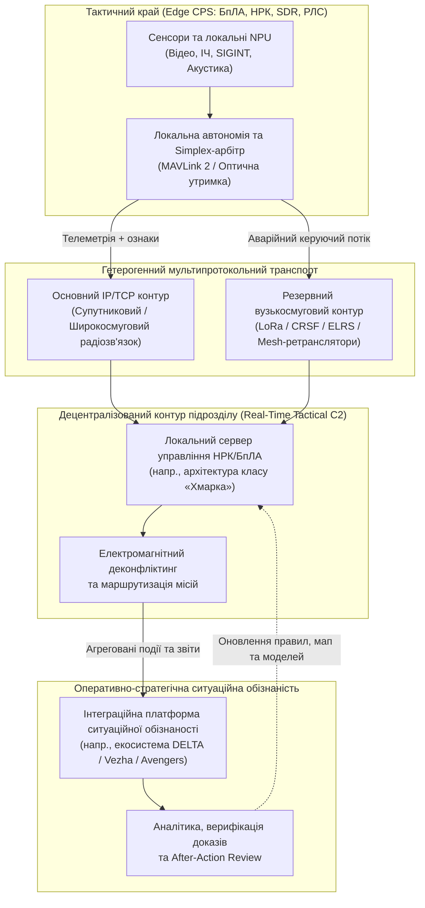
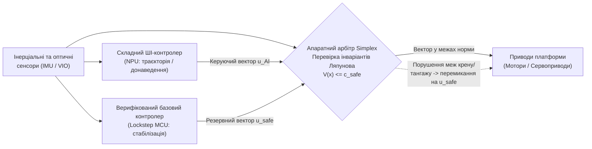

# Військова кібернетика в дії: C4ISTAR, моделювання та кіберфізичні системи

> **Тематичний напрям:** [Військова кібернетика та доказові системи управління](README.md) · Системне моделювання та C4ISTAR  
> **Пов'язані статті:** [Військова кібернетика: теорія керування та генезис](Ukrainian-Military-Cybernetics-UA.md) · [Українська школа військової кібернетики](Ukrainian-Military-Cybernetics-School-UA.md) · [АСУ озброєнням та керована зброя](Military-Cybernetics-Weapons-Control-Systems-UA.md)  
> **Автор:** [Микола Федчик (Mykola Fedchyk)](../Expert_Systems_Architecture/about-the-author.md) · [LinkedIn](https://www.linkedin.com/in/nickfedchik/)

Ця стаття фокусується на прикладному вимірі сучасної військової кібернетики: як теорія зворотного зв'язку та спадщина інженерних шкіл АСУ проявляються в операційному середовищі на перетині систем C4ISTAR, математичного моделювання бойової стійкості та вбудованих кіберфізичних платформ.

Тут важливо одразу провести етичну й безпекову межу. Відкрита науково-інженерна праця не є посібником із планування бойових дій, наведення, ураження, застосування РЕБ, перехоплення повідомлень, розміщення засобів або локальних тактик. Але вона може й повинна аналізувати **архітектуру управління**: які дані збираються, як вони верифікуються, як математично моделюється невизначеність, як підтримується людське рішення і як система навчається після події.

Матеріал спирається на практичний інженерний досвід автора. Моделювання, телекомунікації, інформаційна безпека, SIGINT, захищені Linux-платформи, мережеві засоби захисту, вбудовані системи реального часу й управління інженерними програмами розглядаються тут не як абстрактний каталог технологій, а як взаємопов'язані контури єдиної кібернетичної системи. Саме тому акцент зроблено не на гучних маркетингових назвах, а на керованості, верифікації доказів, детермінованих межах автоматизації та відповідальності командира.

Військова кібернетика в дії — це не «автоматизована війна». Це інженерна дисципліна, яка дозволяє зберегти керованість у середовищі, де діють тисячі гетерогенних сенсорів, динамічно деградують канали зв'язку, змінюються ролі підрозділів, зростає ентропія завад і залишається критично мало часу на виправлення помилки.

---

## 1. Моделювання як безпечна інженерна дисципліна та диференціальна динаміка бою

Фраза «моделювання бойових дій» у відкритій літературі потребує чіткої інженерної декомпозиції. Замість опису закритих тактичних методик сучасна військова кібернетика розглядає моделювання на трьох фундаментальних рівнях: фізико-інженерному, системно-інформаційному та макродинамічному.

### 1.1. Фізичне та інженерне моделювання (CAE, FEA, CFD)

На рівні самої платформи (БпЛА, НРК, радіолокаційного модуля чи мобільного вузла зв'язку) кібернетичний контур управління неможливий без фізичної стабільності носія:

1. **Модальний та віброакустичний аналіз (FEA):** розрахунок власних частот коливань рами та підвісів для захисту мікроелектромеханічних інерціальних сенсорів (MEMS IMU) від високочастотних вібрацій двигунів. Якщо резонансна частота конструкції збігається зі смугою пропускання гіроскопа чи акселерометра, виникає аліасинг і накопичення похибки інтегрування ще до будь-якого впливу ворожого РЕБ.
2. **Термодинамічний аналіз (CFD / CHT):** моделювання конвективного та кондуктивного тепловідведення в герметичних корпусах бортових обчислювачів і NPU-прискорювачів (класу Jetson Orin або Hailo-8). Перегрів кристала понад критичний поріг викликає примусовий тепловий тротлінг (зниження тактової частоти), що стрибкоподібно збільшує латентність контуру комп'ютерного зору $\tau_{\text{vision}}$ і може призвести до втрати динамічної стійкості платформи.

### 1.2. Макродинаміка протиборства: модифіковані рівняння Ланчестера з інформаційним мультиплікатором

На системному рівні класичні моделі виснаження сил (квадратичний і лінійний закони Ф. Ланчестера) у війні XXI століття втрачають адекватність без урахування **інформаційної переваги (C4ISTAR)** та асиметрії змішаних хвиль засобів ураження і перехоплення. У сучасній постановці темп зменшення боєздатних одиниць сторін $x(t)$ та $y(t)$ залежить не лише від вогневої продуктивності $\alpha, \beta$, а й від якості ситуаційної обізнаності $I_x(t), I_y(t) \in [0, 1]$ та затримки в контурі управління $\tau$:

$$
\begin{cases}
\dfrac{dx(t)}{dt} = -\beta \cdot I_y(t - \tau_y) \cdot P_{\text{EW}}^{(x \to y)}(t) \cdot y(t) - \gamma_x x(t), \\[6pt]
\dfrac{dy(t)}{dt} = -\alpha \cdot I_x(t - \tau_x) \cdot P_{\text{EW}}^{(y \to x)}(t) \cdot x(t) - \gamma_y y(t)
\end{cases}
$$

де:
- $I_x(t - \tau_x)$ — інформаційний мультиплікатор розвідки та цілевказання сторони $X$, що експоненційно спадає зі зростанням затримки контуру «сенсор — стрілець» ($I_x \propto e^{-\lambda \tau_x}$);
- $P_{\text{EW}}^{(y \to x)}(t) \in (0, 1]$ — коефіцієнт деградації каналів управління та наведення під дією засобів радіоелектронної боротьби противника;
- $\gamma_x, \gamma_y$ — коефіцієнти операційного виснаження (логістичні втрати, технічні відмови, вичерпання енергоресурсу або боєкомплекту).

З цієї системи рівнянь випливає фундаментальний кібернетичний висновок, багаторазово підтверджений досвідом Сил оборони України: **скорочення латентності контуру управління $\tau_x$ та підвищення вірогідності розвідданих $I_x$ компенсує кількісну перевагу противника у вогневих засобах $y(t)$ ефективніше, ніж лінійне нарощування чисельності платформ**.

### 1.3. Стохастичні мережі Петрі для оцінки стійкості контуру управління

Для перевірки поведінки розподіленої системи управління в умовах деградації зв'язку та інформаційних конфліктів застосовуються **стохастичні мережі Петрі (Stochastic Petri Nets, SPN)**:

$$
\mathcal{N}_{\text{SPN}} = (P, T, F, W, M_0, \Lambda)
$$

де $P$ — множина позицій (станів даних і вузлів: *«Сигнал виявлено»*, *«Джерело верифіковано»*, *«Конфлікт координат»*, *«Очікування підтвердження людини»*), $T$ — множина переходів (подій обробки, передачі або втрати пакета за часом тайм-ауту), $F \subseteq (P \times T) \cup (T \times P)$ — відношення інцидентності, $M_0$ — початкова розмітка, а $\Lambda = \{\lambda_1, \dots, \lambda_{|T|}\}$ — вектор інтенсивностей пуассонівських потоків спрацювання переходів.

На такому формальному графі безпечно й строго перевіряються критичні інженерні питання:
- що станеться з управлінням, якщо зникне основний канал зв'язку і система перейде на низькошвидкісний резервний радіоканал;
- як система відобразить колізію між двома суперечливими повідомленнями від різних сенсорів;
- чи не перевищить вік інформації (Age of Information, AoI) критичний горизонт застарівання до моменту ухвалення рішення;
- чи зможе локальний вузол підрозділу продовжити автономну роботу при втраті зв'язку з центральним сервером.

Показовий приклад безпечної абстрактної постановки — моделювання роботи розрахунків ППО при відбитті комбінованих хвиль повітряних цілей (ударних БпЛА, крилатих і балістичних ракет). Не розкриваючи реальних характеристик озброєння чи позиційних районів, стохастична модель перевіряє інформаційну пропускну здатність пункту управління: чи бачить командир різницю між підтвердженою трасою та гіпотезою, чи не створюють суміжні засоби взаємних завад і чи гарантовано спрацьовує блокування при потребі людського санкціонування.

---

## 2. РЕР, РЕБ, SIGINT та якість радіоелектронної обізнаності

У сучасній війні радіоелектронне середовище є не фоном, а повноцінним простором маневру. Моделювання радіоелектронної розвідки (РЕР / SIGINT) та радіоелектронної боротьби (РЕБ) у відкритій кібернетичній рамці описує не способи перехоплення чи подавлення, а **динаміку спостережуваності та побічних ефектів у власному контурі управління**.

### 2.1. Від сигналу до доказового факту на передньому краї

Сучасні засоби SIGINT трансформувалися з громіздких стаціонарних комплексів у компактні, програмно-визначені (SDR), мережеві вузли переднього краю. Проте з погляду кібернетики **сирий радіосигнал ще не є знанням**. Кожне спостереження характеризується кортежем метаданих:

$$
e_{\text{RF}} = \langle t_{\text{obs}}, \hat{\theta}, \Sigma_{\theta}, \text{SNR}, s_{\text{src}}, c_{\text{trust}}, \tau_{\text{TTL}} \rangle
$$

де $t_{\text{obs}}$ — синхронізована часова мітка, $\hat{\theta}$ — оцінка пеленга або координат із коваріаційною матрицею похибки $\Sigma_{\theta}$, $\text{SNR}$ — відношення сигнал/шум, $s_{\text{src}}$ — криптографічний ідентифікатор сенсора, $c_{\text{trust}} \in [0, 1]$ — апріорна довіра до джерела, а $\tau_{\text{TTL}}$ — час життя (актуальності) спостереження.

Синтетична геометрія в моделі дозволяє перевіряти чутливість мережі РЕР: як зміниться еліпс невизначеності локації при виході з ладу одного з пеленгаторів, чи не покладається штаб на єдине непідтверджене джерело, і як пояснити оператору, чому одна гіпотеза про радіоактивність має вищу достовірність за іншу.

### 2.2. Електромагнітна сумісність і зворотний вплив РЕБ

Для кібернетичної системи управління критично важливо розглядати РЕБ не ізольовано, а через матрицю взаємного впливу на власні засоби зв'язку, навігації, БпЛА, НРК та радари ППО. Будь-яка постановка завад змінює електромагнітний ландшафт для обох сторін.

Саме тому, як показує сучасна практика протидії високошвидкісним і балістичним цілям (де інерціальна навігація комбінується з завадостійкими CRPA-антенами супутникової корекції та активними радіолокаційними головками самонаведення на фінальній ділянці траєкторії), багаторівнева система РЕБ не «вимикає» фізичні гіроскопи ракети, але позбавляє її зовнішньої супутникової корекції та створює хибну радіолокаційну картину у вузькому часовому вікні роботи ГСН, змушуючи інерціальну систему накопичувати квадратичний дрейф похибки $\Delta x(t) \propto \frac{1}{2} b_a t^2$. Водночас інформаційна система штабу має в реальному часі оцінювати, які власні безпілотні платформи перебувають у секторі дії дружніх засобів РЕБ, і завчасно переводити їх у режим автономної інерціально-оптичної навігації.

---

## 3. C4ISTAR як архітектура бойового управління: централізація проти децентралізації

Концепція **C4ISTAR** (Command, Control, Communications, Computers, Intelligence, Surveillance, Target Acquisition, and Reconnaissance) у безпечному інженерному сенсі означає спосіб побудови безшовного інформаційного контуру між сенсорами, штабами, вогневими засобами, безпілотними платформами та контуром післядієвого аналізу (After-Action Review).

### 3.1. Практичний досвід України: «DELTA / Вежа» та децентралізовані тактичні ОС класу «Хмарка»

Реальний досвід українського Defense Tech наочно продемонстрував, чому C4ISTAR не може будуватися як єдиний монолітний сервер на всі рівні війни. На оперативному та міжвідомчому рівнях екосистема **DELTA** (разом із модулем потокового відеоаналізу **«Вежа»** та ШІ-платформою розпізнавання техніки **Avengers**) довела високу ефективність і сумісність зі стандартами НАТО (зокрема під час навчань REPMUS), забезпечуючи єдину картину поля бою для штабів.

Проте на рівні безпосереднього керування роями наземних роботизованих комплексів (НРК) та тактичних дронів централізована архітектура стикається з двома фундаментальними обмеженнями:
1. **Латентність керуючого контуру:** затримка відеопотоку в кілька секунд, цілком прийнятна для ситуаційної обізнаності штабу в «Вежі», є критичною для механіка-водія НРК, який дистанційно веде платформу в реальному часі через складний рельєф або мінні загородження.
2. **Ризик єдиної точки відмови (Single Point of Failure) та суверенітету даних підрозділу:** коли в підрозділі одночасно експлуатується понад 10–20 різнорідних платформ (таких як «Воля-Е», «Терміт», «Рател», «Тарган», DevDroid, Tencore або турелі «Шабля»), «зоопарк» несумісних пультів і закритих хмарних серверів виробників створює хаос і ризик витоку чутливої телеметрії.

Інженерною відповіддю українських розробників стала поява децентралізованих тактичних операційних систем управління в реальному часі (яскравий приклад — програмний комплекс **«Хмарка»**, створений ветеранами та інженерами для підрозділів НРК). Така архітектура реалізує ключові принципи військової кібернетики:
- **Відкритий стандартизований протокол:** використання розширеного протоколу `MAVLink 2` як єдиної мови спілкування між десятками типів наземних платформ і бойових модулів різних виробників.
- **Гібридна багатоканальність і фолбек (Fallback):** основний потік даних і відео передається через IP/TCP (зокрема через Starlink Mini або цифрові радіомодеми), але у випадку подавлення чи втрати супутникового каналу система безшовно перемикає керування на резервні низькорівневі радіопротоколи (`LoRa`, `CRSF`, `ELRS`) через повітряні ретранслятори на базі БпЛА, що дозволяє розширити радіус дії з 700–1000 м прямого радіозв'язку до 5–6+ км і більше.
- **Локальний суверенітет і RBAC:** кожен підрозділ розгортає власний захищений сервер під своїм фізичним і криптографічним контролем, де доступ операторів, штурманів і командирів розмежовується через рольову модель (RBAC) та цифрові сертифікати.
- **Уніфікація бортових і наземних інтерфейсів керування (`JARVIS`, `Droid Box`, `NC13`, `Tencore Ecosystem`):** паралельно з мережевим шаром українські інженери уніфікували саму бортову електроніку наземних роботів — Міноборони кодифікувало НАТО-сумісний бортовий комп'ютер **JARVIS** (`JRVS`), систему керування **Droid Box** (`DevDroid`), платформу планування місій **Burevii**, відкриту апаратну екосистему **Tencore Ecosystem** (із єдиним стандартом роз'ємів, акумуляторів і модуля автономності `AI KIT`, що зберігає понад $30\%$ парку НРК при обриві зв'язку) та фронтову уніфіковану систему керування підрозділу **NC13** (3-тя ОШБр), а у систему **DELTA** інтегровано механізм верифікованого планування й обліку логістичних та евакуаційних місій НРК, обсяг яких перевищив **31 000 виїздів на місяць** (понад **100 000 кумулятивних місій** за 2026 рік).

### 3.2. Кінематичні та інфраструктурні обмеження зовнішніх супутникових систем

Ще один критичний урок сучасної війни стосується небезпеки повної залежності контуру C4ISTAR від комерційних або зовнішніх супутникових сервісів. Практика застосування терміналів супутникового зв'язку на безпілотних платформах виявила жорсткі зовнішні обмеження:
- введення обмежень за швидкістю руху термінала (зокрема ліміт ~60–70 км/год для комерційних терміналів Starlink та обмеження у 100–160 км/год у захищених контурах Starshield) робить неможливим використання такого каналу як єдиного засобу управління для крилатих БпЛА середнього і глибокого радіуса дії (Middle/Deep Strike), чия швидкість звалювання становить близько 60 км/год, а крейсерська швидкість сягає 180–200+ км/год, а також для високошвидкісних дронів-перехоплювачів;
- ризик раптових географічних або політико-адміністративних обмежень доступу з боку оператора супутникового угруповання.

З погляду військової кібернетики це означає, що жоден зовнішній канал зв'язку не може розглядатися як гарантована константа. Стійка архітектура вимагає розвитку суверенних вітчизняних засобів цифрового радіозв'язку, псевдовипадкового перелаштування робочої частоти (ППРЧ / FHSS) та перенесення критичної логіки виконання місії безпосередньо на борт платформи.

---

## 4. Вбудовані кіберфізичні системи, AI-акселератори та бортова безпека

Окрема вісь розвитку сучасної військової кібернетики — перехід від «тонких» телекерованих платформ до вбудованих кіберфізичних систем (Embedded Cyber-Physical Systems), де обчислення виконуються безпосередньо біля сенсорів і приводів.

1. **Локальне візуальне виявлення та термінальне супроводження на базі AI-акселераторів:** інтеграція енергоефективних бортових обчислювачів і NPU (наприклад, модулів автономності класу `Aura AI` на одноплатних комп'ютерах або спеціалізованих чипів комп'ютерного зору) дозволяє передавати в канал управління не лише «сирий» відеопотік, а й структуровані ознаки: координати об'єкта в кадрі, вектор оптичного потоку, рівень упевненості класифікатора та статус захвату цілі. Це також відкриває можливість для нових тактичних класів платформ — наприклад, автономних засідкових дронів («Почекун»), здатних перебувати в режимі очікування 12–24 години у повній радіотиші без випромінювання в ефір і без залежності від Starlink, активуючись лише при появі валідної сигнатури цілі. Водночас на рівні всього ринку впровадження бортової автономності обмежується економікою масової війни: оскільки машинний зір і бортовий обчислювач здорожчують базову платформу на 25–40%, частка повністю автономних систем наразі становить близько 5–10% від загального багатомільйонного випуску дронів, концентруючись там, де без автономності задачу виконати фізично неможливо (подолання щільного РЕБ на останньому кілометрі або тривала засідка).
2. **Багатоспектральний синтез сигнатур (Multi-Spectral Sensor Fusion):** поєднання оптичних, тепловізійних (ІЧ), радіоелектронних, акустичних та хіміко-спектральних ознак у спільну імовірнісну модель події. Наприклад, у задачах гуманітарного та бойового розмінування, де класичні металодетектори та магнітометри безсилі проти мін у пластикових корпусах, українські інженери впроваджують надчутливі флуоресцентно-спектральні сенсори виявлення парів вибухових речовин з повітря (класу `Dream Sensor`), поєднуючи їх із тепловізійним та візуальним картуванням.
3. **Автономна навігація в умовах пригнічення ГНСС (GNSS-Denied Navigation):** із розширенням сучасної фронтової «кіл-зони» до 20–25 км в обидва боки від лінії бойового зіткнення супутникова навігація перестала бути надійною опорою. Українські тактичні розвідувальні БпЛА нового покоління (наприклад, `Slavic` та інші розробки, випробувані за координування кластера Brave1 як вітчизняна заміна комерційним китайським квадрокоптерам) інтегрують бортові модулі оптичного позиціонування (такі як `StabX`), що дозволяють утримувати позицію на висотах до 1000 м протягом 30 хвилин за повної відсутності сигналу GPS, спираючись виключно на візуально-інерціальну одометрію та оптичну прив'язку до підстилаючої поверхні.
4. **Апаратний корінь довіри (Hardware Root of Trust) та флотна атестація:** бортовий прискорювач і польотний контролер є кінцевою точкою ланцюга безпеки. Якщо прошивку або ваги нейромережі скомпрометовано — під час обслуговування або через атаку на сервер оновлень виробника — платформа стає некерованою або небезпечною для власних сил. Криптографічний елемент безпеки (TPM / Secure Element) верифікує цифровий підпис завантажувача (Secure Boot) та конфігурації перед запуском двигунів, а централізована флотна атестація блокує залучення скомпрометованих одиниць до місії.
5. **Архітектура безпеки Simplex для польотних і ходових контролерів:** коли в контур керування інтегрується складний або експериментальний нейромережевий регулятор (Complex Controller), завжди зберігається ризик виходу за межі безпечної експлуатаційної оболонки (Flight Envelope). Архітектурний патерн **Simplex** ізолює складний модуль за допомогою детермінованого апаратного арбітра (Decision Logic на базі Lockstep MCU STM32 / Infineon AURIX під управлінням RTOS Zephyr або на базі FPGA), який паралельно обчислює формально верифікований базовий закон стабілізації (Safety Baseline Controller):

Якщо вихідний вектор нейромережі $\mathbf{u}_{\text{AI}}$ веде до порушення функції Ляпунова $V(\mathbf{x}) \le c_{\text{safe}}$ (перевищення граничних кутів крену/тангажу чи небезпечного просторового дрейфу), апаратний арбітр за мікросекунди перемикає керування на резервний детермінований вектор $\mathbf{u}_{\text{safe}}$, гарантуючи збереження керованості або перехід у режим безпечного повернення.

---

## 5. Дрон як кібернетична бойова одиниця та еволюція до групового управління

У термінах військової кібернетики безпілотний апарат (повітряний, наземний чи морський безекіпажний катер) є замкненим кіберфізичним контуром, який одночасно виступає:
1. **розподіленим сенсором** (формує потік вимірювань про зовнішнє середовище);
2. **виконавчим механізмом** (здійснює фізичний маневр, логістичну доставку, евакуацію чи інженерну дію);
3. **джерелом інтроспективної телеметрії** (постійно оцінює власний енергетичний залишок, цілісність каналу зв'язку, похибку навігації, тепловий режим та справність приводів).

Сьогодні на фронті відбувається фундаментальний кібернетичний перехід від парадигми **«один пілот — один дрон»** (ручне телеоператорне пілотування, де людина безпосередньо замикає внутрішній контур стабілізації) до парадигми **групового супервізорного управління («один пілот — п'ять і більше дронів»)**, яка вже пройшла випробування і впроваджується у бойових підрозділах за координування Brave1 та українських розробників ройових систем. У такій архітектурі внутрішні контури стабілізації, утримання строю, обходу перешкод і розподілу секторів спостереження виконуються бортовою автоматикою, тоді як за людиною залишається зовнішній контур — постановка цільового завдання, контроль меж безпеки та відповідальне санкціонування дій.

---

## 6. Оперативні системи підтримки бойових рішень та проблема викривлення зворотного зв'язку

Система підтримки прийняття бойових рішень (Decision Support System, DSS) не повинна підміняти командира автоматичним генератором наказів. Її призначення — зменшити інформаційну ентропію, зробити видимими приховані залежності й надати людині верифіковані альтернативи.

### 6.1. Одинадцять інваріантних питань доказової системи управління

Якісна кібернетична система підтримки рішень у штабі повинна в будь-який момент часу давати формалізовану відповідь на одинадцять контрольних питань:
1. **Що ми знаємо як підтверджений факт?**
2. **З яких первинних джерел отримано ці дані?**
3. **Який вік інформації (AoI) і чи не вийшла вона за межі вікна актуальності?**
4. **Які джерела конфліктують між собою і в чому полягає розбіжність?**
5. **Які детерміновані правила сумісності та безпеки спрацювали?**
6. **Які директивні, ресурсні або правові обмеження (RoE) діють у цьому секторі?**
7. **Яких критичних даних бракує для зниження ризику?**
8. **Які альтернативні варіанти дій прораховані моделлю?**
9. **Які залишкові ризики (зокрема для власних сил і цивільної інфраструктури) залишаються незнятими?**
10. **Хто за посадовою роллю має повноваження підтвердити це рішення?**
11. **Яким чином результат виконання рішення буде верифікований у післядієвому аналізі?**

Інтелектуальний шар правил і графів знань (детальна архітектура якого розглядається у статтях [«Експертні системи військового призначення»](Military-Expert-Systems-UA.md) та [«Експертні системи для БАС, ППО, РЕР та РЕБ»](Military-Expert-Systems-UAS-AD-ELINT-EW-UA.md), а загальнотеоретичний фундамент — у монографії автора [«Архітектура доказових експертних систем»](../Expert_Systems_Architecture/README.md)) виконує тут функцію **операційної пам'яті системи управління**, що унеможливлює втрату контексту під час ротації змін у штабі.

### 6.2. Систематична похибка виживання у фронтовому зворотному зв'язку (Feedback Bias)

Важливий практичний інсайт українського оборонного сектору (на якому наголошують інженери провідних виробників БпЛА, зокрема компанії «Генерал Черешня») стосується якості зворотного зв'язку з передової. У кібернетиці вважається аксіомою, що зворотний зв'язок коригує систему. Проте в реальних бойових умовах прямий неструктурований фідбек від екіпажів зазнає **статистичного зміщення вибірки (Survivorship & Reporting Bias)**:
- зворотний зв'язок найчастіше надають ті підрозділи, які мають відносно стабільний зв'язок, час на комунікацію з розробником та інженерну культуру фіксації логів;
- водночас екіпажі, які перебувають у найважчих умовах інтенсивного бою та тотального подавлення РЕБ, часто фізично не мають можливості заповнити детальний звіт після втрати виробу.

Якщо R&D-команда покладається виключно на суб'єктивні повідомлення в месенджерах без автоматизованого збору криптографічно підписаної бортової телеметрії та без систематичних полігонних стрес-тестів у контрольованих умовах завад, контур вдосконалення продукту деформується. Тому замкнений кібернетичний цикл розробки вимагає поєднання трьох джерел: автоматичних логів місій, структурованого післядієвого розбору (AAR) та інструментальної верифікації на випробувальних полігонах.

---

## 7. Ризики розвитку прикладної військової кібернетики

Підсумовуючи аналіз прикладних систем, можна виділити п'ять системних ризиків, які супроводжують цифровізацію поля бою:

1. **Автоматизація без суб'єкта відповідальності:** розмивання межі між статистичною гіпотезою алгоритму, правилом бази знань та вольовим рішенням командира.
2. **Крихкість централізованих та моноканальних архітектур:** система, яка втрачає працездатність при відключенні зовнішнього супутникового термінала або центрального хмарного сервера, є вразливою за проєктуванням.
3. **Ілюзія безпомилковості комп'ютерного зору:** локальна нейромережа на борту дрона може деградувати через зміну пори року, задимлення, теплові пастки або зміщення розподілу даних (Out-of-Distribution), тому кожне розпізнавання мусить обмежуватися порогами довіри та апаратним Simplex-контролем.
4. **Протокольна фрагментація («зоопарк систем»):** відсутність єдиних відкритих стандартів телеметрії та обміну подіями перетворює набір навіть дуже якісних виробів на некеровану множину ізольованих інструментів.
5. **Розірваний контур післядієвого навчання:** якщо бойовий інцидент чи виявлена зміна частот противника не трансформуються у верифіковане оновлення правил, прошивок і тактичних нормативів, кібернетичний цикл залишається незамкненим.

---

## Підсумок

Військова кібернетика в дії — це не заміна командира алгоритмом, а інженерна спроможність будувати систему управління, яка усвідомлює якість власних даних, фізичні та кінематичні обмеження платформ, побічні ризики власних дій та міру поточної невизначеності.

Математичне моделювання, архітектура C4ISTAR, засоби SIGINT/РЕР, комплекси РЕБ, повітряні, наземні й морські безпілотні платформи та вбудовані AI-акселератори дають синергетичний ефект лише тоді, коли вони об'єднані в цілісну, децентралізовано-стійку архітектуру. Для України розбудова такої архітектури є не абстрактною науковою задачею, а практичним фундаментом оборонної стійкості — здатністю швидше за противника перетворювати шум поля бою на перевірене знання, відповідальне рішення і збережені життя.

---

## Посилання

- [Війська зв'язку та кібербезпеки Збройних Сил України — Міністерство оборони України](https://mod.gov.ua/pro-nas/vijska-zv-yazku-ta-kiberbezpeki)
- [Військовий інститут телекомунікацій та інформатизації імені Героїв Крут (ВІТІ) — Вікіпедія](https://uk.wikipedia.org/wiki/%D0%92%D1%96%D0%B9%D1%81%D1%8C%D0%BA%D0%BE%D0%B2%D0%B8%D0%B9_%D1%96%D0%BD%D1%81%D1%82%D0%B8%D1%82%D1%83%D1%82_%D1%82%D0%B5%D0%BB%D0%B5%D0%BA%D0%BE%D0%BC%D1%83%D0%BD%D1%96%D0%BA%D0%B0%D1%86%D1%96%D0%B9_%D1%82%D0%B0_%D1%96%D0%BD%D1%84%D0%BE%D1%80%D0%BC%D0%B0%D1%82%D0%B8%D0%B7%D0%B0%D1%86%D1%96%D1%97_%D1%96%D0%BC%D0%B5%D0%BD%D1%96_%D0%93%D0%B5%D1%80%D0%BE%D1%97%D0%B2_%D0%9A%D1%80%D1%83%D1%82)
- [Brave1 — Кластер розвитку оборонних технологій в Україні](https://brave1.gov.ua/)
- [Як «Хмарка» об'єднує 17 типів НРК у єдину систему управління — DOU DefTech](https://dou.ua/lenta/interviews/hmarka-for-unmanned-ground-vehicle/)
- [Starlink та Starshield на війні: обмеження швидкості, ризики відключення та пошук суверенних альтернатив — DOU DefTech](https://dou.ua/lenta/articles/starlink-starshield-was-disconnected/)
- [Як зробити тактичний розвідник Slavic: виклики збільшення кіл-зони до 25 км та оптична навігація без GPS — DOU DefTech](https://dou.ua/forums/topic/62815/)
- [Виклики масштабування виробництва дронів та вимоги до програмного забезпечення у війні — блог Олександра Білоусова («Генерал Черешня»), DOU DefTech](https://dou.ua/forums/topic/63010/)
- [Як DOD Solution розробляє системи автономності Aura AI та засідкові дрони «Почекун» — AIN Defense Tech](https://ain.ua/2026/11/13/iak-dod-solution-rozrobliaje-sistemi-avtonomnosti-dlia-droniv-planuje-narostiti-vitorg-do-10-mln-i-shho-moze-zagalmuvati-zrostannia-kompaniyi-interviu-z-ceo-romanom-gapacilom/)
- [Що означає багаторівнева система РЕБ проти «Іскандерів»: асиметричні рішення протидії балістиці — AIN Defense Tech](https://ain.ua/2026/11/16/shho-oznacaje-bagatorivneva-sistema-reb-proti-iskanderiv-u-minoboroni-zaiavili-pro-asimetricni-risennia-protidiyi-balistici/)
- [Мілітарний — Український мілітарний портал (аналітика та новини оборонних технологій)](https://militarnyi.com/uk/)

---

**Пов'язані публікації:** [Українська школа військової кібернетики](Ukrainian-Military-Cybernetics-School-UA.md) · [АСУ озброєнням та керована зброя](Military-Cybernetics-Weapons-Control-Systems-UA.md) · [Експертні системи військового призначення](Military-Expert-Systems-UA.md) · [Усі статті напряму «Військова кібернетика»](README.md)
