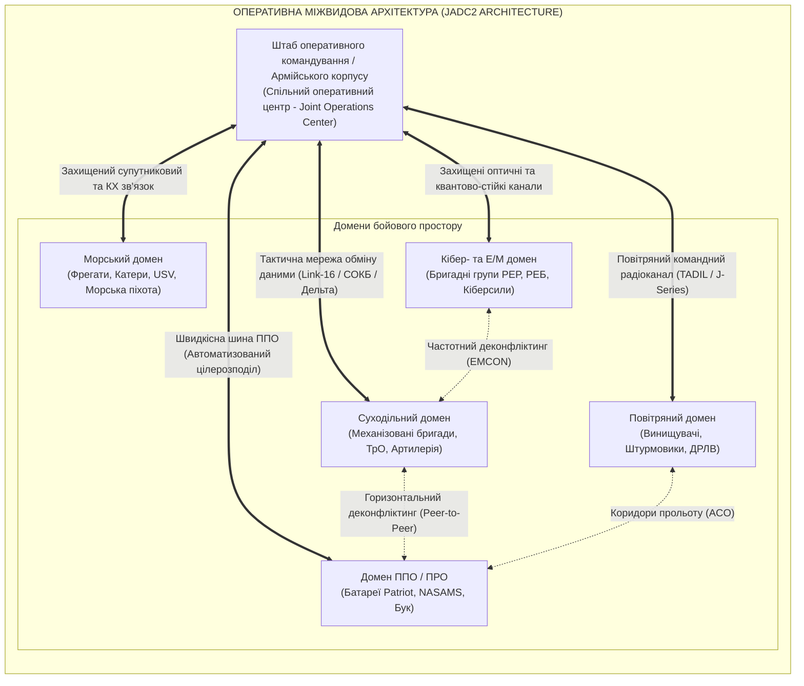
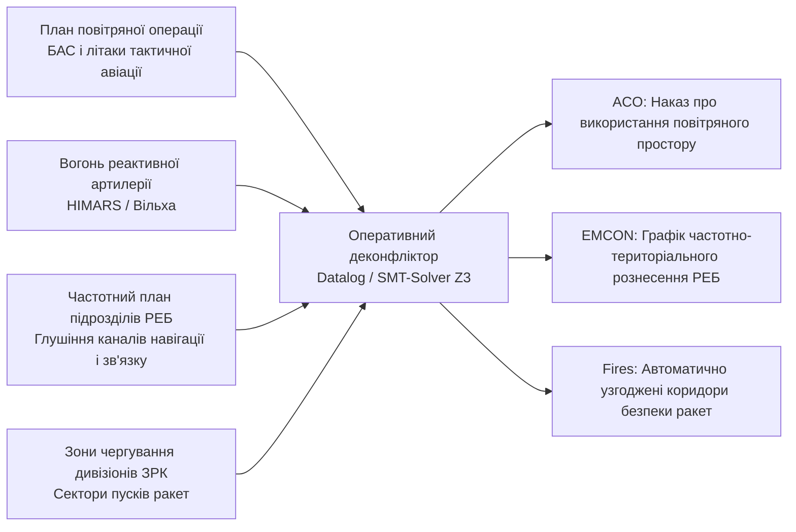
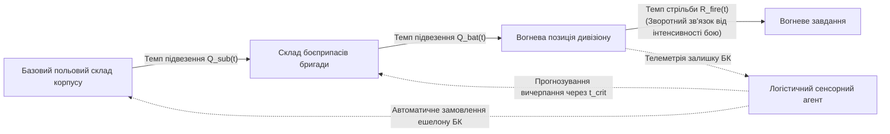

# Військова кібернетика оперативного рівня: міжвидова координація бригад, корпусів та JADC2

> **Тематичний напрям:** [Військова кібернетика та доказові системи управління](README.md) · Ієрархія бойового управління: Оперативна ланка  
> **Пов'язані статті:** [Військова кібернетика тактичного рівня](Military-Cybernetics-Tactical-Level-UA.md) · [Військова кібернетика стратегічного рівня](Military-Cybernetics-Strategic-Level-UA.md) · [Експертні системи для БАС, ППО, РЕР та РЕБ](Military-Expert-Systems-UAS-AD-ELINT-EW-UA.md)  
> **Автор:** [Микола Федчик (Mykola Fedchyk)](../Expert_Systems_Architecture/about-the-author.md) · [LinkedIn](https://www.linkedin.com/in/nickfedchik/)

---

## 1. Оперативний масштаб: координація простору, часу та різнорідних сил

Оперативний рівень ведення війни (оперативні командування, армійські корпуси, угруповання об'єднаних сил) є мостом між тактичними сутичками окремих батальйонів і стратегічними цілями всієї кампанії.

Головний кібернетичний виклик оперативного рівня — подолати **відомчу та фізичну фрагментованість різнорідних компонентів збройних сил**:

1. **Сухопутні війська (механізовані та артилерійські бригади):** оперують у двовимірному координатному просторі з високою щільністю перешкод, прив'язані до ліній постачання та складок рельєфу.
2. **Повітряні сили (тактична авіація, важкі розвідувальні БАС):** діють у тривимірному просторі з надвисокими швидкостями (800–2000 км/год) та вимагають випереджального очищення коридорів польоту від власної та ворожої ППО.
3. **Війська протиповітряної оборони (ЗРК різної дальності):** здійснюють цілодобовий моніторинг радіолокаційного поля та мають надкороткий час реакції на балістичні й крилаті загрози.
4. **Військово-морські сили (надводні та підводні сили):** діють у морських акваторіях, забезпечуючи блокаду узбережжя, десантні та протикорабельні операції.
5. **Сили безпілотних систем і РЕБ:** формують активне електромагнітне поле та дистанційні ройові бар'єри.

Без надійної кібернетичної взаємодії координація перетворюється на хаос: засоби РЕБ суміжної бригади придушують дрони сусідів, зенітні комплекси збивають дружні літаки, а артилерійські удари завдаються по позиціях, що вже зайняті дружньою піхотою.

---

## 2. Математичні моделі оперативного протиборства

### Модифіковані рівняння Ланчестера для гетерогенних сил з інформаційним множником

Класична квадратична модель Ланчестера описує бойове зіткнення однорідних сил. На оперативному рівні кібернетична перевага полягає у збільшенні вогневої ефективності за рахунок швидкості передачі даних.

Нехай $`x(t) \in \mathbb{R}^n`$ та $`y(t) \in \mathbb{R}^m`$ — вектори чисельності різнорідних бойових платформ дружніх та ворожих сил відповідно (танки, артилерія, ППО, дрони). Динаміка втрат описується системою матричних диференціальних рівнянь:

$$
\begin{cases}
\dfrac{d\mathbf{x}}{dt} = - \mathbf{A}(I _ y) \, \mathbf{y}(t) - \mathbf{D} _ x \, \mathbf{x}(t) \\[8pt]
\dfrac{d\mathbf{y}}{dt} = - \mathbf{B}(I _ x) \, \mathbf{x}(t) - \mathbf{D} _ y \, \mathbf{y}(t)
\end{cases}
$$

де:

- $`\mathbf{B}(I_x)`$ — матриця оперативно-тактичної ефективності дружніх сил, що є нелінійною функцією **рівня інформаційної обізнаності** $`I_x \in [0, 1]`$;
- $`\mathbf{A}(I_y)`$ — матриця бойової ефективності противника;
- $`\mathbf{D} _ x, \mathbf{D} _ y`$ — матриці небойових та експлуатаційних втрат (відмови техніки, логістичні зриви).

Рівень інформаційної обізнаності $`I_x`$ формалізується через повноту покриття розвідувальними сенсорами та затримку доведення розвідданих:

$$
I_x = \Big( 1 - e^{-\lambda_{\text{rec}} T_{\text{fresh}}} \Big) \cdot \Big( 1 - P_{\text{latency}}(\tau > \tau_{\text{crit}}) \Big)
$$

Якщо $`I_x \gg I_y`$, менше угруповання сил дружньої сторони перемагає чисельно переважаючого противника шляхом прецизійного вибивання критичних вузлів (штабів, складів, РЛС) за рахунок значно вищих значень коефіцієнтів матриці $`\mathbf{B}`$.

---

## 3. Оперативний деконфліктинг: простір, повітря та електромагнітний спектр

Управління вогнем та рухом на рівні корпусу потребує безперервного автоматизованого узгодження просторово-часових обмежень:

### 1. Деконфліктинг повітряного простору (Airspace Control Order, ACO)

Для уникнення ураження власної авіації засобами ППО та артилерійськими снарядами автоматизована система оперативного рівня синтезує динамічні захисні об'єми (Dynamic Geofenced Volumes, DGV):

- **Артилерійські конуси безпеки (Gun-Target Line Safety Corridor):** тривимірний просторовий коридор над траєкторією польоту снарядів, де тимчасово забороняється політ розвідувальних крил.
- **Тимчасові висотні ешелони (Air Corridors):** коридори швидкого повернення штурмової авіації з відключенням автоматичних пусків ЗРК у цьому вузькому просторовому вікні.

### 2. Електромагнітний деконфліктинг (EMCON — Emission Control)

Масоване придушення радіоканалів противника станціями РЕБ бригадного і корпусного підпорядкування («Буковель», «Нота») не повинно паралізувати радіолінії управління власних безпілотників чи супутникового зв'язку:

$$
\forall i \in \mathcal{F} _ {\text{radio}}, \; \forall j \in \mathcal{J} _ {\text{jam}} \implies |f _ i - f _ j| \ge \Delta f _ {\text{guard}} \quad \lor \quad \|\mathbf{r} _ i - \mathbf{r} _ j\| \ge R _ {\text{safe}}(P _ j)
$$

де $`\mathcal{F} _ {\text{radio}}`$ — множина радіоліній дружніх підрозділів, $`\mathcal{J} _ {\text{jam}}`$ — активні передавачі завад. Якщо умова порушується, символічний деконфліктор автоматично наказує передавачу завад зменшити сектор випромінювання або скоригувати сітку частот.

---

## 4. Логістична кібернетика оперативного рівня

Боєздатність армійського корпусу визначається не кількістю зброї в штаті, а **швидкістю відновлення ресурсів (боєприпаси, паливо, ремонтні комплекти, евакуація)**.

Кібернетика розглядає операційну логістику як динамічну мережу черг (Queuing Network) за принципами системної динаміки Джея Форрестера:

Рівень запасу боєприпасів $`S_k(t)`$ на позиції артилерійського дивізіону $`k`$ моделюється диференціальним рівнянням нерозривності:

$$
\frac{dS_k(t)}{dt} = Q_{\text{in}, k}(t - \tau_{\text{convoy}}) - R_{\text{fire}, k}(t)
$$

де $`Q_{\text{in}, k}`$ — темп надходження вантажів конвоями із запізненням транспортування $`\tau_{\text{convoy}}`$, а $`R_{\text{fire}, k}(t)`$ — стохастичний темп витрати боєприпасів під час відбиття ворожого наступу.

Кібернетична АСУ логістики в реальному часі розраховує оптимізаційну задачу динамічного перерозподілу автотранспорту за критерієм мінімізації ризику утворення «сухого залишку» ($`S_k(t) = 0`$) на найбільш загрозливих напрямках.

### Роботизація оперативно-тактичної логістики «останньої милі» та контр-НРК боротьба (емпіричні метрики DELTA 2025–2026)

Розширення глибини FPV-кіл-зони до $`15\text{–}25\text{ км}`$ зробило традиційний підвіз боєприпасів, продовольства та води звичайним колісним транспортом до передових позицій критично вразливим. Відповіддю Сил оборони України стало системне переведення логістики «останньої милі» та медичної евакуації на наземні роботизовані комплекси (НРК), інтегровані в контур планування та верифікації **DELTA**:

1. **Експоненційне масштабування верифікованих місій НРК у системі DELTA:** із запуском у грудні 2025 року в системі ситуаційної обізнаності `DELTA` автоматизованого обліку логістичних та евакуаційних місій НРК (із нарахуванням електронних балів **«єБали»**, які підрозділи обмінюють на нові НРК, дрони, РЕБ та комплектуючі через **Brave1 Market** і **DOT-Chain Defence**) місячний обсяг верифікованих виїздів наземних роботів зріс більш ніж учетверо:
   - **січень 2026 р.:** $`\sim 7\,500`$ місій на місяць;
   - **березень 2026 р.:** понад $`9\,000`$ місій;
   - **квітень 2026 р.:** понад $`10\,000`$ місій;
   - **червень 2026 р.:** понад $`16\,000`$ місій;
   - **липень 2026 р.:** понад $`23\,700`$ місій (подолано рубіж у **100 000 кумулятивних місій** від початку року);
   - **серпень 2026 р.:** $`25\,143`$ місії (понад **800 виїздів на добу**, кумулятивно $`\sim 112\,000`$ завдань);
   - **жовтень 2026 р.:** рекордні **31 398 логістичних та евакуаційних місій за місяць**.
2. **Питома вага в оперативному забезпеченні смуг оборони:** на окремих інтенсивних ділянках фронту (зокрема в районі Костянтинівки) наземні роботи забезпечують **до 70% усієї фронтової логістики** передових позицій. За рік наземні роботи Третього армійського корпусу здійснили понад **18 000 рейсів**, а під час однієї лише корпусної операції **«Вівальді»** батальйон НРК `NOVA` 3-ї ОШБр перевіз **понад 250 тонн вантажів**, подолавши понад **30 000 км** (що еквівалентно понад $`12\,000`$ піших виходів піхотинця з вантажем під вогнем); на Куп'янському напрямку підрозділ «Оріон» бригади ДПСУ «Помста» за один місяць 85 рейсами НРК доставив понад $`30\text{ тонн}`$ забезпечення.
3. **Ешелонування вантажопідйомності та рухомі польові СТО:** поряд із середніми логістичними платформами (`TerMIT`, `Рись PRO / Рись+`, `Тарган`, `Воля-Е`, `Ardal`, `Ratels`, `SPEXTR`, `Varkhan`, `Numo`, `Єрихон` на $`500\text{ кг}`$) в оперативну ланку введено важкі та надважкі роботизовані транспортери — **Mamont** (`Armolab`, вантажопідйомність до $`700\text{ кг}`$), **VATAG** (до **2 тонн** вантажу), безпілотні вантажівки **Zetros AI** для НГУ, переобладнані бронеавтомобілі **«Новатор»** і **M1117** (полк «Скеля»), універсальну систему телеоперування автомобілями **«Кабан»** та дистанційно керовані самоскиди Державної спеціальної служби транспорту (ДССТ) для зведення фортифікацій під обстрілами. Для підтримання коефіцієнта технічної готовності парку виробники та інженерні КБ (`Ratel`, `Tencore`, КБ `Locker`, майстерня `Vulyk` від `Tenebra`, КБ `Burevii`) розгорнули мережу **мобільних виїзних сервісних майстерень (польових СТО)** безпосередньо у смугах бригад.
4. **Системна контр-НРК боротьба та облік втрат роботів противника:** оскільки противник також намагається масштабувати логістичні та вогневі НРК («Кур'єр», «Странник V2», «Омич», «Челнок», «Депеша», «Титан»), Генеральний штаб ЗСУ офіційно запровадив оперативний облік знищених наземних роботів ворога. За верифікованими даними системи `DELTA`, лише за січень–вересень 2026 року українські підрозділи БпЛА уразили **понад 3000 російських НРК** ($`2851`$ за січень–серпень із піком у **511 знищених одиниць за серпень** та ще майже $`200`$ за першу половину вересня), включно з точковими ударами по цехах збирання ворожих НРК у тимчасово окупованому Донецьку.

---

## 5. Протоколи міжвидової інтеграції та злиття даних

На оперативному рівні неможливо замінити всі існуючі системи управління на єдину програму. Тому сучасна військова кібернетика спирається на **сервіс-орієнтовані шини обміну даними (Enterprise Service Bus) та семантичні онтології**:

- **Стандарти НАТО:** Link-16 (STANAG 5516 / Tactical Data Information Link J), NVG (NATO Vector Graphics), MIP (Multilateral Interoperability Programme).
- **Вітчизняні інтеграційні платформи та тренувальні середовища:** національна інтеграційна система ситуаційної обізнаності **DELTA** (разом із системою управління відеопотоками **«Вежа»** та платформою автоматичного ШІ-розпізнавання техніки **Avengers**), що агрегує шари просторових даних від супутників, БАС, засобів РЕР, акустичних мереж, камер спостереження та підрозділів у реальному часі, а також захищене середовище **Brave1 Dataroom**, де на верифікованих бойових масивах візуальних і тепловізійних сигнатур тренуються алгоритми перехоплення повітряних цілей без ризику витоку чутливих даних за межі суверенного контуру.
- **Міжрівневий міст із децентралізованими тактичними системами:** поєднання оперативної картини штабу бригади/корпусу з автономними польовими контурами керування роями БпЛА та наземними роботизованими комплексами (зокрема системами класу «Хмарка»), які зберігають керованість на рівні батальйону навіть при повному відключенні зовнішніх каналів зв'язку.

---

## 6. Висновки

1. Оперативний рівень військової кібернетики вирішує задачу міжвидової інтеграції різнорідних родів військ (Суходіл, Повітря, ППО, Флот, РЕБ) в єдиний синхронізований бойовий механізм (JADC2).
2. Математичне моделювання на базі розширених матричних рівнянь Ланчестера підтверджує, що скорочення часу доведення розвідданих багаторазово підвищує бойову міць угруповання навіть за меншої кількості техніки.
3. Автоматизований просторово-часовий і частотний деконфліктинг (ACO та EMCON) на основі алгоритмів задоволення обмежень унеможливлює дружній вогонь і взаємне радіоелектронне придушення.
4. Логістична кібернетика як замкнена система керування ланцюгами постачання гарантує безперервність бойових операцій шляхом випереджального забезпечення критичними ресурсами.

---

## Посилання

- [Alberts, D. S., Garstka, J. J., & Stein, F. P. (1999). Network Centric Warfare: Developing and Leveraging Information Superiority. CCRP](https://www.dodccrp.org/files/Alberts_NCW.pdf)
- [Forrester, J. W. (1961). Industrial Dynamics. MIT Press](https://mitpress.mit.edu/9781614275251/industrial-dynamics/)
- [NATO Standardization Office. (2018). STANAG 5516: Tactical Data Exchange - Link 16](https://nso.nato.int/)
- [Як працюють DELTA, Avengers та Brave1 Dataroom у порівнянні з західними платформами — AIN Defense Tech](https://ain.ua/2026/11/16/viiskovii-si-vid-iakogo-vidmovilasia-sveicariia-i-z-iakim-praciuje-ukrayina-comu-jevropa-sukaje-alternativu-palantir-i-ci-zmoze-zaminiti/)
- [Статистика місій НРК у системі DELTA (від 7500 до 31 398 місій/місяць, >100 000 місій за рік та >3000 знищених НРК РФ) — Дайджести НРК #15, #18, #47, #49, #50, #57, DOU DefTech](https://dou.ua/forums/tags/%D0%B4%D0%B0%D0%B9%D0%B4%D0%B6%D0%B5%D1%81%D1%82%20%D0%9D%D0%A0%D0%9A/)
- [Центр інновацій та розвитку оборонних технологій Міністерства оборони України](https://mod.gov.ua/)

---

**Пов'язані публікації:** [Військова кібернетика тактичного рівня](Military-Cybernetics-Tactical-Level-UA.md) · [Військова кібернетика стратегічного рівня](Military-Cybernetics-Strategic-Level-UA.md) · [C4ISTAR, моделювання та кіберфізичні системи](Military-Cybernetics-In-Action-UA.md) · [Усі статті напряму «Військова кібернетика»](README.md)
