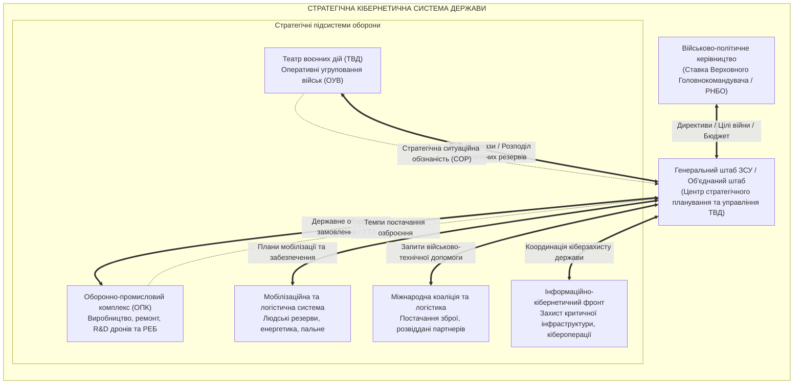
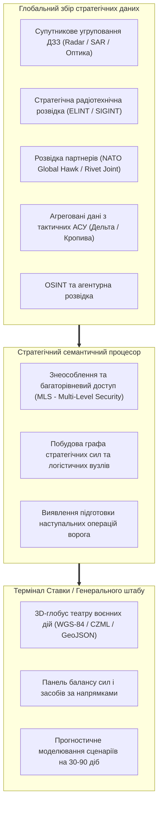
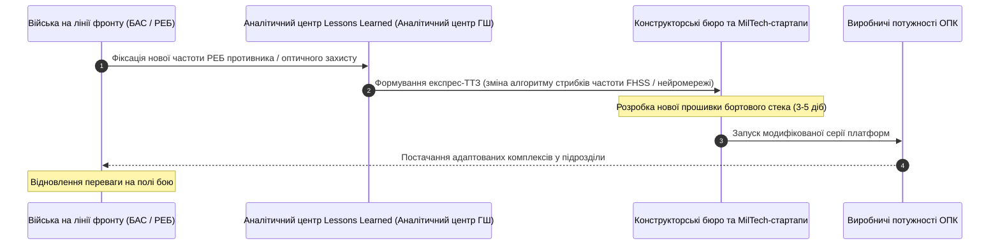

# Розділ 9. Військова кібернетика стратегічного рівня: управління театром воєнних дій та оборонною стійкістю

> **Монографія:** [Військова Кібернетика початку XXI століття](README.md) · [Частина III: Ієрархія бойового управління: Тактика, Операція, Стратегія](README.md#частина-iii-ієрархія-бойового-управління-тактика-операція-стратегія)  
> **Попередній розділ:** [← Розділ 8. Військова кібернетика оперативного рівня: міжвидова координація бригад, корпусів та JADC2](Military-Cybernetics-Operational-Level-UA.md)  
> **Наступний розділ:** [Розділ 10. Експертні системи військового призначення: інженерія знань та доказовий ШІ →](Military-Expert-Systems-UA.md)  
> **Зміст монографії:** [README.md](README.md)  
> **Автор:** [Микола Федчик (Mykola Fedchyk)](../Expert_Systems_Architecture/about-the-author.md) · [LinkedIn](https://www.linkedin.com/in/nickfedchik/)

---

## 1. Стратегічний рівень кібернетики: війна як зіткнення соціотехнічних систем

Стратегічний рівень війни оперує найбільшим масштабом простору, часу та ресурсів: тут вирішуються задачі збереження державності, досягнення цілей оборонної операції та нейтралізації воєнного потенціалу агресора.

Військова кібернетика стратегічного масштабу розглядає війну не як послідовність боїв, а як **протиборство надскладних, самоорганізованих, розподілених соціотехнічних систем**:

---

## 2. Математичне моделювання кампаній та стратегічного виснаження

### Ентропійний критерій стійкості стратегічного управління

Стійкість стратегічного управління державою у війні визначається інформаційною ентропією за Шенноном-Вінером. Якщо обсяг невідомості щодо планів противника або стану власних сил перевищує пропускну здатність штабів, виникає стратегічний хаос.

Нехай $H(S_t)$ — ентропія стану театру дій у момент часу $t$:

$$
H(S_t) = - \sum_{i=1}^K p(s_i) \log_2 p(s_i)
$$

де $p(s_i)$ — ймовірність перебування стратегічної ситуації в гіпотетичному стані $s_i$.

Швидкість усунення невизначеності стратегічною розвідкою $\frac{dI}{dt}$ має перевищувати темп генерування невизначеності противником $\frac{dH}{dt}$:

$$
\frac{dI_{\text{rec}}}{dt} \ge \frac{dH_{\text{theater}}}{dt}
$$

Виконання цієї нерівності є базовою передумовою збереження керованості та стратегічної стабільності оборонної системи.

### Модель стратегічного виснаження потенціалу (Attrition Dynamics)

Динаміка стратегічного виснаження воюючих сторін моделюється системою рівнянь з урахуванням темпів власного військового виробництва та зовнішньої допомоги:

$$
\frac{dM(t)}{dt} = P_{\text{prod}}(t) + A_{\text{ally}}(t) - L_{\text{combat}}(t, \text{Intensity})
$$

де:

- $M(t)$ — сукупний бойовий потенціал сил оборони (кількість боєготових батальйонно-тактичних груп, парку ракет, БАС, артилерійських стволів);
- $P_{\text{prod}}(t)$ — темп внутрішнього оборонного виробництва;
- $A_{\text{ally}}(t)$ — обсяги військової допомоги партнерів;
- $L_{\text{combat}}$ — втрати на лінії бойового зіткнення як функція інтенсивності бойових дій.

Кібернетична система стратегічного планування розраховує горизонт вичерпання запасів агресора та оптимізує моменти введення стратегічних резервів для перелому ходу кампанії.

---

## 3. Ситуаційна обізнаність ТВД: єдина спільна оперативна картина (COP)

На стратегічному рівні командування не аналізує політ окремих квадрокоптерів. Головна задача — побудова **Єдиної спільної оперативної картини (Common Operational Picture, COP)** всього театру воєнних дій:

### Принципи стратегічного COP:

1. **Багаторівнева безпека (Multi-Level Security, MLS):** автоматичне гранульоване маскування джерел інформації відповідно до грифу секретності користувача (Top Secret / Secret / Restricted) без порушення цілісності картини.
2. **Семантична агрегація:** перетворення тисяч точкових сенсорних спостережень у цілісні стратегічні сутності: «ешелон техніки на станції навантаження», «передислокація полку зв'язку», «підготовка аеродрому базування стратегічної авіації».
3. **Предиктивна аналітика:** виявлення неявних просторово-часових кореляцій, що свідчать про підготовку масованого ракетного удару чи зміни основного вектора наступу за 48–72 години до початку дій.

---

## 4. Кібернетика оборонно-промислового комплексу (ОПК) та національної стійкості

В сучасній затяжній війні високої інтенсивності оборонно-промисловий комплекс (ОПК) є невіддільною частиною військової кібернетичної системи.

Цикл **«Бойовий досвід — R&D — Серійне виробництво — Фронт»** має скоротитися з років до тижнів:

Кібернетична система управління ОПК забезпечує:

- **Розподілене виробництво:** перенесення випуску дронів і боєприпасів із вразливих великих заводів на мережу десятків розосереджених підземних або модульних міні-підприємств (завдяки чому виробнича спроможність українського сектору БпЛА масштабувалася до рівня ~7 млн одиниць на рік).
- **Цифровий двійник ланцюжка постачання (Digital Supply Chain Twin) та технологічний суверенітет компонентів:** контроль критичних вузлів (FPGA, NPU, тепловізійні матриці, двигуни, оптоволокно, акумулятори) та імпортозаміщення через вітчизняне R&D — зокрема локалізацію українських тепловізійних модулів (`Odd Systems`, `ZIR System`, `ОКО Камери`) та виробництво кремній-вуглецевих акумуляторних елементів високої щільності енергії (`BTRY Energy` із питомою ємністю 325–450 Вт·год/кг і 65% доданої вартості всередині країни).
- **Кібернетично-економічний баланс складності («дилема вартості бортового ШІ»):** стратегічне планування ОПК враховує нелінійний компроміс між вартістю одиниці зброї та імовірністю виконання задачі. Зокрема, оснащення масового ударного дрона бортовим обчислювачем комп'ютерного зору підвищує собівартість платформи на 25–40%, через що системи з термінальною автономією наразі займають 5–10% загального випуску, але концентруються саме на тих напрямках із щільним купольним РЕБ, де ефективність звичайних радіокерованих дронів падає нижче порогу рентабельності.
- **Програмне забезпечення як самостійний контур оборонних закупівель:** перехід від закупівлі виключно апаратних засобів до контрактування програмних продуктів за шістьма обов'язковими критеріями безпеки (підтверджене походження коду, прозорість залежностей SBOM, контроль змін SDLC, перевірка відсутності компонентів із ворожих юрисдикцій, суверенітет даних на національних серверах класу `DELTA` / `Brave1 Dataroom` та відкрита інтероперабельність із системами C2).
- **Стратегічний прорив сегмента наземних роботизованих комплексів («Армія роботів») та міжнародна кооперація ОПК:** за даними спільного дослідження *KSE Institute, Brave1 та Defence Builder*, при загальному обсязі українського ринку оборонних технологій у **6,8 млрд дол. США** (де сегмент БпЛА становить 6,3 млрд дол. США із зростанням +137%, а систем РЕБ — +215%) найдинамічнішим сектором стало виробництво НРК, яке **зросло на 488%** і досягло **252 млн дол. США**. Лише за перші вісім місяців 2026 року Міноборони кодифікувало та допустило до експлуатації **86 нових зразків НРК** (проти 60 за весь 2025 рік) при державному орієнтирі постачання до **25 000–50 000 наземних роботів на рік**, звільненні закупівель НРК від ПДВ та розгортанні сертифікованих приватних шкіл операторів НРК. Водночас українські розробники НРК перетворилися з імпортерів на експортерів бойових технологій та партнерів провідних оборонних концернів НАТО: створено спільні підприємства `Tencore` у Німеччині (`Quantum Tencore Industries` з `Quantum Systems`, партнерство з `FERNRIDE`) та Фінляндії (`Insta` для випуску `TerMIT 2.0`), спільне виробництво `Roboneers` та німецької `ARX Robotics` (`Рись Pro` та інтеграція турелей `ШаБля` на платформи `GEREON`), розгортання виробництва українських НРК `Равлик` і платформ `Dropla` у Данії, проєкти локалізації `TerMIT` і `Ratel` у Канаді та в Литві (`Роботизовані Комплекси` + `BPTI`), а також кооперацію з `Kongsberg Defence & Aerospace` та `Inission Norge AS` (Норвегія), `Milrem Robotics` (Естонія/Нідерланди), `Shark Robotics`, `Haulotte` і `StrongholdAI` (Франція) та виробником танків *Leopard* `KNDS`.

---

## 5. Коаліційна інтеграція та кібербезпека стратегічного рівня

Жодна сучасна держава не веде масштабну оборону в повній ізоляції. Кібернетична сумісність із протоколами та сервісами союзників (НАТО) є запорукою успіху:

- **Інтероперабельність протоколів:** шлюзи між національними центрами управління та Об'єднаними командуваннями НАТО (SHAPE) за стандартом STANAG 4559 (NATO Secondary Imagery Dissemination) та OTH-Gold.
- **Квантово-стійке шифрування каналів вищого командування:** використання алгоритмів постквантової криптографії (ML-KEM/Kyber, ML-DSA/Dilithium) для унеможливлення стратегічного перехоплення директив вищого командування.

---

## 6. Висновки

1. Стратегічний рівень військової кібернетики інтегрує керування збройними силами, економіку оборонного виробництва, мобілізаційні ресурси та коаліційну взаємодію в єдину замкнену систему зі зворотним зв'язком.
2. Спільна оперативна картина (COP) усього театру воєнних дій забезпечує усунення інформаційної ентропії та випереджальну реакцію вищого військового командування на загрози.
3. Перемога у війні на виснаження забезпечується не статичними запасами зброї, а високою кібернетичною швидкістю адаптації ОПК — циклом швидкої модернізації техніки на основі досвіду After Action Review.
4. Стійкість держави як соціотехнічної системи базується на захищених, децентралізованих і доказових процедурах прийняття стратегічних рішень.

---

## Посилання

- [Clausewitz, C. von. (1832). On War (Vom Kriege)](https://www.gutenberg.org/ebooks/1946)
- [Shannon, C. E. (1948). A Mathematical Theory of Communication. Bell System Technical Journal](https://doi.org/10.1002/j.1538-7305.1948.tb01338.x)
- [Chairman of the Joint Chiefs of Staff. (2020). Joint Publication 3-0: Joint Operations. US DoD](https://www.jcs.mil/Doctrine/)
- [Ціна питання +25–40% до вартості дрона: економіка бортового ШІ та масштаб виробництва 7 млн дронів на рік — AIN Defense Tech](https://ain.ua/2026/11/16/cina-питання-25-40-до-вартості-дрона-чому-шi-досі-не-став-масовим-рішенням-на-фронті-розповідає-співзасновник-dod-solution/)
- [Український виробник кремній-вуглецевих акумуляторів BTRY Energy (325–450 Вт·год/кг) — AIN Defense Tech](https://ain.ua/defense-tech/)
- [Шість вимог до ПЗ в оборонних контрактах та уроки масштабування — Олександр Білоусов («Генерал Черешня»), DOU DefTech](https://dou.ua/forums/topic/63010/)
- [Зростання виробництва НРК на 488% (6,8 млрд дол. США ринок DefTech України за оцінкою KSE Institute, Brave1 і Defence Builder), кодифікація 86 зразків НРК та міжнародні СП в країнах НАТО — Дайджести НРК #20, #26, #28, #37, #38, #45, #47, #48, #55, DOU DefTech](https://dou.ua/forums/tags/%D0%B4%D0%B0%D0%B9%D0%B4%D0%B6%D0%B5%D1%81%D1%82%20%D0%9D%D0%A0%D0%9A/)
- [Рада національної безпеки і оборони України](https://www.rnbo.gov.ua/)

---

[← Розділ 8. Військова кібернетика оперативного рівня: міжвидова координація бригад, корпусів та JADC2](Military-Cybernetics-Operational-Level-UA.md) | [Зміст монографії](README.md) | [Розділ 10. Експертні системи військового призначення: інженерія знань та доказовий ШІ →](Military-Expert-Systems-UA.md)
