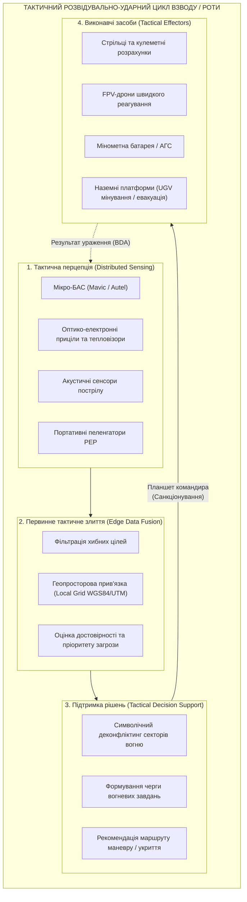
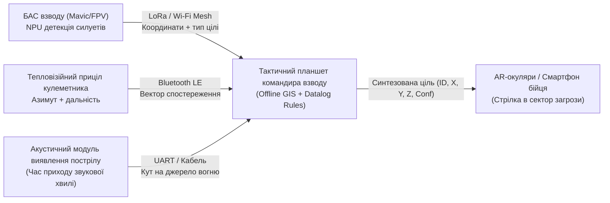
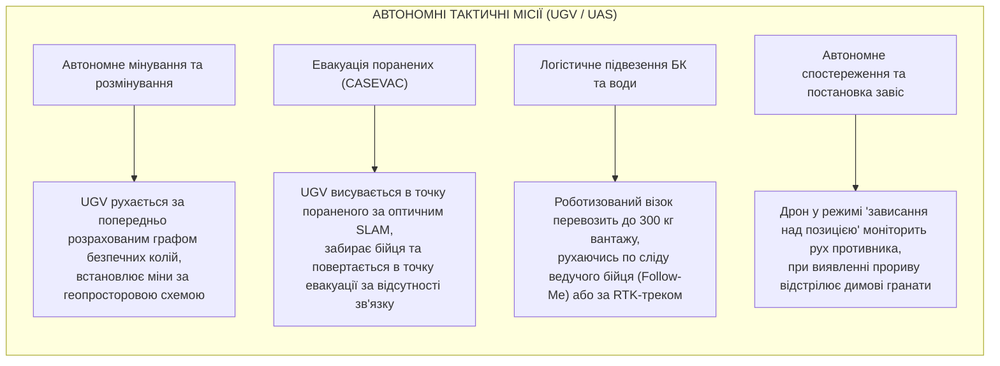

# Розділ 7. Військова кібернетика тактичного рівня: людино-машинна синергія відділення, взводу та роти

> **Монографія:** [Військова Кібернетика початку XXI століття](README.md) · [Частина III: Ієрархія бойового управління: Тактика, Операція, Стратегія](README.md#частина-iii-ієрархія-бойового-управління-тактика-операція-стратегія)  
> **Попередній розділ:** [← Розділ 6. Ройовий інтелект і координація гетерогенних роботокомплексів](Swarm-Intelligence-And-Heterogeneous-Robotics-UA.md)  
> **Наступний розділ:** [Розділ 8. Військова кібернетика оперативного рівня: міжвидова координація бригад, корпусів та JADC2 →](Military-Cybernetics-Operational-Level-UA.md)  
> **Зміст монографії:** [README.md](README.md)  
> **Автор:** [Микола Федчик (Mykola Fedchyk)](../Expert_Systems_Architecture/about-the-author.md) · [LinkedIn](https://www.linkedin.com/in/nickfedchik/)

---

## 1. Специфіка тактичного рівня: мікросекунди, шум і дефіцит уваги

Тактичний рівень ведення бойових дій (від безпосереднього окопу до командно-спостережного пункту батальйону) характеризується екстремальними факторами:

1. **Критичний ліміт часу:** рішення про зміну вогневої позиції, маневр або контратаку приймається за секунди.
2. **Інформаційна перевантаженість бійця:** одночасний потік радіопереговорів, звукових сигнатур бою, відео з розвідувальних дронів та повідомлень у месенджерах призводить до когнітивного паралічу (Cognitive Tunneling).
3. **Фрагментований зв'язок:** вплив ворожого РЕБ, складки рельєфу та руйнація базових станцій роблять неможливою постійну передачу даних на вищі штаби.

Військова кібернетика тактичного рівня покликана трансформувати відділення та взвод у **високоінтегрований людино-машинний кіберфізичний комплекс (Centaur Tactical Unit)**, де сенсори, роботи та бійці діють у єдиній синхронізованій системі.



---

## 2. Математичне моделювання тактичного циклу ураження (Kill Chain)

Ефективність тактичного підрозділу формалізується тривалістю повного сенсорно-вогневого циклу $T_{\text{kill-chain}}$:

$$
T_{\text{kill-chain}} = t_{\text{det}} + t_{\text{fuse}} + t_{\text{dec}} + t_{\text{eng}} + t_{\text{bda}}
$$

де:

- $t_{\text{det}}$ — час первинної детекції цілі сенсором;
- $t_{\text{fuse}}$ — час нормалізації та зіставлення даних у тактичній мережі;
- $t_{\text{dec}}$ — час прийняття рішення командиром (когнітивна затримка);
- $t_{\text{eng}}$ — час доведення команди та підльоту/пострілу вогневого засобу;
- $t_{\text{bda}}$ — час оцінки результатів удару (Battle Damage Assessment).

Якщо $T_{\text{kill-chain}} > T_{\text{dwell}}$ (де $T_{\text{dwell}}$ — час перебування цілі на відкритій позиції до зміни укриття, зазвичай 15–45 с), вогневе ураження стає неможливим. Завдання кібернетики тактичного рівня — скоротити цей час через автоматизацію фаз $t_{\text{fuse}}$ та $t_{\text{dec}}$ до значень менше 5 секунд.

### Ймовірність виявлення цілі в умовах завад

Ймовірність виявлення $P_D$ об'єкта тактичним сенсором у секторі спостереження описується моделлю Маркама-Шверлінга з урахуванням відношення «сигнал/шум» (SNR) та коефіцієнта оптичного або радіоелектронного маскування $K_{\text{mask}}$:

$$
P_D = \frac{1}{2} \, \text{erfc}\left( \sqrt{-\ln P_{FA}} - \sqrt{\frac{\text{SNR}}{1 + K_{\text{mask}}} + \frac{1}{2}} \right)
$$

де $P_{FA}$ — задана допустима ймовірність хибної тривоги (False Alarm Rate), а $\text{erfc}$ — додаткова функція помилок.

---

## 3. Частково спостережувані марковські процеси (POMDP) у тактичному плануванні

У реальному бою стан поля бою $\mathbf{s} \in \mathcal{S}$ є **частково спостережуваним** через туман війни, складки місцевості та задимлення. Тактичний агент підтримки рішень моделює ситуацію як POMDP-кортеж:

$$
\mathcal{M}_{\text{tactical}} = \langle \mathcal{S}, \, \mathcal{A}, \, \mathcal{T}, \, \mathcal{R}, \, \Omega, \, \mathcal{O}, \, \gamma \rangle
$$

де:

- $\mathcal{S}$ — множина просторових станів противника і дружніх сил;
- $\mathcal{A}$ — множина допустимих тактичних дій (вогонь, відхід, димова завіса, спостереження);
- $\mathcal{T}(s' \mid s, a)$ — імовірність переходу поля бою в стан $s'$ після виконання дії $a$;
- $\mathcal{R}(s, a)$ — функція винагороди (збереження особового складу, зупинка прориву);
- $\Omega$ — простір спостережень, що надходять від сенсорів БАС та бійців;
- $\mathcal{O}(o \mid s', a)$ — імовірність отримати спостереження $o$ за умови переходу в стан $s'$;
- $\gamma \in (0, 1)$ — коефіцієнт дисконтування майбутніх наслідків.

Оптимальна тактична стратегія $\pi^{\ast}(b)$ формується відносно поточного вектора довіри (Belief State) $b(s) = P(s_{t} = s \mid o_{1:t}, \, a_{1:t-1})$:

$$
\pi^{\ast}(b) = \arg\max_{a \in \mathcal{A}} \left[ \sum_{s \in \mathcal{S}} b(s) \mathcal{R}(s, a) + \gamma \sum_{o \in \Omega} P(o \mid b, a) V^{\ast}(\tau(b, a, o)) \right]
$$

де $\tau(b, a, o)$ — байєсівське оновлення вектора довіри після отримання нового спостереження.

---

## 4. Розвідка та первинне злиття сенсорів на рівні відділення/взводу

Сучасне відділення не може дозволити собі централізований сервер для обробки даних. Використовується парадигма **Edge Mesh Sensing**:



### Принципи тактичного злиття:

1. **Мінімальний обсяг даних:** передається не «важке» відео, а компактні JSON/Protobuf-вектори метаданих (тип об'єкта, координати WGS-84, рівень достовірності, мітка часу).
2. **Просторовий деконфліктинг дублікатів:** якщо дрон та акустичний сенсор спостерігають одну й ту саму точку з радіусом $\Delta R \le 25$ м, система автоматично об'єднує їх в єдиний трек цілі.
3. **Пріоритет загрози (Threat Scoring):** цілі ранжуються за формулою пріоритету (наприклад, бронетехніка з прямим кутом наведення на позицію має вищий пріоритет, ніж піхотинець в укритті на дистанції 800 м).

---

## 5. Автономні функції виконання тактичних завдань

Роботизовані комплекси на тактичному рівні поступово перебирають на себе смертельно небезпечні рутинні операції, звільняючи особовий склад:



### Алгоритм поведінки UGV при втраті зв'язку (Dead-Reckoning Fail-Safe)

Якщо під час доставки боєкомплекту або евакуації зв'язок придушено завадами, бортовий контролер переходить у детермінований режим безпечного повернення:

```prolog
% Datalog-правило тактичної безпеки UGV
action(ugv_retreat) :-
    link_status(lost),
    link_loss_duration(T),
    T > 30, % секунд
    battery_level(B),
    B > 20,
    safe_path_recorded(true).

% Заборона зупинки у відкритому секторі вогню
action(seek_cover_and_wait) :-
    link_status(lost),
    under_fire(true),
    nearest_trench_cover(Distance),
    Distance < 50.
```

Практичний досвід застосування наземних і повітряних роботизованих комплексів у ланці «відділення — взвод — рота» Сил оборони України виявив три додаткові інженерно-кібернетичні тенденції:
- **Уніфікація парку НРК та спеціалізація місій:** після етапу стихійного пошуку (понад 200 дослідних зразків) фронтова експлуатація стискає ринок до 10–15 стандартизованих платформ із уніфікованими інтерфейсами керування та живлення, де на одну бойову чи розвідувальну турельну систему (наприклад, розвідувально-ударні комплекси `DevDroid` та `Tencore TerMIT`) припадає левова частка місій логістики «останньої милі» та евакуації поранених під прикриттям дрона-ретранслятора.
- **Повністю роботизовані штурми, зачистки та комбінована тактика без входу піхоти у зону вогню:**
  - *Роботизована зачистка та ліквідація ДРГ:* підрозділ «Лава» корпусу НГУ «Хартія» провів у Куп'янську першу повністю роботизовану зачистку позицій без участі піхотинців; у Костянтинівці 100-та ОМБр ліквідувала російську ДРГ, що закріпилася в багатоповерхівці, за допомогою скоординованої тріади НРК (робот-приманка для відволікання вогню $\rightarrow$ важкий НРК-камікадзе з $300\text{ кг}$ вибухівки чи трофейною авіабомбою ФАБ-250 для руйнування укріплення $\rightarrow$ логістична платформа підвезення боєкомплекту штурмовикам).
  - *Комбінований вогневий та інженерний штурм (досвід операції «Вівальді»):* рота ударних НРК `NC13` 3-ї ОШБр відпрацювала тактику, де НРК зі спареними гранатометами `Bullspike` спершу обстрілюють амбразури укриття (імітуючи атаку штурмової піхотної групи), після чого заходять безпосередньо всередину бліндажа й здійснюють підрив; на третьому етапі операції «Вівальді» Третій армійський корпус застосував переобладнані у підрозділі дистанційно керовані **БТР-60-камікадзе** для руйнування найміцніших бетонованих укріплень, а також здійснив «сліпий» підрив ворожого танка наземним дроном та взяття російських військових у полон за допомогою НРК (підрозділи 3-ї ОШБр та 153-ї ОМБр).
- **Живучість евакуаційних контурів (CASEVAC), тандемний порятунок роботів та контрмінні засоби:**
  - *Бронекапсули та мультимодальні евакуаційні ланцюги:* для захисту поранених від повторних атак FPV-дронів та уламків створено спеціалізовані бронекапсули (зокрема модуль `Мураха CaseEvak` із денною й нічною камерами, двостороннім аудіозв'язком з медиком, підігрівом, вентиляцією та двома незалежними каналами зв'язку після від'єднання від шасі, а також евакуаційні комплекси `Рись MAX` на $350\text{ кг}$, `Nurse TB20`, `Тор-800`, `Тарган-200`, `Фродо`, `Бізон` та амфібійний `Тритон` на пружинних амортизаторах). Практика підтвердила їхню виняткову живучість: 57-ма ОМПБр евакуювала з Вовчанська пораненого бійця після **275 діб** перебування на позиції; Перший окремий медичний батальйон спільно з 425-м ОШП «Скеля» вивезли пораненого з напівоточення на дистанцію **$36{,}5\text{ км}$ за 2 години 13 хвилин** (максимальна швидкість до $70\text{ км/год}$), витримавши два підриви на протипіхотних мінах без додаткових травм бійця; евакуаційний НРК **MAUL** встановив рекорд швидкості — **$90\text{ км/год}$** дорогою до пораненого та $78\text{ км/год}$ із пораненим на борту; а в бригаді «Червона Калина» реалізовано триступеневий кіберфізичний порятунок (*важкий дрон-бомбер двічі скинув кров для переливання та доставив моноколесо $\rightarrow$ перші $2\text{ км}$ виходу на моноколесі $\rightarrow$ $14\text{ км}$ евакуації на НРК*).
  - *Тандемна евакуація «робот рятує робота»:* при ураженні або застряганні першої платформи вводиться резервний НРК-евакуатор (у 66-й ОМБр після двох підривів «Тарган-200» на мінах пораненого перевантажили на другий НРК і завершили місію; у 58-й ОМПБр гусеничний «Ардал» витягнув застряглий у багнюці НРК «Гімлі» з пораненим під час 6-годинної операції; для цього класу задач створено спеціалізований колісний евакуатор роботів **NUMO LOKO** вантажопідйомністю понад $500\text{ кг}$ та евакуаційний модуль для **TerMIT**).
  - *Інженерна протидія мінам і радіогоризонту:* для дистанційного пророблення проходів кодифіковано вітчизняний електромагнітний трал **«ПІДРИВ»**, що ініціює міни з магнітними підривачами на безпечній відстані до **7 метрів** перед носієм, комплекси розмінування `Sirko-S1`, `NEO-1` та модулі мінування/постановки загороджень `TerMIT` і `Гном` (якими під час операції «Вівальді» за дві ночі розчистили $30\text{ км}$ маршрутів і встановили $400\text{ м}$ мінних полів), а для подолання низького радіогоризонту без видачі демаскуючого повітряного ретранслятора кодифіковано НРК **«Плющ» із 10-метровою телескопічною щоглою** зв'язку.
- **Автономні місії «роботів-почекунів» і сейсмоакустичний рубіж:** у сірій зоні тактичну оборону посилюють автономні сейсмоакустичні детектори піхоти (класу українського `Dream Sensor`, що виявляють наближення людини на дистанції до 100 м за вібрацією ґрунту та акустичним спектром) у парі з дронами-перехоплювачами в режимі радіомовчазної засідки («Почекун» із часом чергування 12–24 години).

---

## 6. Висновки

1. Тактичний рівень військової кібернетики фокусується на стисненні сенсорно-вогневого циклу $T_{\text{kill-chain}}$ до лічених секунд шляхом когнітивного розвантаження бійця та автоматизації злиття даних на передньому краї.
2. Концепція Centaur Unit поєднує інтуїцію та тактичний досвід командира з обчислювальною швидкістю мікро-NPU та сенсорної мережі взводу.
3. Частково спостережувані марковські процеси (POMDP) дають математичну основу для дій в умовах задимлення, туману війни та радіоелектронного придушення.
4. Наземні та повітряні роботизовані засоби (UGV/UAS) беруть на себе критичні функції логістики, розмінування та медичної евакуації, діючи автономно за детермінованими безпековими правилами.

---

## Посилання

- [Boyd, J. R. (1987). A Discourse on Winning and Losing. Air University Library](https://www.airuniversity.af.edu/)
- [Kaelbling, L. P., Littman, M. L., & Cassandra, A. R. (1998). Planning and acting in partially observable stochastic domains. Artificial Intelligence](https://doi.org/10.1016/S0004-3702(98)00023-X)
- [Scharre, P. (2018). Army of None: Autonomous Weapons and the Future of War. W. W. Norton & Company](https://wwnorton.com/books/army-of-none/)
- [Консолідація ринку НРК та досвід бойової експлуатації (DevDroid, Tencore TerMIT) — DOU DefTech / Мілітарний](https://deftech.dou.ua/)
- [Роботизовані зачистки («Лава», 100 ОМБр, NC13 в операції «Вівальді»), евакуаційні бронекапсули, трал «ПІДРИВ» та НРК «Плющ» — Дайджести НРК #6–#58, DOU DefTech](https://dou.ua/forums/tags/%D0%B4%D0%B0%D0%B9%D0%B4%D0%B6%D0%B5%D1%81%D1%82%20%D0%9D%D0%A0%D0%9A/)
- [Сейсмоакустичний детектор піхоти Dream Sensor та автономні рубіжні сенсори — AIN Defense Tech](https://ain.ua/defense-tech/)
- [Національний університет оборони України](https://nuou.org.ua/)

---

[← Розділ 6. Ройовий інтелект і координація гетерогенних роботокомплексів](Swarm-Intelligence-And-Heterogeneous-Robotics-UA.md) | [Зміст монографії](README.md) | [Розділ 8. Військова кібернетика оперативного рівня: міжвидова координація бригад, корпусів та JADC2 →](Military-Cybernetics-Operational-Level-UA.md)
