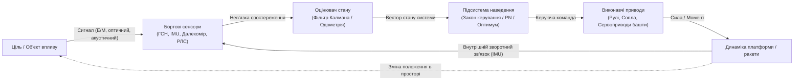
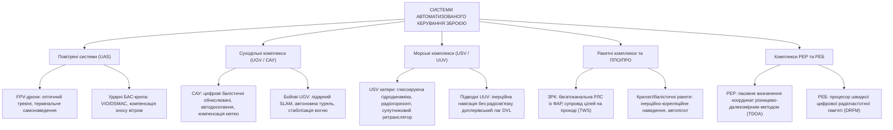
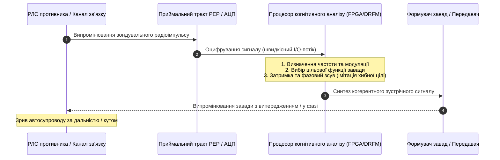
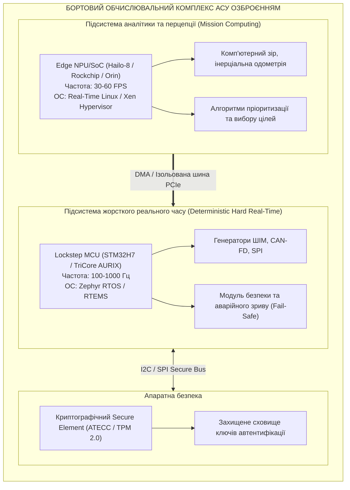

# Військова кібернетика і АСУ озброєнням: внутрішні автоматизовані системи керованої зброї

> **Тематичний напрям:** [Військова кібернетика та доказові системи управління](README.md) · Внутрішня кібернетика озброєння та автономних платформ  
> **Пов'язані статті:** [C4ISTAR, моделювання та кіберфізичні системи](Military-Cybernetics-In-Action-UA.md) · [Автономна навігація БАС та НРК без GNSS](Autonomous-Navigation-GNSS-Denied-MilTech-UA.md) · [Ройовий інтелект і гетерогенні роботокомплекси](Swarm-Intelligence-And-Heterogeneous-Robotics-UA.md)  
> **Автор:** [Микола Федчик (Mykola Fedchyk)](../Expert_Systems_Architecture/about-the-author.md) · [LinkedIn](https://www.linkedin.com/in/nickfedchik/)

---

## 1. Концепція внутрішньої кібернетики зброї: від механізму до кіберфізичної системи

Класична зброя індустріальної епохи функціонувала як розімкнений механічний пристрій: наведення здійснювалося людиною-навідником, а політ снаряда чи рух машини підпорядковувалися незмінним законам зовнішньої балістики без можливості корекції в процесі руху.

Військова кібернетика початку XXI століття розглядає будь-який сучасний зразок озброєння як **замкнену кіберфізичну систему з множинним зворотним зв'язком**:

Кібернетична система озброєння вирішує тріаду задач:

1. **Спостереження (State Estimation):** фільтрація шумів вимірювань і розрахунок просторово-часових параметрів цілі та власної платформи в реальному часі.
2. **Оптимальне наведення (Optimal Guidance):** синтез траєкторії, що мінімізує промах або час підльоту за обмежень на перевантаження.
3. **Виконавча стабілізація (Autopilot & Flight Control):** швидка компенсація аеродинамічних або гідродинамічних збурень середовища через сервоприводи рульових поверхонь чи балістичних приводів.

---

## 2. Математичний апарат систем наведення

### Закон пропорційної навігації (Proportional Navigation)

Основою автоматизованого керування для більшості самонавідних ракет, дронів-перехоплювачів та керованих артилерійських боєприпасів є закон пропорційної навігації (True Proportional Navigation, TPN).

Прискорення перехоплювача $\mathbf{a}_M$, нормальне до лінії візування (Line-of-Sight, LOS), пропорційне кутовій швидкості обертання лінії візування $\dot{\lambda}$ та швидкості зближення $V_c$:

$$
\mathbf{a}_M = N' \, V_c \, \dot{\lambda} \, \mathbf{n}
$$

де:

- $N' \in [3, \, 5]$ — безрозмірний навігаційний коефіцієнт (Navigation Gain);
- $V_c = - \dot{R} = - \frac{d}{dt} \|\mathbf{r}_T - \mathbf{r}_M\|$ — швидкість відносного зближення перехоплювача та цілі;
- $\dot{\lambda} = \frac{\|\mathbf{r} \times \mathbf{v}\|}{\|\mathbf{r}\|^2}$ — кутова швидкість лінії візування;
- $\mathbf{n}$ — одиничний вектор, перпендикулярний до лінії візування в площині перехоплення.

### Оптимальне термінальне керування (Zero Effort Miss)

Для високошвидкісних або маневруючих цілей класична пропорційна навігація модифікується через оцінку прогнозованого промаху за нульового керування (Zero Effort Miss, ZEM):

$$
\mathbf{ZEM}(t) = \mathbf{r}(t) + \mathbf{v}(t) \, t_{go} + \frac{1}{2} \mathbf{a}_T(t) \, t_{go}^2
$$

де $t_{go} = \frac{R}{V_c}$ — прогнозований залишковий час до зустрічі з ціллю (Time-to-Go), а $\mathbf{a}_T$ — оцінене бортовим фільтром Калмана прискорення цілі.

Оптимальне керуюче прискорення перехоплювача, отримане з мінімізації функціонала витрат енергії за принципом максимуму Понтрягіна, записується як:

$$
\mathbf{a}_M^{\ast}(t) = \frac{N'(t_{go})}{t_{go}^2} \, \mathbf{ZEM}(t)
$$

---

## 3. Специфіка систем автоматизованого керування за типами озброєння

### 1. Безпілотні авіаційні комплекси (UAS: FPV, розвідувальні крила, перехоплювачі)

- **Канал сервокерування:** замикається з частотою 400–1000 Гц на бортовому IMU (акселерометри та гіроскопи) через PID-регулятори кутових швидкостей $\mathbf{\omega} = [\omega_x, \omega_y, \omega_z]^T$.
- **Підсистема супроводу цілі (Visual Target Tracker):** реалізується на мікро-NPU (0.5–2 Вт) через кореляційні трекери або моделі глибинного навчання (YOLO-Edge). Замикається через поправку курсу із затримкою до 20–30 мс, компенсуючи зрив радіозв'язку на останніх 50–100 метрах пікірування.

### 2. Суходільні роботизовані комплекси (UGV) та артилерійські установки (САУ)

- **Самохідна артилерія (САУ типу PzH 2000, Богдана, CAESAR):** сучасна САУ є роботом, де людина лише дає дозвіл на постріл. Бортова СУВ (Fire Control System) у реальному часі враховує температуру заряду, знос каналу ствола, тривимірний профіль вітру за метеоданими та автоматично орієнтує ствол за лазерним гірокомпасом із похибкою менше $0.5$ артилерійської поділки.
- **Наземні роботокомплекси (UGV):** діють у високов'язкому та перешкодному середовищі. Бортова система будується на базі 3D-лідарного SLAM і фільтрації непрохідних ділянок рельєфу (Elevation Grid Mapping).

### 3. Морські надводні (USV) та підводні (UUV) ударні дрони

- **USV (морські дрони-катери):** автопілот курсу працює в умовах стохастичного хвильового збурення. Передатна функція корпусу має суттєву інерційність: для стабілізації застосовуються випереджальні фільтри Калмана, що прогнозують підйом і звалювання з гребеня хвилі.
- **Підводні UUV:** повна відсутність електромагнітного зв'язку крізь товщу води вимагає автономної системи навігації на базі доплерівського гідроакустичного лага (Doppler Velocity Log, DVL) та прецизійних волоконно-оптичних гіроскопів (FOG).

### 4. Зенітні ракетні комплекси (ЗРК) та протиракетна оборона (ПРО)

Кібернетика ЗРК вирішує задачу розпаралелювання каналів супроводу десятків швидкісних аеродинамічних і балістичних цілей:

- **Фазована антенна решітка (ФАР/АФАР):** електронне керування променем дозволяє за мікросекунди змінювати напрямок сканування, поєднуючи режим огляду повітряного простору із супроводом цілей на проході (Track-While-Scan, TWS).
- **Радіолінія командного наведення:** обчислювальний комплекс батареї синтезує оптимальну траєкторію зближення та передає кодовані команди на борт зенітної керованої ракети аж до моменту захоплення цілі її власною активною радіолокаційною чи напівактивною ГСН.

---

## 4. Засоби радіоелектронної боротьби (РЕБ) та радіоелектронної розвідки (РЕР)

Військова кібернетика систем РЕБ і РЕР відрізняється від систем кінетичного ураження: тут об'єктом керування є **електромагнітне поле та інформаційні структури сигналів противника**.

### Адаптивна система когнітивного РЕБ

Сучасні станції постановки завад використовують технологію цифрової радіочастотної пам'яті (Digital Radio Frequency Memory, DRFM):

### Енергетичне рівняння придушення радіолінії

Для гарантованого зриву радіолінії керування або супутникової навігації станція РЕБ підтримує співвідношення «завада/сигнал» на вході приймача цілі вище критичного порогу:

$$
\left( \frac{P_J}{P_S} \right) = \frac{P_{tx, J} \, G_J \, G_{rx, J} \, R_S^2 \, L_S}{P_{tx, S} \, G_S \, G_{rx, S} \, R_J^2 \, L_J} \ge \gamma_{\text{jam}}
$$

де:

- $P_{tx, J}, P_{tx, S}$ — потужності передавача завад і корисного передавача відповідно;
- $G$ — коефіцієнти підсилення антен у відповідних напрямках;
- $R_J, R_S$ — відстані від приймача цілі до станції РЕБ та передавача сигналу;
- $\gamma_{\text{jam}}$ — коефіцієнт придушення (зазвичай 3–10 дБ залежно від типу модуляції).

---

## 5. Бортова апаратно-програмна реалізація систем АСУВ

Висока динаміка бойових процесів висуває категоричні вимоги до обчислювальної архітектури бойових машин:

- **Принцип архітектурної ізоляції (Simplex Architecture):** жоден збій нейромережевого прискорювача чи помилка операційної системи Linux не повинні впливати на роботу польотного контролера або підсистеми стабілізації зброї на базі RTOS.
- **Апаратний корінь безпеки (RoT):** захищає алгоритми наведення від несанкціонованої модифікації супротивником при захопленні апарата на полі бою.
- **Емпіричні реалізації у сучасній війні (досвід України):**
  - *Бортові модулі термінального донаведення та автономна «засідка»:* серійні українські модулі комп'ютерного зору (зокрема класу `Aura AI` від DOD Solution) забезпечують захоплення й ураження рухомих цілей на швидкості до 80 км/год в умовах повного придушення радіокерування за останні 200–500 метрів до об'єкта, а спеціалізовані системи автономної засідки (режим «Почекун») переводять посаджений поблизу логістичної траси дрон у 12–24-годинне радіомовчання з міліватним енергоспоживанням до моменту оптико-акустичної детекції цілі.
  - *Гіростабілізовані морські турелі та комбіновані платформи USV:* українські морські бойові модулі (`APEX PREDATOR` та `«Хижак»`), інтегровані на багатоцільові безекіпажні катери-носії (зокрема `MV11` водотоннажністю 9,5 т, що одночасно несе у пускових контейнерах зенітні дрони-перехоплювачі `Sting`), використовують двоконтурну гіростабілізацію з балістичним обчислювачем і нейромережевим автосупроводом, утримуючи лінію прицілювання по повітряних і надводних цілях при хвилюванні моря до 3 метрів (до 4–5 балів).
  - *Системи спрямованої енергії (бойові лазери):* фронтові випробування лазерних комплексів Силами безпілотних систем ЗСУ (UFORCE), а також інтеграція лазерних систем C-UAS на важкі наземні роботизовані платформи (проекти оснащення НРК `Protector`, лазерні комплекси `Archimedes`, `Rheinmetall MUSKOX / Ox` та `Ziesel`) демонструють перехід до безінерційного наведення зі швидкістю світла, де точність утримання плями променя на фюзеляжі маневруючого БпЛА повністю визначається швидкодією замкненого оптико-механічного контуру стеження.
  - *Дистанційно керовані бойові модулі (ДКБМ) та ударні наземні роботизовані комплекси (НРК):* у наземному домені сформувалася повноцінна лінійка кіберфізичних систем вогневого ураження з автоматизованими балістичними обчислювачами:
    1. **Екосистема турелей «ШаБля» (`Roboneers`):** охоплює модифікації під кулемети калібрів $7{,}62\text{ мм}$ та $12{,}7\text{ мм}$ (`Browning M2`, український `MG-50 QCB`), спарену скорострільну установку під два автомати АК-74 калібру $5{,}45\text{ мм}$ (**«ШаБля К-2»** для подвоєння щільності вогню в ближньому бою з можливістю поодинокої або синхронної стрільби з двох стволів через кабель чи Starlink) та $40\text{-мм}$ автоматичні гранатомети (`Mk 19`, `AGL-53`). На їхній базі кодифіковано ударні НРК **«ШаРись PRO M2»** та **«ШаРись PRO MK19»** (ефективна дальність вогню до $1500\text{ м}$, час розгортання до $10\text{ хв}$), виконано інтеграцію на вітчизняні шасі `Веприк`, `Воля-Е`, `Vepr`, `ARDAL 920` і німецькі `ARX GEREON`, а для екіпажів впроваджено цифрового ШІ-асистента (`Roboneers` + `NeoLens`) та портативну метеостанцію **Strilets Core** для автоматичної корекції балістичних таблиць за вітром, тиском і температурою безпосередньо на вогневій позиції.
    2. **Турель «Буря 2.0» (`Frontline Robotics`):** універсальний ДКБМ під $40\text{-мм}$ автоматичні гранатомети (`Mk 19 / RDS40 / AGL-53`) та $12{,}7\text{-мм}$ кулемети `Browning M2`, оснащений балістичним калькулятором, енергонезалежною пам'яттю на **256 цілей** та режимом автономного чергування до **48 годин**. У тандемі з гусеничною платформою **Ardal** (`Burevii`) комплекс забезпечує прицільне ураження на дистанціях до **2000 м** із відхиленням від точки прицілювання близько **3 м** на максимальній дальності, а на шасі `Dropla Logist` інтегрується із ШІ-системою виявлення малих БпЛА **Blue Eyes**.
    3. **Важкі кулеметно-гранатометні, ракетні та вогнеметні НРК:** важкий колісний НРК **Protector** («Українська бронетехніка», серійний випуск 40–50 машин на місяць) з оновленою туреллю **«Таврія-12,7»** під час стрільб у русі на дистанціях $100$, $700$ та $1000\text{ м}$ продемонстрував частку влучань **понад 70%**; кодифіковано сімейство ударних роботів **DevDroid** (`Droid TW 12.7`, `Droid TW-40`, `Zmiy Droid 12.7`, `Tanchik Droid 12.7` із системою керування `Droid Box`, що дозволяє утримувати вогневу позицію без ротації піхоти понад півтора місяця) та важкий **T-700 Браунінг**; на платформу **«Равлик»** інтегровано **7-ствольну пускову установку під 70-мм ракети**, на гусеничний **TerMIT** (`Tencore`) — залповий модуль із **8 реактивними піхотними вогнеметами РПВ-16**, а на штурмові роботи роти `NC13` та `Гієна COBALT` — спарені реактивні гранатомети **Bullspike** та **AT4**.
    4. **Протидронові турелі (C-UAS) та бортові комплекси активного захисту (КАЗ) НРК:** для захисту самих наземних роботів та прикриття підрозділів від FPV-дронів кодифіковано ударний комплекс **TerMIT із бойовим модулем «Хижак»** (`UGV Robotics`), чия ШІ-система наведення виявляє, супроводжує та уражає повітряні цілі безпосередньо під час руху платформи; 60-та ОМБр озброїлася мобільними платформами ППО на базі `Milrem THeMIS`; водночас українські інженери створили автоматичні комплекси активного захисту НРК сіткового типу — **«Тарантул»** (`Rovertech`), **«Мангал»** (`Phantom Defense`, готується до серійного виробництва після підтверджених бойових перехоплень FPV), **«ВОРОН»** (`SMART BIRDS`) та сіткомети `Ratel` і роти «Волинські бобри» 100-ї ОМБр, де оптичні камери й бортовий ШІ у реальному часі розраховують вектор атаки FPV-дрона й автоматично відстрілюють сітку для блокування пропелерів на підльоті.

---

## 6. Висновки

1. Сучасна зброя перестала бути засобом механічного ураження — вона перетворилася на автономну кіберфізичну систему, де ефективність визначається швидкодією та математичною точністю алгоритмів автоматичного керування.
2. Пропорційна навігація (PN) та оцінка прогнозованого промаху (ZEM) забезпечують високу ймовірність ураження маневрених цілей за обмежених енергетичних ресурсів ракети чи дрона.
3. Гетерогенність середовищ (повітря, суходіл, море, електромагнітний спектр) вимагає спеціалізованих алгоритмів зворотного зв'язку: від оптичного трекінгу в FPV до гідроакустичного числення в UUV та когнітивного DRFM у засобах РЕБ.
4. Надійність бортової АСУ озброєнням досягається суворим фізичним і логічним розділенням імовірнісних обчислювачів перцепції та детермінованих підсистем реального часу.

---

## Посилання

- [Zarchan, P. (2012). Tactical and Strategic Missile Guidance (6th ed.). AIAA](https://arc.aiaa.org/doi/book/10.2514/4.101708)
- [Wiener, N. (1948). Cybernetics: Or Control and Communication in the Animal and the Machine. MIT Press](https://mitpress.mit.edu/9780262730099/cybernetics/)
- [Adamy, D. (2001). EW 101: A First Course in Electronic Warfare. Artech House](https://us.artechhouse.com/EW-101-A-First-Course-in-Electronic-Warfare-P314.aspx)
- [Морська турель APEX PREDATOR забезпечує стабільну стрільбу при 3-метрових хвилях — Мілітарний](https://militarnyi.com/uk/news/morska-turel-apex-predator-zabezpechuye-stabilnu-strilbu-pry-3-metrovyh-hvylyah/)
- [Український морський дрон MV11 оснастили перехоплювачами Sting та туреллю «Хижак» — Мілітарний](https://militarnyi.com/uk/news/ukrayinskyj-morskyj-dron-mv11-osnastyly-perehoplyuvachamy-sting-ta-turellyu-hyzhak/)
- [UFORCE випробовує на фронті бойові лазери проти безпілотників — Мілітарний](https://militarnyi.com/uk/news/uforce-vyprobovuye-na-fronti-bojovi-lazery/)
- [Автономне донаведення Aura AI та дрони-«почекуни» — AIN Defense Tech](https://ain.ua/2026/11/16/cina-питання-25-40-до-вартості-дрона-чому-шi-досі-не-став-масовим-рішенням-на-фронті-розповідає-співзасновник-dod-solution/)
- [Бойові модулі «ШаБля» (К-2, М2, MK19), «Буря 2.0», «Хижак», «Таврія-12,7» та комплекси активного захисту НРК «Тарантул» і «Мангал» — Дайджести НРК #8–#58, DOU DefTech](https://dou.ua/forums/tags/%D0%B4%D0%B0%D0%B9%D0%B4%D0%B6%D0%B5%D1%81%D1%82%20%D0%9D%D0%A0%D0%9A/)
- [Військовий інститут телекомунікацій та інформатизації імені Героїв Крут](https://uk.wikipedia.org/wiki/%D0%92%D1%96%D0%B9%D1%81%D1%8C%D0%BA%D0%BE%D0%B2%D0%B8%D0%B9_%D1%96%D0%BD%D1%81%D1%82%D0%B8%D1%82%D1%83%D1%82_%D1%82%D0%B5%D0%BB%D0%B5%D0%BA%D0%BE%D0%BC%D1%83%D0%BD%D1%96%D0%BA%D0%B0%D1%86%D1%96%D0%B9_%D1%82%D0%B0_%D1%96%D0%BD%D1%84%D0%BE%D1%80%D0%BC%D0%B0%D1%82%D0%B8%D0%B7%D0%B0%D1%86%D1%96%D1%97_%D1%96%D0%BC%D0%B5%D0%BD%D1%96_%D0%93%D0%B5%D1%80%D0%BE%D1%97%D0%B2_%D0%9A%D1%80%D1%83%D1%82)

---

**Пов'язані публікації:** [C4ISTAR, моделювання та кіберфізичні системи](Military-Cybernetics-In-Action-UA.md) · [Автономна навігація БАС та НРК без GNSS](Autonomous-Navigation-GNSS-Denied-MilTech-UA.md) · [Ройовий інтелект і гетерогенні роботокомплекси](Swarm-Intelligence-And-Heterogeneous-Robotics-UA.md) · [Усі статті напряму «Військова кібернетика»](README.md)
