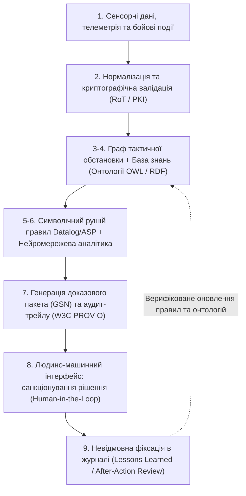

# Розділ 10. Експертні системи військового призначення: інженерія знань та доказовий ШІ

> **Монографія:** [Військова Кібернетика початку XXI століття](README.md) · [Частина IV: Доказовий штучний інтелект та кіберфізична безпека](README.md#частина-iv-доказовий-штучний-інтелект-та-кіберфізична-безпека)  
> **Попередній розділ:** [← Розділ 9. Військова кібернетика стратегічного рівня: управління театром воєнних дій та оборонною стійкістю](Military-Cybernetics-Strategic-Level-UA.md)  
> **Наступний розділ:** [Розділ 11. Експертні системи для БАС, ППО, РЕР та РЕБ →](Military-Expert-Systems-UAS-AD-ELINT-EW-UA.md)  
> **Зміст монографії:** [README.md](README.md)  
> **Автор:** [Микола Федчик (Mykola Fedchyk)](../Expert_Systems_Architecture/about-the-author.md) · [LinkedIn](https://www.linkedin.com/in/nickfedchik/)

Війна різко змінює інженерну ціну інформації. У цивільному програмному середовищі неповні або спотворені дані означають затримку релізу, фінансові витрати чи потребу у виправленні коду. У воєнному контурі управління хибна інтерпретація сигналу, прихована галюцинація статистичної моделі або запізніле рішення коштують життів особового складу та втрати оборонних рубежів. Саме тому аналіз експертних систем військового призначення вимагає значно суворішої інженерної оптики, ніж популярні огляди про «генеративний ШІ на полі бою».

Цей розділ не є посібником із планування атак, наведення, обходу захисту, застосування радіоелектронної боротьби або ведення бойових дій. Такі аспекти не підлягають розкриттю у відкритій науковій праці. Предметом дослідження є архітектура **доказових експертних систем (Evidentiary Expert Systems)**, які допомагають оборонним структурам і штабам працювати з розрізненими даними, плануванням, багатоканальним зв'язком, ризиками, обмеженнями, трасуванням доказів та юридично-командною відповідальністю.

У цій кібернетичній парадигмі експертна система не «воює замість людини». Вона верифікує факти, структурує онтології знань, детерміновано перевіряє інваріанти безпеки, виявляє інформаційні прогалини, моделює стійкість планів, формує дерево доказів і допомагає командиру своєчасно побачити критичні залежності, які легко загубити в інформаційному шумі бою.

---

## 1. Чому військовому управлінню потрібні доказові експертні системи

Військове управління за своєю природою функціонує в умовах неповної, асиметричної та вороже спотвореної інформації. Дані надходять із затримками, джерела суперечать одне одному, канали зв'язку деградують під впливом РЕБ, тактична обстановка змінюється швидше за нормативні цикли документообігу, а противник цілеспрямовано проводить операції інформаційного та радіоелектронного обману (Deception / Spoofing).

Класична база даних надійно зберігає записи. Система зв'язку транспортує пакети. Інформаційна панель ситуаційної обізнаності (COP) візуалізує мітки на мапі. Але командиру та офіцерам штабу в критичний момент потрібне інше: миттєво зрозуміти, що саме змінилося в обстановці, які факти є криптографічно й перехресно підтвердженими, які припущення спираються на застарілі дані, які правила ведення бойових дій (RoE) та електромагнітної сумісності обмежують маневр і де виник конфлікт між повідомленнями різних родів військ.

Сила військової експертної системи полягає не в імітації людської інтуїції, а в безкомпромісній інженерній дисципліні:
- не пропустити жодного обов'язкового правила чи обмеження безпеки;
- не втратити криптографічне та часове походження джерела (Provenance);
- не змішати верифікований факт із імовірнісною гіпотезою;
- не видати відсутність даних (Open-World Ignorance) за підтверджену безпеку сектору;
- не приховати колізію між суперечливими сенсорними спостереженнями;
- не розірвати формальний ланцюг між рекомендацією та первинними доказами;
- не дозволити великій мовній моделі (LLM) формулювати висновок переконливіше, ніж дозволяють верифіковані факти.

---

## 2. Підтримка планування операцій та багатошарова перевірка обмежень

Планування військових операцій — це розв'язання багатовимірної задачі задоволення обмежень (Constraint Satisfaction Problem, CSP) у динамічному середовищі. Воно охоплює ресурси підрозділів, часові вікна, пропускну здатність зв'язку, логістичні плечі, маршрути медичної евакуації (CASEVAC), метеорологічні фактори, технічний ресурс озброєння, правові норми міжнародного гуманітарного права (МГП) та здатність системи управління витримати каскадну відмову вузлів.

У контурі планування експертна система виконує чотири ключові функції:

1. **Формальна перевірка повноти плану (Completeness Verification):** автоматичний аудит наявності обов'язкових контурів забезпечення — основного й резервного зв'язку, інженерних резервів, плеча евакуації, боєкомплекту, часових вікон синхронізації, секторів безпеки цивільної інфраструктури та процедур деградації при втраті зовнішніх сервісів.
2. **Виявлення прихованих ресурсних та просторово-часових конфліктів:** ідентифікація ситуацій, коли два підрозділи одночасно планують використання одного частотного діапазону або ретранслятора, коли логістичний маршрут перетинає сектор роботи дружніх засобів, або коли часова залежність фази операції не узгоджена зі швидкістю розгортання засобів прикриття.
3. **Стрес-тестування стійкості плану (Resilience & What-If Analysis):** моделювання чутливості задуму до відмов — що станеться з керованістю, якщо зникне супутниковий канал, якщо одне з джерел розвідки виявиться хибним або якщо погодні умови знизять дальність оптичної розвідки.
4. **Синтез доказового пакета для затвердження рішення:** формування структурованого досьє для командира, де кожна оцінка супроводжується переліком використаних фактів, рівнем довіри до джерел, явними припущеннями, незнятими ризиками та переліком відхилених альтернатив із поясненням причин їх відхилення.

### 2.1. Алгоритмічний аспект багатокритеріальної експертної підтримки рішень (школа професора В. Г. Тоценка)

Фундаментальний математичний та алгоритмічний апарат для кількісного оцінювання складних альтернатив, побудови розподілених цільових баз знань і узгодження суперечливих експертних суджень був створений українською науковою школою доктора технічних наук, професора **Віталія Георгійовича Тоценка** (який у 1976–1987 роках очолював кафедру військової кібернетики та автоматизованих систем управління КВІРТУ ППО, а з 1987 року заснував наукову школу систем підтримки прийняття рішень в Інституті проблем реєстрації інформації НАН України). У класичній монографії **В. Г. Тоценка *«Методы и системы поддержки принятия решений. Алгоритмический аспект»* (Київ: Наукова думка, 2002. — 382 с.)** та реалізованих під його керівництвом промислових системах сімейства **«Солон» («Солон-1», «Солон-2», «Солон-3»)** і **«Консенсус» («Консенсус-2»)** формалізовано три ключові алгоритмічні контури, безпосередньо критичні для військових експертних систем і штабних СППР:

1. **Метод цільового динамічного оцінювання альтернатив за наявності загроз і ризиків:** головна ціль операції або комплексної цільової програми декомпозується у багаторівневу ієрархічну базу знань (граф цілей, підцілей, критеріїв та контрзаходів протидії загрозам) з урахуванням часової динаміки, ресурсних обмежень та ймовірностей реалізації кожної альтернативи. Відносна ефективність варіанта дій обчислюється через згортку нормованих внесків уздовж графа цілей за одночасного оцінювання дерева загроз і ризиків.
2. **Групові неповні парні порівняння з урахуванням відносної компетентності експертів:** коли оцінювання альтернатив або інформаційних гіпотез виконує група з $K$ фахівців (офіцерів напрямів, аналітиків видів розвідки), їхні індивідуальні матриці парних порівнянь можуть бути неповними і мати різну достовірність. Алгоритм В. Г. Тоценка та його учнів (В. В. Циганка, П. Т. Качанова, С. В. Каденка) обчислює підсумкову вагу $`w_j`$ кожної $j$-ї альтернативи через зважену мультиплікативну або адитивну агрегацію з вагами компетентності $`c_k`$ ($`\sum_{k=1}^K c_k = 1`$), де коефіцієнт компетентності $`c_k`$ визначається об'єктивно на основі апріорної кваліфікації, самооцінки та апостеріорної близькості оцінок $k$-го експерта до узгодженого ядра групи.
3. **Спектральний критерій узгодженості та ітеративний зворотний зв'язок з експертами (Feedback Loop):** агрегувати взаємно суперечливі або внутрішньо нетранзитивні оцінки математично некоректно. Якщо спектральний коефіцієнт узгодженості множини оцінок падає нижче нормативного порога $`S_{\text{cons}} < S_{\min}`$, СППР не усереднює похибки сліпо, а ініціює структурований цикл зворотного зв'язку — локалізує найбільш суперечливі пари суджень і повертає їх відповідним експертам із відображенням аргументованих меж розбіжності до досягнення достатнього порога консенсусу.

---

## 3. Тактичний рівень: детермінована підтримка замість «чорної скриньки»

На тактичному рівні, де час реакції вимірюється секундами, спокуса передати контур прийняття рішень повністю автоматизованим «чорним скринькам» є найвищою — і водночас найнебезпечнішою.

Тактична експертна система повинна діяти як інтелектуальний фільтр і когнітивний підсилювач людини, виконуючи такі задачі:
- агрегація різнорідних повідомлень у єдину нормалізовану картину обстановки;
- чітке візуальне й семантичне розмежування підтверджених фактів та неперевірених гіпотез;
- миттєве виявлення просторово-часових суперечностей між донесеннями сусідніх підрозділів і сенсорів;
- сигналізація про деградацію каналів управління або виникнення «сліпих зон» сенсорного покриття;
- блокування дій, що порушують встановлені директивні межі безпеки або вимагають обов'язкового людського підтвердження;
- невідмовна фіксація стану знань системи на момент ухвалення рішення для подальшого розбору.

---

## 4. Емпіричні уроки сучасної війни для інженерії знань

Досвід високоінтенсивної технологічної війни в Україні сформував п'ять фундаментальних імперативів для проєктування військових експертних систем:

1. **Прискорення верифікації, а не лише транспорту даних:** стиснення циклу «виявлення — розуміння — рішення — дія» (OODA / Kill Chain) без пропорційного підвищення якості перевірки даних лише прискорює масштабування помилок.
2. **Перехід від дефіциту даних до інформаційного перевантаження:** одночасна робота тисяч розвідувальних і ударних БпЛА, наземних роботизованих комплексів, акустичних мереж, пеленгаторів РЕР, супутникових знімків та чатів підрозділів породжує лавину сигналів, де головною задачею стає дедуплікація, відсіювання шуму та оцінка достовірності.
3. **Перманентна робота в деградованому середовищі (DIL — Disconnected, Intermittent, Limited):** система управління не може проєктуватися в припущенні ідеального гігабітного зв'язку; вона мусить зберігати локальну працездатність при втраті пакетів, затримках, фрагментації мережі та активному впливі РЕБ.
4. **Інституціоналізація горизонтальної взаємодії:** бойові підрозділи, екіпажі БпЛА та НРК, групи ППО, підрозділи РЕБ, польові майстерні та аналітичні центри взаємодіють горизонтально в реальному часі; якщо офіційна АСУ не підтримує швидких структурованих горизонтальних зв'язків, управління стихійно мігрує в неструктуровані месенджери й таблиці.
5. **Надшвидке старіння тактичних правил (Knowledge Decay):** зміна частот, прошивок, тактик перехоплення чи алгоритмів завад відбувається щотижня. Тому база знань повинна підтримувати повний життєвий цикл кожного правила: авторство, область чинності, термін актуальності (TTL), версіонування та миттєве відкликання застарілих евристик.

---

## 5. Шість напрямів модернізації операційних систем управління військами

Щоб еволюціонувати від систем відображення карт і документообігу до систем доказового управління, сучасні АСУ військами потребують шести архітектурних трансформацій:

1. **Спільна формалізована доменна онтологія:** єдине машинно-читане визначення сутностей (*Підрозділ*, *Платформа*, *Задача*, *Ресурс*, *Канал*, *Сенсор*, *Подія*, *Обмеження*, *Рішення*, *Доказ*, *Інтервал актуальності*, *Рівень довіри*).
2. **Динамічний граф залежностей (Operational Dependency Graph):** перехід від плоских реляційних таблиць до багатошарового графа, який явно відображає, як виконання задачі залежить від ресурсу, ресурс — від логістики, логістика — від прикриття РЕБ та зв'язку, а рішення — від ланцюжка первинних підтверджень.
3. **Подієво-орієнтована архітектура реального часу (Event-Driven Architecture):** реакція контуру виведення на атомарні криптографічно підписані події (втрата каналу, поява нової сигнатури, зниження довіри до джерела, виникнення конфлікту правил).
4. **Явне числення невизначеності:** кожне твердження системи супроводжується вектором оцінки достовірності, мірою конфлікту джерел та індикатором віку інформації.
5. **Детермінований режим автономної деградації (Local-First / Edge Resilience):** збереження працездатності локального вузла підрозділу при обриві зв'язку з вищим штабом із подальшою безконфліктною синхронізацією (CRDT / Event Sourcing) після відновлення каналу.
6. **Наскрізна пояснюваність (Explainable Inference):** кожна рекомендація або попередження містить пряме посилання на правило, що спрацювало, та первинні факти, які його активували.

---

## 6. Різноканальний зв'язок і кооперація гетерогенних засобів як об'єкт знань

У реальній бойовій архітектурі дані проходять крізь гетерогенне середовище: військові УКХ/КХ радіомережі, повітряні ретранслятори на БпЛА, термінали супутникового зв'язку, оптоволоконні лінії, локальні Mesh-мережі, низькошвидкісні протоколи керування (`LoRa`, `CRSF`, `ELRS`) та міжсистемні шлюзи.

Для експертної системи канал зв'язку є не прозорою «трубою», а **повноцінною сутністю бази знань** із власним вектором стану:

$$
\mathcal{C}_k(t) = \langle B_k(t), \tau_k(t), p_{\text{loss}, k}(t), v_{\max, k}, R_{\text{sovereign}, k}, E_{\text{EMC}, k} \rangle
$$

де $`B_k(t)`$ — доступна пропускна здатність, $`\tau_k(t)`$ — затримка, $`p_{\text{loss}, k}(t)`$ — частка втрачених пакетів, $`v_{\max, k}`$ — кінематичне обмеження швидкості носія (критичне, зокрема, з огляду на те, що комерційні та партнерські супутникові термінали можуть мати жорсткі обмеження швидкості 60–160 км/год, несумісні з крейсерськими режимами швидкісних крилатих БпЛА), $`R_{\text{sovereign}, k}`$ — індикатор суверенності контролю над інфраструктурою каналу, а $`E_{\text{EMC}, k}`$ — чутливість до власних і ворожих засобів РЕБ.

Коли в єдиному просторі взаємодіють повітряні та наземні роботизовані платформи, радіолокаційні станції, комплекси РЕР і станції РЕБ, проста мережева зв'язність ще не створює кооперації. Справжня кооперація виникає тоді, коли експертна система детерміновано контролює **електромагнітну сумісність (ЕМС)**, просторово-часові вікна роботи та взаємні ризики, не допускаючи, щоб увімкнення власного засобу придушення засліпило сусідній розвідувальний контур у критичний момент операції.

---

## 7. Нейросимволічна синергія та формальний апарат Datalog / ASP

Сучасна військова кібернетика відкидає як чисто евристичні системи минулого століття (які не здатні обробляти сирі відеопотоки та спектрограми), так і сліпу довіру до імовірнісних генеративних моделей. Надійним фундаментом виступає **нейросимволічний ШІ (Neuro-Symbolic AI)**, детально обґрунтований у спеціалізованих працях із інженерії знань (зокрема в монографії автора [«Архітектура доказових експертних систем»](../Expert_Systems_Architecture/README.md) та тритомнику [«Експертні системи»](../Expert_Systems/README.md)):

- **Субсимволічний (нейромережевий) шар перцепції:** згорткові та трансформерні моделі комп'ютерного зору (CNN / ViT на бортових прискорювачах), акустичні класифікатори та алгоритми обробки сигналів перетворюють багатовимірний потік сирих сенсорних даних на структуровані гіпотези з оцінками імовірності.
- **Символічний шар детермінованого виведення:** формальні бази знань, онтології та логічні рушії виконують строгу перевірку правил ведення бойових дій (RoE), інваріантів безпеки та ресурсних обмежень.

У системах реального часу та підвищеної відповідальності символічний рушій не може зависнути в нескінченній рекурсії. Тому замість Тюрінг-повних логічних мов без гарантії зупинки застосовуються **Datalog із стратифікованим запереченням (Stratified Datalog)** та **програмування наборів відповідей (Answer Set Programming, ASP)**.

Кожне правило бази знань має форму диз'юнкта Хорна з обмеженнями безпеки змінних:

$$
H(\mathbf{X}) \leftarrow B_1(\mathbf{X}_1) \land \dots \land B_m(\mathbf{X}_m) \land \neg C_1(\mathbf{Y}_1) \land \dots \land \neg C_k(\mathbf{Y}_k)
$$

де всі змінні голови правила $`H(\mathbf{X})`$ та негативних літералів $`\neg C_j(\mathbf{Y}_j)`$ зобов'язані зустрічатися у позитивних предикатах тіла $`B_i(\mathbf{X}_i)`$ (**умова безпеки / Range Restriction**). Це гарантує:
1. **Поліноміальну складність виведення за даними ($P$-completeness):** обчислення єдиної мінімальної моделі (Least Herbrand Model) завершується за строго детермінований скінченний час.
2. **Немонотонне міркування в умовах неповних даних:** стратифіковане заперечення та стабільна семантика моделей (Stable Model Semantics в ASP) дозволяють коректно формалізувати правила виду: *«Маневр або застосування засобу заборонено, якщо НЕ наявне чинне підтвердження ідентифікації ТА НЕ верифіковано відсутність власних платформ у секторі впливу»*.

Приклад формалізованого контуру перевірки безпеки в нотації Datalog:

```prolog
% Правило виявлення застарілості даних (Age of Information перевищує поріг)
stale_evidence(EventID, Now) :-
    observation(EventID, SourceID, Timestamp, _),
    source_policy(SourceID, MaxTTL),
    Now - Timestamp > MaxTTL.

% Правило виявлення електромагнітного конфлікту з власними БпЛА
emc_conflict(EW_ActionID, FriendlyUAV_ID) :-
    planned_ew_sector(EW_ActionID, Sector, FreqBand, TimeWindow),
    active_friendly_uav(FriendlyUAV_ID, Sector, ControlBand, TimeWindow),
    frequency_overlap(FreqBand, ControlBand).

% Інваріант Fail-Closed: блокування рекомендації за наявності незнятих обмежень
action_blocked(ActionID, "EMC_CONFLICT_WITH_FRIENDLY_UAS") :-
    emc_conflict(ActionID, _).

action_blocked(ActionID, "STALE_PRIMARY_EVIDENCE") :-
    depends_on_observation(ActionID, EventID),
    current_time(Now),
    stale_evidence(EventID, Now).

% Рекомендація передається на розгляд командиру лише при повній перевірці
cleared_for_human_review(ActionID) :-
    candidate_action(ActionID),
    valid_roe_compliance(ActionID),
    not action_blocked(ActionID, _).
```

---

## 8. Архітектура дев'яти шарів, доказовий пакет GSN та аудит W3C PROV-O

На системному рівні архітектура військової експертної системи будується з дев'яти ізольованих за відповідальністю шарів:

1. **Шар первинних джерел і сенсорів:** бортова телеметрія БпЛА та НРК, пеленги РЕР/SIGINT, радарні траси, звіти підрозділів та метеодані.
2. **Шар криптографічної валідації та нормалізації:** перевірка цифрових підписів апаратного кореня довіри (RoT / PKI) та приведення повідомлень до єдиної канонічної схеми подій.
3. **Шар онтологій і бази правил:** версіоновані тактичні нормативи, частотно-просторові матриці ЕМС, обмеження RoE та інженерні паспорти платформ.
4. **Динамічний граф обстановки (Tactical Knowledge Graph):** темпоральний граф сутностей і залежностей у реальному часі.
5. **Детермінований рушій логічного виведення (Datalog / ASP Engine):** перевірка несуперечливості фактів, пошук конфліктів та обчислення інваріантів безпеки.
6. **Імовірнісно-аналітичний шар:** просторово-часова кореляція аномалій, оцінка деградації каналів та прогнозування виснаження ресурсів.
7. **Шар синтезу доказового пакета (GSN Generator):** побудова формального дерева аргументації з трасуванням до первинних фактів.
8. **Людино-машинний інтерфейс санкціонування (Human-in-the-Loop):** представлення командиру альтернатив із явною візуалізацією невизначеності та конфліктів.
9. **Шар невідмовного криптографічного аудиту (W3C PROV-O Ledger):** незмінний журнал походження даних і рішень для післядієвого розбору (After-Action Review).



Жодна рекомендація системи не може бути подана оператору як скалярна оцінка без структурованого доказу. Доказовий пакет формалізується як ациклічний орієнтований граф у **нотації структурування цілей (Goal Structuring Notation, GSN)**:

$$
\mathcal{A}_{\text{GSN}} = \langle G, S, C, E, R_{\text{supportedBy}}, R_{\text{inContextOf}} \rangle
$$

де:
- $G$ (**Goals**) — цільові твердження безпеки (наприклад, *«Запланований режим роботи вузла РЕБ не порушує каналів управління суміжних БпЛА у секторі»*);
- $S$ (**Strategies**) — правила декомпозиції твердження на підаргументи (перевірка за частотою, азимутом, висотою та часовим вікном);
- $C$ (**Contexts**) — чинний частотний план, метеоумови та поточний розподіл зон відповідальності;
- $E$ (**Solutions / Evidence**) — криптографічно підписані первинні факти, телеметричні пакети та висновки верифікованих Datalog-правил.

Одночасно кожен вузол доказу $e \in E$ зв'язується у невідмовному графі походження за стандартом **W3C PROV-O**:
- `prov:Entity` — первинне сенсорне повідомлення, знімок, версія правила або згенерований доказовий пакет;
- `prov:Activity` — процес фільтрації, нормалізації, логічного виведення або перегляду людиною з фіксацією точних часових меж $`[t_{\text{start}}, t_{\text{end}}]`$;
- `prov:Agent` — апаратний ідентифікатор сенсора, версія моделі/рушія та цифровий підпис посадової особи, яка санкціонувала рішення (`wasAttributedTo`, `wasDerivedFrom`, `wasGeneratedBy`).

Якщо в дереві $`\mathcal{A}_{\text{GSN}}`$ виявляється хоча б один непідтверджений листовий вузол або розрив походження у графі PROV-O, система автоматично переходить у стан **Fail-Closed**, блокуючи автоматичне просування рекомендації та вимагаючи явної верифікації людиною.

---

## 9. Реальний час, багатошарова таксономія знань і червоні лінії безпеки

Робота експертної системи «в реальному часі» означає не автоматичне прийняття рішень про застосування сили, а гарантовану здатність системи оновлювати картину обстановки, маркувати застарілі факти та виявляти конфлікти швидше, ніж змінюється фізична ситуація на полі бою.

База знань такої системи охоплює сім строго розмежованих шарів:
1. **Доменні знання:** тактико-технічні характеристики платформ, радіуси дії, типи сенсорів, канали зв'язку та організаційна структура.
2. **Процедурні знання:** регламенти взаємодії, ланцюги підпорядкування, умови ескалації та матриці повноважень.
3. **Інженерно-технічні знання:** енергетичні бюджети, залежності між вузлами, вимоги до охолодження, обслуговування та електромагнітної сумісності.
4. **Операційні знання (Lessons Learned):** формалізовані патерни післядієвого розбору, типові сценарії деградації та ознаки ворожого обману.
5. **Нормативно-правові та етичні інваріанти:** обмеження міжнародного гуманітарного права, правила ведення бойових дій (RoE) та захист цивільних об'єктів.
6. **Метазнання про невизначеність:** динамічні рейтинги надійності джерел, пороги часу життя даних (TTL) та правила розв'язання колізій.
7. **Інтроспективні знання про власну систему:** реєстр версій моделей і правил, межі їхньої застосовності (Operational Design Domain) та відповідальні власники правил.

**Червоні лінії проєктування:**
- неприпустимість автоматизаційної упередженості (Automation Bias), коли інтерфейс приховує низьку достовірність даних за впевненим тоном формулювання;
- презумпція недовіри до вхідних сигналів (Zero-Trust Data Ingestion) для захисту від спуфінгу та ін'єкції хибних цілей;
- заборона неконтрольованого самонавчання (Unverified Online Learning) у бойовому контурі без інженерної валідації та підпису нової версії правил;
- нерозривна персональна відповідальність командира за кожне критичне рішення.

---

## 10. Суверенітет військового ШІ, оборонні контракти та перспектива України

Сучасний досвід України та європейських оборонних відомств виявив фундаментальну стратегічну дилему: **суверенітет даних і алгоритмів проти залежності від закритих комерційних платформ**.

### 10.1. Уроки Palantir, європейський курс на On-Premise суверенітет та українська екосистема DELTA / Brave1 Dataroom

Показовим є досвід європейських збройних сил у 2024–2026 роках. Зокрема, швейцарське оборонне відомство (Armasuisse) дев'ять разів відхиляло пропозиції щодо впровадження американської платформи аналізу розвідданих Palantir через ризики втрати цифрового суверенітету та потенційний доступ іноземної юрисдикції до чутливих національних військових баз даних, а командування кіберпростору Бундесверу (ФРН) категорично відмовилося передавати управління даними зовнішнім підрядникам, зробивши ставку на європейські суверенні рішення, що розгортаються виключно на власних захищених серверах (такі як `Clarity` від Helsing, `Arcadia` чи данська C2-система `SitaWare`).

Водночас Україна в умовах повномасштабної війни сформувала прагматичну багатошарову модель:
- ядром оперативної ситуаційної обізнаності та мережецентричного управління виступає суверенна державна екосистема **DELTA** (разом із відеоаналітичним модулем **«Вежа»** та платформою ШІ-розпізнавання **Avengers**), яка перебуває під повним контролем Міністерства оборони України та довела взаємосумісність зі стандартами НАТО;
- для прискореного тренування спеціалізованих моделей комп'ютерного зору та перехоплення повітряних цілей створено захищене середовище **Brave1 Dataroom**, де на верифікованих масивах візуальних і тепловізійних сигнатур (зокрема ударних БпЛА типу «Шахед») вже навчаються десятки спеціалізованих оборонних моделей українських та союзних розробників за суворого збереження контролю держави над первинними даними.

### 10.2. Шість вимог до програмного забезпечення у сучасних оборонних контрактах

Як зазначають практики українського Defense Tech (зокрема на основі досвіду міжнародної кооперації компанії «Генерал Черешня»), у сучасному оборонному секторі програмне забезпечення перестало бути «безкоштовним додатком до заліза» і перетворилося на самостійний предмет контрактування та аудиту безпеки. Для інтеграції військових експертних систем і бортового ПЗ у державні та міжнародні оборонні замовлення обов'язковими стають шість інженерних вимог:

1. **Криптографічно підтверджене походження коду та збірок (Build Provenance & Version Control):** повна відтворюваність кожної версії ПЗ і бази правил.
2. **Прозорість залежностей (SBOM — Software Bill of Materials):** виключення вразливих, неліцензованих або скомпрометованих сторонніх бібліотек.
3. **Аудитований життєвий цикл розробки (Secure SDLC & Change Control):** неможливість несанкціонованої зміни алгоритму чи правила без проходження верифікаційних тестів.
4. **Комплаєнс походження компонентів:** суворе підтвердження відсутності програмних і апаратних закладок з юрисдикцій держав-агресорів.
5. **Суверенітет і локалізація даних (Data Residency & Sovereignty):** гарантія того, що бойова телеметрія, мапи та журнали рішень не залишають захищеного національного контуру.
6. **Стандартизована інтероперабельність із системами C2:** відкриті інтерфейси обміну подіями та метаданими достовірності зі штабними системами управління.

Для України, яка спирається як на фундаментальну спадковість інженерних шкіл КВІРТУ ППО, КВВІУЗ, КВІУС та ВІТІ імені Героїв Крут (зокрема наукові школи кафедри військової кібернетики та АСУ: професора **В. Г. Тоценка**, автора фундаментальної монографії *«Методы и системы поддержки принятия решений. Алгоритмический аспект»* (2002); професора **Л. М. Осинського**, який у працях 1990 та 1999 років заклав теоретичні основи побудови середовищ управління на базі систем обробки знань і автоматичного синтезу рішень в умовах неповноти, нечіткості та суперечливості розподіленого інформаційного середовища; та професора **Б. М. Герасимова**, автора теорії людино-машинних СППР з елементами штучного інтелекту), так і на безпрецедентний практичний досвід сучасної війни, найперспективнішим шляхом є розбудова **федеративної мережі сумісних доказових модулів** — від децентралізованих вузлів тактичного рівня до оперативно-стратегічних графів знань.

---

## Підсумок

Експертні системи військового призначення не є інструментом автономної війни без участі людини. Їхня фундаментальна інженерна місія полягає в тому, щоб зробити бойове управління доказовим, стійким до завад і дезінформації, прозорим для аудиту та захищеним від когнітивного перевантаження штабів.

У війні високої інтенсивності перемагає не та сторона, яка накопичує більший обсяг сирих відеопотоків чи радіоперехоплень, а та, чия архітектура управління здатна швидше й надійніше перетворити сирий сигнал на верифіковане знання, знання — на прораховані та безпечні варіанти маневру, а рішення командира — на формалізований досвід для наступного циклу протиборства. Бо у військових системах найнебезпечнішим є не обережний висновок із вказаними межами невизначеності, а самовпевнена рекомендація «чорної скриньки», яка не здатна довести, звідки вона взялася.

---

## Посилання

- Тоценко В. Г. *Методы и системы поддержки принятия решений. Алгоритмический аспект*. — К.: Наукова думка, 2002. — 382 с.
- Тоценко В. Г. *Обобщенная концепция экспертных систем диагностирования* // Электронное моделирование. — 1995. — № 5. — С. 26–33.
- Totsenko V. G., Tsyganok V. V. *Method of Paired Comparisons Using Feedback with Expert* // Journal of Automation and Information Sciences. — 1999. — Vol. 31, No. 9. — P. 86–97. DOI: [10.1615/JAutomatInfScien.v31.i9.90](https://doi.org/10.1615/JAutomatInfScien.v31.i9.90)
- Zgurovsky M. Z., Totsenko V. G., Tsyganok V. V. *Group Incomplete Paired Comparisons with Account of Expert Competence* // Mathematical and Computer Modelling. — 2004. — Vol. 39, No. 4–5. — P. 349–361. DOI: [10.1016/S0895-7177(04)90512-2](https://doi.org/10.1016/S0895-7177(04)90512-2)
- Totsenko V. G. *On One Approach to Decision Making Support for Formation of Complex Target-Oriented Programs in the Presence of Threats and Risks. Parts 1–2* // Journal of Automation and Information Sciences. — 2004. — Vol. 36, No. 7, P. 62–69; No. 11, P. 55–61.
- Осинський Л. М. *Построение автоматизированной среды организационного управления на основе систем представления и обработки знаний* // Управляющие системы и машины (УСиМ). — 1990. — № 3.
- Осинський Л. М. *Методологія автоматичного синтезу рішень в умовах неповноти, нечіткості і суперечливості розподіленого інформаційного середовища* // Захист інформації. — 1999. — № 1.
- Герасимов Б. М., Тарасов В. О., Токарєв І. В. *Человеко-машинные системы принятия решений с элементами искусственного интеллекта*. — К.: Наукова думка, 1993. — 184 с.
- [Київське вище інженерне радіотехнічне училище протиповітряної оборони (КВІРТУ ППО) — Вікіпедія](https://uk.wikipedia.org/wiki/%D0%9A%D0%B8%D1%97%D0%B2%D1%81%D1%8C%D0%BA%D0%B5_%D0%B2%D0%B8%D1%89%D0%B5_%D1%96%D0%BD%D0%B6%D0%B5%D0%BD%D0%B5%D1%80%D0%BD%D0%B5_%D1%80%D0%B0%D0%B4%D1%96%D0%BE%D1%82%D0%B5%D1%85%D0%BD%D1%96%D1%87%D0%BD%D0%B5_%D1%83%D1%87%D0%B8%D0%BB%D0%B8%D1%89%D0%B5_%D0%BF%D1%80%D0%BE%D1%82%D0%B8%D0%BF%D0%BE%D0%B2%D1%96%D1%82%D1%80%D1%8F%D0%BD%D0%BE%D1%97_%D0%BE%D0%B1%D0%BE%D1%80%D0%BE%D0%BD%D0%B8)
- [Військовий інститут телекомунікацій та інформатизації імені Героїв Крут (ВІТІ) — Вікіпедія](https://uk.wikipedia.org/wiki/%D0%92%D1%96%D0%B9%D1%81%D1%8C%D0%BA%D0%BE%D0%B2%D0%B8%D0%B9_%D1%96%D0%BD%D1%81%D1%82%D0%B8%D1%82%D1%83%D1%82_%D1%82%D0%B5%D0%BB%D0%B5%D0%BA%D0%BE%D0%BC%D1%83%D0%BD%D1%96%D0%BA%D0%B0%D1%86%D1%96%D0%B9_%D1%82%D0%B0_%D1%96%D0%BD%D1%84%D0%BE%D1%80%D0%BC%D0%B0%D1%82%D0%B8%D0%B7%D0%B0%D1%86%D1%96%D1%97_%D1%96%D0%BC%D0%B5%D0%BD%D1%96_%D0%93%D0%B5%D1%80%D0%BE%D1%97%D0%B2_%D0%9A%D1%80%D1%83%D1%82)
- [Війська зв'язку та кібербезпеки Збройних Сил України — Міністерство оборони України](https://mod.gov.ua/pro-nas/vijska-zv-yazku-ta-kiberbezpeki)
- [Військовий ШІ, від якого відмовилася Швейцарія і з яким працює Україна: чому Європа шукає альтернативу Palantir та як працюють DELTA і Brave1 Dataroom — AIN Defense Tech](https://ain.ua/2026/11/16/viiskovii-si-vid-iakogo-vidmovilasia-sveicariia-i-z-iakim-praciuje-ukrayina-comu-jevropa-sukaje-alternativu-palantir-i-ci-zmoze-zaminiti/)
- [Шість вимог до програмного забезпечення в оборонних контрактах та уроки масштабування — Олександр Білоусов («Генерал Черешня»), DOU DefTech](https://dou.ua/forums/topic/63010/)
- [Brave1 — Кластер оборонних технологій України](https://brave1.gov.ua/)
- [Федчик М. Архітектура доказових експертних систем (відкрита монографія)](../Expert_Systems_Architecture/README.md)

---

[← Розділ 9. Військова кібернетика стратегічного рівня: управління театром воєнних дій та оборонною стійкістю](Military-Cybernetics-Strategic-Level-UA.md) | [Зміст монографії](README.md) | [Розділ 11. Експертні системи для БАС, ППО, РЕР та РЕБ →](Military-Expert-Systems-UAS-AD-ELINT-EW-UA.md)
