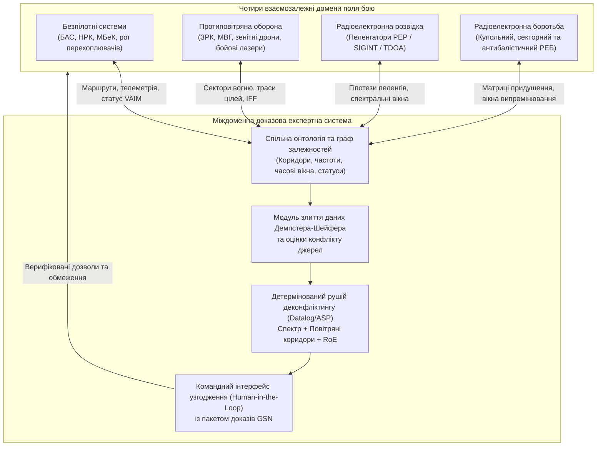

# Експертні системи для БАС, ППО, РЕР та РЕБ: міждоменний деконфліктинг і доказова синхронізація

> **Тематичний напрям:** [Військова кібернетика та доказові системи управління](README.md) · Прикладні міждоменні експертні системи  
> **Пов'язані статті:** [Експертні системи військового призначення](Military-Expert-Systems-UA.md) · [Автономна навігація БАС та НРК без GNSS](Autonomous-Navigation-GNSS-Denied-MilTech-UA.md) · [Апаратний корінь довіри та антиспуфінг у MilTech IoT](Hardware-Root-Of-Trust-And-Anti-Spoofing-Military-IoT-UA.md)  
> **Автор:** [Микола Федчик (Mykola Fedchyk)](../Expert_Systems_Architecture/about-the-author.md) · [LinkedIn](https://www.linkedin.com/in/nickfedchik/)

Загальна інженерна архітектура доказових експертних систем військового призначення — від формальних онтологій і Datalog-рушіїв до аргументів безпеки GSN та невідмовного аудиту W3C PROV-O — проходить своє найсуворіше випробування на перетині високодинамічних бойових середовищ. Найвищої інженерної складності та щільності взаємних залежностей на сучасному театрі воєнних дій досягає взаємодія чотирьох доменів: **військ безпілотних систем (БАС / НРК / МБеК)**, **протиповітряної оборони (ППО)**, **радіоелектронної розвідки (РЕР / ELINT / SIGINT)** та **радіоелектронної боротьби (РЕБ / EW)**.

Ця стаття свідомо зберігає теоретико-архітектурну рамку. Вона не є посібником із тактики бойового застосування, наведення, обходу засобів ППО чи конфігурування завад. Її фокус — математичні моделі злиття суперечливих даних, онтологічне узгодження чотирьох родів сил, алгоритми просторово-частотного деконфліктингу, апаратно-програмний поділ обчислень між бортом і штабом та верифікація рішень за участю людини.

Головна теза роботи: **експертна система на перетині БАС, ППО, РЕР і РЕБ є не «автоматичним командиром», а доказовим кібернетичним шаром синхронізації, який унеможливлює взаємне засліплення та дружній вогонь у спільному електромагнітному і повітряному просторі**.

---

## 1. Природа міждоменної взаємозалежності: чотири контури в єдиному просторі

Складність інтеграції БАС, ППО, РЕР і РЕБ полягає в тому, що ці чотири домени одночасно конкурують за два спільні фізичні ресурси — **електромагнітний спектр** та **повітряний/наземний простір маневру**:

- **Безпілотні системи (БАС, НРК, морські дрони):** забезпечують розвідку, ретрансляцію, логістику та вогневе ураження, але критично залежать від радіоканалів або супутникової телеметрії, нечутливості навігації до завад та безпечних коридорів прольоту крізь зони власної ППО.
- **Протиповітряна оборона (ППО):** вимагає безпомилкової ідентифікації «свій — чужий», мінімального часу реакції на комбіновані хвилі цілей (від низьковисотних БпЛА до реактивних дронів і балістичних ракет) та гарантованої відсутності дружніх безпілотників на лінії перехоплення.
- **Радіоелектронна розвідка (РЕР):** потребує «тихих» спектральних вікон та високої чутливості приймальних трактів для пеленгації слабких і стрибкоподібних сигналів противника (FHSS / ППРЧ), які легко маскуються випромінюванням власних передавачів та станцій РЕБ.
- **Радіоелектронна боротьба (РЕБ):** здійснює активний енергетичний вплив на спектр, який за відсутності автоматизованого деконфліктингу здатен придушити навігацію і канали керування власних БпЛА, засліпити приймачі РЕР або спотворити канали координації мобільних вогневих груп ППО.

---

## 2. Напрямок 1: Спільна машинно-читана доменна онтологія

Перша передумова кооперації — перехід від обміну текстовими повідомленнями до єдиної формальної онтології сутностей:
- **для БАС та НРК:** ідентифікатор платформи, тип місії, полігон/коридор маршруту, висотний ешелон, основний і резервний частотні канали (`IP/TCP`, `LoRa`, `CRSF`, `ELRS`), стан бортової оптичної навігації, енергетичний залишок, статус апаратної атестації та вектор аварійного повернення (RTH);
- **для ППО:** зона відповідальності, кінематичний клас засобу ураження (зенітний ракетний комплекс, мобільна вогнева група, гвинтовий чи реактивний дрон-перехоплювач, турель із гіростабілізацією або лазерна установка), достовірність класифікації цілі, статус повітряного коридору («вільний / закритий для своїх БпЛА»);
- **для РЕР:** центральна частота $`f_c`$, смуга $`\Delta f`$, модуляція, лінія пеленга (LOB) або еліпс локації (TDOA/FDOA), відношення сигнал/шум, повторність сигнатури та апостеріорна достовірність гіпотези;
- **для РЕБ:** просторовий сектор подавлення, діапазон частот, потужність випромінювання, часовий інтервал активності $`[t_1, t_2]`$, розрахунковий радіус побічного впливу на дружні приймачі та відповідальний суб'єкт санкціонування.

---

## 3. Напрямок 2: Багатошаровий граф обстановки і залежностей

Табличне подання даних не дозволяє миттєво оцінити каскадні наслідки подій. Тому обстановка моделюється як **багатошаровий темпоральний граф** $`\mathcal{G}(t) = (V, E_{\text{spatial}} \cup E_{\text{RF}} \cup E_{\text{causal}})`$:
- якщо пеленгатор РЕР виявляє нове випромінювання у секторі, граф автоматично зв'язує цю подію з маршрутами дружніх розвідувальних БпЛА у цьому ж квадраті;
- якщо планується активація секторного РЕБ або робота зенітних дронів-перехоплювачів, алгоритм досяжності на графі за мілісекунди знаходить усі дружні платформи та ретранслятори, чиї канали зв'язку або траєкторії перетинають зону дії, і підсвічучує колізію до моменту видачі наказу.

---

## 4. Напрямок 3: Невизначеність як перший клас даних та комбінування доказів Демпстера — Шейфера

У бойовій обстановці класична байєсівська імовірність часто є недостатньою, оскільки вона вимагає розподілити одиницю імовірності між усіма гіпотезами навіть тоді, коли джерело має лише часткову інформацію (не здатне розрізнити підкласи цілі). Тому у військових експертних системах застосовується **теорія доказів Демпстера — Шейфера (Dempster-Shafer Evidence Theory)**.

Нехай $`\Theta = \{\theta_1, \theta_2, \dots, \theta_n\}`$ — фрейм розрізнення (множина взаємовиключних гіпотез про природу об'єкта у секторі). Кожне незалежне джерело $`i`$ (радар ППО, пеленгатор РЕР, акустичний сенсор або тепловізійна камера БпЛА) задає базовий розподіл маси довіри (Basic Probability Assignment, BPA) $`m_i: 2^{\Theta} \to [0, 1]`$, де:

$$
m_i(\emptyset) = 0, \qquad \sum_{A \subseteq \Theta} m_i(A) = 1
$$

Причому маса $`m_i(\Theta)`$ явно кількісно виражає **міру незнання (епістемічної невизначеності)** джерела $`i`$. Тоді кожна підмножина гіпотез $`A \subseteq \Theta`$ характеризується інтервалом невизначеності між **функцією довіри (Belief)** та **функцією правдоподібності (Plausibility)**:

$$
\text{Bel}(A) = \sum_{B \subseteq A} m(B), \qquad \text{Pl}(A) = \sum_{B \cap A \neq \emptyset} m(B), \qquad \text{Bel}(A) \le P(A) \le \text{Pl}(A)
$$

Комбінування свідчень двох незалежних джерел $`m_1`$ та $`m_2`$ виконується за ортогональним правилом Демпстера:

$$
m_{1 \oplus 2}(A) = \frac{1}{1 - K} \sum_{B \cap C = A} m_1(B) m_2(C), \qquad A \neq \emptyset
$$

де коефіцієнт конфлікту джерел $`K`$ дорівнює:

$$
K = \sum_{B \cap C = \emptyset} m_1(B) m_2(C)
$$

**Критичне інженерне правило безпеки:** якщо коефіцієнт конфлікту перевищує безпечний поріг ($`K > K_{\text{crit}}`$, наприклад, коли радар ППО класифікує ціль як ворожий БпЛА, а система обліку польотів своїх БАС сигналізує про можливе перебування у цьому квадраті дружнього розвідника з втраченим зв'язком), класична нормалізація Демпстера на $`(1 - K)`$ **блокується**, оскільки вона штучно приховує суперечність. Натомість маса конфлікту $`K`$ за правилом Ягера (Yager's modification) переноситься у невідомість $`m(\Theta)`$ або виділяється у явний предикат `high_sensor_conflict(TargetID, K)`, що примусово переводить контур у режим обов'язкової перевірки людиною (Human-in-the-Loop).

---

## 5. Напрямок 4: Подієва архітектура реального часу та бітемпоральна модель часу

Усі події в системі обробляються у **бітемпоральній моделі часу**, яка розрізняє два часові виміри:
1. **Час дійсності події ($`t_{\text{valid}}`$):** коли фізичне явище (спалах пеленга, виявлення цілі, маневр) реально відбулося на місцевості.
2. **Транзакційний час системи ($`t_{\text{tx}}`$):** коли пакет після затримок у ретрансляторах та чергах надійшов у базу знань штабу.

Без розділення $`t_{\text{valid}}`$ і $`t_{\text{tx}}`$ пакет із запізненням у 40 секунд може перезаписати актуальну координату високошвидкісної цілі, а під час післядієвого розбору буде неможливо встановити, які саме факти були відомі системі та командиру в секунду прийняття рішення $`t_{\text{decision}}`$.

---

## 6. Напрямок 5: Людино-машинна взаємодія та рольова адаптація пояснень

Надлишок сирих даних паралізує управління так само, як і їх нестача. Експертна система формує **рольові проєкції єдиного доказового ядра**:
- **оператору БпЛА/НРК** виводяться межі безпечного коридору, прогноз радіовидимості ретранслятора, попередження про сектор дії дружнього РЕБ та статус цілісності бортової навігації;
- **розрахунку та пункту управління ППО** — класифікація повітряної цілі, інтервал достовірності $`[\text{Bel}, \text{Pl}]`$, статус вільності сектору від власної авіації та кінематична досяжність;
- **аналітику РЕР** — граф зв'язку нової сигнатури з історичними профілями випромінювачів та еліпс пеленгації;
- **черговому з РЕБ** — матриця побічного впливу запланованого подавлення на сусідні дружні засоби зв'язку і безпілотники.

---

## 7. Напрямок 6: Експертні системи для військ безпілотних систем (БАС та НРК)

Для безпілотних авіаційних, наземних і морських роботизованих систем експертна архітектура охоплює шість прикладних інженерних контурів:

1. **Перелітна верифікація та місійний деконфліктинг:** автоматична перевірка енергетичного балансу, працездатності сенсорів, метеообмежень, перетину з активними зонами власного РЕБ та коридорами роботи ППО.
2. **Автономна навігація в умовах пригнічення ГНСС (GNSS-Denied):** із розширенням сучасної фронтової «кіл-зони» до 20–25 км бортовий навігаційний комплекс у повітрі поєднує **візуально-інерціальну одометрію (VIO)** на базі багатостанового фільтра Калмана (MSCKF / OpenVINS), оптичну стабілізацію над підстилаючою поверхнею (класу українських систем `StabX` на розвідниках `Slavic`, що утримують позицію до 30 хвилин на висоті до 1 км без GPS) та кореляцію з цифровими картами рельєфу (DSMAC / DEM), а в наземному домені НРК — зіставлення лідарних хмар точок із тривимірними цифровими моделями маршруту (`Farsight Vision`, `Apex AI` у першій 20-кілометровій автономній місії полку «Лава» корпусу «Хартія») та оптико-одометричне повернення пройденим треком при втраті зв'язку (`Tencore AI KIT`, що зберігає понад $`30\%`$ парку роботів підрозділу).
3. **Бортовий нейросимволічний стек (Edge NPU + Lockstep RTOS):** нейромережевий прискорювач (Jetson Orin, Hailo-8 або спеціалізовані модулі класу `Aura AI`) виконує детекцію та супровід об'єктів, тоді як детермінований арбітр на мікроконтролері Lockstep під керуванням RTOS верифікує інваріанти безпеки польоту та правила місії.
4. **Візуальний автономний моніторинг цілісності (VAIM — Visual Autonomous Integrity Monitoring):** статистична перевірка узгодженості оптичного потоку з фізичною моделлю інерціального вимірювального блока (IMU) через відстань Махаланобіса:

$$
d_M = \sqrt{(z - \hat{z})^T S^{-1} (z - \hat{z})} \le \gamma_{\text{threshold}}
$$

де $`z`$ — вектор вимірювання оптичного потоку камери, $`\hat{z}`$ — прогноз за інтегруванням IMU, $`(z - \hat{z})`$ — вектор інновації, а $`S`$ — коваріаційна матриця сумарної похибки. Якщо задимлення, лазерне засліплення або зрив текстури викликають стрибок $`d_M > \gamma_{\text{threshold}}`$, бортовий експертний арбітр миттєво відкидає хибні візуальні вимірювання і переводить платформу в стабілізований інерціальний режим.

5. **Супервізорне групове управління («один пілот — п'ять дронів») та децентралізовані C2 для НРК:** перехід від ручного пілотування одиничних апаратів до групового управління роями БпЛА (вже випробуваного на фронті в межах ініціатив Brave1 та консолідованого угодою між розробником ройового ШІ `Swarmer` і виробником наземних роботів `Ratel Robotics`) та об'єднання десятків різнорідних наземних платформ у єдину децентралізовану тактичну мережу (комплекс «Хмарка» з протоколом `MAVLink 2` поверх IP/TCP та резервних радіоканалів `LoRa / CRSF / ELRS`, НАТО-сумісний бортовий комп'ютер `JARVIS`, системи керування `Droid Box` і `NC13`, екосистема `Tencore Ecosystem`, інтеграційна шина `MOSAIC UXS` та контур верифікації місій НРК у системі `DELTA` з обсягом понад $`31\,000`$ місій на місяць).
6. **Апаратний корінь довіри та флотна атестація:** криптографічна перевірка цілісності прошивки й конфігурації кожного борту перед підключенням до тактичної мережі підрозділу.

---

## 8. Напрямок 7: Експертні системи для ППО та кінематико-економічний баланс перехоплення

Сучасна протиповітряна оборона працює в умовах безпрецедентної різнорідності повітряних загроз — від масових хвиль поршневих ударних БпЛА до реактивних модифікацій і балістичних ракет. Експертна система підтримки ППО вирішує чотири фундаментальні задачі:

1. **Імовірнісно-доказова класифікація та запобігання дружньому вогню:** інтеграція даних радіолокаційних станцій, пасивних пеленгаторів, акустичних мереж та реєстру польотів власних БпЛА для гарантування безпеки власних бортів.
2. **Кінематичний та економічний розподіл засобів перехоплення (Weapon-Target Assignment):** врахування фізичних меж перехоплювачів. Як показує сучасний інженерний аналіз повітряної війни, перехід противника від тихохідних гвинтових «Шахедів» ($`v_T \approx 145\text{ км/год}`$, висота до $`2000\text{ м}`$) до турбореактивних модифікацій типу Shahed-238 ($`v_T \approx 740\text{ км/год}`$, стеля до $`8800\text{ м}`$) створює фундаментальний фізичний бар'єр для гвинтових дронів-перехоплювачів, чия максимальна швидкість обмежена аеродинамікою гвинта на рівні $`v_M \approx 450\text{ км/год}`$. За умови $`v_M < v_T`$ перехоплення наздоганянням у задню півсферу стає кінематично неможливим, а перехоплення на зустрічних курсах ($`V_c = v_M + v_T \approx 330\text{ м/с}`$) скорочує часове вікно термінального донаведення до часток секунди. Тому експертна система ППО при розподілі цілей повинна враховувати швидкісно-висотний профіль загрози, комбінуючи зенітні дрони-перехоплювачі (включно з мобільними пусковими контейнерами перехоплювачів на базі НРК `Ratel` та `HECTHOR`) з дешевими зенітними ракетами малої дальності, гіростабілізованими турелями (зокрема морського базування класу `APEX PREDATOR` і `«Хижак»` на катерах `MV11`, наземними кодифікованими протидроновими комплексами `TerMIT + «Хижак»`, роботизованими платформами ППО `Milrem THeMIS` у 60-й ОМБр та бортовими комплексами активного захисту НРК сіткового типу `«Тарантул»` і `«Мангал»`) та мобільними бойовими лазерними комплексами (які вже проходять фронтові випробування в Україні для кардинального зниження вартості пострілу).
3. **Узгодження з РЕБ та авіацією:** автоматичний контроль безпечних коридорів та висотних ешелонів.
4. **Формалізоване післядієве навчання:** збереження повного сліду радарних, акустичних і командних подій для вдосконалення алгоритмів виявлення нових профілів польоту.

---

## 9. Напрямок 8: Експертні системи для РЕР (ELINT / SIGINT)

Радіоелектронна розвідка оперує фрагментарними, зашумленими та часто навмисно імітованими сигналами. В українській школі військової радіоелектроніки (зокрема на створеному у травні 1978 року в КВІРТУ ППО **Факультеті № 4 — факультеті радіотехнічної розвідки**, який у 1994–1995 роках у складі КВІУС було трансформовано у **Факультет радіоелектронної розвідки — РЕР**, та на профільній кафедрі РТР/РЕР під керівництвом д.т.н., проф. **Ю. О. Смирнова**, к.т.н., доц. **В. С. Рубцова** і к.т.н., доц. **О. О. Солов'яна**) математичне ядро цієї задачі спиралося на теорію статистичного самонавчання при класифікації сигналів в умовах апріорної невизначеності д.т.н., проф. **О. В. Миленького** (1975) та адаптивної просторово-часової обробки сигналів д.т.н., проф. **В. П. Прокоф'єва**. Сучасна експертна система РЕР розвиває цей фундамент і забезпечує:
- побудову темпорального графа зв'язків між виявленими радіочастотними сигнатурами, пеленгами та ідентифікованими вузлами управління противника;
- відокремлення реальних робочих мереж від хибних радіомаяків та імітаторів за сукупністю просторово-часових та модуляційних ознак (включно з непараметричною кластеризацією нових випромінювачів без попередньої навчальної вибірки);
- автоматичне формування запитів на дорозвідку суміжними засобами (наприклад, оптичним БпЛА з тепловізійною камерою вітчизняного виробництва) у секторі перетину ліній пеленгації.

---

## 10. Напрямок 9: Експертні системи для РЕБ, спектральний деконфліктинг та протидія балістиці

Для радіоелектронної боротьби експертна система виступає головним запобіжником від самопридушення та інструментом координації складних багаторівневих впливів.

### 10.1. Формальна умова просторово-частотно-часового деконфліктингу

Кожна активна станція РЕБ $`j`$ з потужністю еквівалентного ізотропного випромінювання $`P_{\text{EIRP}, j}`$ у смузі $`\Delta f_j`$ та секторі діаграми спрямованості $`G_j(\phi, \theta)`$ створює на вході приймача дружнього засобу $`i`$ (БпЛА, ретранслятора або станції РЕР) на відстані $`R_{ji}`$ завадовий потенціал. Умова безпечної електромагнітної сумісності в базі знань формалізується через інваріант захисного відношення сигнал/завада (SINR):

$$
\text{SINR} _ i(t) = \frac{P _ {\text{rx}, i}(t)}{N _ 0 \Delta f _ i + \sum _ {j \in \mathcal{J} _ {\text{active}}(t)} P _ {\text{EIRP}, j} G _ j(\phi _ {ji}, \theta _ {ji}) L _ {\text{path}}(R _ {ji}, f _ j) \cdot \eta(\Delta f _ i, \Delta f _ j)} \ge \gamma _ {\min, i}
$$

де $`L _ {\text{path}}(R _ {ji}, f _ j)`$ — загасання радіохвилі на трасі з урахуванням рельєфу місцевості, а $`\eta(\Delta f _ i, \Delta f _ j) \in [0, 1]`$ — коефіцієнт спектрального перекриття каналів. Якщо активація засобу $`j`$ призводить до порушення нерівності $`\text{SINR} _ i(t) < \gamma _ {\min, i}`$ для критичної дружньої місії $`i`$, Datalog-рушій миттєво сигналізує про колізію і пропонує перехід дружнього БпЛА на резервний частотний діапазон або в режим автономної оптико-інерціальної утримки.

### 10.2. Кібернетична логіка багаторівневої протидії високошвидкісним і балістичним цілям

Показовим прикладом інтелектуальної координації РЕБ є сучасні асиметричні підходи України до протидії балістичним ракетам (зокрема 9М723 комплексу «Іскандер-М»). Такі ракети поєднують автономну інерціальну навігаційну систему (ІНС), захищені багатоелементні CRPA-антени супутникової корекції (сімейства «Комета» на 4–16 елементів, які формують просторові «нулі» діаграми спрямованості в бік одиночних джерел завад) та активні радіолокаційні головки самонаведення (АРГСН типу 9Б918), що вмикаються на фінальній ділянці траєкторії під час аеродинамічного гальмування ракети в щільних шарах атмосфери.

Оскільки засоби РЕБ фізично не можуть вимкнути внутрішні гіроскопи та акселерометри ІНС, експертна система багаторівневого РЕБ координує двофазний асиметричний вплив:
1. **Просторово-розподілене багатовекторне придушення CRPA-антен:** синхронна робота кількох рознесених станцій завад перевищує кількість ступенів свободи фазованої решітки ($`M_{\text{jammers}} \ge N_{\text{elements}}`$), зриваючи супутникову корекцію і залишаючи ракету на чистій інерціальній навігації, похибка якої зростає квадратично з часом польоту.
2. **Радіолокаційна дезорієнтація у термінальному вікні:** у короткому часовому вікні увімкнення активної РЛС самонаведення 9Б918 задіюються пасивні кутові відбивачі та активні DRFM-імітатори хибних радіолокаційних цілей, що зміщують енергетичний центр відбиття і відводять точку прицілювання від об'єкта захисту.

---

## 11. Напрямок 10: Цифрові двійники, симуляція відмов та замкнений контур After-Action Review

Цифровий двійник міждоменної системи управління моделює не «ідеальну карту», а поведінку контуру під час каскадних збоїв: втрати ретранслятора, затримки пакетів на 15–30 секунд, появи дубльованих донесень у чатах, відмови GPS-модуля або суперечності між даними РЕР і радара ППО.

Кожен бойовий епізод завершується формалізованим циклом **After-Action Review (AAR)**: порівнянням того, що система знала і рекомендувала в момент $`t_{\text{decision}}`$, із фактично верифікованим результатом. Це дозволяє виявляти систематичні похибки джерел і оновлювати правила деконфліктингу без втрати інституційної пам'яті під час ротації особового складу.

---

## 12. Напрямок 11: Стійкість до ворожого обману (Adversarial Resilience) та захист бази знань

Противник цілеспрямовано атакує не лише канали зв'язку, а й когнітивну модель системи управління (Data Poisoning, хибні випромінювачі-приманки, акустичні імітатори, спуфінг телеметрії). Архітектура захисту включає:
- вимогу мультимодального перехресного підтвердження (наприклад, поєднання радіопеленга РЕР з акустичною або оптичною верифікацією) перед присвоєнням цілі високого пріоритету;
- суворе обмеження ролі великих мовних моделей (LLM): мовна модель має право лише резюмувати верифіковані факти з обов'язковими посиланнями на ідентифікатори подій у графі знань (`[EventID, SourceID, Timestamp]`), але ніколи не виступає джерелом правил чи фактів;
- криптографічне підписання самої бази знань та таблиць маршрутизації правил, що унеможливлює несанкціоновану зміну порогів довіри або частотних масок.

---

## 13. Напрямок 12: Розподілена обчислювальна архітектура (CPU / GPU / Edge NPU) і метрики якості

Обчислювальне навантаження експертної системи розподіляється за принципом фізичної близькості до джерела даних:
- **Edge NPU + Lockstep MCU (на борту БпЛА, НРК, турелі):** первинне розпізнавання образів, оптична навігація (VIO / `StabX`), контроль цілісності VAIM та апаратний арбітраж Simplex із латентністю 1–10 мс;
- **Польовий сервер підрозділу (CPU + локальний GPU):** децентралізоване управління групою платформ (рівень систем класу «Хмарка»), локальний Datalog-рушій електромагнітного деконфліктингу та кешована база знань, здатна працювати автономно без зв'язку з центром;
- **Оперативний контур штабу (кластер CPU / GPU у захищеному суверенному хмарному або On-Premise середовищі класу DELTA / Brave1 Dataroom):** міждоменна кореляція даних ППО, РЕР, РЕБ і БАС, генерація доказових пакетів GSN, післядієвий аналіз і тренування оновлених моделей.

**Ключові інженерні метрики оцінки такої системи:**
- середній час виявлення просторово-частотного конфлікту між власними засобами ($`\tau_{\text{deconflict}}`$);
- частка рекомендацій із повним трасуванням у графі W3C PROV-O (цільовий показник — $`100\%`$);
- коефіцієнт калібрування невизначеності (відповідність інтервалів $`[\text{Bel}, \text{Pl}]`$ фактичній частоті підтвердження подій);
- час збереження керованості вузла після повного відключення зовнішніх супутникових каналів;
- тривалість циклу від виявлення нової тактики чи частоти противника до розгортання верифікованого оновлення правила у підрозділах.

---

## 14. Українська інженерна спадкоємність та перспектива інтеграції

Унікальність української позиції у розвитку міждоменних експертних систем для БАС, ППО, РЕР і РЕБ полягає у поєднанні двох факторів:
1. **Фундаментальної школи військової кібернетики та радіоелектроніки:** безперервна лінія наступництва від створеного 1 лютого 1953 року КВІРТУ ППО — його **Факультету № 1 автоматизованих систем управління** (з березня 1959 р.; школа теорії автоматів, дослідження операцій та інженерії знань Є. М. Вавилова, Л. М. Осинського, О. Я. Матова, Б. М. Герасимова), **Факультету № 2 радіолокаційних систем** (з березня 1959 р.; школа вторинної цифрової обробки РЛ-інформації С. З. Кузьміна, самонавчального розпізнавання сигналів О. В. Миленького, теорії надійності М. А. Шишонка і Б. П. Креденцера), **Факультету № 3 радіотехнічних систем** (з квітня 1974 р.; високоточна автоматика і нечіткі регулятори Г. Ф. Зайцева та В. І. Гостєва, полігонна телеметрія М. М. Козлова і А. С. Кучерова) та **Факультету № 4 радіотехнічної розвідки** (з травня 1978 р.; кафедри РТР Ю. О. Смирнова, В. С. Рубцова, О. О. Солов'яна та РЕП М. К. Сафронова, І. І. Заруднєва, Л. І. Рожкова) — через створений у серпні 1993 року **КВІУС** (де Факультет № 4 у 1994–1998 рр. діяв як **Факультет радіоелектронної розвідки — РЕР**, а в липні 1999 року кафедру військової кібернетики на чолі з І. Ю. Субачем та спеціальності інженерів-математиків і АСУ було переведено на Печерський майданчик) до **ВІТІ імені Героїв Крут** (з березня 2001 р.), **ІСЗЗІ КПІ імені Ігоря Сікорського** та **НУОУ** заклала системну культуру роботи зі стохастичними сигналами, завадами, теорією інформації та надійністю контурів управління.
2. **Безпрецедентного досвіду сучасної технологічної війни:** створення в Україні окремого роду сил — Сил безпілотних систем, розгортання мережецентричної екосистеми DELTA, робота кластера Brave1 та поява сотень інженерних команд, які щодня вирішують задачі інтеграції дронів-перехоплювачів, НРК, засобів РЕР і багаторівневого РЕБ.

Перетворення цього величезного практичного досвіду з розрізнених чатів і таблиць на формалізовані онтології, детерміновані правила деконфліктингу та суверенні бази знань є ключовим завданням української військової кібернетики на найближчі роки.

---

## Підсумок

Теоретичний і практичний розвиток експертних систем на перетині безпілотних систем, протиповітряної оборони, радіоелектронної розвідки та радіоелектронної боротьби веде не до заміни командира алгоритмом, а до побудови **доказового контуру управління складністю**.

Поєднання спільної доменної онтології, темпоральних графів залежностей, теорії доказів Демпстера — Шейфера для оцінки конфліктів, поліноміальних логічних рушіїв Datalog/ASP для електромагнітного та просторового деконфліктингу, бортового контролю цілісності VAIM і невідмовного аудиту W3C PROV-O дозволяє перетворити різнорідні засоби на узгоджену кібернетичну систему. Найціннішою у бою є не та інтелектуальна система, яка генерує найбільш безапеляційні текстові поради, а та, яка вчасно і математично обґрунтовано попереджає: *«джерела перебувають у конфлікті $`K > K_{\text{crit}}`$»*, *«активація цього сектора РЕБ подавить канал власного БпЛА»*, *«дані застаріли — потрібне підтвердження людини»*.

---

## Посилання

- [Київське вище інженерне радіотехнічне училище протиповітряної оборони (КВІРТУ ППО) — Вікіпедія](https://uk.wikipedia.org/wiki/%D0%9A%D0%B8%D1%97%D0%B2%D1%81%D1%8C%D0%BA%D0%B5_%D0%B2%D0%B8%D1%89%D0%B5_%D1%96%D0%BD%D0%B6%D0%B5%D0%BD%D0%B5%D1%80%D0%BD%D0%B5_%D1%80%D0%B0%D0%B4%D1%96%D0%BE%D1%82%D0%B5%D1%85%D0%BD%D1%96%D1%87%D0%BD%D0%B5_%D1%83%D1%87%D0%B8%D0%BB%D0%B8%D1%89%D0%B5_%D0%BF%D1%80%D0%BE%D1%82%D0%B8%D0%BF%D0%BE%D0%B2%D1%96%D1%82%D1%80%D1%8F%D0%BD%D0%BE%D1%97_%D0%BE%D0%B1%D0%BE%D1%80%D0%BE%D0%BD%D0%B8)
- [Військовий інститут телекомунікацій та інформатизації імені Героїв Крут (ВІТІ) — Вікіпедія](https://uk.wikipedia.org/wiki/%D0%92%D1%96%D0%B9%D1%81%D1%8C%D0%BA%D0%BE%D0%B2%D0%B8%D0%B9_%D1%96%D0%BD%D1%81%D1%82%D0%B8%D1%82%D1%83%D1%82_%D1%82%D0%B5%D0%BB%D0%B5%D0%BA%D0%BE%D0%BC%D1%83%D0%BD%D1%96%D0%BA%D0%B0%D1%86%D1%96%D0%B9_%D1%82%D0%B0_%D1%96%D0%BD%D1%84%D0%BE%D1%80%D0%BC%D0%B0%D1%82%D0%B8%D0%B7%D0%B0%D1%86%D1%96%D1%97_%D1%96%D0%BC%D0%B5%D0%BD%D1%96_%D0%93%D0%B5%D1%80%D0%BE%D1%97%D0%B2_%D0%9A%D1%80%D1%83%D1%82)
- [Дешеві ракети та спрямована енергія проти реактивних дронів: фізичні межі гвинтових перехоплювачів — Віталій Гончарук, DOU DefTech](https://dou.ua/forums/topic/62811/)
- [Що означає багаторівнева система РЕБ проти «Іскандерів»: CRPA «Комета», ГСН 9Б918 та асиметрична протидія балістиці — AIN Defense Tech](https://ain.ua/2026/11/16/shho-oznacaje-bagatorivneva-sistema-reb-proti-iskanderiv-u-minoboroni-zaiavili-pro-asimetricni-risennia-protidiyi-balistici/)
- [UFORCE випробовує на фронті бойові лазери проти безпілотників та розвиває морські платформи ППО — Мілітарний](https://militarnyi.com/uk/news/uforce-vyprobovuye-na-fronti-bojovi-lazery/)
- [Як «Хмарка» об'єднує 17 типів НРК у децентралізовану систему управління — DOU DefTech](https://dou.ua/lenta/interviews/hmarka-for-unmanned-ground-vehicle/)
- [Brave1 — Кластер розвитку оборонних технологій України (групове керування дронами та випробування розвідників)](https://brave1.gov.ua/)
- [Федчик М. Архітектура доказових експертних систем (відкрита монографія)](../Expert_Systems_Architecture/README.md)

---

**Пов'язані публікації:** [Експертні системи військового призначення](Military-Expert-Systems-UA.md) · [Апаратний корінь довіри та антиспуфінг у MilTech IoT](Hardware-Root-Of-Trust-And-Anti-Spoofing-Military-IoT-UA.md) · [Військова кібернетика оперативного рівня](Military-Cybernetics-Operational-Level-UA.md) · [Усі статті напряму «Військова кібернетика»](README.md)
