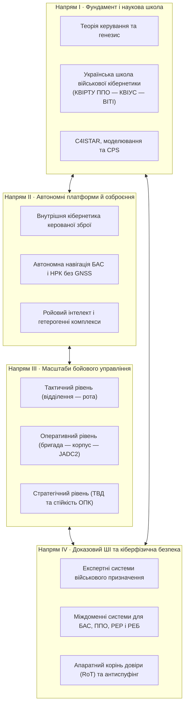
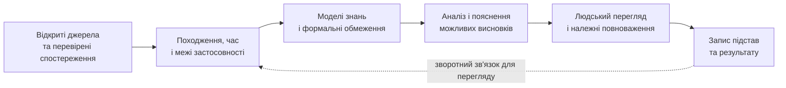
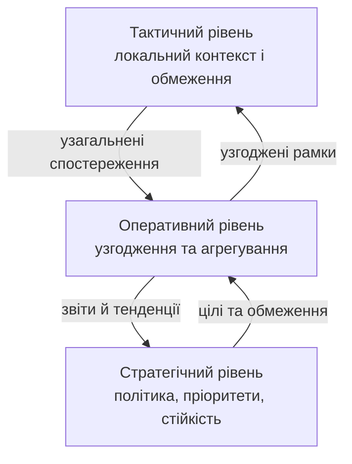

# Військова Кібернетика початку XXI століття: системи управління, кіберфізичні комплекси та доказовий інтелект

**Автор:** [Микола Федчик (Mykola Fedchyk)](../Expert_Systems_Architecture/about-the-author.md) · [LinkedIn](https://www.linkedin.com/in/nickfedchik/)  
**Формат:** Академічна та інженерно-аналітична монографія  
**Рік:** 2026

> [!NOTE]
> Цей каталог містить академічну та інженерно-аналітичну монографію **«Військова кібернетика початку XXI століття»**. Дослідження поєднує класичну спадщину української школи військової кібернетики (зокрема наукові школи академіка В. М. Глушкова, КВІРТУ ППО, КВВІУЗ, КВІУС та ВІТІ імені Героїв Крут) із математичним апаратом і практичним інженерним досвідом сучасної технологічної війни на тактичному, оперативному й стратегічному рівнях.

---

## Концепція та мета монографії

Сучасне протистояння на полі бою перестало бути виключно війною мас і калібрів — воно перетворилося на **війну кібернетичних систем управління**:

1. **Боротьба за цикл управління (Cycle-Time Dominance):** перемагає сторона, чий розвідувально-ударний цикл (OODA Loop / Kill Chain) працює швидше за швидкість реакції супротивника.
2. **Інформаційна цілісність у ворожому середовищі (Zero-Trust Information Dominance):** інформаційне поле бою насичене завадами РЕБ, фальшивими цілями та кібератаками. Перевагу отримують системи, що мають математично доведену стійкість до спуфінгу та строго верифіковану базу знань.
3. **Гетерогенна автономність (Distributed Autonomous Teaming):** перехід від ручного дистанційного керування окремими апаратами до децентралізованих роїв роботів (UAS, UGV, USV) із детермінованим арбітражем правил застосування (Rules of Engagement, RoE).
4. **Ієрархічна кібернетична вертикаль:** безшовний зв'язок між мікроконтролером бортового приводу гармати чи ракети, тактичним планшетом командира роти, оперативним штабом армійського корпусу та стратегічним центром планування кампаній.

---

## Тематична архітектура досліджень

Кожна праця у цьому каталозі є самодостатньою науково-інженерною статтею, яку можна читати незалежно. Водночас разом вони утворюють логічно зв'язану систему знань у чотирьох тематичних напрямах:

Схема відображає логічні зв'язки між тематичними кластерами статей і не є описом конкретного оперативного процесу.

### Концептуальний цикл доказового рішення

Це узагальнена модель простежуваності: автоматизований аналіз підтримує перегляд, але не підміняє відповідальність уповноваженої людини.

### Рівні управління та інформаційний обмін

Стрілки відображають лише концептуальний обмін інформацією між рівнями, а не конкретні процедури чи канали зв'язку.

---

## Навігатор за статтями

### Окрема оглядова публікація для DOU
- **[Українська військова кібернетика: від КВІРТУ ППО до цифрових систем управління (версія для DOU)](DOU-Ukrainian-Military-Cybernetics-School-UA.md)**
  Самодостатня інженерно-історична стаття для спільноти DOU (із діаграмами Mermaid та формулами у форматі KaTeX): від кризи ручних планшетів ППО і заснування кафедр обчислювальної техніки та військової кібернетики КВІРТУ ППО до внеску військових і цивільних учених, інституційної трансформації кінця 1990-х років та сучасних систем «Кропива», «Віраж-Планшет», «Дельта», «Вежа» і децентралізованих контурів НРК.

### Напрям I. Фундамент і спадковість

- **[Військова кібернетика: теорія керування, зворотний зв'язок та генезис](Ukrainian-Military-Cybernetics-UA.md)**
  Теоретичні основи військової кібернетики: зворотний зв'язок Норберта Вінера, цикл Джона Бойда (OODA), закон необхідної різноманітності В. Р. Ешбі, математична динаміка запізнень інформації та каскадне контурування, ентропія Шеннона в умовах РЕБ (семантичне стиснення на Edge проти оптоволоконних ліній), внесок академіка В. М. Глушкова та чотирирівнева епістемічна верифікація L1–L4.
- **[Українська військова кібернетика: від КВІРТУ ППО до цифрових систем управління (повна історико-інженерна версія)](Ukrainian-Military-Cybernetics-School-UA.md)**
  Розгорнутий аналіз архітектур класичних військових автоматизованих систем управління («Повітря», «Промінь», «Вектор»), наукових шкіл факультетів і кафедр КВІРТУ ППО та КВІУС, методології математичного моделювання радіолокаційних полів, алгоритмів супроводу траєкторій та їх трансформації у розподілені бойові системи ЗСУ.
- **[Військова кібернетика в дії: C4ISTAR, моделювання та кіберфізичні системи](Military-Cybernetics-In-Action-UA.md)**
  Концепція C4ISTAR як багаторівневого зворотного зв'язку; теорія кіберфізичних систем поля бою; моделювання бойових дій на основі диференціальних рівнянь Ланчестера з інформаційним мультиплікатором та стохастичних мереж Петрі; децентралізовані тактичні системи керування НРК і Simplex-архітектура безпеки.

### Напрям II. Внутрішня кібернетика озброєння та автономних платформ

- **[Військова кібернетика і АСУ озброєнням: внутрішні автоматизовані системи керованої зброї](Military-Cybernetics-Weapons-Control-Systems-UA.md)**
  Внутрішні системи керування бойовими засобами: дронів усіх середовищ (повітря, суходіл, море, глибина), самохідних артилерійських установок (САУ), керованих ракет, зенітних ракетних комплексів (ЗРК), дистанційно керованих бойових модулів НРК («ШаБля», «Буря 2.0», «Хижак», «Таврія-12,7»), КАЗ («Тарантул», «Мангал»), станцій РЕР та комплексів РЕБ.
- **[Автономна навігація БАС та НРК без GNSS: VIO, DSMAC, LiDAR та арбітраж цілісності](Autonomous-Navigation-GNSS-Denied-MilTech-UA.md)**
  Комплексування вимірювань в умовах спуфінгу та придушення супутникового сигналу. Багатокамерна візуально-інерційна одометрія (MSCKF/OpenVINS), кореляційне зіставлення з оптичними та тепловізійними картами (DSMAC/LightGlue), рельєфна навігація (TRN), 3D-лідарна локалізація НРК (Point-to-Plane ICP) та статистичний контроль цілісності вимірювань (VAIM).
- **[Ройовий інтелект і координація гетерогенних роботокомплексів](Swarm-Intelligence-And-Heterogeneous-Robotics-UA.md)**
  Математичний апарат децентралізованого рою (APF-потенціали Рейнольдса-Хатіба), безконфліктні структури даних (CRDT) у динамічних радіомережах MANET, децентралізовані Datalog-аукціони цілерозподілу, міждоменні операції БАС + НРК + МБеК та трифакторний протокол «Антифратрицид».

### Напрям III. Ієрархія бойового управління: Тактика, Операція, Стратегія

- **[Військова кібернетика тактичного рівня: людино-машинна синергія відділення, взводу та роти](Military-Cybernetics-Tactical-Level-UA.md)**
  Взаємодія військовослужбовців та безпілотних комплексів у нижній ланці управління. Когнітивне розвантаження оператора, скорочення циклу ураження (Kill Chain), частково спостережувані марковські процеси (POMDP), роботизовані штурми та евакуаційні місії НРК (CASEVAC).
- **[Військова кібернетика оперативного рівня: міжвидова координація бригад, корпусів та JADC2](Military-Cybernetics-Operational-Level-UA.md)**
  Кібернетика операційного масштабу. Інформаційно-вогнева інтеграція сухопутних бригад, авіації, ППО, флоту та сил безпілотних систем. Автоматизований деконфліктинг повітряного простору (ACO) та електромагнітної обстановки (EMCON), системна динаміка логістики Форрестера та масштабування місій НРК у системі DELTA.
- **[Військова кібернетика стратегічного рівня: управління театром воєнних дій та оборонною стійкістю](Military-Cybernetics-Strategic-Level-UA.md)**
  Стратегічні АСУ вищого військового командування. Спільна оперативна картина (COP) театру воєнних дій, математичне моделювання кампаній та виснаження ресурсів, кібернетика оборонно-промислового комплексу (ОПК) та міжнародна кооперація.

### Напрям IV. Доказовий штучний інтелект та кіберфізична безпека

- **[Експертні системи військового призначення: інженерія знань та доказовий ШІ](Military-Expert-Systems-UA.md)**
  Архітектура нейросимволічного ядра: методи парних порівнянь і синтезу СППР (школа В. Г. Тоценка, Л. М. Осинського, Б. М. Герасимова), детерміноване виведення на Datalog/ASP, чотирирівнева епістемічна верифікація L1–L4, доказовий пакет аргументації (GSN) та невідмовний аудит за стандартом W3C PROV-O.
- **[Експертні системи для БАС, ППО, РЕР та РЕБ: міждоменний деконфліктинг і доказова синхронізація](Military-Expert-Systems-UAS-AD-ELINT-EW-UA.md)**
  Спеціалізовані прикладні підсистеми підтримки рішень: комбінування доказів Демпстера — Шейфера при високому конфлікті джерел, кінематичний баланс перехоплення ППО, ідентифікація випромінювачів РЕР та просторово-частотний деконфліктинг РЕБ.
- **[Апаратний корінь довіри (Hardware Root of Trust) та антиспуфінг у MilTech IoT](Hardware-Root-Of-Trust-And-Anti-Spoofing-Military-IoT-UA.md)**
  Криптографічний захист польових сенсорних мереж: довірене завантаження Secure Boot, фізично неклоновані функції (PUF), атестація парку дронів за стандартом TPM 2.0 Quote, криптографічний захист баз знань (`Signed Knowledge Packs`), стійкість до трофейного захоплення (Zeroization) та перехід до постквантових алгоритмів (ML-KEM/Kyber, ML-DSA/Dilithium).

---

## Методологічні засади та обмеження безпеки

Усі матеріали монографії сформовано з дотриманням суворих критеріїв інформаційної та операційної безпеки:

- **Виключно відкриті науково-технічні джерела:** робота спирається на розсекречені історичні праці, академічні публікації провідних університетів світу (MIT, Stanford, ETH Zurich), відкриті стандарти IEEE/ISO/NIST та публічні специфікації оборонних проєктів (DARPA, NATO STO).
- **Відсутність чутливих даних:** текст не містить реальних координат, позивних, бойових наказів, актуальних тактичних частот чи вразливостей конкретних підрозділів сил безпеки й оборони України.
- **Математична та інженерна строгість:** замість журналістських узагальнень матеріали фокусуються на диференціальних рівняннях, передатних функціях, ймовірнісних розподілах, векторних діаграмах та коді мовами формальної логіки й системного програмування.

---

## Джерельна база та українська екосистема Defense Tech

Окрім класичних праць із теорії автоматичного керування, радіолокації та дослідження операцій, монографія спирається на відкриті аналітичні матеріали, інженерні розбори та публічні звіти української оборонно-технологічної екосистеми:

- **[Brave1](https://brave1.gov.ua/)** — державний кластер розвитку оборонних технологій України (випробування автономних розвідників, технологій ройового керування, систем зв'язку, НРК та середовища тренування ШІ-моделей `Brave1 Dataroom`);
- **[DOU DefTech](https://deftech.dou.ua/)** — фахові інженерні дослідження, інтерв'ю та аналітичні статті українських розробників MilTech ([форуми](https://deftech.dou.ua/forums/), [новини](https://deftech.dou.ua/news/), [статті](https://deftech.dou.ua/articles/), [блоги](https://deftech.dou.ua/blogs/), включно із систематичною серією оглядів наземної робототехніки [«Дайджест НРК»](https://dou.ua/forums/tags/%D0%B4%D0%B0%D0%B9%D0%B4%D0%B6%D0%B5%D1%81%D1%82%20%D0%9D%D0%A0%D0%9A/));
- **[Мілітарний (Militarnyi)](https://militarnyi.com/uk/)** — профільне українське воєнно-аналітичне видання про розвиток озброєння, безпілотних авіаційних, наземних і морських комплексів, засобів ППО та РЕБ;
- **[AIN Defense Tech](https://ain.ua/defense-tech/)** — інженерно-економічні огляди ринку оборонних технологій, автономних систем донаведення, локалізації компонентів та архітектури цифрового поля бою.

