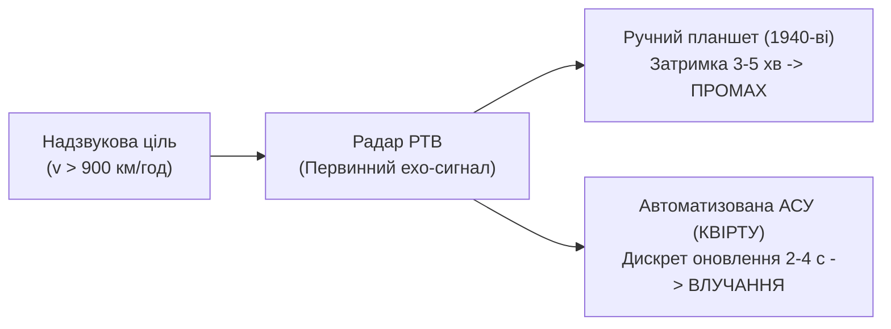
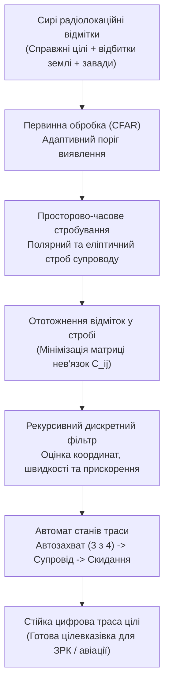
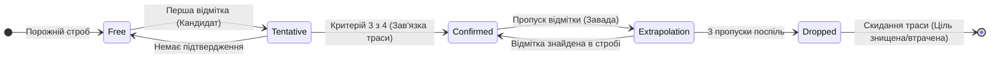
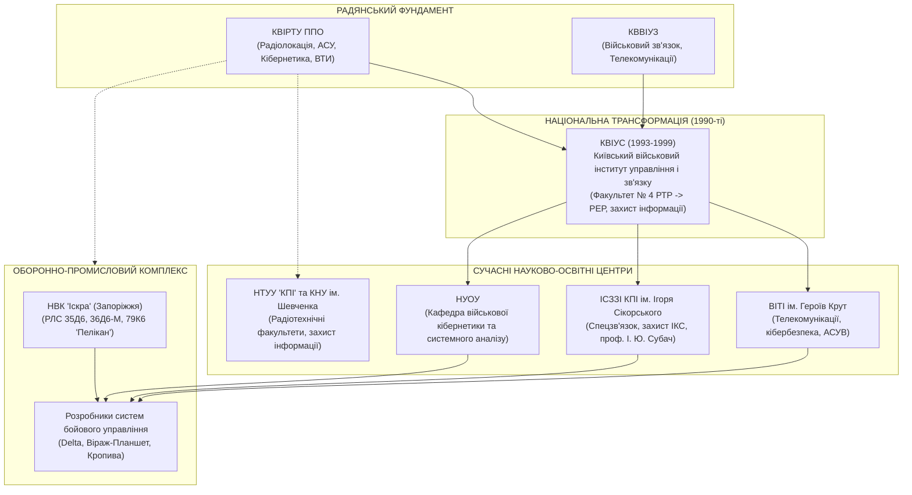
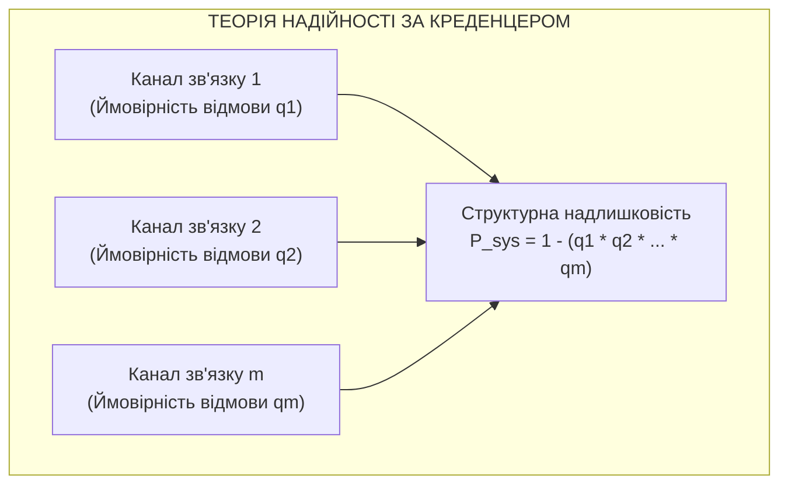
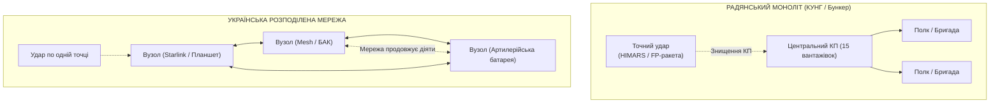

# Українська військова кібернетика: від КВІРТУ ППО до цифрових систем управління (повна історико-інженерна версія)

> **Тематичний напрям:** [Військова кібернетика та доказові системи управління](README.md) · Історична спадковість та наукові школи  
> **Скорочена версія для DOU:** [Українська військова кібернетика: від КВІРТУ ППО до цифрових систем управління (DOU)](DOU-Ukrainian-Military-Cybernetics-School-UA.md)  
> **Пов'язані статті:** [Військова кібернетика: теорія керування, зворотний зв'язок та генезис](Ukrainian-Military-Cybernetics-UA.md) · [C4ISTAR, моделювання та кіберфізичні системи](Military-Cybernetics-In-Action-UA.md) · [Експертні системи військового призначення](Military-Expert-Systems-UA.md)  
> **Автор:** [Микола Федчик (Mykola Fedchyk)](../Expert_Systems_Architecture/about-the-author.md) · [LinkedIn](https://www.linkedin.com/in/nickfedchik/)

---

Фундаментальні засади військової кібернетики — зворотний зв'язок, динаміка часових запізнень та інформаційна ентропія каналів — залишаються абстракцією, доки вони не втілюються в радіолокаційних антенах, сигнальних процесорах, бортових алгоритмах та польових інтерфейсах командних пунктів.

Україна володіє унікальною військово-інженерною школою, яка понад сімдесят років створювала складні автоматизовані системи управління військами (АСУВ). Ця традиція формувалася не в кабінетах теоретиків, а на стику математики радіолокаційного поля, надзвукової аеродинаміки, теорії надійності та жорстких обмежень обчислювальної техніки.

---

## 1. Виклик надзвукової епохи: криза пропускної спроможності людини

У середині XX століття поява реактивної авіації та перших крилатих ракет поставила військову протиповітряну оборону перед фізичним глухим кутом. Доти координати повітряних цілей наносилися вручну: спостерігач з біноклем чи оператор перших радарів передавав координати телефоном, а планшетист у штабі восковим олівцем малював трасу на скляному вертикальному планшеті.

Коли швидкості повітряних цілей зросли до 800–1200 км/год, ручний метод остаточно збанкрутував:

- Затримка проходження голосової інформації через 2–3 телефонні ланки становила 3–5 хвилин.
- За цей час надзвуковий літак долав від 40 до 100 кілометрів, повністю виходячи із зони прогнозованого курсу.
- Оператор фізично не міг одночасно відстежувати понад 3–4 цілі без катастрофічного падіння концентрації.

Виникла класична криза пропускної спроможності людини-оператора як ланки управління:

$$
\Delta t_{\text{human}} \gg \Delta t_{\text{process}}
$$

де $`\Delta t_{\text{human}}`$ — час зняття, озвучення та нанесення точки, а $`\Delta t_{\text{process}}`$ — допустимий дискрет оновлення інформації для наведення ракети.

Для подолання цієї кризи 1 лютого 1953 року постановою уряду було створено **Київське вище інженерне радіотехнічне училище протиповітряної оборони (КВІРТУ ППО)**.

### Факультет радіолокаційних систем та школа цифрової обробки сигналів: інженерний щит надзвукової епохи

З моменту заснування училища його ключовим науково-технічним ядром став **радіолокаційний факультет** (згодом — факультет радіолокаційних систем), першим очільником якого був інженер-полковник А. М. Педак (перший випуск інженерів-радіолокаційників відбувся у жовтні 1956 року). Саме тут формувалася еліта радіотехнічних військ (РТВ) та наукова школа статистичної радіолокації.

Наукові та конструкторські досягнення факультету радіолокації охоплювали передові напрями радіоелектроніки другої половини XX століття:

- **Класична теорія вторинної цифрової обробки радіолокаційної інформації (професор С. З. Кузьмін):** у стінах КВІРТУ ППО професор **Станіслав Захарович Кузьмін** створив фундаментальну трилогію, яка вперше в системному вигляді сформулювала математичну теорію цифрової трасової обробки на ЕОМ: *«Цифровая обработка радиолокационной информации»* (М.: Советское радио, 1967), *«Основы теории цифровой обработки радиолокационной информации»* (М.: Советское радио, 1974) та *«Основы проектирования систем цифровой обработки радиолокационной информации»* (М.: Радио и связь, 1986; підсумкова монографія — *«Цифровая радиолокация. Введение в теорию»*, К.: КВІЦ, 2000). Саме ці праці заклали інженерний стандарт квантування сигналів, виявлення пачок, стробування, автозав'язки трас та рекурентного згладжування траєкторій.
- **Цифрова селекція рухомих цілей (СДЦ) та маловисотна трикоординатна радіолокація:** розробка фазових автокомпенсаторів та когерентно-імпульсних методів виділення сигналу на тлі відбитків від місцевості й дипольних відбивачів (chaff), а також участь науковців училища у створенні та випробуваннях мобільних трикоординатних РЛС серії СТ-68 (5Н59, 19Ж6, 36Д6) з фазованими антенними решітками (ФАР). Вагомий внесок у теорію побудови озброєння РТВ та надширокосмугової (несинусоїдальної відеоімпульсної) радіолокації зробив випускник КВІРТУ ППО (1970), доктор технічних наук, професор генерал-лейтенант **Сергій Анатолійович Жуков (1947–2004)** (*«Основы построения радиоэлектронной техники радиотехнических войск ПВО»*, 1989; *«Наземні радіолокатори виявлення та наведення з несинусоїдальними відеоімпульсними зондувальними сигналами»*, 1997).
- **Стратегічні комплекси СПРН, загоризонтна радіолокація та математичне забезпечення складного експерименту:** залучення наукового потенціалу КВІРТУ до супроводу бойових алгоритмів вузлів Системи попередження про ракетний напад (СПРН типу «Дніпро») та загоризонтної РЛС «Дуга». Теоретичні основи композиційного синтезу складних радіотехнічних систем, просторово-часової обробки сигналів та адаптивних загоризонтних РЛС (ЗГРЛС) розробив випускник і вчений КВІРТУ, лауреат Державної премії (1990), доктор технічних наук, професор **Вадим Павлович Прокоф'єв**. Паралельно випускник (1959) і професор КВІРТУ ППО (1964–1984) **Микола Миколайович Козлов** заснував наукову школу математичної обробки полігонних випробувань комплексів ПРО та СПРН, що втілилася у фундаментальній п'ятитомній монографії спільно з вченими КДУ імені Тараса Шевченка *«Математическое обеспечение сложного эксперимента: в 5 т.»* (К.: Наукова думка, 1982–1990, під заг. ред. акад. І. І. Ляшка). Апаратурний прорив у створенні малошумних твердотілих і кріогенних НВЧ-приймачів для РЛС ППО, СПРН та космічного зв'язку забезпечив професор КВІРТУ, член-кореспондент НАН України **Лев Гассанович Гассанов (1936–2002)** (*«Твердотельные устройства СВЧ в технике связи»*, 1988).
- **Радіотехнічна та радіоелектронна розвідка (РТР / РЕР), РЕБ і розпізнавання сигналів в умовах апріорної невизначеності:** підготовка інженерів із радіотехнічної розвідки (РТР) та радіоелектронної протидії (РЕП / РЕБ) розпочалася в КВІРТУ ППО у 1968–1969 роках (зокрема на польовому центрі в с. Лютіж у 1970–1972 роках було зведено бойові позиції частин «Осназ» та батальйону РЕБ). У 1974–1978 роках цей напрям організаційно виріс у профільні кафедри РЕП (квітень 1974 р., начальники — к.т.н., доц. **М. К. Сафронов**, у 1986–1991 рр. — д.т.н., проф. **І. І. Заруднєв**; провідний винахідник — д.т.н., Заслужений винахідник і раціоналізатор УРСР **Л. І. Рожков**) та РТР, а в травні 1978 року — в окремий **факультет радіотехнічної розвідки (Факультет № 4)**, який у 1994–1995 роках у складі КВІУС був трансформований у **факультет радіоелектронної розвідки (Факультет РЕР)** і діяв до серпня 1998 року (останній випуск на Майданчику № 2 — червень 1999 року). Засновником і багаторічним очільником (до 1990 р.) кафедри РТР був видатний вчений і фахівець ГРУ, доктор технічних наук, професор, Заслужений працівник вищої школи УРСР, академік Інженерної академії наук України полковник **Юрій Олександрович Смирнов** (автор 60 винаходів і понад 180 наукових праць, який особисто підготував 11 кандидатів наук; у 1990–1993 рр. кафедру очолював його учень к.т.н., доц. **В. С. Рубцов**, а в 1993–1998 рр. — к.т.н., доц. **О. О. Солов'ян**). Фундаментальну математичну проблему РЕР — як класифікувати перехоплені імпульси невідомих РЛС у реальному часі за відсутності навчальної вибірки — розв'язав професор КВІРТУ ППО (1956–1988), доктор технічних наук **Олександр Володимирович Миленький (1932–2006)** у класичній монографії *«Классификация сигналов в условиях неопределенности (статистические методы самообучения в распознавании образов)»* (М.: Советское радио, 1975). Разом із працями В. П. Прокоф'єва з адаптивних систем РЕР та дослідженнями професора В. І. Гостєва і Л. В. Скрипника з просторової селекції сигналів у НВЧ-трактах (*«Пространственная обработка сигналов в СВЧ трактах радиосистем передачи»*, 1997) це створило теоретичне підґрунтя для сучасних українських комплексів пасивної радіоелектронної розвідки та просторового придушення активних завад за бічними пелюстками антени.

### Наукова школа кафедри військової кібернетики та ЕОМ (професори Є. М. Вавилов, О. Ф. Кулаков, В. Г. Тоценко і Л. М. Осинський): від синтезу спецобчислювачів і теорії автоматів до технічного діагностування та СППР

Паралельно з фізикою радіолокаційного сигналу в КВІРТУ ППО сформувалася потужна школа комп'ютерних наук, дискретної математики та дослідження операцій. Вже наприкінці 1950-х років на полігоні КВІРТУ ППО досліджувалася унікальна лампова супер-ЕОМ **«М-100»** (створена під керівництвом А. І. Кітова для бойових розрахунків ППО) — найшвидкодійніша у світі лампова машина першого покоління (100 000 операцій за секунду), у якій уперше було застосовано чотиритактний конвеєр команд (pipelining), гарвардську архітектуру та дворівневу оперативну пам'ять із надшвидким феритовим кешем. Тоді ж у військовій науково-дослідній лабораторії КВІРТУ ППО розпочали наукову діяльність майбутні академіки АН УРСР **Ігор Миколайович Коваленко (1935–2015)** та світовий класик стохастичного програмування **Юрій Михайлович Єрмольєв (1936–2022)** (працював у КВІРТУ в 1960–1962 роках; автор монографій *«Экстремальные задачи на графах»*, 1968, та *«Методы стохастического программирования»*, 1976).

Організаційним та інтелектуальним осередком цього напряму стала створена у **1960 році** на Факультеті № 1 (АСУ) **кафедра військової кібернетики** (поряд із профільною кафедрою електронних обчислювальних машин). За архівною хронікою училища кафедру військової кібернетики КВІРТУ ППО — КВІУС послідовно очолювали:
- **1960–1962 рр.** — к.т.н., доц., інженер-полковник **Г. Д. Хелідзе** (перший начальник кафедри; заступник і науковий керівник напряму — д.т.н., проф. **Є. М. Вавилов**; перші викладачі — Г. П. Портной, О. В. Іванов, Є. А. Самохвалов, А. О. Барков, Л. К. Ларін, Ю. О. Бузунов);
- **1962–1967 рр.** — к.т.н., с.н.с., інженер-полковник **М. Ф. Чуйко** (у 1965 р. колектив кафедри у складі М. Ф. Чуйка, Ю. О. Бузунова, Ю. І. Жидкова, В. І. Водолазького та Л. О. Сидорова створив перший у СРСР автоматизований навчальний комплекс на базі ЕОМ «Радон», удостоєний золотої медалі ВДНГ);
- **1967 — липень 1969 р.** — к.т.н., доц., інженер-полковник **Ю. В. Борисов**;
- **лютий 1970 — 1976 р.** — д.т.н. (1971), проф., полковник-інженер **Олександр Федорович Кулаков (О. Ф. Кулаков)** — засновник наукової школи оцінювання якості та надійності програмного забезпечення спецобчислювачів АСУ ППО (автор класичної монографії *«Оценка качества программ ЭВМ»*, К.: Техніка, 1984), за якого у квітні 1974 року кафедра розпочала профільну підготовку офіцерів за спеціальністю *«інженер-математик»*;
- **1976 — серпень 1987 р.** — д.т.н. (1974), проф., полковник-інженер **Віталій Георгійович Тоценко (В. Г. Тоценко)** (заступник начальника кафедри — к.т.н., доц., полковник-інженер **П. М. Кочанов / П. Т. Качанов**);
- **серпень 1987 — лютий 1994 р.** — д.т.н. (1988), проф., Заслужений діяч науки і техніки України полковник **Леонід Михайлович Осинський (Л. М. Осинський)** (який до того з 1975 року очолював кафедру ЕОМ КВІРТУ ППО);
- **березень 1994 — червень 1999 р. (КВІУС, Майданчик № 2)** — к.т.н., с.н.с., полковник **Олександр Миколайович Буточнов (О. М. Буточнов)**;
- **з липня 1999 р. (КВІУС, Майданчик № 1 $`\rightarrow`$ ВІТІ / ІСЗЗІ КПІ)** — випускник кафедри військової кібернетики КВІРТУ ППО 1986 року **Ігор Юрійович Субач (І. Ю. Субач)**, який у 1990-х роках (зокрема у період 1993–1998 рр. на Майданчику № 2) працював викладачем кафедри військової кібернетики, у липні 1999 року очолив її при переведенні на Майданчик № 1 у званні к.т.н., доц., підполковника, а згодом став доктором технічних наук, професором, полковником і завідувачем кафедри ІСЗЗІ КПІ ім. Ігоря Сікорського.

Біля витоків кафедри обчислювальної техніки та кібернетичної школи училища стояв полковник **Євген Миколайович Вавилов (1923–1978)** — перший у КВІРТУ ППО доктор технічних наук (1966), професор (1967), який працював в училищі у 1955–1971 роках (згодом — завідувач кафедри обчислювальної техніки та засновник кафедри прикладної математики КПІ). Його фундаментальна монографія *«Синтез схем электронных цифровых машин»* (спільно з Г. П. Портним; М.: Советское радио, 1963; польське видання — Варшава, 1967), книги *«Синтез схем на пороговых элементах»* (спільно з Б. М. Єгоровим, В. С. Ланцевим та В. Г. Тоценком; М.: Советское радио, 1970) та *«Язык моделирования сложных систем»* (К.: Наукова думка, 1976) заклали інженерну методологію структурного синтезу спеціалізованих ЕОМ.

Визначну роль у розвитку кафедри військової кібернетики та автоматизованих систем управління відіграв доктор технічних наук (травень 1974), професор, полковник-інженер **Віталій Георгійович Тоценко (нар. 1936 р.)**, який очолював кафедру військової кібернетики КВІРТУ ППО упродовж одинадцяти років (**1976–1987**). Науковий доробок професора В. Г. Тоценка поєднав три магістральні напрями київської школи:
- **Порогова логіка та синтез дискретних автоматів:** спільно з Є. М. Вавиловим і Б. М. Єгоровим він розробив методи структурного синтезу комбінаційних і послідовнісних схем на порогових елементах (*«Синтез схем на пороговых элементах»*, М.: Советское радио, 1970, 368 с.).
- **Тестове технічне діагностування цифрових пристроїв та спецобчислювачів АСУ:** ставши у липні 1971 року одним із перших трьох докторантів щойно відкритої докторантури КВІРТУ ППО (разом із В. І. Гостєвим та Б. П. Креденцером) та захистивши у травні 1974 року докторську дисертацію, В. Г. Тоценко створив строгу алгоритмічну теорію побудови перевірних і діагностичних тестів для скінченних автоматів із пам'яттю, узагальнену в монографії *«Алгоритмы технического диагностирования дискретных устройств»* (М.: Радио и связь, 1985, 240 с.) і подальшій концепції експертних систем діагностування (*«Обобщенная концепция экспертных систем диагностирования»*, 1995).
- **Алгоритмічна теорія систем підтримки прийняття рішень (СППР) та експертного оцінювання:** після звільнення в запас за віком у серпні 1987 року професор В. Г. Тоценко перейшов до новоствореного **Інституту проблем реєстрації інформації (ІПРІ) НАН України**, де разом із когортою офіцерів-науковців кафедри військової кібернетики та обчислювального центру КВІРТУ ППО (П. Т. Качановим, Л. К. Ларіним, А. О. Деєвим, В. М. Цицарєвим, В. М. Снєжком) і своїм учнем д.т.н., проф. В. В. Циганком заснував наукову школу інтелектуальних СППР. Підсумком цих досліджень стала фундаментальна монографія **В. Г. Тоценка *«Методы и системы поддержки принятия решений. Алгоритмический аспект»* (Київ: Наукова думка, 2002. — 382 с.)** та створення сімейства промислових людино-машинних СППР **«Солон» («Солон-1», «Солон-2», «Солон-3»)** і системи розподіленого збору та обробки експертних знань **«Консенсус» («Консенсус-2»)**. У цій праці вперше в алгоритмічно замкненому вигляді розроблено метод цільового динамічного оцінювання альтернатив на ієрархічних графах цілей за наявності загроз і ризиків, спектральний метод оцінювання узгодженості експертних даних, а також алгоритми групових неповних парних порівнянь зі зворотним зв'язком з експертами та об'єктивним урахуванням їхньої відносної компетентності.

Учнем, співавтором Є. М. Вавилова і багаторічним лідером кібернетичної школи в училищі став видатний український вчений, доктор технічних наук, професор, Заслужений діяч науки і техніки України (1994) полковник **Леонід Михайлович Осинський (1936–2004)**. Закінчивши КВІРТУ ППО у 1958 році, він присвятив училищу (а згодом — КВІУС та ВІТІ) усе наукове життя, очолюючи з 1975 року кафедру електронних обчислювальних машин (ЕОМ), а у серпні 1987 — лютому 1994 року — кафедру військової кібернетики та АСУ. Разом із Є. М. Вавиловим він створив базові праці *«Синтез схем на пороговых элементах»* (1966), *«Принципы построения цифровых вычислительных машин»* (К.: Вища школа, 1972) та *«Синтез управляющих схем»* (К.: КВИРТУ ПВО, 1974).

Фундаментальна монографія Л. М. Осинського *«Элементы исследования операций и оценка эффективности сил и средств противовоздушной обороны»* (видана у КВІРТУ в 1968 році на 444 сторінках) стала настільною книгою для кількох поколінь військових кібернетиків. Вона вперше системно перевела оцінку бойової роботи військ ППО з якісних описів на рейки суворої теорії ймовірностей, марковських процесів та дослідження операцій.

Наукова еволюція школи професора Осинського (у тісній взаємодії з Науковою радою з кібернетики АН УРСР академіка В. М. Глушкова) охоплює чотири фундаментальні етапи, що утворили безперервний міст між теорією цифрових автоматів 1960-х і сучасними інтелектуальними системами підтримки прийняття рішень:

1. **Економічне кодування станів та синтез скінченних автоматів на однорідних зсувних регістрах зі зворотним зв'язком (1965–1981):** у серії праць із Л. К. Ларіним, К. Л. Костовим та Л. А. Пічугіним в *«Известиях АН СССР. Техническая кибернетика»* (1965, 1971), київському журналі *«Кибернетика»* (1966, 1971), збірнику *«Теория автоматов»* Наукової ради з кібернетики АН УРСР (1967), *«Автоматике и телемеханике»* (1971) та *«Вычислительных системах»* (1981) Л. М. Осинський розробив строгу теорію реалізації керуючих автоматів $`A = \langle X, Y, S, \delta, \lambda, a_0 \rangle`$ за канонічною схемою $`RLR_0`$ — на однорідних структурах вхідних двійкових зсувних регістрів, комбінаційної логічної схеми $`L`$ та **єдиного регістра зворотного зв'язку** $`R`$. Для паралельної або послідовної композиції автоматів $`A_1, \dots, A_n`$ із відомими функціями зворотного зв'язку $`f_{A_i}(a_i, z_i)`$ та довжинами регістрів $`k_1, \dots, k_n`$ професор Осинський довів (через побудову циклічного розширення автомата кратності $`N = 2\sum_{i=1}^n k_i + 1`$), що складений автомат гарантовано реалізується в однорідній структурі $`RLR_0`$ з одним регістром зворотного зв'язку, довжина якого $`K_{\text{comp}}`$ задовольняє точну верхню межу:

$$
K_{\text{comp}} \le 2 \sum_{i=1}^{n} k_i + \max_{1 \le i \le n} k_i
$$

   причому поточний стан системи в момент $`t`$ однозначно відновлюється за скінченним вікном вхідних сигналів і функції зворотного зв'язку довжиною не більше ніж $`k = 4\sum_{i=1}^n k_i + 1`$ тактів. У добу дискретної схемотехніки та перших ВІС це дозволило замінити складні нерегулярні комбінаційні схеми спецобчислювачів ППО на швидкодіючі однорідні регістрові матриці, усунувши перебір при синтезі та змагання сигналів (race conditions).
2. **Мікропроцесорні конвеєрні архітектури потокової обробки даних (1980-ті):** формулювання принципів структурної організації та програмування багатопроцесорних і конвеєрних систем потокової (Dataflow) обробки радіолокаційної інформації в реальному часі (*«Принципы структурной организации и программирования микропроцессорных систем поточной обработки данных»*, УСиМ, 1986), які лягли в основу спецобчислювачів командних пунктів ППО.
3. **Перехід до інженерії знань та гнучких інформаційно-обчислювальних мереж (межа 1980–1990-х):** обґрунтування архітектури автоматизованого середовища організаційного управління військами на основі формалізованих систем подання та обробки знань (*«Построение автоматизированной среды организационного управления на основе систем представления и обработки знаний»*, УСиМ, 1990).
4. **Автоматичний синтез рішень у нечіткому та суперечливому розподіленому середовищі (1990-ті — початок 2000-х, період КВІУС / ВІТІ):** створення формальної методології вироблення управлінських рішень тоді, коли інформація від рознесених вузлів є неповною, зашумленою та взаємно суперечливою (*«Методологія автоматичного синтезу рішень в умовах неповноти, нечіткості і суперечливості розподіленого інформаційного середовища»*, 1999) — напрям, який на чверть століття випередив сучасні розподілені системи C4ISTAR та доказові платформи ситуаційної обізнаності.

Саме в Києві виникло розуміння: для протидії надзвуковій загрозі потрібен не просто оператор, а **військовий інженер-програміст**. Кафедра обчислювальної техніки і військової кібернетики КВІРТУ розглядала програмування як бойову інженерію реального часу: оптимізація машинних команд під такт феритової пам'яті, цифрова фільтрація шумів на фоні відбитків від ґрунту та мілісекундна точність видачі цілевказівки зенітним ракетним комплексам.

### Наукові школи високоточної автоматики, систем управління військами та людино-машинних СППР

Цифрова обробка сигналу та обчислювальний синтез залишалися б замкненими всередині ЕОМ без виконавчих контурів керування антенами, пусковими установками та інформаційними потоками командних пунктів. У КВІРТУ ППО цей напрям сформувався у дві взаємопов'язані наукові школи світового рівня:

1. **Школа високоточних слідкуючих систем, цифрових і нечітких регуляторів (професори Г. Ф. Зайцев та В. І. Гостєв):**
   - Доктор технічних наук (1969), професор (1971), Заслужений діяч науки і техніки УРСР, лауреат Державної премії УРСР **Григорій Фролович Зайцев** (працював у КВІРТУ ППО в 1954–1985 роках, з 1968 року очолював кафедру автоматики і телемеханіки) розв'язав фундаментальну проблему супроводу швидкісних маневрених цілей — як усунути динамічну похибку приводів РЛС без втрати запасу стійкості. Розроблені ним методи синтезу комбінованих і квазіоптимальних слідкуючих систем із розімкнутими компенсаційними каналами та диференціальними зв'язками викладені у класичних монографіях *«Коррекция систем автоматического управления постоянного и переменного тока»* (М.: Энергия, 1969), *«Синтез следящих систем высокой точности»* (К.: Техніка, 1971), *«Основы автоматического управления и регулирования»* (спільно з В. І. Костюком і П. І. Чинаєвим, 1975), *«Квазиоптимальные следящие системы»* (спільно з В. К. Стекловим, 1981) та *«Радиотехнические системы автоматического управления высокой точности»* (1988).
   - Випускник КВІРТУ ППО (1958), доктор технічних наук (1973), професор (1977), Заслужений діяч науки УРСР **Володимир Іванович Гостєв** (з 1978 року — начальник кафедри приймально-передавальних пристроїв, з 1993 року — начальник факультету) створив теорію замкнених систем із періодично змінними параметрами, імпульсних коригувальних пристроїв змінного струму та цифрових і нечітких (fuzzy) регуляторів САУ: *«Расчет автоматических систем с синхронными множительными устройствами»* (К.: Техніка, 1973), *«Замкнутые системы с периодически изменяющимися параметрами»* (спільно з П. І. Чинаєвим; М.: Энергия, 1979), *«Оптимальные системы управления с цифровыми регуляторами»* (1995) та *«Синтез нечетких регуляторов систем автоматического управления»* (2003).
2. **Школа архітектури АСУ військами та інтелектуальних людино-машинних систем підтримки прийняття рішень (професори Г. В. Лавінський, О. Я. Матов, В. Г. Тоценко та Б. М. Герасимов):**
   - Золотий медаліст першого випуску КВІРТУ ППО (1956), доктор технічних наук, професор **Гліб Володимирович Лавінський (1933–2010)** (викладав в училищі у 1960–1970 роках) заклав теоретичні основи оптимального кодування даних та інформаційно-пошукових систем в АСУ (*«Представление и поиск данных в информационной системе»*, 1973; *«Построение и функционирование сложных систем управления»*, 1989).
   - Випускник КВІРТУ ППО (1959), доктор технічних наук (1980), професор, Заслужений діяч науки і техніки України **Олександр Якович Матов (1937–2022)** у 1981–1993 роках заснував і очолював кафедру автоматизації управління військами (АСУ вищих з'єднань) КВІРТУ ППО, у 1993–1995 роках працював заступником начальника КВІУС з наукової роботи, а в 1995–1999 роках очолював Національне агентство з питань інформатизації при Президентові України (згодом — завідувач відділу проблемно-орієнтованих інформаційних систем ІПРІ НАН України), сформувавши системну теорію проєктування інформаційно-обчислювальних мереж АСУ (*«Основы построения АСУ»*, 1983; *«Основы обработки и передачи информации»*, 1985; *«Цілісність та доступність об'єктів в інформаційних мережах»*, 2014).
   - Доктор технічних наук (1974), професор **Віталій Георгійович Тоценко** (начальник кафедри військової кібернетики КВІРТУ ППО у 1976–1987 рр., завідувач відділу ІПРІ НАН України з 1987 р.) заклав алгоритмічний фундамент цільового динамічного оцінювання альтернатив, побудови розподілених баз знань цільового типу та групових експертних процедур зі зворотним зв'язком і урахуванням компетентності експертів: *«Методы и системы поддержки принятия решений. Алгоритмический аспект»* (К.: Наукова думка, 2002. — 382 с.).
   - Доктор технічних наук (1987), професор, Заслужений діяч науки і техніки України **Борис Михайлович Герасимов** (працював у КВІРТУ ППО та КВІУС у 1975–1997 роках) розробив теорію синтезу засобів відображення оперативно-тактичної обстановки та людино-машинних систем підтримки прийняття рішень (СППР) з елементами штучного інтелекту: *«Проблемы синтеза и перспективы развития средств отображения информации»* (К., 1988), *«Человеко-машинные системы принятия решений с элементами искусственного интеллекта»* (спільно з В. О. Тарасовим та І. В. Токарєвим; К.: Наукова думка, 1993) та *«Системы поддержки принятия решений: проектирование, применение, оценка эффективности»* (2004).

---

## 2. Алгоритми класичних АСУ ППО: вторинна обробка за С. З. Кузьміним, стробування та селекція цілей

Під поняттям **київської школи створення АСУ та радіолокаційних систем** в історії вітчизняної інженерії розуміють не один навчальний заклад, а потужний науково-виробничий кластер, який сформувався в Києві у 1960–1990-х роках навколо випускників і вчених КВІРТУ ППО (згодом — КВІУС та ВІТІ):

- **Військово-наукове ядро:** профільні кафедри і науково-дослідні лабораторії (НДЛ) КВІРТУ ППО, створені на їхній базі у 1993–1995 роках **Науково-дослідний центр МО України** (під керівництвом д.т.н., проф. В. П. Прокоф'єва) та **Науковий центр автоматизації засобів і системи ППО** (на чолі з к.т.н., доц. В. О. Третьяковим), а також профільні управління **ЦНДІ Збройних Сил України** та **ЦНДІ озброєння та військової техніки (ОВТ) ЗСУ**;
- **Академічне ядро НАН України:** **Інститут кібернетики імені В. М. Глушкова**, створене при ньому **СКБ математичних машин і систем** (нині — **Інститут проблем математичних машин і систем НАН України, ІПММС**, де створювалися ситуаційні центри й програмно-апаратні комплекси АСУ) та **Інститут проблем реєстрації інформації (ІПРІ) НАН України**;
- **Промислово-конструкторське ядро:** київський **НДІ «Квант»** і завод **«Радар»**, **Київський радіозавод**, **ВО імені С. П. Корольова («Меридіан»)**, **НВО «Електронприлад»**, у кооперації із запорізьким **НВК «Іскра»** та львівським концерном **«Електрон»**, а в роки Незалежності — засновані вихідцями з КВІРТУ ППО та радіопромисловості науково-виробничі підприємства (**НВП «Аеротехніка-МЛТ»**, **НВП «Віраж»**, **НВЦ «Інфозахист»** та ін.).

Саме фахівці цієї школи розробляли алгоритми, впроваджували у військах і модернізували цілу лінійку систем: від апаратури знімання й передавання даних і комплексів автоматизації радіотехнічних батальйонів та полків **«Повітря-1П/1М»**, **«Алмаз»**, **«Промінь»** і бригадних АСУ зенітних ракетних військ **«Вектор-2В/2У»**, **«Сенеж-М1Е»**, **«Байкал-1МЕ»** — до створених уже в незалежній Україні цифрових екстракторів координат, комплексу автоматизованого збору й обробки повітряної обстановки **«Віраж»**, регіональної системи **«Каштан-3М»**, командної системи Повітряних Сил **«Ореанда-ПС»** та сучасної бойової системи ситуаційної обізнаності **«Віраж-Планшет»**.

Основоположником вітчизняної теорії **цифрової вторинної обробки радіолокаційної інформації (ЦОРЛІ)** став полковник-інженер, доктор технічних наук, професор КВІРТУ ППО **Станіслав Захарович Кузьмін**. У середині 1960-х років, коли війська ППО переходили від ручного нанесення цілей на оргскло до перших цифрових спецобчислювачів, С. З. Кузьмін у стінах КВІРТУ ППО першим у СРСР і одним із перших у світовій літературі систематизував математичний апарат автоматичного виявлення («зав'язки») та траєкторного супроводу повітряних цілей на ЕОМ. Його фундаментальна чотиритомна серія монографій — *«Цифровая обработка радиолокационной информации»* (1967), *«Основы теории цифровой обработки радиолокационной информации»* (1974), *«Основы проектирования систем цифровой обработки радиолокационной информации»* (1986) та видана в незалежній Україні підсумкова праця *«Цифровая радиолокация. Введение в теорию»* (К.: КВІЦ, 2000) — заклала класичну архітектуру трасового конвеєра АСУ ППО.

Головна інженерна проблема радіолокації полягає у тому, що приймач РЛС отримує не готові вектори цілей, а суміш корисного відбитого сигналу з потужними завадами: відбитками від земної поверхні, хмар, зграй птахів, а також навмисними активними шумовими й пасивними (дипольні відбивачі) завадами літаків РЕБ. На екрані первинного огляду це виглядає як сотні хаотичних точок на кожному оберті антени.

Для перетворення цього шуму на керовану бойову картину в київській школі кібернетики було реалізовано дворівневу архітектуру обробки: **первинну** (детекція імпульсу на фоні шуму) та **вторинну** (просторово-часове стробування, автозахват трас і рекурсивне траєкторне згладжування за С. З. Кузьміним).

---

### Просторово-часове стробування за С. З. Кузьміним: полярний та еліптичний строби супроводу

Обчислювальні машини командних пунктів 1960–1980-х років мали швидкодію лише у десятки тисяч операцій на секунду та оперативну пам'ять у кілька десятків кілобайтів. Здійснювати повний перебір усіх можливих комбінацій між сотнями відміток на кожному оберті антени було фізично неможливо.

Розв'язанням у школі С. З. Кузьміна стало просторово-часове **стробування (селекція відміток у стробі супроводу)**. Навколо екстрапольованого положення цілі з полярними координатами $`(r_{\text{екс}}, \beta_{\text{екс}})`$, обчисленого на попередньому огляді антени, відкривається просторове вікно очікування — **строб супроводу**. Будь-яка відмітка за межами стробу відкидається ще до початку траєкторної фільтрації.

У ранніх АСУ класу «Повітря-1М» і «Промінь», де спеціалізовані ЕОМ мали жорсткі обмеження на операції множення й ділення, застосовували швидкий **полярний прямокутний строб** за дальністю та азимутом:

$$
|r_k - r_{\text{екс}}| \le \Delta r_{\text{стр}}, \qquad |\beta_k - \beta_{\text{екс}}| \le \Delta \beta_{\text{стр}}
$$

де півширини стробу $`\Delta r_{\text{стр}} = \kappa \sigma_r`$ та $`\Delta \beta_{\text{стр}} = \kappa \sigma_\beta`$ вимагали від процесора лише двох операцій віднімання та порівняння за модулем. Із підвищенням продуктивності обчислювачів (у системах класу «Вектор-2», «Віраж» і сучасних АСУ) переходили до точнішого **нормованого еліптичного стробу супроводу**, узгодженого з еліпсом сумарних похибок вимірювання РЛС та екстраполяції траси:

$$
\frac{(r_k - r_{\text{екс}})^2}{\sigma_r^2} + \frac{(\beta_k - \beta_{\text{екс}})^2}{\sigma_\beta^2} \le \kappa^2
$$

де:

- $`\sigma_r^2`$ — дисперсія сумарної похибки визначення дальності (похибка радара плюс похибка екстраполяції фільтра);
- $`\sigma_\beta^2`$ — дисперсія сумарної похибки за азимутом;
- $`\kappa`$ — коефіцієнт стробування (при $`\kappa \approx 3`$ двовимірний строб утримує до 99% справжніх відміток цілі, відсікаючи понад 98% сторонніх завад простору).

Якщо ціль здійснює інтенсивний маневр із перевантаженням $`n_{\max} g`$, геометричні розміри стробу розширюються на величину максимального маневреного зміщення за період огляду антени $`T_0`$: $`\Delta r_{\text{ман}} = \frac{1}{2} n_{\max} g T_0^2`$.

---

### Математичний апарат дискретної фільтрації трас

Класичний матричний фільтр Калмана вимагає постійного обернення коваріаційних матриць розміром $`6 \times 6`$ або $`9 \times 9`$, що на ранніх ЕОМ займало надто багато часу. Тому в контурах ЦОРЛІ за С. З. Кузьміним в АСУ «Повітря», «Вектор» і «Віраж» застосовували рекурсивні поліноміальні дискретні фільтри першого та другого порядків (**$`\alpha\text{-}\beta`$ та $`\alpha\text{-}\beta\text{-}\gamma`$ фільтри**).

У стаціонарному режимі прямолінійного руху алгоритм працює за рекурсивними рівняннями. На кожному $`k`$-му оберті антени радара обчислюється прогнозований вектор координат:

$$
\begin{aligned}
\hat x_{k|k-1} &= \hat x_{k-1|k-1} + \hat v_{k-1|k-1} T_0 \\
\hat v_{k|k-1} &= \hat v_{k-1|k-1}
\end{aligned}
$$

де $`T_0`$ — період огляду радіолокатора (зазвичай 2–10 секунд залежно від типу РЛС).

Коли радар фіксує нове вимірювання $`z_k`$ всередині стробу, оцінки координат і швидкості коригуються:

$$
\begin{aligned}
\hat x_{k|k} &= \hat x_{k|k-1} + \alpha (z_k - \hat x_{k|k-1}) \\
\hat v_{k|k} &= \hat v_{k|k-1} + \frac{\beta}{T_0} (z_k - \hat x_{k|k-1})
\end{aligned}
$$

#### Подолання динамічного лагу при маневрі

Головна проблема фільтра першого порядку полягає у тому, що при переході цілі у віраж з постійним прискоренням $`a`$ виникає систематична динамічна похибка відставання (лаг):

$$
\Delta x_{\text{lag}} = \lim_{k \to \infty} (x_k - \hat x_{k|k}) = \frac{1 - \alpha}{\beta} \, a \, T_0^2
$$

Для швидкісних винищувачів і крилатих ракет ця похибка досягала кілометрів, що призводило до зриву автосупроводу або вильоту цілі за межі стробу.

Для усунення цієї помилки додається оцінка прискорення — трипараметричний фільтр другого порядку:

Рівняння екстраполяції на такт уперед:

$$
\begin{aligned}
\hat x_{k|k-1} &= \hat x_{k-1|k-1} + \hat v_{k-1|k-1} T_0 + \frac{1}{2} \hat a_{k-1|k-1} T_0^2 \\
\hat v_{k|k-1} &= \hat v_{k-1|k-1} + \hat a_{k-1|k-1} T_0 \\
\hat a_{k|k-1} &= \hat a_{k-1|k-1}
\end{aligned}
$$

Рівняння оновлення стану за новим сигналом $`z_k`$:

$$
\begin{aligned}
\hat x_{k|k} &= \hat x_{k|k-1} + \alpha (z_k - \hat x_{k|k-1}) \\
\hat v_{k|k} &= \hat v_{k|k-1} + \frac{\beta}{T_0} (z_k - \hat x_{k|k-1}) \\
\hat a_{k|k} &= \hat a_{k|k-1} + \frac{2\gamma}{T_0^2} (z_k - \hat x_{k|k-1})
\end{aligned}
$$

Коефіцієнти розраховуються через індекс маневреності цілі $`\Lambda = \frac{\sigma_w T_0^2}{\sigma_v}`$, забезпечуючи нульову стаціонарну похибку супроводу за положенням при постійному прискоренні.

Цей алгоритм потребував лише 6 операцій множення і 6 додавань на одну координату траси за період огляду, дозволяючи вести сотні бойових трас у реальному часі.

---

### Життєвий цикл бойової траси: автомат станів «M із N»

Сама по собі поодинока відмітка в стробі ще не є ціллю. Для захисту від хибних тривог АСУ реалізує дискретний автомат станів:

1. **Ініціалізація (Tentative):** при появі відмітки, що не потрапила в жоден наявний строб, створюється попередня траса-кандидат.
2. **Зав'язка (Confirmed):** застосовується мажоритарне правило «3 із 4». Якщо у трьох із чотирьох наступних обертів антени всередині прогнозованого стробу виявляються відмітки з вектором швидкості, узгодженим за напрямком, траса отримує статус офіційно підтвердженої цілі та унікальний формуляр (Track ID).
3. **Екстраполяція (Coasting):** якщо ціль поставила активну заваду або пішла за складку рельєфу, відмітка зникає. Система не втрачає її миттєво, а переходить у режим «пам'яті», продовжуючи вести екстраполяцію за останнім збереженим вектором швидкості протягом 2–3 тактів.
4. **Скидання (Dropped):** якщо відмітка не з'явилася після трьох тактів екстраполяції, формуляр цілі закривається.

---

### Проблема ототожнення відміток (Data Association)

Коли група ворожих літаків здійснює розпуск строю, або коли ціль викидає пачки дипольних відбивачів (chaff), в один строб потрапляють 3–5 радіолокаційних відміток. Виникає класична кібернетична задача: яку саме точку вважати продовженням справжньої цілі?

В армійських АСУ застосовувалося **ототожнення за мінімумом нормованих квадратичних нев'язок**: будується матриця нев'язок між усіма наявними трасами $`i`$ та новими відмітками $`j`$:

$$
C_{ij} = \frac{(r_j - r_{\text{екс}, i})^2}{\sigma_{r, i}^2} + \frac{(\beta_j - \beta_{\text{екс}, i})^2}{\sigma_{\beta, i}^2}
$$

Задача мінімізації сумарної нев'язки $`\min \sum C_{ij}`$ розв'язувалася за поліноміальний час, що повністю виключало переплутування літаків у строю або помилковий перехід радара на супровід хмари пасивних завад.

Сьогодні ці самі математичні принципи, народжені в КВІРТУ, слугують ядром української системи ситуаційної обізнаності **«Віраж-Планшет»**: система об'єднує в єдині строби дані радіолокаційних постів ППО, акустичних датчиків та оптико-електронних камер спостереження, забезпечуючи надійну зав'язку траєкторій крилатих ракет і низьковисотних дронів у реальному часі.

---

## 3. Математика цілерозподілу: захист від паніки та дублювання залпів

Другою фундаментальною задачею, яку вирішувала військова кібернетика в АСУ рівня «Вектор-2У», був автоматизований розподіл цілей між вогневими засобами (зенітними ракетними дивізіонами С-300, Бук, Оса).

Коли на охоронюваний об'єкт налітає група з 20–30 цілей, людина-командир під дією бойового стресу схильна робити дві критичні помилки:

1. **Дублювання вогню (Overkill):** кілька дивізіонів одночасно відкривають вогонь по найближчій або найбільшій цілі, безглуздо витрачаючи дорогі ракети.
2. **Пропуск загроз:** швидкісні або маловисотні цілі залишаються поза увагою, оскільки оператори зосереджені на флагманських об'єктах.

У київській школі кібернетики ця проблема була формалізована як задача **оптимального призначення засобів ураження (Weapon-Target Assignment, WTA)**:

$$
\max_{\mathbf{X}} \sum_{j=1}^{M} V_j \left( 1 - \prod_{i=1}^{N} (1 - p_{ij})^{x_{ij}} \right)
$$

за умови ресурсного обмеження на кількість одночасно обстрілюваних цілей кожним дивізіоном:

$$
\sum_{j=1}^{M} x_{ij} \le C_i, \quad \forall i \in \{1, \dots, N\}, \quad x_{ij} \in \{0, 1\}
$$

де:

- $`M`$ — кількість виявлених повітряних цілей;
- $`N`$ — кількість доступних зенітно-ракетних дивізіонів або пускових установок;
- $`V_j`$ — бальна цінність (небезпека) $`j`$-ї цілі для прикриваного промислового чи військового об'єкта;
- $`p_{ij}`$ — розрахункова ймовірність ураження $`j`$-ї цілі $`i`$-м комплексом з урахуванням ракурсу, висоти, швидкості та маневру;
- $`x_{ij} = 1`$, якщо дивізіону $`i`$ призначено ціль $`j`$, і $`0`$ у протилежному випадку;
- $`C_i`$ — канальність дивізіону за ціллю.

У реальному часі ця NP-складна задача розв'язувалася за секунди за допомогою модифікованого угорського алгоритму або градієнтних евристик цілерозподілу. Результат розрахунку видавався на екран командира як готова таблиця оптимальної стрільби: жодна ціль не дублювалася без потреби, а всі доступні канали ЗРК завантажувалися рівномірно і ефективно.

---

## 4. Інституційна спадковість в Україні: від КВІРТУ та КВІУС до ВІТІ і оборонно-промислового комплексу

Помилково вважати, що після розпаду СРСР та закриття КВІРТУ ППО його інтелектуальний доробок зник. В Україні відбулася масштабна інституційна трансформація, яка зберегла ключові наукові напрями та перенесла їх у нову національну систему військової освіти й оборонної промисловості.

### Інституційна хронологія: від КВІРТУ ППО (1953–1993) та КВІУС (1993–1999) до ВІТІ імені Героїв Крут та ІСЗЗІ КПІ

1. **Заснування та становлення КВІРТУ ППО (1953–1993):** Постановою Ради Міністрів СРСР від **1 лютого 1953 року** та директивою МО від **3 лютого 1953 року** у Києві (з **27 лютого 1953 року** — на вул. Мельникова, 81, в/ч 52075) було створено вище інженерне радіотехнічне училище, формування якого завершилося **25 квітня 1953 року** (річне свято училища; заняття першого курсу розпочалися **4 травня 1953 року**, а з **22 жовтня 1955 року** затверджено відкриту назву — **Київське вище інженерне радіотехнічне училище ППО, КВІРТУ ППО**). Начальниками КВІРТУ ППО послідовно були: генерал-майор артилерії **І. Ф. Морозов** (т.в.о., лютий — серпень 1953 р.), генерал-майор артилерії **Й. Ф. Короленко** (19 серпня 1953 — квітень 1957 р.), засновник наукових шкіл училища д.т.н., професор, генерал-лейтенант артилерії **Т. Й. Ростунов** (квітень 1957 — грудень 1969 р.), к.т.н., с.н.с., лауреат Ленінської премії генерал-лейтенант-інженер **М. Г. Трофимчук** (грудень 1969 — липень 1974 р.), генерал-лейтенант **О. В. Линник** (липень 1974 — червень 1979 р.), к.в.н., генерал-лейтенант **М. К. Поляков** (червень 1979 — 4 липня 1989 р.), генерал-майор **П. В. Мєхов** (липень 1989 — 6 червня 1992 р.), т.в.о. к.в.н., доц., полковник **Є. Д. Ковальчук** (червень — грудень 1992 р.) та к.в.н., доц., полковник **В. Г. Злобін** (з 24 грудня 1992 р. до серпня 1993 р.).
2. **Створення КВІУС (1993) та функціонування Майданчика № 2 (1993–1999):** Постановою Кабінету Міністрів України від **19 серпня 1992 року № 490** та наказом МО України у **серпні 1993 року** (з початком навчального року **1 вересня 1993 року**) на базі КВІРТУ ППО та Київського вищого військового інженерного училища зв'язку (КВВІУЗ) було сформовано **Київський військовий інститут управління і зв'язку (КВІУС / КВІУЗ)** на чолі з генерал-майором **М. В. Гончаром** (заступниками начальника інституту з наукової роботи та головами спеціалізованої вченої ради із захисту докторських і кандидатських дисертацій працювали вихованці КВІРТУ д.т.н., проф., полковник **О. Я. Матов** у вересні 1993 — жовтні 1995 р. та д.т.н., проф., полковник **О. Л. Сельотков** з жовтня 1995 р.). Печерська база КВВІУЗ стала **Майданчиком № 1**, а чотири військові містечка КВІРТУ ППО на Лук'янівці (вул. Мельникова, 81) — **Майданчиком № 2** (під керівництвом заступника начальника КВІУС полковника **В. Г. Злобіна**). Одночасно у **вересні 1993 року** на базі НДЛ-1 КВІРТУ ППО було створено самостійний Науково-дослідний центр МО України під керівництвом д.т.н., проф., полковника **В. П. Прокоф'єва**, а **12 лютого 1995 року** в окрему військову частину МО України виділився Науковий центр автоматизації засобів і системи ППО на чолі з к.т.н., доц., полковником **В. О. Третьяковим**.
3. **Трансформація Факультету № 4 РТР у Факультет радіоелектронної розвідки (РЕР, 1978–1998):** Створений наказом Міністра оборони у **травні 1978 року** (у рік 25-річчя КВІРТУ ППО за начальника училища генерал-лейтенанта **О. В. Линника** на базі сформованих у 1968–1977 рр. спецкурсів, кафедр РЕП і РТР та полігону ОСНАЗ у с. Лютіж і розбудований у 1979–1989 рр. за генерал-лейтенанта **М. К. Полякова**) **Факультет № 4 — факультет радіотехнічної розвідки (ФРТР)** послідовно очолювали полковник-інженер **В. А. Кокорін** (з травня 1978 р.), полковник **В. В. Шкіренко** (до лютого 1994 р.) та у складі КВІУС — к.т.н., доц., полковник **В. С. Рубцов** (вересень 1993 — серпень 1998 р.). Профільну кафедру РТР/РЕР заснував і до січня 1990 року очолював д.т.н., проф., академік ІАН України полковник **Ю. О. Смирнов**, з літа 1990 до серпня 1993 року її очолював к.т.н., доц. **В. С. Рубцов**, а з серпня 1993 року — к.т.н., доц. **О. О. Солов'ян**. У **1994–1995 роках** факультет було реорганізовано й перейменовано на **Факультет радіоелектронної розвідки (Факультет РЕР)**, що об'єднало 5-річну інженерну підготовку офіцерів усього спектра SIGINT/ELINT/COMINT для потреб ЗСУ та ГУР МО України. У **серпні 1998 року** під час скорочення Майданчика № 2 особовий склад було зведено у три факультети — радіолокаційного озброєння (полковник **Є. Є. Макаров**), радіотехнічних систем (полковник **Г. П. Копилов**) та автоматизованих систем управління (полковник **М. І. Семенченко**), у складі яких завершилася підготовка останніх курсів.
4. **Переведення кафедри військової кібернетики на Майданчик № 1 (липень 1999), ВІТІ (2001) та ІСЗЗІ КПІ:** **27 червня 1999 року** на Майданчику № 2 відбувся останній випуск 216 лейтенантів-радіоінженерів, а **17 серпня 1999 року** згідно з Постановою КМУ № 078 Майданчик № 2 (колишнє КВІРТУ ППО) припинив існування. Проте ключове кібернетичне ядро було збережено: у **липні 1999 року** спеціальності *«інженер-математик»*, *«інженер з радіоелектроніки АСУ»* та **кафедру військової кібернетики** перевели з Майданчика № 2 на Майданчик № 1 (Печерськ), де начальником кафедри військової кібернетики було призначено випускника КВІРТУ ППО 1986 року к.т.н., доц., підполковника **І. Ю. Субача** (після виходу на пенсію Л. М. Осинського у лютому 1994 року кафедру військової кібернетики у 1994–1999 роках очолював к.т.н., с.н.с., полковник **О. М. Буточнов**). **23 березня 2001 року** інститут реорганізовано у **Військовий інститут телекомунікацій та інформатизації (ВІТІ)** (з 2018 року — імені Героїв Крут), а на базі підрозділів захисту інформації сформовано **Інститут спеціального зв'язку та захисту інформації (ІСЗЗІ) КПІ імені Ігоря Сікорського**. Паралельно з **1 вересня 1998 року** підготовку офіцерів запасу за шістьма радіотехнічними спеціальностями КВІУС розпочали військові кафедри КПІ та КНУ імені Тараса Шевченка, а наукові школи та спецради продовжили роботу в **Національному університеті оборони України (НУОУ)**.

### Структура факультетів, профільних кафедр та наукових шкіл КВІРТУ ППО (1953–1993) і КВІУС (Майданчик № 2, 1993–1999)

Після початкового етапу єдиного інженерного факультету (1953–1955 рр., начальник — полковник **І. О. Семенцов**) та трьох радіотехнічних факультетів (з 1 вересня 1955 р., начальники — генерал-майор ІТС **П. З. Париков**, генерал-майори артилерії **А. Е. Кравцов** і **В. В. Метельов**; у 1956–1959 рр. — генерал-майор ІТС **П. С. Грибакін** і полковник **Б. Д. Леонов**), у березні 1959 — травні 1978 року сформувалася класична структура факультетів і кафедр КВІРТУ ППО — КВІУС:

| Факультет (точна назва та роки дії) | Начальники факультету (за періодами) | Профільні кафедри та провідні вчені наукової школи |
| :--- | :--- | :--- |
| **Факультет № 1 — Факультет автоматизованих систем управління (Факультет АСУ)** *(березень 1959 — серпень 1999 р.)* | ген.-майор ІТС **П. С. Грибакін** (1959–1962); к.т.н., доц. **Г. Д. Хелідзе** (1962 — серпень 1974); полк. **Р. М. Рахімкулов** (серпень 1974 — жовтень 1982); полк.-інж. **І. Д. Коваленко** (з жовтня 1982); полк. **В. Ф. Кабанов** (до січня 1993); полк. **М. І. Руда** (1993); к.т.н., доц. **В. М. Бриль** (вересень 1993 — серпень 1998); полк. **М. І. Семенченко** (серпень 1998 — серпень 1999) | **Кафедра військової кібернетики (з 1960 р.) та кафедра ЕОМ:** к.т.н., доц. **Г. Д. Хелідзе** (нач. каф. ВК у 1960–1962 рр.), д.т.н., проф. **Є. М. Вавилов** (1955–1971), к.т.н., с.н.с. **М. Ф. Чуйко** (нач. каф. ВК у 1962–1967 рр.), к.т.н., доц. **Ю. В. Борисов** (нач. каф. ВК у 1967–1969 рр.), д.т.н., проф. **О. Ф. Кулаков** (нач. каф. ВК у 1970–1976 рр.), д.т.н., проф. **В. Г. Тоценко** (нач. каф. ВК у 1976 — серпні 1987 р.), д.т.н., проф. **Л. М. Осинський** (нач. каф. ЕОМ з 1975 р., нач. каф. ВК у серпні 1987 — лютому 1994 р.), к.т.н., с.н.с. **О. М. Буточнов** (нач. каф. ВК у березні 1994 — червні 1999 р.), д.т.н., проф. **І. Ю. Субач** (викладач кафедри у 1993–1998 рр., нач. каф. ВК на Майданчику № 1 з липня 1999 р.), д.т.н., проф. **Б. М. Єгоров**, к.т.н., доц. **О. М. Суворов**, к.т.н., доц. **Є. М. Надольний**. **Кафедра автоматизації управління військами / АСУ вищих з'єднань:** д.т.н., проф., акад. ІАНУ **О. Я. Матов** (нач. кафедри у 1981–1993 рр.), к.т.н., доц. **С. Є. Карловський** (з вересня 1993 р.). **Кафедра АСУ та засобів відображення:** д.т.н., проф. **Г. В. Лавінський**, д.т.н., проф. **Б. М. Герасимов**, д.т.н., проф. **В. О. Тарасов**, д.т.н., проф. **О. Л. Сельотков**, к.т.н., доц. **В. М. Голубєв**, к.т.н., доц. **В. В. Воробйов**. |
| **Факультет № 2 — Радіолокаційний факультет / Факультет радіолокаційних систем** *(з березня 1959 р.; у серпні 1998 — серпні 1999 р. — **Факультет радіолокаційного озброєння**)* | інж.-полк. **А. М. Педак** (1959 — серпень 1974); полк. **А. В. Буровенко** (серпень 1974 — лютий 1985); полк. **В. М. Лехант** (лютий 1985 — січень 1990); полк. **Є. Є. Макаров** (січень 1990 — серпень 1993 та серпень 1998 — серпень 1999); д.т.н., проф., акад. ІАНУ **Б. П. Креденцер** (вересень 1993 — серпень 1998) | **Кафедра радіолокаційного озброєння / РЛС:** проф. **С. З. Кузьмін**, д.т.н., проф. **О. В. Миленький** (1953–1988), д.т.н., проф. **В. П. Прокоф'єв**, д.т.н., проф., ген.-лейт. **С. А. Жуков**, к.т.н., проф. **Б. Ф. Бондаренко** (нач. кафедри до серпня 1997 р.), к.т.н., доц. **О. О. Бондаренко** (з серпня 1997 р.). **Кафедра антенно-фідерних пристроїв і засобів НВЧ:** д.т.н., проф. **Г. Б. Богданов**, чл.-кор. НАНУ **Л. Г. Гассанов**, к.т.н., с.н.с. **В. М. Лисенко** (до жовтня 1991 р.), к.т.н., проф. **Є. А. Якорнов** (жовтень 1991 — січень 1998 р.). **Кафедра основ надійності та радіовимірювань:** к.т.н., проф., ген.-майор **М. А. Шишонок**, д.т.н., проф. **Б. П. Креденцер**, д.т.н., проф. **М. К. Жердєв**, д.т.н., проф. **М. Т. Корнійчук**, к.т.н., доц. **В. Ф. Рєпкін**, к.т.н., доц. **А. І. Ільницький** (з вересня 1993 р.). |
| **Факультет № 3 — Факультет радіотехнічних систем (Факультет РТС)** *(квітень 1974 — лютий 1997 р.; серпень 1998 — серпень 1999 р.)* | полк.-інж. **М. В. Бойко** (серпень 1974 — серпень 1983); полк.-інж. **В. Л. Черноус** (серпень 1983 — серпень 1989); полк. **В. В. Кухарський** (серпень 1989 — серпень 1993); д.т.н., проф., акад. ІАНУ **В. І. Гостєв** (вересень 1993 — лютий 1997); полк. **Г. П. Копилов** (серпень 1998 — серпень 1999) | **Кафедра радіотехнічних вимірювально-інформаційних систем (РВІС, з листопада 1988 р. — радіотелеметричних систем):** д.т.н., проф. **М. М. Козлов** (1964–1984), к.т.н., проф. **А. С. Кучеров** (нач. кафедри у 1977 — листопаді 1988 р.), к.т.н., доц. **В. Г. Сердюк** (1988–1991, 1993–1996), к.т.н., доц. **А. П. Шуляк** (1991–1993, 1996–1997), д.т.н., проф. **В. І. Гостєв** (з лютого 1997 р.), д.т.н. **В. Г. Путятін**. **Кафедра автоматики і телемеханіки:** д.т.н., проф. **Г. Ф. Зайцев** (1954–1985, нач. кафедри з 1968 р.). **Кафедра приймально-передавальних пристроїв:** д.т.н., проф. **В. І. Гостєв** (нач. кафедри з 1978 р.), д.т.н., проф. **Б. І. Курилін**. |
| **Факультет № 4 — Факультет радіотехнічної розвідки (ФРТР)** $`\rightarrow`$ **Факультет радіоелектронної розвідки (Факультет РЕР)** *(травень 1978 — серпень 1998 р., перейменований на Факультет РЕР у 1994–1995 рр.)* | полк.-інж. **В. А. Кокорін** (з травня 1978 р.); полк. **В. В. Шкіренко** (кінець 1980-х — лютий 1994 р.); к.т.н., доц. **В. С. Рубцов** (вересень 1993 — серпень 1998 р.) | **Кафедра радіотехнічної (радіоелектронної) розвідки (РТР / РЕР):** д.т.н., проф., акад. ІАНУ **Ю. О. Смирнов** (засновник і нач. кафедри до січня 1990 р., далі професор кафедри), к.т.н., доц. **В. С. Рубцов** (нач. кафедри влітку 1990 — серпні 1993 р.), к.т.н., доц. **О. О. Солов'ян** (з серпня 1993 р.). **Кафедра радіоелектронної протидії (РЕП, квітень 1974 — липень 1992 р.):** к.т.н., доц. **М. К. Сафронов** (1974–1986), д.т.н., проф. **І. І. Заруднєв** (серпень 1986 — жовтень 1991 р.), д.т.н. **Л. І. Рожков**. **Кафедра основ електроніки та імпульсної техніки / ТЕРК:** д.т.н., проф. **М. С. Спиридонов**, к.т.н., доц. **Ю. К. Воронов** (до жовтня 1991 р.), д.т.н., проф. **В. Ф. Новиков** (жовтень 1991 — 1999 р.), д.т.н., проф. **В. М. Волков**, д.т.н., проф. **Р. П. Карташов** (до листопада 1989 р.), к.т.н., доц. **В. М. Бондаренко**. |
| **Факультет заочного навчання** *(18 лютого 1959 — липень 1977 р.)* та **Іноземний (спеціальний) факультет** *(1 вересня 1963 — серпень 1991 р.)* | *Заочний:* ген.-майори **І. М. Архипов** (1959–1964), Герой Радянського Союзу **Л. О. Говорухін** (1964–1967), **О. І. Горячев** (1967–1973), **В. В. Бражник** (1973–1977). *Іноземний:* полк. **Г. І. Просихін** (1963–1978), **І. О. Воронін** (1978–1983), **А. Б. Бердецький** (до липня 1992 р.) | Загальнонауковий фундамент усіх факультетів забезпечували **кафедра вищої математики** (д.ф.-м.н., проф. **С. Д. Ейдельман**, д.т.н., проф. **В. П. Лобанов**, к.т.н., проф. **І. Я. Соколинський**, де починали науковий шлях академіки АН УРСР **І. М. Коваленко** та **Ю. М. Єрмольєв**) і **кафедра тактики РТВ ППО** (к.в.н., доц. **А. І. Єрмаков**, к.в.н., доц. **В. Ф. Ткаченко**, к.в.н., доц. **Є. Д. Ковальчук**). |

### Науково-виробнича спадковість у радіолокаційній галузі: цифрові антенні решітки та міст до НВК «Іскра»

Школа радіолокації КВІРТУ ППО та київських військово-наукових центрів ППО завжди існувала у нерозривному зв'язку з вітчизняними оборонними підприємствами, насамперед із запорізьким науково-виробничим комплексом **НВК «Іскра»** та **Центральним науково-дослідним інститутом озброєння та військової техніки (ЦНДІ ОВТ) ЗСУ**.

Усі ключові розробки українських трикоординатних радіолокаційних станцій та новітніх багатоканальних антенно-приймальних систем спиралися на цей фундамент:

- **Глибока модернізація РЛС 35Д6 (36Д6-М):** оновлення алгоритмів цифрової селекції рухомих цілей (СДЦ), введення твердотільного передавача та інтеграція нових обчислювачів первинної і вторинної обробки (за класичною схемою С. З. Кузьміна);
- **Створення РЛС 79К6 «Пелікан» та 80К6Т:** високомобільні трикоординатні радіолокаційні станції кругового огляду з цифровими фазованими антенними решітками, призначені для протиповітряної оборони та виявлення маловисотних швидкісних цілей в умовах жорстких завад;
- **Теорія цифрових антенних решіток (ЦАР) і N-OFDM (професор В. І. Слюсар):** у київській школі військової кібернетики ППО (Військова академія ППО Сухопутних військ у Києві, де у 1987–1989 роках було створено перший експериментальний 8-канальний зразок ЦАР, і згодом у ЦНДІ ОВТ ЗСУ) Заслужений діяч науки і техніки України, доктор технічних наук, професор зі спеціальності «Військова кібернетика, системи управління та зв'язок» **Вадим Іванович Слюсар** розробив тензорно-матричну теорію багатоканальної просторово-частотної обробки сигналів у цифрових антенних решітках та теорію неортогональної частотної дискретної модуляції (N-OFDM). Запропоноване В. І. Слюсарем сімейство матричних операцій — проникаючий торцевий добуток матриць (*face-splitting product* або *Slyusar product*, 1996–1999) — дозволило компактно формалізувати багатовимірні відгуки плоских і конформних ЦАР РЛС та систем MIMO, а сьогодні увійшло до світової математичної бібліотеки алгоритмів тензорного машинного навчання та цифрового діаграмоутворення;
- **Комплекси пасивної радіотехнічної розвідки («Кольчуга-М» та сучасні пеленгатори РЕР):** впровадження методів далекобійної часо-різницевої тріангуляції (TDOA) та самонавчального розпізнавання сигнатур випромінювачів супротивника за О. В. Миленьким.

### «Київська школа надійності та технічної діагностики»: від М. А. Шишонка до Б. П. Креденцера, В. Г. Тоценка, М. Т. Корнійчука і М. К. Жердєва

Підготовка фахівців у КВІРТУ ППО, КВІУС та ВІТІ базувалася на всесвітньо відомій київській школі теорії надійності, біля витоків якої наприкінці 1950-х років стояли академік АН УРСР **Борис Володимирович Гнєденко** та інженер-полковник КВІРТУ ППО професор **Микола Андрійович Шишонок**. Створена у КВІРТУ ППО фундаментальна праця М. А. Шишонка, В. Ф. Рєпкіна та Л. Л. Барвінського *«Основы теории надежности и эксплуатации радиоэлектронной техники»* (М.: Советское радио, 1964, 551 с.) стала першим у СРСР систематичним підручником із теорії надійності складних радіоелектронних комплексів, а наступна монографія *«Решение задач надежности и эксплуатации на универсальных ЭЦВМ»* (М. А. Шишонок, Б. П. Креденцер, М. М. Ластовченко, С. О. Сенецький; М.: Советское радио, 1967, 400 с.) започаткувала комп'ютерне статистичне моделювання відмов АСУ і РЛС.

Найвищого розвитку цей напрям набув у працях випускника (1959) і професора КВІРТУ ППО, Заслуженого діяча науки і техніки УРСР **Бориса Петровича Креденцера** (*«Прогнозирование надежности систем с временной избыточностью»*, К.: Наукова думка, 1978), доктора технічних наук, професора **Віталія Георгійовича Тоценка** (*«Алгоритмы технического диагностирования дискретных устройств»*, М.: Радио и связь, 1985, 240 с.), професора КВІРТУ ППО **Мая Тихоновича Корнійчука (1937–2012)** (*«Ризик і надійність. Економіко-стохастичні методи й алгоритми побудови та оптимізації систем»*, 2000; *«Складні системи з випадковою зв'язністю: ймовірнісне моделювання та оптимізація»*, 2003) та засновника школи метрології і технічного діагностування інтегральних вузлів РЕО професора КВІРТУ ППО **Миколи Костянтиновича Жердєва** (*«Контроль устройств на интегральных схемах»*, 1986; *«Діагностування цифрових пристроїв РЕЗ»*, 2007).

КВІРТУ та згодом КВІУС підтримували тісні наукові зв'язки з Інститутом кібернетики АН УРСР: дослідження проводилися за консультацій та участі академіків **В. М. Глушкова**, **В. С. Михалевича** та видатного фахівця з теорії масового обслуговування й випадкових процесів академіка **І. М. Коваленка**.

Головна проблема систем бойового управління — раптові відмови апаратури та фізичне руйнування ліній зв'язку під ударами артилерії. Професор Креденцер довів: абсолютна надійність кожного окремого радіорелейного вузла є недосяжною і занадто дорогою інженерною утопією. Надійність повинна досягатися **структурною та інформаційною надлишковістю**.

Якщо система побудована з $`m`$ незалежних, паралельно функціонуючих каналів передавання даних, кожен з яких має ймовірність безвідмовної роботи $`P_k`$ (і відповідно ймовірність відмови $`q_k = 1 - P_k`$), то результуюча ймовірність проходження бойового сигналу становить:

$$
P_{\text{sys}} = 1 - \prod_{k=1}^{m} (1 - P_k)
$$

**Числовий доказ:** Якщо взяти три польові радіолінії з посередньою надійністю $`P_k = 0{,}80`$ (кожна п'ята спроба зв'язку зривається через завади або рельєф), то об'єднана система паралельного передавання забезпечує надійність:

$$
P_{\text{sys}} = 1 - (1 - 0{,}8)^3 = 1 - 0{,}2^3 = 1 - 0{,}008 = 0{,}992
$$

Ймовірність втрати бойового наказу знижується з 20% до 0,8%! Цей принцип надлишковості став фундаментальним правилом сучасної української військової телекомунікації: зв'язок ніколи не будується на одній технології — він комбінує супутникові канали, транкінгові мережі, спрямовані радіорелейні мости та цивільні стільникові протоколи.

Саме ця наукова спадковість підготувала кадри, які з перших днів війни 2014 та 2022 років змогли розгорнути захищену систему бойового управління та створити вітчизняні платформи нового покоління.

### Інтелектуальний аналіз складних систем і сучасний кіберзахист: внесок професора І. Ю. Субача

Трансформація військової кібернетики в епоху мережецентричної війни вимагала якісного оновлення теоретичного апарату. Якщо класичні АСУ XX століття оперували фіксованими ієрархічними каналами зв'язку, то сучасні бойові платформи діють у просторі розподілених інформаційно-комунікаційних систем (ІКС), які щосекунди зазнають ворожих кібератак, зондувань та спроб деструктивного впливу.

Провідним представником сучасного покоління української школи кібербезпеки та систем управління є доктор технічних наук, професор **Ігор Юрійович Субач** — випускник кафедри військової кібернетики КВІРТУ ППО (1986), який у 1993–1998 роках працював викладачем цієї кафедри на Майданчику № 2 КВІУС (виховавши покоління випускників інженерних спеціальностей 1990-х років), у липні 1999 року очолив кафедру військової кібернетики під час її переведення на Печерський майданчик, а нині є завідувачем спеціальної кафедри Інституту спеціального зв'язку та захисту інформації (ІСЗЗІ) КПІ імені Ігоря Сікорського та головним редактором фахового наукового журналу *«Information Technology and Security»*.

Наукові дослідження професора І. Ю. Субача та його учнів сформували шість прикладних напрямів сучасного кіберзахисту ІКС:

1. **Теорія складних мереж (Complex Networks) та інтелектуальний аналіз даних у військовому кіберзахисті (2018):** спільна монографія з професором Д. В. Ланде та Ю. Є. Бояриновою (*«Основи теорії і практики інтелектуального аналізу даних у сфері кібербезпеки»*, 2018. — 296 с.) присвячена топологічному аналізу стійкості інформаційно-телекомунікаційних систем спеціального призначення, виявленню критичних вузлів-хабів, проєктуванню самовідновлюваної топології мереж зв'язку, а також побудові онтологічних, нечітких і генетичних моделей Data Mining.
2. **Архітектура проактивних інтелектуальних SIEM-систем для критичної інфраструктури (2019):** у праці І. Ю. Субача, А. В. Микитюка та В. О. Кубрака (*«Architecture and Functional Model of a Perspective Proactive Intellectual SIEM for Cyber Protection of Objects of Critical Infrastructure»*, *Information Technology and Security*, 2019, Vol. 7, No. 2, pp. 208–215) розроблено функціональну модель перспективної проактивної SIEM-системи, у якій чітко розділено контури збирання подій, керування даними, кореляційного аналізу, підтримки ухвалення та реалізації рішень (де сповіщення про аномалію відокремлене від автоматичної дії у відповідь без верифікації операційного й фізичного стану об'єкта).
3. **Захист баз даних військових інформаційних систем через консолідацію різнорівневих подій (2022):** у дослідженні І. Ю. Субача та О. В. Власенка (*«Information Technologies for Database Protection Against Cyber Attacks in Military Information Systems»*, *Information Technology and Security*, 2022, Vol. 10, No. 2, pp. 177–193) класифіковано загрози інформаційним системам військового призначення та запропоновано метод виявлення SQL-ін'єкцій, нетипових запитів і прихованої ексфільтрації даних скомпрометованими службовими обліковими записами шляхом наскрізної кореляції журналів мережевого екрана, сервера застосунків та СУБД.
4. **Багатокритеріальний лексикографічний синтез та вибір SIEM-платформ для ситуаційних центрів кібербезпеки (2023):** у роботі І. Ю. Субача та В. О. Кубрака (*«Lexical Method for Solving a Multicriteria Problem of Selecting a SIEM for Building a Situational Center for Cybersecurity»*, *Information Technology and Security*, 2023, Vol. 11, No. 1, pp. 27–38) проєктування ситуаційного центру кібербезпеки (SOC) формалізовано як багатокритеріальну задачу прийняття рішень із лексикографічним упорядкуванням альтернатив за ієрархією критеріїв повноти джерел телеметрії, швидкості кореляції та збереження доказової бази.
5. **Метричний аналіз гістограм для виявлення аномалій у зашифрованому мережевому трафіку без дешифрування (2024):** у праці І. Ю. Субача, Д. М. Шарадкіна та І. В. Яковіва (*«Використання метричних методів порівняння гістограм при виявленні змін в шифрованому мережевому трафіку»*, *Кібербезпека: освіта, наука, техніка*, 2024, № 25, с. 434–448) розроблено статистичний метод виявлення прихованих командних каналів (C2), тунелювання та витоку даних у криптографічно захищених потоках (TLS/IPsec) без порушення конфіденційності вмісту — через обчислення метричних відстаней між гістограмами обсягів пакетів, інтенсивності та міжпакетних затримок ($`\Delta t`$) на сусідніх часових інтервалах.
6. **Поведінкова біометрична автентифікація операторів та нечіткі гіперграфи подій SIEM (2024–2026):** у спільній праці науковців ВІТІ та ІСЗЗІ КПІ В. Фесьохи, Н. Фесьохи, І. Субача, А. Микитюка та І. Горнійчука (*«User Authentication in Critical Infrastructure Information Systems Using a Keyboard Handwriting Biometric Model»*, *CEUR Workshop Proceedings*, Vol. 3887, 2024, pp. 73–82) створено адаптивну біометричну модель безперервної автентифікації операторів критичних ІКС за часовими ознаками клавіатурного почерку, а в роботі І. Ю. Субача та Д. Копича (*«Cyber Incident Detection Model Based on Fuzzy Hypergraph of SIEM Events»*, *Information Technology and Security*, 2026, Vol. 14, No. 1, pp. 99–111) запропоновано модель виявлення багатоетапних кіберінцидентів (APT) на основі **нечіткого гіперграфа подій SIEM** $`H = \langle V, E, \mu \rangle`$, де кожне гіперребро $`e _ m \in E`$ одночасно зв'язує вузол, користувача, адресу, процес і часове вікно, а нечітка оцінка $`\mu(e _ m) \in [0, 1]`$ визначає ступінь підозрілості комбінації слабких сигналів.

Цей науковий напрям продовжує фундаментальну традицію української кібернетики: від дослідження операцій Л. М. Осинського та теорії надійності Б. П. Креденцера — до інтелектуального аналізу складних адаптивних мереж та захисту цифрових систем бойового управління в умовах повномасштабної кібервійни.

---

## 5. Цифрова революція сучасної війни: крах радянського моноліту

Повномасштабна війна продемонструвала повний крах радянської концепції класичних АСУ у зіткненні з високоточною зброєю XXI століття.

Радянські АСУ типу «Маневр» або «Поляна» проектувалися під минулу доктрину:

- Централізований командний пункт складався з 10–15 важких броньованих машин (КУНГів) на шасі Урал чи КамАЗ.
- Для їхнього розгортання та підключення кілометрів кабелів живлення та зв'язку були потрібні години.
- В умовах сучасної супутникової та безпілотної розвідки таке скупчення техніки виявляється за лічені хвилини.
- Перший же точний удар керованої ракети повністю паралізує управління дивізією чи корпусом.

Українська військова кібернетика здійснила фундаментальну трансформацію: **перехід від стаціонарних монолітів до розподіленої оборонної кіберсистеми**, де кожен сучасний контур спирається на наукову спадщину вітчизняної школи:

- **Кіберсистема оперативно-тактичної ситуаційної обізнаності та агрегації радарного поля («Delta», «Кропива», «Віраж-Планшет», акустичні мережі «Звук» / «Sky Fortress»):** пряме продовження школи вторинної обробки радіолокаційної інформації С. З. Кузьміна ($`\alpha`$-$`\beta`$-$`\gamma`$ фільтрація й міжстанційне ототожнення трас), дослідження операцій Л. М. Осинського та алгоритмічних СППР В. Г. Тоценка. Тактична система **«Кропива»** автоматизувала топогеодезичні, метеорологічні й балістичні розрахунки безпосередньо на планшетах артилеристів (скоротивши час відкриття вогню майже вдесятеро); хмарно-розподілена кіберсистема **«Delta»** (сумісна зі стандартами НАТО STANAG, із відеоаналітикою БпЛА **«Вежа» / `Vezha`**, ШІ-розпізнаванням техніки **`Avengers`** і модулем планування та верифікації місій **`Mission Control`**) сформувала єдину операційну картину поля бою; а **«Віраж-Планшет»** об'єднав десятки РЛС, оптико-електронних постів та всеукраїнські мережі акустичної пеленгації крилатих ракет і ударних дронів (**«Звук»**, **«Sky Fortress»**).
- **Програмно-конфігурована радіорозвідка (SDR), пеленгація та радіоелектронна протидія («Пластун-РП3000», «DF-3000», «Покрова»):** розвиток школи РЕР/РЕБ Факультету № 4 КВІРТУ ППО та ВІТІ (самонавчальне розпізнавання сигналів О. В. Миленького, цифрові антенні решітки В. І. Слюсара, методи радіопротидії Ю. О. Смирнова). Від перших українських SDR-плат `ISR1`–`ISR33` на ПЛІС/FPGA (НВЦ «Інфозахист», 2009 р.) цей напрям виріс у серійні малогабаритні комплекси РЕР **«Пластун» (РП-3000)** і пеленгатори **DF-3000**, здатні виявляти канали керування БпЛА з ППРЧ (FHSS) і контрбатарейні радари на дальностях понад 15–25 км, а також загальнонаціональну кіберсистему скоординованого спуфінгу та придушення супутникової навігації (GNSS) крилатих ракет і ударних дронів **«Покрова»** у поєднанні з автономною навігацією власних платформ без GPS (**VIO/MSCKF**, лазерне 3D-сканування **`Farsight Vision`**, **DSMAC/LightGlue**).
- **Гетерогенні відмовостійкі контури зв'язку («Хмарка», підсилені модеми «ГРІМ», оптоволокно):** практична реалізація формул структурної та інформаційної надлишковості М. А. Шишонка і Б. П. Креденцера ($`P_{\text{sys}}(t) = 1 - \prod (1 - P_k(t))`$). Комплекс **«Хмарка»** резервує передавання телеметрії `MAVLink 2` через супутникові, стільникові та вузькосмугові радіоканали (`LoRa / CRSF / ELRS`), а спеціалізований двосімковий LTE-модем **«ГРІМ»** (`Militech Group`) потужністю $`1{,}5\text{ Вт}`$ із безшовним перемиканням між операторами забезпечує керування НРК і БпЛА на відстані до **45 км** від базової станції.
- **Кіберфізичні наземні роботизовані комплекси (НРК), бойові модулі та ройові системи («ШаБля», `Tencore`, `JARVIS`, `Droid Box`, `NC13`, `Apex AI`, `Swarmer`):** продовження школи високоточних слідкуючих приводів Г. Ф. Зайцева, нечітких регуляторів В. І. Гостєва та керуючих автоматів Л. М. Осинського. За 2025–2026 роки в модулі `Mission Control` системи «Delta» верифіковано понад **100 000 бойових і логістичних місій НРК** (понад **31 398 виїздів на місяць** восени 2026 р.) із використанням турелей **«ШаБля»** (`Roboneers`), ударних комплексів **«ШаРись PRO M2/MK19»**, електроспусків і систем керування **DevDroid** (`Droid Box`), метеостанцій **Strilets Core**, бортових комп'ютерів **JARVIS**, фронтової системи **NC13**, платформ **Tencore** із модулем автономного повернення **`AI KIT`**, автономної навігації **Apex AI** (93 % автономного проходження 20-км бойового маршруту) та міждоменної інтеграції БпЛА і НРК через **`MOSAIC UXS`** і ройові алгоритми **Swarmer**.

### Порівняльний результат: скорочення циклу Sensor-to-Shooter

Кібернетичну перевагу нової парадигми найкраще ілюструє час передавання цілевказівки від розвідувального безпілотника до пострілу артилерії:

| Параметр циклу управління | Радянська ієрархічна АСУ | Сучасна українська мережецентрична кіберсистема |
| :--- | :--- | :--- |
| **Носій апаратури** | Важкі КУНГи, стаціонарні бункери | Тактичні планшети, смартфони, бортові комп'ютери (`JARVIS`, `Droid Box`) |
| **Канал передавання даних** | Польовий кабель, вузькосмуговий УКХ | Starlink, MANET, LTE («ГРІМ»), `LoRa/ELRS` («Хмарка»), оптоволокно |
| **Топологія зв'язку** | Жорстке дерево (командир -> штаб -> підлеглий) | Децентралізована горизонтальна мережа (Peer-to-Peer) |
| **Час від виявлення до пострілу** | **15 – 35 хвилин** | **30 – 90 секунд** |
| **Живучість при втраті вузла** | Катастрофічна (параліч управління) | Повна (самовідновлення маршрутів та автономна робота вузлів) |

Цей стрибок у 15–20 разів стався завдяки тому, що інформація більше не долає багатоступеневі сходинки узгодження. Цифрова мережа передає координати розвіданої цілі безпосередньо розрахунку гармати чи оператору ударного дрона, які перебувають у найбільш вигідній позиції для відкриття вогню.

---

## 6. Національна кібернетична спроможність: синтез минулого та виклики майбутнього

Еволюція української військової кібернетики довела: технологічний успіх на війні неможливий без глибокого інженерного фундаменту.

Сьогодні ця національна спроможність спирається на чотири складові:

1. **Фундаментальна академічна спадщина:** теорія керування складною динамікою, розрахунок надлишковості, теорія цифрових автоматів і систем підтримки прийняття рішень Інституту кібернетики імені В. М. Глушкова, КВІРТУ ППО, КВІУЗ та ВІТІ імені Героїв Крут.
2. **Віртуальні полігони SITL/HITL та математичне моделювання фізики бою:** спираючись на школу обчислювального експерименту І. І. Ляшка й М. М. Козлова та кількісної оцінки якості ПЗ О. Ф. Кулакова, сучасні українські команди DefTech впровадили чотириступеневий конвеєр верифікації автономного ПЗ — від unit-тестів і віртуальної симуляції **SITL** (на базі `Unreal Engine 5` / `Crux Lab`) до стендових випробувань **HITL** безпосередньо на цільових бортових модулях (`NVIDIA Jetson`, STM32, FPGA) перед виходом на полігон.
3. **Доказові військові експертні системи (Evidentiary AI) та апаратний шлюз безпеки (Hardware Safety Shield):** поєднання методів контролю узгодженості експертних даних В. Г. Тоценка, синтезу рішень у неповному середовищі Л. М. Осинського та нечітких гіперграфів ІБ І. Ю. Субача з детермінованими апаратними шлюзами на ПЛІС/FPGA ($`< 100\,\mu\text{s}`$), що захищають штабні контури C4ISTAR від галюцинацій LLM і спуфінгу, а бортові приводи БпЛА та НРК — від небезпечних стохастичних збоїв нейромереж.
4. **Горизонтальна взаємодія та інженерна адаптивність:** здатність бойових інженерів та розробників миттєво інтегрувати новітні обчислювальні платформи, SDR-радіорозвідку та ройову робототехніку безпосередньо в контур ведення бою.

---

## Підсумок

Історія української військової кібернетики — це шлях безперервного подолання часової затримки:

- Від скляних планшетів ППО до автоматизованих **$`\alpha`$-$`\beta`$-$`\gamma`$ фільтрів** радіолокаційного стеження КВІРТУ ППО.
- Від громіздких монолітних КУНГів радянських АСУ до надлишкових, горизонтальних мереж ВІТІ та сучасної оборонної кіберсистеми («Кропива», «Delta», «Віраж-Планшет», «Покрова», «Пластун», «Хмарка» та понад 100 000 верифікованих місій НРК).
- Від суб'єктивних наказів до математично оптимізованого цілерозподілу, верифікації SITL/HITL та доказових експертних систем, що гарантують збереження людей і ресурсів.

У наступному розділі буде розглянуто, як ці принципи розгортаються безпосередньо на передньому краї у концепції C4ISTAR, при моделюванні бойових зіткнень та в архітектурі сучасних бойових кіберфізичних платформ.

---

## P.S. Від автора

Цей матеріал автор готував крізь призму власного життєвого та фахового досвіду — як у минулому курсант **Київського військового інституту управління і зв'язку (КВІУЗ) 1993–1998 років**, який мав честь навчатися безпосередньо на **кафедрі військової кібернетики** (заснованій у КВІРТУ ППО в 1960 році) й особисто застав покоління вчених та викладачів цієї видатної наукової школи.

Водночас зосередження цієї праці саме на київській радіотехнічній і кібернетичній школі (КВІРТУ ППО — КВІУЗ — ВІТІ імені Героїв Крут, ІСЗЗІ КПІ імені Ігоря Сікорського та Інститут кібернетики імені В. М. Глушкова НАН України) жодним чином не виключає і не применшує величезних науково-технічних здобутків інших вищих військових навчальних закладів УРСР та України. На момент відновлення Незалежності України та початку масштабної реформи військової освіти (Постанова Кабінету Міністрів України № 490 від 19 серпня 1992 року, згідно з якою з 1 вересня 1993 року розпочалася підготовка в реорганізованих інститутах і університетах) на території України діяло **34 вищі військові навчальні заклади** (зокрема **2 військові академії** та **32 вищі військові училища**), з яких **14 були профільними вищими військовими інженерними та командно-інженерними закладами** з власними всесвітньо відомими науковими школами радіоелектроніки, автоматики, ракетно-космічної, авіаційної, морської та бронетанкової інженерії. Серед них — потужний харківський кластер (**Військова інженерна радіотехнічна академія ППО ім. Л. О. Говорова — ВІРТА**, **Харківське вище військове командно-інженерне училище ракетних військ ім. М. І. Крилова**, **ХВВАІУ** та **ХВВАУРЕ**, об'єднані у 1993 році в **Харківський військовий університет**, нині ХНУПС імені Івана Кожедуба), київські інженерні школи (**Військова академія ППО Сухопутних військ ім. О. М. Василевського**, **КВЗРІУ ім. С. М. Кірова**, **КВВАІУ**, **КВТІУ ім. І. Г. Якубовського**), **Житомирське вище училище радіоелектроніки ППО** (нині ЖВІ імені С. П. Корольова), **Севастопольське вище військово-морське інженерне училище**, **Одеське вище військове об'єднане командно-інженерне училище ППО**, **Кам'янець-Подільське вище військово-інженерне командне училище**, а також училища зв'язку, ЗРВ та артилерії в Полтаві, Дніпрі, Львові, Сумах і Хмельницькому. Кожна з цих шкіл дала плеяду вчених, конструкторів і офіцерів, чиї розробки сьогодні так само працюють на оборону України, тож автор із глибокою повагою залишає можливість їхнім випускникам і дослідникам створити власні публікації про наукову спадщину своїх *alma mater*.

---

## Посилання

- Ларін Л. К., Осинський Л. М. *Об одном способе экономичного кодирования состояний частичного автомата* // Известия АН СССР. Техническая кибернетика. — 1965. — № 5. — С. 103–107.
- Ларін Л. К., Осинський Л. М. *Экономичное кодирование состояний конечного автомата* // Кибернетика. — К.: АН УССР, 1966. — № 3. — С. 46–51. DOI: [10.1007/BF01071628](https://doi.org/10.1007/BF01071628)
- Ларін Л. К., Осинський Л. М. *Построение схем конечных автоматов с выделением однородной структуры в виде сдвигающего регистра* // Теория автоматов. — К.: Научный совет по кибернетике АН УССР, 1967. — Вып. 1.
- Осинський Л. М. *Элементы исследования операций и оценка эффективности сил и средств противовоздушной обороны*. — К.: КВИРТУ, 1968. — 444 с.
- Осинський Л. М., Пічугін Л. А. *Метод синтеза автомата на однородной последовательностной структуре* // Известия АН СССР. Техническая кибернетика. — 1971. — № 1. — С. 96–103.
- Костов К. Л., Осинський Л. М. *Синтез схем конечных автоматов с использованием одного сдвигового регистра обратной связи* // Кибернетика. — К.: АН УССР, 1971. — № 2. — С. 35–42. DOI: [10.1007/BF01071793](https://doi.org/10.1007/BF01071793)
- Костов К. Л., Осинський Л. М. *Построение функции обратной связи при композиции автоматов* // Автоматика и телемеханика. — 1971. — Вып. 11. — С. 98–105. URL: [https://www.mathnet.ru/rus/at9356](https://www.mathnet.ru/rus/at9356)
- Осинський Л. М. *Об одном подходе к построению функции обратной связи при реализации автоматов на сдвиговых регистрах* // Вычислительные системы. — 1981. — Вып. 90. — С. 152–162.
- Осинський Л. М. *Принципы структурной организации и программирования микропроцессорных систем поточной обработки данных* // Управляющие системы и машины (УСиМ). — 1986. — № 5.
- Осинський Л. М. *Построение автоматизированной среды организационного управления на основе систем представления и обработки знаний* // Управляющие системы и машины (УСиМ). — 1990. — № 3.
- Осинський Л. М. *Методологія автоматичного синтезу рішень в умовах неповноти, нечіткості і суперечливості розподіленого інформаційного середовища* // Захист інформації. — 1999. — № 1.
- Гостєв В. І. *Осинський Леонід Михайлович* // Енциклопедія Сучасної України [Електронний ресурс]. — К.: Інститут енциклопедичних досліджень НАН України, 2022. URL: https://esu.com.ua/article-76885
- Вавилов Є. М., Портной Г. П. *Синтез схем электронных цифровых машин*. — М.: Советское радио, 1963. — 440 с.
- Вавилов Є. М., Єгоров Б. М., Ланцев В. С., Тоценко В. Г. *Синтез схем на пороговых элементах*. — М.: Советское радио, 1970. — 368 с.
- Вавилов Є. М., Заславський С. Я., Осинський Л. М., Цегельський В. І. *Принципы построения цифровых вычислительных машин*. — К.: Вища школа, 1972. — 352 с.
- Кулаков О. Ф. *Оценка качества программ ЭВМ*. — К.: Техніка, 1984. — 167 с.
- Тоценко В. Г. *Алгоритмы технического диагностирования дискретных устройств*. — М.: Радио и связь, 1985. — 240 с.
- Тоценко В. Г. *Обобщенная концепция экспертных систем диагностирования* // Электронное моделирование. — 1995. — № 5. — С. 26–33.
- Тоценко В. Г. *Методы и системы поддержки принятия решений. Алгоритмический аспект*. — К.: Наукова думка, 2002. — 382 с.
- Zgurovsky M. Z., Totsenko V. G., Tsyganok V. V. *Group Incomplete Paired Comparisons with Account of Expert Competence* // Mathematical and Computer Modelling. — 2004. — Vol. 39, No. 4–5. — P. 349–361. DOI: [10.1016/S0895-7177(04)90512-2](https://doi.org/10.1016/S0895-7177(04)90512-2)
- Кузьмін С. З. *Цифровая обработка радиолокационной информации*. — М.: Советское радио, 1967. — 400 с.
- Кузьмін С. З. *Основы теории цифровой обработки радиолокационной информации*. — М.: Советское радио, 1974. — 432 с.
- Кузьмін С. З. *Основы проектирования систем цифровой обработки радиолокационной информации*. — М.: Радио и связь, 1986. — 352 с.
- Миленький О. В. *Классификация сигналов в условиях неопределенности (статистические методы самообучения в распознавании образов)*. — М.: Советское радио, 1975. — 328 с.
- Бєлов Ю. А., Діденко В. П., Козлов М. М., Ляшко І. І. та ін. *Математическое обеспечение сложного эксперимента: в 5 т.* / под общ. ред. акад. И. И. Ляшко. — К.: Наукова думка, 1982–1990.
- Кучеров А. С., Путятін В. Г., Сердюк В. Г. *Измерительно-вычислительный комплекс для натурных испытаний*. — К.: КВИРТУ ПВО, 1992. — 360 с.
- Кучеров А. С., Саричев Ю. О. *Хроника событий в КВИРТУ ПВО. Год за годом (1953–1999)*. — К., 2001. URL: https://kvirtu-pvo.narod.ru/history/annot-2.doc
- Жуков С. А. *Наземні радіолокатори виявлення та наведення з несинусоїдальними відеоімпульсними зондувальними сигналами*. — К., 1997.
- Зайцев Г. Ф. *Синтез следящих систем высокой точности*. — К.: Техніка, 1971. — 202 с.
- Зайцев Г. Ф., Стеклов В. К. *Квазиоптимальные следящие системы*. — К.: Вища школа, 1981. — 176 с.
- Зайцев Г. Ф. та ін. *Радиотехнические системы автоматического управления высокой точности*. — К.: Техніка, 1988. — 208 с.
- Гостєв В. І., Чинаєв П. І. *Замкнутые системы с периодически изменяющимися параметрами*. — М.: Энергия, 1979. — 200 с.
- Гостєв В. І., Скрипник Л. В., Мацепура А. Л. *Пространственная обработка сигналов в СВЧ трактах радиосистем передачи*. — К.: Радіоаматор, 1997. — 224 с.
- Гостєв В. І. *Синтез нечетких регуляторов систем автоматического управления*. — К.: Радіоаматор, 2003. — 512 с.
- Матов О. Я. та ін. *Основы построения АСУ*. — К.: КВИРТУ ПВО, 1983.
- Лавінський Г. В. *Построение и функционирование сложных систем управления*. — К.: Вища школа, 1989. — 335 с.
- Герасимов Б. М., Тарасов В. О., Токарєв І. В. *Человеко-машинные системы принятия решений с элементами искусственного интеллекта*. — К.: Наукова думка, 1993. — 184 с.
- Шишонок М. А., Рєпкін В. Ф., Барвінський Л. Л. *Основы теории надежности и эксплуатации радиоэлектронной техники*. — М.: Советское радио, 1964. — 551 с.
- Шишонок М. А., Креденцер Б. П., Ластовченко М. М., Сенецький С. О. *Решение задач надежности и эксплуатации на универсальных ЭЦВМ*. — М.: Советское радио, 1967. — 400 с.
- Креденцер Б. П. *Прогнозирование надежности систем с временной избыточностью*. — К.: Наукова думка, 1978. — 238 с.
- Корнійчук М. Т., Совгір І. К. *Складні системи з випадковою зв'язністю: ймовірнісне моделювання та оптимізація*. — К., 2003.
- Слюсар В. І. *Цифрові антенні решітки: майбутнє радіолокації* // Електроніка: наука, технологія, бізнес. — 2001. — № 6. — С. 42–46; *Схемотехника цифровых антенных решёток. Грани возможного* // Там само. — 2004. — № 8. — С. 34–40.
- Ланде Д. В., Субач І. Ю., Бояринова Ю. Є. *Основи теорії і практики інтелектуального аналізу даних у сфері кібербезпеки*. — К.: ІСЗЗІ КПІ ім. Ігоря Сікорського, 2018. — 296 с.
- Субач І. Ю., Микитюк А. В., Кубрак В. О. *Architecture and Functional Model of a Perspective Proactive Intellectual SIEM for Cyber Protection of Objects of Critical Infrastructure* // Information Technology and Security. — 2019. — Vol. 7, No. 2. — P. 208–215. DOI: [10.20535/2411-1031.2019.7.2.190570](https://doi.org/10.20535/2411-1031.2019.7.2.190570)
- Субач І. Ю., Власенко О. В. *Information Technologies for Database Protection Against Cyber Attacks in Military Information Systems* // Information Technology and Security. — 2022. — Vol. 10, No. 2. — P. 177–193. DOI: [10.20535/2411-1031.2022.10.2.270412](https://doi.org/10.20535/2411-1031.2022.10.2.270412)
- Субач І. Ю., Кубрак В. О. *Lexical Method for Solving a Multicriteria Problem of Selecting a SIEM for Building a Situational Center for Cybersecurity* // Information Technology and Security. — 2023. — Vol. 11, No. 1. — P. 27–38. DOI: [10.20535/2411-1031.2023.11.1.283535](https://doi.org/10.20535/2411-1031.2023.11.1.283535)
- Субач І. Ю., Шарадкін Д. М., Яковів І. В. *Використання метричних методів порівняння гістограм при виявленні змін в шифрованому мережевому трафіку* // Кібербезпека: освіта, наука, техніка. — 2024. — № 25. — С. 434–448. DOI: [10.28925/2663-4023.2024.25.434448](https://doi.org/10.28925/2663-4023.2024.25.434448)
- Fesokha V., Fesokha N., Subach I., Mykytiuk A., Horniichuk I. *User Authentication in Critical Infrastructure Information Systems Using a Keyboard Handwriting Biometric Model* // CEUR Workshop Proceedings. — 2024. — Vol. 3887. — P. 73–82. DOI: [10.55056/ceur-ws.org/Vol-3887/paper7](https://doi.org/10.55056/ceur-ws.org/Vol-3887/paper7)
- Субач І. Ю., Копич Д. *Cyber Incident Detection Model Based on Fuzzy Hypergraph of SIEM Events* // Information Technology and Security. — 2026. — Vol. 14, No. 1. — P. 99–111. DOI: [10.20535/2411-1031.2026.14.1.365480](https://doi.org/10.20535/2411-1031.2026.14.1.365480)
- Фарина А., Студер Ф. *Цифровая обработка радиолокационной информации. Сопровождение целей*. — М.: Радио и связь, 1993.
- [Київське вище інженерне радіотехнічне училище протиповітряної оборони (КВІРТУ ППО) — Вікіпедія](https://uk.wikipedia.org/wiki/%D0%9A%D0%B8%D1%97%D0%B2%D1%81%D1%8C%D0%BA%D0%B5_%D0%B2%D0%B8%D1%89%D0%B5_%D1%96%D0%BD%D0%B6%D0%B5%D0%BD%D0%B5%D1%80%D0%BD%D0%B5_%D1%80%D0%B0%D0%B4%D1%96%D0%BE%D1%82%D0%B5%D1%85%D0%BD%D1%96%D1%87%D0%BD%D0%B5_%D1%83%D1%87%D0%B8%D0%BB%D0%B8%D1%89%D0%B5_%D0%BF%D1%80%D0%BE%D1%82%D0%B8%D0%BF%D0%BE%D0%B2%D1%96%D1%82%D1%80%D1%8F%D0%BD%D0%BE%D1%97_%D0%BE%D0%B1%D0%BE%D1%80%D0%BE%D0%BD%D0%B8)
- [Київське вище військове інженерне училище зв'язку (КВВІУЗ) — Вікіпедія](https://uk.wikipedia.org/wiki/%D0%9A%D0%B8%D1%97%D0%B2%D1%81%D1%8C%D0%BA%D0%B5_%D0%B2%D0%B8%D1%89%D0%B5_%D0%B2%D1%96%D0%B9%D1%81%D1%8C%D0%BA%D0%BE%D0%B2%D0%B5_%D1%96%D0%BD%D0%B6%D0%B5%D0%BD%D0%B5%D1%80%D0%BD%D0%B5_%D1%83%D1%87%D0%B8%D0%BB%D0%B8%D1%89%D0%B5_%D0%B7%D0%B2%27%D1%8F%D0%B7%D0%BA%D1%83)
- [Військовий інститут телекомунікацій та інформатизації імені Героїв Крут (ВІТІ) — Вікіпедія](https://uk.wikipedia.org/wiki/%D0%92%D1%96%D0%B9%D1%81%D1%8C%D0%BA%D0%BE%D0%B2%D0%B8%D0%B9_%D1%96%D0%BD%D1%81%D1%82%D0%B8%D1%82%D1%83%D1%82_%D1%82%D0%B5%D0%BB%D0%B5%D0%BA%D0%BE%D0%BC%D1%83%D0%BD%D1%96%D0%BA%D0%B0%D1%86%D1%96%D0%B9_%D1%82%D0%B0_%D1%96%D0%BD%D1%84%D0%BE%D1%80%D0%BC%D0%B0%D1%82%D0%B8%D0%B7%D0%B0%D1%86%D1%96%D1%97_%D1%96%D0%BC%D0%B5%D0%BD%D1%96_%D0%93%D0%B5%D1%80%D0%BE%D1%97%D0%B2_%D0%9A%D1%80%D1%83%D1%82)
- Постанова Кабінету Міністрів України від 19 серпня 1992 р. № 490 *«Про реформу системи військової освіти»*. URL: https://zakon.rada.gov.ua/laws/show/490-92-%D0%BF/ed19920819
- [Центр інновацій та розвитку оборонних технологій Міністерства оборони України (кіберсистема Delta, Vezha, Avengers, Mission Control)](https://mil.gov.ua/)
- [Аналітика українського Defense Tech, РЕР/РЕБ, БпЛА та наземних роботизованих комплексів — Мілітарний (Militarnyi)](https://militarnyi.com/uk/)
- [Інженерія вбудованих систем, SITL/HITL-симуляції та бортового ШІ в українському MilTech — DOU Tech](https://dou.ua/lenta/tags/miltech/)

---

**Пов'язані публікації:** [Військова кібернетика: теорія керування та генезис](Ukrainian-Military-Cybernetics-UA.md) · [Версія статті для DOU](DOU-Ukrainian-Military-Cybernetics-School-UA.md) · [C4ISTAR, моделювання та кіберфізичні системи](Military-Cybernetics-In-Action-UA.md) · [Усі статті напряму «Військова кібернетика»](README.md)
