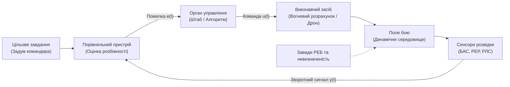
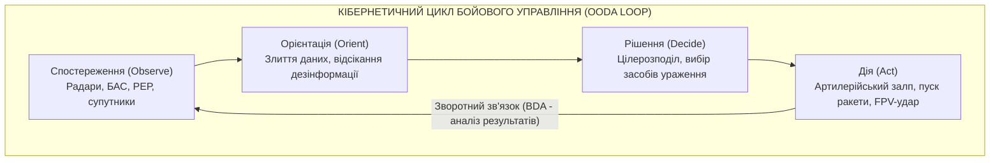
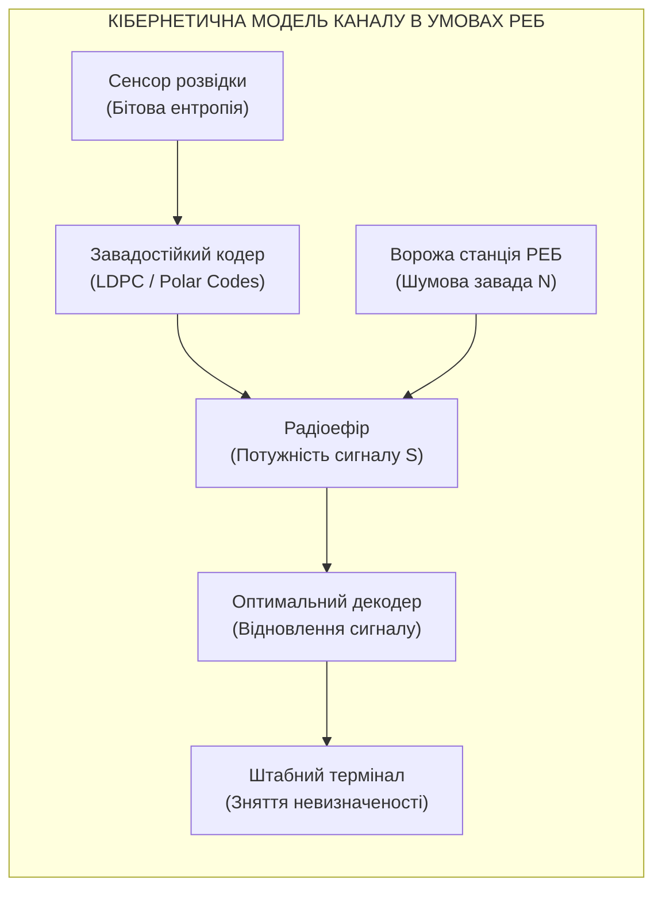

# Військова кібернетика: теорія керування, зворотний зв'язок та генезис

> **Тематичний напрям:** [Військова кібернетика та доказові системи управління](README.md) · Фундамент і теорія керування  
> **Пов'язані статті:** [Українська школа військової кібернетики](Ukrainian-Military-Cybernetics-School-UA.md) · [C4ISTAR, моделювання та кіберфізичні системи](Military-Cybernetics-In-Action-UA.md) · [АСУ озброєнням та керована зброя](Military-Cybernetics-Weapons-Control-Systems-UA.md)  
> **Автор:** [Микола Федчик (Mykola Fedchyk)](../Expert_Systems_Architecture/about-the-author.md) · [LinkedIn](https://www.linkedin.com/in/nickfedchik/)

---

Коли на початку XXI століття говорять про трансформацію війни, зазвичай називають видимі інструменти: безпілотні літальні апарати, системи супутникового зв'язку, тепловізійні приціли чи планшети артилеристів. Проте самі по собі прилади, навіть найдосконаліші, не забезпечують перемоги. Військовий результат визначає здатність пов'язати розрізнені сенсори, вогневі розрахунки, штаби та логістику в стійку систему, яка випереджає супротивника в ухваленні рішень.

Ця дисципліна називається **військовою кібернетикою**. Вона розглядає бойові дії не як хаотичне зіткнення мас і калібрів, а як динамічне протиборство систем управління в умовах жорсткої радіоелектронної протидії, шумів, дефіциту часу та невизначеності.

---

## 1. Сутність кібернетики: зворотний зв'язок проти ентропії поля бою

Будь-яка складна діяльність без постійного контролю результатів деградує і розвалюється. У воєнній історії цей феномен відомий як «туман війни» (термін Карла фон Клаузевіца): плани штабів втрачають актуальність у перші ж хвилини реального бою. Якщо підрозділ отримує наказ і йде в бій без надійного передавання інформації про зміну обстановки, виникає некерований процес. Гармати б'ють по порожніх квадратах, резерви висуваються на вже втрачені рубежі, а командир командує підрозділами, яких більше немає на мапі.

Класична кібернетика, заснована Норбертом Вінером, запропонувала розв'язання цієї проблеми через принцип **зворотного зв'язку**. Замість сліпого виконання жорсткої програми система постійно вимірює розбіжність між поточним станом об'єкта та бажаною метою, обчислює помилку і вносить коригувальну дію:

$$
e(t) = r(t) - y(t)
$$

де:

- $`r(t)`$ — заданий цільовий стан (наприклад, рубіж оборони або маршрут коридору польоту);
- $`y(t)`$ — виміряний сенсорами фактичний стан системи;
- $`e(t)`$ — поточна неузгодженість (помилка наведення, відхилення від графіка операції тощо).

Якщо замкнений ланцюг зворотного зв'язку описується передатною функцією прямого каналу $`W_{\text{fw}}(s)`$ та ланцюга спостереження $`W_{\text{fb}}(s)`$, то загальна передатна функція замкненої системи керування становить:

$$
W_{\text{sys}}(s) = \frac{W_{\text{fw}}(s)}{1 + W_{\text{fw}}(s) W_{\text{fb}}(s)}
$$

Ця математична залежність доводить ключовий кібернетичний закон: поведінка складної системи визначається не потужністю виконавчих органів $`W_{\text{fw}}(s)`$, а характеристиками зворотного зв'язку $`W_{\text{fb}}(s)`$. Якщо сенсори передають спотворені дані або запізнюються, знаменник $`1 + W_{\text{fw}}(s) W_{\text{fb}}(s)`$ наближається до нуля. Система втрачає стабільність, починає неконтрольовано розгойдуватися і зазнає катастрофічного самозбудження.

---

## 2. Військова кібернетика проти кібербезпеки: різниця масштабів і задач

В інженерній та навколовійськовій спільноті нерідко виникає плутанина, коли поняття «кібернетика» зводять виключно до «кібербезпеки». Фахівці починають говорити про антивірусні сканери, міжмережеві екрани, парольні політики або патчі для операційних систем.

Кібербезпека є вкрай важливим, але суто захисним і допоміжним напрямом. Вона відповідає на вузьке технічне питання: *«Як зберегти конфіденційність, цілісність і доступність цифрових каналів від несанкціонованого проникнення противника?»*. Проте захищений комп'ютер у захищеному бліндажі не гарантує перемоги, якщо рішення приймаються повільно, а розвіддані суперечать одне одному.

Військова кібернетика вирішує завдання вищого системного рівня: *«Як організувати взаємодію розвідки, штабів, зброї та зв'язку, щоб уражати цілі швидше, точніше й надійніше за ворога?»*.

Найвідомішим практичним вираженням військової кібернетики став цикл Джона Бойда — концепція OODA (Observe — Orient — Decide — Act):

1. **Observe (Спостереження):** збір первинних даних з поля бою.
2. **Orient (Орієнтація):** фільтрація завад, перевірка джерел на достовірність і побудова карти оперативної обстановки.
3. **Decide (Рішення):** комбінаторний розподіл сил і засобів за критерієм мінімізації часу та втрат.
4. **Act (Дія):** фізичне нанесення удару або маневр сил.

Якщо тривалість власного повного циклу управління позначити як $`\tau_{\text{own}}`$, а тривалість ворожого циклу як $`\tau_{\text{enemy}}`$, то кібернетична умова домінування формулюється математично:

$$
\tau_{\text{own}} < \tau_{\text{enemy}}
$$

Якщо ця нерівність виконується стабільно, супротивник змушений ухвалювати рішення на основі інформації про минуле. Кожен його наступний крок спрямований на протидію тим загрозам, яких уже немає, що призводить до паралічу його системи бойового управління.

### Закон необхідної різноманітності Ешбі на полі бою

Окрім швидкодії циклу $`\tau_{\text{own}} < \tau_{\text{enemy}}`$, стійкість управління визначається фундаментальним **законом необхідної різноманітності Вільяма Росса Ешбі (Law of Requisite Variety)**. Якщо позначити логарифмічну різноманітність (кількість можливих тактичних, спектральних і кінематичних станів) загроз супротивника як $`\mathcal{V}(D)`$, різноманітність доступних режимів нашої системи управління як $`\mathcal{V}(R)`$, а залишкову невизначеність результату бою як $`\mathcal{V}(E)`$, то виконується нерівність:

$$
\mathcal{V}(E) \ge \mathcal{V}(D) - \mathcal{V}(R)
$$

Щоб утримати бойову обстановку в контрольованих межах ($`\mathcal{V}(E) \le \epsilon`$), різноманітність керуючої системи зобов'язана бути не меншою за різноманітність збурень супротивника:

$$
\mathcal{V}(R) \ge \mathcal{V}(D) - \epsilon
$$

Цей закон пояснює, чому мономасштабні рішення неминуче програють у сучасній війні. Якщо супротивник комбінує радіоелектронне придушення в кількох діапазонах, хибні теплові пастки, FPV-дрони на нестандартних частотах та апарати на оптоволокні (високе $`\mathcal{V}(D)`$), то лінійна система оборони з одним фіксованим радіоканалом або одним типом перехоплювача ($`\mathcal{V}(R) \ll \mathcal{V}(D)`$) зазнає системного прориву. Нарощування $`\mathcal{V}(R)`$ досягається гетерогенністю сенсорів (радіолокація + пасивна РЕР + тепловізія + акустика), багатоканальною маршрутизацією зв'язку (Starlink, LTE, Mesh, оптоволокно) та модульною архітектурою корисного навантаження БАС і НРК.

---

## 3. Динаміка запізнення інформації: критичний часовий поріг стійкості

Найбільш підступний ворог системи бойового управління — це не завади РЕБ, а часова затримка передавання сигналів. На практиці це виглядає так: розвідувальний безпілотник виявив ворожу САУ о 12:00. Оператор передав координати до аналітичного центру, звідти вони пішли черговому офіцеру, потім командувачу артилерії, далі комбату і командиру гармати. Постріл пролунав о 12:18. Але ворожа самохідка залишає вогневу позицію за 90 секунд після завершення залпу. Снаряди влучають у порожнє місце.

Чому затримка призводить до катастрофи математично? Розглянемо найпростішу динамічну модель виправлення помилки наведення або ліквідації тактичного відставання з чистим запізненням $`\tau`$:

$$
\frac{d x(t)}{d t} = -a \, x(t - \tau)
$$

де:

- $`x(t)`$ — відхилення системи від мети в момент часу $`t`$;
- $`a > 0`$ — коефіцієнт інтенсивності реагування штабу чи системи управління;
- $`\tau`$ — сумарний час затримки сигналу (час проходження радіоканалу, час дешифрування відео, час ухвалення рішення).

Характеристичне рівняння цього диференціального рівняння має вигляд:

$$
s + a \, e^{-s \tau} = 0
$$

Підставляючи граничне значення на межі стійкості $`s = j \omega`$, отримуємо систему для дійсної та уявної частин:

$$
\omega = a \sin(\omega \tau), \quad a \cos(\omega \tau) = 0
$$

Звідси $`\omega \tau = \frac{\pi}{2}`$, що визначає гранично допустимий час запізнення в системі:

$$
\tau_{\text{crit}} = \frac{\pi}{2a}
$$

Цей розрахунок дає фундаментальний інженерний висновок: якщо сумарна затримка в циклі зв'язку та рішень перевищує величину $`\frac{\pi}{2a}`$, система втрачає фазову стійкість. Замість згасання помилки виникають наростаючі автоколивання: підрозділи починають хаотично метушитися між старими й новими наказами, витрачаючи пальне, боєкомплект і сили. Боротьба за скорочення затримки $`\tau`$ — це серце військової кібернетики.

### Інженерна компенсація запізнення: екстраполяція стану та каскадне контурування

Як військова кібернетика долає бар'єр $`\tau > \tau_{\text{crit}}`$ у реальних бойових системах? Використовуються два взаємодоповнювальні механізми:

1. **Прогнозувальна фільтрація (екстраполяція Калмана–Б'юсі та предиктор Сміта):** замість наведення на застарілу координату $`y(t - \tau)`$ система будує математичну модель руху цілі й обчислює упереджений вектор стану на момент фактичного підльоту засобу ураження $`t_{\text{hit}} = t + \tau_{\text{flight}}`$:

$$
\hat{\mathbf{x}}(t + \tau \mid t) = \mathbf{\Phi}(\tau)\,\hat{\mathbf{x}}(t \mid t) + \int_{0}^{\tau} \mathbf{\Phi}(\tau - \theta)\,\mathbf{B}\,\mathbf{u}(t + \theta)\,d\theta
$$

   де $`\mathbf{\Phi}(\tau) = e^{\mathbf{A}\tau}`$ — фундаментальна перехідна матриця кінематики цілі. Саме цей принцип лежить в основі автоматизованих систем керування зенітним вогнем та перехоплювачів БпЛА.
2. **Каскадне розділення контурів керування (Edge-декомпозиція):** повільний зовнішній контур ($`\tau_{\text{outer}} \sim 1\text{--}10\text{ с}`$), де присутня людина-оператор і штабний канал зв'язку, передає лише цільове призначення (вектор місії та обмеження RoE), тоді як швидкий внутрішній контур стабілізації, обходу перешкод і термінального донаведення ($`\tau_{\text{inner}} \sim 2\text{--}15\text{ мс}`$) замикається безпосередньо на бортовому обчислювачі дрона чи наземного робота. Завдяки тому, що для внутрішнього контуру $`\tau_{\text{inner}} \ll \frac{\pi}{2a_{\text{inner}}}`$, апарат зберігає стійкість навіть при затримках або тимчасових розривах зовнішнього радіоканалу.

---

## 4. Інформаційна ентропія бою та передача сигналів під завадами РЕБ

Поле сучасного бою насичене електромагнітними завадами станцій РЕБ, розривами снарядів і суперечливими повідомленнями. Командир, отримуючи десятки неперевірених доповідей, перебуває у стані високої невизначеності.

Клод Шеннон визначив інформацію як зняту невизначеність, пов'язавши її зі статистичною ентропією ймовірнісного розподілу можливих станів обстановки $`p_i`$:

$$
H(X) = - \sum_{i=1}^{n} p_i \log_2 p_i
$$

Коли розвіддані відсутні, ентропія максимальна: противник із рівною ймовірністю може атакувати на будь-якому з напрямків. Одне достовірне повідомлення, що підтверджує пересування ворожої колони з імовірністю $`p \approx 1`$, різко знижує ентропію системи майже до нуля, перетворюючи здогадки на математично обґрунтований розрахунок оборони.

Проте доставлення цього біта інформації відбувається через зашумлений радіоканал. Гранична пропускна здатність каналу зв'язку за теоремою Шеннона-Гартлі становить:

$$
C = B \log_2 \left( 1 + \frac{S}{N} \right)
$$

де:

- $`B`$ — ширина смуги частот радіоканалу (Гц);
- $`S`$ — потужність корисного радіосигналу передавача (Вт);
- $`N`$ — спектральна потужність шумів та завад ворожого РЕБ (Вт);
- $`C`$ — максимальна швидкість безпомилкового передавання даних (біт/с).

Якщо ворожа станція РЕБ підвищує рівень завад $`N`$ у $`10^4`$ разів (на 40 дБ), співвідношення сигнал/шум $`S/N`$ прямує до нуля. За формулою Тейлора при $`x \to 0`$ маємо $`\ln(1+x) \approx x`$, тому:

$$
C \approx B \cdot \frac{S}{N} \cdot \log_2 e \approx 1{,}4427 \cdot B \cdot \frac{S}{N}
$$

За таких умов потокове відео високої роздільної здатності передати фізично неможливо — пропускна здатність каналу падає до сотих часток кілобіта на секунду.

Кібернетичне вирішення цієї проблеми розвивається у двох ортогональних інженерних напрямах:

1. **Семантичне стиснення на краю мережі (Edge Semantic Compression):** бортовий мікрокомп'ютер дрона або станції РЕР локально розпізнає ціль і передає через заглушений ефір не гігабайти сирого відеопотоку ($`C_{\text{req}} \sim 5\text{--}20\text{ Мбіт/с}`$), а короткий криптографічно підписаний пакет метаданих обсягом $`64\text{--}128\text{ байтів}`$ (клас цілі, координати, вектор швидкості, час, рівень достовірності). Навіть за умов катастрофічного придушення ефіру на $`40\text{ дБ}`$ низькошвидкісна модуляція (LoRa / FHSS) надійно доставляє ці байти знань до штабного контуру вогневого ураження.
2. **Фізична ізоляція каналу (оптоволоконні лінії управління БпЛА та НРК):** коли щільність завад РЕБ у $`20\text{--}25\text{ км}`$ «кіл-зоні» робить радіоефір повністю непроникним ($`N_{\text{RF}} \to \infty`$), перехід на оптоволоконну котушку довжиною $`10\text{--}41\text{ км}`$ фізично обнуляє зовнішню електромагнітну заваду в каналі ($`N_{\text{fiber}} \approx \text{const} \ll S`$), повертаючи пропускну здатність $`C`$ до сотень мегабіт за секунду при нульовому радіовипромінюванні. Проте з погляду кібернетики це не «абсолютна зброя», а перенесення обмежень із частотної площини у механіко-кінематичну: маса котушки $`m_{\text{spool}} \propto L`$ зменшує бойову частину й маневреність апарата, а ризик обриву волокна на кутах забудови, лісосмугах чи при перетині траєкторій знову вимагає наявності на борту автономного резервного контуру (VIO / термінального донаведення).

---

## 5. Український кібернетичний генезис: спадщина Віктора Глушкова

Широко поширена хибна думка, ніби цифровізація Збройних Сил України почалася стихійно лише у 2022 році завдяки ентузіазму волонтерів і закупівлям цивільних дронів. Насправді підґрунтя для цього формувалося десятиліттями у межах всесвітньо визнаної української кібернетичної школи.

Фундатором вітчизняної школи кібернетики став академік Віктор Михайлович Глушков (1923–1982), засновник Інституту кібернетики Академії наук України. Саме в Києві ще у 1950–1960-х роках було закладено базові наукові принципи:

- **Теорія дискретних перетворювачів і цифрових автоматів:** математичне обґрунтування того, як дискретні схеми можуть моделювати складні логічні процеси мислення та управління.
- **Концепція ОГАС (Загальнодержавна автоматизована система обліку та обробки інформації):** проєкт розподіленої комп'ютерної мережі для обробки даних у реальному часі задовго до появи комерційного інтернету.
- **ЕОМ серії «Київ», «Дніпро», «МИР»:** перші вітчизняні машини для інженерних розрахунків та автоматизації управління складними технологічними й військовими об'єктами.

Глушков розглядав кібернетику не просто як програмування, а як інструмент посилення інтелектуальних можливостей людини. У його концепції обчислювальна машина виступала не заміною особи, що приймає рішення, а інтелектуальним партнером, здатним аналізувати мільйони варіантів обстановки, відсікати завідомо програшні сценарії та пропонувати оптимальні рішення.

Ця наукова традиція створила в Україні критичну масу математиків, системних аналітиків, схемотехніків та інженерів зв'язку, які розуміли природу великих систем задовго до термінів Big Data чи Cloud Computing.

---

## 6. Ризики кібернетизації: від візуалізації до доказовості рішень

Швидке насичення військ цифровими технологіями несе системні ризики, про які інженер зобов'язаний пам'ятати:

1. **«Культ інтерфейсу»:** яскрава цифрова мапа на планшеті створює ілюзію повного контролю. Якщо координати на мапі не мають позначки джерела та часу актуальності, командир бачить не реальність, а кольорову ілюзію.
2. **«Культ генеративного ШІ»:** спроби застосовувати непрозорі нейромережі типу «чорна скринька» для автоматичного вибору цілей загрожують трагічними помилками (ураженням дружніх сил чи цивільних об'єктів). Імовірнісна перцепція повинна суворо обмежуватися детермінованими правилами перевірки.
3. **Фрагментація рішень:** поява десятків несумісних між собою волонтерських або комерційних програмних продуктів створює інформаційний хаос у штабах замість єдиного операційного поля.
4. **Централізація без права на деградацію:** якщо цифрова система розрахована виключно на наявність супутникового інтернету та віддалених серверів, вона перетворюється на тягар у разі застосування ворогом засобів глушіння зв'язку.

Кібернетична дисципліна вимагає, щоб кожен елемент системи мав математично обґрунтовану модель автономної роботи при відмові зовнішніх зв'язків, а будь-яке рішення з контуру штучного інтелекту проходило чотирирівневу епістемічну верифікацію (**L1–L4**):
- **L1 (Формалізація правил):** переведення тактичних нормативів, ТТХ та правил ведення бою (RoE) у формальні предикати без змістових втрат;
- **L2 (Структурна та топологічна цілісність):** перевірка графа знань на відсутність циклів, суперечностей та «мертвих» гілок логіки;
- **L3 (Семантична та гранична кваліфікація):** верифікація фізичних допусків, кінематичних конвертів та граничних значень (Boundary Value Analysis) перед допуском до бойового контуру;
- **L4 (Детерміноване виконання та трасованість):** гарантований час обчислення за фіксовану кількість тактів із криптографічним журналюванням кожного спрацьованого правила та первинних сенсорних доказів.

---

## Підсумок

Військова кібернетика — це не набір приладів чи серверів, а точна інженерна теорія і практика управління протиборством систем. Вона доводить:

- Перемога здобувається не масою заліза, а мінімізацією часу в замкненій петлі зворотного зв'язку $`\tau_{\text{own}} < \tau_{\text{enemy}}`$ та забезпеченням необхідної різноманітності засобів $`\mathcal{V}(R) \ge \mathcal{V}(D) - \epsilon`$ за законом Ешбі.
- Запізнення передавання інформації $`\tau > \frac{\pi}{2a}`$ руйнує фазову стійкість системи бойового управління, тому вимагає математичної екстраполяції стану цілей і делегування швидких контурів стабілізації на бортові обчислювачі (Edge).
- В умовах тотального РЕБ перемагає поєднання семантичного стиснення даних на рівні сенсора, фізично захищених каналів (зокрема оптоволоконних та вузькосмугових FHSS/Mesh) і детермінованих доказових правил прийняття рішень.

---

## Посилання

- Вінер Н. *Кібернетика, або керування і зв'язок у тварині та машині*. — М.: Радянське радіо, 1958.
- Глушков В. М. *Вступ до кібернетики*. — К.: Видавництво АН УРСР, 1964.
- Ешбі В. Р. *Вступ до кібернетики* (Ashby W. R. *An Introduction to Cybernetics*). — London: Chapman & Hall, 1956.
- Шеннон К. *Математична теорія зв'язку* // Роботи з теорії інформації та кібернетики. — М.: ІЛ, 1963.
- Boyd, John R. *The Essence of Winning and Losing*. Unpublished lecture notes, 1996.
- [Війська зв'язку та кібербезпеки Збройних Сил України — Міністерство оборони України](https://mod.gov.ua/pro-nas/vijska-zv-yazku-ta-kiberbezpeki)
- [Інститут кібернетики імені В. М. Глушкова НАН України](https://incyb.kiev.ua/)

---

**Пов'язані публікації:** [Українська школа військової кібернетики](Ukrainian-Military-Cybernetics-School-UA.md) · [C4ISTAR, моделювання та кіберфізичні системи](Military-Cybernetics-In-Action-UA.md) · [Експертні системи військового призначення](Military-Expert-Systems-UA.md) · [Усі статті напряму «Військова кібернетика»](README.md)
