```mermaid
flowchart TD
    accTitle: Рисунок 1. Структурно-логічна схема монографії за принципом дидактичної послідовності
    accDescr: Діаграма відображає ієрархічний розвиток матеріалу від Частини 1 (Теоретичні основи та темпоральна логіка, Глави 01-02) через Частину 2 (Стохастична деградація та каузально-конформне прогнозування, Глави 03-04) і Частину 3 (Відкриті наукові проблеми та технологічні бар'єри, Глава 05) до перспективних глав Частини 4 (Глави 06-10).

    subgraph Part1 ["Частина 1. Теоретичні засади, часова екстраполяція та темпоральні логіки"]
        Ch01["Глава 01. Теоретичні засади, історична еволюція та таксономія\n(Від ретроспективної діагностики до випереджальних моделей Розена,\nнерівність горизонту прогнозу Ляпунова та прогностичний стан Omega)"]
        Ch02["Глава 02. Темпоральні логіки та інтервальні числення\n(Алгебра Аллена, LTL, MTL, сигнальна логіка STL Малера-Нічковича,\nтеорема про ліпшицеву оцінку запасу стійкості rho на горизонті tau)"]
    end

    subgraph Part2 ["Частина 2. Стохастична деградація ресурсу, каузальність і гарантовані інтервали"]
        Ch03["Глава 03. Стохастичні процеси деградації та залишковий ресурс\n(Модель Кокса, закон Періса-Ердогана, процеси Вінера і гамма,\nвиведення розподілу Вальда для RUL згідно з ISO 13381-1)"]
        Ch04["Глава 04. Каузальне виведення та конформні прогностичні інтервали\n(Структурні каузальні моделі Перла, числення do(X), контрфакти,\nтеорія конформного прогнозування Вовка та адаптивний метод ACI)"]
    end

    subgraph Part3 ["Частина 3. Відкриті наукові напрями та технологічні проблеми (Базове ядро)"]
        Ch05["Глава 05. Відкриті наукові проблеми, фундаментальні гіпотези та технологічні бар'єри\n(Перформативність прогнозу і закон Гудгарта, приховані конфаундери,\nбіфуркації екстремумів, конфлікт PINNs і термодинаміки, сертифікація WCET)"]
    end

    subgraph Part4 ["Частина 4. Проектування, гібридна інтеграція та галузева сертифікація (Перспективні глави скелета)"]
        Ch06["Глава 06. Прогнозування на основі правил (Rule-Based Forecasting)\nта арбітраж ансамблів експертних гіпотез"]
        Ch07["Глава 07. Фізично-інформовані прогностичні системи\nта збереження диференціальних інваріантів"]
        Ch08["Глава 08. Попередження рідкісних катастрофічних подій\nта індикатори критичного сповільнення"]
        Ch09["Глава 09. Обчислювальні архітектури реального часу\nта детерміноване планування превентивних дій"]
        Ch10["Глава 10. Методологія валідації, калібрування Brier/CRPS\nта сертифікації за ISO 13381-1 і SOTIF"]
    end

    Ch01 --> Ch02 --> Ch03 --> Ch04 --> Ch05 --> Ch06 --> Ch07 --> Ch08 --> Ch09 --> Ch10

    classDef p1 fill:#e3f2fd,stroke:#1565c0,stroke-width:2px,color:#0d47a1;
    classDef p2 fill:#e8f5e9,stroke:#2e7d32,stroke-width:2px,color:#1b5e20;
    classDef p3 fill:#fce4ec,stroke:#c2185b,stroke-width:2px,color:#880e4f;
    classDef p4 fill:#fff3e0,stroke:#e65100,stroke-width:2px,color:#bf360c;

    class Ch01,Ch02 p1;
    class Ch03,Ch04 p2;
    class Ch05 p3;
    class Ch06,Ch07,Ch08,Ch09,Ch10 p4;
```

# Предиктивні експертні системи: Математичні моделі часової екстраполяції, каузального виведення та гарантованих прогностичних інтервалів

> **Статус видання:** Наукова монографія та навчально-методологічний посібник (скелет книги та базові глави 01–05)  
> **Автор:** [Микола Федчик](../ExpertSystem/about-the-author.md)  
> **Галузь знань:** Штучний інтелект, системи прийняття рішень, математична теорія прогнозування, каузальне виведення, технічна прогностика та керування ресурсом систем  
> **Дидактичний принцип побудови:** Сувора систематичність і послідовність — від детермінованої та стохастичної часової екстраполяції через формальні темпоральні логіки й моделі деградації ресурсу до інтервенційного каузального числення, непараметричних конформних гарантій та відкритих наукових проблем

---

## 1. Загальна характеристика наукової праці

### 1.1. Термінологічна демаркація та предмет дослідження

У сучасній науково-технічній літературі критично важливо розрізняти два паронімічні поняття:
- **Предикативні експертні системи** (*Predicative Expert Systems*) — логічні системи, побудовані на численні предикатів першого порядку (*First-Order Predicate Calculus*), які можуть оцінювати лише поточний або ретроспективний стан об'єкта у фіксований момент часу $`t_0`$.
- **Предиктивні (прогнозувальні, прогностичні) експертні системи** (*Predictive / Prognostic / Anticipatory Expert Systems*) — клас інтелектуальних систем прийняття рішень, які на основі поточних вимірювань на інтервалі $`[t_0 - T_w, t_0]`$, формалізованих доменних знань експертів, фізичних законів збереження та структурних каузальних моделей виводять майбутню траєкторію стану об'єкта $`\hat{\mathbf{x}}(t_0 + \tau)`$ на горизонті випередження $`\tau > 0`$, оцінюють час до настання граничного стану (*Remaining Useful Life*, RUL) та обчислюють ефект запланованих керуючих втручань $`\mathrm{do}(\mathbf{u})`$ із гарантованими межами достовірності.

У класичній таксономії експертних систем Фредеріка Хейєса-Рота, Дональда Вотермена та Дугласа Лената (*Building Expert Systems*, 1983) задачі прогнозування (*Prediction — inferring likely consequences of given situations*) виділені в окрему фундаментальну категорію поруч із інтерпретацією, діагностикою, моніторингом, плануванням та керуванням. Проте на відміну від діагностичної системи, яка шукає причину *вже присутньої* несправності у момент $`t_0`$, предиктивна експертна система працює з принципово іншою математичною природою невизначеності: майбутній стан ще не відбувся, його неможливо безпосередньо прочитати з пам'яті або сенсора в момент $`t_0`$, а саме оголошення прогнозу та превентивна дія оператора змінюють подальшу еволюцію досліджуваної системи.

### 1.2. Актуальність теми та історична еволюція (1941–2026)

Розвиток математичних та інженерних методів прогнозування пройшов шість історичних етапів, кожен із яких розв'язував обмеження попереднього рівня, але породжував нові теоретичні виклики:

**Таблиця 1.** Історична еволюція математичного апарату та архітектур предиктивних систем (1941–2026).

| Історичний етап та ключові праці | Базовий математичний апарат | Головне наукове досягнення етапу | Фундаментальне обмеження, що стимулювало наступний етап |
| :--- | :--- | :--- | :--- |
| **1. Лінійна стаціонарна екстраполяція та фільтрація стану (1941–1965)** А. М. Колмогоров (1941), Н. Вінер (1949), Р. Калман (1960), Р. Б'юсі (1961) | Ортогональна проекція в гільбертовому просторі $`L^2`$, рівняння Вінера — Гопфа, рекурсивне байєсівське оцінювання в лінійних гауссових просторах станів | Оптимальна за середньоквадратичною похибкою лінійна оцінка майбутнього стану за наявності гауссового шуму вимірювань | Нездатність враховувати асиметричні доменні правила, структурні розриви режимів, нормативні обмеження та нелінійні фазові переходи |
| **2. Символьні експертні системи першого покоління та теорія випереджальних систем (1975–1990)** Ф. Хейєс-Рот, Д. Вотермен, Д. Ленат (1983), Дж. Аллен (1983), Р. Розен (*Anticipatory Systems*, 1985) | Продукційні правила з коефіцієнтами впевненості, інтервальна темпоральна алгебра Аллена (13 відношень), внутрішні предикативні моделі Розена | Явне подання експертних знань про сценарії розвитку подій та формалізація поняття системи, що діє у теперішньому часі на основі моделі майбутнього | Дискретні правила не інтегруються з неперервною динамікою диференціальних рівнянь; комбінаторний вибух при багатошаговому розгортанні сценаріїв у часі |
| **3. Прогнозування на основі правил та статистичний синтез часових рядів (1990–2003)** Дж. Бокс, Г. Дженкінс (ARIMA), Ф. Коллопі, Дж. С. Армстронг (*Rule-Based Forecasting*, 1992) | Зважена комбінація параметричних моделей екстраполяції трендів із продукційною базою із 99 доменних правил корекції рівня та нахилу | Емпірично доведено, що поєднання експертних правил про фізичні та економічні режими із моделями часових рядів суттєво перевершує суто статистичну екстраполяцію | Евристичне налаштування ваг правил; відсутність строгих меж похибки на скінченних вибірках та нездатність відокремити кореляцію від причинності |
| **4. Технічна прогностика, теорія надійності та темпоральна верифікація сигналів (2000–2015)** А. Пнуелі (LTL), О. Малер, Д. Нічкович (STL, 2004), стандарт ISO 13381-1 (2004/2015), І. Сі, Ч. Чжоу (RUL, 2011) | Сигнальна темпоральна логіка (STL) із кількісною мірою запасу стійкості $`\rho(\varphi, \mathbf{x}, t)`$, стохастичні процеси деградації Вінера, гамма та обернені гаусівські процеси | Аналітичний розрахунок розподілу залишкового корисного ресурсу (RUL) за часом першого досягнення порогу відмови та неперервний контроль часових специфікацій | Моделі деградації оцінюють пасивне спостереження за системою, але не дозволяють строго обчислити наслідки контрфактичної зміни режиму керування |
| **5. Каузальне виведення, фізично-інформовані моделі та конформне прогнозування (2000–2022)** Дж. Перл (*Causality*, 2000/2009), В. Вовк, А. Гаммерман, Г. Шефер (2005), М. Раїссі, Дж. Карніадакіс (PINNs, 2019) | Структурні каузальні моделі (SCM), числення інтервенцій $`\mathrm{do}(X=x)`$, конформні прогностичні множини $`\mathcal{C}_{1-\alpha}`$, регуляризація операторів диференціальних рівнянь у частинних похідних | Перехід від кореляційної екстраполяції до прогнозування результату активного втручання та отримання непараметричних гарантій покриття $`\mathbb{P}(Y_{n+1} \in \mathcal{C}_{1-\alpha}) \ge 1 - \alpha`$ | Класичне конформне прогнозування вимагає обмінюваності даних (*exchangeability*), яка порушується в нестаціонарних часових рядах та при зворотній дії прогнозу на середовище |
| **6. Адаптивні, перформативно-стійкі та доказові предиктивні системи (2020–2026)** Р. Тібшірані, Е. Кандес (2019), Х. Пердомо, М. Гардт (2020), І. Гіббс, Е. Кандес (ACI, 2021) | Адаптивне конформне виведення (ACI) за довільного дрейфу розподілу, теорія перформативного прогнозування у просторах Вассерштейна, верифіковані гібридні каскади | Збереження гарантованої достовірності прогнозу за структурних зсувів середовища та врахування рефлексивного впливу самого прогнозу на об'єкт керування | Залишаються відкритими задачі детермінованого верхнього часу виконання (WCET), прогнозування біфуркацій за межами вибірки та каузальної ідентифікації за прихованих змінних |

---

## 2. Дидактична систематичність і послідовність викладу монографії

Монографія спроектована за суворим дидактичним правилом **послідовного нарощування складності та заборони випереджальних посилань** (*strict prerequisite ordering*): жоден математичний оператор не використовується раніше, ніж введено його формальне означення, а кожна наступна глава додає рівно один новий структурний вимір до базового **прогностичного стану системи** $`\Omega(t_0, \tau)`$.

Наскрізна еволюція математичного об'єкта дослідження від Глави 01 до Глави 10 підпорядковується такій послідовності:

$$
\underbrace{\hat{\mathbf{x}}(t_0 + \tau) \pm u(\tau)}_{\text{Глава 01: Часова екстраполяція}} \longrightarrow \underbrace{\rho\left(\varphi_{[a,b]}, \hat{\mathbf{x}}, t_0\right)}_{\text{Глава 02: Часова логіка STL}} \longrightarrow \underbrace{f_{\mathrm{RUL}}(\tau \mid \mathcal{H}_{t_0})}_{\text{Глава 03: Стохастичний ресурс}} \longrightarrow \underbrace{P\left(Y_{t_0+\tau} \in \mathcal{C}_{1-\alpha} \;\middle|\; \mathrm{do}(\mathbf{u})\right)}_{\text{Глава 04: Каузальність і конформні межі}} \longrightarrow \underbrace{\theta^* = \mathcal{A}\left(\mathcal{D}(\theta^*)\right)}_{\text{Глава 05: Перформативна рівновага і відкриті проблеми}}
$$

---

## 3. Припущення інженерної цінності, еталонні базові лінії та протокол практичної верифікації

### 3.1. Центральна інженерна гіпотеза праці

Сучасна інженерна практика прогнозування розколота на два ізольовані полюси:
1. **Суто статистичні або глибокі нейромережеві апроксиматори часових рядів** (`ARIMA`, `LSTM`, `Temporal Fusion Transformers`), які мінімізують середню квадратичну похибку на історичних даних, але порушують закони фізичного збереження (наприклад, прогнозують немонотонне «саморікування» втомної тріщини без ремонту), втрачають працездатність при зміні режиму керування через відсутність каузальної моделі $`\mathrm{do}(\mathbf{u})`$ та видають некалібровані точкові оцінки без гарантованого рівня покриття.
2. **Класичні дискретні символьні системи правил** (`CLIPS`, `Drools`, `Prolog`), які зберігають нормативну трасованість, але оперують миттєвими булевими порогами без інтегрування стохастичної динаміки деградації та не здатні обчислити розподіл залишкового ресурсу $`\mathrm{RUL}(t_0)`$.

**Інженерна гіпотеза книги** полягає у такому перевірюваному твердженні:

> Якщо побудувати **гібридний чотирирівневий тракт предиктивної експертної системи**, у якому:
> 1) неперервна фізична еволюція оцінюється через стохастичні процеси деградації з фізично-інформованими обмеженнями монотонності та збереження енергії ([Глава 03](ch03-stochastic-degradation-and-remaining-useful-life.md));
> 2) доменні правила експертів формулюються як формули сигнальної темпоральної логіки STL із неперервним функціоналом запасу міцності $`\rho(\varphi, \hat{\mathbf{x}}, t_0)`$ ([Глава 02](ch02-temporal-logics-and-interval-calculi.md));
> 3) вибір превентивної дії виконується за каузальним інтервенційним численням Перла $`P(Y_{t_0+\tau} \mid \mathrm{do}(\mathbf{u}))`$ ([Глава 04](ch04-causal-inference-counterfactuals-and-conformal-bounds.md));
> 4) вихідний прогноз огортається адаптивним конформним інтервалом $`\mathcal{C}_{1-\alpha}(t_0, \tau)`$ із правилом захисної відмови при перевищенні граничної ширини інтервалу $`\lvert \mathcal{C}_{1-\alpha} \rvert > \Delta_{\max}`$,
>
> то така система одночасно забезпечує: **(а)** емпіричне покриття дійсних майбутніх значень не нижче номінального рівня $`1 - \alpha`$ навіть за нестаціонарного дрейфу середовища; **(б)** нульову частку фізично неможливих траєкторій прогнозу; **(в)** зниження частоти хибних превентивних втручань при прихованих конфаундерах порівняно з кореляційними моделями.

### 3.2. Чотири еталонні базові лінії та стендова програма доведення

Для об'єктивної перевірки сформульованої гіпотези предиктивна експертна система порівнюється з чотирма базовими лініями (`B1`–`B4`) за чотирма експериментальними протоколами (`E1`–`E4`), наведеними в таблиці 2.

**Таблиця 2.** Еталонні базові лінії та протокол практичного доведення переваги предиктивних експертних систем.

| Код випробування | Що саме порівнюється (Досліджувана система проти Базової лінії) | Методика випробування та тестовий корпус | Вимірювані кількісні метрики | Кількісний критерій практичного доведення переваги | Умова спростування (коли підхід недоцільний) |
| :-: | :--- | :--- | :--- | :--- | :--- |
| **E1** *(Точність оцінки залишкового ресурсу RUL та фізична узгодженість)* | Стохастична модель деградації з правилами перемикання режимів ([Глава 03](ch03-stochastic-degradation-and-remaining-useful-life.md)) проти **B1** (лінійна екстраполяція `ARIMA / Holt-Winters` та суто регресійна нейромережа `LSTM` без фізичних обмежень) | Прогнозування залишкового ресурсу $`\mathrm{RUL}`$ на корпусі деградації турбовентиляторних двигунів (`NASA C-MAPSS`) та підшипників (`PRONOSTIA`) на горизонтах $`\tau \in \{10, 30, 50, 100\}`$ циклів | Середня абсолютна похибка $`\mathrm{MAE}_{\mathrm{RUL}}`$, неперервна рангова оцінка ймовірності (`CRPS`), асиметричний штраф запізнілого прогнозу за ISO 13381-1, частка немонотонних (фізично неможливих) інверсій деградації | Частка фізичних інверсій деградації $`\equiv 0{,}0\%`$ (проти $`8\dots 19\%`$ у необмеженій `LSTM`); зниження асиметричного штрафу запізнілого попередження щонайменше на $`25\%`$ | Якщо процес деградації не має вимірюваних фізичних передвісників і відмова має суто пуассонівський миттєвий характер ($`\lambda(t) = \text{const}`$) |
| **E2** *(Темпоральна верифікація STL проти миттєвих порогів)* | Моніторинг прогностичного запасу стійкості STL $`\rho(\varphi, \hat{\mathbf{x}}, t_0)`$ ([Глава 02](ch02-temporal-logics-and-interval-calculi.md)) проти **B2** (класична продукційна система `CLIPS / Drools` із миттєвими булевими порогами `x(t) > L_max`) | Подання 5 000 перехідних процесів із короткочасними допустимими викидами ($\Delta t < \tau_{\mathrm{safe}}$) та повільним небезпечним накопиченням перегріву | Час випередження тривоги $`\Delta t_{\mathrm{lead}}`$, частота хибних спрацювань (`FAR`) на безпечних імпульсних завадах, частота пропуску каскадних аварій (`FRR`) | Збільшення часу випередження тривоги $`\Delta t_{\mathrm{lead}}`$ при зниженні хибних тривог на короткочасних імпульсах нижче $`1{,}0\%`$ завдяки часовим операторам $`\mathcal{G}_{[a,b]}`$ та $`\mathcal{F}_{[a,b]}`$ | Якщо вимога безпеки є суто миттєвою без часової інерції об'єкта ($`a = b = 0`$) |
| **E3** *(Каузальна стійкість при зміні політики керування)* | Структурна каузальна модель із оператором інтервенції $`P(Y \mid \mathrm{do}(\mathbf{u}))`$ ([Глава 04](ch04-causal-inference-counterfactuals-and-conformal-bounds.md)) проти **B3** (кореляційний градієнтний бустинг / регресія $`P(Y \mid \mathbf{u})`$, навчена на історичних логах за прихованого конфаундера навантаження) | Оцінювання ефекту превентивного зниження навантаження або профілактичного обслуговування, яке в історичних даних призначалося переважно найбільш зношеним вузлам (парадокс Сімпсона) | Відносна похибка оцінки інтервенційного ефекту $`\lvert \hat{\tau}_{\mathrm{ATE}} - \tau_{\mathrm{ATE}} \rvert`$, частота рекомендації шкідливого втручання (інверсія знаку ефекту) | Нульова частота інверсії знаку керуючої дії завдяки бекдор-коригуванню за станом зносу (у той час як кореляційна базова лінія `B3` хибно асоціює профілактику з прискоренням відмови) | Якщо граф причинно-наслідкових зв'язків домену повністю невідомий, а всі конфаундери є принципово неспостережуваними без інструментальних змінних |
| **E4** *(Гарантоване покриття за нестаціонарного дрейфу)* | Адаптивне конформне прогнозування (ACI, [Глава 04](ch04-causal-inference-counterfactuals-and-conformal-bounds.md)) проти **B4** (параметричні гаусівські інтервали $`\hat{y} \pm 1{,}96\hat{\sigma}`$ та базова неадаптивна конформна схема Split-CP) | Потокове прогнозування часового ряду зі стрибкоподібною зміною дисперсії шуму та структурним зсувом тренду (10 000 кроків при цільовому рівні довіри $`1 - \alpha = 0{,}95`$) | Фактична частота покриття істинних значень (`Empirical Coverage`), середня ширина інтервалу, час відновлення покриття після структурного зсуву | Збереження емпіричного покриття в межах $`95{,}0\% \pm 1{,}0\%`$ при зміні розподілу (тоді як гаусівський інтервал `B4` падає до $`65\dots 78\%`$ покриття під час стрибка волатильності) | Якщо ширина адаптивного інтервалу перевищує фізично допустимий діапазон керування (у цьому разі система ТЕОС/ПЕС зобов'язана видати детерміновану відмову від прогнозу) |

---

## 4. Архітектура та детальний план глав монографії

Монографія складається з 4 частин (10 глав за повним планом). У цьому репозиторії повністю розгорнуто фундаментальне ядро книги (Глави 01–05) та закладено детальний структурний каркас прикладних глав (Глави 06–10).

### Частина 1. Теоретичні засади, часова екстраполяція та темпоральні логіки

1. **[Глава 01. Теоретичні засади, історична еволюція та таксономія предиктивних експертних систем](ch01-foundations-and-evolution-of-predictive-systems.md)** *(Повністю розроблена)*  
   Фундаментальна асиметрія між діагностикою теперішнього та прогнозуванням майбутнього. Історична генеза від лінійної екстраполяції Колмогорова — Вінера й фільтра Калмана до таксономії Хейєса-Рота та теорії випереджальних систем Роберта Розена. Канонічний вектор прогностичного стану $`\Omega(t_0, \tau)`$. Теорема 1.1 про експоненційне зростання дисперсії прогнозу в системах із додатним показником Ляпунова та визначення максимального горизонту достовірного прогнозування $`\tau_{\max}`$. Покроковий числовий розрахунок горизонту передбачуваності теплового розгону реактора.
2. **[Глава 02. Темпоральні логіки, інтервальні числення та кількісна семантика стійкості прогнозу](ch02-temporal-logics-and-interval-calculi.md)** *(Повністю розроблена)*  
   Обмеженість класичної миттєвої логіки предикатів при описі часових траєкторій. Інтервальна алгебра Джеймса Аллена (13 базових відношень та таблиця транзитивної композиції). Перехід від лінійної (LTL) і метричної (MTL) темпоральних логік до сигнальної темпоральної логіки (STL) Малера — Нічковича. Кількісна семантика запасу стійкості $`\rho(\varphi, \mathbf{x}, t)`$. Теорема 2.1 про гарантовану виконуваність темпоральної специфікації безпеки на прогнозованій траєкторії з урахуванням трубки похибки прогнозу. Числовий інженерний розрахунок випереджувального контролю тиску та температури.

### Частина 2. Стохастична деградація ресурсу, каузальність і гарантовані інтервали

3. **[Глава 03. Стохастичні процеси деградації, теорія виживаності та оцінювання залишкового ресурсу](ch03-stochastic-degradation-and-remaining-useful-life.md)** *(Повністю розроблена)*  
   Архітектура технічної прогностики за стандартом ISO 13381-1. Функція інтенсивності відмов, розподіл Вейбулла та напівпараметрична регресія пропорційних ризиків Д. Кокса. Фізичні моделі накопичення пошкоджень (закон Періса — Ердогана) та стохастичні процеси деградації (процес Вінера з дрейфом, монотонний гамма-процес, обернений гаусівський процес). Означення часу першого досягнення порогу відмови (*First Hitting Time*) та залишкового корисного ресурсу (`RUL`). Теорема 3.1 про аналітичний розподіл Вальда для залишкового ресурсу та байєсівське оновлення параметра дрейфу. Покроковий числовий розрахунок `RUL` високовольтного обладнання.
4. **[Глава 04. Каузальне виведення, контрфактичне прогнозування та гарантовані конформні інтервали](ch04-causal-inference-counterfactuals-and-conformal-bounds.md)** *(Повністю розроблена)*  
   Крах кореляційних прогнозів при зміні політики керування (парадокс Сімпсона в системах профілактичного обслуговування). Три рівні каузальної ієрархії Джудеї Перла: спостереження, інтервенція $`\mathrm{do}(X=x)`$, контрфактичний аналіз. Структурні каузальні моделі (SCM) та Теорема 4.1 про ідентифікованість інтервенційного прогнозу за критерієм блокування зворотних шляхів (*Back-door adjustment*). Непараметрична оцінка невизначеності: теорія конформного прогнозування Володимира Вовка (Теорема 4.2 про скінченно-вибіркову гарантію покриття $`1 - \alpha`$) та адаптивне конформне виведення (ACI) Гіббса — Кандеса для нестаціонарних рядів. Покроковий числовий розрахунок каузального ефекту превентивного розвантаження та конформного інтервалу.

### Частина 3. Відкриті наукові напрями та технологічні проблеми

5. **[Глава 05. Відкриті наукові проблеми, фундаментальні гіпотези та технологічні бар'єри предиктивних експертних систем](ch05-open-scientific-problems-and-technological-frontiers.md)** *(Повністю розроблена)*  
   Систематичний огляд переднього краю світової науки про прогнозувальні системи та невирішених проблем:
   - **Проблема 1:** Перформативність прогнозу, рефлексивний зворотний зв'язок та ефект саморуйнівних пророцтв (*Self-Defeating Prophecies*, закон Гудгарта; Теорема 5.1 про умову існування перформативно стабільної рівноваги за метрикою Вассерштейна).
   - **Проблема 2:** Неідентифікованість прихованих нестаціонарних конфаундерів у динамічних каузальних графах.
   - **Проблема 3:** Прогнозування екстремальних подій та біфуркаційних фазових переходів за межами навчального розподілу (теорія екстремальних значень Пікандса — Балкема — де Гаана та індикатори критичного сповільнення Шеффера).
   - **Проблема 4:** Математичний конфлікт між статистичною апроксимацією та жорсткими законами збереження у фізично-інформованих нейромережах (PINNs).
   - **Проблема 5:** Технологічний бар'єр детермінованого верхнього часу виконання (WCET) при інтеграції стохастичних фільтрів і оптимізаційних солверів у системи критичної безпеки ASIL-D / DAL-A.
   - **Чотири відкриті дослідницькі гіпотези (Гіпотези 5.1–5.4)** з формальними протоколами їх перевірки та фальсифікації.

### Частина 4. Проектування, гібридна інтеграція та галузева сертифікація (Структурний план глав 06–10)

6. **Глава 06. Прогнозування на основі правил та арбітраж ансамблів експертних гіпотез** *(План глави)*  
   Формалізація методу Коллопі — Армстронга (*Rule-Based Forecasting*). Декомпозиція часового ряду на рівень, локальний нахил та довгостроковий потенціал. Логічні правила виявлення структурних зламів, аномалій та насичення. Оптимальне комбінування експертних та модельних прогнозів за логарифмічними й квадратичними правилами оцінювання.
7. **Глава 07. Фізично-інформовані прогностичні системи та збереження диференціальних інваріантів** *(План глави)*  
   Поєднання операторів частинних похідних (законів збереження маси, імпульсу, енергії та монотонності ентропії) з продукційними правилами експертної системи. Проекція прогнозованого вектора стану на допустимий симплектичний або дисипативний многовид.
8. **Глава 08. Попередження рідкісних катастрофічних подій та індикатори критичного сповільнення** *(План глави)*  
   Теорія біфуркацій ковимірності 1 (сідло-вузлова біфуркація, біфуркація Андронова — Гопфа). Зростання часу релаксації, дисперсії та автокореляції з лагом 1 як ранні передвісники зриву режиму. Розподіл Парето для перевищень над високим порогом (*Peaks-Over-Threshold*, POT).
9. **Глава 09. Обчислювальні архітектури реального часу та детерміноване планування превентивних дій** *(План глави)*  
   Синтез прогнозувальної експертної системи з прогнозувальним керуванням за моделлю (*Model Predictive Control*, MPC) із обмеженнями за шансами (*Chance-Constrained MPC*). Амортизація обчислень на скінченному горизонті та гарантування верхнього часу відгуку (WCET).
10. **Глава 10. Методологія валідації, калібрування прогностичних розподілів та сертифікації за стандартами безпеки** *(План глави)*  
    Строгі правила оцінювання імовірнісних та інтервальних прогнозів (*Proper Scoring Rules*: оцінка Браєра, логарифмічна оцінка, неперервна рангова оцінка CRPS, коефіцієнт Віinkler для інтервалів). Вимоги стандартів ISO 13381-1, ISO/PAS 21448 (SOTIF) та FDA AI/ML SaMD до прогностичних систем.

---

## 5. Зведений термінологічний словник монографії

| Термін | Англійський еквівалент | Строге наукове визначення |
| :--- | :--- | :--- |
| **Предиктивна експертна система** | *Predictive Expert System* | Інтелектуальна система, яка поєднує формалізовані доменні знання з динамічними, стохастичними та каузальними моделями для виведення майбутніх станів об'єкта на горизонті $`\tau > 0`$ із кількісною оцінкою невизначеності. |
| **Випереджальна система Розена** | *Anticipatory System* | Система, що містить внутрішню прогностичну модель себе та свого середовища і використовує передбачення майбутнього стану для зміни своєї поточної керуючої дії у теперішній момент часу. |
| **Горизонт достовірного прогнозу** | *Valid Prediction Horizon* | Максимальний інтервал випередження $`\tau_{\max}`$, на якому розширена невизначеність прогнозу не перевищує ширини нормативного поля допуску безпеки. |
| **Запас темпоральної стійкості** | *STL Robustness Degree* | Дійснозначний функціонал $`\rho(\varphi, \mathbf{x}, t)`$, знак якого показує виконання або порушення формули сигнальної темпоральної логіки $`\varphi`$, а модуль дорівнює допустимому збуренню траєкторії $`\mathbf{x}`$ у метриці $`L_\infty`$ без зміни істинності формули. |
| **Залишковий корисний ресурс** | *Remaining Useful Life (RUL)* | Випадкова величина $`T_{\mathrm{RUL}}(t_0) = \inf\{\tau > 0 \mid X(t_0 + \tau) \ge x_{\mathrm{fail}}\}`$, що визначає час від поточного моменту спостереження $`t_0`$ до першого перетину процесом деградації граничного порогу відмови. |
| **Каузальна інтервенція** | *Causal Intervention (`do`-operator)* | Математичний оператор Джудеї Перла $`\mathrm{do}(X = x)`$, який моделює примусове встановлення змінної $`X`$ у значення $`x`$ шляхом видалення з каузального графа всіх вхідних ребер до $`X`$ при збереженні решти структурних рівнянь системи. |
| **Конформний прогностичний інтервал** | *Conformal Prediction Interval* | Непараметрична прогностична множина $`\mathcal{C}_{1-\alpha}(X_{n+1})`$, побудована за рангами мір невідповідності на калібрувальній вибірці, яка гарантує ймовірність покриття істинного значення не менше ніж $`1 - \alpha`$ без припущень про параметричний вид розподілу. |
| **Перформативність прогнозу** | *Performative Prediction* | Властивість замкнених соціотехнічних та кіберфізичних систем, у яких сам факт публікації або застосування прогнозу $`\theta`$ викликає зсув розподілу даних середовища $`\mathcal{D}(\theta)`$. |
