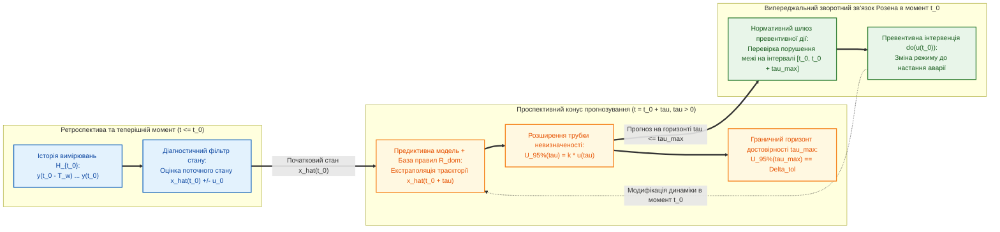

# Глава 01. Теоретичні засади, історична еволюція та таксономія предиктивних експертних систем

> **Книга:** [Предиктивні експертні системи: Математичні моделі часової екстраполяції, каузального виведення та гарантованих прогностичних інтервалів](README.md) · Частина 1. Теоретичні засади, часова екстраполяція та темпоральні логіки  
> **Попередня глава:** — (Вступна глава монографії)  
> **Наступна глава:** [Глава 02. Темпоральні логіки, інтервальні числення та кількісна семантика стійкості прогнозу](ch02-temporal-logics-and-interval-calculi.md)  
> **Зміст книги:** [README.md](README.md)  
> **Автор:** [Микола Федчик](../ExpertSystem/about-the-author.md)  
> **Рівень складності та пререквізити:** `[L2]` Базовий теоретико-математичний (індекс Д. Кнута `[22]`) · *Пререквізити:* теорія звичайних диференціальних рівнянь, основи теорії ймовірностей та лінійної алгебри, базові поняття логіки предикатів  
> **Очікувані результати:** засвоїти фундаментальну математичну відмінність між ретроспективною діагностикою та проспективним прогнозуванням; простежити історичну еволюцію методів прогнозування від фільтрації Колмогорова — Вінера — Калмана до теорії випереджальних систем Роберта Розена та прогнозування на основі правил Коллопі — Армстронга; формалізувати канонічний вектор прогностичного стану $`\Omega(t_0, \tau)`$; довести теорему про границю достовірного горизонту прогнозування в динамічних системах із додатним показником Ляпунова та виконати інженерний розрахунок максимального часу випередження для теплового агрегату.

---

## Анотація

Перша глава закладає понятійний та аксіоматичний фундамент теорії предиктивних експертних систем. Усувається поширена термінологічна плутанина між предикативними системами (побудованими на статичному численні предикатів першого порядку) та предиктивними системами (призначеними для виведення майбутніх станів об'єкта на горизонті випередження $`\tau > 0`$). Проаналізовано шість історичних етапів становлення наукової прогностики: від ортогональної проекції в гільбертових просторах у працях А. М. Колмогорова [[1]](#src-1) та Н. Вінера [[2]](#src-2) і рекурсивного оцінювання стану Р. Калмана [[3]](#src-3) до класичної таксономії експертних систем Ф. Хейєса-Рота, Д. Вотермена й Д. Лената [[4]](#src-4), математичної теорії випереджальних систем Р. Розена [[5]](#src-5) та методології прогнозування на основі правил Ф. Коллопі й Дж. С. Армстронга [[6]](#src-6).

Введено базовий об'єкт дослідження монографії — **канонічний вектор прогностичного стану** $`\Omega(t_0, \tau)`$, який об'єднує точкову оцінку майбутньої траєкторії, коваріаційний оператор невизначеності, скінченну множину активних доменних правил перемикання режимів та максимальний горизонт достовірного прогнозу. Сформульовано й строго доведено теорему про границю горизонту достовірного прогнозування $`\tau_{\max}`$ у нелінійних динамічних системах за наявності початкової похибки вимірювання та адитивного стохастичного збурення. Наведено покроковий числовий розрахунок горизонту попередження про тепловий розгін хімічного реактора.

---

> [!NOTE]
> **Чотири наукові положення, що систематизуються та виносяться на розгляд у Главі 01**
> 1. **Епістемологічна та математична асиметрія між діагностикою і прогнозуванням:** на відміну від ретроспективної діагностики ($`t \le t_0`$), яка оцінює прихований, але вже фізично реалізований стан об'єкта з незмінною ентропією, проспективне прогнозування ($`t = t_0 + \tau, \ \tau > 0`$) оперує відкритим конусом можливих траєкторій, дисперсія яких монотонно зростає з часом випередження $`\tau`$ і залежить від майбутніх керуючих дій.
> 2. **Форболізація парадигми випереджальної системи за Р. Розеном:** показано, що предиктивна експертна система є замкненим оператором виду $`\mathbf{u}(t_0) = \mathcal{K}\left(\mathbf{x}(t_0), \ \hat{\mathbf{x}}(t_0 + \tau), \ \mathcal{R}_{\mathrm{dom}}\right)`$, де поточне рішення у момент $`t_0`$ визначається прогнозованим станом внутрішньої моделі у момент $`t_0 + \tau`$ за обмежень нормативної бази правил $`\mathcal{R}_{\mathrm{dom}}`$.
> 3. **Канонічний вектор прогностичного стану $`\Omega(t_0, \tau)`$:** означено мінімально достатню п'ятірку параметрів, необхідну для доказового прогнозування в інженерних системах критичного призначення, яка унеможливлює видачу точкового прогнозу без супутньої межі достовірного горизонту $`\tau_{\max}`$.
> 4. **Теорема про аналітичну межу горизонту достовірного прогнозування:** виведено замкнене співвідношення для граничного часу випередження $`\tau_{\max}`$ як функції старшого показника Ляпунова $`\lambda_{\max}`$, початкової інструментальної невизначеності $`u_0`$, інтенсивності шуму процесу $`q`$ та ширини нормативного допуску безпеки $`\Delta_{\mathrm{tol}}`$.
> *Інженерний інваріант:* Будь-який прогноз, запитаний на горизонті $`\tau > \tau_{\max}`$, де розширена невизначеність перевищує ширину поля допуску безпеки ($`U_{95\%}(\tau) > \Delta_{\mathrm{tol}}`$), зобов'язаний детерміновано переводитися у стан кваліфікованої відмови (`HORIZON_EXCEEDED_REFUSAL`).

---

## 1. Фундаментальна відмінність між діагностикою теперішнього та прогнозуванням майбутнього

Більшість класичних експертних систем першого покоління (`MYCIN`, `DENDRAL`, `INTERNIST-I`) створювалися як **діагностичні або класифікаційні системи**. У задачі діагностики об'єкт у момент спостереження $`t_0`$ вже перебуває в деякому об'єктивно наявному стані $`\mathbf{x}(t_0) \in \mathcal{X}`$, а завдання системи полягає у відновленні цього стану за вектором непрямих симптомів $`\mathbf{y}(t_0)`$ через обернене байєсівське або дедуктивне виведення $`P(\mathbf{x}(t_0) \mid \mathbf{y}(t_0))`$.

У задачі **прогнозування** (*Prediction / Prognostics*) ситуація принципово інша (рисунок 1.1):
1. **Онтологічна невизначеність майбутнього:** у момент $`t_0`$ стан $`\mathbf{x}(t_0 + \tau)`$ при $`\tau > 0`$ ще не існує фізично. Жодна база даних не містить «цитати» про значення температури турбіни через 30 хвилин; у пам'яті системи існують лише історичні вимірювання $`\mathcal{H}_{t_0} = \{\mathbf{y}(s) \mid s \le t_0\}`$ та закони еволюції.
2. **Неспадне розширення трубки невизначеності:** при діагностиці залучення кожного додаткового незалежного сенсора у момент $`t_0`$ зменшує умовну ентропію стану $`H(\mathbf{x}(t_0) \mid \mathbf{y}_1, \dots, \mathbf{y}_m)`$. Натомість при просуванні вперед за часом $`\tau \uparrow`$ навіть за ідеально відомого закону руху початкова похибка вимірювання $`u(\mathbf{x}(t_0))`$ та стохастичні збурення середовища неминуче розширюють довірчу трубку прогнозу.
3. **Залежність від майбутніх інтервенцій:** траєкторія об'єкта на інтервалі $`(t_0, t_0 + \tau]`$ залежить від керуючих впливів $`\mathbf{u}(t)`$, які будуть застосовані самою системою або оператором у відповідь на виданий прогноз.

**Рисунок 1.1.** Схема проспективного прогнозування з розширенням трубки невизначеності $`U_{95\%}(\tau)`$, границею горизонту достовірності $`\tau_{\max}`$ та випереджальною превентивною дією за Робертом Розеном [[5]](#src-5).

---

## 2. Історична генеза та математичні школи наукового прогнозування

Сучасна теорія предиктивних експертних систем сформувалася на перетині чотирьох наукових шкіл.

### 2.1. Гільбертова теорія стаціонарної екстраполяції Колмогорова — Вінера та простір станів Калмана

У 1941 році Андрій Миколайович Колмогоров у праці *«Інтерполяція і екстраполяція стаціонарних випадкових послідовностей»* [[1]](#src-1) та незалежно Норберт Вінер у 1949 році [[2]](#src-2) сформулювали задачу оптимального лінійного прогнозування як задачу ортогональної проекції майбутньої випадкової величини $`X(t_0 + \tau)`$ на замкнений лінійний підпростір $`\mathcal{H}_{t_0} \subset L^2(\Omega, \mathcal{F}, \mathbb{P})`$, породжений спостережуваними значеннями $`\{X(s) \mid s \le t_0\}`$. Оптимальний лінійний предиктор $`\hat{X}(t_0 + \tau)`$, який мінімізує середньоквадратичну похибку $`\mathbb{E}[\lvert X(t_0 + \tau) - \hat{X}(t_0 + \tau) \rvert^2]`$, задовольняє фундаментальну умову ортогональності нев'язки до всіх минулих спостережень:

$$
\mathbb{E}\left[ \left( X(t_0 + \tau) - \hat{X}(t_0 + \tau) \right) \cdot X(s) \right] = 0 \qquad \forall s \le t_0
$$

У 1960–1961 роках Рудольф Калман [[3]](#src-3) та Річард Б'юсі перевели задачу фільтрації та екстраполяції зі спектральної області рівнянь Вінера — Гопфа у часову область диференціальних рівнянь простору станів $`\dot{\mathbf{x}}(t) = \mathbf{A}(t)\mathbf{x}(t) + \mathbf{B}(t)\mathbf{u}(t) + \mathbf{w}(t)`$. У фільтрі Калмана прогноз на горизонт $`\tau`$ обчислюється інтегруванням рівняння еволюції середнього вектора стану та матричного диференціального рівняння Ляпунова — Ріккаті для коваріаційної матриці похибки $`\mathbf{P}(t_0 + \tau \mid t_0)`$:

$$
\frac{d}{d\tau}\mathbf{P}(t_0 + \tau \mid t_0) = \mathbf{A}\mathbf{P}(t_0 + \tau \mid t_0) + \mathbf{P}(t_0 + \tau \mid t_0)\mathbf{A}^T + \mathbf{Q}
$$

де $`\mathbf{Q} \succeq 0`$ — коваріаційна матриця інтенсивності шуму процесу. Хоча фільтр Калмана став основою аерокосмічної навігації, він оперує виключно гладкими числовими траєкторіями і не має апарату для представлення дискретних нормативних правил, технологічних регламентів, юридичних обмежень та структурних перемикань режимів.

### 2.2. Таксономія Хейєса-Рота та теорія випереджальних систем Роберта Розена

У 1983 році Фредерік Хейєс-Рот, Дональд Вотермен і Дуглас Ленат у фундаментальній монографії *«Побудова експертних систем»* [[4]](#src-4) виділили прогнозувальні експертні системи (*Prediction Systems*) як окремий клас знання-орієнтованих систем, що інтегрують динамічні параметричні моделі з продукційними правилами для передбачення врожайності сільськогосподарських культур (`PLANT/ds`), оцінки розвитку військово-тактичної обстановки (`IURES`), прогнозування геологічних покладів та сейсмічних ризиків (`PROSPECTOR`) і економічних криз.

У 1985 році американський математик і теоретичний біолог Роберт Розен опублікував працю *«Випереджальні системи: Філософські, математичні та методологічні засади»* (*Anticipatory Systems*) [[5]](#src-5), у якій дав строге математичне означення випереджальної системи. На відміну від суто реактивної системи $`S`$, де зміна стану $`\dot{\mathbf{x}}(t)`$ залежить лише від поточного стану $`\mathbf{x}(t)`$ та поточного входу середовища $`\mathbf{e}(t)`$, випереджальна система містить **внутрішню предикативну модель** $`M`$, яка працює у прискореному масштабі модельного часу і обчислює оцінку майбутнього стану $`\hat{\mathbf{x}}(t + \tau)`$. Якщо модель $`M`$ прогнозує потрапляння траєкторії $`\hat{\mathbf{x}}(t + \tau)`$ у заборонену область фазового простору $`\mathcal{X}_{\mathrm{bad}}`$, експертний ефектор змінює закон керування системи $`S`$ вже у теперішній момент $`t`$.

### 2.3. Методологія прогнозування на основі правил Коллопі — Армстронга

У 1992 році Фред Коллопі та Дж. Скотт Армстронг у праці *«Прогнозування на основі правил: Розробка та валідація підходу експертних систем до комбінування екстраполяцій часових рядів»* (*Rule-Based Forecasting*, Management Science) [[6]](#src-6) здійснили перший масштабний емпіричний синтез продукційних експертних систем і статистичної економетрики. Вони показали, що інженерні та соціально-економічні часові ряди мають **доменні сили** (*causal forces*: зростання, спадання, протидія, насичення, регуляторні обмеження), які відомі людині-експерту, але невидимі для суто авторегресійної формули. Побудувавши продукційну базу з 99 формальних правил, які динамічно змінюють ваги короткострокової та довгострокової моделей тренду залежно від доменних ознак ряду, Коллопі та Армстронг статистично достовірно перевершили як метод рівнозваженого ансамблю, так і класичні методи Бокса — Дженкінса на еталонних часових рядах конкурсу M-Competition.

---

## 3. Математична формалізація прогностичного стану та теорема про границю горизонту

Щоб об'єднати неперервну стохастичну динаміку стану з дискретною базою експертних правил, введемо базове означення прогностичного стану.

**Означення 1.1 (Канонічний вектор прогностичного стану).** *Прогностичним станом* експертної системи у момент спостереження $`t_0`$ для горизонту випередження $`\tau > 0`$ називається впорядкована п'ятірка об'єктів, що задається формулою (1.1):

$$
\Omega(t_0, \tau) = \left\langle \mathcal{C}_{\mathcal{H}}(t_0), \quad \hat{\mathbf{x}}(t_0 + \tau \mid t_0), \quad \mathbf{P}(t_0 + \tau \mid t_0), \quad \mathcal{R}_{\mathrm{act}}(t_0, \tau), \quad \tau_{\max}(\Delta_{\mathrm{tol}}) \right\rangle
$$

**Формула (1.1).** Канонічне представлення прогностичного стану в предиктивній експертній системі.

Тут:
- $`\mathcal{C}_{\mathcal{H}}(t_0)`$ — криптографічний дескриптор походження вхідного вікна спостережень $`\mathcal{H}_{t_0}`$ та версії використаних нормативних правил;
- $`\hat{\mathbf{x}}(t_0 + \tau \mid t_0) \in \mathbb{R}^n`$ — вектор прогнозованих номінальних значень фазових координат об'єкта на момент $`t_0 + \tau`$;
- $`\mathbf{P}(t_0 + \tau \mid t_0) \in \mathbb{R}^{n \times n}`$ ($`\mathbf{P} \succeq 0`$) — симетрична невід'ємно визначена коваріаційна матриця похибки прогнозу (або у непараметричному випадку — конформна прогностична множина $`\mathcal{C}_{1-\alpha}(t_0, \tau)`$, див. [Главу 04](ch04-causal-inference-counterfactuals-and-conformal-bounds.md));
- $`\mathcal{R}_{\mathrm{act}}(t_0, \tau) = \{r_1, \dots, r_m\}`$ — впорядкована множина продукційних та нормативних правил домену, умови спрацювання яких виконуються вздовж прогнозованої траєкторії на інтервалі $`[t_0, t_0 + \tau]`$;
- $`\tau_{\max}(\Delta_{\mathrm{tol}}) \ge 0`$ — максимальний горизонт достовірного прогнозування при заданому нормативному полі допуску безпеки $`\Delta_{\mathrm{tol}} > 0`$.

### 3.1. Закон росту похибки прогнозування та границя горизонту достовірності

Розглянемо скалярну або лінеаризовану вздовж опорної траєкторії провідну нестійку моду динамічної системи зі старшим дійсним показником Ляпунова $`\lambda_{\max} \in \mathbb{R}`$ [[7]](#src-7), яка еволюціонує під дією білого гаусівського шуму інтенсивності $`q \ge 0`$. Нехай у початковий момент $`t_0`$ стан виміряно з дисперсією інструментальної невизначеності $`u_0^2 = u^2(x(t_0)) > 0`$. Тоді дисперсія похибки прогнозу $`u^2(\tau) = \mathbb{E}[(x(t_0 + \tau) - \hat{x}(t_0 + \tau))^2]`$ задовольняє лінійне диференціальне рівняння першого порядку:

$$
\frac{d u^2(\tau)}{d\tau} = 2 \lambda_{\max} u^2(\tau) + q, \qquad u^2(0) = u_0^2
$$

**Формула (1.2).** Диференціальне рівняння еволюції дисперсії похибки прогнозування вздовж провідної моди з показником Ляпунова $`\lambda_{\max}`$.

Тут:
- $`\lambda_{\max}`$ — старший характеристичний показник Ляпунова ($`\text{с}^{-1}`$ або $`\text{год}^{-1}`$): при $`\lambda_{\max} > 0`$ траєкторії експоненційно розбігаються (локальна нестійкість або хаос), при $`\lambda_{\max} < 0`$ система є асимптотично дисипативною;
- $`q \ge 0`$ — спектральна густина (дифузійний коефіцієнт) неврахованих стохастичних збурень середовища (в одиницях $`\text{од. вим.}^2 / \text{час}`$).

**Теорема 1.1 (Про аналітичну границю горизонту достовірного прогнозування).** *Нехай нормативний регламент безпеки вимагає, щоб розширена невизначеність прогнозу при коефіцієнті охоплення $`k_p \ge 1`$ ($`U_p(\tau) = k_p \cdot u(\tau)`$) не перевищувала гранично допустимої похибки $`\Delta_{\mathrm{tol}} > k_p u_0`$. Тоді для динамічної системи з рівнянням дисперсії (1.2) при $`\lambda_{\max} > 0`$ максимальний горизонт достовірного прогнозування $`\tau_{\max}`$ є скінченним і однозначно визначається формулою (1.3):*

$$
\tau_{\max} = \frac{1}{2\lambda_{\max}} \ln\left( \frac{\left(\frac{\Delta_{\mathrm{tol}}}{k_p}\right)^2 + \frac{q}{2\lambda_{\max}}}{u_0^2 + \frac{q}{2\lambda_{\max}}} \right)
$$

**Формула (1.3).** Граничний горизонт достовірного прогнозування для системи з додатним показником Ляпунова $`\lambda_{\max} > 0`$.

*(У виродженому нейтральному випадку $`\lambda_{\max} \to 0`$ границя формули (1.3) за правилом Лопіталя переходить у закон дифузійного блукання Вінера: $`\tau_{\max} = \frac{(\Delta_{\mathrm{tol}}/k_p)^2 - u_0^2}{q}`$).*

*Доведення.* Розв'яжемо лінійне неоднорідне диференціальне рівняння (1.2) методом варіації сталої. Помноживши обидві частини на інтегрувальний множник $`e^{-2\lambda_{\max}\tau}`$, отримуємо:

$$
\frac{d}{d\tau}\left( u^2(\tau) e^{-2\lambda_{\max}\tau} \right) = q e^{-2\lambda_{\max}\tau}
$$

Інтегруючи в межах від $`0`$ до $`\tau`$ з початковою умовою $`u^2(0) = u_0^2`$, знаходимо закон росту дисперсії прогнозу на горизонті $`\tau`$:

$$
u^2(\tau) e^{-2\lambda_{\max}\tau} - u_0^2 = \frac{q}{2\lambda_{\max}} \left(1 - e^{-2\lambda_{\max}\tau}\right) \implies u^2(\tau) = \left(u_0^2 + \frac{q}{2\lambda_{\max}}\right) e^{2\lambda_{\max}\tau} - \frac{q}{2\lambda_{\max}}
$$

**Формула (1.4).** Закон зростання дисперсії похибки прогнозу $`u^2(\tau)`$ з часом випередження $`\tau`$.

Оскільки при $`\lambda_{\max} > 0`$ та $`u_0^2 + q/(2\lambda_{\max}) > 0`$ функція $`u^2(\tau)`$ є неперервною і суворо монотонно зростаючою від $`u_0^2`$ до $`+\infty`$, умова граничної допустимості прогнозу $`U_p(\tau) = k_p u(\tau) \le \Delta_{\mathrm{tol}}`$ еквівалентна нерівності $`u^2(\tau) \le (\Delta_{\mathrm{tol}}/k_p)^2`$. Прирівнюючи праву частину формули (1.4) до $`(\Delta_{\mathrm{tol}}/k_p)^2`$, маємо:

$$
e^{2\lambda_{\max}\tau_{\max}} = \frac{\left(\frac{\Delta_{\mathrm{tol}}}{k_p}\right)^2 + \frac{q}{2\lambda_{\max}}}{u_0^2 + \frac{q}{2\lambda_{\max}}}
$$

Логарифмування обох частин і ділення на $`2\lambda_{\max} > 0`$ безпосередньо дає формулу (1.3). ∎

*Фундаментальний методологічний наслідок Теореми 1.1:* Якщо точність сенсора підвищується в $`M`$ разів ($`u_0 \leftarrow u_0 / M`$) за відсутності стохастичного шуму середовища ($`q = 0`$), то горизонт достовірного прогнозування $`\tau_{\max} = \frac{1}{\lambda_{\max}}\ln\left(\frac{\Delta_{\mathrm{tol}}}{k_p u_0}\right)`$ зростає лише на **адитивну логарифмічну сталу** $`\Delta \tau_{\max} = \frac{\ln M}{\lambda_{\max}}`$. Якщо ж у системі діє ненульовий шум процесу $`q > 0`$, то навіть при абсолютно точному початковому вимірюванні ($`u_0 \to 0`$) горизонт достовірного прогнозу залишається обмеженим зверху скінченною величиною:

$$
\tau_{\max}^{(\mathrm{abs})} = \lim_{u_0 \to 0} \tau_{\max} = \frac{1}{2\lambda_{\max}} \ln\left( 1 + \frac{2\lambda_{\max}}{q}\left(\frac{\Delta_{\mathrm{tol}}}{k_p}\right)^2 \right) < \infty
$$

Саме тому предиктивна експертна система не може спиратися лише на числову екстраполяцію траєкторії на великі часи — вона повинна використовувати **доменні правила перемикання режимів та каузальні превентивні інтервенції**, які переводять об'єкт із нестійкої області ($`\lambda_{\max} > 0`$) у дисипативну область стабілізації ($`\lambda_{\max} < 0`$).

---

## 4. Таксономія предиктивних експертних систем за характером знань та горизонтом

Відповідно до структури вектора прогностичного стану $`\Omega(t_0, \tau)`$, усі предиктивні експертні системи класифікуються за чотирма канонічними архітектурними типами (таблиця 1.1).

**Таблиця 1.1.** Архітектурна таксономія предиктивних експертних систем.

| Клас предиктивної системи | Математичне ядро прогнозу | Роль бази експертних правил $`\mathcal{R}_{\mathrm{dom}}`$ | Типовий горизонт та галузь застосування |
| :--- | :--- | :--- | :--- |
| **1. Оперативні темпорально-логічні предиктори** ([Глава 02](ch02-temporal-logics-and-interval-calculi.md)) | Диференціальний фільтр стану + кількісна семантика сигнальної логіки STL $`\rho(\varphi, \hat{\mathbf{x}}, t_0)`$ | Правила задають часові вікна допустимих перехідних режимів $`\mathcal{G}_{[a,b]}`$ та $`\mathcal{F}_{[a,b]}`$ | Мілісекунди — хвилини: авіоніка, енергомережі, хімічні реактори, автономний транспорт |
| **2. Прогностичні системи оцінки залишкового ресурсу (PHM / RUL)** ([Глава 03](ch03-stochastic-degradation-and-remaining-useful-life.md)) | Стохастичні процеси деградації (Вінера, гамма, Вейбулла, Періса — Ердогана) | Правила визначають зміну стадій деградації, пороги граничного стану $`x_{\mathrm{fail}}`$ та байєсівські апріорні параметри | Години — місяці: турбогенератори, підшипники, високовольтні трансформатори, авіадвигуни (ISO 13381-1) |
| **3. Каузально-інтервенційні та контрфактичні радники** ([Глава 04](ch04-causal-inference-counterfactuals-and-conformal-bounds.md)) | Структурні каузальні моделі Перла $`P(Y_{t_0+\tau} \mid \mathrm{do}(\mathbf{u}))`$ + конформні інтервали Вовка | Правила фіксують орієнтований ациклічний граф причинності (DAG) та допустимі множини інтервенцій | Хвилини — роки: клінічна медицина та фармакокінетика, керування технологічними режимами, економічна політика |
| **4. Гібридні ансамблеві системи прогнозування на основі правил (RBF)** (Глава 07) | Комбінація параметричних моделей екстраполяції трендів із продукційною корекцією нахилу | Правила класифікують доменні сили (*causal forces*), структурні злами та асимптоти насичення | Дні — роки: прогнозування попиту в енергосистемах, макроекономічне та логістичне планування |

---

## 5. Навчальний інженерний приклад: розрахунок граничного горизонту достовірного прогнозування для екзотермічного реактора

*Постановка базового наскрізного прикладу монографії:* Протягом глав 01–05 ми послідовно розбудовуватимемо предиктивну експертну систему безпеки екзотермічного хімічного реактора неперервної дії. На першому кроці (Глава 01) визначимо сам прогнозований вектор стану та максимальний горизонт часу $`\tau_{\max}`$, на який експертна система має математичне право видавати прогноз температури в режимі початку теплового розгону.

### 5.1. Вихідні інженерні дані

Екзотермічний реактор працює поблизу верхньої робочої температури $`T_0 = 400{,}0\text{ К}`$. При послабленні охолодження тепловиділення реакції за законом Арреніуса перевищує тепловідведення, і лінеаризоване рівняння відхилення температури $`\Delta T(\tau) = T(t_0 + \tau) - T_0`$ набуває додатного показника Ляпунова:
1. **Старший показник нестійкості (Ляпунова):** $`\lambda_{\max} = 0{,}05\text{ хв}^{-1}`$, номінальна швидкість початкового дрейфу температури $`v_0 = +0{,}80\text{ К/хв}`$ (тобто номінальна траєкторія $`\hat{T}(t_0 + \tau) = T_0 + \frac{v_0}{\lambda_{\max}}(e^{\lambda_{\max}\tau} - 1)`$).
2. **Інструментальна невизначеність у момент спостереження $`t_0`$: ** платиновий термоопір має стандартну невизначеність $`u_0 = 0{,}25\text{ К}`$.
3. **Інтенсивність стохастичних флуктуацій теплообміну:** спектральна густина шуму процесу становить $`q = 0{,}02\text{ К}^2/\text{хв}`$.
4. **Нормативні вимоги контракту безпеки:** коефіцієнт охоплення для рівня довіри $`95\%`$ становить $`k_p = 2{,}0`$; максимально допустима розширена невизначеність прогнозу, за якої дозволяється автоматичне планування режиму, дорівнює $`\Delta_{\mathrm{tol}} = 4{,}0\text{ К}`$.

Потрібно: (1) обчислити максимальний горизонт достовірного прогнозування $`\tau_{\max}`$; (2) знайти прогнозовану температуру та її довірчий інтервал при $`\tau_1 = 15\text{ хв}`$ і $`\tau_2 = 45\text{ хв}`$; (3) визначити теоретичну межу горизонту $`\tau_{\max}^{(\mathrm{abs})}`$ за гіпотетичної заміни термопари на ідеальний давач із нульовою похибкою ($`u_0 \to 0`$).

### 5.2. Покроковий розрахунок

**Крок 1. Перевірка початкової допустимості та допоміжних величин:**
У початковий момент $`\tau = 0`$ розширена невизначеність становить $`U_{95\%}(0) = k_p u_0 = 2{,}0 \times 0{,}25 = 0{,}50\text{ К} < \Delta_{\mathrm{tol}} = 4{,}0\text{ К}`$.
Знаходимо граничну стандартну дисперсію $`(\Delta_{\mathrm{tol}}/k_p)^2`$ та шумове відношення $`q / (2\lambda_{\max})`$:

$$
\left(\frac{\Delta_{\mathrm{tol}}}{k_p}\right)^2 = \left(\frac{4{,}0}{2{,}0}\right)^2 = 4{,}00\text{ К}^2, \qquad \frac{q}{2\lambda_{\max}} = \frac{0{,}02}{2 \times 0{,}05} = 0{,}20\text{ К}^2, \qquad u_0^2 = (0{,}25)^2 = 0{,}0625\text{ К}^2
$$

**Крок 2. Обчислення граничного горизонту достовірного прогнозування $`\tau_{\max}`$ за Теоремою 1.1:**
Підставляємо знайдені величини у формулу (1.3):

$$
\tau_{\max} = \frac{1}{2 \times 0{,}05} \ln\left( \frac{4{,}00 + 0{,}20}{0{,}0625 + 0{,}20} \right) = 10{,}0 \cdot \ln\left( \frac{4{,}20}{0{,}2625} \right) = 10{,}0 \cdot \ln(16{,}0) \approx 10{,}0 \times 2{,}7726 = 27{,}73\text{ хв}
$$

Отже, максимальний інтервал часу, на якому прогноз експертної системи зберігає метрологічну легітимність ($`U_{95\%}(\tau) \le 4{,}0\text{ К}`$), становить **$27\text{ хвилин } 44\text{ секунди}$**.

**Крок 3. Оцінка прогностичного стану при $`\tau_1 = 15\text{ хв}`$ та $`\tau_2 = 45\text{ хв}`$:**
- Для горизонту $`\tau_1 = 15\text{ хв} \le \tau_{\max}`$:
  Номінальна прогнозована температура становить:

$$
\hat{T}(t_0 + 15) = 400{,}0 + \frac{0{,}80}{0{,}05}\left(e^{0{,}05 \times 15} - 1\right) = 400{,}0 + 16{,}0 \times (e^{0{,}75} - 1) \approx 400{,}0 + 16{,}0 \times 1{,}1170 = 417{,}87\text{ К}
$$

  За формулою (1.4) дисперсія та розширена невизначеність прогнозу дорівнюють:

$$
u^2(15) = (0{,}0625 + 0{,}20) e^{1{,}50} - 0{,}20 \approx 0{,}2625 \times 4{,}4817 - 0{,}20 = 0{,}9764\text{ К}^2 \implies U_{95\%}(15) = 2{,}0\sqrt{0{,}9764} \approx 1{,}98\text{ К} \le 4{,}0\text{ К}
$$

  Вердикт системи для $`\tau_1 = 15\text{ хв}`$: **прогноз валідний**, $`\hat{T}(t_0 + 15) = 417{,}87 \pm 1{,}98\text{ К}`$.
- Для горизонту $`\tau_2 = 45\text{ хв} > \tau_{\max}`$:
  Дисперсія за формулою (1.4) зростає до $`u^2(45) = 0{,}2625 \cdot e^{4{,}50} - 0{,}20 \approx 23{,}43\text{ К}^2`$, звідки $`U_{95\%}(45) \approx 9{,}68\text{ К} > \Delta_{\mathrm{tol}} = 4{,}0\text{ К}`$. Система детерміновано відхиляє запит на точковий прогноз і видає типізований статус **`HORIZON_EXCEEDED_REFUSAL`**.

**Крок 4. Оцінка абсолютного теоретичного порогу $`\tau_{\max}^{(\mathrm{abs})}`$ при $`u_0 \to 0`$: **
Навіть якби давач у момент $`t_0`$ мав нульову похибку ($`u_0 = 0`$), через внутрішні стохастичні флуктуації реактора ($`q = 0{,}02\text{ К}^2/\text{хв}`$) граничний горизонт становив би:

$$
\tau_{\max}^{(\mathrm{abs})} = 10{,}0 \cdot \ln\left( \frac{4{,}00 + 0{,}20}{0 + 0{,}20} \right) = 10{,}0 \cdot \ln(21{,}0) \approx 30{,}45\text{ хв}
$$

Отже, нескінченне вдосконалення точності первинного давача дало б приріст горизонту прогнозу лише на $`30{,}45 - 27{,}73 = 2{,}72\text{ хв}`$. Щоб керувати реактором на більших часах, необхідно ввести формальні темпоральні правила контролю траєкторії, до вивчення яких ми переходимо у [Главі 02](ch02-temporal-logics-and-interval-calculi.md).

---

## Висновки

1. Предиктивні експертні системи принципово відрізняються від предикативних і діагностичних систем тим, що оперують майбутніми станами $`\hat{\mathbf{x}}(t_0 + \tau)`$ з монотонно зростаючою невизначеністю та рефлексивним зворотним зв'язком превентивного керування.
2. Історичний розвиток наукового прогнозування привів до необхідності поєднання трьох компонентів: аналітичної фільтрації простору станів (Колмогоров — Вінер — Калман), випереджального механізму прийняття рішень за внутрішньою моделлю (Розен) та продукційної бази доменних правил (Хейєс-Рот, Коллопі — Армстронг).
3. Канонічний вектор прогностичного стану $`\Omega(t_0, \tau)`$ обов'язково містить максимальний горизонт достовірності $`\tau_{\max}`$, поза яким точкова екстраполяція втрачає метрологічний зміст.
4. Згідно з доведеною Теоремою 1.1, у локально нестійких режимах ($`\lambda_{\max} > 0`$) горизонт достовірного прогнозування зростає лише логарифмічно зі зменшенням початкової похибки вимірювання і має скінченну верхню межу за наявності шуму середовища.

---

## Словник

| Термін | Англійський еквівалент | Визначення |
| :--- | :--- | :--- |
| **Предиктивна експертна система** | *Predictive Expert System* | Система прийняття рішень, що виводить майбутні траєкторії об'єкта та інтервали їхньої невизначеності шляхом інтеграції динамічних моделей і бази експертних правил. |
| **Горизонт прогнозування** | *Prediction Horizon* | Часовий інтервал випередження $`\tau = t - t_0 > 0`$ між поточним моментом спостереження $`t_0`$ та цільовим моментом у майбутньому $`t`$. |
| **Випереджальна система** | *Anticipatory System* | За Р. Розеном — система, поточна поведінка якої визначається прогнозом внутрішньої моделі щодо її майбутнього стану. |
| **Показник Ляпунова** | *Lyapunov Exponent* | Величина $`\lambda`$, що характеризує середню швидкість експоненційного розходження (при $`\lambda > 0`$) або зближення (при $`\lambda < 0`$) нескінченно близьких фазових траєкторій. |

---

## Перелік абревіатур

- **ARIMA** — *Autoregressive Integrated Moving Average* (авторегресійне інтегроване ковзне середнє).
- **PHM** — *Prognostics and Health Management* (технічна прогностика та керування станом і ресурсом).
- **RBF** — *Rule-Based Forecasting* (метод прогнозування на основі правил Коллопі — Армстронга).
- **RUL** — *Remaining Useful Life* (залишковий корисний ресурс).

---

## Бібліографія

1. **Колмогоров А. Н.** Интерполяция и экстраполяция стационарных случайных последовательностей // *Известия АН СССР. Серия математическая*. — 1941. — Т. 5, № 1. — С. 3–14.
2. **Wiener N.** *Extrapolation, Interpolation, and Smoothing of Stationary Time Series: With Engineering Applications*. — Cambridge, MA: MIT Press, 1949. — 163 p.
3. **Kalman R. E.** A New Approach to Linear Filtering and Prediction Problems // *Transactions of the ASME — Journal of Basic Engineering*. — 1960. — Vol. 82, Series D. — P. 35–45.
4. **Hayes-Roth F., Waterman D. A., Lenat D. B. (Eds.)** *Building Expert Systems*. — Reading, MA: Addison-Wesley, 1983. — 444 p.
5. **Rosen R.** *Anticipatory Systems: Philosophical, Mathematical, and Methodological Foundations*. — Oxford: Pergamon Press, 1985. — 436 p. (2nd ed., Springer, 2012).
6. **Collopy F., Armstrong J. S.** Rule-Based Forecasting: Development and Validation of an Expert Systems Approach to Combining Time Series Extrapolations // *Management Science*. — 1992. — Vol. 38, No. 10. — P. 1394–1414.
7. **Ляпунов А. М.** *Общая задача об устойчивости движения*. — Харьков: Математическое общество, 1892. — 250 с.
