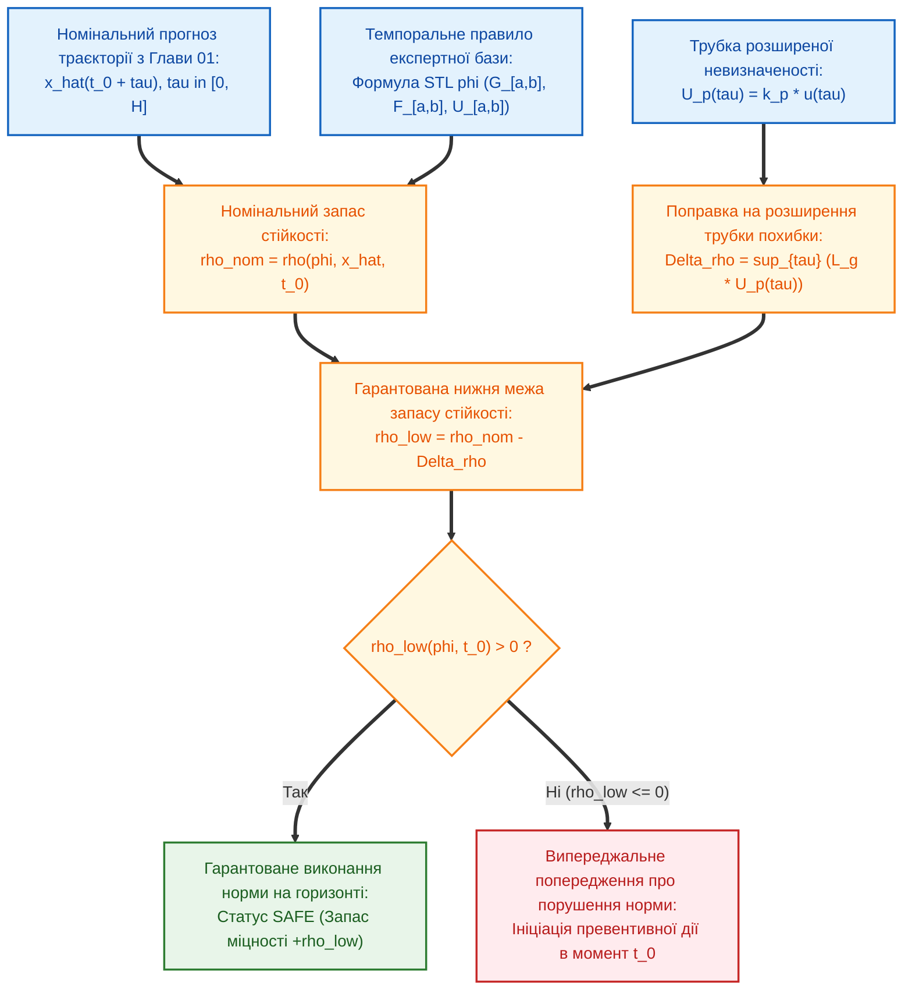

# Глава 02. Темпоральні логіки, інтервальні числення та кількісна семантика стійкості прогнозу

> **Книга:** [Предиктивні експертні системи: Математичні моделі часової екстраполяції, каузального виведення та гарантованих прогностичних інтервалів](README.md) · Частина 1. Теоретичні засади, часова екстраполяція та темпоральні логіки  
> **Попередня глава:** [Глава 01. Теоретичні засади, історична еволюція та таксономія предиктивних експертних систем](ch01-foundations-and-evolution-of-predictive-systems.md)  
> **Наступна глава:** [Глава 03. Стохастичні процеси деградації, теорія виживаності та оцінювання залишкового ресурсу](ch03-stochastic-degradation-and-remaining-useful-life.md)  
> **Зміст книги:** [README.md](README.md)  
> **Автор:** [Микола Федчик](../ExpertSystem/about-the-author.md)  
> **Рівень складності та пререквізити:** `[L3]` Дослідницький формально-алгебраїчний (індекс Д. Кнута `[30]`) · *Пререквізити:* [Глава 01](ch01-foundations-and-evolution-of-predictive-systems.md), математична логіка, метричні простори  
> **Очікувані результати:** опанувати ієрархію формальних темпоральних числень — від інтервальної алгебри Дж. Аллена до лінійної (LTL), метричної (MTL) та сигнальної темпоральної логіки (STL); навчитися обчислювати неперервний функціонал запасу темпоральної стійкості $`\rho(\varphi, \mathbf{x}, t)`$; довести теорему про гарантовану виконуваність часової специфікації безпеки на прогнозованій траєкторії за наявності трубки похибки $`U_p(\tau)`$ та розв'язати практичну задачу випереджувального контролю перехідного процесу.

---

## Анотація

Друга глава вирішує фундаментальну проблему представлення часових правил у предиктивних експертних системах. Показано, чому класичні продукційні системи з миттєвими булевими порогами (`IF x(t) > L_max THEN Alarm`) є структурно непридатними для задач прогнозування: вони не здатні виразити вимоги до тривалості утримання режиму, допустимого часу релаксації після збурення та впорядкованості каскадних подій у майбутньому.

Систематизовано чотири рівні темпорального формалізму в порядку зростання виражальної потужності: інтервальну алгебру Джеймса Аллена [[1]](#src-1), лінійну темпоральну логіку Аміра Пнуелі (LTL) [[2]](#src-2), метричну темпоральну логіку Роні Коямаса (MTL) [[3]](#src-3) та сигнальну темпоральну логіку Одеда Малера і Деяна Нічковича (STL) [[4]](#src-4), доповнену кількісною семантикою просторової стійкості Фаїнекоса — Паппаса [[5]](#src-5) і Доназе — Малера [[6]](#src-6). Сформульовано та строго доведено теорему про гарантовану нижню межу темпоральної стійкості прогнозованої траєкторії $`\hat{\mathbf{x}}(t_0 + \tau)`$ з урахуванням розширеної невизначеності прогнозу $`U_p(\tau)`$, введеної у [Главі 01](ch01-foundations-and-evolution-of-predictive-systems.md).

---

> [!NOTE]
> **Чотири наукові положення, що систематизуються та виносяться на розгляд у Главі 02**
> 1. **Чотирирівнева ієрархія темпоральних правил експертних систем:** встановлено строгий перехід від якісних інтервальних відношень Аллена до неперервнозначної сигнальної логіки STL над прогнозованими траєкторіями $`\hat{\mathbf{x}}: [t_0, t_0 + H] \to \mathbb{R}^n`$.
> 2. **Заміна бінарної істинності неперервним функціоналом запасу темпоральної стійкості:** кожне експертне правило безпеки $`\varphi`$ отримує дійснозначну оцінку $`\rho(\varphi, \hat{\mathbf{x}}, t_0) \in \mathbb{R}`$, знак якої визначає виконання або порушення специфікації на горизонті прогнозу, а модуль дорівнює точній відстані траєкторії до межі відмови в рівномірній метриці Чебишова $`L_\infty`$.
> 3. **Теорема про робастну верифікацію прогнозованої траєкторії в трубці невизначеності:** математично доведено, що для ліпшицевих предикатів умова $`\rho(\varphi, \hat{\mathbf{x}}, t_0) > \sup_{\tau \in I(\varphi)} L_\mu U_p(\tau)`$ є достатньою умовою гарантованої безпеки істинної (невідомої) майбутньої траєкторії з довірчою ймовірністю не менше ніж $`p`$.
> 4. **Усунення хибних спрацювань на короткочасних імпульсах:** показано, що оператори обмеженого часового вікна $`\mathcal{G}_{[a,b]}`$ та $`\mathcal{F}_{[a,b]}`$ дозволяють строго розмежувати безпечні високочастотні викиди тривалістю $`\Delta t < a`$ та небезпечне накопичення аварійного стану.
> *Інженерний інваріант:* Превентивна дія експертної системи ініціюється не в момент фактичного перетину межі $`x(t_0) > L_{\max}`$, а в момент, коли нижня довірча межа прогностичного запасу стійкості $`\rho_{\mathrm{low}}(\varphi, t_0)`$ перетинає нульовий рівень на майбутньому вікні $`[t_0, t_0 + \tau_{\max}]`$.

---

## 1. Обмеженість миттєвої логіки предикатів та інтервальна алгебра Аллена

У класичних продукційних системах умова правила записується як атомарний предикат від поточного вектора стану $`\mu(\mathbf{x}(t_0)) > 0`$. Проте реальні інженерні регламенти та клінічні протоколи майже ніколи не зводяться до миттєвих зрізів — вони описують **розвиток процесів у часі**:
- *«Якщо після відкриття охолоджувального клапана температура протягом 3 хвилин не знизиться нижче 410 К і не утримуватиметься там щонайменше 5 хвилин, необхідно запустити аварійне глушіння реактора»*.

Першу формальну систему для дедуктивного виведення над часовими подіями запропонував Джеймс Аллен у 1983 році [[1]](#src-1). В **інтервальній алгебрі Аллена** базовим примітивом є часовий інтервал $`I = [t^-, t^+]`$ ($`t^- < t^+`$). Між будь-якими двома інтервалами $`I_1`$ та $`I_2`$ можливе рівно одне з **13 взаємно виключних базових відношень**:
- 6 асиметричних пар (разом 12 відношень): *передує* (`before`, `<` / `>`), *зустрічає* (`meets`, `m` / `mi`), *перекриває* (`overlaps`, `o` / `oi`), *починає* (`starts`, `s` / `si`), *міститься під час* (`during`, `d` / `di`), *завершує* (`finishes`, `f` / `fi`);
- 1 симетричне відношення: *збігається* (`equals`, `=`).

Виведення в алгебрі Аллена виконується шляхом множення матриць обмежень за таблицею транзитивної композиції $`R_1 \circ R_2`$. Однак алгебра Аллена є суто **якісною**: вона впорядковує події відносно одна одної, але не оперує метричною тривалістю у секундах та неперервними фізичними амплітудами сигналів.

---

## 2. Від лінійної та метричної до сигнальної темпоральної логіки

Щоб поєднати логічні правила з неперервною прогнозованою траєкторією $`\hat{\mathbf{x}}(t_0 + \tau)`$ з [Глави 01](ch01-foundations-and-evolution-of-predictive-systems.md), у сучасних предиктивних системах застосовується **Сигнальна темпоральна логіка** (*Signal Temporal Logic*, STL), розроблена Одедом Малером та Деяном Нічковичем у 2004 році [[4]](#src-4) як розширення лінійної логіки Пнуелі [[2]](#src-2) та метричної логіки Коямаса [[3]](#src-3).

**Означення 2.1 (Синтаксис сигнальної темпоральної логіки STL).** Формули специфікації STL $`\varphi`$ над неперервним векторним сигналом $`\mathbf{x}: \mathbb{R}_{\ge 0} \to \mathbb{R}^n`$ будуються рекурсивно за граматикою Бекуса — Наура (формула (2.1)):

$$
\varphi ::= \top \;\big|\; \mu(\mathbf{x}) \ge 0 \;\big|\; \neg \varphi \;\big|\; \varphi_1 \wedge \varphi_2 \;\big|\; \varphi_1 \,\mathcal{U}_{[a, b]}\, \varphi_2
$$

**Формула (2.1).** Формальна граматика сигнальної темпоральної логіки STL з метричними інтервалами часу $`[a, b]`$ ($`0 \le a \le b < \infty`$).

Тут:
- $`\mu(\mathbf{x}) \equiv g(\mathbf{x}) \ge 0`$ — атомарний числовий предикат стану, де $`g: \mathbb{R}^n \to \mathbb{R}`$ — неперервна скалярна функція фазових координат (наприклад, $`g(T) = T_{\max} - T \ge 0`$);
- $`\mathcal{U}_{[a, b]}`$ — бінарний темпоральний оператор **«Доки» (*Until*)** на часовому вікні $`[a, b]`$: формула $`\varphi_1 \,\mathcal{U}_{[a, b]}\, \varphi_2`$ істинна в момент $`t`$, якщо існує такий момент $`t' \in [t + a, t + b]`$, у якому виконується $`\varphi_2`$, і на всьому передуючому відрізку $`[t, t']`$ неперервно виконується $`\varphi_1`$.

Через базовий оператор $`\mathcal{U}_{[a, b]}`$ однозначно виражаються два головні оператори інженерної прогностики:
1. **Оператор досяжності у вікні («Колись на інтервалі $`[a, b]`$» — *Eventually*, $`\mathcal{F}_{[a, b]}`$ або $`\lozenge_{[a, b]}`$):**

$$
\mathcal{F}_{[a, b]} \varphi \equiv \top \,\mathcal{U}_{[a, b]}\, \varphi
$$

   *(Прогноз гарантує, що принаймні в один момент між $`t + a`$ і $`t + b`$ система увійде в цільовий стан $`\varphi`$).*
2. **Оператор інваріантності у вікні («Завжди на інтервалі $`[a, b]`$» — *Always / Globally*, $`\mathcal{G}_{[a, b]}`$ або $`\square_{[a, b]}`$):**

$$
\mathcal{G}_{[a, b]} \varphi \equiv \neg \mathcal{F}_{[a, b]} (\neg \varphi)
$$

   *(Прогноз гарантує, що протягом усього інтервалу $`[t + a, t + b]`$ параметр безпеки жодного разу не вийде за межі $`\varphi`$).*

Комбінація цих двох операторів дозволяє записувати складні правила стабілізації: наприклад, формула **відгуку та утримання** (*Response and Persistence*)

$$
\varphi_{\mathrm{stab}} = \mathcal{G}_{[0, H]} \left( \text{Перегрів} \implies \mathcal{F}_{[0, \tau_{\mathrm{react}}]} \mathcal{G}_{[0, \tau_{\mathrm{hold}}]} (\text{Норма}) \right)
$$

означає: *«У будь-який момент горизонту $`[0, H]`$, якщо виникає перегрів, то не пізніше ніж через час реакції $`\tau_{\mathrm{react}}`$ температура повинна повернутися в норму і безперервно утримуватися в ній щонайменше протягом часу $`\tau_{\mathrm{hold}}`$»*.

---

## 3. Кількісна семантика просторової стійкості та верифікація прогнозу з похибкою

Булева перевірка формули STL дає лише бінарну відповідь «Так / Ні», яка не показує, *наскільки близько* прогнозована траєкторія підійшла до небезпечної межі. Тому в працях Георгіоса Фаїнекоса і Джорджа Паппаса [[5]](#src-5) та Александра Доназе і Одеда Малера [[6]](#src-6) було введено **кількісну семантику запасу стійкості** (*Quantitative Robustness Semantics*).

**Означення 2.2 (Функціонал запасу темпоральної стійкості STL).** *Запасом темпоральної стійкості* формули $`\varphi`$ відносно траєкторії $`\mathbf{x}`$ у момент часу $`t`$ називається дійсне число $`\rho(\varphi, \mathbf{x}, t) \in \mathbb{R} \cup \{\pm\infty\}`$, яке визначається за індуктивними правилами формули (2.2):

$$
\begin{aligned}
\rho\left(g(\mathbf{x}) \ge 0, \ \mathbf{x}, \ t\right) &= g\left(\mathbf{x}(t)\right) \\
\rho\left(\neg \varphi, \ \mathbf{x}, \ t\right) &= -\rho\left(\varphi, \ \mathbf{x}, \ t\right) \\
\rho\left(\varphi_1 \wedge \varphi_2, \ \mathbf{x}, \ t\right) &= \min\left( \rho(\varphi_1, \mathbf{x}, t), \ \rho(\varphi_2, \mathbf{x}, t) \right) \\
\rho\left(\mathcal{F}_{[a, b]} \varphi, \ \mathbf{x}, \ t\right) &= \sup_{t' \in [t+a, t+b]} \rho\left(\varphi, \ \mathbf{x}, \ t'\right) \\
\rho\left(\mathcal{G}_{[a, b]} \varphi, \ \mathbf{x}, \ t\right) &= \inf_{t' \in [t+a, t+b]} \rho\left(\varphi, \ \mathbf{x}, \ t'\right) \\
\rho\left(\varphi_1 \,\mathcal{U}_{[a, b]}\, \varphi_2, \ \mathbf{x}, \ t\right) &= \sup_{t' \in [t+a, t+b]} \min\left( \rho(\varphi_2, \mathbf{x}, t'), \ \inf_{t'' \in [t, t']} \rho(\varphi_1, \mathbf{x}, t'') \right)
\end{aligned}
$$

**Формула (2.2).** Індуктивна система рівнянь кількісної семантики запасу темпоральної стійкості $`\rho(\varphi, \mathbf{x}, t)`$.

Як випливає з формули (2.2), операції класичної логіки ($`\neg, \wedge, \vee`$) та темпоральні квантори ($`\mathcal{G}, \mathcal{F}`$) точно відображаються на операції тропічної напівкільцевої алгебри $`(-\cdot, \min, \max, \inf, \sup)`$.

**Рисунок 2.1.** Схема прогностичної верифікації правила STL із обчисленням гарантованої нижньої межі запасу темпоральної стійкості $`\rho_{\mathrm{low}}(\varphi, t_0)`$.

У предиктивній системі ми не знаємо істинної майбутньої траєкторії $`\mathbf{x}(t_0 + \tau)`$, а маємо лише номінальний прогноз $`\hat{\mathbf{x}}(t_0 + \tau)`$ та трубку розширеної невизначеності $`\lVert \mathbf{x}(t_0 + \tau) - \hat{\mathbf{x}}(t_0 + \tau) \rVert \le U_p(\tau)`$ з довірчою ймовірністю $`p`$ ([Глава 01](ch01-foundations-and-evolution-of-predictive-systems.md), формула (1.4)). Виникає ключове питання: за якої умови позитивний запас стійкості на *номінальному прогнозі* $`\hat{\mathbf{x}}`$ гарантує виконання правила на *дійсній майбутній траєкторії* $`\mathbf{x}`$? Відповідь дає така теорема.

**Теорема 2.1 (Про гарантовану нижню межу темпоральної стійкості прогнозованої траєкторії).** *Нехай формула STL $`\varphi`$ побудована над атомарними предикатами $`g_k(\mathbf{x}) \ge 0`$, кожен із яких задовольняє умову Ліпшиця з константою $`L_k > 0`$ ($`\lvert g_k(\mathbf{x}) - g_k(\mathbf{y}) \rvert \le L_k \lVert \mathbf{x} - \mathbf{y} \rVert`$), і нехай $`L_{\max} = \max_k L_k`$. Якщо на скінченному горизонті дії формули $`\tau \in [0, H]`$ істинна майбутня траєкторія $`\mathbf{x}(t_0 + \tau)`$ з довірчою ймовірністю $`p`$ лежить у трубці прогнозу $`\lVert \mathbf{x}(t_0 + \tau) - \hat{\mathbf{x}}(t_0 + \tau) \rVert \le U_p(\tau)`$, то для будь-якої формули STL $`\varphi`$ виконується двобічна ліпшицева оцінка (формула (2.3)):*

$$
\left\lvert \rho\left(\varphi, \mathbf{x}, t_0\right) - \rho\left(\varphi, \hat{\mathbf{x}}, t_0\right) \right\rvert \le L_{\max} \cdot \sup_{\tau \in [0, H]} U_p(\tau)
$$

*Зокрема, якщо гарантована нижня межа прогностичної стійкості $`\rho_{\mathrm{low}}(\varphi, t_0)`$ додатна:*

$$
\rho_{\mathrm{low}}(\varphi, t_0) = \rho\left(\varphi, \hat{\mathbf{x}}, t_0\right) - \sup_{\tau \in [0, H]} \left(L_{\max} \cdot U_p(\tau)\right) > 0 \implies \mathbb{P}\left( \mathbf{x}, t_0 \models \varphi \right) \ge p
$$

*(А для монотонно спадного за похибкою оператора інваріантності $`\varphi = \mathcal{G}_{[a, b]}(g(\mathbf{x}) \ge 0)`$ точна поточкова нижня межа дорівнює $`\rho_{\mathrm{low}}(\varphi, t_0) = \inf_{\tau \in [a, b]} \left[ g(\hat{\mathbf{x}}(t_0 + \tau)) - L_g U_p(\tau) \right]`$).*

**Формула (2.3).** Ліпшицева оцінка збурення функціонала темпоральної стійкості STL та критерій гарантованого виконання часової специфікації на горизонті прогнозу.

*Доведення.* Доведемо нерівність (2.3) структурною індукцією за побудовою формули STL $`\varphi`$ (означення 2.1):
1. **База індукції (атомарний предикат $`\varphi = (g_k(\mathbf{x}) \ge 0)`$ у момент $`t = t_0 + \tau`$):**
   За означенням 2.2 та умовою Ліпшиця для функції $`g_k`$ маємо:

$$
\left\lvert \rho(\varphi, \mathbf{x}, t_0 + \tau) - \rho(\varphi, \hat{\mathbf{x}}, t_0 + \tau) \right\rvert = \left\lvert g_k(\mathbf{x}(t_0 + \tau)) - g_k(\hat{\mathbf{x}}(t_0 + \tau)) \right\rvert \le L_k \left\lVert \mathbf{x}(t_0 + \tau) - \hat{\mathbf{x}}(t_0 + \tau) \right\rVert \le L_{\max} U_p(\tau)
$$

2. **Індуктивний крок для булевих та темпоральних зв'язок:**
   - Для заперечення $`\neg \varphi`$: $`\lvert -\rho(\varphi, \mathbf{x}, t) - (-\rho(\varphi, \hat{\mathbf{x}}, t)) \rvert = \lvert \rho(\varphi, \mathbf{x}, t) - \rho(\varphi, \hat{\mathbf{x}}, t) \rvert`$, оцінка зберігається тотожно.
   - Для кон'юнкції $`\varphi_1 \wedge \varphi_2`$, операторів $`\mathcal{F}_{[a,b]}`$, $`\mathcal{G}_{[a,b]}`$ та $`\mathcal{U}_{[a,b]}`$ використаємо елементарну властивість нерозтягування (1-ліпшицевості) операторів супремуму та інфімуму для довільних обмежених функцій $`f_1, f_2`$:

$$
\left\lvert \sup_{s \in I} f_1(s) - \sup_{s \in I} f_2(s) \right\rvert \le \sup_{s \in I} \left\lvert f_1(s) - f_2(s) \right\rvert, \qquad \left\lvert \inf_{s \in I} f_1(s) - \inf_{s \in I} f_2(s) \right\rvert \le \sup_{s \in I} \left\lvert f_1(s) - f_2(s) \right\rvert
$$

   Оскільки всі темпоральні оператори в формулі (2.2) є композиціями операцій $`\sup`$ та $`\inf`$ на підінтервалах горизонту $`[0, H]`$, нерівність $`\lvert \rho(\varphi, \mathbf{x}, t_0) - \rho(\varphi, \hat{\mathbf{x}}, t_0) \rvert \le \sup_{\tau \in [0, H]} L_{\max} U_p(\tau)`$ зберігається на кожному кроці структурної індукції.
3. Звідси при виконанні події $`\forall \tau \in [0, H]: \lVert \mathbf{x}(t_0 + \tau) - \hat{\mathbf{x}}(t_0 + \tau) \rVert \le U_p(\tau)`$ (ймовірність якої становить щонайменше $`p`$) маємо $`\rho(\varphi, \mathbf{x}, t_0) \ge \rho_{\mathrm{low}}(\varphi, t_0) > 0`$, а за властивістю коректності кількісної семантики STL [[5]](#src-5) додатність $`\rho(\varphi, \mathbf{x}, t_0) > 0`$ гарантує істинність $`\mathbf{x}, t_0 \models \varphi`$. ∎

---

## 4. Навчальний інженерний приклад: прогностична темпоральна верифікація для хімічного реактора

*Дидактична наступність наскрізного прикладу:* У [Главі 01](ch01-foundations-and-evolution-of-predictive-systems.md) (розділ 5) ми ввели канонічний вектор прогностичного стану $`\Omega(t_0, \tau) = \langle \hat{\mathbf{x}}(t_0 + \tau), \mathcal{I}_{1-\alpha}(t_0 + \tau), \rho_{\mathrm{low}}(\varphi, t_0), F_{\mathrm{RUL}}(\tau \mid \mathcal{H}_{t_0}), \mathcal{E}_{\mathrm{do}}(u) \rangle`$ та обчислили для нашого екзотермічного реактора дві перші його компоненти: закон росту температури $`\hat{T}(t_0 + \tau) = 400{,}0 + 16{,}0(e^{0{,}05\tau} - 1)`$, розширену невизначеність $`U_{95\%}(\tau) = 2{,}0\sqrt{0{,}2625 e^{0{,}10\tau} - 0{,}20}`$ і граничний горизонт $`\tau_{\max} = 27{,}73\text{ хв}`$. Тепер заповнимо третю компоненту вектора $`\Omega(t_0, \tau)`$ — нижню межу запасу темпоральної стійкості $`\rho_{\mathrm{low}}(\varphi, t_0)`$ — і перевіримо виконання двох правил безпеки на інтервалі $`\tau \in [0, 20]\text{ хв} \subset [0, \tau_{\max}]`$.

### 4.1. Вихідні інженерні дані

Технологічний регламент реактора містить два темпоральні правила на горизонті $`H = 20\text{ хв}`$:
1. **Правило інваріантної безпеки $`\varphi_1`$:** *«Протягом усього вікна прогнозування $`\tau \in [0, 20]\text{ хв}`$ температура реактора в жоден момент не повинна перевищити критичний поріг руйнування каталізатора $`T_{\mathrm{crit}} = 430{,}0\text{ К}`$»*:

$$
\varphi_1 = \mathcal{G}_{[0, 20]} \left( T_{\mathrm{crit}} - T \ge 0 \right), \qquad g_1(T) = 430{,}0 - T \quad (L_1 = 1{,}0)
$$

2. **Правило фільтрації короткочасного теплового викиду $`\varphi_2`$:** У реакторі при перемиканні мішалки виникає короткочасний імпульсний сплеск температури в пристінному шарі $`T_{\mathrm{spike}}(\tau) = 426{,}0\text{ К}`$ тривалістю лише $`\Delta t = 0{,}5\text{ хв}`$ (при $`\tau \in [2{,}0; \ 2{,}5]\text{ хв}`$), після чого температура повертається до $`405{,}0\text{ К}`$. Класичний пороговий давач (`T > 425 K`) видає хибну аварійну зупинку. Натомість правило STL дозволяє сплеск вище $`T_{\mathrm{warn}} = 425{,}0\text{ К}`$, якщо не пізніше ніж за $`1{,}0\text{ хв}`$ температура повертається нижче $`425{,}0\text{ К}`$:

$$
\varphi_2 = \mathcal{G}_{[0, 20]} \left( (T - 425{,}0 \ge 0) \implies \mathcal{F}_{[0, 1{,}0]} (425{,}0 - T \ge 0) \right)
$$

### 4.2. Покроковий розрахунок

**Крок 1. Верифікація правила інваріантної безпеки $`\varphi_1`$ за Теоремою 2.1:**
Оскільки і номінальна температура $`\hat{T}(t_0 + \tau)`$, і трубка невизначеності $`U_{95\%}(\tau)`$ монотонно зростають із часом випередження $`\tau`$, інфімум на відрізку $`\tau \in [0, 20]\text{ хв}`$ досягається на правому кінці інтервалу при $`\tau = 20\text{ хв}`$:
1. Обчислюємо номінальний прогноз температури при $`\tau = 20\text{ хв}`$:

$$
\hat{T}(t_0 + 20) = 400{,}0 + 16{,}0\left(e^{0{,}05 \times 20} - 1\right) = 400{,}0 + 16{,}0(e^{1{,}0} - 1) \approx 400{,}0 + 16{,}0 \times 1{,}7183 = 427{,}49\text{ К}
$$

2. Знаходимо номінальний запас темпоральної стійкості $`\rho(\varphi_1, \hat{T}, t_0)`$ за формулою (2.2):

$$
\rho\left(\varphi_1, \hat{T}, t_0\right) = \inf_{\tau \in [0, 20]} \left(430{,}0 - \hat{T}(t_0 + \tau)\right) = 430{,}0 - 427{,}49 = +2{,}51\text{ К} > 0
$$

*(Зауважимо: система без обліку похибки прогнозу вирішила б, що запас становить $`+2{,}51\text{ К}`$, і не ввімкнула б превентивне охолодження!)*
3. Тепер обчислимо розширену невизначеність прогнозу при $`\tau = 20\text{ хв}`$ за формулою (1.4):

$$
u^2(20) = 0{,}2625 \cdot e^{2{,}0} - 0{,}20 \approx 0{,}2625 \times 7{,}3891 - 0{,}20 = 1{,}7396\text{ К}^2 \implies U_{95\%}(20) = 2{,}0\sqrt{1{,}7396} \approx 2{,}64\text{ К}
$$

4. За Теоремою 2.1 (формула (2.3)) знаходимо гарантовану нижню межу запасу темпоральної стійкості:

$$
\rho_{\mathrm{low}}(\varphi_1, t_0) = \rho(\varphi_1, \hat{T}, t_0) - 1{,}0 \cdot U_{95\%}(20) = +2{,}51 - 2{,}64 = -0{,}13\text{ К} \le 0
$$

**Висновок за Кроком 1:** Оскільки $`\rho_{\mathrm{low}}(\varphi_1, t_0) = -0{,}13\text{ К} \le 0`$, верхня межа 95%-ї трубки прогнозу при $`\tau = 20\text{ хв}`$ досягає $`427{,}49 + 2{,}64 = 430{,}13\text{ К} > T_{\mathrm{crit}}`$. Третя компонента вектора прогностичного стану $`\Omega(t_0, 20)`$ набуває від'ємного значення $`\rho_{\mathrm{low}}(\varphi_1, t_0) = -0{,}13\text{ К}`$, тому предиктивна експертна система вже в поточний момент $`t_0`$ (за $`19{,}8\text{ хв}`$ до можливого перетину порогу!) формує випереджальну команду на відкриття тракту резервного охолодження.

**Крок 2. Перевірка правила фільтрації короткочасного сплеску $`\varphi_2`$: **
Розпишемо імплікацію $`A \implies B`$ як диз'юнкцію $`\neg A \vee B`$. Тоді за формулою (2.2) під час пристінного сплеску $`T_{\mathrm{spike}} = 426{,}0\text{ К}`$ на відрізку $`\tau \in [2{,}0; \ 2{,}5]\text{ хв}`$ друга компонента диз'юнкції $`\mathcal{F}_{[0, 1{,}0]}(425{,}0 - T \ge 0)`$ досягає супремуму відразу після завершення $`0{,}5`$-хвилинного імпульсу (при $`\tau' = 2{,}6\text{ хв} \in [2{,}0; \ 3{,}0]`$), де температура дорівнює $`405{,}0\text{ К}`$:

$$
\rho\left(\mathcal{F}_{[0, 1{,}0]}(425{,}0 - T \ge 0), \ T_{\mathrm{spike}}, \ 2{,}0\right) = 425{,}0 - 405{,}0 = +20{,}0\text{ К} > 0
$$

Отже, правило STL $`\varphi_2`$ дає додатний запас стійкості $`+20{,}0\text{ К}`$ і повністю блокує хибне спрацювання аварійного захисту на безпечній короткочасній заваді. У наступній [Главі 03](ch03-stochastic-degradation-and-remaining-useful-life.md) ми перейдемо від короткострокових перехідних процесів до прогнозування незворотного накопичення зносу та оцінки залишкового ресурсу обладнання (`RUL`).

---

## Висновки

1. Інтервальна алгебра Аллена, логіки LTL, MTL та STL утворюють послідовну ієрархію формалізації експертних знань про час, де STL забезпечує пряме поєднання символьних темпоральних операторів із неперервними фазовими траєкторіями.
2. Кількісна семантика STL $`\rho(\varphi, \mathbf{x}, t)`$ перетворює логічну верифікацію на неперервну задачу оптимізації, де знак функціонала показує виконання норми, а модуль — запас допустимого збурення у фізичних одиницях вимірювання.
3. Згідно з доведеною Теоремою 2.1, віднімання константи Ліпшиця, помноженої на ширину трубки невизначеності прогнозу $`U_p(\tau)`$, дозволяє гарантувати виконання темпоральної норми безпеки на істинній майбутній траєкторії з заданою довірчою ймовірністю $`p`$.

---

## Словник

| Термін | Англійський еквівалент | Визначення |
| :--- | :--- | :--- |
| **Інтервальна алгебра Аллена** | *Allen's Interval Algebra* | Числення з 13 базових топологічних відношень між часовими відрізками для якісного темпорального виведення. |
| **Сигнальна темпоральна логіка** | *Signal Temporal Logic (STL)* | Формальна логіка з метричними часовими операторами над неперервними дійснозначними сигналами. |
| **Запас темпоральної стійкості** | *Robustness Degree* | Кількісна міра $`\rho(\varphi, \mathbf{x}, t)`$, що визначає знакову відстань від траєкторії $`\mathbf{x}`$ до межі порушення темпоральної формули $`\varphi`$. |

---

## Перелік абревіатур

- **LTL** — *Linear Temporal Logic* (лінійна темпоральна логіка Пнуелі).
- **MTL** — *Metric Temporal Logic* (метрична темпоральна логіка з часовими інтервалами).
- **STL** — *Signal Temporal Logic* (сигнальна темпоральна логіка Малера — Нічковича).

---

## Бібліографія

1. **Allen J. F.** Maintaining Knowledge about Temporal Intervals // *Communications of the ACM*. — 1983. — Vol. 26, No. 11. — P. 832–843.
2. **Pnueli A.** The Temporal Logic of Programs // *Proceedings of the 18th Annual Symposium on Foundations of Computer Science (FOCS)*. — IEEE, 1977. — P. 46–57.
3. **Koymans R.** Specifying Real-Time Properties with Metric Temporal Logic // *Real-Time Systems*. — 1990. — Vol. 2, No. 4. — P. 255–299.
4. **Maler O., Nickovic D.** Monitoring Temporal Properties of Continuous Signals // *Formal Techniques, Modelling and Analysis of Timed and Fault-Tolerant Systems (FORMATS 2004)*. — Lecture Notes in Computer Science, Vol. 3253. — Springer, 2004. — P. 152–166.
5. **Fainekos G. E., Pappas G. J.** Robustness of Temporal Logic Specifications for Continuous-Time Signals // *Theoretical Computer Science*. — 2009. — Vol. 410, No. 42. — P. 4262–4291.
6. **Donzé A., Maler O.** Robust Satisfaction of Temporal Logic over Real-Valued Signals // *Formal Modeling and Analysis of Timed Systems (FORMATS 2010)*. — Lecture Notes in Computer Science, Vol. 6246. — Springer, 2010. — P. 92–106.
