# Глава 03. Стохастичні процеси деградації, теорія виживаності та оцінювання залишкового ресурсу

> **Книга:** [Предиктивні експертні системи: Математичні моделі часової екстраполяції, каузального виведення та гарантованих прогностичних інтервалів](README.md) · Частина 2. Стохастична деградація ресурсу, каузальність і гарантовані інтервали  
> **Попередня глава:** [Глава 02. Темпоральні логіки, інтервальні числення та кількісна семантика стійкості прогнозу](ch02-temporal-logics-and-interval-calculi.md)  
> **Наступна глава:** [Глава 04. Каузальне виведення, контрфактичне прогнозування та гарантовані конформні інтервали](ch04-causal-inference-counterfactuals-and-conformal-bounds.md)  
> **Зміст книги:** [README.md](README.md)  
> **Автор:** [Микола Федчик](../ExpertSystem/about-the-author.md)  
> **Рівень складності та пререквізити:** `[L3]` Дослідницький стохастично-аналітичний (індекс Д. Кнута `[33]`) · *Пререквізити:* [Глава 01](ch01-foundations-and-evolution-of-predictive-systems.md), [Глава 02](ch02-temporal-logics-and-interval-calculi.md), теорія випадкових процесів, рівняння Фоккера — Планка — Колмогорова, байєсівський аналіз  
> **Очікувані результати:** засвоїти математичний апарат сучасної технічної прогностики згідно зі стандартом ISO 13381-1; обґрунтувати перехід від популяційних моделей виживаності (Вейбулла, пропорційних ризиків Кокса) до індивідуальних траєкторних моделей деградації (закон Періса — Ердогана, процеси Вінера з дрейфом та монотонні гамма-процеси); строго вивести розподіл Вальда (обернений гаусівський розподіл) для щільності ймовірності залишкового корисного ресурсу (`RUL`) та розрахувати квантилі безпечної експлуатації обладнання.

---

## Анотація

Третя глава присвячена центральній інженерній задачі прогностичних експертних систем — кількісному оцінюванню **залишкового корисного ресурсу** (*Remaining Useful Life*, RUL) технічних, енергетичних та біомедичних об'єктів за поточними вимірюваннями індикаторів деградації. Проаналізовано еволюцію математичних моделей надійності: від класичного розподілу Вейбулла [[1]](#src-1) та напівпараметричної регресії пропорційних ризиків Девіда Кокса [[2]](#src-2) до фізичної механіки руйнування Періса — Ердогана [[3]](#src-3) і сучасної теорії стохастичних процесів досягнення межі (*First Hitting Time*, FHT) [[4]](#src-4), [[5]](#src-5), стандартизованої в ISO 13381-1 [[6]](#src-6).

Сформульовано та строго доведено теорему про аналітичний вид розподілу залишкового ресурсу $`T_{\mathrm{RUL}}(t_0)`$ для вінерівського процесу накопичення пошкоджень із лінійним дрейфом та про байєсівське оновлення швидкості деградації за експертними правилами перемикання навантажувальних режимів. Наскрізний інженерний приклад екзотермічного реактора з Глав 01–02 доповнено розрахунком залишкового ресурсу каталітичного пакета та торцевого ущільнення насоса охолодження.

---

> [!NOTE]
> **Чотири наукові положення, що систематизуються та виносяться на розгляд у Главі 03**
> 1. **Перехід від популяційної статистики відмов до індивідуальної траєкторної прогностики:** показано, що класичний розподіл Вейбулла оцінює лише середню тривалість життя ансамблю однотипних виробів, тоді як предиктивна система оцінює умовний розподіл часу першого досягнення порогу відмови $`f_{\mathrm{RUL}}(\tau \mid X(t_0) = x_0, \mathcal{R}_{\mathrm{dom}})`$ для конкретного екземпляра в поточному стані зносу $`x_0`$.
> 2. **Критерій вибору стохастичного ядра деградації:** встановлено строгу демаркацію між процесами Вінера з дрейфом (для двонаправлених індикаторів здоров'я з шумом регенерації та вимірювань) і монотонними гамма-процесами та обернено-гаусівськими процесами (для строго необоротних фізичних процесів зносу, корозії та росту тріщин, де $`dX(t) \ge 0`$).
> 3. **Теорема про розподіл Вальда та байєсівську адаптацію дрейфу для залишкового ресурсу:** математично доведено, що для дифузійного процесу деградації $`dX(t) = \mu\,dt + \sigma\,dW(t)`$ час до перетину граничного бар'єра $`x_{\mathrm{fail}} > x_0`$ точно підпорядковується оберненому гаусівському розподілу (розподілу Вальда), а апостеріорне усереднення за випадковим дрейфом $`\mu \sim \mathcal{N}(\hat{\mu}_{t_0}, s_{t_0}^2)`$ зберігає замкнену аналітичну форму розподілу без необхідності ітерацій Монте-Карло.
> 4. **Асиметричне правило прийняття рішень за нижнім квантилем ресурсу:** обґрунтовано, що через несиметричність функції втрат (катастрофічна ціна запізнілого прогнозу $`\hat{\tau}_{\mathrm{RUL}} > \tau_{\mathrm{true}}`$ порівняно з помірною ціною дострокової профілактики) керуючий шлюз експертної системи повинен орієнтуватися на нижній квантиль $`\tau_{\alpha}(t_0) = F_{\mathrm{RUL}}^{-1}(\alpha \mid \mathcal{H}_{t_0})`$ при $`\alpha \in [0{,}01; \ 0{,}05]`$.
> *Інженерний інваріант:* Будь-яка прогностична модель, яка для монотонного фізичного процесу руйнування без ремонтного втручання видає від'ємний приріст пошкодження ($`\hat{X}(t_0 + \tau_2) < \hat{X}(t_0 + \tau_1)`$ при $`\tau_2 > \tau_1`$), відбраковується верифікатором фізичної монотонності як некоректна.

---

## 1. Від теорії виживаності та моделі Кокса до траєкторних моделей деградації

Історично першим математичним інструментом оцінки часу до відмови була **статистична теорія надійності та виживаності**. Нехай $`T > 0`$ — випадковий час безвідмовної роботи об'єкта з функцією розподілу $`F(t) = \mathbb{P}(T \le t)`$, функцією виживаності $`S(t) = \mathbb{P}(T > t) = 1 - F(t)`$ та щільністю $`f(t) = F'(t)`$. Умовна миттєва інтенсивність відмов (*Hazard Rate*) $`\lambda(t)`$ визначається як границя:

$$
\lambda(t) = \lim_{\Delta t \to 0^+} \frac{\mathbb{P}(t < T \le t + \Delta t \mid T > t)}{\Delta t} = \frac{f(t)}{S(t)} = -\frac{d}{dt} \ln S(t)
$$

У класичній моделі Валодді Вейбулла (1951) [[1]](#src-1) інтенсивність відмов задається степеневим законом $`\lambda(t) = \frac{\beta}{\eta}\left(\frac{t}{\eta}\right)^{\beta - 1}`$, де параметр форми $`\beta < 1`$ описує період припрацювання (дитячу смертність), $`\beta = 1`$ — випадкові пуассонівські відмови з постійною інтенсивністю, а $`\beta > 1`$ — старіння і втомне зношування.

У 1972 році Девід Кокс запропонував знамениту **напівпараметричну модель пропорційних ризиків** (*Cox Proportional Hazards Model*) [[2]](#src-2), яка дозволила зв'язати базову інтенсивність відмов $`\lambda_0(t)`$ з вектором спостережуваних діагностичних ознак та умов експлуатації $`\mathbf{z}(t) \in \mathbb{R}^p`$ (формула (3.1)):

$$
\lambda\left(t \;\middle|\; \mathbf{z}(t)\right) = \lambda_0(t) \cdot \exp\left( \boldsymbol{\gamma}^T \mathbf{z}(t) \right)
$$

**Формула (3.1).** Рівняння інтенсивності відмов у моделі пропорційних ризиків Д. Кокса.

Тут:
- $`\lambda_0(t) \ge 0`$ — базова інтенсивність відмов за номінальних умов експлуатації ($`\mathbf{z} = \mathbf{0}`$);
- $`\boldsymbol{\gamma} \in \mathbb{R}^p`$ — вектор вагових коефіцієнтів впливу діагностичних факторів (температури, вібрації, перевантаження), оцінюваний методом часткової правдоподібності Кокса.

Проте моделі Вейбулла та Кокса оперують лише бінарним фактом настання відмови у популяції. У сучасних інженерних системах до моменту катастрофічної відмови вдається безперервно вимірювати **фізичний параметр деградації** $`X(t)`$ (довжину втомної тріщини, опір ізоляції, падіння активності каталізатора, амплітуду віброприскорення підшипника). Наприклад, у механіці руйнування поширення втомної тріщини довжиною $`a`$ за циклічного навантаження $`N`$ підпорядковується **диференціальному закону Періса — Ердогана** (1963) [[3]](#src-3):

$$
\frac{da}{dN} = C \cdot (\Delta K)^m, \qquad \Delta K = Y \cdot \Delta \sigma \cdot \sqrt{\pi a}
$$

де $`\Delta K`$ — розмах коефіцієнта інтенсивності напружень, а $`C, m`$ — константи матеріалу. Інтегрування цього рівняння разом зі стохастичними збуреннями середовища веде до теорії випадкових процесів деградації.

---

## 2. Стохастичні процеси деградації та задача першого досягнення межі

Згідно з міжнародним стандартом технічної прогностики ISO 13381-1 [[6]](#src-6), відмова об'єкта настає в момент, коли неперервний стохастичний процес деградації $`\{X(t), t \ge 0\}`$ вперше досягає нормативно встановленого граничного порогу граничного стану $`x_{\mathrm{fail}}`$ (рисунок 3.1).

```mermaid
flowchart LR
    accTitle: Рисунок 3.1. Схема оцінювання залишкового корисного ресурсу за часом першого досягнення граничного порогу
    accDescr: Спостережувана траєкторія деградації X(t) до моменту t_0 екстраполюється пучком стохастичних траєкторій до перетину порогу відмови x_fail, формуючи щільність розподілу Вальда f_RUL(tau) та нижній безпечний квантиль tau_alpha.

    subgraph Obs ["Спостереження до моменту t_0"]
        X0["Поточний рівень зносу:\nX(t_0) = x_0 < x_fail"]
        Drift["Експертно-байєсівська оцінка швидкості дрейфу:\nmu_hat(t_0), sigma"]
        X0 ==> Drift
    end

    subgraph Stoch ["Стохастичне ядро деградації (t = t_0 + tau)"]
        Proc["Процес деградації:\nВінера (dX = mu*dt + sigma*dW)\nабо монотонний Гамма-процес"]
        Thresh["Нормативний поріг граничного стану:\nx_fail (Остаточний запас w_rem = x_fail - x_0)"]
        Proc ==> Thresh
    end

    subgraph OutRUL ["Розподіл часу до відмови (First Hitting Time)"]
        Wald["Щільність розподілу Вальда:\nf_RUL(tau | x_0) = InverseGaussian"]
        Quant["Нижній квантиль безпеки:\ntau_alpha = F_RUL^{-1}(alpha) при alpha = 0.05"]
        Wald ==> Quant
    end

    Drift ==> Proc
    Thresh ==> Wald

    classDef oStyle fill:#e3f2fd,stroke:#1565c0,stroke-width:2px,color:#0d47a1;
    classDef sStyle fill:#fff8e1,stroke:#f57f17,stroke-width:2px,color:#e65100;
    classDef rStyle fill:#e8f5e9,stroke:#2e7d32,stroke-width:2px,color:#1b5e20;

    class X0,Drift oStyle;
    class Proc,Thresh sStyle;
    class Wald,Quant rStyle;
```

**Рисунок 3.1.** Обчислення розподілу залишкового корисного ресурсу (`RUL`) як часу першого досягнення граничного порогу деградації $`x_{\mathrm{fail}}`$.

**Означення 3.1 (Залишковий корисний ресурс як час першого досягнення порогу).** Нехай у поточний момент часу $`t_0`$ зафіксовано працездатний стан об'єкта з рівнем деградації $`X(t_0) = x_0 < x_{\mathrm{fail}}`$, і нехай $`w_{\mathrm{rem}}(t_0) = x_{\mathrm{fail}} - x_0 > 0`$ — залишковий фізичний запас до граничного стану. *Залишковим корисним ресурсом* $`T_{\mathrm{RUL}}(t_0)`$ називається випадкова величина часу першого досягнення порогу $`x_{\mathrm{fail}}`$ (формула (3.2)):

$$
T_{\mathrm{RUL}}(t_0) = \inf\left\{ \tau > 0 \;\middle|\; X(t_0 + \tau) \ge x_{\mathrm{fail}} \;\Big|\; X(t_0) = x_0, \ \mathcal{H}_{t_0} \right\}
$$

**Формула (3.2).** Формальне означення залишкового корисного ресурсу (`RUL`) через інфімум часу першого перетину бар'єра відмови.

У сучасній теорії прогностики (Сі, Ванг, Гу та Чжоу, 2011 [[5]](#src-5)) використовуються два основні класи стохастичних процесів $`X(t)`$:

### 2.1. Монотонний гамма-процес для необоротного фізичного зносу

Якщо фізичний процес деградації є суворо монотонним (наприклад, корозійне стоншення стінки трубопроводу або абразивне зношування різця, де самовідновлення фізично неможливе: $`\Delta X(\tau) = X(t_0 + \tau) - X(t_0) \ge 0`$), приріст деградації на інтервалі $`\tau`$ моделюється **гамма-процесом** із параметром форми $`\alpha(\tau) = \nu \tau > 0`$ та параметром масштабу $`\beta > 0`$:

$$
f_{\Delta X(\tau)}(x) = \frac{\beta^{\nu\tau}}{\Gamma(\nu\tau)} x^{\nu\tau - 1} e^{-\beta x} \cdot \mathbb{I}(x \ge 0), \qquad \mathbb{E}[\Delta X(\tau)] = \frac{\nu\tau}{\beta}, \qquad \mathrm{Var}[\Delta X(\tau)] = \frac{\nu\tau}{\beta^2}
$$

Оскільки траєкторії гамма-процесу є монотонно неспадними, подія $`\{T_{\mathrm{RUL}}(t_0) > \tau\}`$ тотожно еквівалентна події $`\{\Delta X(\tau) < w_{\mathrm{rem}}(t_0)\}`$, звідки функція розподілу залишкового ресурсу виражається через неповну гамма-функцію:

$$
F_{\mathrm{RUL}}(\tau \mid x_0) = \mathbb{P}\left(\Delta X(\tau) \ge w_{\mathrm{rem}}(t_0)\right) = \frac{\Gamma\left(\nu\tau, \ \beta w_{\mathrm{rem}}(t_0)\right)}{\Gamma(\nu\tau)}
$$

### 2.2. Вінерівський процес деградації з дрейфом та розподіл Вальда

Коли спостережуваний індикатор деградації формується накладанням необоротного тренду зношування та двонаправлених стохастичних коливань навантаження й теплового шуму (як-от опір акумуляторних батарей, температура підшипників або активність каталізатора), еволюція $`X(t)`$ описується стохастичним диференціальним рівнянням Іто для вінерівського процесу з додатним дрейфом $`\mu > 0`$ та коефіцієнтом дифузії $`\sigma > 0`$:

$$
dX(t) = \mu\,dt + \sigma\,dW(t), \qquad X(t_0) = x_0 < x_{\mathrm{fail}}
$$

де $`W(t)`$ — стандартний вінерівський процес (броунівський рух).

**Теорема 3.1 (Про аналітичний розподіл Вальда для залишкового ресурсу та його байєсівське узагальнення).**
*1) Якщо приріст деградації при фіксованій швидкості дрейфу $`\mu > 0`$ задовольняє рівняння $`X(t_0 + \tau) - x_0 = \mu\tau + \sigma(W(t_0 + \tau) - W(t_0))`$, то час першого досягнення граничного порогу $`T_{\mathrm{RUL}}(t_0) = \inf\{\tau > 0 \mid X(t_0 + \tau) \ge x_{\mathrm{fail}}\}`$ відносно поглинаючого екрана $`w_{\mathrm{rem}} = x_{\mathrm{fail}} - x_0 > 0`$ має точний обернений гаусівський розподіл (розподіл Абрахама Вальда [[4]](#src-4)) із щільністю ймовірності $`f_{\mathrm{RUL}}(\tau \mid \mu)`$, математичним сподіванням та дисперсією, що задаються формулою (3.3):*

$$
f_{\mathrm{RUL}}(\tau \mid \mu, x_0) = \frac{w_{\mathrm{rem}}}{\sigma\sqrt{2\pi \tau^3}} \exp\left( -\frac{\left(w_{\mathrm{rem}} - \mu\tau\right)^2}{2\sigma^2 \tau} \right), \qquad \mathbb{E}[T_{\mathrm{RUL}}] = \frac{w_{\mathrm{rem}}}{\mu}, \qquad \mathrm{Var}[T_{\mathrm{RUL}}] = \frac{w_{\mathrm{rem}} \sigma^2}{\mu^3}
$$

*2) Якщо ж унаслідок індивідуальної варіативності екземплярів та експертного правила перемикання режиму швидкість дрейфу в момент $`t_0`$ має апостеріорний нормальний розподіл $`\mu \sim \mathcal{N}(\hat{\mu}_{t_0}, s_{\mu}^2)`$ ($`\hat{\mu}_{t_0} \gg s_{\mu} > 0`$), то безумовна прогностична щільність залишкового ресурсу зберігає замкнений аналітичний вигляд (формула (3.4)):*

$$
f_{\mathrm{RUL}}(\tau \mid \mathcal{H}_{t_0}) = \frac{w_{\mathrm{rem}}}{\sqrt{2\pi \tau^2 \left(s_{\mu}^2 \tau^2 + \sigma^2 \tau\right)}} \exp\left( -\frac{\left(w_{\mathrm{rem}} - \hat{\mu}_{t_0}\tau\right)^2}{2\left(s_{\mu}^2 \tau^2 + \sigma^2 \tau\right)} \right)
$$

**Формула (3.3) та Формула (3.4).** Щільність розподілу Вальда для залишкового корисного ресурсу за детермінованого ($`s_{\mu} = 0`$) та байєсівськи невизначеного ($`s_{\mu} > 0`$) коефіцієнта дрейфу деградації.

*Доведення.*
1. Для доведення формули (3.3) розглянемо перехідну щільність імовірності $`p(y, \tau)`$ приросту деградації $`Y(\tau) = X(t_0 + \tau) - x_0`$ за наявності поглинаючого екрана в точці $`y = w_{\mathrm{rem}} > 0`$. Функція $`p(y, \tau)`$ задовольняє пряме параболічне рівняння Фоккера — Планка — Колмогорова з початковою умовою $`p(y, 0) = \delta(y)`$ та крайовою умовою поглинання $`p(w_{\mathrm{rem}}, \tau) = 0`$ при всіх $`\tau > 0`$:

$$
\frac{\partial p}{\partial \tau} = -\mu \frac{\partial p}{\partial y} + \frac{\sigma^2}{2} \frac{\partial^2 p}{\partial y^2}, \qquad y \in (-\infty, w_{\mathrm{rem}})
$$

За методом відображення (принципом симетрії Андре — Башельє — Леві з експоненційним ваговим множником $`\exp(2\mu w_{\mathrm{rem}}/\sigma^2)`$ для компенсації дрейфу $`\mu`$) розв'язок крайової задачі на півосі $`y < w_{\mathrm{rem}}`$ є лінійною комбінацією фундаментального гаусівського ядра у вихідній точці $`y = 0`$ та дзеркального джерела у точці $`y = 2 w_{\mathrm{rem}}`$:

$$
p(y, \tau) = \frac{1}{\sigma\sqrt{2\pi\tau}} \left[ \exp\left(-\frac{(y - \mu\tau)^2}{2\sigma^2\tau}\right) - \exp\left(\frac{2\mu w_{\mathrm{rem}}}{\sigma^2}\right) \exp\left(-\frac{(y - 2w_{\mathrm{rem}} - \mu\tau)^2}{2\sigma^2\tau}\right) \right]
$$

Ймовірність того, що до моменту $`\tau`$ траєкторія ще жодного разу не досягла бар'єра $`w_{\mathrm{rem}}`$, дорівнює інтегралу $`S_{\mathrm{RUL}}(\tau) = \mathbb{P}(T_{\mathrm{RUL}} > \tau) = \int_{-\infty}^{w_{\mathrm{rem}}} p(y, \tau)\,dy`$. Диференціюючи $`F_{\mathrm{RUL}}(\tau) = 1 - S_{\mathrm{RUL}}(\tau)`$ за часом $`\tau`$ і використовуючи рівняння Фоккера — Планка, отримуємо вираз для потоку ймовірності через поглинаючу межу $`y = w_{\mathrm{rem}}`$:

$$
f_{\mathrm{RUL}}(\tau \mid \mu) = -\frac{d}{d\tau}\int_{-\infty}^{w_{\mathrm{rem}}} p(y, \tau)\,dy = -\frac{\sigma^2}{2}\left.\frac{\partial p(y, \tau)}{\partial y}\right|_{y = w_{\mathrm{rem}}} = \frac{w_{\mathrm{rem}}}{\sigma\sqrt{2\pi\tau^3}} \exp\left(-\frac{(w_{\mathrm{rem}} - \mu\tau)^2}{2\sigma^2\tau}\right)
$$

2. Для доведення формули (3.4) проінтегруємо умовну щільність (3.3) за апріорним нормальним законом $`\mu \sim \mathcal{N}(\hat{\mu}_{t_0}, s_{\mu}^2)`$: оскільки показник експоненти в добутку $`f_{\mathrm{RUL}}(\tau \mid \mu) \cdot \mathcal{N}(\mu; \hat{\mu}_{t_0}, s_{\mu}^2)`$ є квадратичною формою відносно $`\mu`$, виділення повного квадрата за змінною $`\mu`$ та взяття стандартного гаусівського інтеграла замінює дисперсію $`\sigma^2 \tau`$ у знаменнику показника на сумарну дисперсію $`\sigma^2 \tau + s_{\mu}^2 \tau^2`$, що точно дає формулу (3.4). ∎

Кумулятивна функція розподілу Вальда $`F_{\mathrm{RUL}}(\tau \mid \mu, x_0) = \mathbb{P}(T_{\mathrm{RUL}} \le \tau)`$ виражається через стандартну нормальну функцію розподілу Лапласа $`\Phi_{\mathcal{N}}(\cdot)`$ (формула (3.5)):

$$
F_{\mathrm{RUL}}(\tau \mid \mu, x_0) = \Phi_{\mathcal{N}}\left( \frac{\mu\tau - w_{\mathrm{rem}}}{\sigma\sqrt{\tau}} \right) + \exp\left( \frac{2\mu w_{\mathrm{rem}}}{\sigma^2} \right) \Phi_{\mathcal{N}}\left( -\frac{\mu\tau + w_{\mathrm{rem}}}{\sigma\sqrt{\tau}} \right)
$$

**Формула (3.5).** Точна кумулятивна функція розподілу залишкового корисного ресурсу для обчислення довірчих квантилів відмови.

---

## 3. Навчальний інженерний приклад: оцінювання залишкового ресурсу каталізатора та ущільнення насоса хімічного реактора

*Дидактична наступність наскрізного прикладу:* У [Главах 01](ch01-foundations-and-evolution-of-predictive-systems.md) та [02](ch02-temporal-logics-and-interval-calculi.md) ми розрахували три перші компоненти канонічного вектора прогностичного стану $\Omega(t_0, \tau) = \langle \hat{\mathbf{x}}(t_0 + \tau), \mathcal{I}_{1-\alpha}(t_0 + \tau), \rho_{\mathrm{low}}(\varphi, t_0), F_{\mathrm{RUL}}(\tau \mid \mathcal{H}_{t_0}), \mathcal{E}_{\mathrm{do}}(u) \rangle$ на короткостроковому горизонті (до $27{,}7\text{ хв}$) та верифікували температуру реактора за правилами сигнальної темпоральної логіки. Тепер піднімемося на середньостроковий горизонт (десятки й сотні годин експлуатації) і обчислимо четверту компоненту вектора прогностичного стану $\Omega(t_0, \tau)$ — кумулятивну функцію розподілу залишкового корисного ресурсу $F_{\mathrm{RUL}}(\tau \mid \mathcal{H}_{t_0})$ торцевого ущільнення головного циркуляційного насоса охолодження за Теоремою 3.1.

### 3.1. Вихідні інженерні дані

1. **Фізичний індикатор деградації $`X(t)`$:** середньоквадратичне значення віброшвидкості підшипникового вузла ущільнення насоса (мм/с). У поточний момент інспекції $`t_0 = 800\text{ год}`$ зафіксовано рівень зносу $`X(t_0) = x_0 = 3{,}20\text{ мм/с}`$.
2. **Нормативний поріг аварійної відмови за стандартом ISO 10816 / ISO 13381-1:** гранично допустима віброшвидкість, за якої настає розгерметизація ущільнення, становить $`x_{\mathrm{fail}} = 7{,}20\text{ мм/с}`$.
3. **Параметри стохастичного процесу деградації:**
   - Залишковий запас до межі відмови: $`w_{\mathrm{rem}}(t_0) = x_{\mathrm{fail}} - x_0 = 7{,}20 - 3{,}20 = 4{,}00\text{ мм/с}`$.
   - За даними штатного режиму швидкість дрейфу віброшвидкості становить $`\mu_1 = 0{,}020\text{ (мм/с)/год}`$, але оскільки в Главі 02 було зафіксовано перехід реактора у форсований тепловий режим ($`T > 415\text{ К}`$), експертне правило бази знань $`r_{\mathrm{thermal}}`$ множить швидкість зношування на коефіцієнт термічного прискорення Арреніуса $`k_T = 2{,}0`$, встановлюючи чинний дрейф $`\mu = 0{,}040\text{ (мм/с)/год}`$.
   - Коефіцієнт дифузії стохастичних коливань: $`\sigma = 0{,}080\text{ (мм/с)/\sqrt{\text{год}}}`$.
4. **Критерій призначення превентивної заміни:** регламент безпеки вимагає зупинити насос на профілактику не пізніше часу, коли ймовірність відмови досягає порогу ризику $`\alpha = 0{,}05`$ ($`5\%`$).

### 3.2. Покроковий розрахунок

**Крок 1. Обчислення математичного сподівання, середньоквадратичного відхилення та моди розподілу RUL:**
Підставляємо $`w_{\mathrm{rem}} = 4{,}00\text{ мм/с}`$, $`\mu = 0{,}040\text{ (мм/с)/год}`$ та $`\sigma = 0{,}080\text{ (мм/с)/\sqrt{\text{год}}}`$ у формулу (3.3):

$$
\mathbb{E}[T_{\mathrm{RUL}}] = \frac{w_{\mathrm{rem}}}{\mu} = \frac{4{,}00}{0{,}040} = 100{,}0\text{ год}
$$

$$
\mathrm{Var}[T_{\mathrm{RUL}}] = \frac{w_{\mathrm{rem}} \cdot \sigma^2}{\mu^3} = \frac{4{,}00 \times (0{,}080)^2}{(0{,}040)^3} = \frac{0{,}0256}{0{,}000064} = 400{,}0\text{ год}^2 \implies \mathrm{SD}[T_{\mathrm{RUL}}] = \sqrt{400{,}0} = 20{,}0\text{ год}
$$

*(Зауважимо: якби експертне правило $`r_{\mathrm{thermal}}`$ не врахувало тепловий режим із Глави 02 і залишило базовий дрейф $`\mu_1 = 0{,}020`$, суто статистична модель видала б небезпечно завищену оцінку середнього ресурсу $`200{,}0\text{ год}`$ замість реальних $`100{,}0\text{ год}`$!)*

**Крок 2. Обчислення ймовірності відмови на горизонті $`\tau = 64\text{ год}`$ та $`\tau = 100\text{ год}`$ за формулою (3.5):**
Перевіримо ймовірність настання відмови до моменту $`\tau_1 = 64\text{ год}`$ ($`\sqrt{\tau_1} = 8{,}0\text{ год}^{1/2}`$):
1. Обчислюємо аргументи функції Лапласа $`\Phi_{\mathcal{N}}`$ та показник експоненти:

$$
z_1 = \frac{\mu\tau_1 - w_{\mathrm{rem}}}{\sigma\sqrt{\tau_1}} = \frac{0{,}040 \times 64 - 4{,}00}{0{,}080 \times 8{,}0} = \frac{2{,}56 - 4{,}00}{0{,}64} = \frac{-1{,}44}{0{,}64} = -2{,}25
$$

$$
\frac{2\mu w_{\mathrm{rem}}}{\sigma^2} = \frac{2 \times 0{,}040 \times 4{,}00}{0{,}0064} = 50{,}0, \qquad z_2 = -\frac{\mu\tau_1 + w_{\mathrm{rem}}}{\sigma\sqrt{\tau_1}} = -\frac{2{,}56 + 4{,}00}{0{,}64} = -10{,}25
$$

2. За таблицями стандартного нормального розподілу $`\Phi_{\mathcal{N}}(-2{,}25) \approx 0{,}0122`$, а другий доданок $`e^{50}\Phi_{\mathcal{N}}(-10{,}25) \approx 0{,}0006`$, звідки:

$$
F_{\mathrm{RUL}}(64\text{ год}) = \mathbb{P}(T_{\mathrm{RUL}} \le 64\text{ год}) \approx 0{,}0122 + 0{,}0006 = 0{,}0128 \quad (1{,}28\% < 5{,}0\%)
$$

Аналогічно для горизонту $`\tau_2 = 72{,}5\text{ год}`$ ($`\sqrt{\tau_2} \approx 8{,}5147`$):

$$
z_1 = \frac{0{,}040 \times 72{,}5 - 4{,}00}{0{,}080 \times 8{,}5147} = \frac{-1{,}10}{0{,}6812} \approx -1{,}615 \implies F_{\mathrm{RUL}}(72{,}5\text{ год}) \approx 0{,}050 \quad (5{,}0\%)
$$

**Висновок за Кроком 2:** Хоча середній очікуваний залишковий ресурс становить $`\mathbb{E}[T_{\mathrm{RUL}}] = 100{,}0\text{ год}`$, гарантований 5%-й нижній квантиль безпечної експлуатації становить **$T_{\mathrm{RUL}, 0{,}05} = 72{,}5\text{ год}$**. Предиктивна експертна система призначає обов'язкове превентивне перемикання на резервний насос через $`72{,}0\text{ год}`$. А як саме обчислити причинно-наслідковий ефект такого превентивного втручання і не потрапити в пастку історичних кореляцій — розглянемо в наступній [Главі 04](ch04-causal-inference-counterfactuals-and-conformal-bounds.md).

---

## Висновки

1. Сучасна прогностика залишкового ресурсу (ISO 13381-1) замінює популяційні оцінки часу безвідмовної роботи індивідуальним розрахунком розподілу часу першого досягнення граничного порогу $`x_{\mathrm{fail}}`$ від поточного виміряного стану деградації $`x_0`$.
2. Вибір стохастичного ядра визначається фізикою деградації: для строго монотонних необоротних пошкоджень застосовується гамма-процес, а для процесів із двонаправленими тепловими та навантажувальними флуктуаціями — вінерівський процес із дрейфом, який породжує точний аналітичний розподіл Вальда (Теорема 3.1).
3. Комбінація стохастичного рівняння деградації з експертними правилами перемикання фізичних режимів (як-от термічне прискорення зносу) дозволяє миттєво адаптувати розподіл `RUL` при зміні умов роботи об'єкта.

---

## Словник

| Термін | Англійський еквівалент | Визначення |
| :--- | :--- | :--- |
| **Інтенсивність відмов** | *Hazard Rate* | Умовна щільність імовірності настання відмови об'єкта в момент $`t`$ за умови, що об'єкт безвідмовно пропрацював до моменту $`t`$. |
| **Час першого досягнення межі** | *First Hitting Time (FHT)* | Випадковий момент часу, у який стохастичний процес деградації вперше перетинає заданий поріг граничного стану. |
| **Розподіл Вальда** | *Wald / Inverse Gaussian Distribution* | Точний закон розподілу часу першого досягнення додатного порогу вінерівським процесом із додатним дрейфом. |
| **Гамма-процес** | *Gamma Process* | Стохастичний процес із незалежними невід'ємними приростами, що мають гамма-розподіл; використовується для моделювання монотонного зносу. |

---

## Перелік абревіатур

- **FHT** — *First Hitting Time* (час першого досягнення граничного порогу).
- **PHM** — *Prognostics and Health Management* (прогностика та керування ресурсом).
- **RUL** — *Remaining Useful Life* (залишковий корисний ресурс).
- **SD** — *Standard Deviation* (середньоквадратичне відхилення).

---

## Бібліографія

1. **Weibull W.** A Statistical Distribution Function of Wide Applicability // *Journal of Applied Mechanics*. — 1951. — Vol. 18, No. 3. — P. 293–297.
2. **Cox D. R.** Regression Models and Life-Tables // *Journal of the Royal Statistical Society: Series B (Methodological)*. — 1972. — Vol. 34, No. 2. — P. 187–220.
3. **Paris P., Erdogan F.** A Critical Analysis of Crack Propagation Laws // *Journal of Basic Engineering*. — 1963. — Vol. 85, No. 4. — P. 528–533.
4. **Wald A.** *Sequential Analysis*. — New York: John Wiley & Sons, 1947. — 212 p.
5. **Si X.-S., Wang W., Hu C.-H., Zhou D.-H.** Remaining Useful Life Estimation — A Review on the Statistical Data Driven Approaches // *European Journal of Operational Research*. — 2011. — Vol. 213, No. 1. — P. 1–14.
6. **ISO 13381-1:2015.** *Condition Monitoring and Diagnostics of Machines — Prognostics — Part 1: General Guidelines*. — Geneva: International Organization for Standardization, 2015.
