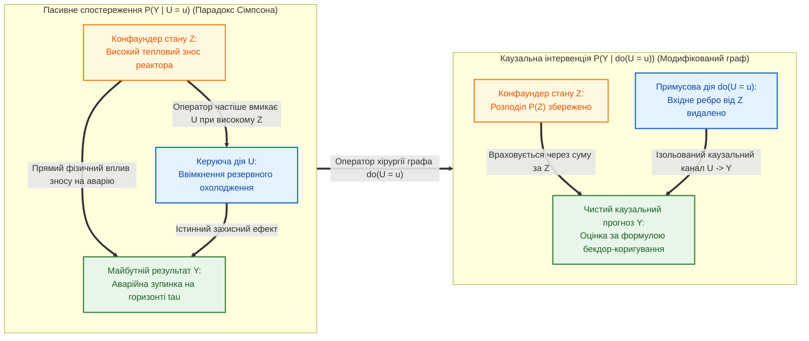

# Глава 04. Каузальне виведення, контрфактичне прогнозування та гарантовані конформні інтервали

> **Книга:** [Предиктивні експертні системи: Математичні моделі часової екстраполяції, каузального виведення та гарантованих прогностичних інтервалів](README.md) · Частина 2. Стохастична деградація ресурсу, каузальність і гарантовані інтервали  
> **Попередня глава:** [Глава 03. Стохастичні процеси деградації, теорія виживаності та оцінювання залишкового ресурсу](ch03-stochastic-degradation-and-remaining-useful-life.md)  
> **Наступна глава:** [Глава 05. Відкриті наукові проблеми, фундаментальні гіпотези та технологічні бар'єри предиктивних експертних систем](ch05-open-scientific-problems-and-technological-frontiers.md)  
> **Зміст книги:** [README.md](README.md)  
> **Автор:** [Микола Федчик](../ExpertSystem/about-the-author.md)  
> **Рівень складності та пререквізити:** `[L3]` Дослідницький каузально-статистичний (індекс Д. Кнута `[36]`) · *Пререквізити:* [Глави 01–03](ch03-stochastic-degradation-and-remaining-useful-life.md), теорія орієнтованих ациклічних графів, умовні розподіли ймовірностей, порядкові статистики  
> **Очікувані результати:** засвоїти трирівневу каузальну ієрархію Джудеї Перла (спостереження, інтервенція, контрфактичний прогноз); довести теорему про ідентифікованість інтервенційного прогнозу $`P(Y \mid \mathrm{do}(U=u))`$ за критерієм блокування обхідних шляхів (*Back-door criterion*); опанувати непараметричну теорію конформного прогнозування Володимира Вовка та адаптивного конформного виведення (ACI) Гіббса — Кандеса з повним доведенням теореми про скінченно-вибіркову гарантію покриття $`1 - \alpha`$.

---

## Анотація

Четверта глава розв'язує дві фундаментальні проблеми, на яких зазнають краху суто статистичні та кореляційні моделі машинного навчання при спробі використати їх як радників для превентивного керування:
1. **Проблема змішування спостережуваної кореляції та ефекту активного втручання:** коли предиктивна система навчається на історичних журналах експлуатації, у яких профілактичні дії або аварійне охолодження вмикалися операторами переважно у важких передаварійних станах, умовна ймовірність $`P(\text{Відмова} \mid \text{Охолодження} = 1)`$ виявляється *вищою*, ніж $`P(\text{Відмова} \mid \text{Охолодження} = 0)`$ (парадокс Юла — Сімпсона [[1]](#src-1)). Кореляційний предиктор робить абсурдний висновок, ніби превентивне охолодження «викликає» аварію.
2. **Проблема некаліброваних інтервалів невизначеності за порушення гауссовості та стаціонарності:** класичні параметричні довірчі інтервали спираються на припущення про нормальність похибок, яке не виконується для нелінійних та багатомодальних процесів.

У першій частині глави викладено апарат **структурних каузальних моделей (SCM)** та числення інтервенцій $`\mathrm{do}(U = u)`$ Джудеї Перла [[2]](#src-2) і строго доведено формулу каузального коригування за блокуючою множиною конфаундерів. У другій частині глави викладено математичну теорію **конформного прогнозування** Володимира Вовка, Александра Гаммермана та Гленна Шефера [[3]](#src-3), її розширення на випадок коваріатного зсуву Тібшірані — Кандеса [[4]](#src-4) та алгоритм **адаптивного конформного виведення (ACI)** Айзека Гіббса й Еммануеля Кандеса [[5]](#src-5) для нестаціонарних часових рядів із доведенням теорем про скінченно-вибіркове та асимптотичне покриття $`1 - \alpha`$.

---

> [!NOTE]
> **Чотири наукові положення, що систематизуються та виносяться на розгляд у Главі 04**
> 1. **Демаркація пасивного прогнозу та превентивної інтервенції за Перлом:** доведено, що для вибору превентивної дії $`\mathbf{u}`$ експертна система зобов'язана обчислювати інтервенційний розподіл у модифікованому графі $`P(Y_{t_0+\tau} \mid \mathrm{do}(\mathbf{U} = \mathbf{u}))`$, а не спостережувану умовну ймовірність $`P(Y_{t_0+\tau} \mid \mathbf{U} = \mathbf{u})`$.
> 2. **Теорема про ідентифікованість інтервенційного прогнозу через доменну базу правил:** показано, що якщо експертна онтологія домену визначає допустиму множину змінних стану $`\mathbf{Z}`$, яка блокує всі некаузальні зворотні шляхи від стану зносу до керуючої дії, то ефект втручання однозначно обчислюється зі спостережуваних даних без проведення небезпечних натурних експериментів.
> 3. **Теорема про непараметричну скінченно-вибіркову гарантію конформного інтервалу:** строго доведено, що для будь-якого базового алгоритму точкового прогнозування (від фізичної формули до нейромережі) конформний квантиль рангів нев'язок на калібрувальній вибірці обсягу $`n`$ гарантує точну двобічну оцінку покриття $`1 - \alpha \le \mathbb{P}(Y_{n+1} \in \mathcal{C}_{1-\alpha}(X_{n+1})) < 1 - \alpha + \frac{1}{n+1}`$ для довільного невідомого розподілу з обмінюваними спостереженнями.
> 4. **Адаптивна стабілізація рівня помилок за довільного нестаціонарного дрейфу (метод ACI):** показано, що онлайн-оновлення квантильного рівня $`\alpha_{t+1} = \alpha_t + \gamma(\alpha - \mathrm{err}_t)`$ забезпечує збіжність фактичної частоти помилок до номінального рівня $`\alpha`$ навіть за раптових структурних зламів часового ряду без жодних стохастичних припущень про процес генерації даних.
> *Інженерний інваріант:* Жодна рекомендація превентивної керуючої дії не видається операторові без попереднього розщеплення спостережуваної кореляції на прямий каузальний шлях та конфаундинговий шлях за графом SCM, а також без супутнього конформного інтервалу $`\mathcal{C}_{1-\alpha}`$.

---

## 1. Трирівнева каузальна ієрархія Перла та інтервенційне прогнозування

Як показав лауреат премії Тюрінга Джудея Перл [[2]](#src-2), задачі прогнозування поділяються на три строго вкладені рівні складності (*Causal Hierarchy Theorem*), причому питання вищого рівня принципово не можуть бути розв'язані за допомогою математичного апарату нижчого рівня:

1. **Рівень 1 — Асоціативне (пасивне) прогнозування ($`P(Y \mid X = x)`$):**
   *Питання:* «Яким буде очікуване значення майбутнього виходу $`Y`$, якщо ми пасивно спостерігаємо значення ознаки $`X = x`$?». Саме на цьому рівні працюють усі класичні регресії, фільтри Калмана та глибокі нейромережі.
2. **Рівень 2 — Інтервенційне прогнозування ($`P(Y \mid \mathrm{do}(U = u), \ Z = z)`$):**
   *Питання:* «Яким буде майбутній стан системи $`Y`$, якщо в поточному стані $`Z = z`$ ми примусово встановимо керуючий вплив $`U`$ у значення $`u`$?».
3. **Рівень 3 — Контрфактичне прогнозування ($`P(Y_{u'} \mid U = u, \ Y = y)`$):**
   *Питання:* «В системі було застосовано керування $`U = u`$ і настала відмова $`Y = y`$. Що сталося б із цією ж системою в тій самій реалізації випадкових факторів середовища, якби замість $`u`$ було застосовано превентивну дію $`u'`$?».

**Рисунок 4.1.** Механізм виникнення хибної кореляції через конфаундер стану $`Z`$ (ліворуч) та виділення чистого каузального ефекту превентивної дії оператором $`\mathrm{do}(U = u)`$ (праворуч).

**Означення 4.1 (Структурна каузальна модель та оператор інтервенції).** *Структурною каузальною моделлю (SCM)* називається четвірка $`\mathcal{M} = \langle \mathbf{E}, \mathbf{V}, \mathcal{F}, P(\mathbf{E}) \rangle`$, де $`\mathbf{V} = \{V_1, \dots, V_d\}`$ — множина ендогенних змінних системи, що утворюють орієнтований ациклічний граф (DAG) $`\mathcal{G}`$, $`\mathbf{E}`$ — екзогенні шумові змінні з відомим спільним розподілом $`P(\mathbf{E})`$, а $`\mathcal{F} = \{f_1, \dots, f_d\}`$ — система детермінованих структурних рівнянь $`V_i = f_i(\mathrm{pa}_i, E_i)`$, де $`\mathrm{pa}_i \subset \mathbf{V}`$ — множина безпосередніх батьківських вершин змінної $`V_i`$ у графі $`\mathcal{G}`$.
*Оператор інтервенції* $`\mathrm{do}(U = u)`$ для керуючої змінної $`U \in \mathbf{V}`$ замінює рівняння $`U = f_U(\mathrm{pa}_U, E_U)`$ на константу $`U := u`$, видаляючи з графа $`\mathcal{G}`$ усі вхідні стрілки до вершини $`U`$ (рисунок 4.1).

**Теорема 4.1 (Формула каузального коригування за критерієм блокування зворотних шляхів Перла).** *Нехай у каузальному графі $`\mathcal{G}`$ множина спостережуваних змінних стану $`\mathbf{Z} \subset \mathbf{V}`$ задовольняє критерій блокування зворотних шляхів (Back-door criterion) відносно пари $`(U, Y)`$: (1) жодна вершина $`Z \in \mathbf{Z}`$ не є нащадком керуючої змінної $`U`$; (2) множина $`\mathbf{Z}`$ блокує ($d$-сепарує) кожен ненаправлений шлях між $`U`$ та $`Y`$, який містить вхідну стрілку до $`U`$ ($`\dots \to U`$). Тоді інтервенційний прогностичний розподіл $`P(Y_{t_0+\tau} = y \mid \mathrm{do}(U = u))`$ є каузально ідентифікованим за пасивними спостереженнями і обчислюється за формулою (4.1):*

$$
P\left(Y_{t_0+\tau} = y \;\middle|\; \mathrm{do}(U = u)\right) = \sum_{\mathbf{z}} P\left(Y_{t_0+\tau} = y \;\middle|\; U = u, \ \mathbf{Z} = \mathbf{z}\right) \cdot P(\mathbf{Z} = \mathbf{z})
$$

**Формула (4.1).** Формула інтервенційного прогнозування Перла (*Back-door Adjustment Formula*) за наявності конфаундерів стану $`\mathbf{Z}`$.

*Доведення.* За означенням 4.1 у модифікованому графі інтервенції $`\mathcal{G}_{\underline{U}}`$ (де видалені всі вхідні стрілки до $`U`$) розподіл довільної підмножини змінних визначається усеченою марківською факторизацією. Оскільки жоден елемент $`\mathbf{Z}`$ не є нащадком $`U`$, примусове встановлення $`\mathrm{do}(U = u)`$ не змінює маргінального розподілу конфаундерів стану (Правило 3 числення `do`-calculus Перла [[2]](#src-2)):

$$
P(\mathbf{Z} = \mathbf{z} \mid \mathrm{do}(U = u)) = P(\mathbf{Z} = \mathbf{z})
$$

З іншого боку, оскільки множина $`\mathbf{Z}`$ блокує всі зворотні шляхи $`U \leftarrow \dots \to Y`$ у вихідному графі $`\mathcal{G}`$, у підграфі $`\mathcal{G}_{\underline{U}}`$ (де видалені ребра, що виходять із $`U`$) змінні $`U`$ та $`Y`$ є умовно незалежними при фіксованому $`\mathbf{Z}`$ ($`(Y \perp\!\!\!\perp U \mid \mathbf{Z})_{\mathcal{G}_{\underline{U}}}`$). Тоді за Правилом 2 числення `do`-calculus дія інтервенції $`\mathrm{do}(U = u)`$ при фіксованому $`\mathbf{Z} = \mathbf{z}`$ тотожно збігається з умовним спостереженням $`U = u`$:

$$
P(Y = y \mid \mathrm{do}(U = u), \mathbf{Z} = \mathbf{z}) = P(Y = y \mid U = u, \mathbf{Z} = \mathbf{z})
$$

Розкладаючи $`P(Y = y \mid \mathrm{do}(U = u))`$ за формулою повної ймовірності через $`\mathbf{Z} = \mathbf{z}`$ та підставляючи обидві тотожності, отримуємо формулу (4.1). ∎

Для обчислення індивідуального **контрфактичного прогнозу** (Рівень 3 каузальної ієрархії) виконується трикроковий алгоритм Перла (*Abduction — Action — Prediction*):
1. **Абдукція (*Abduction*):** за фактично спостережуваними минулими траєкторіями $`(\mathbf{X} = \mathbf{x}, \mathbf{Y} = \mathbf{y})`$ оновлюється апостеріорний розподіл індивідуальних прихованих факторів середовища $`P(\mathbf{E} \mid \mathbf{X} = \mathbf{x}, \mathbf{Y} = \mathbf{y})`$.
2. **Дія (*Action*):** у структурній моделі рівняння для керуючої змінної замінюється на контрфактичну альтернативу $`U := u'`$.
3. **Прогнозування (*Prediction*):** у модифікованій моделі з індивідуальним вектором шумів $`\mathbf{E}`$ обчислюється контрфактичний стан $`Y_{u'}(\mathbf{E})`$.

---

## 2. Непараметричні гарантовані прогностичні інтервали: теорія конформного прогнозування

Навіть якщо каузальна або фізична модель побудована коректно, залишкові похибки прогнозування $`R_i = \lvert Y_i - \hat{f}(X_i) \rvert`$ у реальних інженерних системах рідко мають ідеальний гаусівський розподіл. Як побудувати навколо точкового прогнозу $`\hat{f}(X_{n+1})`$ такий довірчий інтервал $`\mathcal{C}_{1-\alpha}(X_{n+1})`$, який гарантує покриття $`\mathbb{P}(Y_{n+1} \in \mathcal{C}_{1-\alpha}(X_{n+1})) \ge 1 - \alpha`$ на скінченній вибірці для **будь-якого невідомого розподілу** і **будь-якого базового алгоритму** $`\hat{f}`$?

Цю задачу розв'язали Володимир Вовк, Александр Гаммерман та Гленн Шефер у теорії **конформного прогнозування** (*Conformal Prediction*, 2005) [[3]](#src-3).

**Означення 4.2 (Розділене конформне прогнозування — Split Conformal Prediction).** Нехай базовий предиктор $`\hat{f}: \mathcal{X} \to \mathbb{R}`$ вже навчений або скомпільований із доменних правил, і нехай ми маємо відкладену калібрувальну вибірку з $`n`$ пар спостережень $`\mathcal{D}_{\mathrm{cal}} = \{(X_1, Y_1), \dots, (X_n, Y_n)\}`$. Для кожного калібрувального прикладу обчислимо невід'ємну **міру невідповідності (конформний скор)** $`S_i = s(X_i, Y_i) = \lvert Y_i - \hat{f}(X_i) \rvert`$ (або нормовану похибку $`S_i = \lvert Y_i - \hat{f}(X_i) \rvert / \hat{u}(X_i)`$). Тоді конформний прогностичний інтервал рівня довіри $`1 - \alpha \in (0, 1)`$ для нової точки $`X_{n+1}`$ визначається формулою (4.2):

$$
\mathcal{C}_{1-\alpha}(X_{n+1}) = \left[ \hat{f}(X_{n+1}) - \hat{q}_{1-\alpha}, \quad \hat{f}(X_{n+1}) + \hat{q}_{1-\alpha} \right], \qquad \hat{q}_{1-\alpha} = S_{\left(\lceil (n+1)(1-\alpha) \rceil\right)}
$$

**Формула (4.2).** Конформний прогностичний інтервал на основі порядкової статистики $`k = \lceil (n+1)(1-\alpha) \rceil`$ калібрувальних нев'язок $`S_{(1)} \le S_{(2)} \le \dots \le S_{(n)}`$.

**Теорема 4.2 (Про скінченно-вибіркову гарантію покриття конформного прогнозу та адаптивну збіжність у часових рядах).**
*1) (Теорема Вовка — Лей — Вассермана для обмінюваних даних [[3]](#src-3), [[6]](#src-6)): Якщо послідовність із $`n + 1`$ випадкових пар $`(X_1, Y_1), \dots, (X_n, Y_n), (X_{n+1}, Y_{n+1})`$ є обмінюваною (exchangeable, тобто її спільний розподіл інваріантний відносно перестановок індексів), то для будь-якого базового предиктора $`\hat{f}`$ і будь-якого рівня значущості $`\alpha \in (0, 1)`$ інтервал (4.2) задовольняє нерівність:*

$$
\mathbb{P}\left( Y_{n+1} \in \mathcal{C}_{1-\alpha}(X_{n+1}) \right) \ge 1 - \alpha
$$

*Причому якщо міри невідповідності $`S_1, \dots, S_{n+1}`$ не мають збігів з імовірністю 1 (неперервний розподіл), то покриття обмежене і зверху вузькою скінченно-вибірковою границею:*

$$
1 - \alpha \le \mathbb{P}\left( Y_{n+1} \in \mathcal{C}_{1-\alpha}(X_{n+1}) \right) < 1 - \alpha + \frac{1}{n + 1}
$$

*2) (Теорема Гіббса — Кандеса про адаптивне конформне виведення ACI за довільного нестаціонарного дрейфу [[5]](#src-5)): Якщо в нестаціонарному часовому ряді обмінюваність порушується і рівень квантиля $`\alpha_t`$ на кожному такті $`t = 1, \dots, T`$ оновлюється за рекурентним правилом зворотного зв'язку з кроком адаптації $`\gamma > 0`$: *

$$
\alpha_{t+1} = \alpha_t + \gamma \left( \alpha - \mathrm{err}_t \right), \qquad \mathrm{err}_t = \mathbb{I}\left( Y_t \notin \mathcal{C}_{1-\alpha_t}(X_t) \right) \in \{0, 1\}
$$

*то для будь-якої реалізації часового ряду (навіть обраної супротивником) відхилення емпіричної частоти помилок на інтервалі з $`T`$ кроків від цільового рівня $`\alpha`$ детерміновано обмежене зверху величиною $`\mathcal{O}(1/T)`$ (формула (4.3)):*

$$
\left\lvert \frac{1}{T}\sum_{t=1}^{T} \mathrm{err}_t - \alpha \right\rvert \le \frac{\max(\alpha_1, 1 - \alpha_1) + \gamma}{\gamma \cdot T} \xrightarrow[T \to \infty]{} 0
$$

**Формула (4.3).** Детермінована оцінка збіжності частоти помилок адаптивного конформного виведення (ACI) для нестаціонарних часових рядів.

*Доведення.*
1. Доведемо частину 1. Оскільки пари $`(X_1, Y_1), \dots, (X_{n+1}, Y_{n+1})`$ є обмінюваними, а функція базового прогнозу $`\hat{f}`$ зафіксована заздалегідь і діє симетрично на кожну пару, випадкові величини нев'язок $`S_1, S_2, \dots, S_n, S_{n+1}`$ також є обмінюваними. За симетрією перестановок ранг нової тестової нев'язки $`S_{n+1}`$ серед усіх $`n + 1`$ величин $`\{S_1, \dots, S_{n+1}\}`$ розподілений рівномірно на дискретній множині $`\{1, 2, \dots, n + 1\}`$ (а за наявності збігів ранг за верхньою межею стохастично не перевищує рівномірний). Отже, подія $`\{\mathrm{Rank}(S_{n+1}) \le \lceil (n+1)(1-\alpha) \rceil\}`$ виконується з імовірністю щонайменше $`\frac{\lceil (n+1)(1-\alpha) \rceil}{n + 1} \ge 1 - \alpha`$. Оскільки нерівність $`\mathrm{Rank}(S_{n+1}) \le k`$ серед $`n+1`$ елементів тотожно еквівалентна нерівності $`S_{n+1} \le S_{(k)} = \hat{q}_{1-\alpha}`$ серед перших $`n`$ калібрувальних елементів, отримуємо $`\mathbb{P}(\lvert Y_{n+1} - \hat{f}(X_{n+1}) \rvert \le \hat{q}_{1-\alpha}) \ge 1 - \alpha`$.
2. Доведемо частину 2 (формулу (4.3)). Оскільки при $`\alpha_t \le 0`$ конформний інтервал розширюється до $`(-\infty, +\infty)`$ і помилка неможлива ($`\mathrm{err}_t = 0 \implies \alpha_{t+1} = \alpha_t + \gamma\alpha > \alpha_t`$), а при $`\alpha_t \ge 1`$ інтервал порожній і помилка гарантована ($`\mathrm{err}_t = 1 \implies \alpha_{t+1} = \alpha_t - \gamma(1-\alpha) < \alpha_t`$), за індукцією вся траєкторія параметра $`\alpha_t`$ при всіх $`t \ge 1`$ залишається в обмеженому відрізку $`[-\gamma, \ 1 + \gamma]`$. Просумувавши телескопічну різницю $`\alpha_{t+1} - \alpha_t = \gamma(\alpha - \mathrm{err}_t)`$ від $`t = 1`$ до $`T`$, отримуємо тотожність:

$$
\alpha_{T+1} - \alpha_1 = \gamma \sum_{t=1}^{T} (\alpha - \mathrm{err}_t) \implies \left\lvert \frac{1}{T}\sum_{t=1}^{T} \mathrm{err}_t - \alpha \right\rvert = \frac{\lvert \alpha_{T+1} - \alpha_1 \rvert}{\gamma T} \le \frac{1 + \gamma}{\gamma T}
$$

що завершує доведення. ∎

---

## 3. Навчальний інженерний приклад: розрахунок інтервенційного ефекту превентивного розвантаження та конформного інтервалу для реактора

*Дидактична наступність наскрізного прикладу:* У [Главах 01–03](ch03-stochastic-degradation-and-remaining-useful-life.md) ми сформували перші чотири компоненти вектора прогностичного стану $`\Omega(t_0, \tau) = \langle \hat{\mathbf{x}}(t_0 + \tau), \mathcal{I}_{1-\alpha}(t_0 + \tau), \rho_{\mathrm{low}}(\varphi, t_0), F_{\mathrm{RUL}}(\tau \mid \mathcal{H}_{t_0}), \mathcal{E}_{\mathrm{do}}(u) \rangle`$ і встановили, що через тепловий перегрів реактора залишковий корисний ресурс ущільнення насоса охолодження скоротився до нижнього квантиля $`72{,}5\text{ год}`$. Тепер заповнимо п'яту (завершальну) компоненту вектора $`\Omega(t_0, \tau)`$ — каузальну оцінку інтервенційного ефекту $`\mathcal{E}_{\mathrm{do}}(u)`$ для превентивної керуючої дії $U = 1$ (*зниження подачі реагенту на 20%*), а також уточнимо другу компоненту $`\mathcal{I}_{1-\alpha}`$ непараметричним конформним методом Вовка (4.2).

### 3.1. Вихідні інженерні дані

1. **Історичний журнал із 1 000 експлуатаційних змін ($`Z \in \{0, 1\}`$ — нормальний або важкий тепловий знос; $`U \in \{0, 1\}`$ — чи знижував оператор подачу реагенту; $`Y \in \{0, 1\}`$ — чи сталася відмова ущільнення до кінця тижня):**
   - При нормальному стані ($`Z = 0`$, $`500`$ змін, $`P(Z=0) = 0{,}50`$):
     - Без розвантаження ($`U = 0`$, $`450`$ змін): сталося $`45`$ відмов $`\implies P(Y=1 \mid U=0, Z=0) = 10{,}0\%`$.
     - З розвантаженням ($`U = 1`$, $`50`$ змін): сталося $`1`$ відмова $`\implies P(Y=1 \mid U=1, Z=0) = 2{,}0\%`$.
   - При важкому тепловому зносі ($`Z = 1`$, $`500`$ змін, $`P(Z=1) = 0{,}50`$):
     - Без розвантаження ($`U = 0`$, $`50`$ змін): сталося $`30`$ відмов $`\implies P(Y=1 \mid U=0, Z=1) = 60{,}0\%`$.
     - З розвантаженням ($`U = 1`$, $`450`$ змін): сталося $`90`$ відмов $`\implies P(Y=1 \mid U=1, Z=1) = 20{,}0\%`$.
2. **Калібрувальна вибірка нев'язок прогнозу температури ($`n = 19`$ незалежних калібрувальних циклів):**
   Упорядкований ряд абсолютних похибок прогнозу $`S_{(1)} \le \dots \le S_{(19)}`$ (у Кельвінах) має старші порядкові статистики: $`S_{(16)} = 1{,}40\text{ К}`$, $`S_{(17)} = 1{,}65\text{ К}`$, $`S_{(18)} = 1{,}90\text{ К}`$, $`S_{(19)} = 2{,}35\text{ К}`$. Потрібно побудувати непараметричний конформний інтервал для нового прогнозу $`\hat{T} = 412{,}0\text{ К}`$ при рівні довіри $`1 - \alpha = 0{,}90`$ ($`\alpha = 0{,}10`$).

### 3.2. Покроковий розрахунок

**Крок 1. Виявлення парадоксу Сімпсона при наївному кореляційному прогнозуванні:**
Обчислимо сумарну спостережувану частоту відмов без стратифікації за конфаундером $`Z`$:
- Усього змін із $`U = 0`$: $`450 + 50 = 500`$, у них відмов: $`45 + 30 = 75 \implies P(Y=1 \mid U=0) = 75 / 500 = 15{,}0\%`$.
- Усього змін із $`U = 1`$: $`50 + 450 = 500`$, у них відмов: $`1 + 90 = 91 \implies P(Y=1 \mid U=1) = 91 / 500 = 18{,}2\%`$.

*Пастка кореляційного предиктора (`B3`):* Оскільки в історичних логах $`P(Y=1 \mid U=1) = 18{,}2\% > P(Y=1 \mid U=0) = 15{,}0\%`$, стандартний класифікатор без каузального графа робить висновок, ніби зниження подачі реагенту ($`U=1`$) *підвищує* ризик аварії на $`+3{,}2\%`$, і забороняє превентивне розвантаження!

**Крок 2. Обчислення істинного інтервенційного ефекту за Теоремою 4.1 (формула (4.1)):**
Врахуємо конфаундер $`Z`$ за формулою каузального бекдор-коригування (4.1):

$$
P\left(Y = 1 \;\middle|\; \mathrm{do}(U = 0)\right) = 0{,}10 \times 0{,}50 + 0{,}60 \times 0{,}50 = 0{,}05 + 0{,}30 = 0{,}350 \quad (35{,}0\%)
$$

$$
P\left(Y = 1 \;\middle|\; \mathrm{do}(U = 1)\right) = 0{,}02 \times 0{,}50 + 0{,}20 \times 0{,}50 = 0{,}01 + 0{,}10 = 0{,}110 \quad (11{,}0\%)
$$

Середній каузальний ефект превентивного втручання (*Average Treatment Effect*, ATE) становить:

$$
\tau_{\mathrm{ATE}} = P(Y=1 \mid \mathrm{do}(U=1)) - P(Y=1 \mid \mathrm{do}(U=0)) = 11{,}0\% - 35{,}0\% = -24{,}0\%
$$

Отже, превентивне розвантаження насправді **знижує ймовірність аварії у понад три рази** (з $`35{,}0\%`$ до $`11{,}0\%`$, а для поточного важкого стану $`Z=1`$ — з $`60{,}0\%`$ до $`20{,}0\%`$).

**Крок 3. Побудова гарантованого конформного інтервалу за Теоремою 4.2:**
Для калібрувальної вибірки обсягу $`n = 19`$ та рівня довіри $`1 - \alpha = 0{,}90`$ знаходимо порядковий номер квантиля за формулою (4.2):

$$
k = \lceil (n + 1)(1 - \alpha) \rceil = \lceil (19 + 1) \times 0{,}90 \rceil = \lceil 18{,}0 \rceil = 18 \implies \hat{q}_{0{,}90} = S_{(18)} = 1{,}90\text{ К}
$$

Отже, непараметричний конформний прогностичний інтервал становить:

$$
\mathcal{C}_{0{,}90} = [412{,}0 - 1{,}90; \quad 412{,}0 + 1{,}90] = [410{,}10\text{ К}; \quad 413{,}90\text{ К}]
$$

За Теоремою 4.2 дійсна ймовірність покриття майбутньої температури цим інтервалом строго лежить у межах $`[0{,}90; \ 0{,}95)`$ незалежно від форми розподілу шуму в реакторі. Проте що станеться, якщо сам факт оголошення прогнозу змінить режим роботи сусідніх агрегатів, або якщо в системі виникне біфуркаційний зрив за межами всіх історичних даних? Цим фундаментальним відкритим питанням присвячена наступна [Глава 05](ch05-open-scientific-problems-and-technological-frontiers.md).

---

## Висновки

1. Кореляційні моделі прогнозування ($`P(Y \mid U)`$) є структурно вразливими до змішуючих факторів історичної політики керування (парадоксу Сімпсона) і не можуть використовуватися для вибору превентивних дій без каузальної ідентифікації за оператором $`\mathrm{do}(U = u)`$.
2. Теорія конформного прогнозування Вовка та адаптивний метод ACI Гіббса — Кандеса забезпечують математично доведену скінченно-вибіркову та асимптотичну гарантію покриття $`1 - \alpha`$ без параметричних припущень про гауссовість похибок.

---

## Словник

| Термін | Англійський еквівалент | Визначення |
| :--- | :--- | :--- |
| **Конфаундер (змішуючий фактор)** | *Confounder* | Змінна, яка одночасно є причиною керуючого рішення та причиною цільового результату, породжуючи хибну статистичну кореляцію між ними. |
| **Критерій блокування зворотних шляхів** | *Back-door Criterion* | Графова умова Перла, виконання якої для множини змінних $`\mathbf{Z}`$ дозволяє обчислити ефект активного втручання з пасивних спостережень. |
| **Обмінюваність вибірки** | *Exchangeability* | Інваріантність спільного розподілу ймовірностей випадкової послідовності відносно довільної перестановки її елементів. |

---

## Перелік абревіатур

- **ACI** — *Adaptive Conformal Inference* (адаптивне конформне виведення для нестаціонарних рядів).
- **ATE** — *Average Treatment Effect* (середній каузальний ефект втручання).
- **DAG** — *Directed Acyclic Graph* (орієнтований ациклічний граф).
- **SCM** — *Structural Causal Model* (структурна каузальна модель Перла).

---

## Бібліографія

1. **Simpson E. H.** The Interpretation of Interaction in Contingency Tables // *Journal of the Royal Statistical Society: Series B*. — 1951. — Vol. 13, No. 2. — P. 238–241.
2. **Pearl J.** *Causality: Models, Reasoning, and Inference*. — 2nd ed. — Cambridge: Cambridge University Press, 2009. — 484 p.
3. **Vovk V., Gammerman A., Shafer G.** *Algorithmic Learning in a Random World*. — New York: Springer, 2005. — 324 p. (2nd ed., 2022).
4. **Tibshirani R. J., Foygel Barber R., Candès E. J., Ramdas A.** Conformal Prediction Under Covariate Shift // *Advances in Neural Information Processing Systems (NeurIPS)*. — 2019. — Vol. 32. — P. 2530–2540.
5. **Gibbs I., Candès E.** Adaptive Conformal Inference Under Distribution Shift // *Advances in Neural Information Processing Systems (NeurIPS)*. — 2021. — Vol. 34. — P. 1660–1672.
6. **Lei J., G'Sell M., Rinaldo A., Tibshirani R. J., Wasserman L.** Distribution-Free Predictive Inference for Regression // *Journal of the American Statistical Association*. — 2018. — Vol. 113, No. 523. — P. 1094–1111.
