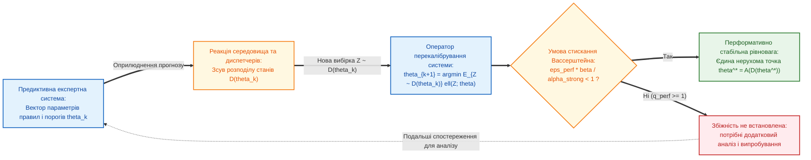

# Глава 05. Відкриті наукові проблеми, фундаментальні гіпотези та технологічні бар'єри предиктивних експертних систем

> **Книга:** [Предиктивні експертні системи: Математичні моделі часової екстраполяції, каузального виведення та гарантованих прогностичних інтервалів](README.md) · Частина 3. Відкриті наукові напрями та технологічні проблеми  
> **Попередня глава:** [Глава 04. Каузальне виведення, контрфактичне прогнозування та гарантовані конформні інтервали](ch04-causal-inference-counterfactuals-and-conformal-bounds.md)  
> **Наступна глава:** [Глава 06. Від прогнозу до доказово допустимої дії: чотиризначна оцінка, осі можливості й дозволу та контракт рекомендації](ch06-from-prediction-to-admissible-action.md)  
> **Зміст книги:** [README.md](README.md)  
> **Автор:** [Микола Мартинович Федчик](../ExpertSystem/about-the-author.md) 
> **Рівень складності та пререквізити:** бакалаврський рівень із поглибленим опрацюванням часових рядів, причинного аналізу та статистичного оцінювання; матеріал пояснює необхідні припущення перед їх застосуванням. 
> **Очікувані результати:** розрізняти встановлені результати, висновки за конкретних припущень і дослідницькі пропозиції; формулювати перевірювані питання для прогнозної експертної системи; обирати базові варіанти, метрики та критерії спростування; пояснювати межі висновку за часової залежності, зсуву даних і неповної доказовості.

---

## Анотація

У цій главі окреслено дослідницькі питання, що виникають, коли прогнозна експертна система працює з даними, на які впливають її власні рекомендації, часовою залежністю, неповними спостереженнями та обмеженим часом виконання. Окремо розглянуто, що саме можна виснувати з причинного аналізу, часової логіки, конформного оцінювання, моделей критичних переходів і фізично-інформованих нейронних мереж. Наведені результати літератури стосуються конкретних методів та припущень; вони не доводять загальної готовності цих методів до експлуатації у будь-якій предметній галузі. Наприкінці сформульовано чотири пропозиції з питаннями, обґрунтуванням, базовими варіантами, вимірюваними показниками та критеріями спростування.

---

> [!NOTE]
> **Чотири перевірювані напрями дослідження**
> 1. **Часова верифікація прогнозів:** порівняти моніторинг точкових і множин можливих траєкторій за шуму, пропусків та невизначених часових позначок.
> 2. **Калібрування за часової залежності та зміни умов:** окремо перевірити покриття майбутніх результатів і ідентифікацію причинного ефекту; жодна з цих властивостей не випливає автоматично з іншої.
> 3. **Оцінювання рішень і утримання від автоматичної відповіді:** виміряти ризик серед прийнятих рішень разом із часткою ескалацій, а не лише точність прогнозу.
> 4. **Відтворюваність бенчмарків залишкового ресурсу:** перевірити одиницю поділу, часовий порядок і доступність еталонних значень, не прирівнюючи симуляційні набори до польових даних.
> *Методологічне застереження:* наведені нижче напрями є програмою перевірок, а не твердженням про новизну, отриманий результат чи універсальну гарантію.

---

## 1. Перша відкрита проблема: перформативність прогнозу, закон Гудгарта та парадокс саморуйнівних пророцтв

У звичайній постановці прогнозування розподіл спостережень задається незалежно від поточної моделі. Однак якщо прогноз використовують для вибору дій, а ці дії змінюють майбутні дані, припущення про незмінний розподіл може не виконуватися. Пердомо та співавтори формалізували цей випадок як перформативне прогнозування: модель впливає на розподіл, для якого її оцінюють, і повторне перенавчання за певних умов може збігатися до стабільної моделі [[1]](#src-1). Це не означає, що будь-яка система зворотного зв'язку нестійка або що така рівновага існує без додаткових припущень.

Це питання перетинається із законом Гудгарта про зміну поведінки показника, коли його перетворюють на ціль, але формальна модель перформативного прогнозування конкретизує відображення «модель — розподіл» і умови стабільності; вона не доводить, що кожен оприлюднений прогноз обов'язково сам себе спростовує [[7]](#src-7).

Наведені далі сценарії є навчальними прикладами, а не повідомленням про виміряні аварії:
- **Парадокс балансування енергомережі та маршрутизації трафіку:** Предиктивна експертна система прогнозує перевантаження підстанції А (або транспортної магістралі А) через 30 хвилин і транслює цей прогноз автоматичним диспетчерам. Усі диспетчери синхронно перемикають навантаження на резервну підстанцію Б. У результаті підстанція А залишається порожньою (прогноз формально «не справдився»), а на підстанції Б виникає штучна каскадна аварія, спричинена самим прогнозом!
- **Парадокс «помилкової дискредитації» превентивної медицини та безпеки (*Self-Defeating Prophecy*):** Предиктивна система прогнозує високий ризик відмови агрегату, інженер виконує превентивне втручання, і аварія не відбувається. При наївному перенавчанні моделі на нових логах без каузальної розмітки система бачить, що після високих прогнозів ризику аварій не сталося, і знижує чутливість правил на наступній ітерації, відкриваючи шлях реальній катастрофі.

**Рисунок 5.1.** Схема впливу прогнозу на наступний розподіл даних. Умова стискання є достатньою для збіжності в наведеній математичній постановці; її порушення саме по собі не доводить нестійкості.

**Означення 5.1 (Перформативна чутливість середовища у метриці Вассерштейна).** Нехай кожному вектору параметрів прогностичної системи $`\theta \in \Theta \subset \mathbb{R}^d`$ відповідає індукований розподіл ймовірностей майбутніх станів об'єкта $`\mathcal{D}(\theta)`$. Кажуть, що середовище має *перформативну чутливість* $`\varepsilon_{\mathrm{perf}} \ge 0`$, якщо для будь-яких двох наборів параметрів прогнозу $`\theta, \theta' \in \Theta`$ відстань Канторовича — Рубінштейна — Вассерштейна першого порядку $`W_1`$ між індукованими розподілами задовольняє умову Ліпшиця (формула (5.2)):

$$
W_1\left(\mathcal{D}(\theta), \ \mathcal{D}(\theta')\right) \le \varepsilon_{\mathrm{perf}} \cdot \left\lVert \theta - \theta' \right\rVert_2
$$

**Формула (5.2).** Умова ліпшицевої перформативної чутливості розподілу станів середовища до зміни параметрів прогнозу.

Тут $`W_1`$ вимірює відстань між розподілами за наперед визначеною метрикою станів; $`\theta`$ і $`\theta'`$ — вектори з $`d`$ параметрів моделі; $`\|\theta-\theta'\|_2`$ — їхня евклідова відстань; $`\varepsilon_{\mathrm{perf}}`$ — межа зміни розподілу на одиницю зміни параметрів. Її числове значення залежить від масштабу обох метрик і не є універсальною характеристикою системи. Для практичної перевірки треба задати діапазон параметрів, спосіб збору даних після дії та оцінку невизначеності цієї межі.

Нехай оператор переналаштування прогностичної системи за спостережуваним розподілом $`\mathcal{D}(\theta)`$ має вигляд мінімізації функції втрат $`\ell(z; \theta)`$:

Оператор повторного мінімізування ризику задається як $`\mathcal{A}(\theta)=\arg\min_{\vartheta\in\Theta}\mathbb{E}_{Z\sim\mathcal{D}(\theta)}[\ell(Z;\vartheta)]`$, де $`\ell`$ — функція втрат, а $`\vartheta`$ — кандидатні параметри переналаштованої моделі.

**Теорема 5.1 (Збіжність повторного мінімізування ризику за умов перформативності [[1]](#src-1)).** *У розглянутій у джерелі постановці параметрична множина є замкненою та опуклою, функція втрат є спільно гладкою за даними й параметрами та сильно опуклою за параметрами, а відображення розподілу має чутливість, обмежену формулою (5.2). За цих припущень оператор повторного мінімізування має наведену нижче межу стискання:*

$$
\left\lVert \mathcal{A}(\theta) - \mathcal{A}(\theta') \right\rVert_2 \le \frac{\varepsilon_{\mathrm{perf}} \cdot \beta}{\alpha_{\mathrm{str}}} \left\lVert \theta - \theta' \right\rVert_2
$$

**Формула (5.3).** Межа стискання оператора повторного мінімізування ризику за наведених припущень.

Тут $`\mathcal{A}`$ — оператор повторного мінімізування; $`\theta,\theta'`$ — початкові параметри, а $`\mathcal{A}(\theta),\mathcal{A}(\theta')`$ — параметри після переналаштування. Норма зліва вимірює відстань між новими параметрами, права частина обмежує її через чутливість розподілу та гладкість втрат.

*Позначивши $`q_{\mathrm{perf}}=\varepsilon_{\mathrm{perf}}\beta/\alpha_{\mathrm{str}}`$, одержуємо достатню умову збіжності $`q_{\mathrm{perf}}<1`$ (формула (5.4)):*

$$
\varepsilon_{\mathrm{perf}} < \frac{\alpha_{\mathrm{str}}}{\beta} \iff q_{\mathrm{perf}} = \frac{\varepsilon_{\mathrm{perf}} \cdot \beta}{\alpha_{\mathrm{str}}} < 1
$$

**Формула (5.4).** Достатня умова збіжності повторного мінімізування ризику.

*За цих умов повторне мінімізування ризику збігається з лінійною швидкістю до єдиної стабільної точки. Якщо $`q_{\mathrm{perf}}\ge 1`$, ця теорема не дає висновку про збіжність; це не є доказом розбіжності чи автоколивань.*

Тут $`\alpha_{\mathrm{str}}>0`$ — коефіцієнт сильної опуклості, а $`\beta`$ — константа спільної гладкості втрат за параметрами та спостереженнями у джерелі. Їхні значення залежать від масштабу параметрів і даних. Формули (5.3)–(5.4) обґрунтовують збіжність лише для відповідного оператора й за всіх перелічених припущень; оцінка $`q_{\mathrm{perf}}`$ не є показником фізичної безпеки.

---

## 2. Друга та третя відкриті проблеми: приховані нестаціонарні конфаундери та прогнозування біфуркаційних катастроф

### 2.1. Проблема неідентифікованості за нестаціонарних прихованих конфаундерів

Причинний висновок у [Главі 04](ch04-causal-inference-counterfactuals-and-conformal-bounds.md) залежить від припущень ідентифікації, зокрема вимірювання спільних причин дії та результату. Для часових даних треба також враховувати порядок дій і змінних: конфаундер, на який вплинула попередня дія, не завжди можна коректно обробити звичайним регресійним коригуванням. За відсутності послідовної обмінності спостережувані дані самі по собі не визначають причинний ефект без додаткових припущень або дизайну. Часткові межі — один із можливих способів подати те, що лишається ідентифікованим; їхня інформативність залежить від конкретних обмежень, а не від самого факту застосування причинного алгоритму [[8]](#src-8).

### 2.2. Прогнозування біфуркаційних фазових переходів та екстремальних подій за межами вибірки

Різка зміна поведінки поблизу втрати стійкості може не бути представленою в навчальних даних, але це не означає, що всі регресійні моделі однаково провалюються або що кожен критичний перехід має спостережуваний передвісник. Шеффер та співавтори описують критичне сповільнення й інші можливі ранні індикатори для окремих класів переходів; їхня наявність і корисність залежать від механізму динаміки, шуму та способу спостереження [[3]](#src-3).

У локальному наближенні біля стійкої рівноваги $`x^*`$ сідло-вузлової біфуркації швидкість релаксації $`\kappa`$ може зменшуватися. Для відхилення $`\xi=x-x^*`$ розгляньмо стаціонарний процес Орнштейна — Уленбека $`d\xi=-\kappa\xi\,dt+\sigma\,dW(t)`$, де $`W(t)`$ — стандартний броунівський рух. За фіксованих $`\kappa>0`$ і $`\sigma`$ модель дає співвідношення для дисперсії та автокореляції у формулі (5.5); це наслідок прийнятих припущень, а не універсальний передвісник.

$$
\mathrm{Var}[\xi] = \frac{\sigma^2}{2\kappa}, \qquad
\rho(\Delta t) = \frac{\mathrm{Cov}(\xi_t,\xi_{t+\Delta t})}{\mathrm{Var}[\xi_t]}
= \exp(-\kappa\Delta t)
$$

**Формула (5.5).** Стаціонарна дисперсія та автокореляція процесу Орнштейна — Уленбека за фіксованих параметрів.

Тут $`\xi`$ — відхилення стану від рівноваги; $`\sigma`$ — інтенсивність білого шуму (одиниці стану на корінь одиниці часу); $`\kappa>0`$ — швидкість релаксації (обернена одиниця часу); $`\Delta t`$ — інтервал між вимірюваннями; $`\rho`$ — безрозмірна автокореляція. Результат використовується як перевірювана модельна ознака: зі зменшенням $`\kappa`$ дисперсія зростає, а залежність сусідніх вимірювань посилюється. У реальних даних тренд цих оцінок треба відрізняти від зміни шуму, сезонності та дрейфу датчика; сам він не є прогнозом часу до аварії.

Для перевищень достатньо високого порога $`u_{\mathrm{th}}`$ теорія екстремальних значень обґрунтовує наближення узагальненим розподілом Парето за умов, визначених граничною теоремою; часову залежність спостережень треба враховувати окремо, наприклад декластеризацією або моделлю залежності [[2]](#src-2):

$$
G_{\xi,\beta}(y) = 1 - \left(1 + \frac{\xi y}{\beta}\right)^{-1/\xi}
$$

**Формула (5.6).** Функція розподілу узагальненого Парето для перевищення порога.

Тут $`y=X-u_{\mathrm{th}}\ge0`$ — величина перевищення; $`\beta>0`$ — параметр масштабу в тих самих одиницях, що й $`y`$; $`\xi`$ — безрозмірний параметр форми; вираз визначений на підтримці, де $`1+\xi y/\beta>0`$. За $`\xi\to0`$ границею є експоненційний розподіл. За $`\xi\ge 1/2`$ дисперсія відповідної GPD нескінченна, якщо цей параметр є коректною характеристикою хвоста; це не означає, що оцінка з короткої вибірки точна. Практичне застосування — оцінити хвостовий ризик із діагностикою чутливості до порога й невизначеності параметрів, а не оголосити виявлення біфуркації.

Наприклад, за суто умовних параметрів $`\xi=0{,}1`$, $`\beta=2`$ цикли та $`y=4`$ цикли маємо $`1-G_{\xi,\beta}(y)=1{,}2^{-10}\approx0{,}1615`$. Це умовна ймовірність перевищити ще на чотири цикли за умови вже зафіксованого перевищення порога; для ризику на цикл додатково потрібна оцінка частоти самих перевищень. Число не є результатом вимірювання, а лише показує, як параметри моделі перетворюються на величину для подальшого рішення.

---

## 3. Четверта та п'ята технологічні проблеми: фізична неузгодженість гібридних нейромереж та бар'єр сертифікації реального часу

### 3.1. Межі фізично-інформованих нейромереж у прогнозних задачах

Фізично-інформовані нейронні мережі (PINNs) навчаються узгоджувати спостереження з нев'язкою заданого диференціального рівняння; початкову постановку такого підходу наведено Раїссі, Пердікарісом і Карніадакісом [[4]](#src-4). Типова функція втрат має вигляд:

$$
\mathcal{L}_{\mathrm{total}}(\theta) = \mathcal{L}_{\mathrm{data}}(\theta) + \lambda_{\mathrm{PDE}} \cdot \left\lVert \frac{\partial u_\theta}{\partial t} + \mathcal{N}[u_\theta] \right\rVert_{L^2(\mathcal{X} \times [0, H])}^2
$$

**Формула (5.7).** Типова сума похибки за даними та штрафу за нев'язку фізичної моделі.

Тут $`\mathcal{L}_{\mathrm{data}}`$ — похибка на спостереженнях, $`\mathcal{N}`$ — диференціальний оператор, $`u_\theta`$ — наближений розв'язок із параметрами $`\theta`$, $`\lambda_{\mathrm{PDE}}\ge0`$ — вага нев'язки, а $`\mathcal{X}\times[0,H]`$ — область оцінювання. Цей штраф зменшує середню нев'язку на вибраних точках, але сам по собі не гарантує точного виконання обмежень між ними. Аналіз Wang, Yu та Perdikaris пов'язує окремі збої навчання PINNs із дисбалансом градієнтів і спектром ядра дотичних ознак; ці результати стосуються досліджених постановок і не доводять універсальної непридатності PINNs [[5]](#src-5).

Для прогнозної експертної системи практичне питання полягає в тому, чи зберігається фізичний інваріант на нових траєкторіях і за межами навчального режиму. Відповідь потребує окремого тесту на нев'язку, порушення обмежень і чутливість до густини колокаційних точок; у разі жорсткої вимоги можна дослідити параметризацію, що вбудовує обмеження, або перевірений проєктор. Жоден із цих варіантів не слід називати гарантією без доказу для конкретної моделі.

### 3.2. Технологічний бар'єр детермінованого часу виконання та безпека запланованої функціональності

Стандарти безпеки мають визначену предметну сферу та вимоги до життєвого циклу, а не підтверджують точність довільного прогнозу. DO-178C стосується розроблення програмного забезпечення бортових систем, ISO 26262 — функціональної безпеки дорожніх транспортних засобів, а ISO 21448 — ризиків безпеки, пов'язаних із недостатністю передбачуваної функціональності. Їх не можна зводити до єдиного універсального сертифіката предиктивної моделі [[6]](#src-6), [[22]](#src-22), [[23]](#src-23).

Для обмеженого часу виконання окремо задають апаратну платформу, розмір входу, режим навантаження та верхню межу часу. Ітераційність сама по собі не означає необмежений час: фіксований ліміт ітерацій дає межу виконання, але може погіршити точність або збіжність. Навпаки, вимірювання однакової затримки у скінченній кількості запусків не доводить WCET. Отже, дослідницьке завдання — довести або консервативно оцінити часову межу для конкретної реалізації та окремо перевірити якість її прогнозів.

---

## 4. Чотири відкриті наукові гіпотези для подальших досліджень

Наведені пропозиції є питаннями для майбутньої перевірки, а не підтвердженими гіпотезами чи заявами про новизну. Для кожної треба зафіксувати протокол, джерело еталона, базові варіанти та критерій нульового результату до аналізу тестових даних.

### 4.1. Часова логіка за неповних і невизначених спостережень

**Питання.** Чи зменшує моніторинг множини можливих траєкторій ризик хибного безпечного висновку порівняно з підстановкою точкових оцінок, не збільшуючи надмірно частку нерозв'язаних вердиктів?

**Обґрунтування.** Кількісна семантика STL задає запас виконання формули для поданої траєкторії, але сама по собі не є ймовірністю правильності прогнозу. Роботи з моніторингу невизначених спостережень і прогнозної верифікації пропонують різні, залежні від моделі способи зберігати цю невизначеність [[9]](#src-9), [[10]](#src-10).

**Дизайн і базовий варіант.** У синтетичному генераторі з відомими неперервними траєкторіями внести контрольовані пропуски, шум, фіксоване зміщення датчика та джиттер часових позначок. На C-MAPSS перевіряти лише семантику дискретно спостережених циклів; не трактувати інтерпольовану між циклами криву як фізичну істину. Порівняти звичайний STL-монітор на імпутованих точках, монітор часткового префікса та інтервальний монітор із наперед заданими межами похибки.

**Метрики та критерій спростування.** Вимірювати частки хибного виконання й хибного порушення, частку невизначених відповідей, покриття оракульної робастності заявленим інтервалом, затримку до першого визначеного вердикту, час процесора та пам'ять. Будь-який визначений вердикт «виконано» для оракульної траєкторії, що порушує формулу в межах задекларованих похибок, спростовує заяву про коректність для цих меж. Практична перевага не підтверджується, якщо за однакової частки визначених відповідей інтервальний варіант не зменшує хибні безпечні вердикти або перевищує наперед встановлений ресурсний бюджет.

### 4.2. Конформні прогнози та причинні висновки за часової залежності

**Питання.** Які властивості покриття зберігаються для послідовних прогнозів під часовою залежністю та зміною режиму, і чи можна відокремити втрату прогнозного покриття від неідентифікованості причинного ефекту?

**Обґрунтування.** Звичайне split conformal дає скінченно-вибіркове маргінальне покриття за обмінності, а не загальну гарантію для довільних послідовностей [[20]](#src-20). EnbPI заявляє приблизне маргінальне покриття за умов сильного змішування; ACI контролює довгострокову частоту помилок за наявності онлайн-зворотного зв'язку; прогнозна перевірка часових властивостей за зміни розподілу має власні припущення, зокрема щодо межі зміни розподілу [[12]](#src-12), [[13]](#src-13), [[21]](#src-21).

**Дизайн і базові варіанти.** Для прогнозу залишкового ресурсу використовувати поділ за двигуном і часом, а не випадкове перемішування вікон. Порівняти точковий прогноз, звичайний conformal із хронологічною калібрувальною вибіркою, EnbPI та ACI; окремо провести симуляцію поздовжньої причинної моделі з відомими потенційними результатами, змішуючими чинниками, на які впливали попередні дії, і контрольованим зсувом політики. Причинне покриття оцінювати лише в симуляції або за дизайном, що надає обґрунтований еталон.

**Метрики та критерій спростування.** Звітувати покриття за горизонтом і в ковзних вікнах, ширину інтервалів, хибно безпечні висновки, частку утримання від рішення та точність оцінювання причинного параметра. Гарантія методу не підтверджується, якщо за умов, для яких її заявлено, емпіричне покриття систематично нижче номінального з урахуванням наперед заданої статистичної похибки. Гіпотеза про користь методу не підтверджується, якщо він не покращує наперед вибраний показник при зіставному рівні ризику. Успішне прогнозне покриття не вважається доказом причинної ідентифікації.

### 4.3. Корисність рекомендації та політика утримання від відповіді

**Питання.** Чи покращує предиктивна експертна система наслідок рішення порівняно з чинною практикою, коли їй дозволено передавати невизначені випадки на експертний розгляд?

**Обґрунтування.** Метрики прогнозу не визначають автоматично якість подальшої дії. Decision curve analysis оцінює чисту користь на заданих порогах, predict-then-optimize порівнює рішення, сформовані за прогнозами, а селективне прогнозування розглядає компроміс між ризиком і часткою автоматично прийнятих випадків [[14]](#src-14), [[15]](#src-15), [[16]](#src-16).

**Дизайн і базові варіанти.** На зафіксованій популяції або в симуляції з відомими наслідками порівняти чинні правила/процес без нової моделі, прогноз без можливості відмови та інтегровану політику з автоматичною відповіддю, кваліфікованим висновком і ескалацією. Пороги та відносну ціну наслідків узгодити до відкриття тесту; якщо їх не встановлено, подати результати для діапазону порогів без твердження про єдиний оптимальний поріг.

**Метрики та критерій спростування.** Вимірювати очікувану втрату або чисту користь на 1 000 випадків, критичні помилки, криву ризик–покриття, частку ескалацій і затримку рішення; подавати результати за релевантними підгрупами. Гіпотеза про користь спростовується, якщо система не зменшує втрату відносно базового процесу за наперед визначеним порогом або зростання критичних помилок перевищує погоджену межу. Висока точність серед невеликої кількості прийнятих випадків без обліку ескалацій не є достатнім позитивним результатом.

### 4.4. Відтворюваність оцінювання прогнозу залишкового ресурсу

**Питання.** Наскільки висновок про якість RUL-моделі залежить від коректного поділу за двигуном, часової ізоляції та доступності тестових еталонів?

**Обґрунтування.** Документація NASA PCoE та аналіз Ramasso і Saxena описують окремі набори C-MAPSS і PHM08, їхні поділи за одиницею та відмінності між режимами складності. Автори застерігають, що результати різних піднаборів не завжди зіставні; для PHM08 перевірка прихованого тестового RUL нині обмежена недоступністю онлайн-оцінювання [[17]](#src-17), [[18]](#src-18).

**Дизайн і базові варіанти.** На FD001–FD004 зафіксувати офіційний поділ train/test за двигунами та додатковий внутрішній validation лише всередині train. Порівняти простий останній/лінійний тренд із вибраною прогнозною моделлю; випадковий поділ вікон використовувати лише як контроль витоку, а не як оцінку узагальнення. Окремо документувати, чи є доступні тестові мітки й чи можна відтворити їхнє оцінювання. У PHM08 приховані тестові мітки та недоступне онлайн-оцінювання обмежують незалежну перевірку на момент укладання джерельної нотатки [[17]](#src-17), [[18]](#src-18). N-CMAPSS може бути кандидатом для іншої перевірки, але в межах цієї роботи повний текст методики не був доступний (видавничий сайт повернув 403, репозитарій — 500); перевірено лише метадані й анотацію. Пряме стабільне посилання на завантаження та офіційний протокол розбиття не підтверджені, тому сильніші висновки за цією працею не робляться [[19]](#src-19).

**Метрики та критерій спростування.** На тесті з доступними еталонами звітувати MAE, RMSE і, якщо протокол набору це передбачає, асиметричну оцінку RUL; подавати парні різниці з довірчими інтервалами між піднаборами та протоколами. Гіпотеза про суттєвий вплив протоколу не підтримується, якщо різниця між коректним поділом за двигунами та контрольним поділом не перевищує наперед зареєстрованої практичної межі. Для набору без доступних еталонів результат позначається як невиміряний, а не відновлюється припущенням.

---

## 5. Навчальний інженерний приклад: розрахунок перформативної стабільності та передвісника біфуркації для мережі з двох реакторів

Розгляньмо суто навчальні, нормалізовані значення для ітеративного переналаштування моделі та стаціонарного процесу Орнштейна — Уленбека. Це не вимірювання на реакторі чи іншому промисловому обладнанні. Перша частина перевіряє достатню математичну умову теореми 5.1; друга показує, як параметр релаксації змінює статистики сигналу за припущень формули (5.5).

### 5.1. Вихідні інженерні дані

1. **Нормалізовані параметри для застосування теореми 5.1:**
   - Для однакових нормованих масштабів параметрів і даних коефіцієнт сильної опуклості дорівнює $`\alpha_{\mathrm{str}} = 2{,}0`$, а константа спільної гладкості — $`\beta = 4{,}0`$.
   - Для двох умовних політик розподілу потоку перформативна чутливість становить відповідно $`\varepsilon_{\mathrm{perf},1}=0{,}30`$ та $`\varepsilon_{\mathrm{perf},2}=0{,}75`$. Ці числа обрано для арифметичного прикладу, а не оцінено на реальному процесі.
2. **Параметри навчального процесу Орнштейна — Уленбека (формула (5.5)):**
   - Кроки опитування давача температури: $`\Delta t = 0{,}10\text{ хв}`$, інтенсивність теплового шуму $`\sigma = 0{,}40\text{ К/\sqrt{\text{хв}}}`$.
   - У режимі A швидкість релаксації дорівнює $`\kappa_A=2{,}0\text{ хв}^{-1}`$, а в умовному режимі B — $`\kappa_B=0{,}20\text{ хв}^{-1}`$.

### 5.2. Покроковий розрахунок

**Крок 1. Перевірка достатньої умови збіжності за теоремою 5.1:** за формулою (5.4) межа для цих нормованих значень становить $`\alpha_{\mathrm{str}}/\beta=2{,}0/4{,}0=0{,}50`$.

- У **Режимі 1** ($`\varepsilon_{\mathrm{perf}, 1} = 0{,}30`$): $`q_{\mathrm{perf}, 1} = 0{,}30 \times 4{,}0 / 2{,}0 = 0{,}60 < 1`$. Якщо припущення теореми справджуються, це дає збіжність повторного мінімізування ризику; числовий приклад не оцінює, чи справджуються вони в реальному середовищі.
- У **Режимі 2** ($`\varepsilon_{\mathrm{perf}, 2} = 0{,}75`$): $`q_{\mathrm{perf}, 2} = 0{,}75 \times 4{,}0 / 2{,}0 = 1{,}50`$. Достатня умова збіжності не виконується, але з цього не випливає ні нестійкість, ні автоколивання. Потрібні інший аналіз або контрольоване випробування.

**Крок 2. Обчислення статистик процесу Орнштейна — Уленбека за формулою (5.5):** для режиму A дисперсія дорівнює $`0{,}40^2/(2\times2{,}0)=0{,}040\text{ К}^2`$, а автокореляція через $`0{,}10`$ хв — $`\exp(-2{,}0\times0{,}10)\approx0{,}8187`$. Для режиму B маємо $`0{,}40^2/(2\times0{,}20)=0{,}400\text{ К}^2`$ та $`\exp(-0{,}20\times0{,}10)\approx0{,}9802`$.

У межах цієї математичної моделі дисперсія зросла вдесятеро, а автокореляція — з $`0{,}8187`$ до $`0{,}9802`$. **Дія для експертної системи:** це підстава позначити сигнал для додаткової перевірки моделі шуму та датчиків, але не автоматично оголосити наближення аварії. Перед експлуатаційним порогом необхідні контроль хибних тривог і тест на нестаціонарний або кольоровий шум.

---

## 6. Оцінювання детермінованого часу відгуку та селективної відмови

У попередній версії цього підрозділу наводилися показники синтезу RTL-конвеєра, затримки, джиттера та точності INT8. У межах наявної перевірки не знайдено лістингу, репозиторію, звіту синтезу або протоколу, за якими ці числа можна відтворити; тому їх вилучено і не подано як результати. Нижче наведено план перевірки, а не повідомлення про виконаний стендовий експеримент.

Для конкретної цільової платформи слід зафіксувати модель процесора або FPGA, тактову частоту, розмір входу, кількість правил, режими пам'яті та конкурентне навантаження. Базовий варіант — програмна реалізація тих самих правил і моніторів; апаратний варіант порівнюється з нею за однакового набору входів і однакової семантики рішень. Тест має включати допустимий прогноз, недостатню впевненість, суперечність правил і позадоменний вхід, для яких очікуваний статус визначено до запуску.

Вимірюються середня, 99-й перцентиль і максимальна спостережена затримка, пропускна здатність, пам'ять, енергоспоживання та частота помилок рішення. Максимальна спостережена затримка не називається WCET без аналізу, що обґрунтовує верхню межу для визначеної конфігурації. Гіпотеза про перевагу апаратної реалізації не підтверджується, якщо вона не задовольняє наперед установлену межу часу або якщо прискорення супроводжується неприйнятним зростанням помилок, енергоспоживання чи обсягу невизначених рішень.

---

## Висновки

1. Перформативне прогнозування, причинний аналіз часових даних, конформне оцінювання та часовий моніторинг описують різні властивості системи. Їхні припущення та межі не можна звести до одного показника «довіри».
2. Критичне сповільнення, хвостові моделі та фізично-інформовані мережі дають перевірювані математичні інструменти лише для визначених моделей і режимів; висновок для реального обладнання потребує незалежного вимірювання та аналізу похибок.
3. Чотири напрями дослідження задають протоколи, за якими можна отримати як позитивні, так і нульові результати. Поки такі експерименти не проведено, вони лишаються пропозиціями, а не підтвердженням новизни чи готовності системи до експлуатації.

---

## Словник

| Термін | Англійський еквівалент | Визначення |
| :--- | :--- | :--- |
| **Перформативна стабільність** | *Performative Stability* | У моделі Пердомо та співавторів — параметри, оптимальні для розподілу, який індукує розгортання саме цієї моделі. Існування й досяжність такої точки залежать від припущень. |
| **Критичне сповільнення** | *Critical Slowing Down* | Зменшення швидкості відновлення після малих збурень у деяких класах систем поблизу втрати стійкості; можливі статистичні ознаки залежать від моделі шуму та спостережень. |
| **Узагальнений розподіл Парето** | *Generalized Pareto Distribution (GPD)* | Гранична модель перевищень високого порога за умов теорії екстремальних значень; її придатність потребує перевірки порога, залежності та невизначеності оцінок. |

---

## Перелік абревіатур

- **GPD** — *Generalized Pareto Distribution* (узагальнений розподіл Парето).
- **NTK** — *Neural Tangent Kernel* (дотичне ядро нейронної мережі).
- **PINNs** — *Physics-Informed Neural Networks* (фізично-інформовані нейронні мережі).
- **SOTIF** — *Safety of the Intended Functionality* (безпека передбачуваної функціональності за ISO 21448).
- **WCET** — *Worst-Case Execution Time* (верхня межа часу виконання у найгіршому випадку).

---

## Бібліографія

1. **Perdomo J., Zrnic T., Mendler-Dünner C., Hardt M.** “Performative Prediction.” *Proceedings of the 37th International Conference on Machine Learning*, PMLR 119, 2020, pp. 7599–7609. [Текст і бібліографія PMLR](https://proceedings.mlr.press/v119/perdomo20a.html).
2. **Pickands J.** “Statistical Inference Using Extreme Order Statistics.” *The Annals of Statistics* 3(1), 1975, pp. 119–131. [DOI](https://doi.org/10.1214/aos/1176343003).
3. **Scheffer M. et al.** “Early-Warning Signals for Critical Transitions.” *Nature* 461, 2009, pp. 53–59. [DOI](https://doi.org/10.1038/nature08227).
4. **Raissi M., Perdikaris P., Karniadakis G. E.** “Physics-Informed Neural Networks: A Deep Learning Framework for Solving Forward and Inverse Problems Involving Nonlinear Partial Differential Equations.” *Journal of Computational Physics* 378, 2019, pp. 686–707. [DOI](https://doi.org/10.1016/j.jcp.2018.10.045).
5. **Wang S., Yu X., Perdikaris P.** “When and Why PINNs Fail to Train: A Neural Tangent Kernel Perspective.” *Journal of Computational Physics* 449, 2022, article 110768. [DOI](https://doi.org/10.1016/j.jcp.2021.110768).
6. **ISO 21448:2022.** *Road vehicles — Safety of the intended functionality (SOTIF).* International Organization for Standardization, 2022. [Офіційна сторінка стандарту](https://www.iso.org/standard/77490.html).
7. **Goodhart C. A. E.** “Problems of Monetary Management: The U.K. Experience.” *Papers in Monetary Economics*, vol. I, Reserve Bank of Australia, 1975, pp. 1–20. [Архів публікацій RBA за 1975 рік](https://www.rba.gov.au/publications/confs/1975/).
8. **Robins J. M., Hernán M. A., Brumback B.** “Marginal Structural Models and Causal Inference in Epidemiology.” *Epidemiology* 11(5), 2000, pp. 550–560. [DOI](https://doi.org/10.1097/00001648-200009000-00011).
9. **Donzé A., Maler O.** “Robust Satisfaction of Temporal Logic over Real-Valued Signals.” *FORMATS 2010*, LNCS 6418, pp. 92–106. [DOI](https://doi.org/10.1007/978-3-642-15297-9_9).
10. **Finkbeiner B., Fränzle M., Kohn F., Kröger P.** “A Truly Robust Signal Temporal Logic: Monitoring Safety Properties of Interacting Cyber-Physical Systems under Uncertain Observation.” *Algorithms* 15(4), 2022, article 126. [DOI](https://doi.org/10.3390/a15040126).
11. **Lei L., Candès E. J.** “Conformal Inference of Counterfactuals and Individual Treatment Effects.” *Journal of the Royal Statistical Society: Series B* 83(5), 2021, pp. 911–938. [DOI](https://doi.org/10.1111/rssb.12445).
12. **Xu C., Xie Y.** “Conformal Prediction Interval for Dynamic Time-Series.” *Proceedings of the 38th International Conference on Machine Learning*, PMLR 139, 2021, pp. 11559–11569. [Текст і бібліографія PMLR](https://proceedings.mlr.press/v139/xu21h.html).
13. **Zhao Y. et al.** “Distributionally Robust Predictive Runtime Verification under Spatio-Temporal Logic Specifications.” *ACM Transactions on Cyber-Physical Systems* 9(4), 2025. [DOI](https://doi.org/10.1145/3748818); [відкритий рукопис](https://arxiv.org/abs/2504.02964).
14. **Vickers A. J., Elkin E. B.** “Decision curve analysis: a novel method for evaluating prediction models.” *Medical Decision Making* 26(6), 2006, pp. 565–574. [DOI](https://doi.org/10.1177/0272989X06295361).
15. **Elmachtoub A. N., Grigas P.** “Smart ‘Predict, then Optimize’.” *Management Science* 68(1), 2022, pp. 9–26. [DOI](https://doi.org/10.1287/mnsc.2020.3922).
16. **Geifman Y., El-Yaniv R.** “SelectiveNet: A Deep Neural Network with an Integrated Reject Option.” *Proceedings of ICML 2019*, PMLR 97, pp. 2151–2159. [Текст і бібліографія PMLR](https://proceedings.mlr.press/v97/geifman19a.html).
17. **NASA Prognostics Center of Excellence.** “Prognostics Data Repository.” Опис публічних наборів даних і протоколів. [Сторінка NASA PCoE](https://www.nasa.gov/intelligent-systems-division/discovery-and-systems-health/pcoe/pcoe-data-set-repository/).
18. **Ramasso E., Saxena A.** “Performance Benchmarking and Analysis of Prognostic Methods for CMAPSS Datasets.” *International Journal of Prognostics and Health Management* 5(2), 2014. [DOI](https://doi.org/10.36001/ijphm.2014.v5i2.2236).
19. **Arias Chao M., Kulkarni C., Goebel K., Fink O.** “Aircraft Engine Run-to-Failure Dataset under Real Flight Conditions for Prognostics and Diagnostics.” *Data* 6(1), 2021, article 5. [DOI](https://doi.org/10.3390/data6010005).
20. **Lei J., G’Sell M., Rinaldo A., Tibshirani R. J., Wasserman L.** “Distribution-Free Predictive Inference for Regression.” [Публічний рукопис arXiv:1604.04173](https://arxiv.org/abs/1604.04173).
21. **Gibbs I., Candès E. J.** “Adaptive Conformal Inference Under Distribution Shift.” [Публічний рукопис arXiv:2106.00170](https://arxiv.org/abs/2106.00170).
22. **RTCA.** *DO-178C: Software Considerations in Airborne Systems and Equipment Certification.* [Офіційна сторінка документа](https://www.rtca.org/product/do-178c/).
23. **ISO 26262:2018.** *Road vehicles — Functional safety.* [Офіційна сторінка стандарту](https://www.iso.org/standard/68383.html).
