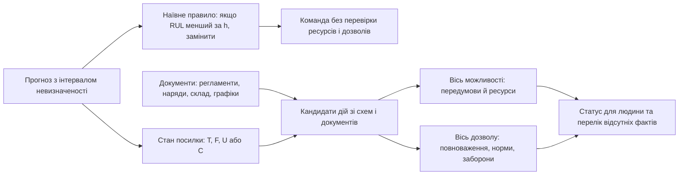
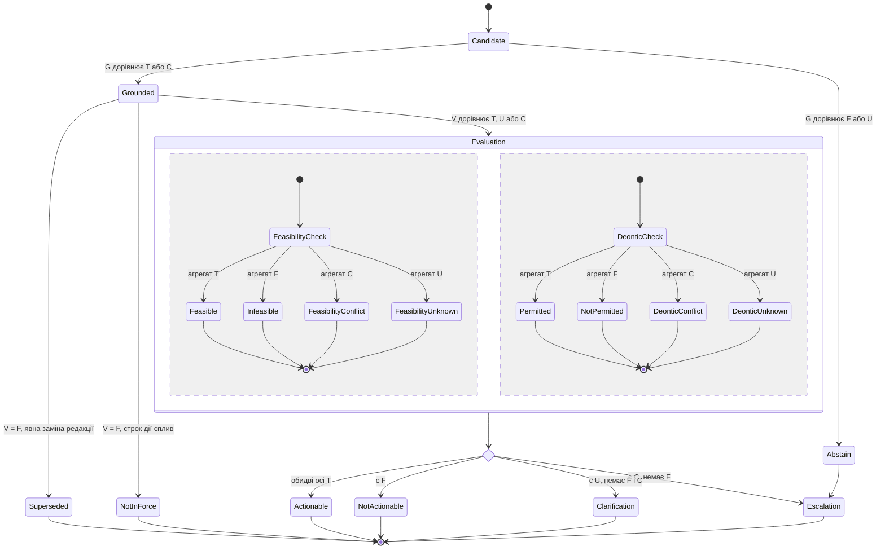
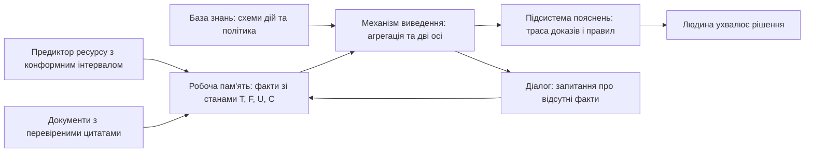

# Глава 06. Від прогнозу до доказово допустимої дії: чотиризначна оцінка, осі можливості й дозволу та контракт рекомендації

> **Книга:** [Предиктивні експертні системи: Математичні моделі часової екстраполяції, каузального виведення та гарантованих прогностичних інтервалів](README.md) · Частина 4. Проектування, гібридна інтеграція та галузева сертифікація  
> **Попередня глава:** [Глава 05. Відкриті наукові проблеми, фундаментальні гіпотези та технологічні бар'єри предиктивних експертних систем](ch05-open-scientific-problems-and-technological-frontiers.md)  
> **Наступна глава:** Глава 07. Прогнозування на основі правил та арбітраж ансамблів експертних гіпотез *(перспективний план Частини 4)*  
> **Зміст книги:** [README.md](README.md)  
> **Автор:** [Микола Мартинович Федчик](../ExpertSystem/about-the-author.md)<br>
> **Рівень складності та пререквізити:** бакалаврський рівень; потрібні поняття множини, лінійного порядку та ймовірності події, а також конформний інтервал із [Глави 04](ch04-causal-inference-counterfactuals-and-conformal-bounds.md). Кожне нове позначення визначено в місці першого використання.<br>
> **Очікувані результати:** відрізняти прогноз, згадану дію, практичну можливість, нормативний дозвіл і рекомендацію; обчислювати підсумковий стан набору перевірок за правилом агрегації; перетворювати конформний інтервал залишкового ресурсу на стан посилки правила; оцінювати частку хибних дозволів і розуміти межі цієї оцінки.

---

## Анотація

Предиктивна експертна система корисна тоді, коли її прогноз допомагає вибрати дію. Проте сам прогноз не каже, чи є ресурси для дії, чи має виконавець повноваження і чи не забороняє її регламент. У цій главі розглянуто шар експертної системи між прогностичною моделлю та рекомендацією: базу знань зі схемами дій і політикою, механізм виведення з чотиризначною оцінкою тверджень і підсистему пояснень, яка показує відсутні факти. Автором запропоновано проєктну модель, у якій прогнозний інтервал перетворюється на стан посилки продукційного правила, а кожна кандидатна дія отримує два незалежні статуси: практичної можливості та нормативного дозволу. Модель задає детерміновану й відтворювану поведінку механізму виведення: прогалина чи суперечність у даних не може стати дозволом, а паралельна реалізація зобов'язана давати той самий результат, що й послідовна. Окремі складники моделі відомі з логіки Белнапа, стандарту XACML і defeasible-логіки. Їхнє поєднання з прогнозними посилками ще не перевірено експериментально, тому глава подає його як проєктну модель із протоколом перевірки, а не як встановлений результат.

---

> [!NOTE]
> **Чотири навчальні результати глави**
> 1. **Розмежування висновків:** прогноз, згадана дія, виведена дія, можлива дія, дозволена дія та рекомендація потребують різних підстав.
> 2. **Чотиризначна агрегація:** підсумковий стан набору перевірок обчислюється так, щоб невідомість і суперечність не зникали.
> 3. **Міст від прогнозу до правила:** конформний інтервал залишкового ресурсу визначає стан посилки правила, а не саму дію.
> 4. **Оцінювання хибних дозволів:** дві метрики з різними знаменниками та довірчий інтервал показують, чи можна покладатися на видані дозволи.
> *Методологічне застереження:* усі числові приклади глави навчальні й умовні; вони не є вимірюваннями на реальному обладнанні.

---

## 1. Розрив між прогнозом і дією в предиктивній експертній системі

Попередні глави показали, як отримати прогноз з оцінкою невизначеності: розподіл залишкового ресурсу в [Главі 03](ch03-stochastic-degradation-and-remaining-useful-life.md) і конформний інтервал у [Главі 04](ch04-causal-inference-counterfactuals-and-conformal-bounds.md). Користувач експертної системи, однак, чекає не числа, а відповіді на запитання «що робити?». Між прогнозом і дією лежить шар міркувань, якого прогностична модель не містить. Чи є ресурси для дії? Чи має виконавець повноваження? Чи не забороняє її регламент? Чи чинні документи, на які спирається висновок? [Глава 05](ch05-open-scientific-problems-and-technological-frontiers.md#43-корисність-рекомендації-та-політика-утримання-від-відповіді) сформулювала цю проблему як відкрите питання про корисність рекомендації та утримання від відповіді. Ця глава пропонує для неї проєктну математичну модель.

Наївне правило «якщо прогнозований ресурс менший за горизонт планування, замінити вузол» виглядає природно, але в експлуатації має три вади. По-перше, воно трактує точкову оцінку як факт і не враховує, що інтервал невизначеності може перетинати горизонт. По-друге, воно змішує технічну необхідність із дозволом: заміну не можна почати без наряду-допуску чи погодженого вікна простою. По-третє, воно мовчки трактує відсутність даних як сприятливу обставину: якщо невідомо, чи є запчастина, правило однаково видає «замінити». Коли хибна рекомендація має фізичні наслідки, кожна з цих вад може призвести до небезпечної дії або до втрати довіри до системи. Рисунок 6.1 порівнює наївний шлях із доказовим, який розглянуто далі.



**Рисунок 6.1.** Наївний і доказовий шляхи від прогнозу до рекомендації. Доказовий шлях не виконує дію сам: він повертає людині статуси та відсутні факти.

### 1.1. П'ять видів висновків про дію

Щоб експертна система не плутала прогноз із наказом, висновки про дію треба розкласти на види, кожен з яких потребує власних підстав. Якщо цього не зробити, механізм виведення почне вважати прохання в листі дозволом, а технічну можливість — правом діяти. Таблиця 6.2 подає п'ять видів висновків, які розрізняє модель цієї глави.

**Таблиця 6.2.** Види висновків про дію та їхні підстави.

| Вид висновку | Питання | Чим підтверджується | Навчальний приклад |
| :--- | :--- | :--- | :--- |
| **Згадана дія** | Чи називає дію документ? | Дослівна цитата з джерела | Регламент: «підшипник замінюють, якщо вібрація перевищує граничне значення» |
| **Виведена дія** | Чи випливає дія з фактів за зареєстрованим правилом? | Цитовані посилки та схема дії | Прогноз ресурсу разом із правилом планування дає «запланувати заміну» |
| **Можлива дія** | Чи можна виконати її зараз? | Передумови, ресурси, час | Запчастина на складі, бригада вільна, є вікно простою |
| **Дозволена дія** | Чи має виконавець право її виконати? | Норма, повноваження, відсутність заборони | Оформлено наряд-допуск, бригада має допуск |
| **Рекомендована дія** | Чи найкраща вона щодо мети? | Явно задана функція мети | Найменший простій за заданих обмежень |

Шостий вид — прогноз поведінки людини, тобто що вона, найімовірніше, зробить, — свідомо не входить до моделі. Експертна система тут пропонує обґрунтовані варіанти, а не вгадує вибір користувача.

### 1.2. Незалежність можливості та дозволу

Практична можливість і нормативний дозвіл — дві незалежні осі, а не сходинки однієї драбини. Дія може бути дозволеною регламентом, але нездійсненною зараз через брак запчастини. І навпаки, бригада може бути технічно готова, але не мати наряду-допуску. Якщо вважати дозвіл частиною можливості, перший випадок загубиться: система не скаже, що дію дозволено і бракує лише ресурсу. Тому модель повертає обидва статуси окремо, а дію, для якої підтверджено обидва, називає **доказово допустимою** (розділ 5). Навіть цей статус лише пропонує варіант людині, а не наказує його виконати.

## 2. Чотиризначна оцінка тверджень і правило агрегації

Механізм виведення експертної системи поєднує десятки перевірок: цитат, прогнозних посилок, ресурсів, повноважень. Якщо кожну з них звести до «так» або «ні», невідомий факт непомітно стане або «так», що дає небезпечний дозвіл, або «ні», що дає втрачену корисну дію. Класична система MYCIN розв'язувала схожу задачу коефіцієнтами впевненості від $-1$ до $1$ [[1]](#src-1). Проте одне число не відрізняє ситуацію «доказів немає» від ситуації «докази суперечать одне одному». Тому в цій главі кожне твердження має один із чотирьох станів.

### 2.1. Чотири стани твердження

Перш ніж поєднувати перевірки, треба домовитися, що саме повертає одна перевірка. Від цього залежить, чи зможе система відрізнити факт, який ще ніхто не перевірив, від факту, щодо якого джерела сперечаються.

**Означення 6.1 (Чотиризначний стан твердження).** Нехай $x$ — перевірюване твердження, наприклад «запчастина є на складі», а $D$ — зафіксований знімок даних і документів. Стан $`s(x)\in\{T,F,U,C\}`$ визначається так:
- `T` — є застосовний доказ на користь $x$;
- `F` — є застосовний доказ проти $x$;
- `U` — застосовного доказу немає;
- `C` — є несумісні застосовні докази, і чинна політика пріоритетів їх не розв'язує.

Стан `T` означає «підтримано наявними даними», а не «істинно у світі». Стан `U` не дорівнює `F`: відсутність запису про запчастину не доводить, що її немає. Стан `C` не розв'язується голосуванням чи вибором найновішого документа: для цього потрібне явне правило пріоритету.

### 2.2. Правило агрегації

Дія залежить від багатьох тверджень одночасно, тому потрібне правило, яке перетворює набір станів на один підсумковий стан і не дає невідомості чи суперечності зникнути. Для цього стани впорядковано за силою блокування: $`T \prec U \prec C \prec F`$. Знак $\prec$ читається «блокує слабше, ніж». Агрегат множини станів визначено як її найсильніший елемент:

$$
\mathrm{agg}(S)=\max\nolimits_{\prec} S,\qquad \mathrm{agg}(\varnothing)=T
$$

**Формула (6.3).** Агрегат скінченної множини станів за порядком сили блокування.

Тут $S$ — скінченна множина станів окремих перевірок, а $\varnothing$ — порожня множина: дія без умов нічим не заблокована. Результат — один зі станів `T`, `F`, `U`, `C`; одиниць виміру він не має. Порядок обрано так, щоб результат напряму керував поведінкою системи:

- $`\mathrm{agg}\{T,T,T\}=T`$ — усі перевірки пройдено, можна переходити до наступного кроку;
- $`\mathrm{agg}\{T,U,F\}=F`$ — обов'язкову умову спростовано, дію відхилено з причиною, а про невідомий факт не питають;
- $`\mathrm{agg}\{T,U,C\}=C`$ — суперечність передається власникові політики, а відсутній факт додається до запиту;
- $`\mathrm{agg}\{T,U\}=U`$ — користувачеві ставлять запитання про відсутній факт.

Стан `F` переважає `C`, бо дію зі спростованою обов'язковою умовою не можна виконати, як би не розв'язалася суперечність в іншій умові; ескалація була б марною витратою часу експерта. Стан `C` переважає `U`, бо суперечність свідчить про дефект джерел чи бази знань і потребує втручання власника політики, тоді як `U` закривається звичайним запитанням. Агрегат не стирає вихідних станів: кожна умова зберігає свій стан у записі, а перелік відсутніх фактів містить усі `U`.

**Твердження 6.1 (Властивості агрегації).** Для скінченних множин станів $S$, $`S_1`$, $`S_2`$:
1. $`\mathrm{agg}(S)=T`$ тоді й лише тоді, коли кожен елемент $S$ дорівнює `T`;
2. $`\mathrm{agg}(S_1\cup S_2)=\mathrm{agg}\{\mathrm{agg}(S_1),\mathrm{agg}(S_2)\}`$;
3. результат не залежить від порядку, в якому перебирають елементи.

*Доведення.* (1) `T` — найменший елемент порядку, тому максимум дорівнює `T` лише тоді, коли всі елементи дорівнюють `T`. (2) У лінійно впорядкованій множині максимум об'єднання дорівнює більшому з максимумів частин. (3) Випливає з (2), бо операція «більший із двох» комутативна й асоціативна. ∎

Практичний наслідок твердження 6.1: перевірки можна розподілити між потоками чи виконати на апаратному прискорювачі, і результат зобов'язаний збігатися з послідовним обчисленням. Розбіжність є дефектом реалізації, а не допустимою похибкою.

### 2.3. Винятки, заперечення й тягар доведення

Регламенти рідко дозволяють дію без застережень: «дозволено, крім випадків, коли…». Такий виняток має протилежну полярність, ніж звичайна умова: дію блокує *підтверджений* виняток, а не непідтверджена умова. Якщо записати виняток як звичайну передумову, система почне шукати доказ *наявності* винятку як умову дозволу, тобто інвертує норму. Тому для винятків використовується заперечення, яке міняє місцями `T` і `F` та залишає `U` і `C` без змін: $`\neg T=F`$, $`\neg F=T`$, $`\neg U=U`$, $`\neg C=C`$. Для кожного предиката $X$, який перевіряє одну вісь дії (розділ 5):

$$
X(a,t)=\mathrm{agg}\Bigl(\{\,s(c,t)\mid c\in\mathrm{Req}_X(a)\,\}\ \cup\ \{\,\neg\,\tilde s(d,t)\mid d\in\mathrm{Def}_X(a)\,\}\Bigr),\qquad X\in\{P,K,H,R\}
$$

**Формула (6.4).** Стан предиката осі з урахуванням обов'язкових умов і винятків.

$$
\tilde s(d,t)=
\begin{cases}
F, & s(d,t)=U\ \text{і}\ \beta(d)=\mathsf{presumed},\\
s(d,t), & \text{інакше}
\end{cases}
$$

**Формула (6.5).** Стан винятку з урахуванням тягаря доведення.

Тут $a$ — кандидатна дія; $t$ — час оцінювання; $`\mathrm{Req}_X(a)`$ — обов'язкові умови, що належать предикату $X$; $`\mathrm{Def}_X(a)`$ — винятки, що його скасовують; $`\beta(d)\in\{\mathsf{strict},\mathsf{presumed}\}`$ — тягар доведення для винятку $d$. Його визначає політика системи, а не текст документа. За `strict` невідомий виняток дає `U`, тому дія не отримає `T`, доки виняток не спростовано. За `presumed` невідомий виняток вважається відсутнім, а система записує це припущення в пояснення. Предикати $P$, $K$, $H$, $R$ визначено в розділі 5.

Розгляньмо дозвіл на вогневі роботи з винятком «крім випадків, коли концентрація горючих газів перевищує допустиму». Якщо газоаналіз ще не проведено, стан винятку дорівнює `U`. За політикою `strict` маємо $`\neg U=U`$, тож $R=U$, і дія не отримає дозволу до вимірювання. За політикою `presumed` маємо $`\tilde s=F`$ і $`\neg F=T`$, тож $R=T$, але припущення стає частиною пояснення. Для небезпечних робіт розумним є `strict`. Політика `presumed` допустима лише там, де перевірено повноту виявлення винятків (розділ 7.2).

Формули (6.3)–(6.5) реалізує така програма мовою Go. Порядок констант відтворює порядок сили блокування, функція `Agg` — формулу (6.3), а функція `Neg` — заперечення з формули (6.4). Очікуваний вивід програми — чотири рядки `T`, `F`, `C`, `U`, що збігається з прикладами розділу 2.2 і з випадком невідомого винятку за політикою `strict`.

```go
package main

import "fmt"

// State — чотиризначний стан твердження; порядок констант задає силу блокування T < U < C < F.
type State int

const (
	T State = iota // підтримано
	U              // доказу бракує
	C              // суперечність
	F              // спростовано
)

func (s State) String() string { return [...]string{"T", "U", "C", "F"}[s] }

// Agg реалізує формулу (6.3): найсильніший стан множини; порожня множина дає T.
func Agg(states ...State) State {
	result := T
	for _, s := range states {
		if s > result {
			result = s
		}
	}
	return result
}

// Neg міняє місцями T і F та залишає U і C без змін.
func Neg(s State) State {
	switch s {
	case T:
		return F
	case F:
		return T
	}
	return s
}

func main() {
	fmt.Println(Agg(T, T, T))   // T
	fmt.Println(Agg(T, U, F))   // F
	fmt.Println(Agg(T, U, C))   // C
	fmt.Println(Agg(T, Neg(U))) // U: невідомий виняток за політикою strict
}
```

### 2.4. Зв'язок із відомими формалізмами

Перш ніж застосовувати модель, варто з'ясувати, що в ній нове, а що відоме. Інакше можна приписати собі чужий результат або пропустити перевірену альтернативу. Таблиця 6.6 зіставляє правило агрегації з формалізмами, з якими його найчастіше плутають.

**Таблиця 6.6.** Чотиризначна агрегація порівняно з відомими формалізмами.

| Формалізм | Значення або рішення | Що спільне | Чим відрізняється |
| :--- | :--- | :--- | :--- |
| Логіка Белнапа [[2]](#src-2) | істина, хиба, «ні те, ні інше», «і те, і інше» | Ті самі чотири значення та таке саме заперечення | Кон'юнкція «ні те, ні інше» і «і те, і інше» дає «хибу»; формула (6.3) дає `C`, щоб зберегти потребу в ескалації |
| XACML 3.0 [[3]](#src-3) | `Permit`, `Deny`, `NotApplicable`, `Indeterminate`; алгоритми поєднання, зокрема `Deny-overrides` | Явні рішення за неповної інформації та поєднання за пріоритетом | Відповідає лише на питання дозволу; немає окремої осі практичної можливості та прив'язки до цитат |
| FEVER [[4]](#src-4) | `Supported`, `Refuted`, `NotEnoughInfo` | Розрізнення «спростовано» і «бракує інформації» | Оцінює окремі твердження, а не дії; немає стану суперечності |
| MYCIN [[1]](#src-1) | Коефіцієнт впевненості від $-1$ до $1$ | Поширення невизначеності правилами | Одне число не відрізняє «немає доказів» від «докази суперечать» |
| Аргументація Дунга [[5]](#src-5) і деонтична defeasible-логіка [[6]](#src-6) | Прийнятні аргументи та атаки; обов'язок, дозвіл, заборона з пріоритетами правил | Конфлікти й винятки — повноправні об'єкти міркування | Потребують вибору семантики прийнятності; формула (6.3) — простіша консервативна маршрутизація |

Отже, окремі складники моделі відомі. Новим може бути їхнє поєднання з прогнозними посилками та точною прив'язкою до джерел. Цю можливість не перевірено експериментально, тому вона подається як проєктна модель, а не як встановлений результат.

## 3. Від прогнозного інтервалу до стану посилки

У цьому розділі прогностичний апарат глав 03–04 поєднується з правилами дії. Прогноз не є ні дією, ні фактом: це посилка правила з відомим рівнем покриття. Якщо перетворювати інтервал на `T` чи `F` надто впевнено, система видаватиме хибні рекомендації; якщо надто обережно — постійно відповідатиме «невідомо» і стане марною. Тому межу між станами треба визначити точно.

### 3.1. Стан посилки за конформним інтервалом

Розгляньмо посилку $`\pi_h`$: «залишковий ресурс вузла вичерпається не пізніше горизонту планування $h$». Тут $h$ — горизонт планування в добах, наприклад тривалість циклу планування ремонтів. Нехай предиктор залишкового ресурсу дає конформний інтервал $[\ell,u]$ за формулою (4.2) з [Глави 04](ch04-causal-inference-counterfactuals-and-conformal-bounds.md) із номінальним покриттям $1-\alpha$. Тоді стан посилки визначається так:

$$
s(\pi_h)=
\begin{cases}
T, & u\le h,\\
F, & \ell>h,\\
U, & \ell\le h<u\ \ \text{або предиктор не валідовано для цього класу обладнання},\\
C, & \text{один валідований предиктор дає } T, \text{ а інший } F
\end{cases}
$$

**Формула (6.7).** Стан прогнозної посилки за конформним інтервалом залишкового ресурсу.

Тут $\ell$ і $u$ — нижня й верхня межі інтервалу в тих самих одиницях, що й $h$, тобто в добах; $1-\alpha$ — номінальна ймовірність покриття, $`0<\alpha<1`$. Значення $\alpha$ визначає політика системи, а не модель. «Валідовано» означає, що покриття предиктора перевірено на даних саме цього класу обладнання за умов теореми 4.2 з [Глави 04](ch04-causal-inference-counterfactuals-and-conformal-bounds.md). Якщо $u\le h$ і справжній ресурс потрапляє в інтервал з імовірністю не менше $1-\alpha$, то з тією самою ймовірністю він не перевищує $h$. Отже, стан `T` означає, що посилка хибна з імовірністю не більше $\alpha$.

Цю гарантію треба читати точно. Теорема 4.2 з [Глави 04](ch04-causal-inference-counterfactuals-and-conformal-bounds.md) дає *маргінальне* покриття, тобто середнє за калібрувальною вибіркою та новим спостереженням, а не гарантію для конкретного насоса [[7]](#src-7). Вона також потребує обмінюваності даних. Для нестаціонарних рядів адаптивне конформне виведення (ACI) контролює довгострокову частоту помилок, а не ймовірність помилки в окремому рішенні [[8]](#src-8). Тому стан `T` за формулою (6.7) — «посилка підтримана з відомим рівнем ризику», а не «посилка істинна».

**Навчальний розрахунок (умовні числа).** Нехай $h=14$ діб і $1-\alpha=0{,}9$.

- Інтервал $[6,11]$: $u=11\le14$, тому $`s(\pi_h)=T`$. Правило планування може породити кандидата «запланувати заміну».
- Інтервал $[9,20]$: $\ell=9\le14<20=u$, тому $`s(\pi_h)=U`$. Прогноз не дозволяє ні підтвердити, ні спростувати посилку.
- Інтервал $[16,30]$: $\ell=16>14$, тому $`s(\pi_h)=F`$. Заміна в цьому циклі планування не обґрунтована прогнозом.
- Фізична модель деградації з [Глави 03](ch03-stochastic-degradation-and-remaining-useful-life.md) дає $[6,11]$, а модель на даних — $[18,40]$. Тоді $`s(\pi_h)=C`$: розбіжність валідованих моделей свідчить про зсув даних або хибну модель, і рішення не можна приймати автоматично.

Стан `U` не робить прогноз марним: у розділі 4.2 показано, як він породжує дію зі збору інформації.

### 3.2. Кілька імовірнісних посилок: межа спільного покриття

Кандидатна дія часто залежить від кількох прогнозних посилок одночасно, наприклад від ресурсу підшипника і ресурсу ущільнення. Кожна з них може помилитися зі своєю ймовірністю, і разом ці ризики накопичуються. Якщо не врахувати накопичення, система видаватиме `T` для дії, ризик помилки якої більший, ніж дозволяє політика. Нижню межу ймовірності того, що всі $k$ посилок правильні, дає нерівність Буля:

$$
\mathbb{P}\Bigl(\bigcap_{i=1}^{k} E_i^{\mathsf{c}}\Bigr)\ \ge\ 1-\sum_{i=1}^{k}\alpha_i
$$

**Формула (6.8).** Нижня межа ймовірності, що всі $k$ імовірнісних посилок правильні.

Тут $`E_i`$ — подія «посилка $i$ хибна», $`E_i^{\mathsf{c}}`$ — протилежна подія, а $`\alpha_i`$ — гарантована межа ймовірності помилки посилки $i$, тобто $`\mathbb{P}(E_i)\le\alpha_i`$.

**Твердження 6.2 (Межа спільного покриття).** Нерівність (6.8) виконується для будь-яких залежностей між посилками.

*Доведення.* За законом де Моргана $`\bigcap_i E_i^{\mathsf{c}}`$ — доповнення до $`\bigcup_i E_i`$. За нерівністю Буля $`\mathbb{P}(\bigcup_i E_i)\le\sum_i\mathbb{P}(E_i)\le\sum_i\alpha_i`$. Віднявши від одиниці, отримуємо (6.8). ∎

Межа не потребує незалежності, тому її можна використовувати навіть тоді, коли посилки обчислено з тих самих датчиків. Для двох посилок із покриттям $0{,}95$ кожна спільне покриття не менше $1-0{,}05-0{,}05=0{,}90$; для п'яти таких посилок — не менше $0{,}75$. **Дія:** якщо політика вимагає, щоб ризик помилки однієї рекомендації не перевищував $`\alpha_{\mathrm{total}}`$, рівні окремих посилок треба вибирати так, щоб $`\sum_i\alpha_i\le\alpha_{\mathrm{total}}`$. Наприклад, для двох посилок і $`\alpha_{\mathrm{total}}=0{,}1`$ кожен предиктор налаштовують на $`\alpha_i=0{,}05`$. Межа консервативна: справжнє спільне покриття може бути вищим, але без додаткових припущень гарантувати його не можна.

## 4. Простір кандидатів дій: з документів і зі схем

Перш ніж оцінювати дію, треба вирішити, звідки беруться кандидати. У класичній експертній системі дії породжують продукційні правила бази знань. Система, що працює з прогнозами та корпусом документів, має ще одне джерело: частину дій уже названо в регламентах чи листах. Якщо обмежитися лише названими діями, система не запропонує очевидного кроку, якого ніхто не записав. Якщо ж дозволити мовній моделі вигадувати дії, система пропонуватиме непідтверджене.

### 4.1. Згадані та виведені кандидати

Модель цієї глави поєднує обидва джерела, але вимагає підстави для кожного кандидата. Множина кандидатів складається з двох частин:

$$
A(D,q,\mathcal{R})=A_{\mathrm{ext}}(D,q)\ \cup\ A_{\mathrm{der}}(D,q,\mathcal{R})
$$

**Формула (6.9).** Множина кандидатних дій як об'єднання згаданих і виведених дій.

Тут $D$ — знімок даних і документів; $q$ — запит із визначеною роллю користувача та предметною сферою; $\mathcal{R}$ — реєстр схем дій; $`A_{\mathrm{ext}}(D,q)`$ — дії, прямо згадані у фрагментах $D$; $`A_{\mathrm{der}}(D,q,\mathcal{R})`$ — дії, виведені за схемами.

**Означення 6.2 (Схема дії).** Схема дії $r\in\mathcal{R}$ — це продукційне правило $`\pi_1(\bar x)\land\dots\land\pi_{k_r}(\bar x)\Rightarrow\alpha_r(\bar x)`$, яке має власника, версію та позитивну рецензію. Тут $\bar x$ — змінні (вузол, дата, документ), $`\pi_i`$ — фактичні або прогнозні посилки, $`k_r`$ — кількість посилок, $`\alpha_r`$ — шаблон дії.

Схема дії — це звичайне правило «якщо — то» класичної експертної системи, доповнене вимогами до походження. Схожий поділ на передумови та наслідки дії використовують мови планування STRIPS і PDDL2.1 [[9]](#src-9), [[10]](#src-10). Вони, однак, не перевіряють, чи правдиві самі факти про стан. Виведені кандидати отримують підстановкою значень із даних:

$$
A_{\mathrm{der}}(D,q,\mathcal{R})=\left\{\alpha_r\theta\ \middle|\ r\in\mathcal{R}_q,\ \theta\in\Theta_r(D)\right\}
$$

**Формула (6.10).** Виведені кандидати як підстановки даних у шаблони застосовних схем.

Тут $`\mathcal{R}_q`$ — схеми, застосовні до ролі та сфери запиту; $\theta$ — підстановка, яка кожній змінній ставить у відповідність конкретне значення, наприклад «насос Н-1»; $`\Theta_r(D)`$ — множина підстановок, значення яких мають локатор у $D$. Підстановка лише зв'язує змінні з даними. Чи підтверджено посилки, визначає предикат джерельного обґрунтування:

$$
G(a,D,\mathcal{R})=
\begin{cases}
Q(a,D), & a\in A_{\mathrm{ext}}(D,q),\\
\mathrm{agg}\Bigl(\{\,Q(\pi_i\theta_a,D)\,\}_{i=1}^{k_{r_a}}\cup\{\mathrm{Reg}(r_a)\}\Bigr), & a\in A_{\mathrm{der}}(D,q,\mathcal{R})\setminus A_{\mathrm{ext}}(D,q)
\end{cases}
$$

**Формула (6.11).** Предикат джерельного обґрунтування для згаданих і виведених дій.

Тут $`Q(x,D)\in\{T,F,U,C\}`$ — стан перевірки твердження $x$ за даними $D$. Для цитованого факту це дворівнева перевірка цитати (розділ 7.2), для прогнозної посилки — формула (6.7). $`r_a`$ і $`\theta_a`$ — схема та підстановка, які породили дію $a$. $`\mathrm{Reg}(r_a)=T`$, якщо схема чинна в реєстрі: має власника, версію, рецензію і не відкликана; інакше `F`. Якщо $G$ дорівнює `F` або `U`, кандидата не розглядають далі, а система пояснює, якої підстави бракує. Ідеї, які мовна модель пропонує без зареєстрованої схеми, зберігаються лише як гіпотези для людини й не отримують статусів.

### 4.2. Схеми дій для прогностичного обслуговування

Щоб побачити, як схеми працюють разом із прогнозом, розгляньмо три навчальні схеми для вузла з прогнозованим ресурсом. Вони показують, що прогноз корисний за будь-якого стану посилки, а не лише за `T`.

1. $`r_1`$: якщо $`s(\pi_h)=T`$, то кандидат — «запланувати заміну вузла до моменту $`t_0+h`$», де $`t_0`$ — поточний момент.
2. $`r_2`$: якщо $`s(\pi_h)=U`$ через ширину інтервалу, то кандидат — «збільшити частоту вимірювань вузла». Посилка цієї схеми — твердження про стан знань системи, яке завжди відоме точно, тому його стан `T` або `F`. Так невизначеність прогнозу сама породжує дію зі збору інформації. Це аналог запитань консультаційної експертної системи, але адресований не користувачеві, а процесу вимірювань.
3. $`r_3`$: якщо $`s(\pi_h)=C`$, то кандидат — «передати розбіжність моделей інженерові з надійності».

Жодна з цих схем не виконує дію: вона лише створює кандидата, якого далі перевіряють за двома осями.

## 5. Дві осі: практична можливість і нормативний дозвіл

Кандидат, що пройшов перевірку обґрунтування, ще не готовий до рекомендації: невідомо, чи можна його виконати і чи дозволено це. Ці питання оцінюють незалежно, бо помилка в одному не повинна приховувати відповідь на інше. Розділ визначає обидві осі, їхній перетин і поведінку системи для кожного статусу.

### 5.1. Можливість, дозвіл і доказова допустимість

Дві осі мають спільними лише дві перевірки: обґрунтування $G$ і чинність джерел $V$. Дія без обґрунтування або з нечинним джерелом не отримує жодного позитивного статусу. Нехай $\Pi$ — явно задана політика: ієрархія джерел, правила розв'язання колізій, таблиця повноважень і тягар доведення для винятків.

$$
\mathsf{Feasible}(D,q,\mathcal{R},t)=\left\{a\in A(D,q,\mathcal{R})\ \middle|\ G=T\land V(a,t)=T\land P(a,t)=T\land K(a,t)=T\right\}
$$

**Формула (6.12).** Множина практично можливих дій.

$$
\mathsf{Permitted}(D,q,\mathcal{R},\Pi,t)=\left\{a\in A(D,q,\mathcal{R})\ \middle|\ G=T\land V(a,t)=T\land H(a,t)=T\land R(a,t)=T\land B(a,t,\Pi)=T\right\}
$$

**Формула (6.13).** Множина нормативно дозволених дій.

$$
\mathsf{Actionable}(D,q,\mathcal{R},\Pi,t)=\mathsf{Feasible}(D,q,\mathcal{R},t)\ \cap\ \mathsf{Permitted}(D,q,\mathcal{R},\Pi,t)
$$

**Формула (6.14).** Множина доказово допустимих дій.

Тут $G$ — скорочення для $G(a,D,\mathcal{R})$ з формули (6.11). Інші предикати:
- $V(a,t)$ — джерела, на які спирається висновок, чинні на момент $t$; `F`, якщо редакцію явно замінено або строк її дії сплив;
- $P(a,t)$ — підтверджено практичні передумови, наприклад достатність вікна простою;
- $K(a,t)$ — підтверджено спроможність і ресурси: запчастини, персонал, обладнання;
- $H(a,t)$ — конкретний виконавець має повноваження, наприклад оформлений наряд-допуск;
- $R(a,t)$ — є позитивна норма, що дозволяє дію, або правило політики, яке її виводить; умови й винятки норми враховано за формулою (6.4);
- $B(a,t,\Pi)$ — перевірено відсутність неврегульованої заборони серед авторитетних джерел, визначених політикою.

Предикат $B$ найлегше зробити хибно позитивним, тому для нього потрібні три умови. $B=T$ лише тоді, коли (1) набір авторитетних джерел оголошено повним для сфери запиту, (2) повноту виявлення заборон і винятків у цих джерелах перевірено (розділ 7.2), (3) жодна застосовна заборона не лишилася неврегульованою за правилами $\Pi$. Якщо умова (1) або (2) не виконується, $B=U$; якщо заборони чи пріоритети суперечать одне одному, $B=C$. Дія не стає дозволеною лише тому, що пошук не знайшов заборони.

**Означення 6.3 (Доказово допустима дія).** Дія $a$ доказово допустима на момент $t$, якщо вона належить множині (6.14), тобто всі сім перевірок $G$, $V$, $P$, $K$, $H$, $R$, $B$ мають стан `T`.

### 5.2. Статуси та поведінка системи

Формули (6.12)–(6.14) відповідають на питання «належить чи ні». Користувачеві ж потрібно знати, *чому* дія не належить множині і що з цим робити. Тому кожна вісь отримує статус за тим самим правилом агрегації (6.3), як подано в таблиці 6.15.

**Таблиця 6.15.** Відповідність агрегату станів і статусів запису.

| Агрегат | Практична вісь: $\mathrm{agg}(G,V,P,K)$ | Нормативна вісь: $\mathrm{agg}(G,V,H,R,B)$ | Підсумок: агрегат обох осей |
| :--- | :--- | :--- | :--- |
| `T` | `FEASIBLE` | `PERMITTED` | `ACTIONABLE` |
| `F` | `INFEASIBLE` | `NOT_PERMITTED` | `NOT_ACTIONABLE` |
| `C` | `CONFLICT` | `CONFLICT` | `NEEDS_ESCALATION` |
| `U` | `UNKNOWN` | `UNKNOWN` | `NEEDS_CLARIFICATION` |

За твердженням 6.1 підсумок дорівнює `ACTIONABLE` тоді й лише тоді, коли всі сім перевірок мають `T`, тобто таблиця узгоджена з означенням 6.3. Статус визначає відповідь системи:

1. `ACTIONABLE` — варіант показують з усіма доказами; рішення й виконання залишаються за людиною.
2. `FEASIBLE`, але нормативна вісь `UNKNOWN` — «технічно можна, але не встановлено, чи дозволено»; система запитує відсутні факти, наприклад наряд-допуск.
3. `PERMITTED`, але практична вісь `UNKNOWN` або `INFEASIBLE` — «дозволено, але ресурс не підтверджено або його немає»; система вказує, якого ресурсу бракує.
4. Будь-який `CONFLICT` — ескалація власникові політики з переліком суперечливих джерел.
5. `INFEASIBLE` або `NOT_PERMITTED` — дія потрапляє до списку відхилених із причиною, а не зникає з відповіді.

Рисунок 6.16 показує ці статуси як автомат станів з двома паралельними областями. Поділ на області підкреслює головну властивість моделі: невідомість однієї осі не скасовує підтвердженого результату іншої.



**Рисунок 6.16.** Автомат станів кандидатної дії. Ліва й права області обчислюються незалежно; підсумковий вибір застосовує правило (6.3) до двох осей.

Ранжування додається лише за явно заданою функцією мети, наприклад мінімумом простою чи вартості. Воно впорядковує дії зі статусом `ACTIONABLE` і не змінює статусів. Оптимізаційне планування превентивних дій із прогнозувальним керуванням заплановано для Глави 10.

## 6. Наскрізний навчальний приклад: прогноз зносу підшипника насоса

Попередні розділи визначили формули окремо; цей розділ показує їх у дії на одній задачі прогностичного обслуговування. Приклад також порівнює модель із наївним правилом із розділу 1, щоб показати, де саме наївний підхід помиляється. Усі документи, числа та назви вигадані.

### 6.1. Вихідні дані

Предиктор залишкового ресурсу підшипника насоса Н-1 валідовано для цього класу насосів; він дає конформний інтервал із покриттям $1-\alpha=0{,}9$. Горизонт планування $h=14$ діб. Для вибору дії використовують такі документи:

- **Д1, регламент обслуговування:** заміну підшипника дозволено виконувати бригаді з допуском до електрообладнання за оформленим нарядом-допуском, крім періодів пікового навантаження водопостачання;
- **Д2, складська відомість:** підшипник потрібного типу є у кількості 2 шт.;
- **Д3, графік роботи:** вікно простою насоса Н-1 через 5 діб триває 8 годин і не припадає на пікове навантаження;
- **Д4, норма часу:** заміна підшипника триває 4 години;
- **Д5, перелік персоналу:** бригада Б-2 має допуск до електрообладнання і вільна у вікно простою.

Наряду-допуску на цю роботу в даних немає. Політика $\Pi$ оголошує Д1 повним авторитетним джерелом норм для цього запиту; тягар доведення для винятків — `strict`. Повноту виявлення заборон у регламентах прийнято перевіреною — це припущення прикладу.

### 6.2. Покроковий розрахунок

**Варіант А: інтервал $[6,11]$ діб.** За формулою (6.7) $u=11\le14$, тому $`s(\pi_h)=T`$. Схема $`r_1`$ породжує кандидата $`a_1`$ — «запланувати заміну підшипника насоса Н-1 у вікно простою через 5 діб». Перевірки подано в таблиці 6.17.

**Таблиця 6.17.** Стани перевірок для кандидата $`a_1`$ у варіанті А.

| Перевірка | Стан | Підстава |
| :--- | :--- | :--- |
| $G$ | `T` | Посилка $`\pi_h`$ має стан `T` за формулою (6.7); схема $`r_1`$ чинна в реєстрі |
| $V$ | `T` | Регламент Д1 чинний на момент запиту |
| $P$ | `T` | Вікно простою достатнє: $`T_{\mathrm{win}}=8\ \text{год}\ \ge\ T_{\mathrm{job}}=4\ \text{год}`$ (Д3, Д4) |
| $K$ | `T` | Запчастина є: $`N_{\mathrm{stock}}=2\ge N_{\mathrm{req}}=1`$ (Д2); бригада з допуском вільна (Д5) |
| $H$ | `U` | Наряду-допуску на роботу в даних немає |
| $R$ | `T` | Д1 дозволяє заміну; виняток «пікове навантаження» має стан `F` (Д3), тому $`\neg F=T`$ |
| $B$ | `T` | Д1 оголошено повним, заборону не знайдено, повноту виявлення прийнято перевіреною |

Практична вісь: $`\mathrm{agg}(T,T,T,T)=T`$, тобто `FEASIBLE`. Нормативна вісь: $`\mathrm{agg}(T,T,U,T,T)=U`$, тобто `UNKNOWN`. Підсумок — `NEEDS_CLARIFICATION`, а перелік відсутніх фактів містить один пункт: наряд-допуск на роботу у вибране вікно. **Дія системи:** запропонувати оформити наряд-допуск. Якщо його оформлено, $H=T$ і $`a_1`$ стає `ACTIONABLE`; виконання однаково вирішує людина.

**Варіант Б: інтервал $[9,20]$ діб.** Тепер $\ell=9\le14<20=u$, тому $`s(\pi_h)=U`$. Схема $`r_1`$ не спрацьовує, але спрацьовує схема $`r_2`$: її посилка «стан $`\pi_h`$ дорівнює `U` через ширину інтервалу» має стан `T`. Вона породжує кандидата $`a_2`$ — «перейти на щодобові вимірювання вібрації насоса Н-1». Якщо портативний вимірювач є, а регламент дозволяє оператору такі вимірювання, $`a_2`$ отримує `ACTIONABLE`. Нові вимірювання звузять інтервал на наступному кроці прогнозу.

### 6.3. Порівняння з наївним правилом

Наївне правило з розділу 1 порівнює з горизонтом точкову оцінку. Для симетричного інтервалу (4.2) нею є середина інтервалу: у варіанті А це $8{,}5$ доби, у варіанті Б — $14{,}5$ доби. У варіанті А наївне правило видає команду «замінити» без наряду-допуску, тобто рекомендує роботу, на яку ще немає права. У варіанті Б воно не пропонує нічого, бо $14{,}5>14$, хоча інтервал допускає вичерпання ресурсу вже через 9 діб. Модель цієї глави в обох випадках дає корисну й безпечну відповідь. У варіанті А вона називає єдиний відсутній документ, у варіанті Б — дію, що зменшить невизначеність.

## 7. Місце апарату в архітектурі експертної системи

Математична модель корисна, лише якщо зрозуміло, який компонент експертної системи її виконує і що станеться, коли компонент відмовить. Класична експертна система складається з бази знань, робочої пам'яті, механізму виведення, підсистеми пояснень і діалогу консультації. Розділ показує, що додає модель кожному з них і де вона найвразливіша.

### 7.1. Відповідність компонентам

Модель не замінює жодного компонента класичної архітектури, а уточнює, що кожен із них зберігає і за якими правилами працює. Таблиця 6.18 подає цю відповідність, а рисунок 6.19 — потоки даних між компонентами.

**Таблиця 6.18.** Внесок моделі в компоненти експертної системи.

| Компонент | Що додає модель |
| :--- | :--- |
| **База знань** | Схеми дій $\mathcal{R}$ — продукційні правила з власником, версією й рецензією; політика $\Pi$ окремо задає пріоритети джерел, повноваження та тягар доведення |
| **Робоча пам'ять** | Кожен факт має стан `T`, `F`, `U` або `C` і посилання на першоджерело або на прогностичну модель |
| **Механізм виведення** | Правило агрегації (6.3), формули (6.4)–(6.14); можливість і дозвіл обчислюються окремо |
| **Підсистема пояснень** | Для кожного висновку зберігається траса цитат, посилок і правил; перелік відсутніх фактів пояснює, *чого бракує* для іншої відповіді |
| **Діалог консультації** | Стани `U` стають запитаннями до користувача, але лише про факти, від яких залежить статус |
| **Набуття знань** | Метрики розділу 8 стають критеріями приймання нової версії бази знань до розгортання |



**Рисунок 6.19.** Потоки даних між компонентами предиктивної експертної системи з доказовим шаром рекомендацій.

### 7.2. Перевірка цитат і роль мовної моделі

Найслабше місце моделі — не формули, а перетворення тексту документів на стани тверджень. Якщо регламент прочитано хибно, правильні формули дадуть хибний дозвіл. Тому перевірка цитованого факту має два рівні. **Рівень 1 — кастодія цитати:** детерміновано перевіряють, що зазначений фрагмент дослівно існує у вказаній версії документа (геш файлу, межі фрагмента, збіг тексту). **Рівень 2 — семантична відповідність:** окремо перевіряють, чи правильно з фрагмента визначено модальність, заперечення, виконавця й умову.

Рівень 1 не замінює рівня 2. Візьмімо речення «бригада не має права розпочинати роботу без наряду-допуску». Правильно вказаний фрагмент ще не гарантує, що система не прочитала його як дозвіл без умов. Навіть простий детектор заперечень лише виявить слово «не». Правильне прочитання — заборона роботи *без* наряду; чи випливає з неї дозвіл роботи *з* нарядом, має визначити окреме правило. Для рівня 2 придатні лексичні правила-індикатори заперечень, як в алгоритмі NegEx для англомовних клінічних текстів [[11]](#src-11). Також можна порівнювати незалежні витяги або вибірково перевіряти їх людиною. Для українських документів лексикон треба створити й перевірити окремо. Якщо рівень 2 не підтвердив прочитання, твердження отримує `U`. Трасу походження зручно зберігати за моделлю W3C PROV-O, яка описує сутності, діяльності та агентів, але не посвідчує істинності джерела [[12]](#src-12).

Мовна модель може допомагати знаходити кандидатів і формулювати пояснення, але не визначає статусів. Її відмова не змінює вже обчислених станів, проте зменшує повноту витягу: детерміновані правила знайдуть лише те, що покривають. Втрата повноти небезпечна саме для дозволу: пропущена заборона чи пропущений виняток можуть хибно дати $B=T$. Тому діє додаткове правило: для типів документів, де повноту виявлення заборон не перевірено на активному способі витягу, $B$ і презумпції `presumed` знижуються до `U`. Тоді відмова моделі збільшує частку `UNKNOWN`, а не частку хибних дозволів.

### 7.3. Паралельна та апаратна реалізація

За твердженням 6.1 агрегат не залежить від порядку перевірок, тому їх можна розподілити між потоками чи передати апаратному прискорювачу, наприклад FPGA. Це виправдано лише тоді, коли профілювання показало, що саме обчислення предикатів обмежує час відповіді; зазвичай найдовше триває витяг тексту, а не агрегація. Будь-яка паралельна реалізація повинна проходити перевірку еквівалентності з послідовним еталоном на всіх чотирьох станах, а не лише на булевому результаті.

> [!NOTE]
> **Три складники авторської проєктної моделі доказово допустимої дії**
> 1. **Консервативна чотиризначна агрегація:** у цій монографії автором запропоновано порядок сили блокування $`T\prec U\prec C\prec F`$ (формула (6.3)) із запереченням для винятків і явним тягарем доведення (формули (6.4)–(6.5)).
> 2. **Міст від прогнозу до правила:** конформний інтервал залишкового ресурсу визначає стан посилки продукційного правила (формула (6.7)), а сумарний ризик кількох посилок обмежується нерівністю (6.8).
> 3. **Дві незалежні осі рекомендації:** практична можливість і нормативний дозвіл обчислюються окремо, а доказово допустимою є лише дія з їхнього перетину (формули (6.12)–(6.14)).
> *Інженерний інваріант:* жодна прогалина `U` чи суперечність `C` не може дати статус `ACTIONABLE`, а паралельна реалізація зобов'язана збігатися з послідовною на всіх чотирьох станах.

## 8. Оцінювання: хибні дозволи та протокол зіставлення

Щоб вирішити, чи можна довіряти моделі, недостатньо виміряти точність прогнозу: як зазначено в [Главі 05](ch05-open-scientific-problems-and-technological-frontiers.md#43-корисність-рекомендації-та-політика-утримання-від-відповіді), якість прогнозу не визначає якості дії. Найнебезпечніша помилка доказового шару — хибний дозвіл, тобто статус `PERMITTED` для дії, яку не можна дозволяти. Розділ визначає, як її вимірювати і як не обдурити себе малою вибіркою.

### 8.1. Метрики хибного дозволу

Для хибного дозволу потрібні дві метрики з різними знаменниками, бо вони відповідають на різні питання. Нехай $\mathcal{G}$ — еталонна множина кандидатів, розмічена незалежними експертами, і кожен кандидат $g$ має еталонний нормативний статус $y(g)$. Нехай $\mathcal{S}$ — кандидати системи зі статусами $\hat y(s)$, а $`m:\mathcal{S}\to\mathcal{G}\cup\{\varnothing\}`$ — однозначне зіставлення за протоколом розділу 8.2. Позначимо через $`\mathrm{TP}_{\mathrm{perm}}`$ кількість виданих `PERMITTED`, зіставлених з еталонними `PERMITTED`. Через $`\mathrm{FP}_{\mathrm{perm}}`$ позначимо кількість виданих `PERMITTED`, зіставлених з іншим еталонним статусом або не зіставлених зовсім.

$$
\mathrm{FDR}_{\mathrm{perm}}=\frac{\mathrm{FP}_{\mathrm{perm}}}{\mathrm{TP}_{\mathrm{perm}}+\mathrm{FP}_{\mathrm{perm}}}=1-\mathrm{Precision}_{\mathrm{perm}}
$$

**Формула (6.20).** Частка хибних серед виданих дозволів.

Величина $`\mathrm{FDR}_{\mathrm{perm}}\in[0,1]`$ показує, яку частку дозволів, побачених користувачем, видано хибно. Вона визначена, лише якщо система видала хоча б один дозвіл. Вона не показує, як часто система помиляється на діях, які дозволяти не можна; для цього потрібна частота хибного дозволу на еталонних негативних прикладах:

$$
\mathrm{FPR}_{\mathrm{perm}}=\frac{\left\lvert\{\,g\in\mathcal{G}^{-}\mid \exists s\in\mathcal{S}:\ m(s)=g\land \hat y(s)=\mathrm{PERMITTED}\,\}\right\rvert}{\left\lvert\mathcal{G}^{-}\right\rvert},\qquad \mathcal{G}^{-}=\{\,g\in\mathcal{G}\mid y(g)\neq\mathrm{PERMITTED}\,\}
$$

**Формула (6.21).** Частота хибного дозволу серед еталонних кандидатів, яких не можна дозволяти.

Тут $`\mathcal{G}^{-}`$ — еталонні кандидати зі статусами `NOT_PERMITTED`, `UNKNOWN` або `CONFLICT`, а $\lvert\cdot\rvert$ — кількість елементів множини. Незіставлені дозволи системи до $`\mathrm{FPR}_{\mathrm{perm}}`$ не входять, бо для них немає еталонного прикладу; їх звітують окремо як кількість вигаданих дозволів. Аналогічні метрики рахують для `FEASIBLE` і `ACTIONABLE`.

**Навчальний розрахунок (умовні числа, не вимірювання).** Еталон містить 40 кандидатів: 12 `PERMITTED` і 28 інших. Система видала 10 `PERMITTED`: 8 зіставлено з еталонними `PERMITTED`, 1 — з еталонним `UNKNOWN`, 1 не зіставлено. Тоді $`\mathrm{FDR}_{\mathrm{perm}}=2/10=0{,}20`$, $`\mathrm{FPR}_{\mathrm{perm}}=1/28\approx0{,}036`$, а повнота дозволів $8/12\approx0{,}67$. Мала $`\mathrm{FPR}_{\mathrm{perm}}`$ не означає надійності: хибним виявився кожен п'ятий показаний дозвіл. Точний 95-відсотковий інтервал Клоппера — Пірсона для $`\mathrm{FDR}_{\mathrm{perm}}`$ за $2/10$ становить приблизно від $0{,}03$ до $0{,}56$ [[13]](#src-13), тобто вибірка замала для будь-якого висновку. За 100 виданих дозволів і тієї самої частки $0{,}20$ інтервал звужується приблизно до $[0{,}13;\ 0{,}29]$. **Дія:** якщо верхня межа інтервалу перевищує наперед зареєстрований поріг власника ризику, видані `PERMITTED` можна використовувати лише з людською перевіркою; слід збільшити тестову вибірку або посилити умови для $B$.

Частку кандидатів, які система довела до `ACTIONABLE`, варто звітувати разом із помилкою серед них. Це та сама крива «ризик — покриття», яку використовують у селективній класифікації [[14]](#src-14). Система, що майже завжди відповідає `UNKNOWN`, матиме нульовий хибний дозвіл, але буде марною.

### 8.2. Протокол зіставлення та базові варіанти

Метрики залежать від того, як вирішено, що кандидат системи й еталонний кандидат — одна дія. Якщо правило зіставлення обрати після перегляду результатів, метрики можна підігнати. Тому протокол фіксують до розкриття тестових міток:

1. *Шар доказу:* обидва кандидати посилаються на ту саму версію документа, а їхні фрагменти перекриваються не менше за наперед зареєстрований поріг, наприклад частку спільних слів 0,5. Це вибір протоколу, а не стандарт. Для виведеної дії кожна еталонна посилка має знайти відповідний фрагмент серед посилок системи.
2. *Шар предиката:* після зведення до словника дій, зафіксованого заздалегідь, збігаються дія, об'єкт і роль виконавця. Формулювання поза словником оцінюють експерти, яким не відомо, яка система їх породила.
3. *Однозначність:* кожному еталонному кандидатові відповідає не більше одного кандидата системи; дублікати лишаються незіставленими.
4. *Розбіжні шари:* кандидати, що збігаються лише за предикатом, у первинному аналізі вважаються незіставленими, а після сліпої експертизи їх подають як вторинний аналіз.

Еталон створюють незалежні анотатори, які не бачать виходу системи. Корисним зразком є набір ContractNLI: він розмічає підтвердження, суперечність і відсутність згадки разом із доказовими фрагментами договорів [[15]](#src-15), хоча й не розмічає повноважень чи ресурсів. Базові варіанти для порівняння: наївне правило розділу 1; той самий прогноз без чотиризначної агрегації (точкова оцінка); повна модель; абляції без винятків, без правила для $B$ і без формули (6.7).

## 9. Межі застосовності та відкриті питання

Модель цієї глави — проєктна пропозиція, і її корисність ще треба довести. Розділ підсумовує, де модель свідомо обмежена, і формулює гіпотези, які можуть її спростувати.

### 9.1. Межі застосовності

Обмеження моделі випливають з її консервативності та з вартості знань, на які вона спирається. Головні з них такі:

1. **Вузьке місце набуття знань.** Схеми $\mathcal{R}$ і політику $\Pi$ мають писати й підтримувати фахівці. Це класична проблема експертних систем, і модель її не усуває.
2. **Консервативність.** Правило (6.3) збільшує частку `UNKNOWN`. Корисність залежить від того, чи вдається швидко закривати прогалини.
3. **Повнота заборон.** $B=T$ можливий лише там, де набір авторитетних джерел можна оголосити повним. У відкритих предметних галузях це часто недосяжно.
4. **Маргінальність гарантії.** Стан `T` за формулою (6.7) спирається на середнє покриття за вибіркою, а не на гарантію для окремого вузла.
5. **Відсутність оптимізації.** Модель відповідає, *що* підтверджено, але не *що найкраще*; для ранжування потрібна окрема функція мети.
6. **Юридичне тлумачення.** Стани норм і повноважень не замінюють правового висновку, якщо від дії залежать юридичні наслідки.

### 9.2. Перевірювані гіпотези

Щоб модель не лишилася декларацією, її твердження треба звести до експериментів, які можуть дати і позитивний, і нульовий результат. Пороги для кожної гіпотези реєструють до розкриття тестових міток.

**Гіпотеза 6.1 (Зменшення хибних дозволів).** На тих самих справах повна модель має нижчу $`\mathrm{FPR}_{\mathrm{perm}}`$, ніж наївне правило, а частка пропущених необхідних дій зростає не більше, ніж на наперед заданий допуск. *Спростування:* довірчий інтервал парної різниці не підтверджує зниження $`\mathrm{FPR}_{\mathrm{perm}}`$ або пропуски необхідних дій перевищують допуск.

**Гіпотеза 6.2 (Користь інтервальної посилки).** Перетворення інтервалу за формулою (6.7) дає менше хибно безпечних рекомендацій, ніж порівняння точкової оцінки з горизонтом, за зіставної частки `UNKNOWN`. *Спростування:* різниця в кількості хибно безпечних рекомендацій не перевищує наперед заданої практичної межі.

**Гіпотеза 6.3 (Дії зі збору інформації).** Схеми з посилкою «стан дорівнює `U`» скорочують час до обґрунтованого рішення порівняно з простим утриманням від відповіді. *Спростування:* медіанний час до рішення не зменшується або кількість зайвих вимірювань перевищує погоджену межу.

## Висновки

1. Прогноз — це посилка правила з відомим рівнем покриття, а не дія. Формула (6.7) перетворює конформний інтервал на один із чотирьох станів, а нерівність (6.8) обмежує сумарний ризик кількох посилок.
2. Правило агрегації (6.3) зберігає невідомість і суперечність під час поєднання перевірок. За твердженням 6.1 його результат не залежить від порядку обчислень, що дає перевірюваний інваріант для паралельних і апаратних реалізацій.
3. Практична можливість і нормативний дозвіл — незалежні осі. Їх окреме обчислення дає змогу сказати користувачеві, чого саме бракує для рішення, а доказово допустимою вважати лише дію з їхнього перетину.
4. Найслабше місце моделі — перетворення тексту документів на стани тверджень. Кастодія цитати не гарантує правильного прочитання модальності чи заперечення, тому семантична перевірка й правило для $B$ є обов'язковими.
5. Окремі складники моделі відомі. Її корисність треба перевірити за гіпотезами 6.1–6.3; до цього вона лишається проєктною пропозицією, а не встановленим результатом.

---

## Словник

| Термін | Англійський еквівалент | Визначення |
| :--- | :--- | :--- |
| **Чотиризначний стан твердження** | *Four-valued claim state* | Один зі станів `T` (підтримано), `F` (спростовано), `U` (доказу бракує), `C` (суперечність), що описує підтримку твердження наявними даними, а не його істинність у світі. |
| **Агрегат станів** | *State aggregation* | Найсильніший за порядком $`T\prec U\prec C\prec F`$ елемент множини станів; для порожньої множини — `T`. |
| **Виняток** | *Defeater* | Умова, підтвердження якої скасовує дозвіл чи можливість дії; враховується із запереченням. |
| **Тягар доведення** | *Burden of proof* | Правило політики, що визначає, чи має невідомий виняток блокувати дію (`strict`) чи вважатися відсутнім (`presumed`). |
| **Схема дії** | *Action schema* | Продукційне правило з посилками й шаблоном дії, яке має власника, версію та рецензію. |
| **Виведена дія** | *Derived action* | Кандидатна дія, не названа в жодному документі, але отримана підстановкою даних у схему дії. |
| **Доказово допустима дія** | *Evidence-admissible action* | Дія, для якої всі перевірки обґрунтування, чинності, можливості та дозволу мають стан `T`. |
| **Частка хибних дозволів** | *False discovery rate of permissions* | Частка виданих дозволів, які не підтверджено еталоном. |
| **Частота хибного дозволу** | *False permission rate* | Частка еталонних кандидатів, яких не можна дозволяти, але яким система видала дозвіл. |

---

## Перелік абревіатур

- **ACI** — *Adaptive Conformal Inference* (адаптивне конформне виведення).
- **FDR** — *False Discovery Rate* (частка хибних серед виданих позитивних рішень).
- **FPGA** — *Field-Programmable Gate Array* (програмована користувачем вентильна матриця).
- **FPR** — *False Positive Rate* (частота хибнопозитивних рішень серед негативних прикладів).
- **PROV-O** — *PROV Ontology* (онтологія походження даних W3C).
- **RUL** — *Remaining Useful Life* (залишковий корисний ресурс).
- **XACML** — *eXtensible Access Control Markup Language* (розширювана мова розмітки керування доступом).

---

## Бібліографія

1. <a id="src-1"></a>**Shortliffe E. H., Buchanan B. G.** “A Model of Inexact Reasoning in Medicine.” *Mathematical Biosciences* 23(3–4), 1975, pp. 351–379. [DOI](https://doi.org/10.1016/0025-5564(75)90047-4).
2. <a id="src-2"></a>**Belnap N. D.** “A Useful Four-Valued Logic.” In: *Modern Uses of Multiple-Valued Logic.* Dordrecht: D. Reidel, 1977, pp. 5–37. [DOI](https://doi.org/10.1007/978-94-010-1161-7_2).
3. <a id="src-3"></a>**OASIS.** *eXtensible Access Control Markup Language (XACML) Version 3.0.* OASIS Standard, 22 January 2013. [Специфікація](https://docs.oasis-open.org/xacml/3.0/xacml-3.0-core-spec-os-en.html).
4. <a id="src-4"></a>**Thorne J., Vlachos A., Christodoulopoulos C., Mittal A.** “FEVER: a Large-scale Dataset for Fact Extraction and VERification.” *Proceedings of NAACL-HLT 2018*, pp. 809–819. [DOI](https://doi.org/10.18653/v1/N18-1074).
5. <a id="src-5"></a>**Dung P. M.** “On the Acceptability of Arguments and Its Fundamental Role in Nonmonotonic Reasoning, Logic Programming and n-Person Games.” *Artificial Intelligence* 77(2), 1995, pp. 321–357. [DOI](https://doi.org/10.1016/0004-3702(94)00041-X).
6. <a id="src-6"></a>**Governatori G., Rotolo A., Riveret R.** “A Deontic Argumentation Framework Based on Deontic Defeasible Logic.” *PRIMA 2018: Principles and Practice of Multi-Agent Systems*, Lecture Notes in Computer Science, Springer, 2018, pp. 484–492. [DOI](https://doi.org/10.1007/978-3-030-03098-8_33).
7. <a id="src-7"></a>**Vovk V., Gammerman A., Shafer G.** *Algorithmic Learning in a Random World.* New York: Springer, 2005.
8. <a id="src-8"></a>**Gibbs I., Candès E.** “Adaptive Conformal Inference Under Distribution Shift.” *Advances in Neural Information Processing Systems (NeurIPS)* 34, 2021, pp. 1660–1672.
9. <a id="src-9"></a>**Fikes R. E., Nilsson N. J.** “STRIPS: A New Approach to the Application of Theorem Proving to Problem Solving.” *Artificial Intelligence* 2(3–4), 1971, pp. 189–208. [DOI](https://doi.org/10.1016/0004-3702(71)90010-5).
10. <a id="src-10"></a>**Fox M., Long D.** “PDDL2.1: An Extension to PDDL for Expressing Temporal Planning Domains.” *Journal of Artificial Intelligence Research* 20, 2003, pp. 61–124. [DOI](https://doi.org/10.1613/jair.1129).
11. <a id="src-11"></a>**Chapman W. W., Bridewell W., Hanbury P., Cooper G. F., Buchanan B. G.** “A Simple Algorithm for Identifying Negated Findings and Diseases in Discharge Summaries.” *Journal of Biomedical Informatics* 34(5), 2001, pp. 301–310. [DOI](https://doi.org/10.1006/jbin.2001.1029).
12. <a id="src-12"></a>**W3C.** *PROV-O: The PROV Ontology.* W3C Recommendation, 30 April 2013. [Специфікація](https://www.w3.org/TR/2013/REC-prov-o-20130430/).
13. <a id="src-13"></a>**Clopper C. J., Pearson E. S.** “The Use of Confidence or Fiducial Limits Illustrated in the Case of the Binomial.” *Biometrika* 26(4), 1934, pp. 404–413. [DOI](https://doi.org/10.1093/biomet/26.4.404).
14. <a id="src-14"></a>**Geifman Y., El-Yaniv R.** “Selective Classification for Deep Neural Networks.” *Advances in Neural Information Processing Systems (NIPS)* 30, 2017. [arXiv:1705.08500](https://arxiv.org/abs/1705.08500).
15. <a id="src-15"></a>**Koreeda Y., Manning C. D.** “ContractNLI: A Dataset for Document-level Natural Language Inference for Contracts.” *Findings of the Association for Computational Linguistics: EMNLP 2021*, pp. 1907–1919. [DOI](https://doi.org/10.18653/v1/2021.findings-emnlp.164).
