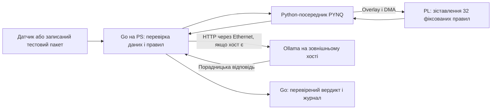

# Перевірте PYNQ-Z1 перед інтеграцією експертної системи

Якщо напис «Pync Z-1» наявної плати означає Digilent PYNQ-Z1, це може бути придатною платформою для перевірки вузького FPGA-прискорювача, але не для розміщення всієї системи без додаткових перевірок. За документацією, плата містить Zynq-7000 із двома ядрами ARM Cortex-A9, 512 МБ DDR3 і програмованою логікою; це дає підстави розглядати Go на процесорній підсистемі (PS) та невеликий детермінований модуль у програмованій логіці (PL). Go для Linux/ARM має документований шлях збірки, однак образ конкретної плати та ABI ще не перевірені. Натомість сумісність Ollama з 32-бітним ARM Cortex-A9 не підтверджена: офіційні інструкції для Linux наводять ARM64-пакет, але не ARMv7. Тому за наявності сумісного зовнішнього хоста Ollama слід розмістити там, а PYNQ залишити для Go, правил і одного вимірюваного PL-ядра; без такого хоста прототип варто будувати без Ollama. Поки не задано датчик, темп даних, формат, дедлайн і бюджет потужності, це рішення є планом експерименту, а не підтвердженою конфігурацією.

## Задокументовані ресурси не є результатами вимірювань

**Факти з документації виробника.** Посібник Digilent ідентифікує PYNQ-Z1 за SoC XC7Z020-1CLG400C, описує два ядра Cortex-A9 до 650 МГц і 512 МБ DDR3; AMD для Z-7020 наводить 53 200 LUT, 106 400 тригерів, 220 DSP-слайсів і близько 4,9 Мбіт BRAM ([Digilent PYNQ-Z1 Reference Manual](https://digilent.com/reference/programmable-logic/pynq-z1/reference-manual); [AMD Zynq-7000 Overview, DS190](https://docs.amd.com/v/u/en-US/ds190-Zynq-7000-Overview)). На платі описані гігабітний Ethernet, USB OTG, microSD, HDMI та роз’єми Pmod і Arduino/chipKIT. Це не плата PCIe: у задокументованому наборі роз’ємів немає PCIe-шляху для встановлення у слот хоста. Це висновок із документації плати, а не твердження про кожну теоретично можливу конфігурацію.

**Статус і невизначеність.** Офіційний сайт PYNQ відносить PYNQ-Z1 до попередніх образів, а не до коротких інструкцій для новіших плат ([PYNQ official site and board images](https://www.pynq.io/index.html)). Перевірені джерела підтверджують тип платформи й загальні ресурси, але не точну ревізію наявної плати, поточну доступність образу, дистрибутив Linux, розрядність ABI, версії Python і драйверів чи справність SD-карти. AMD-документ містить ресурсні характеристики, але в межах цієї перевірки не встановлено завантаження конкретного BSP або доступність будь-яких матеріалів із обліковим доступом до порталів виробників. Отже, точний образ, комплект інструментів і підтримку саме цієї ревізії слід вважати **неперевіреними**.

**Виміряні результати.** У наданій оцінці немає самостійних вимірювань пропускної здатності, затримки, споживання, температури або синтезованих ресурсів PYNQ-Z1. Наведені числа є паспортними специфікаціями, а не результатами прототипу. Звідси випливає лише інженерна гіпотеза: невеликий модуль порівняння цілих чисел може бути доречним для Z-7020, однак фактичне розміщення, частота та ефективність підтвердяться лише збіркою й тестом на платі.

## Рекомендація щодо розміщення залежить від хоста

Go має виконувати нормалізацію даних, застосовувати версійовані правила, журналювати підстави й формувати остаточний результат. Документація Go описує підтримку Linux/ARM та збірку 32-бітного ARM-застосунку; це підтверджує шлях для проби Go на PS, але не сумісність із конкретним образом PYNQ і його бібліотеками ([Go ARM port documentation](https://go.dev/wiki/GoArm)). Перш ніж покладатися на нього, потрібно перевірити ABI образу, зібрати простий бінарник без cgo та виконати його на платі.

**Якщо доступний сумісний зовнішній хост:** розмістити там Ollama, а Go — спершу на PS, якщо smoke test пройде. Go передає до Ollama мінімальний потрібний контекст через HTTP API поверх Ethernet; відповідь моделі залишається порадою. Go перевіряє структуру відповіді, допустимість посилань на ідентифікатори доказів і застосовує власні правила; помилка, тайм-аут або непідтверджена відповідь не змінює вердикт. Офіційна документація Ollama описує Linux ARM64-пакет і HTTP API, але не підтверджує ARMv7-варіант для PS ([Ollama Linux installation](https://docs.ollama.com/linux); [Ollama API introduction](https://docs.ollama.com/api/introduction)).

**Якщо такого хоста немає:** PYNQ можна оцінювати як платформу для Go, фіксованих правил і першого апаратного ядра, а Ollama відкласти. На ARM Cortex-A9 архітектурна невідповідність офіційно описаному ARM64-пакету вже заважає вважати локальний запуск підтриманим; до того ж 512 МБ DDR3 є спільною системною пам’яттю, а не вільною пам’яттю для моделі. Офіційне джерело з оцінки не задає мінімуму RAM, тож стверджувати абсолютну неможливість запуску Ollama не можна. Водночас до окремої перевірки ARMv7-збірки, залежностей і фактичної пам’яті запуск Ollama на PYNQ не слід закладати в план прототипу.

Для PL існує документований шлях PYNQ: Python `Overlay` завантажує bitstream і читає метадані HWH; бібліотеки надають MMIO для простого керування, а DMA та відповідні буфери призначені для більших передач даних ([PYNQ Libraries](https://pynq.readthedocs.io/en/latest/pynq_libraries.html); [PYNQ Overlay API](https://pynq.readthedocs.io/en/latest/pynq_libraries/overlay.html)). Практично рекомендовано залишити цей задокументований керувальний шлях у Python-посереднику на PS: Go передає запит через локальний Unix-сокет або обмежений RPC, посередник працює з overlay і DMA, після чого повертає вихід Go. Такий IPC є власною інтеграцією, а не штатним Go API PYNQ. Прямий доступ Go до MMIO/DMA через UIO або власний драйвер також є інженерно можливим шляхом, але не офіційною інтеграцією PYNQ; він потребуватиме роботи з device tree, кеш-когерентністю, перериваннями й межами доступу. Не надавати процесу Go необмежений доступ через `/dev/mem`.

## Перше FPGA-ядро: фіксований зіставлювач порогових правил

Рекомендується рівно одна початкова задача для PL: обробка пакета з 256 записів, де кожен запис містить 16 ознак `int16`, а кожне з 32 заздалегідь заданих правил є кон’юнкцією порогових умов над цими ознаками. Виходом для кожного запису є 32-бітна маска спрацьованих правил. Правила тут фіксуються для тесту; їхній бізнес-зміст не задано. Обчислення використовує цілочисельні порівняння без множення, тому є простим для незалежного звірення. Масштаб задачі навмисно обмежений відносно паспортних ресурсів Z-7020, але реальне використання LUT/BRAM і завершення синтезу ще треба підтвердити.

**Еталон Go.** Реалізувати чисту функцію без cgo, що приймає той самий пакет і таблицю правил та повертає маску для кожного запису. До фіксації RTL визначити, як інтерпретуються знакові `int16`, як трактуються рівність порогу та порожнє правило. Дані передавати між Go й Python-посередником; PL отримує пакет через PYNQ DMA. Для початку зафіксувати таблицю правил у bitstream або передавати її як окремі параметри керування — вибір має залишатися однаковим для Go-еталона й RTL.

**Вхід для тесту й еквівалентність.** Створити незалежні еталонні приклади з ознаками на порозі, на одиницю нижче й вище, крайніми значеннями `int16`, нульовими даними та пакетами з псевдовипадковим вмістом за зафіксованим seed. Для кожного запису порівнювати Go- та FPGA-маску побітово. Вимога коректності — жодної різниці на повному зафіксованому тестовому наборі; будь-яка відмінність означає `no-go` для цього RTL, а не допуск після перегляду результату. Цей тест доводить лише еквівалентність на перевірених входах, не загальну безпеку.

**Метрики та рішення.** Окремо вимірювати час обчислення Go, передачу DMA, виконання ядра та повну затримку через IPC; звітувати пропускну здатність у записах/с, p50/p95/p99 затримки, CPU-навантаження, кількість копіювань і синтезовані LUT/BRAM/DSP. Енергію на рішення додавати лише за наявності вимірювача. Не встановлювати числовий поріг продуктивності до визначення дедлайну. Перехід до інтеграції можливий лише після побітової еквівалентності, успішної роботи overlay/DMA та підтвердження розміщення в ресурсах плати. Якщо повний шлях не кращий за Go-еталон за заздалегідь обраною системною метрикою або не вкладається в майбутні вимоги, FPGA-ядро не приймати.

Для попереднього масштабу даних, а не як результат вимірювання, можна оцінити сирий потік:

$$
R_{\mathrm{raw}} = C \cdot f_s \cdot B
$$

`C` — кількість каналів датчика, ціле додатне число; `f_s` — частота дискретизації кожного каналу в відліках за секунду, додатна величина в Гц; `B` — число байтів на один відлік, додатне ціле число; `R_raw` — сирий потік у байтах за секунду, без часових міток, заголовків і протокольних витрат. За суто ілюстративного припущення `C = 16`, `f_s = 1 000 Гц` і `B = 2 байти` маємо `R_raw = 32 000 байт/с`, тобто 32 кБ/с у десятковому позначенні. Це не параметри проєкту й не вимірювання PYNQ. Дія: після вибору датчика повторити оцінку з реальним форматом, додати метадані та зіставити з виміряною наскрізною швидкістю приймання; лише тоді вибирати розмір пакета й спосіб передачі.

## Джерела

- **[S1]** Digilent, [PYNQ-Z1 Reference Manual](https://digilent.com/reference/programmable-logic/pynq-z1/reference-manual).
- **[S2]** AMD, [Zynq-7000 SoC Overview (DS190)](https://docs.amd.com/v/u/en-US/ds190-Zynq-7000-Overview).
- **[S3]** PYNQ, [офіційний сайт і образи плат](https://www.pynq.io/index.html).
- **[S4]** PYNQ, [Libraries documentation](https://pynq.readthedocs.io/en/latest/pynq_libraries.html).
- **[S5]** PYNQ, [Overlay API](https://pynq.readthedocs.io/en/latest/pynq_libraries/overlay.html).
- **[S6]** Go, [ARM port documentation](https://go.dev/wiki/GoArm).
- **[S7]** Ollama, [Linux installation](https://docs.ollama.com/linux).
- **[S8]** Ollama, [API introduction](https://docs.ollama.com/api/introduction).

## Відкриті параметри та два наступні досліди

Точному сайзингу заважають п’ять невідомих: **наявність і характеристики зовнішнього хоста** для Ollama; **цільовий датчик і частота дискретизації**; **формат даних** та одиниці; **дедлайн затримки й бюджет потужності**; **модель Ollama та контракт її виходу** (поля, посилання на докази, відмови). Окремо треба звірити напис, SoC і ревізію самої плати та перевірити доступний образ PYNQ. Не встановлено сумісність фактичного образу з 32-бітним Go-бінарником, роботу конкретного DMA overlay чи ресурси синтезованого ядра. Використання FPGA саме по собі не доводить жорсткий реальний час, безпеку, сертифікацію або придатність до виробничої експлуатації.

1. **Ідентифікація та програмний smoke test:** звірити маркування плати й SoC, завантажити наявний образ, зафіксувати Linux/ABI/Python, перевірити Ethernet і виконати простий Go-бінарник, зібраний для підтвердженої архітектури. За наявності зовнішнього хоста окремо перевірити HTTP-зв’язок із Ollama та поведінку Go на тайм-ауті.
2. **Еквівалентність порогового ядра:** реалізувати Go-еталон, overlay і DMA для наведеного пакета; порівняти результати на граничних і фіксованих псевдовипадкових даних, записати ресурси синтезу та повну затримку. Результат цього досліду визначить, чи є сенс залишати FPGA в прототипі.
