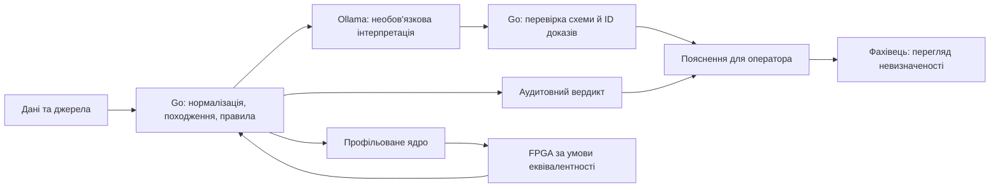
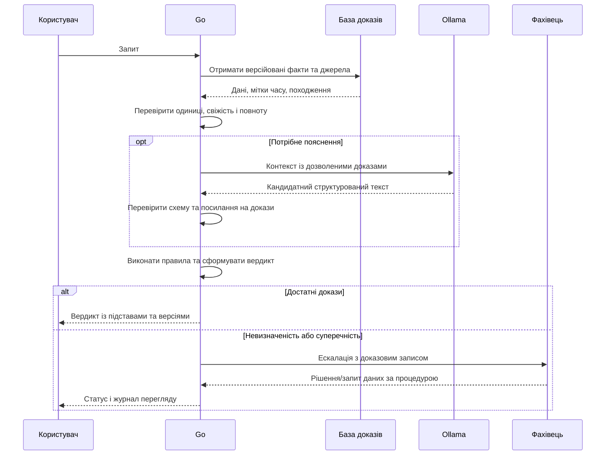

# Як спроєктувати перевірювану експертну систему Go–Ollama–FPGA

**Короткий висновок.** Найкращий початковий дослідницький домен — промислова прогностика ресурсу обладнання до відмови (RUL), але лише як автономний демонстратор підтримки рішень: відкриті набори дають ціль для прогнозування, проте їхні симульовані або малі вибірки не доводять перенесення на виробництво. Енергетика має доступніший часовий ряд попиту, але він не вимірює деградацію окремого активу; автомобільна безпека має найвищі наслідки помилки й найслабшу відповідність доступних публічних міток завданню керування вбудованим пристроєм. Архітектурно Go має контролювати дані, походження доказів, правила й вердикт; Ollama — лише готувати необов’язкові пояснення; FPGA — прискорювати тільки обмежене ядро, яке профіль виконання доведе як вузьке місце. Ні вибір FPGA, ні твердження про безпечність, жорсткий реальний час, приватність локального запуску або причинну достовірність прогнозу наразі не обґрунтовані. Рекомендацію щодо домену та наступних кроків слід переглянути після фіксації реальної задачі, даних, наслідків помилки й цільового обладнання.

## 1. Для першого випробування найкраще підходить промислова прогностика

Домен не слід визначати за привабливістю технологічного стеку. Порівняння нижче оцінює насамперед відповідність доступних даних цільовому результату, можливість побудувати незалежний тест і межі висновку. Це якісне ранжування готовності до досліду, а не оцінка суспільної важливості чи ринкового потенціалу.

| Домен | Публічно вимірювана задача | Сильна сторона для першого тесту | Межа узагальнення | Оцінка готовності |
|---|---|---|---|---|
| Промислова прогностика | Залишкові цикли/час до кінця траєкторії, зношення інструмента або мітка деградації | Пряме зіставлення прогнозу з відомою траєкторією run-to-failure; можна відокремити двигуни чи інші одиниці | C-MAPSS є симуляцією; фізичні набори можуть бути малі, а режими, датчики й умови майданчика відрізняються | **Перша умовна рекомендація:** дослідницький RUL-демонстратор без керування обладнанням |
| Енергетична інфраструктура | Годинний попит/генерація та порогове попередження | Відкриті часові ряди EIA підтримують хронологічний тест прогнозу навантаження | Сукупний попит не є міткою відмови трансформатора чи турбіни; з нього не випливає придатність до швидкого захисту мережі | Добра альтернатива, якщо ціль — планування навантаження |
| Автомобільна/вбудована безпека | Ретроспективна класифікація наслідків аварії або спеціалізовані сенсорні дані | Дає змогу досліджувати окремі ретроспективні асоціації та ризики | FARS не є набором сенсорних потоків чи істинних міток безпечного рішення ECU; рідкі події, відбір і відсутність часової істини обмежують тест | Не рекомендується як старт без визначеної функції, даних і аналізу небезпек |

NASA PCoE описує симуляційні прогностичні набори й дані зношення інструмента; вони дають ціль для досліду, але не доводять точності на реальному флоті ([NASA PCoE; офіційний каталог](https://www.nasa.gov/intelligent-systems-division/discovery-and-systems-health/pcoe/pcoe-data-set-repository/)). PHM Society CNC challenge має лише шість різців і відому помилку в одному файлі зношення; його варто використовувати лише після перевірки файлів і міток ([сторінка набору](https://phmsociety.org/phm_competition/2010-phm-society-conference-data-challenge/)).

Особливої обережності потребує C-MAPSS. Огляд бенчмарків описує FD001–FD004 як симуляційні траєкторії з поділом навчальних і тестових двигунів; автори огляду застерігають, що набори різняться за режимами відмов і умовами, тому результати між ними не завжди зіставні ([Ramasso & Saxena, 2014; рецензований огляд, DOI](https://doi.org/10.36001/ijphm.2014.v5i2.2236)). У перевірених матеріалах помічено розбіжність доступу/версій: стара сторінка каталогу C-MAPSS/C-MAPSS40K позначає ці пакети недоступними, тоді як сторінка репозиторію окремо перелічує “Turbofan Engine Degradation Simulation-2”. Це **не підтверджує**, що йдеться про однаковий архів, версію або мітки. До початку експерименту потрібно зафіксувати точну назву, URL завантаження, ліцензію, README, контрольну суму й структуру розбиття; версію не можна реконструювати за назвою набору ([NASA C-MAPSS catalog](https://data.nasa.gov/dataset/c-mapss-aircraft-engine-simulator-data); [NASA PCoE repository](https://www.nasa.gov/intelligent-systems-division/discovery-and-systems-health/pcoe/pcoe-data-set-repository/)).

Для енергетики EIA надає годинні ряди попиту й генерації: вони підтримують хронологічний тест навантаження, але не діагностику окремого активу чи захист із субсекундним дедлайном ([EIA; офіційні дані](https://www.eia.gov/electricity/)). FARS містить ретроспективні дані про смертельні ДТП, не мітки поведінки контролера. Сторінка NHTSA повернула HTTP 403, тому актуальні файли й метадані не перевірені ([NHTSA FARS; офіційний каталог](https://www.nhtsa.gov/research-data/fatality-analysis-reporting-system-fars)).

**Умовна рекомендація:** почати з RUL на зафіксованій версії NASA-даних, із системою, що видає лише дослідницьку оцінку та пояснює її джерелами. Якщо первинна бізнес-задача — короткострокове планування електроспоживання, обрати EIA замість RUL. Якщо система повинна впливати на автомобільну функцію безпеки, ці публічні дані не є належним доказом: спершу потрібні конкретна функція, автомобільні сенсорні дані, аналіз небезпек, вимоги часу й відповідна процедура верифікації. Стандарти IEC 61508, ISO 26262 та ISO/SAE 21434 задають різні сфери безпеки й кібербезпеки; сам факт використання Go, LLM або FPGA не встановлює їх застосовності чи відповідності ([IEC 61508-1; каталог стандарту](https://webstore.iec.ch/en/publication/5515); [ISO 26262; каталог](https://www.iso.org/standard/68383.html); [ISO/SAE 21434; каталог](https://www.iso.org/standard/70918.html)).

## 2. Розмежування відповідальності має залишити вердикт у Go

Go доцільно використати як координатор перевірених даних, джерел і версій правил. Він перевіряє типи, одиниці, час, свіжість і повноту доказів; виконує правила та журналює вердикт із підставами. Пропущені, прострочені чи суперечливі дані мають спричиняти невизначеність або ескалацію, не мовчазне прийняття. Модель пам’яті Go гарантує послідовну узгодженість для програм без data race, але не детермінованість логіки, мережі, планувальника чи зовнішнього прогнозу ([Go Memory Model; офіційна специфікація](https://go.dev/ref/mem)).

За потреби часовий монітор зіставляє потік із формальними правилами й може повертати невизначеність для неповних спостережень. Робастність STL є запасом траєкторії до межі правила, не ймовірністю правильності прогнозу; скалярний RUL сам не доводить властивість майбутньої траєкторії. Потрібно задати часову семантику, обробку пропусків і модель невизначеності ([Donzé & Maler; рецензована праця](https://doi.org/10.1007/978-3-642-15297-9_9); [Finkbeiner et al.; рецензована праця](https://doi.org/10.3390/a15040126)).

Ollama слід обмежити тлумаченням запиту, пошуком формулювань або поясненням вже перевірених доказів. Модель може повертати кандидатне твердження зі структурованими полями, але Go перевіряє формат, допустимі ідентифікатори доказів, часові межі й сумісність із правилами; цитата, яка існує, ще не доводить твердження. Відповідь моделі не змінює факти, пороги, вердикт або стан виконавчих механізмів. Документація Ollama описує JSON/JSON Schema та зазначає, що низька температура робить генерацію *більш* детермінованою, але не обіцяє однакового результату; структурований вивід підтверджує форму, не правдивість. Локальний API за типової конфігурації прив’язано до localhost, але це не є незалежною гарантією конфіденційності, захищеності хоста чи безпечності мережевої конфігурації ([Ollama Structured Outputs; офіційна документація](https://docs.ollama.com/capabilities/structured-outputs); [Ollama FAQ; офіційна документація](https://docs.ollama.com/faq)). Отже, потрібні окремі політики доступу, журналювання, зберігання даних і тестування відмов.

FPGA має сенс лише після профілювання на цільовому обладнанні. Кандидатами є потокова фільтрація, скінченновимірні ознаки, обмежений часовий монітор або малий статичний набір предикатів, якщо саме вони домінують у витратах. Змінну базу знань, оркестрацію, нерегулярний пошук і генерацію мови краще залишити на хості. Спершу слід порівняти оптимізований CPU-код та, для щільних нейромережевих обчислень, доступні GPU/NPU: вони зазвичай зменшують витрати інтеграції спеціального RTL, драйвера й перевірки. FPGA може дати виграш для чітко окресленого потоку, але це гіпотеза до вимірювання, а не властивість платформи.

Плати не обрано, бо ще не визначено обсяг і швидкість даних, інтерфейс, ОС, бюджет потужності, допустиму затримку, ціну та фізичне розміщення. Малі FPGA, SoC FPGA з процесорним підсистемним блоком та PCIe-карти відрізняються не тільки обсягом логіки, а й способом інтеграції; запуск Go, доступ до драйвера та передавання даних залежать від конкретної плати. У дослідницькому проході сторінки AMD та Intel відображалися як JavaScript-shell, тому версії SDK, назви API та конкретні драйверні інструкції тут **не верифіковані**. Джерела FINN показують результат для спеціально бінаризованої мережі MNIST на конкретній платформі, а MLPerf Tiny — корисний шаблон одночасного вимірювання точності, затримки й енергії; жодне з них не є прогнозом прискорення цього рушія ([FINN; дослідницька стаття, препринт](https://arxiv.org/abs/1612.07119); [MLPerf Tiny; дослідницька стаття](https://arxiv.org/abs/2106.07597)).

Для кожного запиту послідовність виконання повинна зберігати межу між підказкою моделі й правиловим результатом.

Стани `ACCEPT`, `QUALIFIED` і `REFUSAL` слід визначити як політику інтерфейсу, а не як універсальну класифікацію ризику. `ACCEPT` означає, що умови заздалегідь заданого дослідницького правила виконані; `QUALIFIED` — що результат залежить від невизначеності або потребує фахового перегляду; `REFUSAL` — що система відмовляється видавати дієву рекомендацію через порушення межі застосування чи доказові вади. Жоден зі статусів сам собою не авторизує фізичну дію.

```mermaid
stateDiagram-v2
  accTitle: Стани доказового рішення
  accDescr: Запит проходить перевірку доказів; достатні дані допускають оцінювання, а прогалини та суперечності спрямовують до умовного статусу чи відмови.
  [*] --> Intake
  Intake --> Validate
  Validate --> Assess: Дані повні та в межах задачі
  Validate --> Qualified: Даних бракує або вони прострочені
  Validate --> Refusal: Формат чи сфера застосування неприйнятні
  Assess --> Accept: Правила виконані, пороги задані наперед
  Assess --> Qualified: Інтервал перетинає поріг або діє OOD-прапорець
  Assess --> Refusal: Задане обмеження порушене
  Qualified --> Review
  Refusal --> Review
  Review --> [*]
  Accept --> [*]
```

## 3. Прототип має просуватися лише через фальсифіковані ворота

Перший етап — не написання прискорювача, а протокол даних. Зафіксувати намір системи, цільову величину, одиниці, горизонт прогнозу, процедуру ескалації, ціну пропуску/хибної тривоги, допустимий дедлайн, джерело й версію набору. Для C-MAPSS поділяти за повними траєкторіями двигунів; навчальну валідацію створити лише всередині навчальної частини, а зафіксований тест не використовувати для підбору. Не розбивати випадково часові вікна одного двигуна між train і test: це створює витік і завищує оцінку узагальнення. Для оцінювання нового майданчика потрібен окремий сайт/режим, не лише випадкові рядки.

| Етап | Порівняння та вимірювання | Нульовий/негативний результат | Умова переходу |
|---|---|---|---|
| 0. Визначення задачі | Зафіксувати ціль, одиниці, горизонти, мітки, джерела, політику дії й тестовий спліт | Немає відтворюваних міток, незалежної одиниці поділу або доступу до архіву | Зупинити доменне твердження; не будувати метрики з неперевірених даних |
| 1. Програмний прогнозний базис | Порівняти persistence та простий лінійний тренд із фіксованою моделлю; виміряти MAE/RMSE у циклах або годинах по кожному горизонту, активу й режиму | Перевага над базисом не відтворюється на закритому unit-wise тесті або зникає за зміни режиму | Продовжити лише якщо критерій корисності й довірчий інтервал зафіксовано до тесту |
| 2. Go та доказовий запис | Перевірити правила на повних, неповних, застарілих, суперечливих і некоректних одиницях даних; ін’єктувати події поза порядком | Хоч один випадок видає прийняття без обов’язкової підстави або не відтворюється за тим самим знімком | Перейти після трасування кожного вердикту до джерел, правил і версій |
| 3. Ollama як порадник | Зафіксувати модельний digest, шаблон, схему й параметри; перевірити коректні, хибні, неоднозначні, прострочені запити, prompt injection, timeout і malformed output | Небезпечне хибне прийняття, неперевірене посилання або збій сервісу змінює Go-вердикт | Залишити тільки якщо пояснення додає виміряну цінність; інакше вилучити компонент |
| 4. FPGA-профіль | На однакових вхідних векторах зіставити Go/CPU, доступні GPU/NPU та кандидатне FPGA-ядро; виміряти повний шлях, передачу даних, потужність і ресурси | Вузького місця немає, поліпшення менше за витрати інтеграції, або відмінність змінює рішення | Не вибирати плату, доки не визначені профіль, інтерфейс, бюджет і критерій виграшу |
| 5. Зовнішня валідація | Перевірити на даних іншого періоду, майданчика чи фізичної одиниці; оцінити drift та процес перегляду | Погіршення за межами наперед прийнятого рівня чи невідтворюваність | Не переводити у виробничу рекомендацію без окремих вимог, аналізу ризиків і незалежної перевірки |

Метрики прогнозу й покриття не можна зливати в одну «точність». Нехай для одиниці `i` на горизонті `h` виміряне значення міститься в прогнозному інтервалі з нижньою межею `L` і верхньою межею `U`. Емпіричне покриття інтервалу обчислюється так:

$$
\widehat{C}_{h} =
\frac{1}{N_h}\sum_{i=1}^{N_h}
\mathbf{1}\{L_{i,h} \le y_{i,h} \le U_{i,h}\}
$$

Тут `h` — один із заздалегідь заданих горизонтів прогнозу, вимірюваний у циклах або годинах; `N_h` — додатне ціле число оцінених одиниць на цьому горизонті; `i` перебирає ці одиниці; `y` — фактичний невід’ємний RUL у циклах або годинах; `L` та `U` — нижня й верхня межі в тих самих одиницях, причому `0 ≤ L ≤ U`; `1{…}` дорівнює одиниці, коли факт лежить усередині інтервалу. Результат безрозмірний. Рівень `1−α` задається до тесту, де `α` — безрозмірна цільова частка непокриття в діапазоні `(0,1)`. Інженер має звітувати фактичне покриття, ширину інтервалу та довірчі межі окремо для горизонту, активу, режиму й пропусків; маргінальна конформна гарантія не означає однакове умовне покриття в кожній підгрупі. Для часових даних звичайна гарантія за обмінності не переноситься автоматично на залежність або дрейф ([Barber et al.; дослідницька стаття про межі конформного висновку](https://arxiv.org/abs/2202.13415)).

Окремо визначається **частка прогнозів, що система видала**, а не відмовилася від них:

$$
C_{\mathrm{emit}} =
\frac{N_{\mathrm{valid}}}{N_{\mathrm{eligible}}}
$$

`N_valid` — ціле число валідних прогнозів після перевірок; `N_eligible` — додатне ціле число всіх запитів, що відповідали наперед визначеним умовам включення; має виконуватися `0 ≤ N_valid ≤ N_eligible`, інакше частка не визначена. Обидві величини — лічильники одного періоду, отже результат безрозмірний і належить `[0,1]`. Його слід показувати разом із selective risk — часткою помилок серед автоматично прийнятих випадків — та частотою ескалації: система, що відповідає лише на один простий випадок зі ста, не демонструє високої корисності лише через малу помилку на цьому випадку. Для рішення додати lead time до зафіксованого порогу тривоги, хибні ранні попередження й пропущені відмови; допустимий баланс визначає предметний власник, не дослідницька вибірка.

Затримка вимірюється на повному шляху, а не тільки всередині ядра:

$$
T_{\mathrm{e2e}} = t_{\mathrm{finish}} - t_{\mathrm{receive}}
$$

`t_receive` і `t_finish` — час отримання запиту та готового вердикту за тією самою монотонною шкалою часу, записаний у мілісекундах; `t_finish ≥ t_receive`, отже `T_e2e ≥ 0`. Інтервал включає черги, підготовку даних, Go, мережу/виклик Ollama (якщо ввімкнено), драйвер, передавання в FPGA та перевірки результату. Для кожної конфігурації записати p50/p95/p99 і найбільше **спостережене** значення під холодним і прогрітим стартом, навантаженням та відмовою залежностей. Найбільша виміряна затримка не є WCET і не доводить жорсткого дедлайну.

Апаратну еквівалентність треба визначити до реалізації. Для оголошеної області входів `D`:

$$
\forall x \in D:\quad
d\!\left(f_{\mathrm{FPGA}}(x), f_{\mathrm{ref}}(x)\right) \le \varepsilon
$$

`x` — вхідний вектор із задекларованими одиницями й допустимим станом; `D` — наперед задана множина таких входів, що включає граничні значення, округлення, насичення та режими скидання; `f_FPGA` і `f_ref` — апаратний результат і незалежний програмний еталон із порівнюваними вихідними одиницями; `d` — невід’ємна, заздалегідь визначена метрика відмінності; `ε ≥ 0` — дозволена похибка в одиницях виходу, для побітової рівності дорівнює нулю. Результати потрібно порівнювати на золотих і випадкових векторах та на краях числового діапазону; для функції, що впливає на рекомендацію, додатково вимагати однакового кінцевого класу дії. Порушення допуску означає відмову від прискорювача, а не корекцію базису після тесту.

Енергію звітують на завершений запит або рішення, вимірюючи одну й ту саму функціональність:

$$
E_{\mathrm{decision}} =
\frac{\int_{t_0}^{t_1} P_{\mathrm{system}}(t)\,dt}{N_{\mathrm{decisions}}}
$$

`P_system(t)` — виміряна невід’ємна потужність хоста разом із платою, у ватах; `t0` і `t1` — межі тестового інтервалу в секундах, причому `t1 > t0`; `N_decisions` — додатне ціле число валідних завершених рішень; результат у джоулях на рішення. Потрібні прилад, частота відліку, температура, режими частоти, простій і повна конфігурація. Окремо подавати повну енергію та додаткову енергію відносно простою; не підміняти системне споживання оцінкою потужності одного ядра. Перехід до FPGA виправданий лише якщо функціонально еквівалентне ядро покращує заздалегідь обрану метрику повного шляху або енергії без погіршення якості рішення.

## 4. Ранжовані рекомендації й питання для перегляду

1. **Спершу заморозити предметну задачу й набір.** Зафіксувати версію даних, контрольну суму, одиницю незалежного поділу, ціль, горизонт, правила оцінки й межі висновку. Для RUL взяти persistence і лінійний тренд як обов’язкові прості базиси; зберегти незалежний тест до фінальної оцінки.
2. **Побудувати детерміновану доказову частину до генеративної.** Типізований вхід, джерело/версія/час/одиниці, правила, причина рішення та політика `QUALIFIED`/`REFUSAL` мають працювати без Ollama. Додати тестування гонок, порядок подій, повторні запити, дублікати, тайм-аут і неповні дані.
3. **Додавати Ollama лише під перевірювану людську потребу.** Зафіксувати модель, digest, промпт, схему, генераційні параметри та корпус; виміряти правильність посилань на джерела, підтриманість тверджень, відмови, помилкові прийняття й затримки. Валідний JSON або температура `0` не є доказом фактичної правильності.
4. **Відкласти вибір FPGA до профілювання.** Порівняти програмну реалізацію, оптимізований CPU та придатні GPU/NPU на одному записаному навантаженні. Додати HDL лише для доведеного обчислювального вузького місця; перевірити арифметику, передавання, еквівалентність, енергію й резервне виконання.
5. **Перейти до експлуатаційної оцінки лише після зовнішнього тесту.** Потрібні незалежні активи/майданчики/періоди, реальні експлуатаційні мітки, узгоджені пороги корисності, процедура ескалації й аналіз наслідків помилок. Для регульованої функції окремо визначити застосовні стандарти та вимоги юрисдикції; демонстрація на відкритому датасеті не є сертифікацією.

Для перегляду рішення потрібні: призначення й користувач; ціна ранньої/пізньої тривоги; сенсори, калібрування й частота вимірювань; горизонт та дедлайн; операторська процедура; вимоги до приватності, мережі й обладнання; зовнішні дані для нових режимів і майданчиків; юрисдикція. Невизначеними залишаються репрезентативність RUL-еталона, користь Ollama для оператора, профіль FPGA на реальному навантаженні та вплив дрейфу. Ці відповіді можуть змінити рекомендацію щодо домену й архітектури.

## Джерельна база та межі перевірки

**Набори й домени.** NASA, PHM Society, EIA та NHTSA — офіційні каталоги/джерела; розбіжність версій C-MAPSS відкрита, FARS повернув 403. Ramasso & Saxena — рецензований огляд RUL ([DOI](https://doi.org/10.36001/ijphm.2014.v5i2.2236)).

**Інструменти й апаратні обмеження.** Go/Ollama — документація, MLPerf Tiny — методика, FINN — результат іншої бінаризованої задачі, не системний бенчмарк. Портали AMD/Intel показали JavaScript-shell, тому SDK/API не перевірено.

**Методи та стандарти.** Barber et al. — препринт про припущення конформного прогнозування. Каталоги IEC/ISO не доводять відповідності; NIST AI RMF добровільний, не сертифікаційний ([офіційна сторінка](https://www.nist.gov/itl/ai-risk-management-framework)).

## Що ще не встановлено

Не визначено остаточний домен, призначення, користувача, наслідки помилки, юрисдикцію, вимоги до латентності, апаратну плату, джерело й ліцензію конкретного набору, бажану модель Ollama та профіль реального обчислення. Не виміряно якість прогнозу, його покриття чи калібрування; не доведено переносність на нові активи й режими; не перевірено, що FPGA скоротить повний час або енергію; не підтверджено детермінованість, приватність, hard real-time, функціональну безпеку, кібербезпеку чи сертифікацію. Тому обґрунтованим результатом наразі є архітектурний поділ відповідальності та план фальсифікованих дослідів, а не твердження про готову систему. Можливі майбутні перехресні посилання з іншими книжковими проєктами — окрема необов’язкова робота; цей звіт належить самостійному проєкту `Prediction_Expert_Systems` і не змінює матеріали `ExpertSystem/`.
