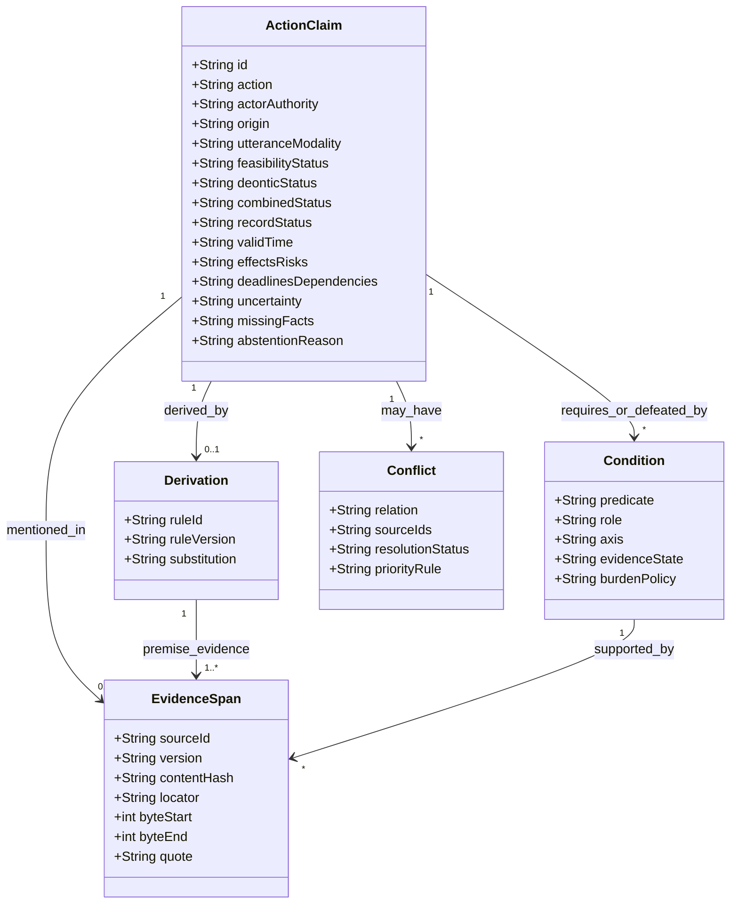
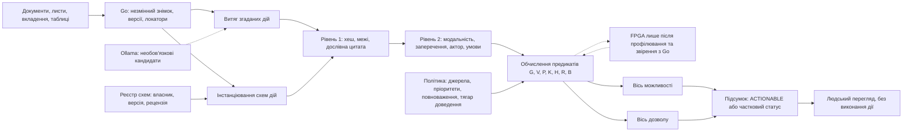
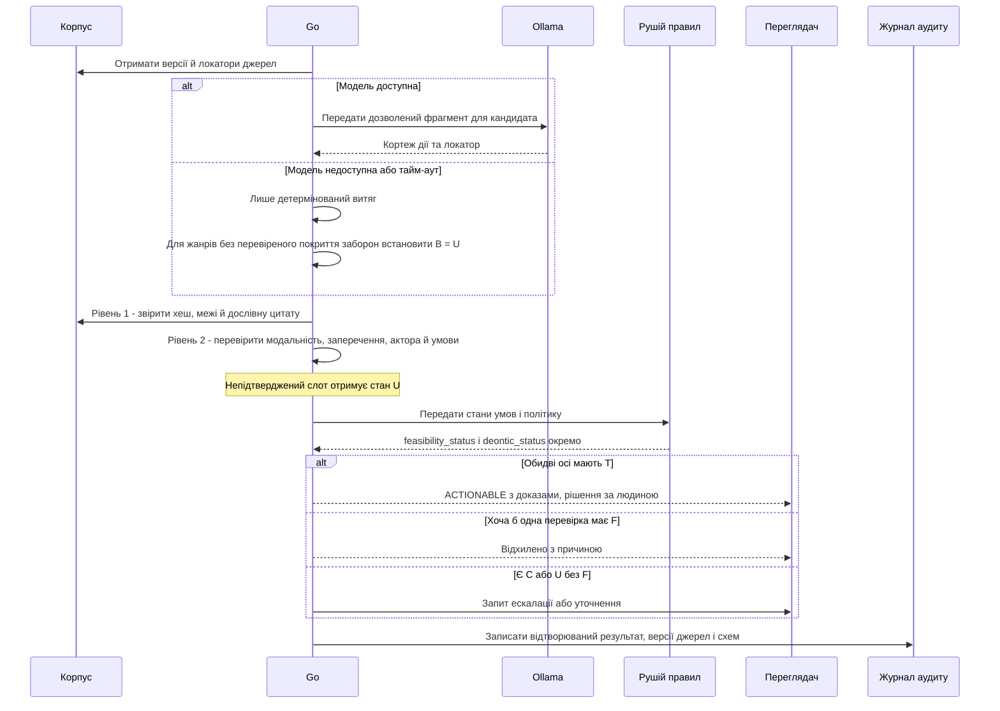
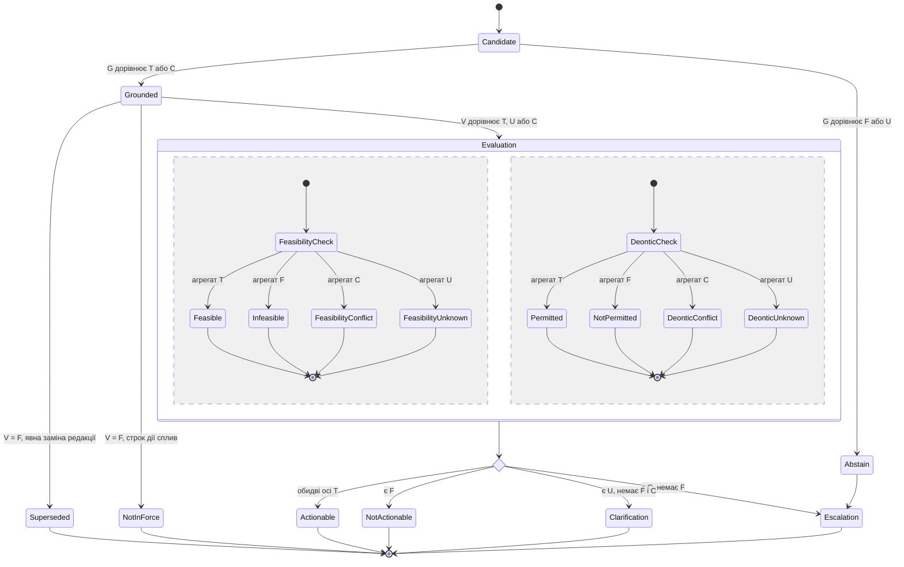

# Доказовий оракул можливих дій

Завдання `feasible_actions` — перетворити неоднорідний корпус на перелік дій, підтверджених джерелами, із зазначенням умов і меж доказу. Система витягує згадані в джерелах дії, за потреби виводить нові кандидати за зареєстрованими схемами, окремо оцінює практичну можливість і нормативний дозвіл та, за заданою метою, ранжує варіанти. Вона не прогнозує поведінку людини. Згадка, виведення, можливість, дозвіл і рекомендація є різними висновками; кожен потребує окремих доказів або правила. Результат зберігає версії, невідомі факти й суперечності замість неперевіреної генерації. Ця редакція враховує зауваження [рецензії](<./Рецензія на звіт Доказовий оракул можливих дій.md>); прийняті зміни та розбіжності з рецензією наведено в розділі «Джерела».

## 1. П’ять висновків, які не можна змішувати

Для кожної дії слід розрізняти п’ять видів висновків. **Витягнута (згадана) дія** — джерело її згадує, просить, вимагає, дозволяє або забороняє; важливі авторство, цитування, заперечення й адресат. **Можлива за поточного стану** — істинність необхідних практичних передумов і наявність потрібної спроможності підтверджено на заданий час. **Дозволена** — знайдено позитивну застосовну підставу дозволу, повноваження виконавця та не виявлено невирішеної вищої за пріоритетом заборони; цей висновок не залежить від наявності ресурсу. **Рекомендована** — дія оцінена відносно явно заданих цілей, обмежень і вподобань; це окремий висновок, а не цитата з документа. **Передбачена поведінка** — оцінка того, що людина, найімовірніше, зробить; вона не входить до предмета цього оракула.

Наприклад, лист «Олено, підготуйте звіт до п’ятниці» підтверджує згадку прохання й строк, але не посадовий обов’язок, доступність даних, дозвіл на їх розкриття чи фактичне виконання. Цитата з давнього листа може бути нечинною; відсутність заборони у знайдених файлах не є дозволом. STRIPS і PDDL моделюють передумови й наслідки для заданого стану, але не доводять правдивість цього стану або нормативну силу документа ([STRIPS](https://doi.org/10.1016/0004-3702(71)90010-5); [PDDL 2.1](https://doi.org/10.1613/jair.1129)). Деонтична логіка й аргументація розділяють дозвіл, обов’язок, заборону та атаки на аргументи; пріоритети джерел усе одно має задавати політика системи ([Dung](https://doi.org/10.1016/0004-3702(94)00041-X); [Governatori et al.](https://doi.org/10.1007/978-3-030-03098-8_33)).

Запит фіксує роль, юрисдикцію, сферу й час; дата публікації не дорівнює чинності. RFC 8174 визначає нормативність ключових слів у контексті IETF, а не для довільних листів, тож парсер враховує жанр, цитату, виняток і редакцію ([RFC 8174](https://www.rfc-editor.org/rfc/rfc8174.html)).

Можливість і дозвіл — дві незалежні осі, а не сходинки однієї драбини. Дія може бути дозволеною договором, але нездійсненною зараз через брак ресурсу; і навпаки, технічно доступною, але без підтвердженого повноваження виконавця. Тому система повертає обидва статуси окремо, а дію, для якої підтверджено обидві осі, називає **готовою до рішення** (розділ 3.3). Навіть такий статус лише пропонує варіант людині, а не наказує його виконати.

Окрему вісь утворює **походження кандидата**. Прямо згадані дії $`A_{\mathrm{ext}}`$ мають дослівну цитату у фрагменті документа. Виведені дії $`A_{\mathrm{der}}`$ не названі в жодному джерелі, але породжуються явно зареєстрованою схемою дії з фактів, кожен з яких має перевірену цитату. Скажімо, жоден лист може не пропонувати перенести строк. Проте з дедлайну в договорі, планової дати отримання даних і оцінки тривалості роботи випливає документальна несумісність плану зі строком, а договір допускає письмову зміну строку. Тоді «запропонувати зміну строку» — виведений кандидат (розділ 3.4). Схема дії є артефактом системи з власником, версією й рецензією, а не доказом із корпусу. Ідеї, які модель пропонує без зареєстрованої схеми, зберігаються лише як гіпотези для людини й не отримують статусів можливості чи дозволу. MVP обмежується $`A_{\mathrm{ext}}`$; повний режим підтримки вибору дій працює з $`A_{\mathrm{ext}} \cup A_{\mathrm{der}}`$.

## 2. Типізований контракт дії та доказу

Вихід доцільно представляти як запис на кожну дію, а не як один нерозділений абзац. Мінімальний контракт наведено нижче.

| Поле | Тип і вимога |
|---|---|
| `action` | Нормалізований предикат, об’єкт і параметри; зберігається окремо від дослівного формулювання. |
| `origin` | `EXTRACTED` — дію прямо згадано у джерелі; `DERIVED` — дію виведено схемою з ідентифікатором і версією (`rule_id`) та зафіксованою підстановкою змінних. Для `DERIVED` доказом є цитовані посилки схеми, а не сама дія. |
| `actor_authority` | Виконавець або роль, адресат, джерело повноваження та сфера його дії; невизначена особа не підмінюється узагальненим «користувачем». |
| `utterance_modality` | Тип і полярність вислову в джерелі: опис, прохання, обов’язок, дозвіл, рекомендація, заборона, гіпотеза; окремо — чи вислів авторський, цитований або пересланий. Для `DERIVED` значення `NONE`, бо дію не висловлено в джерелі. Модальність вислову не є статусом висновку: прохання «зробіть X» не доводить ні можливості, ні дозволу. |
| `preconditions` | Обов’язкові умови з віссю, до якої вони належать (`P`, `K`, `H` або `R`), джерелом кожної умови та станом `SUPPORTED`, `REFUTED`, `UNKNOWN` або `CONTESTED`. |
| `exceptions_defeaters` | Винятки й умови скасування («крім випадків, коли…», «якщо не…»), кожен з віссю, джерелом, станом і політикою тягаря доведення: `strict` — виняток має бути спростовано; `presumed` — відсутність винятку презюмується й показується як припущення. |
| `feasibility_status` | Підсумок практичної осі: `FEASIBLE`, `INFEASIBLE`, `UNKNOWN` або `CONFLICT`; обчислюється з `G`, `V`, `P`, `K` (розділ 3). |
| `deontic_status` | Підсумок нормативної осі: `PERMITTED`, `NOT_PERMITTED`, `UNKNOWN` або `CONFLICT`; обчислюється з `G`, `V`, `H`, `R`, `B` за політикою `Π`. `NOT_PERMITTED` охоплює і доведену заборону, і доведену відсутність повноважень; причина зберігається окремо. |
| `combined_status` | `ACTIONABLE`, `NOT_ACTIONABLE`, `NEEDS_ESCALATION` або `NEEDS_CLARIFICATION`; агрегує дві осі, але не замінює їх. `ACTIONABLE` не є командою на виконання. |
| `record_status` | `ACTIVE`, `SUPERSEDED` (явна заміна редакції), `NOT_IN_FORCE` (строк чинності сплив) або `ABSTAIN` (цитату чи посилку не звірено). |
| `effects_risks` | Заявлені наслідки, побічні ефекти й ризики; якщо джерело їх не описує, поле позначається як невідоме, а не заповнюється моделлю. |
| `deadlines_dependencies` | Строк із часовим поясом і точкою відліку; залежності від інших дій, погоджень, даних чи ресурсів. |
| `evidence[]` | Для кожного фактичного твердження обов’язкові незмінні ID документа, версія або хеш, точний фрагмент і стабільна адреса: байтові межі, сторінка/абзац, комірка таблиці або ID листа й позиція в тілі. Для цитати зберігається дослівний текст і перевірка його відповідності джерелу. |
| `conflicts_supersession` | Зв’язки суперечності, відкликання, заміни редакції, часової чинності та застосоване правило пріоритету; новіша дата сама по собі не означає скасування. |
| `uncertainty` | Окрема впевненість для витягу, актора, модальності, умови й цитати; числова ймовірність допускається лише після калібрування на релевантній вибірці. |
| `missing_facts` | Факти, яких бракує для переходу до сильнішого статусу, із вказанням джерела, яке могло б їх підтвердити. |
| `abstention_escalation` | Причина утримання від висновку, потрібне уточнення або компетентний перегляд; порожнє поле не означає, що перевірка пройдена. |

Джерельне походження є обов’язковим для фактичної заяви про дію. Якщо висновок складений кількома фрагментами, він має містити кожну посилку та ідентифікатор правила виведення. Для виведеної дії ланцюжок має вигляд «цитовані посилки → схема `rule_id` певної версії → кандидат». Правильні цитати не виправдовують помилкову схему, тому схеми рецензуються й версіонуються окремо від корпусу. Згенерований переказ може полегшити читання, але не стає доказом: перевірюваним доказом залишається фрагмент першоджерела. W3C PROV-O надає придатну модель сутностей, агентів, діяльностей і похідності, але не посвідчує істинність джерела чи юридичну силу документа ([W3C PROV-O](https://www.w3.org/TR/2013/REC-prov-o-20130430/)).

Передумови й винятки зберігаються окремо, бо мають протилежну полярність. Дію блокує непідтверджена передумова, але *підтверджений* виняток. Якщо виняток «крім випадків прострочення оплати» записати як звичайну передумову, система почне шукати доказ *наявності* прострочення як умову дозволу, тобто інвертує норму. Політику `strict` чи `presumed` для кожного типу винятку визначає власник політики; її не можна автоматично вивести з тексту.

Діаграма не виражає двох інваріантів, тому їх зафіксовано окремо. Запис `EXTRACTED` має щонайменше один зв’язок `mentioned_in`. Запис `DERIVED` має рівно один зв’язок `derived_by`, а виведення — щонайменше одну цитовану посилку. Поле `role` у класі `Condition` набуває значення `PRECONDITION` або `DEFEATER`. Поле `axis` визначає, на який предикат розділу 3 впливає умова: `P`, `K`, `H` або `R`.

## 3. Математичне правило для можливих, дозволених і готових до рішення дій

Розділи 1–2 визначають, *що* має містити запис дії; цей розділ визначає, *як* обчислюються його статуси. Без явного правила той самий корпус давав би різні вердикти залежно від реалізації, а прогалина в доказах могла б непомітно перетворитися на дозвіл. Правило має три частини: як поєднувати стани окремих перевірок, які кандидати взагалі розглядаються і за яких умов дія отримує кожен статус.

Нехай $D$ — зафіксований знімок корпусу, $q$ — запит із визначеними роллю, предметною сферою та юрисдикцією, $t$ — час оцінювання, $\mathcal{R}$ — версійований реєстр схем дій, а $\Pi$ — явно задана політика: ієрархія джерел, правила розв’язання колізій, таблиця повноважень і тягар доведення для винятків. Кожне перевірюване твердження $x$ отримує стан $`s(x)\in\{T,F,U,C\}`$: `T` — підтримано джерелом; `F` — спростовано застосовним доказом; `U` — доказу бракує; `C` — є несумісні чинні докази. `U` не дорівнює `F`, а `C` не розв’язується голосуванням або вибором найновішого файла. Стан `T` означає «підтримано корпусом», а не «істинно у світі».

### 3.1. Чотири стани та правило агрегації

Статус дії залежить від багатьох перевірок: цитат, умов, повноважень, заборон. Потрібне одне правило, яке перетворює набір станів на підсумковий стан і не дає невідомості чи суперечності зникнути під час поєднання. Для цього стани впорядковано за силою блокування $T \prec U \prec C \prec F$, а агрегат множини станів визначено як її максимум:

$$
\mathrm{agg}(S)=\max\nolimits_{\prec} S,\qquad \mathrm{agg}(\varnothing)=T.
$$

Тут $S$ — скінченна множина станів окремих перевірок, а $\prec$ — заданий вище порядок. Отже, $\mathrm{agg}(S)=T$ лише тоді, коли всі елементи $S$ дорівнюють `T`. Спростована обов’язкова умова (`F`) блокує дію одразу, без зайвих запитів на уточнення. Суперечність (`C`) переважає невідомість (`U`), бо потребує ескалації до власника політики, навіть якщо інші факти ще не встановлено. Агрегат не стирає вихідних станів: кожна умова зберігає свій стан у записі, а `missing_facts` перелічує всі `U`. Наприклад, $`\mathrm{agg}\{T,U,F\}=F`$: дію відхилено з причиною, і про невідомий факт не питають. Натомість $`\mathrm{agg}\{T,U,C\}=C`$: система ескалює конфлікт і додатково повідомляє про відсутній факт.

Максимум за лінійним порядком асоціативний і комутативний, тому результат не залежить від порядку чи групування перевірок. Звідси випливає перевірюваний інваріант реалізації: паралельне обчислення предикатів, зокрема на FPGA, має давати той самий результат, що й послідовний еталон Go.

Винятки потребують заперечення, бо дію блокує *підтверджений* виняток. Заперечення міняє місцями `T` і `F` та залишає `U` і `C` незмінними. Для кожного предиката $X$ із розділу 3.3:

$$
X(a,t)=\mathrm{agg}\Bigl(\{\,s(c,t)\mid c\in\mathrm{Req}_X(a)\,\}\ \cup\ \{\,\neg\,\tilde s(d,t)\mid d\in\mathrm{Def}_X(a)\,\}\Bigr),\qquad X\in\{P,K,H,R\},
$$

$$
\tilde s(d,t)=
\begin{cases}
F, & s(d,t)=U\ \text{і}\ \beta(d)=\mathsf{presumed},\\
s(d,t), & \text{інакше}.
\end{cases}
$$

Тут $a$ — кандидат дії; $`\mathrm{Req}_X(a)`$ — обов’язкові умови осі $X$ із поля `preconditions`; $`\mathrm{Def}_X(a)`$ — винятки осі $X$ із поля `exceptions_defeaters`; $`\beta(d)\in\{\mathsf{strict},\mathsf{presumed}\}`$ — тягар доведення для винятку $d$, заданий політикою $\Pi$. За `strict` невідомий виняток дає `U`, тому дія не може отримати `T`, доки виняток не спростовано. За `presumed` невідомий виняток вважається відсутнім, а це припущення записується в `uncertainty`. Презумпція допустима лише для жанрів джерел, для яких перевірено повноту витягу винятків (розділ 4); інакше застосовується `strict`.

Чотири стани відповідають значенням чотиризначної логіки Белнапа: `U` — «ні істина, ні хиба», `C` — «і істина, і хиба»; заперечення теж збігається з белнапівським ([Belnap](https://doi.org/10.1007/978-94-010-1161-7_2)). Проте $\mathrm{agg}$ не є кон’юнкцією Белнапа. У белнапівському порядку істинності кон’юнкція значень «невідомо» і «суперечливо» дає «хибу», і потреба в ескалації зникла б. Тому $\mathrm{agg}$ — консервативне проєктне правило маршрутизації цього звіту, а не наслідок логіки Белнапа.

### 3.2. Простір кандидатів: згадані та виведені дії

Попередня редакція розглядала лише дії, дослівно знайдені в корпусі. Через це система не могла запропонувати альтернативу, яку жоден документ не називає, навіть коли всі факти для неї є. Тепер множина кандидатів має дві частини:

$$
A(D,q,\mathcal{R})=A_{\mathrm{ext}}(D,q)\ \cup\ A_{\mathrm{der}}(D,q,\mathcal{R}).
$$

Тут $`A_{\mathrm{ext}}(D,q)`$ — нормалізовані дії, прямо згадані у фрагментах $D$, релевантних запиту $q$; $`A_{\mathrm{der}}(D,q,\mathcal{R})`$ — дії, породжені схемами з реєстру. Схема $r\in\mathcal{R}$ має вигляд $`\pi_1(\bar x)\land\dots\land\pi_{k_r}(\bar x)\Rightarrow\alpha_r(\bar x)`$, де $\bar x$ — змінні (дати, суми, ролі, документи), $`\pi_i`$ — фактичні посилки, $`k_r`$ — кількість посилок, а $`\alpha_r`$ — шаблон дії. Виведені кандидати:

$$
A_{\mathrm{der}}(D,q,\mathcal{R})=\left\{\alpha_r\theta\ \middle|\ r\in\mathcal{R}_q,\ \theta\in\Theta_r(D)\right\}.
$$

Тут $`\mathcal{R}_q\subseteq\mathcal{R}`$ — схеми, застосовні до ролі й сфери запиту; $\theta$ — підстановка значень змінних; $`\Theta_r(D)`$ — множина підстановок, кожне значення яких прив’язано до сутності з локатором у $D$. Цей крок лише зв’язує змінні з даними; підтвердження посилок виконує предикат $G$ нижче. Посилки схеми пояснюють, *чому* дія стає доречною, і відрізняються від передумов самої дії з розділу 3.3: посилки породжують кандидата, а передумови визначають, чи можна його виконати.

Предикат джерельного обґрунтування $G$ замінює вужчу умову попередньої редакції «дія дослівно міститься у джерелі»:

$$
G(a,D,\mathcal{R})=
\begin{cases}
Q(a,D), & a\in A_{\mathrm{ext}}(D,q),\\
\mathrm{agg}\Bigl(\{\,Q(\pi_i\theta_a,D)\,\}_{i=1}^{k_{r_a}}\cup\{\mathrm{Reg}(r_a)\}\Bigr), & a\in A_{\mathrm{der}}(D,q,\mathcal{R})\setminus A_{\mathrm{ext}}(D,q).
\end{cases}
$$

Тут $`Q(x,D)\in\{T,F,U,C\}`$ — результат дворівневої перевірки твердження $x$ (розділ 4): кастодії цитати та семантичної відповідності слотів. $Q=T$ лише тоді, коли обидва рівні пройдено; якщо семантичну відповідність не підтверджено, $Q=U$. Посилку, обчислену з інших посилок, оцінюють агрегатом станів її входів, а оголошені входи системи, як-от календар робочих днів, записують у `uncertainty` як припущення. $`r_a`$ і $`\theta_a`$ — схема й підстановка, які породили $a$. $`\mathrm{Reg}(r_a)=T`$, якщо схема чинна в реєстрі: має власника, версію, позитивну рецензію і не відкликана; інакше `F`. Дію, яку і згадано, і виведено, оцінюють за першим рядком, а виведення зберігають як додаткову підставу. Якщо $G$ дорівнює `F` або `U`, запис отримує `record_status = ABSTAIN`. Якщо $G=C$, наприклад через суперечливу посилку, жодна вісь не може отримати `T`; за відсутності спростувань обидві мають `CONFLICT`, і запит ескалюється.

### 3.3. Дві осі та готовність до рішення

Практична можливість і нормативний дозвіл обчислюються незалежно. Спільні в них лише перевірки $G$ і $V$: дія без перевіреного обґрунтування або з нечинним джерелом не отримує жодного статусу `T`.

$$
\mathsf{Feasible}(D,q,\mathcal{R},t)=\left\{a\in A(D,q,\mathcal{R})\ \middle|\ G(a,D,\mathcal{R})=T\land V(a,t)=T\land P(a,t)=T\land K(a,t)=T\right\},
$$

$$
\mathsf{Permitted}(D,q,\mathcal{R},\Pi,t)=\left\{a\in A(D,q,\mathcal{R})\ \middle|\ G(a,D,\mathcal{R})=T\land V(a,t)=T\land H(a,t)=T\land R(a,t)=T\land B(a,t,\Pi)=T\right\},
$$

$$
\mathsf{Actionable}(D,q,\mathcal{R},\Pi,t)=\mathsf{Feasible}(D,q,\mathcal{R},t)\ \cap\ \mathsf{Permitted}(D,q,\mathcal{R},\Pi,t).
$$

$V(a,t)$ означає, що релевантні джерела чинні для часу $t$ і сфери запиту; `F` — якщо редакцію явно замінено (`SUPERSEDED`) або строк її дії сплив (`NOT_IN_FORCE`). $P(a,t)$ — підтверджено практичні передумови дії. $K(a,t)$ — підтверджено потрібну спроможність, ресурс і часовий горизонт. $H(a,t)$ — конкретний виконавець має застосовні повноваження. $R(a,t)$ — є позитивний дозвіл або правило в $\Pi$, яке його виводить; умови цього дозволу й винятки з нього входять до $R$ за формулою розділу 3.1. $B(a,t,\Pi)$ — перевірено відсутність неврегульованої заборони серед авторитетних джерел $`\Sigma_\Pi`$, які визначає політика.

$B=T$ лише за трьох умов: (1) $`\Sigma_\Pi`$ оголошено повною для сфери запиту; (2) повноту витягу заборон і винятків із цих джерел перевірено на активному шляху витягу (розділ 4); (3) жодна застосовна заборона не лишилася непереможеною за правилами $\Pi$. Якщо умова (1) або (2) не виконується, $B=U$; якщо заборони чи пріоритети суперечать одне одному, $B=C$. Дія не стає дозволеною лише тому, що пошук не знайшов заборони.

Статуси запису обчислюються тим самим правилом $\mathrm{agg}$:

| Агрегат | `feasibility_status` з $\mathrm{agg}(G,V,P,K)$ | `deontic_status` з $\mathrm{agg}(G,V,H,R,B)$ | `combined_status` з агрегату обох осей |
|---|---|---|---|
| `T` | `FEASIBLE` | `PERMITTED` | `ACTIONABLE` |
| `F` | `INFEASIBLE` | `NOT_PERMITTED` | `NOT_ACTIONABLE` |
| `C` | `CONFLICT` | `CONFLICT` | `NEEDS_ESCALATION` |
| `U` | `UNKNOWN` | `UNKNOWN` | `NEEDS_CLARIFICATION` |

Оскільки $\mathrm{agg}$ асоціативний, `combined_status` дорівнює `ACTIONABLE` тоді й лише тоді, коли всі сім перевірок мають стан `T`, тобто дія належить до $\mathsf{Actionable}$. Отриманий статус визначає відповідь системи:

1. `ACTIONABLE` — варіант показується з усіма доказами; рішення й виконання залишаються за людиною.
2. `FEASIBLE`, але `deontic_status` дорівнює `UNKNOWN` — «технічно можна, але не встановлено, чи дозволено»; система запитує факти з `missing_facts`, наприклад документ про повноваження.
3. `PERMITTED`, але `feasibility_status` дорівнює `UNKNOWN` або `INFEASIBLE` — «дозволено, але ресурс не підтверджено або його немає». Попередня редакція визначала дозвіл як підмножину можливих дій, тому в цьому випадку дія втрачала нормативний статус.
4. Будь-який `CONFLICT` — ескалація до власника політики з переліком суперечливих джерел.
5. `INFEASIBLE` або `NOT_PERMITTED` — дія потрапляє до списку відхилених із причиною, а не зникає з відповіді.

Ранжування додається тільки за явною функцією мети, наприклад вартістю, строком або заданою користувачем перевагою. Воно впорядковує дії зі статусом `ACTIONABLE`, а дії з частковими статусами показуються окремим непорядкованим списком; ранжування не змінює статусів. Якщо мети немає, система повертає непорядкований набір. Формули задають корпусно-обмежений критерій, а не твердження про всі можливі дії у світі, і жодна з множин не є командою на виконання.

### 3.4. Навчальний приклад: пропозиція змінити строк

Приклад показує, як виведений кандидат проходить обидві осі і чим нова модель відрізняється від попередньої. Усі документи, дати й політика вигадані.

- **Д1, договір:** звіт подається до 30.11.2026; зміна строку чи обсягу можлива за письмовою згодою сторін; указано адресу для письмових повідомлень.
- **Д2, лист постачальника даних:** повний набір даних *планується* передати 25.11.2026.
- **Д3, робочий план:** після отримання повного набору підготовка звіту займає орієнтовно 6 робочих днів; призначено відповідального виконавця.
- **Політика $\Pi$:** Д1 — єдине авторитетне нормативне джерело для цього запиту, і його оголошено повним. Правило політики: «якщо договір допускає зміну умови за письмовою згодою, письмова пропозиція такої зміни від уповноваженої особи дозволена». Тягар доведення для винятків — `strict`. Шлях витягу заборон для договорів вважається перевіреним — це припущення прикладу.
- **Календар:** святкових і перенесених днів у період 25–30.11.2026 немає. Це оголошений вхід системи, а не факт із корпусу.

Схема $`r_1`$ має п’ять посилок: строк $d$ (Д1), планову дату початку роботи $s$ (Д2), оцінку тривалості $n$ (Д3), нерівність $`W(s,d)<n`$ і пункт про письмову зміну строку (Д1). Шаблон дії: «надіслати від імені сторони письмову пропозицію змінити строк». Кількість робочих днів обчислюється так:

$$
W(s,d)=\left\lvert\{\,u\in[s,d]\mid u\ \text{— робочий день}\,\}\right\rvert.
$$

Тут $u$ — календарний день, $[s,d]$ — інтервал днів включно з обома кінцями, а результат — ціла кількість днів. Для $s$, що дорівнює 25.11.2026 (середа), і $d$, що дорівнює 30.11.2026 (понеділок), робочими є 25, 26, 27 і 30 листопада, тому $W=4$. Оскільки $4<6$, четверта посилка має стан `T`. Цей стан означає лише, що *задокументовані* план і оцінка несумісні зі строком, а не що звіт буде прострочено: Д2 описує план, а Д3 — оцінку. Прогноз фактичного запізнення не належить до предмета оракула.

| Перевірка для $`a_1`$ | Стан | Підстава |
|---|---|---|
| $G$ | `T` | Чотири посилки процитовано, нерівність обчислено з них і оголошеного календаря; схема $`r_1`$ чинна в реєстрі. |
| $V$ | `T` | Д1 чинний на час запиту за умовою прикладу. |
| $P$ | `T` | Д1 містить адресу для письмових повідомлень. |
| $K$ | `T` | Д3 називає відповідального виконавця. |
| $H$ | `U` | Жоден документ не підтверджує права користувача підписувати пропозиції від імені сторони. |
| $R$ | `T` | Правило політики $\Pi$ і пункт Д1 про письмову зміну строку. |
| $B$ | `T` | Джерело Д1 оголошено повним, заборони не знайдено, шлях витягу вважається перевіреним. |

Звідси $`\mathrm{agg}(G,V,P,K)=T`$, тобто `FEASIBLE`, і $`\mathrm{agg}(G,V,H,R,B)=U`$, тобто `UNKNOWN`. Отже, `combined_status` дорівнює `NEEDS_CLARIFICATION`, а `missing_facts` містить довіреність або посадовий документ про право підписувати пропозиції змін до договору. Сама зміна строку, $`a_2`$, має інший статус: умова дозволу в Д1 — письмова згода обох сторін — ще не підтверджена, тому $R=U$ і $`a_2`$ не може бути `PERMITTED`.

Попередня редакція відкинула б $`a_1`$ повністю: дії немає в тексті корпусу, а дозвіл вимагав спершу практичної можливості. Нова модель показує $`a_1`$ як практично можливу дію з одним відсутнім фактом. **Дія системи:** запитати документ про повноваження. Якщо він підтвердить $H=T$, кандидат $`a_1`$ стане `ACTIONABLE`, але надсилання пропозиції однаково вирішує людина.

## 4. Архітектура: Go ухвалює перевірюваний статус

Тракт починається зі знімка корпусу: кожен оригінал отримує стійкий ID, хеш, часові метадані й правила доступу; адаптери зберігають структуру таблиць, вкладень і листових ниток. Go оркеструє імпорт, версії, схему, часову чинність, походження та детерміновані правила. Витягувальний модуль пропонує кортежі й локатори для $`A_{\mathrm{ext}}`$, а модуль виведення інстанціює схеми з реєстру $\mathcal{R}$ для $`A_{\mathrm{der}}`$. Обидва потоки проходять однакову дворівневу перевірку, після якої окремо обчислюються осі можливості й дозволу. Вихід містить трасу до джерел, схем і правил, невідомі поля та можливість людського перегляду.

**Рівень 1 — кастодія цитати.** Go детерміновано перевіряє хеш версії документа, коректність байтових меж `byteStart..byteEnd` і дослівний збіг цитати з байтами джерела. Ця перевірка гарантує лише те, що зазначений фрагмент існує в зазначеній версії. **Рівень 2 — семантична відповідність слотів.** Окремо перевіряється, чи правильно з фрагмента витягнуто модальність, полярність і сферу заперечення, актора, умову та ознаку цитування. Наявність дослівної цитати цього не доводить. Наприклад, для речення «Замовник не має права розірвати договір без попередження за 30 днів» модель може вказати правильні межі, але записати `PERMITTED` без умов. Рівень 1 таку помилку пропустить. Навіть детектор заперечень лише виявить слово «не». Правильне прочитання — заборона розірвання *без* попередження; дозвіл розірвання *з* попередженням із нього ще треба окремо вивести правилом.

Для рівня 2 придатні три механізми, жоден з яких не дає гарантії: детерміновані правила-індикатори заперечення й модальності в межах фрагмента; другий незалежний витяг із порівнянням результатів; вибіркова людська перевірка. Алгоритм NegEx показав придатність простих лексичних правил для виявлення заперечень в англомовних клінічних текстах ([Chapman et al.](https://doi.org/10.1006/jbin.2001.1029)); для українських листів і договорів лексикон треба створити й перевірити окремо. Розбіжність механізмів або неможливість перевірки дає слоту стан `U`, тому відповідний предикат не може отримати `T`. Частота помилок рівня 2 — емпірична величина, яку вимірює Ранг 2.

Ollama лише пропонує витяг, нормалізацію чи переказ; Go відкидає відповідь без точного фрагмента або з некоректною схемою. Тайм-аут чи збій моделі не змінюють статусів уже перевірених записів і не додають неперевірених слотів, але знижують повноту витягу: на неструктурованих листах детермінований шлях знайде лише те, що покривають його правила. Ця втрата повноти не нейтральна для дозволу. Пропущена заборона або пропущений виняток можуть хибно дати $B=T$ чи підтвердити презумпцію `presumed`. Тому $B=T$ і презумпція допускаються лише для жанрів джерел, для яких повноту витягу заборон і винятків перевірено саме на активному шляху витягу. Якщо модель недоступна, а детермінований шлях для цього жанру не перевірено, $B$ і презумпції знижуються до `U`. За такого правила відмова моделі збільшує частку `UNKNOWN`, а не хибних дозволів. Проте це не доводить коректності самого детермінованого шляху: його частку хибних дозволів треба вимірювати окремо (розділ 6). Передавання документів потребує явної політики: локальне виконання саме по собі не доводить приватність. Документація Ollama описує HTTP API, а не правильність конкретного витягу ([Ollama API](https://docs.ollama.com/api/introduction)).

FPGA — необов’язковий виконавець обмеженого набору паралельних предикатів, лише якщо профіль засвідчить вузьке місце. Спершу створюється еталон Go, далі перевіряється його еквівалентність із PL і вимірюється повний шлях; до того CPU залишається базовим варіантом. Еквівалентність перевіряється на рівні чотирьох станів, а не лише булевого результату: асоціативність $\mathrm{agg}$ (розділ 3.1) допускає паралельне обчислення, але не допускає розбіжності з еталоном. Не слід припускати локальну сумісність Ollama із PYNQ-Z1: плата використовує Zynq/ARM Cortex-A9, але образ і запуск не перевірені ([Digilent PYNQ-Z1](https://digilent.com/reference/programmable-logic/pynq-z1/reference-manual); [PYNQ Overlay API](https://pynq.readthedocs.io/en/latest/pynq_libraries/overlay.html); [Ollama Linux](https://docs.ollama.com/linux)). Модель можна винести на сумісний хост або не включати до MVP.

Огляд архітектури прототипу розподіляє ролі між модулем збирання джерел, компілятором знань, рушієм перевірки запитів, апаратним виконавцем перевірок і модулем подій і сповіщень; правила розробки прототипу відділяють пошук кандидатів від нормативного допуску. Системна вимога про периферійні мікроанклави TinyGo та апаратні шлюзи PYNQ і специфікація набору інструкцій перевіряльника задають проєктні цілі та формат, але не доводять працездатність. За картою реалізації, повноцінний MIME-парсер і маршрут довільного подання листів не підтверджені; адаптер пошти потрібен окремо.

Апаратні записи дослідницького прототипу суперечливі. Меморандум про порівняння FPGA і CPU названо емпіричним порівнянням і наведено затримки та енергію, тоді як відкладене завдання про синтез і вимірювання словникового пошуку на ПЛІС має статус `deferred`: синтез XC7Z020, ресурси, повний шлях PS–PL, DMA й енергія залишені до появи Vivado та фізичної плати. Ці цифри не слід переносити на оракул або вважати відтвореними для словникового пошуку без звірення стенда, артефактів і методики. Меморандум про масштабування багатоядерного масиву перевірок описує завершену RTL-симуляцію за фізичного стенда `ON-HOLD`; меморандум про HIL-верифікацію вимагає HIL для тверджень про фізичну швидкодію й енергію. За переданим станом PYNQ-вузли нині недоступні через технічні проблеми; плати не перевірялися. Карта архітектури називає агент заглушкою з тестовим буфером і демонстраційним вердиктом, а Go-backend — розрахунковим, не вимірювальним; це не аудит усіх шляхів коду. Меморандум про HMI-сенсорику дає лише приклад різнорідної інженерної документації, не валідацію дій для автомобільного HMI.

## 5. Ранжовані питання та фальсифікований MVP

**Ранг 1 — чи можна витягати дію разом із точним джерелом у змішаному корпусі?** Порівняти пошук/правила, стандартний витяг сутностей і контрольований виклик Ollama на документах PDF, політиках, листах, протоколах зустрічей, таблицях, специфікаціях і сканах. Для пошти додати нитки, відповіді з цитованою історією, переслані повідомлення, підпис і вкладення. Фальсифікатор: кандидат позначається як чинне доручення, хоча є лише цитатою/переказом, або прив’язана цитата не підтримує саме цей слот. Вимірювати покриття витягнутих дій і хибні непідтверджені твердження.

**Ранг 2 — чи розрізняє система модальність, умови, актора й строк?** Створити контрастні пари з тим самим дієсловом у формі прохання, обов’язку, дозволу, заборони, умовного дозволу, гіпотези, заперечення та опису минулої події; змінювати виконавця, виняток і часовий якір. Фальсифікатор: помилка в точній модальності, інвертоване заперечення чи пропуск обов’язкової умови або винятку породжує `FEASIBLE` чи `PERMITTED`, що не підтверджується еталоном. Окремо вимірювати, скільки таких помилок проходить рівень 1 (кастодію цитати) і ловиться лише рівнем 2.

**Ранг 3 — чи коректно обробляються редакції й суперечливі документи?** Випробувати явне відкликання, нову редакцію з датою чинності, новіший але не пов’язаний файл, паралельні політики різних рівнів і конфлікт без правила пріоритету. Очікування: система приймає лише явно застосовне правило версій; невирішена суперечність повертає `CONFLICT`, а не «перемагає» через дату чи кількість документів.

**Ранг 4 — чи знижує утримання від висновку хибні дозволи без непрактичного зростання перевірки?** Вилучати по одному критичному факту: повноваження, згоду, наявність ресурсу, точку відліку дедлайну або факт скасування. Порівняти підхід із відкритим пошуком і генеративною відповіддю без доказового шлюзу. Фальсифікатор: відсутня умова трактована як виконана, або вартість людського перегляду зростає без зменшення хибних рішень. Контрольований користувацький тест має міряти правильність вибору між «підтверджено», «уточнити» й «пошукати», не фактичне виконання. Окремий прогін із вимкненою моделлю перевіряє правило розділу 4: частка `UNKNOWN` може зрости, але $`\mathrm{FPR}_{\mathrm{perm}}`$ не має зростати понад довірчий інтервал прогону з моделлю.

**Ранг 5 — чи дають зареєстровані схеми корисні виведені альтернативи?** На тих самих справах порівняти три режими: лише $`A_{\mathrm{ext}}`$; $`A_{\mathrm{ext}} \cup A_{\mathrm{der}}`$ з невеликим рецензованим реєстром схем; модельні пропозиції без схем, позначені як гіпотези. Експерти, яким не відомо, який режим породив кандидата, оцінюють його доречність і правильність обґрунтування. Фальсифікатор: виведені кандидати не додають доречних варіантів понад $`A_{\mathrm{ext}}`$, або частка недоречних чи хибно обґрунтованих виведених кандидатів перевищує наперед заданий поріг. Повноту $`A_{\mathrm{der}}`$ визначено лише відносно реєстру $\mathcal{R}$, а не відносно всіх можливих дій.

**Ранг 6 — чи виправдане FPGA-прискорення?** Профілювати фіксований набір чотиристанових перевірок на Go; лише якщо він домінує в загальній затримці, порівняти з PL на тих самих векторах. Фальсифікатор: будь-яка семантична розбіжність, відсутність виграшу на повному шляху або енергетична перевага, менша за невизначеність вимірювання. До доступності фізичного стенда результатом буде лише програмна оцінка, не HIL-висновок.

MVP доцільно будувати поетапно. **Етап 0 — межі та дані:** погодити призначення, ролі, юрисдикцію, перелік авторитетних документів, політику чинності, ліцензії та ризик хибного дозволу; сформувати корпус із контрольованих прикладів і дозволених матеріалів. **Етап 1 — джерельна кастодія:** імпортувати PDF, HTML, текст, таблиці й поштові повідомлення зі збереженням вкладень, ниток, хешів і локаторів; протестувати цитату до формування висновку. **Етап 2 — витяг кандидатів:** порівняти детерміновані базові правила й Ollama, залишивши модель необов’язковою; зібрати типізований контракт та список помилок. На цьому етапі MVP обмежується $`A_{\mathrm{ext}}`$. **Етап 3 — детермінована оцінка:** реалізувати чотиристанове трактування тверджень (`SUPPORTED`, `REFUTED`, `UNKNOWN`, `CONTESTED`), правило агрегації, окремі осі можливості й дозволу, перевірку часу, винятків і ескалацію; жодна дія не виконується автоматично. **Етап 4 — виведені кандидати:** лише після стабілізації етапів 1–3 додати невеликий рецензований реєстр схем і перевірити Ранг 5. **Етап 5 — людська оцінка:** порівняти систему з пошуком-only і перевірити час до правильного статусу, точність доказу та частоту хибного допуску. **Етап 6 — апаратний профіль:** починати лише після доступності плати, зафіксованих векторів і доказу, що прискорювач має сенс.

## 6. Оцінювання, еталон і межі даних

Еталон не можна створювати круговим способом, коли модель позначає власні відповіді. Два незалежні анотатори працюють зі знімком джерела, не бачачи виходу системи; кожен позначає межі доказу, автора/цитату, дію, суб’єкта, модальність, полярність, умови, строки, чинність, залежності й статус невизначеності. Власник політики або профільний експерт задає таблицю повноважень та пріоритетів до анотування; третій рецензент розв’язує розбіжності, але початкові мітки й протокол зберігаються. Окремо звітуються узгодженість анотаторів і частка неврегульованих випадків.

Поділ даних виконується за цілим документом, справою, ниткою листування, джерелом і часом; окремий тест за доменом виявляє перенесення на новий жанр. Речення з одного листа чи редакції не повинні потрапити водночас у навчання й тест. Обов’язково включаються контрольовані приклади цитат, форвардів, змін версій, протилежних правил, невідомої передумови, відсутнього дозволу, запізнілої редакції, OCR-помилок і неспівпадіння між заголовком таблиці та значенням.

| Вимір | Метрики та контроль |
|---|---|
| Витяг | Precision, recall, F1 для кандидатів і кожного слота; exact frame match та окремі результати за жанрами. |
| Джерельний доказ | Точний збіг і token-F1 меж фрагмента; точність цитування (чи підтримує фрагмент заяву) та покриття еталонних тверджень належним доказом. |
| Семантика | Правильність актора/повноважень, модальності, умови, дедлайну, полярності, чинності та зв’язку версій; оцінки окремо, не лише загальний бал. |
| Набір дій | Precision/recall окремо для `FEASIBLE`, `PERMITTED` і `ACTIONABLE`; $`\mathrm{FDR}_{\mathrm{perm}}`$ і $`\mathrm{FPR}_{\mathrm{perm}}`$ за формулами нижче; кількість незіставлених дозволів; частка пропущених дозволених дій і виявлення конфліктів. Для `DERIVED` — повнота відносно реєстру схем і експертна оцінка доречності. |
| Невизначеність | Частка коректних відмов/уточнень, помилка серед виданих висновків за різної частки покриття, калібрування лише за наявності достатньої вибірки. |
| Практичність | Час людського перегляду; наскрізна затримка p50/p95/p99, пам’ять, завантаження CPU; енергія в джоулях на рішення лише з вимірювачем і визначеною межею системи. |

Хибний дозвіл — найнебезпечніша помилка оракула, тому для нього потрібні дві метрики з різними знаменниками. Нехай $\mathcal{G}$ — еталонна множина кандидатів з еталонним нормативним статусом $y(g)$, $\mathcal{S}$ — множина кандидатів системи зі статусом $\hat y(s)$, а $`m:\mathcal{S}\to\mathcal{G}\cup\{\varnothing\}`$ — однозначне зіставлення за протоколом нижче. $`\mathrm{TP}_{\mathrm{perm}}`$ — кількість виданих `PERMITTED`, зіставлених з еталонними `PERMITTED`; $`\mathrm{FP}_{\mathrm{perm}}`$ — кількість виданих `PERMITTED`, зіставлених з еталонним іншим статусом або не зіставлених зовсім.

$$
\mathrm{FDR}_{\mathrm{perm}}=\frac{\mathrm{FP}_{\mathrm{perm}}}{\mathrm{TP}_{\mathrm{perm}}+\mathrm{FP}_{\mathrm{perm}}}=1-\mathrm{Precision}_{\mathrm{perm}}
$$

$`\mathrm{FDR}_{\mathrm{perm}}`$ — частка хибних серед дозволів, які побачив користувач; її визначено, лише якщо система видала хоча б один дозвіл. Вона не показує, як часто система помиляється на діях, які не можна дозволяти. Для цього потрібна частота хибного дозволу на еталонних негативних прикладах:

$$
\mathrm{FPR}_{\mathrm{perm}}=\frac{\left\lvert\{\,g\in\mathcal{G}^{-}\mid \exists s\in\mathcal{S}:\ m(s)=g\land \hat y(s)=\mathrm{PERMITTED}\,\}\right\rvert}{\left\lvert\mathcal{G}^{-}\right\rvert},\qquad \mathcal{G}^{-}=\{\,g\in\mathcal{G}\mid y(g)\neq\mathrm{PERMITTED}\,\}.
$$

Знаменник $`\mathcal{G}^{-}`$ охоплює еталонні `NOT_PERMITTED`, `UNKNOWN` і `CONFLICT`. Незіставлені дозволи системи не входять до $`\mathrm{FPR}_{\mathrm{perm}}`$, бо для них немає еталонного негативного прикладу; їх звітують окремо як кількість вигаданих дозволів. Аналогічні показники рахуються для `FEASIBLE` і `ACTIONABLE`.

**Навчальний розрахунок (умовні числа, не вимірювання).** Еталон містить 40 кандидатів: 12 `PERMITTED` і 28 інших. Система видала 10 `PERMITTED`: 8 зіставлено з еталонними `PERMITTED`, 1 — з еталонним `UNKNOWN`, 1 не зіставлено. Тоді $`\mathrm{FDR}_{\mathrm{perm}}=2/10=0{,}20`$, $`\mathrm{FPR}_{\mathrm{perm}}=1/28\approx0{,}036`$, а повнота дозволів $8/12\approx0{,}67$. Мала $`\mathrm{FPR}_{\mathrm{perm}}`$ не означає надійності: хибним виявився кожен п’ятий показаний дозвіл. Точний 95-відсотковий інтервал Клоппера–Пірсона для $`\mathrm{FDR}_{\mathrm{perm}}`$ за $2/10$ становить приблизно від $0{,}03$ до $0{,}56$ ([Clopper і Pearson](https://doi.org/10.1093/biomet/26.4.404)). Отже, вибірка замала для будь-якого висновку. **Дія:** якщо верхня межа інтервалу перевищує наперед зареєстрований поріг власника ризику, видані `PERMITTED` не можна використовувати без людської перевірки; слід збільшити тестову вибірку або посилити умови для $B$.

**Двошаровий протокол зіставлення.** Метрики залежать від того, як вирішено, що кандидат системи й еталонний кандидат — одна дія. Тому протокол фіксується до розкриття тестових міток:

1. *Шар доказу:* обидва кандидати посилаються на ту саму версію документа, а їхні фрагменти перекриваються не менше за наперед зареєстрований поріг, наприклад токенний IoU ≥ 0,5; це вибір протоколу, а не стандарт. Для `DERIVED` кожна еталонна посилка має знайти відповідний фрагмент серед посилок системи.
2. *Шар предиката:* після канонізації за наперед зафіксованим словником дій збігаються дія, об’єкт і роль виконавця. Формулювання поза словником вирішують анотатори, яким не відомо, яка система їх породила.
3. *Однозначність:* зіставлення будується як максимальне парування двочасткового графа; дублікати системи лишаються незіставленими.
4. *Розбіжні шари:* кандидати, що збігаються лише за предикатом, але мають інший доказ, у первинному аналізі вважаються незіставленими; після сліпої експертизи їх подають як вторинний аналіз.

Для `DERIVED` еталон створюється відносно реєстру $\mathcal{R}$: анотатори отримують схеми й корпус і позначають очікувані виведені кандидати з посилками. Тому їхня повнота — повнота відносно $\mathcal{R}$, а не відносно всіх можливих дій.

Потрібні базові лінії: пошук без узагальненої відповіді, правила/регулярні вирази, загальний витяг із тією самою моделлю, але без перевірки цитат, і повний доказовий шлях. Абляції вимикають обробку версій, ниток листування, перевірку умов і політику відмови по одному. Пороги приймання не можна запозичити з іншого набору: власник ризику й користувач мають визначити мінімально корисну якість, допустимий хибний дозвіл і витрати перегляду до розкриття тестових міток; після цього їх реєструють і звітують інтервали невизначеності.

Відкриті дані охоплюють лише частини задачі. Enron Intent має 3 655 речень про потребу дії/відповіді, анотацію одного фахівця й суб’єктивні межі; це не еталон дозволів чи повноважень ([дані](https://github.com/Charlie9/enron_intent_dataset_verified)). Enron corpus має приватнісні й повнотні обмеження; публічність не є універсальною ліцензією ([CMU](https://www.cs.cmu.edu/~enron/)). AMI та QMSum корисні для транскриптів і пошуку доказів, але не розмічають контракт «актор—умова—дозвіл» ([AMI](https://groups.inf.ed.ac.uk/ami/corpus/); [QMSum](https://doi.org/10.18653/v1/2021.naacl-main.472)). ContractNLI охоплює підтримку/спростування/нейтральність у 607 договорах; CUAD — пошук положень, не повний набір дій ([ContractNLI](https://doi.org/10.18653/v1/2021.findings-emnlp.164); [CUAD](https://doi.org/10.48550/arXiv.2103.06268)). Ліцензії наборів (зокрема CC BY 4.0 для AMI/ContractNLI/CUAD та MIT для репозиторію QMSum) не слід автоматично поширювати на вихідні листи й записи: умови кожного ресурсу перевіряються окремо. FEVER, ALCE, RAGAS і ARES оцінюють підтримку тверджень та цитат, але не замінюють розмітку дозволів і умов ([FEVER](https://doi.org/10.18653/v1/N18-1074); [ALCE](https://doi.org/10.18653/v1/2023.emnlp-main.398); [RAGAS](https://doi.org/10.18653/v1/2024.eacl-demo.16); [ARES](https://doi.org/10.18653/v1/2024.naacl-long.20)).

Для першого пілота умовно варто обрати низькоризиковий внутрішній процес із невеликою кількістю явних політик, відомими ролями, фіксованими строками й можливістю людського підтвердження. Якщо корпус складається з юридично значущих листів, персональних даних або змінних регуляторних актів, пілот відкладається до правової та безпекової оцінки доступу, зберігання, локальної обробки й повторного використання. Цей звіт не отримував доступу до приватних листів або корпусу користувача; публічні датасети не можна вважати представницькими для нього.

## Висновок

Перший результат має бути перевірюваним реєстром дій, у якому походження (згадана чи виведена дія), практична можливість, нормативний дозвіл і рекомендація мають окремі статуси, а «готова до рішення» означає лише перетин двох підтверджених осей. Точний локатор першоджерела обов’язковий і для згаданої дії, і для кожної посилки виведеної; проте дослівна цитата не доводить правильності модальності чи заперечення. Прогалина чи конфлікт не перетворюються на дозвіл, а недоступність моделі має знижувати повноту, а не збільшувати частку хибних дозволів. Go виконує перевірки, Ollama лишається необов’язковою, а FPGA додається лише після виміряного профілювання. Такий прототип не гарантує повноти чи правомірності й не виконує реальних дій.

## Джерела

### Наукові праці та офіційні ресурси

Основні праці: Fikes і Nilsson, [STRIPS](https://doi.org/10.1016/0004-3702(71)90010-5); Fox і Long, [PDDL2.1](https://doi.org/10.1613/jair.1129); Dung, [аргументація](https://doi.org/10.1016/0004-3702(94)00041-X). Офіційні джерела: W3C [PROV-O](https://www.w3.org/TR/2013/REC-prov-o-20130430/), IETF [RFC 8174](https://www.rfc-editor.org/rfc/rfc8174.html), а також документація PYNQ, Digilent і Ollama з розділу 4. Джерела для оцінювання наведено в розділі 6. Для чотиризначних станів і перевірки заперечень: Belnap, [A Useful Four-Valued Logic](https://doi.org/10.1007/978-94-010-1161-7_2); Chapman et al., [NegEx](https://doi.org/10.1006/jbin.2001.1029). Для інтервалів частот: Clopper і Pearson, [The Use of Confidence or Fiducial Limits](https://doi.org/10.1093/biomet/26.4.404). Бібліографічні дані цих трьох праць звірено через Crossref.

### Внутрішні матеріали дослідницького прототипу — лише проєктний контекст

Як проєктний контекст переглянуто внутрішні документи дослідницького прототипу: огляд архітектури прототипу й правила його розробки, системну вимогу про периферійні мікроанклави TinyGo та апаратні шлюзи PYNQ, специфікацію набору інструкцій перевіряльника, меморандуми про телеметрію, оцінювання стану й контроль під час виконання, про безперервне навчання, відкладені мітки й позаполітичне оцінювання, про HMI-сенсорику, про порівняння FPGA і CPU, про масштабування багатоядерного масиву перевірок, про HIL-верифікацію, про TinyGo та шлюзи подій, а також відкладене завдання про синтез і вимірювання словникового пошуку на ПЛІС; узагальнену дослідницьку мапу наведено в нотатці `research_notes/Доказовий оракул можливих дій/prototype_architecture_map.md`. Самі внутрішні документи не входять до цього репозиторію; вони описують проєктні вимоги, симуляції або заявлені експерименти й не є незалежною науковою валідацією цієї системи.

Попередні звіти `reports/Архітектура експертної системи Go Ollama FPGA.md` і `reports/PYNQ Z1 для експертної системи.md` використано для архітектурного поділу та застережень щодо платформи; `reports/Наукові напрями прогнозних систем.md` стосується іншої задачі — прогнозу, а не переліку можливих дій.

### Рецензія та розбіжності з нею

Цю редакцію підготовлено за [рецензією](<./Рецензія на звіт Доказовий оракул можливих дій.md>). Прийнято всі шість зауважень. Простір кандидатів розширено виведеними діями (розділи 1 і 3.2), а дозвіл відокремлено від практичної можливості (розділ 3.3). Поле статусу розділено, додано винятки й стан `SUPERSEDED` (розділи 2 і 4). Кастодію цитати відокремлено від семантичної перевірки (розділ 4). Метрики хибного дозволу формалізовано (розділ 6). Три пропозиції рецензії уточнено, а не перенесено дослівно:

1. Запропоноване в рецензії означення $`A_{\mathrm{der}}`$ містило імплікацію всередині опису множини, через що умова виконувалася формально і для непідтверджених посилок. У цій редакції виведення лише зв’язує змінні, а посилки перевіряє предикат $G$.
2. Рецензія пов’язує правило агрегації з логікою Белнапа. Збігаються лише значення й заперечення; правило «`F` переважає `C`, `C` переважає `U`» є проєктним рішенням, бо кон’юнкція Белнапа для «невідомо» і «суперечливо» дає «хибу» (розділ 3.1).
3. Рецензія стверджує, що відмова Ollama зберігає безпеку допуску. Це правильно лише за додаткового правила: для жанрів без перевіреного покриття заборон $B$ знижується до `U`, бо пропущена заборона інакше дала б хибний дозвіл (розділ 4).

### Межі виконаних перевірок

Після цієї редакції повторно виконано статичні перевірки файла. `inspect_math_formatting.py` і `inspect_buzzwords.py` повернули `[OK]`. `scripts/inspect_render_syntax.mjs` розібрав усі об’єкти локальними бібліотеками MathJax 4.1.3 і Mermaid 12.2.0: 160 із 160 формул, 4 із 4 діаграм і 2 із 2 відносних посилань пройшли. Цей валідатор має вбудовані негативні контролі: незакрита діаграма й невідома команда MathJax мають завершуватися помилкою. Успішний локальний розбір не гарантує ідентичного відображення на GitHub, бо версія Mermaid на GitHub може відрізнятися; візуальний рендеринг на GitHub не перевірявся. Календар 25–30.11.2026 і інтервал Клоппера–Пірсона для навчального прикладу обчислено локальним скриптом Python. Не перевірялися фізична PYNQ-Z1/FPGA плата, синтез і HIL, повний конвеєр імпорту корпусу, приватні листи чи дані користувача, запуск Ollama наживо, затримка й енергоспоживання, правова застосовність політик у конкретній юрисдикції та семантичний парсинг реальних документів. Mermaid-рендеринг у GitHub не перевірявся.
