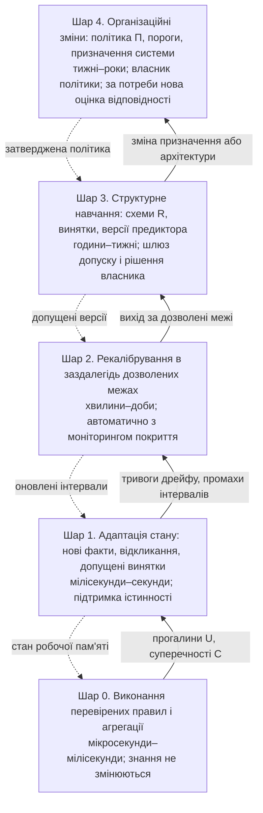
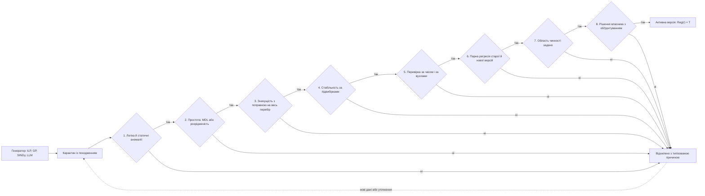
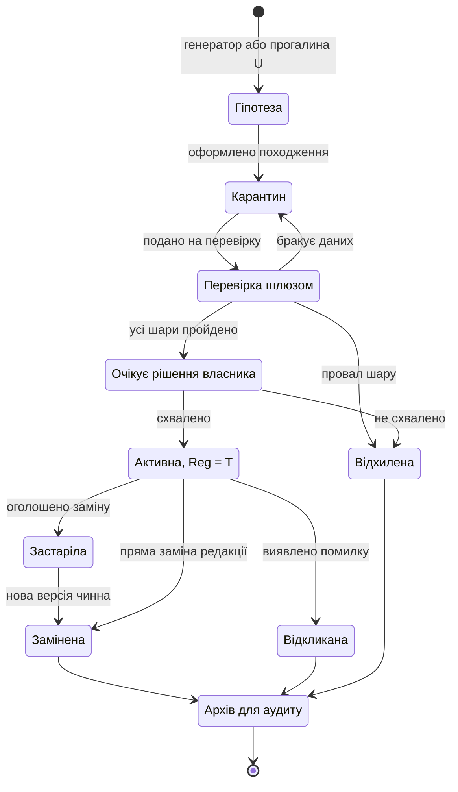
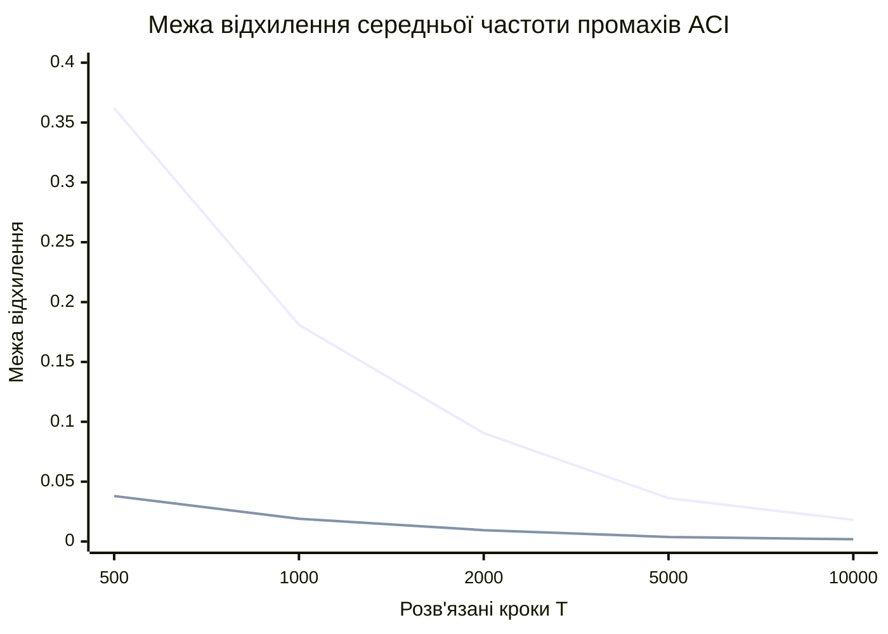
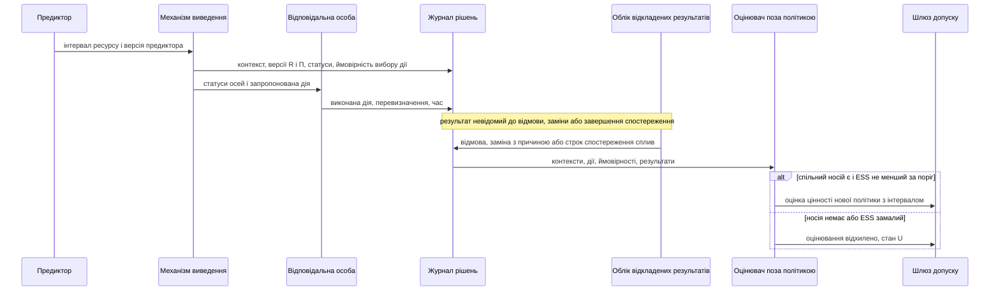
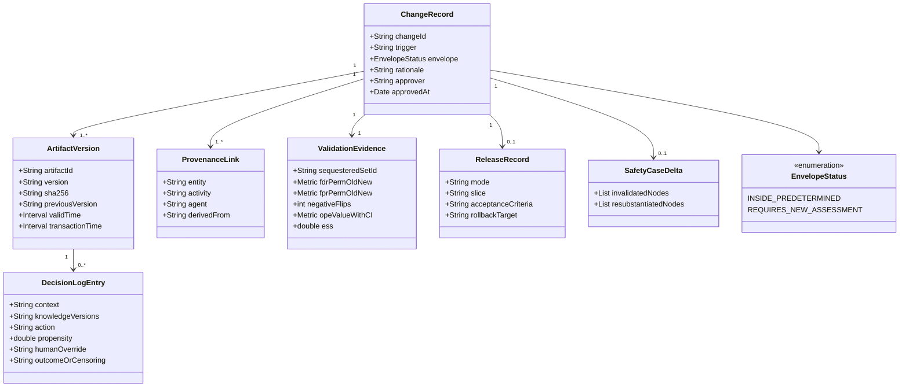

# Знання еволюціонують лише через доказовий шлюз

Предиктивна експертна система може розвивати знання без втрати доказовості лише тоді, коли еволюцію розкладено на класи змін із власним темпом і власною інстанцією допуску: нові факти, відкликання й уже допущені винятки обробляються автоматично, а кожна зміна схем дій $`\mathcal{R}`$, політики $\Pi$, сертифіката повноти заборон, предиктора чи порогів приймання проходить шлюз допуску й завершується рішенням відповідальної особи. Індуктивне логічне програмування, класифікаторні системи, генетичне програмування, символьна регресія та великі мовні моделі в такій архітектурі лише породжують кандидатів: рецензовані праці 2023–2025 років узгоджено показують, що мовна модель є сильним автором гіпотез, але ненадійним верифікатором, а на еталоні, захищеному від запам'ятовування, найкраща система відновлює символьно точне рівняння лише в **31,5%** задач ([LLM-SRBench](https://arxiv.org/abs/2504.10415)). Окремі ланки шлюзу мають доведені гарантії за явних припущень — контроль частки хибних відкриттів, стабільний добір за підвибірками, конформне покриття за зсуву, покрокові межі хибних тривог детектора ADWIN, подвійно робасне оцінювання нової політики, лінійна складність пропозиційної дефезибельної логіки, — проте жодна знайдена праця не доводить безпечності всього ланцюга еволюції знань і не повідомляє польової частки машинно допущених правил, згодом спростованих в експлуатації. Найнебезпечніший механізм деградації специфічний для прогностики: успішна превентивна заміна цензурує ту саму відмову, яку передбачила, тож наївне перенавчання на власних журналах послаблює чутливість правил ([Lenert et al.](https://doi.org/10.1093/jamia/ocz145)); протидіяти цьому можна лише журналюванням дії, ймовірності її вибору та причини цензурування від першого дня експлуатації. Регуляторні рамки вже допускають заздалегідь визначені зміни: регламент ЄС про ШІ не вважає істотною модифікацією зміни, описані під час первинної оцінки відповідності ([Reg. 2024/1689](http://publications.europa.eu/resource/celex/32024R1689)), а «AI Omnibus» переніс застосування правил для високоризикових систем із чутливих сфер Annex III на **2 грудня 2027 року**, а для систем, вбудованих у продукцію за Annex I, — на **2 серпня 2028 року** ([Єврокомісія, перевірено 2026-11-03](https://digital-strategy.ec.europa.eu/en/policies/regulatory-framework-ai)). Внутрішня проєктна документація дослідницького прототипу описує більшість потрібних механізмів як задум, але статично прочитаний код реалізує переважно цілісність і порядок версій, а не епістемічну якість змін, і документи суперечать один одному щодо автономності допуску. Звідси випливає програма досліджень, у центрі якої — рекалібрування за цензурування власними втручаннями, старіння сертифікатів повноти заборон, регресійні межі після серії ревізій і ревізія дефезибельних теорій із пріоритетами.

Щоб не змішувати доведене з бажаним, кожне змістове твердження звіту має позначку статусу (таблиця 1). Позначка стосується підстави твердження: доведена теорема може мати вузькі припущення, а проєктна пропозиція може бути добре вмотивованою, але неперевіреною.

**Таблиця 1.** Позначки статусу тверджень.

| Позначка | Значення | Приклад у звіті |
| :--- | :--- | :--- |
| **[встановлено]** | доведене твердження, означення, чинна норма або рецензований результат, якому не суперечать знайдені джерела | постулати AGM; стаття 43(4) регламенту ЄС про ШІ |
| **[за припущень]** | результат, чинний лише за названих умов, на одному наборі даних або в одному дослідженні | покриття зваженого конформного методу за відомого відношення правдоподібності |
| **[пропозиція]** | проєктне рішення, синтез автора звіту або дорожня карта без незалежної перевірки | восьмишаровий шлюз допуску (рисунок 8) |
| **[не перевірено]** | препринт, висновок за аналогією або твердження, яке не вдалося звірити з першоджерелом | інформативне цензурування в превентивному обслуговуванні |
| **[задум] / [код] / [записано]** | лише для дослідницького прототипу: вимога чи меморандум; статичне читання коду без запуску; результат, який документ заявляє, але який не відтворено | розділ 8 |

## 1. Знання змінюються дев'ятьма способами з різним темпом і різними підставами

Предиктивна експертна система з [Глави 06](../ch06-from-prediction-to-admissible-action.md) складається з бази знань (реєстр схем дій $`\mathcal{R}`$ і політика $\Pi$), робочої пам'яті з фактами в станах `T`, `F`, `U`, `C`, механізму виведення з правилом агрегації, предиктора залишкового ресурсу з конформним шаром і підсистеми пояснень. Кожен компонент старіє по-своєму: редакції регламентів замінюються, у парку з'являються нові режими роботи, предиктор втрачає покриття, власник ризику змінює допустимі пороги. Якщо всі ці зміни пропускати одним механізмом «оновити базу знань», виникає відмова, добре задокументована на системі XCON: за сім років вона зросла приблизно з **700 до 6 200 правил**, з яких близько **50% змінювалися щороку**; продуктивність лишалася задовільною, але розробники «бояться змінювати правила», бо керування приховано в порядку спрацьовування, а знання про наміри живуть в інституційній пам'яті ([Soloway, Bachant & Jensen, AAAI-87](https://cdn.aaai.org/AAAI/1987/AAAI87-148.pdf)) **[встановлено як емпіричний звіт]**. Правильна поведінка на виході ще не означає, що знання можна безпечно змінювати; цю властивість треба проєктувати окремо. Слово «еволюція» в цьому звіті має два значення: зміну знань у часі та еволюційні обчислення як один із генераторів нових знань. Перше значення визначає архітектуру, друге — лише одне з джерел кандидатів.

Перше розрізнення дає теорія зміни переконань. Кацуно й Мендельзон показали, що випадок «світ змінився» (оновлення, update) і випадок «з'ясувалося, що знання були хибними» (ревізія, revision) потребують різних постулатів, і що жоден набір постулатів не придатний для всіх застосувань ([Katsuno & Mendelzon](https://doi.org/10.1017/CBO9780511526664.007)) **[встановлено]**. Для прогностики це розрізнення має пряму інженерну ціну **[пропозиція]**: заміна підшипника є оновленням, яке змінює факти про вузол і не повинно спростовувати правил, а виявлена помилка порога деградації є ревізією, яка змінює саме правило. Система, що не розрізняє ці події, після планової заміни компонента може «виправити» правильне правило лише тому, що прогноз для нового компонента розійшовся з історією старого.

Друге розрізнення стосується того, що саме гарантує теорія. Постулати Альчуррона, Гярденфорса й Макінсона (AGM) характеризують сімейство операцій часткового перетину: кожна з них забезпечує успіх, несуперечність, мінімальність зміни відносно розширення й незалежність від синтаксису, але теорія не вибирає єдиного оператора, бо вибір задає позалогічне впорядкування за укоріненістю ([AGM 1985](https://doi.org/10.2307/2274239); [SEP](https://plato.stanford.edu/entries/logic-belief-revision/)) **[встановлено]**. Для бази правил це означає, що явні пріоритети правил і є функцією вибору, тож їх треба зберігати, версіонувати й рецензувати як знання, а не як налаштування **[пропозиція]**. AGM також припускає логічно замкнені множини переконань із монотонним наслідком, «логічну всевідомість» агента й відсутність явного часу; ітерованої ревізії вона не визначає, а щодо додаткових постулатів Дарвіша — Перла, за оцінкою Стенфордської енциклопедії, «думки суттєво розходяться» ([SEP, §§1.3, 8](https://plato.stanford.edu/entries/logic-belief-revision/); [Darwiche & Pearl](https://doi.org/10.1016/S0004-3702(96)00038-0)) **[встановлено]**. Важливий інженерний наслідок дає теорія скінченних баз: бази $`\{p,q\}`$ і $`\{p,\ p\leftrightarrow q\}`$ мають однакові наслідки, але після ревізії за $\neg p$ перша зберігає $q$, а друга виводить $\neg q$ ([SEP, §5](https://plato.stanford.edu/entries/logic-belief-revision/)) **[встановлено]**. Тому версіонувати треба текст правил, а не лише множину поточних висновків: дві бази з однаковою поведінкою сьогодні можуть по-різному відреагувати на ту саму виправку завтра.

Третє розрізнення — за об'єктом і темпом зміни. Таблиця 2 зводить дев'ять об'єктів, які в предиктивній експертній системі змінюються з різних причин і потребують різних доказів. Поділ за темпом узагальнено з внутрішнього задуму дослідницького прототипу (меморандум про самоорганізацію експертних систем і кібернетику керування знаннями), де п'ять рівнів адаптації впорядковано від мікросекундного виконання до організаційних змін, а нове правило чи поняття названо навчанням бази знань, яке «може починатися автоматично, але закінчується рішенням про допуск» **[задум]**. Той самий принцип у загальній книзі автора сформульовано як окремі маршрути зміни факту, правила й параметра моделі та як життєвий цикл «пропозиція — карантин — перевірена базова версія» ([ExpertSystem, гл. 25](../../ExpertSystem/ch25-how-expert-systems-learn.md); [гл. 26](../../ExpertSystem/ch26-continual-learning.md)) **[пропозиція]**. Обидва джерела є матеріалами автора, а не незалежним підтвердженням.

**Таблиця 2.** Об'єкти знань предиктивної експертної системи та підстави їх зміни.

| Об'єкт | Типова причина зміни | Механізм | Хто ухвалює | Що перевіряє шлюз | Статус підстави |
| :--- | :--- | :--- | :--- | :--- | :--- |
| Факти й редакції джерел, предикат $V$ | нова редакція, явна заміна, сплив строку | оновлення; бітемпоральне заміщення | автоматично за правилами $\Pi$ | кастодія й семантика цитати (Глава 06, §7.2) | [встановлено] для оновлення; бітемпоральність — [задум] |
| Стан робочої пам'яті | відкликана посилка, новий факт | підтримка істинності (TMS) | автоматично | несуперечність обґрунтувань | [встановлено] |
| Винятки до чинних схем | випадок, що суперечить правилу | дефезибельний виняток із пріоритетом | власник схеми | регресія на опорних випадках | [встановлено] формалізм; процедура — [пропозиція] |
| Схеми дій $`\mathcal{R}`$ | прогалина `U`, новий режим, машинний кандидат | ревізія через карантин | власник і рецензент | повний шлюз розділу 3 | [пропозиція] |
| Політика $\Pi$, зокрема тягар доведення $\beta$ | нова ієрархія джерел, зміна апетиту ризику | організаційна ревізія | власник політики | вплив на $B$, повторна оцінка минулих рішень | [пропозиція]; у Главі 06 не версіоновано |
| Сертифікат повноти заборон для $B$ | новий корпус, новий спосіб витягу | автоматичне зниження до `U`, повторна сертифікація | власник політики | повнота виявлення на активному способі витягу | [пропозиція], розширює Главу 06, §7.2 |
| Предиктор: форма й параметри | дрейф, новий механізм відмови | перенавчання або заміна | інженер з валідації й власник | часова й поодинична перевірка, негативні перевертання | [за припущень] |
| Конформний шар і рівень $\alpha$ | коваріатний зсув, старіння калібрування | рекалібрування | автоматично в дозволених межах | моніторинг покриття на розв'язаних випадках | [за припущень] |
| Пороги приймання й еталон $`\mathcal{G}`$ | новий поріг ризику, помилки розмітки | реєстрація до розкриття міток | власник ризику | незалежність анотаторів | [пропозиція] |

Рисунок 3 упорядковує ці об'єкти за темпом. Головне правило шарів **[пропозиція]**: швидший шар не змінює змінних повільнішого. Якби рекалібрування конформного шару могло змінювати пороги політики, тривога дрейфу могла б непомітно послабити правила дозволу; тому сигнали — прогалини `U`, суперечності `C`, тривоги дрейфу, промахи інтервалів — піднімаються вгору, а рішення про зміну спускаються вниз лише після допуску на своєму рівні.

**Рисунок 3.** Шари еволюції знань. Часові масштаби узагальнено з внутрішнього задуму дослідницького прототипу (меморандум про самоорганізацію експертних систем і кібернетику керування знаннями); поділ на шари є пропозицією цього звіту.

## 2. Генератори знань пропонують кандидатів, а доказ дає зовнішній оцінювач

Вузьке місце набуття знань — найстаріша проблема експертних систем. Ще автор TEIRESIAS зазначав, що базу знань «часто збирають вручну», це може забрати «кілька людино-років», а взаємодія з експертом зазвичай потребує посередництва програміста ([Davis, гл. 9](https://www.shortliffe.net/Buchanan-Shortliffe-1984/Chapter-09.pdf)), а Глава 06 прямо визнає, що схеми й політику мають писати й підтримувати фахівці. Машинні генератори обіцяють послабити це обмеження, але в архітектурі з доказовим шаром вони стоять поза базою знань: їхній вихід потрапляє лише в карантин, а схема отримує $`\mathrm{Reg}(r)=T`$ у формулі (6.11) Глави 06 тільки після допуску. Причина не в недовірі до конкретного методу, а в тому, що кожен клас генераторів має характерну ваду, яку видно лише ззовні.

Індуктивне логічне програмування (ILP) будує теорії з означених клауз першого порядку з прикладів і фонових знань. Серед ранніх промислових успіхів Маґлтон називає правила діагностики несправностей супутників, але водночас зазначає, що ILP «недовизначене своєю логічною специфікацією» й потребує мовних обмежень ([Muggleton 1994](https://doi.org/10.1145/181668.181671)) **[встановлено]**. Система Popper реалізує цикл «породити — перевірити — обмежити»: гіпотезу відкидають, якщо вона не виводить усіх позитивних прикладів або виводить хоч один негативний, а з провалів виводять обмеження, що відсікають цілі класи гіпотез ([Cropper & Morel 2021](https://doi.org/10.1007/s10994-020-05934-z)) **[встановлено]**. Така перевірка вже є логічним шлюзом, проте класичне ILP, за оцінкою Еванса й Ґрефенштетте, «надзвичайно ефективне щодо даних», але нестійке до шуму й хибних міток; диференційовне ∂ILP показує стійкість до шуму на власних тестах ([Evans & Grefenstette 2018](https://doi.org/10.1613/jair.5714)) **[за припущень]**. Для прогностики знайдено лише діагностичні застосування: система ACEDIA вивчала правила переходів між станами підсистем і в спрощеному автомобільному прикладі ранжувала вище правила, справді пов'язані з помилкою ([Sato et al. 2020](https://doi.org/10.1109/icphm49022.2020.9187032)) **[за припущень]**. Рецензованих застосувань ILP до залишкового ресурсу не знайдено **[не перевірено]**. Неперервні сигнали доводиться спершу дискретизувати в предикати, і якість дискретизації сама стає точкою відмови.

Еволюційні методи породжують явні знання, придатні до інспекції. У класифікаторній системі XCS пристосованість правила визначає точність його прогнозу виграшу, а не сила, тож популяція прямує до повного й точного відображення та до правил, «максимально загальних за умови точності» ([Wilson 1995](https://doi.org/10.1162/evco.1995.3.2.149)) **[встановлено]**. Кожне таке правило несе власну статистику помилки, яку шлюз може порівнювати з порогом **[пропозиція]**, проте обмежений пошук не виявив рецензованих застосувань класифікаторних систем навчання (LCS) до прогнозу ресурсу **[не перевірено]**. Генетичне програмування в прогностиці вже застосовували для побудови складених ознак деградації ([Liao 2013](https://doi.org/10.1109/tie.2013.2270212)) і явних виразів ресурсу поворотних підшипників, перевірених на трьох випробуваннях до відмови ([Ding et al. 2019](https://doi.org/10.1109/access.2019.2919663)) **[за припущень]**: це свідчить про можливість зрозумілих виразів, але не про узагальнення на парк. Генетичні нечіткі системи перетворюють конфлікт точності й зрозумілості на багатокритеріальну задачу, де складність бази правил є окремою ціллю ([Fazzolari et al.](https://doi.org/10.1109/TFUZZ.2012.2201338); [Toffolo & Lazzaretto 2008](https://doi.org/10.5541/ijot.1034000219)) **[встановлено як напрям]**. Ту саму складність шлюз може використати як критерій: не допускати набору правил, домінованого на фронті Парето **[пропозиція]**.

Символьна регресія й розріджена ідентифікація динаміки відновлюють закони, а не правила. Шмідт і Ліпсон без апріорної фізики відновили гамільтоніани й закони збереження з траєкторій руху ([Schmidt & Lipson 2009](https://doi.org/10.1126/science.1165893)), а SINDy шукає найменше членів у бібліотеці кандидатних функцій за припущення, що динаміка розріджена «у відповідному базисі» ([Brunton et al. 2016](https://doi.org/10.1073/pnas.1517384113)) **[встановлено]**. Вади названо в наступних працях тієї ж школи: ідентифікація «чутлива до шуму, особливо за малих даних», а бутстреп-ансамбль дає ймовірності включення кожного члена ([Fasel et al. 2022](https://doi.org/10.1098/rspa.2021.0904)) **[встановлено]**; нормування даних може зробити знайдену модель щільною й фізично хибною ([Raut, Wilke & Schmidt, препринт](https://doi.org/10.48550/arxiv.2603.05201)) **[не перевірено]**. Для прогностики це означає, що бібліотека кандидатних членів — закони Арреніуса, степеневі закони чи закон Періса — сама є знанням, яке треба версіонувати, а закон деградації, знайдений на кількох одиницях до відмови, має бути прив'язаний до області режимів, на якій його перевірено **[пропозиція]**. Застосування SINDy до оцінки стану батарей ([Lee et al. 2025](https://doi.org/10.1007/s10846-025-02274-9)) поки є поодиноким результатом **[за припущень]**.

Великі мовні моделі змінили економіку породження, але не логіку допуску. Автори FunSearch прямо визнають, що конфабуляції заважають науковим відкриттям, і тому поєднують модель із «систематичним оцінювачем» в еволюційному циклі ([Romera-Paredes et al.](https://doi.org/10.1038/s41586-023-06924-6)) **[встановлено]**. Ту саму архітектуру підтримують інші праці **[за припущень]**: мовні моделі є «феноменальними авторами гіпотез», але мають помітний розрив між індукцією правила та його застосуванням і досягають сильних результатів лише разом із символьним інтерпретатором-фільтром ([Qiu et al., ICLR 2024](https://arxiv.org/abs/2310.08559)); гіпотези, реалізовані як програми й перевірені виконанням, дали 30% на підмножині ARC ([Wang et al., ICLR 2024](https://arxiv.org/abs/2309.05660)); у LLM-SR модель пропонує каркас рівняння, а параметри підганяє оптимізатор ([Shojaee et al., ICLR 2025](https://arxiv.org/abs/2404.18400)). Найтверезіший результат дає LLM-SRBench: попередні еталони спиралися на загальновідомі рівняння, які модель могла запам'ятати, а на 239 нових задачах найкраща система досягла лише 31,5% символьної точності ([LLM-SRBench, ICML 2025](https://arxiv.org/abs/2504.10415)) **[встановлено як еталон]**. Отже, коли модель «відкриває» закон Періса, це ще не доказ здатності до відкриттів. Для надійнісних знань прямі дані поки дає лише медичне FMEA: чотири моделі запропонували 190 видів відмов, після експертного перегляду лишилося 79, а середнє число пріоритету ризику (RPN) моделей становило 110 проти 36 в експертів ([Nair et al. 2026](https://doi.org/10.1016/j.adro.2026.102060)) **[за припущень]**. У класифікації видів відмов за нарядами на обслуговування показник F1 зріс з 0,46 для неадаптованої моделі до 0,80 після донавчання ([препринт](https://doi.org/10.48550/arxiv.2309.08181)) **[не перевірено]**.

**Таблиця 4.** Генератори кандидатних знань: що вони дають і що мусить додати шлюз.

| Генератор | Що породжує | Встановлена сильна сторона | Задокументована вада | Докази для прогностики | Що мусить додати шлюз |
| :--- | :--- | :--- | :--- | :--- | :--- |
| ILP: Progol, Metagol, Popper | правила першого порядку з прикладів і фонових знань | ефективність щодо даних; логічна перевірка на прикладах [встановлено] | нестійкість до шуму; потреба в мовних обмеженнях [встановлено] | діагностика, один приклад [за припущень]; ресурс — не знайдено | статистичний допуск, перевірка дискретизації |
| ∂ILP | правила через градієнтне навчання | стійкість до шуму на власних тестах [за припущень] | масштабованість не з'ясовано [не перевірено] | не знайдено | незалежна перевірка на даних прогностики |
| LCS, XCS | правила «умова — дія» зі статистикою точності | максимальна загальність за умови точності [встановлено] | нетривіальне налаштування реалізації [встановлено] | не знайдено в обмеженому пошуку | поріг на власну помилку правила |
| GP і символьна регресія | ознаки деградації, явні вирази ресурсу | зрозумілі вирази [за припущень] | ризик перенавчання на кількох одиницях [не перевірено кількісно] | два окремі дослідження [за припущень] | поодинична перевірка, область чинності |
| Генетичні нечіткі системи | нечіткі бази правил | фронт «точність — складність» [встановлено як напрям] | кількісних порівнянь не вилучено | діагностика газової турбіни [за припущень] | недомінованість на фронті Парето |
| SINDy, E-SINDy | розріджені диференціальні рівняння | простота; ймовірності включення членів [встановлено] | шум, малі дані, залежність від бібліотеки [встановлено]; спотворення нормуванням [не перевірено] | стан батарей, одне дослідження [за припущень] | поріг імовірності включення, версія бібліотеки |
| LLM із зовнішнім оцінювачем | правила, каркаси рівнянь, види відмов | сильний автор гіпотез із фільтром [за припущень] | слабке застосування й перевірка; запам'ятовування [встановлено] | медичне FMEA: 79 із 190 [за припущень] | зовнішній оцінювач і експертне переоцінювання |

Усі ці результати сходяться на одній архітектурній формулі **[пропозиція, що спирається на кілька рецензованих праць]**: генератор пропонує, зовнішній оцінювач перевіряє на даних або в символьному інтерпретаторі, а рішення про допуск ухвалює шлюз, незалежний від генератора. Формула збігається з правилом Глави 06, за яким ідеї мовної моделі без зареєстрованої схеми зберігаються лише як гіпотези для людини й не отримують статусів. Нейросимвольність у цьому сенсі — не злиття нейромережі з правилами в одну модель, а розподіл ролей: нейромережа розширює простір кандидатів, символьний шар звужує його до перевірюваного. Відкритим лишається питання, як рахувати хибні відкриття, коли генератор сам бачив відповіді оцінювача; від нього залежить конструкція шлюзу в наступному розділі.

## 3. Шлюз допуску мусить рахувати весь перебір, а не лише переможців

Шлюз допуску стоїть між карантином і реєстром $`\mathcal{R}`$, і від нього залежить, чи накопичуватиме база знань випадкові закономірності. Кожна хибна схема, допущена в реєстр, далі породжує кандидатів на реальних вузлах: необґрунтовану заміну, пропущену заміну або, через політику, хибний `PERMITTED`. Наївний шлюз перевіряє найкращих кандидатів на рівні значущості 0,05 на тих самих даних, на яких їх відібрано, і саме він руйнується за масового перебору. Вебб показав, що стандартні методи пошуку закономірностей знаходять «численні хибні закономірності» навіть у випадкових даних, а на реальних даних великі набори знайденого відкидаються коректною статистичною перевіркою ([Webb 2007](https://doi.org/10.1007/s10994-007-5006-x); [Hämäläinen & Webb](https://doi.org/10.1007/s10618-018-0590-x)) **[встановлено]**.

Перше питання шлюзу кількісне: скільки хибних правил пропустить поріг значущості, якщо перевірено $m$ кандидатів, і яким має бути поріг для одного кандидата, щоб імовірність хоча б одного хибного допуску не перевищувала заданої. Вимірюються кількість хибних допусків у штуках і поріг p-значення.

$$
\mathbb{E}[V]=m_0\,\alpha\le m\,\alpha,\qquad \alpha_{\mathrm{Bonf}}=\frac{\alpha_{\mathrm{FWER}}}{m}
$$

**Формула (5).** Очікувана кількість хибних допусків і поріг Бонферроні.

Тут $m$ — кількість кандидатів, статистично перевірених на даних допуску; $`m_0\le m`$ — кількість тих із них, для яких справджується нульова гіпотеза «правило не краще за випадковість»; $V$ — кількість хибно допущених кандидатів; $`\alpha\in(0,1)`$ — рівень значущості одного тесту; $`\alpha_{\mathrm{FWER}}`$ — допустима ймовірність хоча б одного хибного допуску на весь перебір; $`\alpha_{\mathrm{Bonf}}`$ — поріг p-значення для одного кандидата. Перша частина випливає з лінійності математичного сподівання, друга — з нерівності Буля, тієї самої, що дає межу (6.8) у Главі 06; тому поправка Бонферроні чинна за будь-яких залежностей між кандидатами **[встановлено]**.

Навчальний розрахунок. Нехай генератор запропонував $m=10\,000$ кандидатних правил, і жодне з них насправді не корисне. Наївний поріг $`\alpha=0{,}05`$ пропустить у середньому **500** хибних правил. Щоб імовірність хоча б одного хибного допуску не перевищувала 0,05, кожне правило має мати $`p\le0{,}05/10\,000=5\cdot10^{-6}`$. **Дія [пропозиція]:** $m$ рахують за всіма кандидатами, яких оцінено на даних допуску, включно з усіма поколіннями генетичного програмування й усіма вибірками мовної моделі, якщо їх перевіряли на тих самих даних. Звідси вимога розділити дані для породження й дані для допуску; настанова FDA щодо змін ШІ-функцій медичних виробів вимагає саме такого відокремлення тестових даних від навчальних і налаштувальних, щоб запобігти перенавчанню й хибному звітуванню якості ([FDA PCCP](https://www.fda.gov/media/166704/download)) **[встановлено як настанова]**.

Поріг Бонферроні контролює ймовірність будь-якої помилки й тому дуже консервативний. Якщо допустимо, щоб серед допущених правил була невелика частка хибних, застосовують процедуру Бенджаміні — Хохберга, яка контролює очікувану частку хибних серед відкриттів (FDR) і за наявності справжніх ефектів має більшу потужність ([Benjamini & Hochberg 1995](https://doi.org/10.1111/j.2517-6161.1995.tb02031.x)).

$$
k^{*}=\max\Bigl\{k\in\{1,\dots,m\}\ :\ p_{(k)}\le\frac{k}{m}\,q\Bigr\}
$$

**Формула (6).** Кількість кандидатів, яких допускає процедура Бенджаміні — Хохберга.

Тут $`p_{(1)}\le\dots\le p_{(m)}`$ — упорядковані за зростанням p-значення кандидатів; $`q\in(0,1)`$ — цільова частка хибних серед допущених; $`k^{*}`$ — кількість допущених: допускають $`k^{*}`$ кандидатів із найменшими p-значеннями, а якщо жодне $k$ не задовольняє умови, не допускають нікого. Гарантію $`\mathrm{FDR}\le q`$ доведено для незалежних статистик **[встановлено]**; кандидати, оцінені на тих самих даних, зазвичай залежні, і для них цитована теорема гарантії не дає **[за припущень]**.

Навчальний розрахунок (умовні числа). Нехай $m=2\,000$ і $`q=0{,}05`$, тож поріг для рангу $k$ дорівнює $`k\cdot2{,}5\cdot10^{-5}`$. Десять найменших p-значень: $`1\cdot10^{-6}`$, $`4\cdot10^{-6}`$, $`9\cdot10^{-6}`$, $`3\cdot10^{-5}`$, $`6\cdot10^{-5}`$, $`1{,}1\cdot10^{-4}`$, $`1{,}6\cdot10^{-4}`$, $`2{,}4\cdot10^{-4}`$, $`4\cdot10^{-4}`$, $`9\cdot10^{-4}`$; решта 1 990 кандидатів — шум із p-значеннями, рівномірно розподіленими на відрізку від 0 до 1. Для $k=7$ маємо $`1{,}6\cdot10^{-4}\le1{,}75\cdot10^{-4}`$, для $k=8$ — $`2{,}4\cdot10^{-4}>2{,}0\cdot10^{-4}`$, а для більших рангів p-значення шуму зростають швидше за поріг, тож $`k^{*}=7`$. Бонферроні з $`\alpha_{\mathrm{FWER}}=0{,}05`$ допускає лише три правила з $`p\le2{,}5\cdot10^{-5}`$, а наївний поріг 0,05 — десять сильних і ще близько 100 шумових. **Дія [пропозиція]:** для схем, що можуть привести до `PERMITTED` або до пропуску заміни, шлюз використовує контроль FWER; для схем, які лише породжують дію зі збору інформації, як схема $`r_2`$ з Глави 06 («збільшити частоту вимірювань»), допустимий контроль FDR, бо хибна схема коштує зайвого вимірювання, а не аварії.

Значущість не гарантує відтворюваності. Добір за стабільністю повторює процедуру на багатьох підвибірках і дає контроль хибних відкриттів у скінченних вибірках для широкого класу методів добору ([Meinshausen & Bühlmann 2010](https://doi.org/10.1111/j.1467-9868.2010.00740.x)) **[встановлено]**; для законів деградації аналогом є ймовірність включення члена в бутстреп-ансамблі E-SINDy ([Fasel et al. 2022](https://doi.org/10.1098/rspa.2021.0904)). Шлюз може вимагати, щоб правило чи член закону з'являлися в більшості перевибірок, а критерій мінімальної довжини опису ([Rissanen 1978](https://doi.org/10.1016/0005-1098(78)90005-5)) чи розрідженість відсіювали надлишково складні варіанти **[пропозиція]**. Ще важливіший поділ даних. Для нестаціонарних рядів позавибіркове оцінювання зі збереженням часового порядку дало точніші оцінки, ніж перехресна перевірка, на 62 реальних рядах ([Cerqueira et al. 2020](https://doi.org/10.1007/s10994-020-05910-7)) **[встановлено]**. У прогностиці рядки однієї траєкторії вузла сильно автокорельовані, тож випадковий поділ за рядками допускає витік і занижує ризик хибних відкриттів; поділ має бути за вузлами й за часом **[пропозиція; профільного джерела для C-MAPSS не знайдено]**.

Статичні перевірки бази правил ловлять інший клас дефектів. Пріс, Шингал і Батарех виділили чотири типи аномалій — надлишковість, амбівалентність, циклічність і неповноту — і назвали їх «сильними ознаками помилок» ([Preece et al. 1992](https://doi.org/10.1017/S026988890000624X)); пізніша праця уточнює, що аномалії є симптомами ймовірних помилок, а методи стосуються баз правил без числових мір упевненості ([Preece & Shinghal 1994](https://doi.org/10.1002/int.4550090804)) **[встановлено]**. Звідси два обмеження **[пропозиція]**: статична перевірка не виявить несуперечливого, але хибного порога деградації, а в дефезибельній базі виняток, розв'язаний явним пріоритетом, не можна позначати як амбівалентність, інакше кожен виняток стане тривогою.

Останній статистичний шар порівнює нову версію зі старою на тих самих випадках, і історичний досвід тут однозначний. SEEK2 автоматично уточнював ревматологічну базу з приблизно 140 правил і підняв точність з **73% до 98%** на 121 випадку, випробувавши 106 змін і прийнявши 8, але автори застерігали, що поліпшення «гарантоване» лише щодо наявної бази випадків, а експерт лишається остаточним суддею ([Ginsberg, Weiss & Politakis, IJCAI-85](https://ijcai.org/proceedings/1985/0069.pdf)) **[встановлено як емпіричний звіт]**. Це доказ припасування, а не узагальнення. Ripple-Down Rules зробили набуття знань і супровід одним процесом: нове правило мусить відрізняти новий випадок і зберігати правильну класифікацію раніше розглянутих опорних випадків ([Richards 2009](https://doi.org/10.1017/S0269888909000241)) **[встановлено]**. Для статистичних моделей ту саму вимогу формулює напрям зворотної сумісності: точніше оновлення може погіршити роботу команди «людина — ШІ» ([Bansal et al. 2019](https://doi.org/10.1609/aaai.v33i01.33012429)), сумісність падає навіть без зсуву даних через стохастичність оптимізації ([Srivastava et al. 2020](https://doi.org/10.1145/3394486.3403379)), а частку негативних перевертань (negative flips) — випадків, де стара модель відповідала правильно, а нова помиляється, — можна вимірювати й зменшувати ([Yan et al.](https://arxiv.org/abs/2011.09161)) **[встановлено]**.

Шлюзу потрібне числове правило: скільки негативних перевертань допустимо і скільки опорних випадків треба, щоб це перевірити. Вимірюються частка опорних випадків, які нова версія зіпсувала, і верхня межа цієї частки з довірою 95%.

$$
\widehat{\mathrm{NFR}}=\frac{N_{\mathrm{flip}}}{\lvert\mathcal{A}\rvert},\qquad
\text{допуск}\ \Longleftrightarrow\ N_{\mathrm{flip}}^{\mathrm{blk}}=0\ \land\ U_{0.95}\bigl(N_{\mathrm{flip}},\lvert\mathcal{A}\rvert\bigr)\le\tau_{\mathrm{nf}}
$$

**Формула (7).** Правило допуску за негативними перевертаннями.

Тут $`\mathcal{A}`$ — множина опорних випадків, на яких стара версія дала еталонно правильну відповідь, зокрема випадків із підтвердженим результатом обслуговування; $`\lvert\mathcal{A}\rvert`$ — їх кількість; $`N_{\mathrm{flip}}`$ — кількість випадків з $`\mathcal{A}`$, на яких нова версія помиляється; $`\widehat{\mathrm{NFR}}`$ — спостережена частка негативних перевертань; $`N_{\mathrm{flip}}^{\mathrm{blk}}`$ — перевертання на блокувальній підмножині, де помилка означає хибний `PERMITTED` або пропуск обов'язкової заміни; $`U_{0.95}(k,n)`$ — однобічна 95-відсоткова верхня межа Клоппера — Пірсона для частки $k/n$ ([Clopper & Pearson](https://doi.org/10.1093/biomet/26.4.404)), яка для $k=0$ має замкнений вигляд $`1-0{,}05^{1/n}`$; $`\tau_{\mathrm{nf}}\in(0,1)`$ — допуск, зареєстрований власником ризику до перевірки.

Навчальний розрахунок. Нехай $`\tau_{\mathrm{nf}}=0{,}01`$. За $`\lvert\mathcal{A}\rvert=400`$ і нуля перевертань $`U_{0.95}=1-0{,}05^{1/400}\approx0{,}0075\le0{,}01`$: шар пройдено. За двох перевертань поза блокувальною підмножиною $`U_{0.95}\approx0{,}0157>0{,}01`$: нову версію не допускають, навіть якщо її середня точність вища. За $`\lvert\mathcal{A}\rvert=100`$ і нуля перевертань $`U_{0.95}\approx0{,}0295`$: перевірити допуск 1% неможливо в принципі. **Дія:** мінімальний розмір опорного набору для допуску $`\tau_{\mathrm{nf}}`$ за нуля перевертань становить $`n\ge\ln0{,}05/\ln(1-\tau_{\mathrm{nf}})`$, тобто щонайменше **299** випадків для 1%. Той самий парний принцип застосовують до метрик Глави 06 **[пропозиція]**: $`\mathrm{FDR}_{\mathrm{perm}}`$ і $`\mathrm{FPR}_{\mathrm{perm}}`$ нової версії порівнюють зі старою на тому самому еталоні $`\mathcal{G}`$, а не лише з абсолютним порогом.

**Рисунок 8.** Шлюз допуску. Порядок шарів відображає вартість перевірки: дешеві логічні перевірки відсіюють кандидатів раніше за дорогі статистичні.

Восьмишаровий шлюз є синтезом, а не опублікованим стандартом **[пропозиція]**. Шари 1, 3, 4 і 6 спираються на встановлені методи; шари 5 і 7 належать до усталеної практики надійнісної інженерії, але не підтверджені в цьому дослідженні окремим джерелом; шар 8 підтримано лише досвідом SEEK2, RDR і медичного FMEA. Невідомо, яку частку хибних правил такий шлюз пропускає на реальних даних прогностики: емпіричної оцінки частки допущених машинних правил, згодом спростованих в експлуатації, не знайдено **[не перевірено]**.

## 4. Винятки додаються без переписування правил, але змінюють висновки минулого

У Главі 06 винятки вже є повноправними об'єктами: множина $`\mathrm{Def}_X(a)`$ у формулі (6.4) і тягар доведення $\beta(d)$ у формулі (6.5). Саме вони найчастіше змінюються в експлуатації, бо кожен новий режим чи нова конструкція вузла породжує застереження «крім випадків, коли…». Якщо виняток вносити переписуванням загального правила, база деградує так, як XCON: одне правило виконує кілька функцій, розширення роблять копіюванням правил схожого пристрою, і виникає «щурине гніздо» тісно пов'язаних спеціальних правил ([Soloway et al., AAAI-87](https://cdn.aaai.org/AAAI/1987/AAAI87-148.pdf)) **[встановлено як емпіричний звіт]**. Якщо ж виняток записати як звичайну передумову, система інвертує норму, як показано в Главі 06, §2.3.

Дефезибельна логіка розділяє факти, строгі правила, дефезибельні правила, які можуть бути переможені, дефітери, що лише блокують висновок, і явне відношення переваги між правилами; вона узагальнює мережі успадкування з винятками, замінюючи неявну специфічність явним програмованим пріоритетом ([Maher 2001](https://arxiv.org/pdf/cs/0405090); [Antoniou et al. 2001](https://doi.org/10.1145/371316.371517)) **[встановлено]**. Виняток додається як нове правило й одне ребро переваги, а загальне правило лишається незмінним; це практична форма «толерантності до доповнень», яку Маккарті вважав необхідною для штучного інтелекту людського рівня ([McCarthy](http://jmc.stanford.edu/articles/elaboration.html)). Для швидкодії важливий результат Махера: виведення в пропозиційній дефезибельній логіці виконується за лінійний час, тоді як у більшості інших пропозиційних немонотонних логік воно обчислювально важке, а для першого порядку задача виведення лише рекурсивно перелічувана ([Maher 2001](https://doi.org/10.1017/S1471068401001168)) **[встановлено за припущення пропозиційності]**. Отже, шаблони правил першого порядку треба заземлювати на скінченну множину вузлів або обмежувати їхній розмір, щоб гарантія часу відповіді зберігалася **[пропозиція]**.

Ripple-Down Rules реалізують ту саму ідею операційно. Експерт додає виняток у контексті конкретного хибно класифікованого випадку, правило обґрунтовується ознаками цього випадку, а раніше правильно класифіковані випадки мусять лишитися правильними ([Richards 2009](https://doi.org/10.1017/S0269888909000241)). У патологічній системі PEIRS за дев'ять місяців створено понад **950 правил**, і весь супровід виконував штатний патолог без навичок програмування; обмеженням названо дублювання правил для звітів із кількома коментарями ([Edwards et al. 1993](https://pubmed.ncbi.nlm.nih.gov/8316495)) **[встановлено як емпіричний звіт]**. TEIRESIAS ще раніше використовував контекст помилки, щоб сформувати очікування щодо змісту нового правила й перевірити, що воно справді розв'язує проблему ([Davis](https://www.shortliffe.net/Buchanan-Shortliffe-1984/Chapter-09.pdf)). Спільний знаменник успішних систем — зміна, прив'язана до випадку **[пропозиція як синтез]**. Для прогностики природний «випадок» — історія вузла з підтвердженим результатом, тобто відмовою або знахідкою під час обслуговування.

Ціна адитивності — немонотонність. Виняток додає рядок до тексту бази, але може зняти висновки, зроблені раніше, тому «адитивне в тексті» не означає «адитивне у висновках» **[пропозиція як наслідок означення]**. Механізм, що робить такі зміни безпечними під час виконання, відомий з 1979 року: система підтримки істинності Дойла записує причини кожного переконання, тож відкликання посилки автоматично відкликає залежні висновки ([Doyle, MIT AIM-521](https://dspace.mit.edu/handle/1721.1/5733)) **[встановлено]**. ATMS де Клеєра зберігає для кожного вузла мітку — мінімальні набори припущень, за яких він виводиться, — та базу мінімальних суперечливих наборів ([de Kleer, AAAI-88](https://cdn.aaai.org/AAAI/1988/AAAI88-034.pdf)); для прогностики мітка відповідає на запитання «за яких припущень тримається цей прогноз», наприклад «датчик $k$ справний» і «режим номінальний» **[пропозиція]**. Обмеження теж задокументовані: базова ATMS приймає лише хорнівські обґрунтування, кількість суперечливих наборів може зростати експоненційно, і без фокусування техніка погано працює на великих просторах пошуку ([de Kleer](https://cdn.aaai.org/AAAI/1988/AAAI88-034.pdf); [Forbus & de Kleer](https://cdn.aaai.org/AAAI/1988/AAAI88-035.pdf)) **[встановлено]**. Система підтримки істинності не вирішує, від чого відмовитися; це задача впорядкування з теорії AGM, тобто явних пріоритетів. Поєднання «дефезибельна логіка для подання, пріоритети як укоріненість, підтримка істинності для поширення відкликань» є синтезом, а не перевіреною опублікованою архітектурою **[пропозиція]**, а формальних постулатів ревізії саме дефезибельних теорій із пріоритетами в межах цього дослідження не знайдено **[не перевірено]**.

Немонотонність створює вимогу аудиту, якої немає в статичній моделі: щоб відтворити минуле рішення, треба застосувати знання в тому вигляді, в якому система мала їх на момент рішення, а щоб переглянути рішення, — у сучасному вигляді. Стенфордська енциклопедія філософії згадує додавання часових індексів до речень як один зі способів розвести оновлення й ревізію ([SEP, §7.1](https://plato.stanford.edu/entries/logic-belief-revision/)); внутрішній задум дослідницького прототипу (архітектурне рішення про бітемпоральний журнал змін та ідемпотентну перекомпіляцію) пропонує для цього бітемпоральну модель із часом чинності й часом запису, де стару редакцію не перезаписують, а позначають заміненою **[задум]**. Для схем дій це дає таке правило вибору версії **[пропозиція]**.

$$
\mathrm{ver}(r,t_v,t_x)=v\quad\text{така, що}\quad t_v\in\bigl[\mathrm{vs}(v),\,\mathrm{ve}(v)\bigr)\ \land\ t_x\in\bigl[\mathrm{tx}(v),\,\mathrm{tx}^{\mathrm{end}}(v)\bigr)
$$

**Формула (9).** Вибір версії схеми за часом чинності й часом запису.

Тут $r$ — схема дії, виняток чи правило політики; $v$ — один бітемпоральний запис її версії; $`t_v`$ — час чинності, тобто момент, про який ухвалюється рішення; $`t_x`$ — час запису, тобто момент, станом на який відтворюється вміст бази знань; $`[\mathrm{vs}(v),\mathrm{ve}(v))`$ — оголошений проміжок чинності версії; $`[\mathrm{tx}(v),\mathrm{tx}^{\mathrm{end}}(v))`$ — проміжок, протягом якого запис існував у базі, причому $`\mathrm{tx}^{\mathrm{end}}=\infty`$ для чинного запису. Шлюз допуску перевіряє інваріант єдиності: для кожної трійки $`(r,t_v,t_x)`$ існує не більше одного запису. Якщо запису немає, $`\mathrm{Reg}(r)=F`$ на цей момент, і формула (6.11) з Глави 06 відкидає кандидата з поясненням.

Навчальний розрахунок (умовні дати). Запис $`v_{1.2}`$ схеми $`r_1`$ з чинністю від 10.01.2026 без кінцевої дати внесено 08.01.2026. Розбір відмови показав, що після повторного змащення температурний перехідний процес хибно запускає заміну, і 03.06.2026 внесено $`v_{1.3}`$ із винятком і чинністю від 01.06.2026; того самого дня початковий запис $`v_{1.2}`$ закрито в часі запису й замінено копією з чинністю від 10.01 до 01.06. Рекомендацію для насоса видано 02.06.2026. Аудит відтворення бере $`t_v=t_x=02.06`$: у часі запису відкритий лише початковий $`v_{1.2}`$, тож відтворюється саме те рішення, яке бачив оператор. Ретроспективний перегляд бере $`t_v=02.06`$ і $`t_x=03.11`$: серед чинних записів дату 02.06 охоплює лише $`v_{1.3}`$. **Дія:** якщо статуси двох обчислень різняться, рішення від 02.06 потрапляє до списку ретроспективного перегляду через залежності підтримки істинності, а траса пояснення кожного рішення зобов'язана зберігати трійку $`(r,v,t_x)`$ і геш тексту схеми. Без цього відтворити минуле рішення неможливо, а ревізію не відрізнити від оновлення. У прикладі відбулася саме ревізія: світ не змінився, змінилося знання про нього.

Рисунок 10 показує життєвий цикл однієї одиниці знань, сумісний із Главою 06 **[пропозиція]**. У Главі 06 предикат $`\mathrm{Reg}(r)`$ двозначний: схема або чинна, або відкликана чи неповна. Розширений цикл не змінює формули (6.11): $`\mathrm{Reg}(r)=T`$ лише для активного запису, вибраного за формулою (9), а всі інші стани дають `F` і з'являються в поясненні як причина. Гіпотеза не може задовольнити запит про дозвіл чи заборону; та сама межа є у внутрішній вимозі дослідницького прототипу до компілятора знань про атоми-гіпотези з ненормативних джерел **[задум]**. Замінені й відкликані версії не видаляють, бо без них формула (9) не відтворить минулого.

**Рисунок 10.** Життєвий цикл одиниці знань. Відкликання миттєво робить $`\mathrm{Reg}(r)=F`$ і через підтримку істинності знімає залежні висновки.

## 5. Предиктор і калібрування старіють швидше, ніж надходять мітки

Предиктор залишкового ресурсу живить робочу пам'ять через формулу (6.7) Глави 06: конформний інтервал $[\ell,u]$ стає станом посилки $`s(\pi_h)`$, причому стан `U` призначається, якщо «предиктор не валідовано для цього класу обладнання». Будь-яка еволюція предиктора — перенавчання, рекалібрування чи заміна моделі — прямо змінює стани посилок і через схеми дій впливає на рекомендації. Небезпека полягає в мовчазній відмові: системи машинного навчання за зсуву даних «схильні відмовляти мовчки» ([Rabanser et al.](https://arxiv.org/abs/1810.11953)), а в перевірці 32 наборів даних із чотирьох галузей часову деградацію якості виявлено у 91% із 128 пар «модель — набір» ([Vela et al. 2022](https://doi.org/10.1038/s41598-022-15245-z)) **[встановлено для загального машинного навчання; поздовжніх даних для прогностики не знайдено]**. Наївна відповідь — перенавчати за розкладом або коли падає точність — у прогностиці не працює, бо точність стає відомою лише після відмови.

Таксономія дрейфу розрізняє зміну розподілу входів $P(X)$, яка не зсуває межі рішення, і зміну $`P(y\mid X)`$, яка зсуває її й знижує точність ([Lu et al.](https://doi.org/10.1109/TKDE.2018.2876857); [Gama et al. 2014](https://doi.org/10.1145/2523813)) **[встановлено]**. Звідси жорсткий висновок **[пропозиція як логічний наслідок]**: зміну фізики деградації за тих самих показів датчиків неможливо виявити, спостерігаючи лише входи; для цього потрібні мітки, а мітками в прогностиці є відмови або підтверджений стан. Детектори на ознаках стану виявляють новий режим експлуатації, але не новий механізм відмови. Класична прогностика вже оновлює модель кожного вузла — байєсівським уточненням параметрів експоненційної деградації ([Gebraeel et al. 2005](https://doi.org/10.1080/07408170590929018)) чи фільтром частинок ([Orchard & Vachtsevanos 2009](https://doi.org/10.1177/0142331208092026)) **[встановлено]**, — але таке оновлення належить до адаптації стану, а не до еволюції знань: воно не виявляє, що змінилася сама форма моделі.

Серед детекторів формальні межі має ADWIN: на кожному кроці ймовірність хибного зменшення вікна за сталого середнього не перевищує $\delta$, а за різниці середніх підвікон понад $`2\epsilon_{\mathrm{cut}}`$ зміну буде виявлено з імовірністю $1-\delta$ ([Bifet & Gavaldà 2007](https://www.cs.upc.edu/~gavalda/papers/adwin06.pdf)) **[встановлено за припущень]**. Ці межі покрокові, тож їх треба перерахувати на горизонт експлуатації: скільки хибних тривог очікувати за рік і який зсув детектор гарантовано помітить.

$$
\mathbb{E}\bigl[N_{\mathrm{FA}}\bigr]\le N_{\mathrm{chk}}\,\delta,\qquad
\epsilon_{\mathrm{cut}}=\sqrt{\frac{1}{2m}\ln\frac{4}{\delta'}},\qquad
m=\Bigl(\frac{1}{n_0}+\frac{1}{n_1}\Bigr)^{-1},\qquad \delta'=\frac{\delta}{n}
$$

**Формула (11).** Очікувана кількість хибних тривог ADWIN за горизонт і поріг розрізнення підвікон.

Тут $`N_{\mathrm{FA}}`$ — кількість хибних тривог за горизонт, коли зміни насправді немає; $`N_{\mathrm{chk}}`$ — кількість перевірок за горизонт; $`\delta\in(0,1)`$ — покрокова межа ймовірності хибної тривоги; $n$ — довжина вікна; $`n_0`$ і $`n_1`$ — довжини двох підвікон, $`n_0+n_1=n`$; $m$ — їх гармонічне поєднання; $\delta'$ — поправка на перевірку всіх розбиттів вікна; $`\epsilon_{\mathrm{cut}}`$ — поріг різниці середніх підвікон у тих самих одиницях, що й спостереження. Спостереження мають лежати на відрізку від 0 до 1: це, наприклад, індикатор промаху конформного інтервалу або нормований залишок. Перша нерівність випливає з покрокової межі й лінійності сподівання за будь-якої залежності між кроками. Строга версія порогу спирається на нерівність Гьофдінга для незалежних обмежених спостережень, а практична версія з нормальним наближенням, за словами авторів, «не на 100% строга» **[встановлено за припущень]**. Поріг тесту Пейджа — Хінклі задає той самий компроміс між хибними тривогами й затримкою, а фактори згасання прискорюють виявлення ціною частіших хибних тривог ([Gama, Sebastião & Rodrigues 2013](https://doi.org/10.1007/s10994-012-5320-9)) **[встановлено]**.

Навчальний розрахунок. Детектор перевіряє погодинний потік, тож за рік $`N_{\mathrm{chk}}=8\,760`$. За поширеного $`\delta=0{,}002`$ очікується до **17,5** хибних тривог на рік, тобто понад одна на місяць. Якщо власник експлуатації погоджується лише на одну тривогу на рік, $`\delta=1/8\,760\approx1{,}14\cdot10^{-4}`$. Для вікна $`n=1\,000`$ з $`n_0=n_1=500`$ поріг зростає лише з 0,170 до 0,186, бо $\delta$ стоїть під логарифмом: сімнадцятикратне зменшення хибних тривог коштує дев'яти відсотків чутливості. Проте гарантоване виявлення вимагає різниці середніх понад $`2\epsilon_{\mathrm{cut}}\approx0{,}37`$. Щоб строго гарантувати виявлення зростання частки промахів з 0,1 до 0,2, потрібне вікно приблизно з **16 130** спостережень, тобто близько 1,8 року погодинних даних. **Дія [пропозиція]:** $\delta$ вибирають із бюджету хибних тривог, а не за замовчуванням; тривога не змінює правил, а переводить посилки ураженого класу обладнання в стан `U` («предиктор не валідовано») до повторної валідації, тож дрейф збільшує частку `UNKNOWN`, а не хибних `T`. Строгі межі придатні для швидкого виявлення лише великих зсувів; для малих зсувів строгої гарантії за розумний час немає, і це треба визнати в плані змін. Автокорельовані ознаки стану порушують припущення незалежності, тож заявлену частоту хибних тривог для них перевіряють емпірично.

Затримка міток підриває більшість адаптивних методів. Вони «оптимістично» припускають, що мітки надходять одразу ([Žliobaitė 2010](https://doi.org/10.1109/ICDMW.2010.49)), а оцінювання за схемою «перевірити, потім навчити» хибно вважає, що істинна мітка з'являється відразу після прогнозу ([Grzenda, Gomes & Bifet 2020](https://doi.org/10.1007/s10618-019-00654-y)) **[встановлено]**. Для залишкового ресурсу затримка мітки дорівнює самому ресурсові, а для вузлів, знятих за планом профілактики, точна мітка не настає ніколи — відома лише нижня межа **[пропозиція як наслідок]**. Сучасні глибокі моделі залишкового ресурсу здебільшого не враховують правого цензурування, хоча його частка в промисловості може бути високою; метод, що його враховує, на CMAPSS і N-CMAPSS був конкурентним за низької частки цензурування й кращим за високої ([IJPHM 2025](https://doi.org/10.36001/ijphm.2025.v16i2.4260)) **[за припущень]**. Навчання лише на вузлах, що відмовили, зміщує вибірку до коротших ресурсів; кількісної оцінки цього зміщення для прогностики не знайдено **[не перевірено]**.

Неперервне навчання зменшує забування, але не гарантує збереження валідованої поведінки. EWC штрафує зміщення важливих параметрів за діагональним наближенням Лапласа, і самі автори називають точкову оцінку дисперсії «суттєвою слабкістю» ([Kirkpatrick et al. 2017](https://doi.org/10.1073/pnas.1611835114)) **[встановлено]**; огляд Парізі та співавторів показує, що методи послаблюють забування лише «різною мірою» ([Parisi et al. 2019](https://doi.org/10.1016/j.neunet.2019.01.012)). Нові режими експлуатації й нові вузли парку ближчі до доменно-інкрементного сценарію, а висновки з інших сценаріїв на нього не переносяться ([van de Ven et al. 2022](https://doi.org/10.1038/s42256-022-00568-3)) **[за припущень]**. Рецензованих застосувань неперервного навчання саме до залишкового ресурсу зі звітом про якість на старих режимах не знайдено **[не перевірено]**. Тому для предиктора працює той самий шар парної регресії, що й для правил: властивість «помилка на старих режимах не зросте більш ніж на допуск» перевіряють за формулою (7) на зафіксованому опорному наборі, а не виводять із методу навчання.

Конформний шар можна оновлювати частіше за модель, бо він має формальні гарантії, але треба точно знати, які саме. Зважений конформний метод зберігає покриття $1-\alpha$ за коваріатного зсуву, якщо відоме відношення правдоподібності тестового й навчального розподілів входів або якщо його можна точно оцінити за великим набором нерозмічених тестових входів ([Tibshirani et al. 2019](https://arxiv.org/abs/1904.06019)) **[за припущень]**. Барбер, Кандес, Рамдас і Тібширані обмежили втрату покриття без припущень про розподіл ([Barber et al. 2023](https://doi.org/10.1214/23-AOS2276)) **[встановлено]**, і ця межа дає змістовне правило старіння калібрувальних даних. Вимірюється гарантована нижня межа ймовірності, що справжній ресурс нового вузла потрапить в інтервал.

$$
\mathbb{P}\bigl\{Y_{n+1}\in\hat C_n(X_{n+1})\bigr\}\ \ge\ 1-\alpha-\frac{\sum_{i=1}^{n}w_i\,d_{\mathrm{TV}}\bigl(Z,Z^{i}\bigr)}{1+\sum_{i=1}^{n}w_i}
$$

**Формула (12).** Нижня межа покриття конформного інтервалу з фіксованими вагами калібрувальних точок.

Тут $`(X_{n+1},Y_{n+1})`$ — ознаки нового вузла та його справжній ресурс; $`\hat C_n`$ — інтервал, побудований за $n$ калібрувальними точками; $`w_i\in[0,1]`$ — вага калібрувальної точки $i$, задана наперед і незалежна від даних; $Z$ — уся послідовність з $n+1$ точок; $`Z^{i}`$ — та сама послідовність, у якій $i$-ту й нову точки поміняно місцями; $`d_{\mathrm{TV}}`$ — відстань повної варіації між розподілами цих послідовностей, від 0 за взаємозамінності до 1. За взаємозамінних даних дріб дорівнює нулю, і повертається звичайна гарантія **[встановлено]**. Гарантія маргінальна: вона усереднена за калібрувальною вибіркою й новим вузлом і не стосується конкретного насоса.

Навчальний розрахунок (відстані — припущення, а не вимірювання). Калібрувальний набір містить 200 старих точок, для яких інженер припускає $`d_{\mathrm{TV}}\le0{,}3`$, і 100 свіжих з $`d_{\mathrm{TV}}\le0{,}02`$. Без ваг втрата покриття не більша за $`(200\cdot0{,}3+100\cdot0{,}02)/301\approx0{,}206`$, тож номінал 0,9 гарантує лише 0,694. З вагою 0,1 для старих точок межа дорівнює $`(6+2)/121\approx0{,}066`$, а без старих точок — $`2/101\approx0{,}020`$. **Дія:** якщо свіжих точок достатньо для потрібного $\alpha$, старі дані краще вилучити; вага має сенс лише тоді, коли свіжих точок замало. Однак відстані $`d_{\mathrm{TV}}`$ неспостережувані, тому межа (12) є інструментом аналізу чутливості й документування припущень у плані змін, а не виміряним сертифікатом; її підтверджують моніторингом фактичного покриття на розв'язаних випадках **[пропозиція]**.

Для потоку адаптивний конформний висновок (ACI) змінює робочий рівень після кожного розв'язаного кроку й гарантує довгострокову частоту промахів для будь-якої послідовності даних ([Gibbs & Candès 2021](https://arxiv.org/abs/2106.00170)) **[встановлено]**. Інженерові треба знати, після скількох розв'язаних випадків ця гарантія стає змістовною.

$$
\alpha_{t+1}=\alpha_t+\gamma\,\bigl(\alpha-\mathrm{err}_t\bigr),\qquad
\left\lvert\frac{1}{T}\sum_{t=1}^{T}\mathrm{err}_t-\alpha\right\rvert\le\frac{\max\{\alpha_1,\,1-\alpha_1\}+\gamma}{\gamma\,T}
$$

**Формула (13).** Оновлення рівня ACI та межа відхилення середньої частоти промахів.

Тут $\alpha$ — цільова частка промахів, наприклад 0,1; $`\alpha_t`$ — робочий рівень на кроці $t$, а $`\alpha_1`$ — початковий; $`\gamma>0`$ — крок адаптації; $`\mathrm{err}_t\in\{0,1\}`$ — індикатор промаху інтервалу на кроці $t$; $T$ — кількість розв'язаних кроків. Межа діє з імовірністю 1 без припущень про розподіл даних, але лише для середньої частоти, а не для окремого рішення **[встановлено]**.

Навчальний розрахунок. Для $`\alpha=\alpha_1=0{,}1`$ і $`\gamma=0{,}005`$ після $`T=1\,000`$ розв'язаних кроків середня частота промахів може відхилятися від 0,1 на **0,181**, тобто сягати 0,28; нижче 0,02 межа опускається лише після $`T=10\,000`$. Крок $`\gamma=0{,}05`$ дає межу 0,019 уже за $`T=1\,000`$, але кожен промах змінює рівень на 0,045, і інтервали стають нестабільними; онлайн-налаштування кроку в DtACI послаблює цей вибір ([Gibbs & Candès 2024](https://arxiv.org/abs/2208.08401)). У прогностиці $`\mathrm{err}_t`$ стає відомим лише після відмови або коли спостережуваний ресурс уже перевищив верхню межу інтервалу. Якщо парк із 200 насосів дає близько 20 розв'язаних випадків на місяць (навчальне припущення), $`T=1\,000`$ накопичиться лише за понад чотири роки. **Дія:** ACI придатний як механізм підстроювання й монітор, але не як самостійний доказ для шлюзу допуску. Строгих результатів для онлайн-конформних методів із затримкою мітки, що дорівнює ресурсу, і правим цензуруванням одночасно не знайдено **[не перевірено]**. Для цензурованих даних існує конформний аналіз виживання з нижніми межами часу до події та подвійною робастністю щодо механізму цензурування ([Candès, Lei & Ren](https://arxiv.org/abs/2103.09763)) **[за припущень]**, а на C-MAPSS невзаємозамінні конформні варіанти дали найкраще середнє покриття ([Javanmardi & Hüllermeier 2023](https://doi.org/10.36001/ijphm.2023.v14i2.3417)) **[за припущень]**.

**Рисунок 14.** Межа формули (13) для $`\alpha=\alpha_1=0{,}1`$: верхня лінія — $`\gamma=0{,}005`$, нижня — $`\gamma=0{,}05`$.

Звідси поділ, сумісний із Главою 06 **[пропозиція]**. Рекалібрування конформного шару в заздалегідь оголошених межах — вікно калібрування, ваги, діапазон $\alpha$ — відбувається автоматично, бо його гарантії формальні, хоч і маргінальні. Перенавчання чи заміна моделі є структурною зміною: нова версія предиктора починає зі стану «не валідовано» і за формулою (6.7) дає посилкам `U`, доки не пройде часову й поодиничну перевірку, прогностичні метрики Саксени — горизонт прогнозу, точність $\alpha$-$\lambda$, відносну точність і збіжність, які потребують відомого моменту відмови ([Saxena et al. 2010](https://doi.org/10.36001/ijphm.2010.v1i1.1336)), — і парну регресію за формулою (7). Під час порівняння «чемпіон — претендент» обидві версії можуть бути валідованими й розійтися; тоді формула (6.7) дає `C`, і розбіжність іде до інженера з надійності. Еволюція предиктора, отже, збільшує частку невизначеностей і ескалацій, а не хибних підтверджень, ціною корисності, яку треба вимірювати кривою «ризик — покриття».

## 6. Рекомендації змінюють дані, з яких система потім навчається

Шлях даних від рекомендації назад до навчання — найменш помітна частина архітектури, бо він проходить через людей і обладнання: механізм виведення пропонує дію, відповідальна особа її виконує або відхиляє, а журнал стає навчальними даними наступної версії. [Глава 05](../ch05-open-scientific-problems-and-technological-frontiers.md) уже показала на навчальному прикладі, що наївне перенавчання на таких журналах без каузальної розмітки знижує чутливість правил. Наслідок системний: що краще працює система, то швидше вона «деградує» за наївними метриками, і то більша спокуса виправити її в хибному напрямку.

Пердомо й співавтори називають прогнози, що впливають на свою ціль, перформативними; якщо це ігнорувати, перформативність проявляється як небажаний зсув розподілу, а повторне перенавчання збігається до перформативно стабільної точки лише за умов, які автори формулюють ([Perdomo et al. 2020](https://arxiv.org/abs/2002.06673)) **[встановлено за припущень]**; Глава 05 подає достатню умову стиску й застерігає, що її порушення не доводить розбіжності. Ленерт, Матені й Волш показали для клінічних прогностичних моделей, що «чим ефективніші модель і втручання, тим швидше модель здаватиметься деградованою», а перепідгонка не завжди найкраща відповідь; вони пропонують моделювати результат і втручання разом і підтримувати нагляд за якістю моделей ([Lenert et al. 2019](https://doi.org/10.1093/jamia/ocz145)) **[встановлено]**. Регламент ЄС про ШІ робить цю проблему обов'язком проєктування: високоризикові системи, що продовжують навчатися після введення в обіг, мають усувати або максимально зменшувати ризик того, що упереджені виходи впливають на входи майбутніх операцій, і належно пом'якшувати такі петлі зворотного зв'язку ([Reg. 2024/1689, ст. 15(4)](http://publications.europa.eu/resource/celex/32024R1689)) **[встановлено]**.

Для превентивного обслуговування механізм прямий, хоча профільного рецензованого джерела не знайдено **[не перевірено, аналогія]**. Високий прогнозований ризик запускає заміну, заміна цензурує відмову, а саме цензурування залежить від оцінки ризику моделі, тобто є інформативним. Стандартні методи аналізу виживання припускають неінформативне цензурування, тож журнали недоотримують відмов саме в зоні високого ризику, і наївне перенавчання може засвоїти, що ознаки високого ризику супроводжуються меншою кількістю відмов.

Оцінювання нової політики на журналах старої — задача оцінювання поза політикою (OPE). Минулі дані не відображають пропорцій дій нової політики; моделі винагороди дають велике зміщення, моделі журнальної політики — велику дисперсію, а подвійно робасна оцінка точна, якщо добра хоча б одна з двох моделей ([Dudík, Langford & Li 2011](https://arxiv.org/abs/1103.4601); [Dudík et al. 2014](https://doi.org/10.1214/14-STS500)) **[встановлено]**. Мінімізація контрфактичного ризику враховує дисперсію зваженої оцінки в межах узагальнення ([Swaminathan & Joachims 2015](https://arxiv.org/abs/1502.02362)), а метод відтворення дає незміщену офлайн-оцінку для журналів, зібраних із випадковим вибором дій ([Li et al. 2011](https://arxiv.org/abs/1003.5956)) **[встановлено за припущень]**. Усім цим методам потрібні ймовірності, з якими журнальна політика вибирала дії, і шлюзові треба знати, скільки інформації про нову політику насправді містить журнал.

$$
w_i=\frac{\pi_{\mathrm{new}}(a_i\mid x_i)}{\pi_{\mathrm{log}}(a_i\mid x_i)},\qquad
\mathrm{ESS}=\frac{\bigl(\sum_{i=1}^{N}w_i\bigr)^{2}}{\sum_{i=1}^{N}w_i^{2}}
$$

**Формула (15).** Ваги важливості для оцінювання нової політики та ефективний розмір вибірки.

Тут $`x_i`$ — контекст рішення $i$ у момент рішення; $`a_i`$ — фактично виконана дія; $`\pi_{\mathrm{log}}(a_i\mid x_i)`$ — ймовірність, з якою журнальна політика, тобто система разом із людиною, вибрала цю дію; $`\pi_{\mathrm{new}}(a_i\mid x_i)`$ — ймовірність тієї самої дії за новою політикою; $`w_i\ge0`$ — вага важливості; $N$ — кількість журнальних рішень; ESS — ефективний розмір вибірки, від 1 до $N$, тобто кількість рівноважних спостережень, яким еквівалентна зважена вибірка. Якщо $`\pi_{\mathrm{log}}(a\mid x)=0`$ для дії, яку обрала б нова політика, вага не визначена, і ефект цієї дії з даних не ідентифікується **[встановлено як властивість зважування]**. Формула ESS є стандартним означенням для зважених вибірок; правило «відмовитися від оцінки, якщо ESS нижчий за поріг» узято з внутрішнього задуму дослідницького прототипу (меморандум про безперервне навчання, відкладені мітки й позаполітичне оцінювання) **[задум]**.

Навчальний розрахунок. У 200 контекстах із високим прогнозованим ризиком журнальна політика призначала заміну з імовірністю 0,95 і відкладала її з імовірністю 0,05; заміну відкладено 10 разів. Нова політика в цих контекстах завжди відкладає заміну. Тоді 10 відкладених випадків мають вагу $`1/0{,}05=20`$, а 190 замін — вагу 0, і $`\mathrm{ESS}=(10\cdot20)^2/(10\cdot20^2)=10`$: двісті рішень еквівалентні десяти. **Дія [пропозиція]:** за порогу $`\mathrm{ESS}_{\min}=30`$ оцінювач відмовляє й повертає шлюзові стан `U` замість точкової оцінки. Якби стара політика ніколи не відкладала заміни, оцінка була б неможливою в принципі. Розвідка в зоні високого ризику сама небезпечна, тож безпечна рандомізація допустима лише там, де обидві дії допустимі за Главою 06, наприклад вибір між двома інтервалами огляду для вузлів зі станом посилки `F`. Політики, що відкладали б заміну за стану `T`, лишаються неоцінюваними за даними й можуть спиратися лише на фізичні чи каузальні моделі з явно названими припущеннями.

Звідси мінімальний склад журналу рішення, який треба закласти до першого розгортання **[пропозиція]**: контекст у момент рішення, версії схем, політики й предиктора, обчислені статуси, виконана дія, ймовірність її вибору, перевизначення людиною, а пізніше — результат або час і причина цензурування. Мета цього складу збігається з метою журналювання за статтею 12 регламенту ЄС про ШІ: фіксувати події, що дають змогу виявляти ситуації ризику чи істотної модифікації та підтримувати післяринковий моніторинг ([Reg. 2024/1689, ст. 12](http://publications.europa.eu/resource/celex/32024R1689)) **[встановлено]**. Рисунок 16 показує цей потік. Перформативна стабільність дає ще один критерій **[пропозиція]**: якщо послідовні перенавчання дають зміни параметрів, які не зменшуються, а коливаються, це сигнал сильного перформативного ефекту, на який треба відповідати каузальним моделюванням, а не новим перенавчанням.

**Рисунок 16.** Потік журналу рішень. Без імовірності вибору дії й причини цензурування крок оцінювача поза політикою неможливий.

## 7. Регуляторні рамки дозволяють заздалегідь визначені зміни за умови доказового плану

Шлюз допуску відповідає на питання «чи краща нова версія», а регуляторні рамки — на питання «чи це все ще та сама оцінена система». Для еволюції знань різниця принципова: зміна поза оголошеними межами вимагає нової оцінки відповідності, а для систем, уведених в обіг раніше, суттєва зміна конструкції може втягнути систему у сферу дії регламенту. Тому межі допустимих змін треба оголосити заздалегідь, а не виводити з поточної поведінки.

У регламенті ЄС про ШІ «істотна модифікація» — це зміна, не передбачена й не запланована в первинній оцінці відповідності, яка впливає на відповідність вимогам або змінює призначення системи (ст. 3(23)); для систем, що продовжують навчатися, зміни, заздалегідь визначені постачальником під час первинної оцінки й описані в технічній документації за пунктом 2(f) Annex IV, істотною модифікацією не є (ст. 43(4)) ([Reg. 2024/1689](http://publications.europa.eu/resource/celex/32024R1689)) **[встановлено]**. Annex IV вимагає описати заздалегідь визначені зміни й технічні рішення для безперервної відповідності (п. 2(f)), процедури валідації й тестування з даними та метриками (п. 2(g)) і систему післяринкового оцінювання з планом моніторингу (п. 9). Третя сторона, яка вносить істотну модифікацію в систему, що лишається високоризиковою, набуває обов'язків постачальника (ст. 25(1)(b)). Регламент (ЄС) 2026/1744, відомий як «AI Omnibus», набув чинності 27 липня 2026 року; за сторінкою Єврокомісії, перевіреною 2026-11-03, правила для високоризикових систем із чутливих сфер Annex III, зокрема критичної інфраструктури, застосовуються з **2 грудня 2027 року**, а для систем, вбудованих у продукцію за Annex I, — з **2 серпня 2028 року** ([Єврокомісія](https://digital-strategy.ec.europa.eu/en/policies/regulatory-framework-ai); [Reg. 2026/1744](http://publications.europa.eu/resource/celex/32026R1744)) **[встановлено]**. Той самий акт замінив обов'язковий шаблон плану післяринкового моніторингу настановою із шаблоном, яку Комісія має ухвалити до 2 вересня 2027 року (ст. 72(3) у новій редакції), а до систем, уведених в обіг до дати застосування, регламент застосовується лише в разі суттєвих змін їхньої конструкції після цієї дати (ст. 111(2) у новій редакції) **[встановлено]**. Чи є конкретна предиктивна система обслуговування високоризиковою, залежить від її призначення й ролі як компонента безпеки; цей звіт такої правової оцінки не дає, а взаємодію дат застосування статей 12, 15 і 72 треба підтвердити юридично **[не перевірено]**.

У США розділ 515C федерального закону про харчові продукти, ліки й косметику, доданий 2022 року, звільняє від нового подання зміну медичного виробу, узгоджену з затвердженим планом контролю заздалегідь визначених змін (PCCP). Остаточна настанова FDA для ШІ-функцій, уперше видана 4 грудня 2024 року й оновлена 18 серпня 2025 року, вимагає трьох складників — опису модифікацій, протоколу модифікацій (керування даними, практики перенавчання, оцінювання якості, процедури оновлення) і оцінки впливу, — відокремлення тестових даних від навчальних, а також назви й номера версії плану, які зазначають у дозвільному листі ([FDA PCCP](https://www.fda.gov/media/166704/download)) **[встановлено як ненормативна настанова]**. Спільні принципи FDA, Health Canada й MHRA вимагають, щоб план був сфокусованим і обмеженим, зокрема мав механізми «виявити й відкотити або зупинити» зміну, що не відповідає критеріям, і щоб окремі й сукупні зміни лишалися прийнятними з часом ([PCCP principles](https://www.fda.gov/medical-devices/artificial-intelligence-enabled-medical-devices/predetermined-change-control-plans-machine-learning-enabled-medical-devices-guiding-principles)); десятий принцип доброї практики машинного навчання вимагає моніторингу розгорнутих моделей і керування ризиками перенавчання ([GMLP](https://www.fda.gov/media/153486/download?attachment)) **[встановлено як настанова]**. Для промислової прогностики ці документи не обов'язкові, але дають найдокладніший публічний шаблон плану змін **[пропозиція]**.

Стандарти функціональної безпеки й менеджменту ШІ вимагають керованих процесів змін, але в цьому дослідженні звірено лише їхні публічні описи сфери застосування **[встановлено лише щодо сфери]**. ISO 26262-8 серед підтримувальних процесів називає керування конфігурацією, керування змінами, верифікацію й керування документацією ([ISO 26262-8](https://www.iso.org/standard/68390.html)); ISO 21448 охоплює заходи на етапі експлуатації ([ISO 21448](https://www.iso.org/standard/77490.html)); ISO/IEC 42001 задає вимоги до постійного поліпшення системи менеджменту ШІ ([ISO/IEC 42001](https://www.iso.org/standard/42001)), а ISO/IEC 5338 визначає процеси життєвого циклу систем ШІ на основі ISO/IEC/IEEE 15288 і 12207 ([ISO/IEC 5338](https://www.iso.org/standard/81118.html)); IEC 61508-1 чинний у редакції 2.0 зі строком стабільності до 2027 року ([IEC 61508-1](https://webstore.iec.ch/en/publication/5515)). Номери й зміст пунктів про модифікації в цих стандартах не звірено **[не перевірено]**.

Інженерна практика доповнює рамки поетапним випуском **[встановлено як практика й концепція]**. Канаркове розгортання — це часткове й обмежене в часі розгортання зміни з порівнянням із контрольною частиною ([Google SRE Workbook](https://sre.google/workbook/canarying-releases/)); у конвеєрах MLOps сховище метаданих зберігає вказівник на попередню модель для відкату ([Google Cloud](https://cloud.google.com/architecture/mlops-continuous-delivery-and-automation-pipelines-in-machine-learning)); рубрика ML Test Score містить 28 тестів і потреб моніторингу ([Breck et al. 2017](https://doi.org/10.1109/BigData.2017.8258038)); динамічні докази безпеки переносять ідею безперервного постачання на аргумент безпеки ([Denney, Pai & Habli 2015](https://doi.org/10.1109/ICSE.2015.199)). Тіньовий режим вимірює лише збіг прогнозів і поведінку на входах, бо тіньові рекомендації не виконуються; ефект дій видно лише в канарковій частці або через оцінювання поза політикою, тож канаркова частка водночас стає джерелом даних розвідки **[пропозиція]**.

**Таблиця 17.** Відповідність регуляторних вимог і механізмів еволюції знань.

| Вимога | ЄС: регламент про ШІ | США: PCCP | Механізм предиктивної експертної системи |
| :--- | :--- | :--- | :--- |
| Межі допустимих змін | Annex IV, п. 2(f); ст. 43(4) | опис модифікацій | класи змін таблиці 2 з оголошеними діапазонами |
| Метод внесення змін | технічні рішення для безперервної відповідності | протокол модифікацій | шлюз допуску (рисунок 8) |
| Докази до й після зміни | Annex IV, п. 2(g) | оцінка впливу, порівняння до й після | парна регресія (формула 7) і метрики Глави 06 |
| Журнали й моніторинг | ст. 12, ст. 72 | післяринковий нагляд | журнал рішень (рисунок 16) |
| Відкат | у звірених статтях прямо не названо | «виявити й відкотити або зупинити» | вказівник на попередню версію, архів записів (рисунок 10) |
| Сукупні зміни | ст. 111(2) для систем, уведених раніше | «окремі й сукупні зміни» | граф походження версій, а не лише остання різниця |

Мінімальний запис доказів однієї зміни (рисунок 18) є синтезом настанови FDA, Annex IV і практики MLOps **[пропозиція]**. Він поєднує ідентичність і версії артефактів із гешами та вказівником на попередню версію, походження у словнику W3C PROV-O, де сутність — версія знань, діяльність — зміна, агент — інженер, експерт чи генератор ([PROV-O](https://www.w3.org/TR/prov-o/)), тригер і статус щодо заздалегідь дозволених меж, докази валідації, запис випуску, перелік вузлів доказу безпеки, які зміна знецінила, і журнал рішень після випуску. PROV-O задає словник, але не приписує цієї схеми й не посвідчує істинності джерел. Версії онтології й бази правил треба відстежувати разом: Ной і Кляйн показали, що еволюція онтологій не зводиться до еволюції схем баз даних і що сумісність версій має кілька вимірів ([Noy & Klein 2004](https://research.vu.nl/en/publications/ontology-evolution-not-the-same-as-schema-evolution/)) **[встановлено як позиційна праця]**, тож правило може змінити зміст, не змінивши тексту, якщо перевизначено клас, на який воно посилається **[пропозиція]**. Вимірювання й зберігання еволюції великих графів знань досі лишаються відкритою задачею ([TGDK 2023](https://doi.org/10.4230/TGDK.1.1.11)), що є аргументом на користь невеликих явно версіонованих баз.

**Рисунок 18.** Запис доказів однієї зміни. Поле `envelope` відділяє зміни в заздалегідь оголошених межах від змін, що потребують нової оцінки.

## 8. Внутрішній досвід дослідницького прототипу: задум випереджає код, а вимірювань майже немає

Дослідницький прототип доказової експертної системи — внутрішній проєкт автора, у якому багато механізмів цього звіту вже описано як вимоги й архітектурні рішення. Його матеріали використано лише як проєктний контекст: вони показують, які задуми вже сформульовано і де задум розходиться з кодом, але не є незалежним науковим підтвердженням. Код прочитано статично, без запуску тестів; результати, які заявляють документи, не відтворено. Назви внутрішніх підсистем і документів узагальнено до їхніх функцій і тем; ідентифікатори документів і шляхи до файлів свідомо не наводяться.

**Таблиця 19.** Механізми еволюції знань у дослідницькому прототипі: задум, код і перевірені результати.

| Механізм | Задум | Код (статично) | Перевірений результат |
| :--- | :--- | :--- | :--- |
| Рівні змін за темпом; структурне навчання закінчується рішенням про допуск | меморандум про самоорганізацію експертних систем і кібернетику керування знаннями [задум] | шлях гарячої заміни пакета знань без кроку схвалення [код] | немає |
| Автономне самонавчання «без втручання людини» | меморандуми про самонавчання з епістемічним зворотним зв'язком і про автономне виявлення дефіциту знань [задум; суперечать меморандумам про самоорганізацію експертних систем, про безперервне навчання, про шлюзи випуску й про телеметрію] | сортування талонів прогалин за SimHash і гаряча заміна [код] | вимірювань для критеріїв згортання ≥90% і заміни <500 мкс не знайдено |
| Нульова регресія на опорному буфері базових аксіом | меморандуми про безперервне навчання й про самонавчання з епістемічним зворотним зв'язком [задум] | не знайдено [код] | немає |
| Оцінювання поза політикою з охороною спільного носія та ESS | меморандум про безперервне навчання; раніше меморандум про самонавчання із тезою «гарантує» [задум] | не знайдено [код] | немає |
| Стани відкладених результатів | меморандум про безперервне навчання, відкладені мітки й позаполітичне оцінювання [задум] | не знайдено [код] | немає |
| Групований поділ, обов'язкові зрізи, санітизація міток з ескалацією людині | меморандум про шлюзи випуску, поділ даних і якість міток [задум] | не знайдено [код] | немає |
| Детектор дрейфу лише для ескалації до аудитора | меморандум про телеметрію, оцінювання стану й контроль під час виконання [задум] | не знайдено [код] | немає |
| Семантичний журнал змін із MAJOR/MINOR/PATCH за деревами й нормами | архітектурне рішення про бітемпоральний журнал змін та ідемпотентну перекомпіляцію [задум] | класифікація лише за кількістю атомів; поле змінених правил не заповнюється; MAJOR не породжується [код] | немає |
| Бітемпоральне заміщення редакцій | архітектурні рішення про бітемпоральний журнал змін і про федерацію епістемічної пам'яті, а також меморандум про міждокументне часове заміщення [задум] | фільтр замінених правил за датою запиту [код] | немає |
| Захист від відкату й відкликання пакетів | архітектурне рішення про ланцюг довіри хоста, відкат і відкликання: частково реалізовано, заблоковано [задум] | монотонна межа родоводу, підписаний маніфест відкликання [код] | проходження тестів під детектором гонок [записано] |
| Атоми-гіпотези не задовольняють деонтичних запитів | вимога до компілятора знань про атоми-гіпотези з ненормативних джерел; архітектурне рішення про атоми-гіпотези з позначкою виду можливості позначено реалізованим [задум] | детермінована вибірка гіпотез для розмітки людиною [код] | 180 атомів; атоми з `MAY` виявилися нормами в 3 із 30 [записано] |
| Карантин пропозицій витягу з типізованою причиною | — | перевірник, за яким упевненість ніколи не є критерієм прийняття [код] | немає |

Задум дослідницького прототипу загалом збігається з висновками розділів 1–6. Меморандум про самоорганізацію експертних систем розводить п'ять рівнів адаптації й вимагає, щоб структурне навчання закінчувалося рішенням про допуск; меморандум про безперервне навчання, відкладені мітки й позаполітичне оцінювання формулює три інваріанти: нульову регресію на опорному буфері базових аксіом, охорону спільного носія для зважених оцінок і карантин для зворотного зв'язку оператора з побайтовою перевіркою цитати; меморандум про шлюзи випуску, поділ даних і якість міток вимагає групованого поділу даних за документом, редакцією й родиною протоколів, обов'язкових зрізів і ескалації підозрілих міток людині без автоматичної зміни еталона; меморандум про телеметрію, оцінювання стану й контроль під час виконання дозволяє детекторові дрейфу лише ескалацію до аудитора **[задум]**. Вимога до компілятора знань про атоми-гіпотези з ненормативних джерел забороняє атомам-гіпотезам задовольняти запити про обов'язок, заборону чи дозвіл і вимагає кваліфікованої невідповіді, коли гіпотеза є єдиним доказом **[задум]**; це та сама межа, що й правило Глави 06 про гіпотези мовної моделі.

Документи, однак, суперечать один одному щодо автономності. Меморандум про самонавчання з епістемічним зворотним зв'язком визначає самонавчання «без втручання людини» і стверджує, що подвійно робасна оцінка «гарантує» поліпшення без ризикових експериментів; меморандум про автономне виявлення дефіциту знань і талони прогалин описує «автономне самонавчання без галюцинацій» від талона прогалини до гарячої заміни пакета знань без кроку допуску **[задум]**. Обидва твердження суперечать меморандумам про самоорганізацію експертних систем, про безперервне навчання, про шлюзи випуску й про телеметрію, а також застереженню в огляді архітектури прототипу, що побайтова кастодія доводить збіг цитати з джерелом, але не істинність джерела, правильність витягу чи доречність відповіді. Теза меморандуму про самонавчання про гарантію є перебільшенням: подвійно робасна оцінка точна лише за доброї моделі винагороди або журнальної політики й непридатна без спільного носія (розділ 6), що визнає пізніший меморандум про безперервне навчання, додаючи охорону носія й поріг ESS. Для книги придатна лише модель із рішенням про допуск; вона узгоджена з означенням 6.2 Глави 06, за яким схема дії має позитивну рецензію.

Статичне читання коду показує протилежну асиметрію. Реалізовано механізми цілісності й порядку версій: монотонну межу родоводу проти відкату й підписані маніфести відкликання в резидентному хості знань, фільтр замінених правил за датою запиту в аргументаційному рушії, детерміновану вибірку атомів-гіпотез для розмітки, кластеризацію талонів прогалин і карантин пропозицій витягу з типізованою причиною **[код]**. Механізмів епістемічної якості не знайдено: немає ідентифікаторів для відкладених результатів, оцінювання поза політикою, опорного буфера, групованого поділу, санітизації міток чи детектора дрейфу, а каталогів, на які посилаються специфікації, не існує **[код]**. Шлях гарячої заміни перевіряє цілісність і родовід, але не містить кроку схвалення, тобто відповідає моделі меморандуму про автономне виявлення дефіциту знань, а не меморандуму про самоорганізацію експертних систем. Фільтр замінених правил працює з часом чинності; відтворення стану бази на момент запису, потрібне для формули (9), у коді не знайдено **[не перевірено]**.

Найповчальніша розбіжність стосується журналу змін. Архітектурне рішення про бітемпоральний журнал змін та ідемпотентну перекомпіляцію обіцяє дворівневе виявлення змін через порівняння синтаксичних дерев і множин видобутих деонтичних норм, з підвищенням версії MAJOR для анульованих чи змінених обмежень **[задум]**. Код класифікує зміну лише за кількістю атомів: однакова кількість дає PATCH «синтаксичне вирівнювання» навіть тоді, коли зміст правил змінився, поле змінених правил ніколи не заповнюється, а MAJOR не породжується **[код]**. Отже, переписування норм зі збереженням їхньої кількості було б записане як косметична правка, тобто саме той клас змін, який найбільше важить для дозволів. Урок для книги однозначний: запис версії потребує контент-адресованого порівняння кожного правила, а не лічильників; криптографічно захищений журнал може бути незмінним і водночас хибно описувати зміну.

Виміряних результатів мало. Для атомів-гіпотез записано вимір від 20.10.2026: 180 атомів, розмітка локальною мовною моделлю з 93-відсотковим збігом із незалежною розміткою автора вимоги, а атоми з `MAY` виявилися нормами в 3 із 30 випадків (10%, 95-відсотковий довірчий інтервал 3,5–25,6%); частку справжніх гіпотез не вимірювали, а поріг якості власник має зафіксувати після першого виміру **[записано]**. Для захисту від відкату заявлено проходження тестів під детектором гонок, хоча архітектурне рішення про ланцюг довіри хоста, відкат і відкликання позначено як частково реалізоване й заблоковане **[записано]**. Посилання меморандумів про телеметрію, про шлюзи випуску та про безперервне навчання на чотири архітектурні рішення ведуть до відсутніх файлів, а системна вимога про безперервну семантичну SRE-телеметрію й тиху деградацію посилається на два меморандуми, яких немає в каталозі досліджень **[задум із висячими посиланнями]**. Жоден документ дослідницького прототипу не специфікує рекалібрування конформного калібрувального набору, версіонування реєстру схем дій із власником і рецензією, версіонування політики $\Pi$ чи повторної сертифікації повноти заборон після зміни способу витягу; ці прогалини збігаються з прогалинами Глави 06.

## 9. Десять напрямів досліджень випливають із місць, де встановлені результати не сходяться

Встановлені результати розділів 1–6 є окремими ланками: кожна має свої припущення, і жодна знайдена праця не доводить, що вони зберігаються в композиції. Саме на стиках виникають наукові задачі, специфічні для предиктивних експертних систем: конформна гарантія не знає про цензурування власними втручаннями, контроль хибних відкриттів не знає про генератор, що бачив відповіді оцінювача, а теорія ревізії не знає про пріоритети дефезибельних правил. Напрями в таблиці 20 сформульовано як гіпотези, які можна спростувати; усі вони мають статус **[пропозиція]**, а пороги для них, як і в Главі 06, треба реєструвати до розкриття тестових міток.

**Таблиця 20.** Напрями досліджень еволюції знань предиктивної експертної системи.

| № | Напрям | Прогалина | Перевірювана гіпотеза | Мінімальний експеримент |
| :--- | :--- | :--- | :--- | :--- |
| 1 | Рекалібрування за цензурування власними втручаннями | немає строгих результатів для онлайн-конформних методів за затримки мітки, що дорівнює ресурсу, і правого цензурування; самознищувальне цензурування в обслуговуванні описано лише за аналогією | конформна нижня межа ресурсу з урахуванням цензурування й журналованих імовірностей втручань утримує покриття в межах допуску там, де наївне рекалібрування на вузлах, що відмовили, недопокриває | симулятор на основі C-MAPSS із превентивною заміною, ймовірність якої залежить від прогнозу, і відомою істиною; порівняння фактичного покриття |
| 2 | Старіння сертифіката повноти заборон | Глава 06 прив'язує $B$ до активного способу витягу, але не задає версії, строку дії й повторної сертифікації | зміна версії витягу без повторної сертифікації збільшує $`\mathrm{FPR}_{\mathrm{perm}}`$; з автоматичним зниженням до `U` вона не зростає, а частка `UNKNOWN` зростає не більше за зареєстровану межу | фіксований корпус регламентів, дві версії витягу, незалежна розмітка, парне порівняння |
| 3 | Регресійна межа серії ревізій | гіпотези 6.1–6.3 Глави 06 одномоментні; SEEK2 показує припасування, а не узагальнення | після $k$ послідовних ревізій через шлюз верхня межа $`\mathrm{FPR}_{\mathrm{perm}}`$ не перевищує базової більше ніж на $\delta$ | відтворення хронології версій бази знань на замороженому еталоні й опорному наборі |
| 4 | Польова частка хибних відкриттів генераторів | немає оцінки частки допущених машинних правил, згодом спростованих | за однакового шлюзу частка правил, що виживають на пізніших вузлах, різниться між ILP, GP і LLM з оцінювачем | N-CMAPSS із поділом за вузлами й часом; лічба правил, спростованих на відкладених вузлах |
| 5 | Допуск за адаптивного перебору | теорему Бенджаміні — Хохберга доведено для незалежних статистик, а генератори бачать відгуки оцінювача | шлюз із відокремленими даними допуску й контролем FWER на даних без сигналу допускає хоч одне правило не частіше, ніж у частці $`\alpha_{\mathrm{FWER}}`$ прогонів | перевірка за Веббом: генератори на випадкових даних, лічба допусків |
| 6 | Ревізія дефезибельних теорій із пріоритетами | AGM припускає монотонний наслідок; постулатів для дефезибельних баз не знайдено | існує оператор ревізії, що задовольняє успіх, мінімальну зміну ребер переваги й збереження опорних випадків і має поліноміальну складність у пропозиційному випадку | теоретична праця: доведення або контрприклад |
| 7 | Сумісні оновлення предиктора | EWC не дає гарантій; застосувань до залишкового ресурсу не знайдено | донавчання зі штрафом за негативні перевертання зменшує їх на опорному наборі без погіршення метрик Саксени | послідовні режими N-CMAPSS, порівняння з наївним перенавчанням |
| 8 | Виявлення перформативних коливань | Глава 05 дає лише достатню умову стиску | норма різниці параметрів послідовних версій відрізняє збіжний цикл перенавчання від коливного раніше, ніж погіршуються метрики | симулятор із регульованою силою впливу втручання на результат |
| 9 | Автоматичне оновлення доказу безпеки | динамічні докази безпеки описано як концепцію | відображення «артефакт — вузол GSN» знаходить знецінені вузли доказу з повнотою не нижче зареєстрованого порога порівняно з експертним аудитом | історії змін із засіяними дефектами |
| 10 | Супровід бази знань за участі мовної моделі | емпіричних досліджень із виміряними результатами не знайдено | мовна модель, що пропонує виняток у контексті хибно класифікованого випадку за схемою RDR, скорочує час експерта на одне допущене правило без зростання $`\mathrm{FPR}_{\mathrm{perm}}`$ | потік випадків із прихованим еталоном, сліпе порівняння з ручним RDR |

Першочерговими є напрями 1 і 2. Вони специфічні саме для предиктивної експертної системи з доказовим шаром, прямо впливають на хибні дозволи й не мають відповіді в знайденій літературі; крім того, напрям 1 визначає, які поля журналу рішень треба закласти ще до першого розгортання. Напрями 3–5 дешеві: їх можна виконати на відкритих наборах і випадкових даних задовго до появи польових журналів, і вони дадуть першу оцінку того, скільки хибних правил пропускає шлюз рисунка 8. Напрям 6 найглибший теоретично: без нього поєднання дефезибельної логіки з теорією ревізії лишається інженерною домовленістю. Напрям 10 найпривабливіший практично, але без напрямів 3–5 його результат неможливо інтерпретувати, бо скорочення часу експерта нічого не варте, якщо невідомо, скільки хибних винятків пройшло разом із правильними.

## Висновки

Безпека еволюції знань є властивістю композиції, а не генератора. Вибір між ILP, генетичним програмуванням і мовною моделлю важить менше, ніж три рішення шлюзу: чи враховано весь перебір, чи відокремлено дані допуску від даних породження і чи порівнюється нова версія зі старою на тих самих опорних випадках. Чотиризначна модель Глави 06 має властивість, яка робить її природною основою для еволюції: якщо версії предиктора, способу витягу й схем мають явний статус валідації, кожна незавершена зміна відображається в `U` або `C`, а не в `T`. Новий предиктор до валідації дає `U`, змінений спосіб витягу знижує $B$ до `U`, розбіжні чемпіон і претендент дають `C`. Еволюція тоді збільшує частку ескалацій, а не хибних дозволів; ціну цієї властивості — втрату корисності — треба вимірювати кривою «ризик — покриття», а не припускати.

Найважча проблема — не навчитися нового правила, а навчатися на даних, які система сама цензурує. Її неможливо виправити заднім числом: якщо журнал не містить імовірності вибору дії й причини цензурування, оцінка будь-якої нової політики спиратиметься на неперевірювані припущення. Тому журнал рішень і план заздалегідь визначених змін треба проєктувати раніше за першу модель, а 2 грудня 2027 року дає для систем із чутливих сфер конкретний строк. Досвід дослідницького прототипу показує, що цілісність версій — підписи, родовід, захист від відкату — реалізувати легше, ніж епістемічну якість змін, і що саме тут проєкти найлегше обманюють себе: незмінний журнал не гарантує правдивого опису зміни.

## Джерела

### Наукові праці, стандарти й офіційні ресурси

Усі зовнішні джерела цитовано в тексті за місцем використання. Теорія зміни знань: [AGM](https://doi.org/10.2307/2274239), [Katsuno & Mendelzon](https://doi.org/10.1017/CBO9780511526664.007), [Darwiche & Pearl](https://doi.org/10.1016/S0004-3702(96)00038-0), [SEP](https://plato.stanford.edu/entries/logic-belief-revision/), [Doyle](https://dspace.mit.edu/handle/1721.1/5733), [de Kleer](https://cdn.aaai.org/AAAI/1988/AAAI88-034.pdf), [Maher](https://doi.org/10.1017/S1471068401001168), [Antoniou et al.](https://doi.org/10.1145/371316.371517), [McCarthy](http://jmc.stanford.edu/articles/elaboration.html). Супровід баз знань: [Davis](https://www.shortliffe.net/Buchanan-Shortliffe-1984/Chapter-09.pdf), [SEEK2](https://ijcai.org/proceedings/1985/0069.pdf), [XCON](https://cdn.aaai.org/AAAI/1987/AAAI87-148.pdf), [Richards](https://doi.org/10.1017/S0269888909000241), [PEIRS](https://pubmed.ncbi.nlm.nih.gov/8316495), [Preece et al.](https://doi.org/10.1017/S026988890000624X), [Noy & Klein](https://research.vu.nl/en/publications/ontology-evolution-not-the-same-as-schema-evolution/), [PROV-O](https://www.w3.org/TR/prov-o/). Генератори знань: [Muggleton](https://doi.org/10.1145/181668.181671), [Popper](https://doi.org/10.1007/s10994-020-05934-z), [∂ILP](https://doi.org/10.1613/jair.5714), [XCS](https://doi.org/10.1162/evco.1995.3.2.149), [SINDy](https://doi.org/10.1073/pnas.1517384113), [E-SINDy](https://doi.org/10.1098/rspa.2021.0904), [FunSearch](https://doi.org/10.1038/s41586-023-06924-6), [LLM-SRBench](https://arxiv.org/abs/2504.10415). Статистика допуску: [Webb](https://doi.org/10.1007/s10994-007-5006-x), [Benjamini & Hochberg](https://doi.org/10.1111/j.2517-6161.1995.tb02031.x), [Meinshausen & Bühlmann](https://doi.org/10.1111/j.1467-9868.2010.00740.x), [Clopper & Pearson](https://doi.org/10.1093/biomet/26.4.404), [Cerqueira et al.](https://doi.org/10.1007/s10994-020-05910-7). Дрейф, сумісність і калібрування: [ADWIN](https://www.cs.upc.edu/~gavalda/papers/adwin06.pdf), [Lu et al.](https://doi.org/10.1109/TKDE.2018.2876857), [Kirkpatrick et al.](https://doi.org/10.1073/pnas.1611835114), [Yan et al.](https://arxiv.org/abs/2011.09161), [Tibshirani et al.](https://arxiv.org/abs/1904.06019), [Barber et al.](https://doi.org/10.1214/23-AOS2276), [Gibbs & Candès](https://arxiv.org/abs/2106.00170), [Candès, Lei & Ren](https://arxiv.org/abs/2103.09763), [Saxena et al.](https://doi.org/10.36001/ijphm.2010.v1i1.1336). Зворотний зв'язок: [Perdomo et al.](https://arxiv.org/abs/2002.06673), [Lenert et al.](https://doi.org/10.1093/jamia/ocz145), [Dudík et al.](https://doi.org/10.1214/14-STS500), [Swaminathan & Joachims](https://arxiv.org/abs/1502.02362). Регулювання й практика: [Reg. 2024/1689](http://publications.europa.eu/resource/celex/32024R1689), [Reg. 2026/1744](http://publications.europa.eu/resource/celex/32026R1744), [сторінка Єврокомісії](https://digital-strategy.ec.europa.eu/en/policies/regulatory-framework-ai), [FDA PCCP](https://www.fda.gov/media/166704/download), [GMLP](https://www.fda.gov/media/153486/download?attachment), [ISO 26262-8](https://www.iso.org/standard/68390.html), [Google SRE](https://sre.google/workbook/canarying-releases/), [ML Test Score](https://doi.org/10.1109/BigData.2017.8258038), [Dynamic Safety Cases](https://doi.org/10.1109/ICSE.2015.199).

### Глави книг автора

[Глава 05](../ch05-open-scientific-problems-and-technological-frontiers.md) і [Глава 06](../ch06-from-prediction-to-admissible-action.md) цієї книги задають об'єкти $`\mathcal{R}`$, $\Pi$, $B$, правило агрегації, формулу стану посилки та метрики хибного дозволу, з якими узгоджено всі пропозиції звіту. Загальна книга автора містить суміжні розділи про набуття знань ([гл. 10](../../ExpertSystem/ch10-knowledge-acquisition-systems.md)), верифікацію бази знань ([гл. 23](../../ExpertSystem/ch23-knowledge-base-verification.md)), маршрути зміни й життєвий цикл знань ([гл. 25](../../ExpertSystem/ch25-how-expert-systems-learn.md)), неперервне навчання й оцінювання поза політикою ([гл. 26](../../ExpertSystem/ch26-continual-learning.md)), реактивні відкликання ([гл. 35](../../ExpertSystem/ch35-self-organizing-expert-systems-synergetics-and-npu-runtime.md)) і дефіцит знань ([гл. 38](../../ExpertSystem/ch38-curing-machine-hallucinations-and-knowledge-deficits.md)). Ці глави переглянуто лише за заголовками; глибину їхнього викладу не звіряли, і вони не є незалежним підтвердженням.

### Внутрішні матеріали дослідницького прототипу — лише проєктний контекст

Як проєктний контекст переглянуто внутрішні документи дослідницького прототипу: меморандуми про телеметрію й оцінювання стану, про шлюзи випуску й якість міток, про безперервне навчання з відкладеними мітками й позаполітичним оцінюванням, про самонавчання з епістемічним зворотним зв'язком, про міждокументне часове заміщення, про самоорганізацію експертних систем і про автономне виявлення дефіциту знань; архітектурні рішення про ланцюг довіри хоста, відкат і відкликання, про федерацію епістемічної пам'яті, про бітемпоральний журнал змін і про атоми-гіпотези; вимоги про атоми-гіпотези з ненормативних джерел, про автоматичне сортування талонів прогалин і про семантичну SRE-телеметрію; виконане завдання про захист хоста від відкату й відкликання; огляд архітектури прототипу, а також вихідний код журналу змін, вибірки атомів-гіпотез і модуля приймання документів компілятора знань, механізмів відкату, відкликання, резидентного хоста й фільтра замінених правил рушія перевірки запитів і кластеризації талонів прогалин модуля подій і сповіщень. Ці матеріали не входять до цього репозиторію; вони описують задум, статично прочитаний код і заявлені результати й не є незалежною науковою валідацією. Внутрішні назви, ідентифікатори документів і шляхи до файлів свідомо узагальнено.

### Межі виконаних перевірок

Звіт синтезовано з дослідницьких нотаток у каталозі `research_notes/Еволюція знань предиктивної експертної системи/`. Більшість зовнішніх тверджень звірено за анотаціями або метаданими DOI, а не за повними текстами; праці, доступні лише за метаданими, використано тільки для бібліографічних посилань. Не звірено пункти стандартів ISO та IEC про модифікації, складність ревізії за Айтером і Ґотлобом, точні пороги DDM, повні тексти Лордена й Мустакідеса та остаточний статус рецензування препринтів. Дати «AI Omnibus» повторно звірено зі сторінкою Єврокомісії 2026-11-03. Числа навчальних розрахунків (межі Клоппера — Пірсона, пороги ADWIN, межі Барбер і ACI, ESS) обчислено локальним скриптом Python; усі вони ілюстративні й не є вимірюваннями. Код дослідницького прототипу прочитано статично без запуску тестів; заявлені в документах прототипу результати не відтворено. Експериментів на даних прогностики й правової оцінки класифікації конкретної системи за регламентом ЄС не виконано. Після запису звіту `inspect_math_formatting.py` і `inspect_buzzwords.py` повернули `[OK]`, а `scripts/inspect_render_syntax.mjs` розібрав локальними бібліотеками MathJax 4.1.3 і Mermaid 12.2.0 усі 203 математичні вирази, 6 діаграм і 12 відносних посилань без помилок. Локальний розбір не гарантує ідентичного відображення на GitHub, зокрема для `xychart-beta`; візуальний рендеринг на GitHub не перевірявся.
