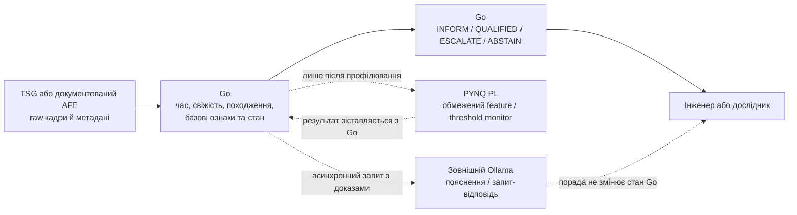
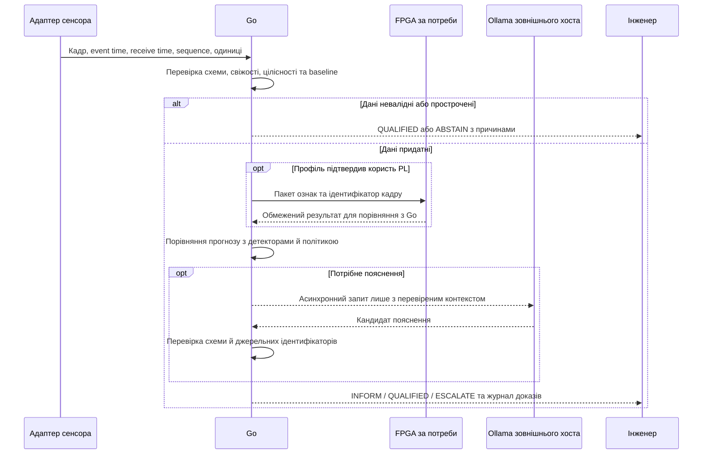

# Оцініть прогноз дрейфу HMI у дослідницькому прототипі доказової експертної системи

**Короткий висновок.** Розширення дослідницького прототипу до експертної системи раннього попередження про дрейф автомобільного ємнісного HMI-сенсора є науково змістовною, але поки запропонованою метою: джерела підтверджують правдоподібність зміни сирих відліків і потребу в компенсації, а не прогностичну корисність прототипу. Бракує доступу до синхронізованих raw-кадрів конкретного контролера, незалежних міток подій і тесту на невиданих панелях та умовах. Найсильніший висновок — спершу зібрати дані й порівняти прогноз із детекцією; не можна називати перетин порога реалізованою функцією прототипу. Go може забезпечити доказовий шлях, Ollama — необов’язкове пояснення, PYNQ-Z1 FPGA — лише можливе прискорення після профілювання. Результати цього дослідження лише інформують, кваліфікують, ескалують інженерові або відмовляють в оцінці; вони не запускають дій, що впливають на безпеку.

## 1. Відокремте оцінювання стану від прогнозу порога

Слово «дрейф» не задає ні вимірюваної події, ні часу випередження. **Оцінювання стану** реконструює прихований baseline або повільну зміну каналу з поточних і попередніх вимірів. **Виявлення аномалії** позначає незвичне теперішнє спостереження; **виявлення зміни режиму** накопичує послідовні відхилення й оцінює, чи змінився процес. EWMA та CUSUM є такими детекторами, а не прогнозами майбутнього перетину; їхні стандартні обґрунтування залежать від припущень про розподіл і залежність спостережень ([NIST, EWMA](https://www.itl.nist.gov/div898/handbook/pmc/section3/pmc324.htm); [Page, 1954](https://doi.org/10.1093/biomet/41.1-2.100); [Lorden, 1971](https://doi.org/10.1214/aoms/1177693054)). **Компенсація** змінює baseline, поріг або обробку сигналу, щоб зберегти класифікацію дотику чи відсіяти воду/заваду. Вона не доводить, що система передбачила майбутню подію: адаптивна компенсація може змінити саму послідовність і момент появи мітки. **Прогнозування** оцінює ще не спостережену подію з корисним випередженням.

Для першого досліду слід задати одну спрямовану межу для одного сенсорного каналу й не змішувати її з міткою «хибний дотик». Нехай `$\`z_{j,s}\`$` — значення каналу `j` у момент вимірювання `s`, у сирих відліках контролера або в каліброваних фізичних одиницях; `$\`u_j\`$` — зафіксований до тесту поріг у тих самих одиницях; `$\`m_{j,s}=u_j-z_{j,s}\`$` — запас до верхнього порога. Первинну подію пропонується визначити так:

$$
Y_{j,t}^{(H,\delta)} =
\mathbf{1}\left\{\exists s \in [t+\delta,t+H] :
m_{j,s} \le 0 \text{ протягом щонайменше } n_c
\text{ послідовних валідних відліків}\right\}
$$

Тут `j` — ідентифікатор каналу; `t` і `s` — часи вимірювання в секундах; `H` — горизонт прогнозу; `δ` — мінімальне корисне випередження в секундах, де `0 < δ ≤ H`; `$\`n_c\`$` — наперед задане ціле число відліків для підтвердження події; `Y` — двійкова мітка, а `1{…}` дорівнює 1, коли умову виконано. Це **пропозиція до експерименту**, не реалізована функція дослідницького прототипу. Межа нижнього чи двостороннього перетину потребує окремого визначення.

Для даних, доступних до моменту `t`, прогноз можна подати як `$\`\hat p_{j,t}(H,\delta)=\widehat{\Pr}(Y_{j,t}^{(H,\delta)}=1 \mid \mathcal{F}_t)\`$`, де `$\`\mathcal{F}_t\`$` — усі перевірені спостереження та метадані з часом вимірювання не пізніше `t`; `$\`\hat p\`$` — оцінена ймовірність без одиниць у діапазоні `[0,1]`, а не гарантія. Для навчання й оцінювання потрібні мітка, зафіксована до підбору моделі межа, часовий горизонт і коректне поводження з цензурованими записами. Запис, що закінчився раніше `H`, не є негативною міткою. Після калібрування предметний власник може визначити безрозмірні політичні межі для `INFORM`, `QUALIFIED` і ескалації; жодних числових меж тут не вигадується. Свіжі дані зростаючого ризику інформують фахівця, невизначені/неповні дані дають `QUALIFIED` або abstain, а ескалація передає питання людині. Жоден прогноз цього дослідження не змінює поріг сенсора й не запускає захисний актуатор.

## 2. Предметна правдоподібність є, даних і доказу корисності бракує

| Клас доказу | Що він підтримує | Чого не доводить |
|---|---|---|
| Документація сенсорики | Infineon описує сирі відліки, baseline, температурно-вологісну чутливість, автоналаштування й компенсацію води та шуму. | Наявність випереджального сигналу до порога, старіння конкретної панелі або точність прогнозу. |
| Публічні дані | У пошуках, задокументованих у нотатках, знайдено окремі ємнісні записи/симуляції. | Репрезентативну автомобільну часову вибірку з raw-кадрами, подіями й умовами середовища. |
| Статистичні методи | Існують формалізовані методи фільтрації стану, виявлення змін і оцінювання інтервалів. | Каліброваність чи користь для цього контролера та його залежної телеметрії. |
| Внутрішні матеріали дослідницького прототипу і перевірений код | Окреслюють вимоги, бажану архітектуру, історичні записи та поточні заглушки. | Незалежно відтворений вимір, готову інтеграцію чи наукову валідацію. |

Інфінеонівські специфікації та прикладні нотатки пояснюють, чому raw count і baseline можуть змінюватися від температури, вологості, води та електромагнітних перешкод; описані засоби автоналаштування й water rejection підтверджують потребу відділяти прогноз від штатної компенсації ([CY8CMBR3xxx datasheet](https://www.infineon.com/assets/row/public/documents/30/49/infineon-cy8cmbr3002-cy8cmbr3102-cy8cmbr3106s-cy8cmbr3108-cy8cmbr3110-cy8cmbr3116-datasheet-en.pdf); [AN90071](https://www.infineon.com/assets/row/public/documents/30/42/infineon-an90071-cy8cmbr3xxx-capsenser-design-guide-applicationnotes-en.pdf); [AN65973](https://www.infineon.com/assets/row/public/documents/30/42/infineon-an65973-cy8c20xx6a-h-as-capsenser-design-guide-applicationnotes-en.pdf); [AN85951](https://www.infineon.com/assets/row/public/documents/30/42/infineon-an85951-psoc-4-psoc-6-capsense-design-guide-applicationnotes-en.pdf)). Окремий опублікований випадок помилкової активації автомобільного ємнісного дисплея пов’язує її з геометрією проміжку, але один випадок не встановлює поширеність, причину дрейфу чи передбачуваність події ([J. Phys.: Conf. Ser., DOI 10.1088/1742-6596/2815/1/012037](https://doi.org/10.1088/1742-6596/2815/1/012037)). Тому фізична правдоподібність є підставою для вимірювального експерименту, не для твердження про прогноз.

У нотатках зафіксовано пошук у Zenodo, DataCite, Hugging Face Datasets і GitHub. **Лише в межах цих пошуків не знайдено відкритого набору** з автомобільними raw-кадрами, часовими мітками, незалежними мітками дрейфу/хибного дотику й синхронними умовами середовища. Знайдені TouchKeys — музичний інструмент, а DataCite-запис — симуляція електростатичних сценаріїв, не автомобільний часовий ряд ([TouchKeys](https://zenodo.org/records/1180531); [DataCite simulation](https://doi.org/10.34810/data3475); [GitHub query](https://github.com/search?q=%22automotive+capacitive+touch%22+dataset&type=repositories)). Це обмежений результат пошуку, не глобальна заява.

Для дослідницького прототипу HMI має більшу предметну відповідність, але слабшу відтворюваність на відкритих даних, ніж загальна промислова прогностика залишкового ресурсу (RUL). Каталоги NASA містять симуляційні run-to-failure траєкторії, а PHM Society — малий набір зношення різців: вони дозволяють відтворити прогнозний протокол, але не доводять перенесення на автомобільний сенсор або конкретне середовище ([NASA PCoE](https://www.nasa.gov/intelligent-systems-division/discovery-and-systems-health/pcoe/pcoe-data-set-repository/); [PHM Society CNC challenge](https://phmsociety.org/phm_competition/2010-phm-society-conference-data-challenge/); [Ramasso & Saxena, огляд PHM-бенчмарків](https://doi.org/10.36001/ijphm.2014.v5i2.2236)). Використати їх можна для перевірки загальної обробки часових рядів, але не як заміну HMI-даним. Інтеграційна демонстрація передачі значень через FPGA підтверджує максимум роботу такого шляху в заданій конфігурації; вона не показує, що сенсорний сигнал містить ознаку майбутнього перетину, що прогноз випереджає детектор, або що попередження корисне операторові.

Не визначено TSG-модель, регістрову карту, частоту кадрів, протокол, напруги та доступ до raw count/baseline/noise; внутрішня документація не знімає цієї прогалини. За відсутності такого інтерфейсу контрольований стенд із окремим перетворювачем ємності на кшталт TI FDC1004 може допомогти перевірити метод вимірювання, але не є заміною TSG чи автомобільною валідацією ([TI FDC1004 datasheet](https://www.ti.com/lit/ds/symlink/fdc1004.pdf)). PYNQ-Z1 — низьковольтний стенд, не захищений автомобільний аналоговий фронтенд; перетворення ємності на цифровий код потребує відповідного AFE/контролера. Digilent manual у зазначеному пошуку повернув HTTP 403, сторінка плати PYNQ — 404, а AMD-документація відображалася як застосункова оболонка; точні діапазони/маршрути входів та характеристики конкретної ревізії тут не підтверджено. Не можна підключати невідомі автомобільні лінії без перевіреного інтерфейсу, масштабування й захисту.

## 3. Go має зберігати вердикт незалежним від Ollama й FPGA

Запропонований розподіл відповідальності залишає детермінований шлях у Go. Він приймає записи сенсора з ідентифікаторами джерела, серійними номерами, часом вимірювання й часом отримання; перевіряє свіжість, порядок, одиниці, калібрування й пропуски; обчислює прості програмні еталони; веде версії схеми, порогів, компенсації та правил; повертає типізований стан і трасу причин. Два часи потрібні, бо час прибуття не замінює час фізичного вимірювання; прострочені чи розсинхронізовані повідомлення мають спричиняти `QUALIFIED`/abstain, а не удавану відсутність події. Внутрішні меморандуми дослідницького прототипу щодо оцінювання стану й відкладених міток можуть слугувати вимогами до цих перевірок, не доказом їх реалізації.

Для PYNQ-Z1 перевірений попередній огляд пропонує Go на процесорній підсистемі ARMv7, Python-посередник для PYNQ overlay/DMA та зовнішній Ollama-хост: офіційна документація Go описує Linux/ARM шлях, а сторінка Ollama — ARM64, не ARMv7 ([Go ARM](https://go.dev/wiki/GoArm); [Ollama Linux](https://docs.ollama.com/linux); [PYNQ libraries](https://pynq.readthedocs.io/en/latest/pynq_libraries.html)). Це архітектурний варіант, не підтверджений робочий комплект. Ollama може формувати пояснення або відповідати на інженерний запит; Go перевіряє формат і посилання на ідентифікатори доказів. Тайм-аут, недоступність, помилка парсингу чи невідповідь моделі не блокують і не переписують детермінований результат.

PYNQ PL може прискорювати лише малий, обмежений примітив — наприклад, фіксоване віконне усереднення, обчислення запасу до порога чи часовий монітор — якщо профіль покаже, що саме він є вузьким місцем. Програмна версія Go лишається еталоном; необхідно перевірити числові межі, переповнення, скидання, DMA/IPC, втрати й порядок даних. Програмована логіка не забезпечує автоматично системний WCET, детермінізм усього шляху, функціональну безпеку чи сертифікацію.

Внутрішні свідчення дослідницького прототипу потребують обережного трактування. Меморандум про порівняння FPGA і CPU позначений «APPROVED / EMPIRICAL BENCHMARK», але також каже, що відкладене завдання про синтез і вимірювання словникового пошуку на ПЛІС чекає фізичного розгортання PL; заявлені швидкодія, енергія й нульовий джитер незалежно не перевірялися. Меморандум про масштабування багатоядерного масиву перевірок повідомляє про RTL-симуляцію, тоді як фізичний стенд має статус `ON-HOLD`; меморандум про HIL-верифікацію зазначає, що HIL-валідація ще потрібна. Історична інструкція введення апаратного стенда в експлуатацію фіксує окрему локальну мережу стенда, базовий overlay та відкладену компіляцію бітстриму віртуальної машини перевірок. Пізніші записи вказують інші мережеві адреси двох PYNQ-вузлів (апаратний вузол 1 і апаратний вузол 2) та брокера повідомлень; доступ до поточних вузлів не підтверджено через повідомлені технічні проблеми. Це не live-інвентаризація.

У переглянутих файлах поточного checkout у головному модулі агента апаратного вузла BRAM представлено in-memory слайсом із демонстраційними `cycles`/`ACCEPT`; `/dev/uio0` згаданий у коментарі, але не мапиться. Модуль апаратного доступу агента апаратного виконавця перевірок має XADC fallback з `RealHW=false` і Go-backend з оціненою затримкою. Це спостереження лише про два файли. Меморандум про HMI-сенсорику описує запропоновану HMI/KAS-архітектуру, системна вимога про периферійні мікроанклави TinyGo та апаратні шлюзи PYNQ і меморандум про TinyGo та шлюзи подій — вимоги/рекомендації, а внутрішні документи загалом змішують проєктні пропозиції, статусні твердження, заглушки й журнали, не рецензовані докази готової системи.

```mermaid
stateDiagram-v2
  accTitle: Дослідницькі стани та відмова від оцінки
  accDescr: Невалідні дані спричиняють abstain; придатні дані дають інформаційний статус або передачу фахівцю, а збій Ollama не блокує рішення Go.
  [*] --> Intake
  Intake --> Abstain: Невідомі одиниці / прострочені / пропущені дані
  Intake --> Evaluate: Перевірено схему й походження
  Evaluate --> Inform: Лише інформаційний ризик за наперед заданим правилом
  Evaluate --> Qualified: Невизначеність, зміна режиму або OOD
  Evaluate --> Escalate: Потрібен інженерний розгляд
  Evaluate --> AdvisoryUnavailable: Ollama недоступна
  AdvisoryUnavailable --> Inform: Go завершує базовий шлях
  AdvisoryUnavailable --> Qualified: Go фіксує обмеження даних
  Qualified --> HumanReview
  Escalate --> HumanReview
  Abstain --> HumanReview
  Inform --> [*]
  HumanReview --> [*]
```

## 4. Ранжовані експерименти встановлять, чи є випереджальний сигнал

У всіх випробуваннях потрібно наперед зафіксувати протокол, ціль, одиниці, пороги, часові мітки й null-критерій; зберігати сирі дані та їхні контрольні суми, калібрування, ідентифікатори панелей/контролерів/плати, профіль температури й вологості, версії коду/правил/моделі, параметри запуску та журнал виключень. Вікна одного пристрою й прогону ніколи не розподіляються між навчанням і тестом. Потрібні незалежне утримання фізичних панелей/контролерів і профілів умов; для тверджень про апаратний шлях — також окремий апаратний екземпляр, якщо він доступний. Якщо є лише одна PYNQ-Z1, узагальнення між FPGA-платами не заявляти.

| Ранг і питання | Джерело даних та поділ | Базові лінії | Метрики та фальсифікація |
|---|---|---|---|
| **1. Чи можна виміряти й незалежно розмітити подію?** | Отримати модель TSG, vendor-approved спосіб читання raw кадрів/baseline/порогів/діагностик; синхронно реєструвати температуру й вологість біля панелі, дотики, воду/конденсат і операторську ground truth. Якщо TSG не відкриває raw data — окремий AFE/панель є тільки стендовим сурогатом. Поділ за повними панелями та прогонами; майбутні часові сесії й цілі режими середовища лишити поза розробкою. | Стабільний контрольний прогін без навмисного впливу; той самий сенсорний сигнал до/після штатного baseline-tracking; незалежний реєстратор умов і міток. | Повнота кадрів, втрата/переупорядкування, синхронізація часу, частка кадрів з валідними одиницями й узгодженість ground truth. **No-go для прогнозу**, якщо немає сирих вимірів, фіксованого правила перетину або незалежної мітки; тоді можна лише досліджувати інтерфейс чи описову детекцію. |
| **2. Чи прогнозує модель раніше за простий детектор?** | Використати лише набір із воріт 1; хронологічний тест на пізніших сесіях плюс сліпий holdout повних фізичних панелей і умов. Не підбирати поріг чи горизонт на тесті; при малій кількості подій звітувати невизначеність і пілотний статус. | Штатний поріг/компенсація, persistence (останній стан), лінійна екстраполяція; окремо EWMA/CUSUM як детектори зміни, не прогнози. Калманівська модель стану допустима як оцінювач, а не як автоматичний доказ прогнозу. | Хибні попередження на пристрій-годину, пропущені перетини, медіана/розподіл lead time, частка попереджень із lead time не меншим за заздалегідь задане `δ`, Brier score і калібрування окремо для кожного `H`. **Фальсифікація:** якщо прогноз не перевершує persistence/детектор на відкладених панелях, дає недостатнє випередження або купує його неприйнятними хибними тривогами, залишити лише виявлення зміни/компенсацію. |
| **3. Чи виправдане FPGA на повному шляху?** | Ті самі хешовані записи та, після стабілізації acquisition, live stream з документованого AFE. Однакові кадри/ідентифікатори проходять Go-only і Go+PL; умови, панель, плата, конфігурація та часові інтервали утримуються окремо. Вимірювати сенсорне захоплення, мережеве отримання (якщо використовується), черги, IPC, копіювання, DMA, ядро та перевірку відповіді — не лише такти RTL. | Go-еталон без FPGA; Go з тим самим кодом функцій/порогів; необов’язковий Ollama виконується лише асинхронно й окремо від вердикту. Ін’єктувати timeout, збій мережі, пропуски та перезапуск, щоб перевірити незалежність Go-шляху від Ollama. | Точна еквівалентність або наперед допустима похибка та однаковий статус; втрачені/переупорядковані кадри; затримки acquisition-to-verdict p50/p95/p99 і найбільше **спостережене** значення; пропускна здатність, завантаження CPU, ресурси PL і виміряна енергія за наявності приладу. **No-go для PL**, якщо дані чи рішення різняться, повний шлях не поліпшується за заздалегідь вибраною метрикою понад похибку вимірювання або накладні витрати/відмови погіршують цілісність. Максимум спостереженої затримки не є WCET. |

Перед запуском кожного порівняння фіксують версію набору та моделі, розподіл train/calibration/test, визначення пропуску/цензурування, часовий горизонт і метрики; довірчі оцінки мають враховувати кластеризацію за панеллю/прогоном. Тестові панелі та умови відкриваються лише після вибору базисів і параметрів. Докази прогнозу, реалізації й швидкодії не взаємозамінні: успішний тест DMA не компенсує невдалу подієву оцінку, а точний прогноз на одній панелі не доводить безпечність системи.

## 5. Ворота рішення та джерела

**Ворота переходу.** Перший перехід дозволено лише після підтвердження TSG/AFE-інтерфейсу та незалежної розмітки. Другий — тільки якщо прогноз на невиданих панелях має корисне випередження й зафіксовану перевагу над простими базисами за погодженого бюджету хибних попереджень; інакше ціль звужується до стану/детекції/компенсації. FPGA додається лише після функціональної еквівалентності й наскрізного вимірювання; за відсутності переваги її вилучають із дослідження. До окремого аналізу небезпек, вимог, незалежної валідації та відповідного процесу підтвердження жоден результат не виводиться на автомобільний safety path. Внутрішні докази дослідницького прототипу тут лише задають дизайн-контекст, не становлять peer-reviewed доказу або статусу готовності.

**Офіційні специфікації та документація.** Infineon, [CY8CMBR3xxx datasheet](https://www.infineon.com/assets/row/public/documents/30/49/infineon-cy8cmbr3002-cy8cmbr3102-cy8cmbr3106s-cy8cmbr3108-cy8cmbr3110-cy8cmbr3116-datasheet-en.pdf), [AN90071](https://www.infineon.com/assets/row/public/documents/30/42/infineon-an90071-cy8cmbr3xxx-capsenser-design-guide-applicationnotes-en.pdf), [AN65973](https://www.infineon.com/assets/row/public/documents/30/42/infineon-an65973-cy8c20xx6a-h-as-capsenser-design-guide-applicationnotes-en.pdf), [AN85951](https://www.infineon.com/assets/row/public/documents/30/42/infineon-an85951-psoc-4-psoc-6-capsense-design-guide-applicationnotes-en.pdf); Digilent, [PYNQ-Z1 Reference Manual](https://digilent.com/reference/programmable-logic/pynq-z1/reference-manual); AMD, [Zynq-7000 TRM UG585](https://docs.amd.com/v/u/en-US/ug585-Zynq-7000-TRM), [XADC UG480](https://docs.amd.com/v/u/en-US/ug480_7Series_XADC); Go, [Linux ARM](https://go.dev/wiki/GoArm); Ollama, [Linux install](https://docs.ollama.com/linux), [API](https://docs.ollama.com/api/introduction). Ці посилання описують заявлені можливості, не перевірену конфігурацію стенда.

**Первинні наукові праці та методичні огляди.** Page, [CUSUM (1954)](https://doi.org/10.1093/biomet/41.1-2.100); Lorden, [sequential change detection (1971)](https://doi.org/10.1214/aoms/1177693054); Adams & MacKay, [online Bayesian change-point detection](https://arxiv.org/abs/0710.3742); Kalman, [filtering (1960)](https://doi.org/10.1115/1.3662552); Xu & Xie, [EnbPI, ICML 2021](https://proceedings.mlr.press/v139/xu21h.html); Kaplan & Meier, [censoring (1958)](https://doi.org/10.1080/01621459.1958.10501452); Saxena et al., [PHM/RUL metrics](https://doi.org/10.1109/PHM.2008.4711436); Ramasso & Saxena, [PHM benchmark review](https://doi.org/10.36001/ijphm.2014.v5i2.2236). Модельні гарантії цих праць не переносяться автоматично на автокорельовані HMI-виміри.

**Внутрішні документи — лише дизайн-контекст.** Як проєктний контекст переглянуто внутрішні документи дослідницького прототипу: меморандуми про телеметрію, оцінювання стану й контроль під час виконання (стан телеметрії/часова свіжість), про безперервне навчання, відкладені мітки й позаполітичне оцінювання (відкладені мітки), про HMI-сенсорику (запропонована HMI/KAS-архітектура), інструкцію введення апаратного стенда в експлуатацію (історичний журнал PYNQ bring-up), меморандуми про порівняння FPGA і CPU (заявлені порівняння з відкладеним фізичним завданням), про масштабування багатоядерного масиву перевірок (RTL-симуляція; фізичний стенд `ON-HOLD`), про HIL-верифікацію (потреба HIL-валідації), про TinyGo та шлюзи подій, а також системну вимогу про периферійні мікроанклави TinyGo та апаратні шлюзи PYNQ (проєктні вимоги/рекомендації). Ці документи не входять до цього репозиторію, не є незалежними публікаціями чи підтвердженими вимірами й не становлять незалежної наукової валідації.

**Обмеження цього висновку.** Джерельний пошук виконано під час підготовки трьох дослідницьких нотаток; додаткового веб-пошуку на етапі їх синтезу не проводили. Не виконувалися вимірювання сенсорів, мережеве підключення до стенда чи реалізація прогнозу; Mermaid-рендеринг окремо не перевірявся. Не вирішено TSG-інтерфейс і доступ до поточних вузлів; не встановлено автомобільних міток, допустимих `H`/`δ`, порогів, потрібної частоти, кількості панелей чи критеріїв користі. Отже, висновок підтверджує змістовність дослідницької постановки, а не готовність дослідницького прототипу, ефективність раннього попередження, відповідність стандарту чи придатність до керування автомобілем.
