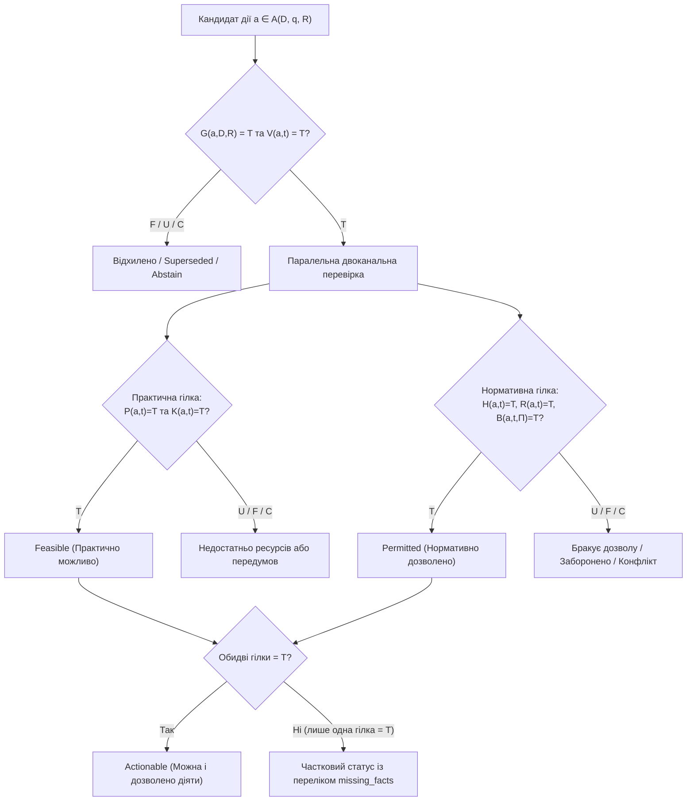

# Рецензія на звіт Доказовий оракул можливих дій

## 0. План та протокол виконання рецензії

Перевірку звіту [«Доказовий оракул можливих дій»](<./Доказовий оракул можливих дій.md>) проведено у шість етапів без внесення змін до вихідних файлів дослідження і без доступу до зовнішніх мережевих сервісів чи апаратних вузлів:

1. **Епістемічна декомпозиція мети** — зіставлення постановки звіту з вимогою користувача («віддати корпус різнорідних даних і отримати передбачення/перелік того, що може бути вдіяне на підставі цих даних»).
2. **Формально-логічна верифікація (Розділ 3)** — аналіз предикатів $A, M, V, P, K, H, R, B$, чотиризначної оцінки $`\{T, F, U, C\}`$, теореми вкладеності $`\mathsf{Permitted} \subseteq \mathsf{Feasible}`$ на чотирьох обов'язкових граничних випадках та перевірка узгодженості між таблицею контракту (Розділ 2), формулами (Розділ 3) і діаграмою переходів станів `stateDiagram-v2` (Розділ 4).
3. **Аудит першоджерел і локальних артефактів дослідницького прототипу** — звірка наукових публікацій, стандартів (STRIPS, PDDL 2.1, Dung 1995, Governatori et al. 2018, W3C PROV-O, RFC 8174), паспортів датасетів (Enron Intent, CMU Enron, AMI, QMSum, ContractNLI, CUAD, FEVER, ALCE, RAGAS, ARES) та первинних внутрішніх документів прототипу (меморандумів про порівняння FPGA і CPU, про масштабування багатоядерного масиву перевірок і про HIL-верифікацію, а також відкладеного завдання про синтез і вимірювання словникового пошуку на ПЛІС).
4. **Архітектурно-системний аналіз** — оцінка розподілу Go / Ollama / FPGA (Digilent PYNQ-Z1) щодо повноти витягу, семантичної верифікації цитат і меж детермінізму.
5. **Методологія експерименту та наукова новизна** — перевірка фальсифікованості гіпотез, знаменників метрик та позиціонування відносно відомих класів систем.
6. **Перевірка математичного та графічного оформлення** — інспекція синтаксису MathJax і семантичної повноти діаграм Mermaid.

---

## 1. Загальний висновок

За фактичним рівнем обґрунтування розглянутий документ є **якісною, методологічно дисциплінованою концептуальною специфікацією (design proposal & evaluation protocol) доказової системи підтримки рішень з елементами формальної верифікації джерел**. Він **не є** звітом про завершене емпіричне дослідження або валідовану промислову систему.

* **Що у звіті науково обґрунтовано та витримало перевірку:**
  1. Чітке розмежування п'яти епістемічних рівнів (згадка у тексті $\neq$ практична здійсненність $\neq$ нормативний дозвіл $\neq$ оптимальна рекомендація $\neq$ прогноз поведінки людини).
  2. Заборона трактувати відсутність заборони у неповному корпусі як автоматичний дозвіл (відмова від наївної Closed-World Assumption для нормативного допуску).
  3. Критичний аудит внутрішньої документації дослідницького прототипу: звіт абсолютно точно зафіксував розбіжність між заявленими «емпіричними» метриками FPGA в меморандумі про порівняння FPGA і CPU та фактичним статусом `deferred` відкладеного завдання про синтез і вимірювання словникового пошуку на ПЛІС і `ON-HOLD` у меморандумі про масштабування багатоядерного масиву перевірок.
  4. Коректна характеристика меж відкритих корпусів (Enron, AMI, QMSum, ContractNLI, CUAD) та правових застережень щодо нетотожності ліцензії GitHub-репозиторію і прав на первинні документи.

* **Що є проєктною пропозицією або неперевіреною гіпотезою:**
  1. Контракт даних `ActionClaim` (Розділ 2), математичний фільтр множин (Розділ 3) і конвеєр Go + Ollama + опціональна FPGA (Розділ 4) — це проєктні конструкції, які ще не проходили тестування на реальному змішаному корпусі листів і документів.
  2. П'ять ранжованих дослідницьких питань (Розділ 5) і протокол анотування — це коректно сформульований план майбутніх експериментів, а не отримані результати.

* **Що в поточній редакції є логічно вразливим або потребує виправлення:**
  1. **Змішування екстракції з генерацією нових дій:** формула $`\mathsf{Feasible}(D,q,t)`$ вимагає $M(a)=T$ («кандидат справді міститься у джерелі й має перевірювану цитату»). Це робить систему **екстрактором і верифікатором згаданих дій**, але математично блокує виведення *нових* дій, які не названі буквально в жодному листі, проте логічно випливають із сукупності фактів і правил.
  2. **Жорстке вкладення $`\mathsf{Permitted}(D,q,t) \subseteq \mathsf{Feasible}(D,q,t)`$:** змішує деонтичний статус (правомірність) із поточною операційною спроможністю ($K(a,t)=T$). Дія, на яку є прямий юридичний дозвіл у договорі, але для якої в поточний момент бракує ресурсу, за цією формулою втрачає статус дозволеної.
  3. **Внутрішні неузгодженості між розділами звіту:** розбіжність переліків статусів у таблиці контракту, формулах і діаграмі станів; відсутність поля `exceptions` у `classDiagram`; погіршення повноти витягу (Recall) у разі вимкнення Ollama; прогалина між побайтовою перевіркою цитати в Go та семантичною перевіркою модальності/заперечення.

---

## 2. Таблиця зауважень

| № | Важливість | Місце у звіті | Теза звіту | Обґрунтування та аналіз | Наслідок для системи / читача | Пропоноване виправлення | Впевненість і спосіб перевірки |
|---|---|---|---|---|---|---|---|
| **1** | **Критична (Логіка / Мета)** | Розділ 3, абз. 2–3 | «$A(D,q)$ — скінченна множина нормалізованих кандидатів, знайдених у цьому корпусі... $M(a)=T$ означає, що кандидат справді міститься у джерелі й має перевірювану цитату» | Умова $M(a)=T$ вимагає, щоб сама дія $a$ була текстуально присутня в корпусі $D$. Якщо в листі №1 сказано «постачання затримається на 5 днів», а в договорі №2 — «при затримці понад 3 дні замовник має право вимагати пеню або змінити графік», то у випадку, коли в листі не згадано про зміну графіка, дія «ініціювати зміну графіка» є *виведеною* з факту та норми, а не буквально процитованою як поточна пропозиція. Для суто синтезованих дій (наприклад, «перерозподілити завдання між інженерами») буквальної цитати дії $M(a)$ в корпусі взагалі немає. Це або свідоме звуження MVP до *аудиту згаданих дій*, або суперечність ширшій меті підтримки вибору дій. | Система відкидатиме будь-яку дію, прямо не названу в тексті документів, навіть якщо всі фактичні передумови для неї в корпусі є. | Розділити походження кандидата на два класи: 1) **прямо згадані дії** ($`M_{\mathrm{direct}}(a)=T`$) та 2) **виведені за правилами дії** ($`M_{\mathrm{derived}}(a)=T`$, де цитуються окремо *факти-посилки* з корпусу та *ідентифікатор правила/схеми дії* з реєстру правил). Уточнити в преамбулі, чи MVP обмежується лише класом 1. | **Висока.** Прямий логічний аналіз формули $`\mathsf{Feasible}(D,q,t)`$ та контрприкладу 3 (див. Розділ 4 рецензії). |
| **2** | **Критична (Формалізм)** | Розділ 3, абз. 4 | «$`\mathsf{Permitted}(D,q,t)=\left\{a\in\mathsf{Feasible}(D,q,t)\ \middle\vert\ H(a,t)=T \land R(a,t)=T \land B(a,t)=T\right\}`$» | Включення $`a \in \mathsf{Feasible}`$ робить фізичну/ресурсну спроможність $K(a,t)=T$ необхідною умовою нормативного дозволу $`\mathsf{Permitted}`$. У деонтичній логіці та праві нормативний дозвіл (*de jure* permission) і практична здійсненність (*de facto* capability) ортогональні. Якщо договір прямо дозволяє дію ($H=T, R=T, B=T$), але сервер тимчасово недоступний або ресурс не підтверджений ($K=F$ або $K=U$), дія залишається *дозволеною*, але *нездійсненною зараз*. | Користувач не зможе відрізнити юридичну заборону/відсутність права від тимчасової нестачі технічного ресурсу. | Визначити $`\mathsf{Permitted}(D,q,t)`$ незалежно від $K(a,t)$ (на базі чинності джерела та нормативних умов $H, R, B$), а перетин означити окремо як $`\mathsf{Actionable}(D,q,t) = \mathsf{Feasible}(D,q,t) \cap \mathsf{Permitted}(D,q,t)`$. | **Висока.** Перевірено за семантикою деонтичної логіки та контрприкладом 1. |
| **3** | **Суттєва (Узгодженість моделі)** | Розділ 2 (таблиця й `classDiagram`), Розділ 3, Розділ 4 (`stateDiagram-v2`) | Таблиця: `EXTRACTED`, `POSSIBLE`, `PERMITTED`, `CONFLICT`, `SUPERSEDED`, `ABSTAIN` (умови: `SUPPORTED`, `REFUTED`, `UNKNOWN`, `CONTESTED`). Формули: `Feasible`, `Permitted`, `QUALIFIED`/`ABSTAIN` (оцінки: `T, F, U, C`). Діаграма станів: `Extracted`, `EvidenceChecked`, `Possible`, `Permitted`, `Unknown`, `Conflict`, `Abstain`, `Clarification`, `Escalation`. | По-перше, у таблиці в одному полі `modality_status` змішано лінгвістичну модальність вислову («прохання, обов'язок, заборона...») та системний статус верифікації (`POSSIBLE`, `CONFLICT` тощо). По-друге, статус `SUPERSEDED` (замінено новішою редакцією) і статус `QUALIFIED` є в тексті/таблиці, але відсутні у `stateDiagram-v2`. По-третє, у `stateDiagram-v2` перехід `Possible --> Unknown: Нормативне охоплення неповне` знищує вже встановлений факт фізичної можливості дії: якщо $P=T, K=T$, але $B=U$, дія має залишатися `Possible` (із нормативним статусом `Unknown`), а не втрачати статус `Possible`. | Неоднозначність під час реалізації Go-структур і скінченного автомата; втрата інформації про фізичну можливість дії при невизначеному дозволі. | Розділити поле `modality_status` на три атомарні поля: `utterance_modality` (обов'язок/дозвіл/заборона/запит), `feasibility_status` та `deontic_status`. Додати стан `Superseded` у діаграму станів і прибрати зворотний перехід із `Possible` у безликий `Unknown`. | **Висока.** Пряме поелементне зіставлення Розділів 2, 3 і 4 звіту. |
| **4** | **Суттєва (Архітектура та верифікація)** | Розділ 4, абз. 1–2 та `sequenceDiagram` | «Ollama лише пропонує витяг, нормалізацію чи переказ; Go відкидає відповідь без точного фрагмента або з некоректною схемою... Go звіряє цитату з указаною версією та перевіряє автора, цитування й заперечення» | Звірка хешу, байтових меж (`byteStart`, `byteEnd`) і дослівного збігу рядка в Go гарантує лише **кастодію цитати** (що підрядок фізично існує в документі). Вона **не гарантує**, що LLM правильно визначила модальність, заперечення чи умову всередині цієї цитати. Наприклад, із речення «Замовник НЕ має права розривати договір без попередження за 30 днів» модель може повернути реальний локатор речення, але помилково записати `modality: PERMITTED, preconditions: []`. Для виявлення цієї помилки Go-ядро мусить мати власний детермінований синтаксично-лексичний парсер модальностей і заперечень; проте у звіті не пояснено, як саме Go виконує крок «Визначити цитату, заперечення, автора й чинність» для природної мови без участі моделі. Крім того, якщо Ollama недоступна (`opt Модель доступна`), детермінований шлях на правилах неминуче матиме нижчу повноту (Recall) на неструктурованих листах, тому теза «Тайм-аут чи збій не блокують детермінований шлях і не змінюють статус» істинна лише для вже знайдених за шаблоном кандидатів, але хибна щодо повноти всього набору $A(D,q)$. | Хибне відчуття безпеки: розробник може вважати, що перевірка SHA-256 і `byteStart..byteEnd` захищає від семантичних галюцинацій LLM під час заповнення слотів контракту. | Явно розмежувати у звіті: (а) **криптографічно-байтову верифікацію локатора** (тривіально в Go) та (б) **семантичну верифікацію предикатів і заперечень** (потребує або формалізованої контрольованої підмови/правил у Go, або незалежного верифікатора, і залишається головним джерелом помилок Рангу 2). Уточнити, що відмова Ollama не порушує *безпеку* (Soundness), але знижує *повноту* (Recall) витягу. | **Висока.** Логічний аналіз діаграми послідовності (Розділ 4) та `prototype_architecture_map.md`. |
| **5** | **Помірна (Контракт даних)** | Розділ 2, `classDiagram` vs таблиця; нотатка `action_extraction.md` | У нотатці `action_extraction.md` (§3) обґрунтовано окреме поле `exceptions` (винятки з правила) та координати OCR-якості для сканів. У звіті (Розділ 1, 5) винятки й OCR-помилки згадуються, але в таблиці контракту та `classDiagram` (Розділ 2) поле `exceptions` відсутнє. | У нормативних документах і договорах (зокрема ContractNLI) конструкція «Дозволено $X$, *за винятком випадків* $Y$» є головним джерелом помилок. Якщо звести винятки $Y$ до звичайних передумов `preconditions`, виникає плутанина з відсутністю доказів: для звичайної передумови стан $U$ (невідомо) блокує дію, тоді як для винятку (*defeater* / *unless* clause) семантика в дефезибельній логіці інша (тягар доведення може лежати на наявності винятку або вимагати явної перевірки `REFUTED`). | Спрощення контракту в Розділі 2 ускладнює реалізацію аргументаційного рушія та дефезибельних правил, заявлених у Розділі 1. | Додати поле `exceptions / defeaters` до таблиці контракту та класу `Condition` (наприклад, булевий прапорець або тип `role: PRECONDITION \| EXCEPTION_DEFEATER`). | **Висока.** Зіставлення з `action_extraction.md` та Governatori et al. (2018). |
| **6** | **Помірна (Метрики експерименту)** | Розділ 6, таблиця метрик | «Набір дій: Precision/recall для `POSSIBLE` і `PERMITTED` окремо; частка хибних дозволів серед усіх виданих дозволів, частка пропущених дозволених дій...» | «Частка хибних дозволів серед усіх виданих дозволів» — це False Discovery Rate ($`\mathrm{FDR} = \frac{\mathrm{FP}_{\mathrm{perm}}}{\mathrm{TP}_{\mathrm{perm}} + \mathrm{FP}_{\mathrm{perm}}} = 1 - \mathrm{Precision}_{\mathrm{perm}}`$), тобто дублювання метрики Precision. Натомість у безпеково-критичних системах ключовою є також частота хибного дозволу на множині дій, які в еталоні *заборонені* або *невизначені* ($`\mathrm{FPR}_{\mathrm{perm}} = \frac{\mathrm{FP}_{\mathrm{perm}}}{N_{\mathrm{prohibited}} + N_{\mathrm{unknown}}}`$). Крім того, не уточнено процедуру вирівнювання (matching) нормалізованих дій перед обчисленням Precision/Recall, коли формулювання дії трохи відрізняється від еталонного. | При малій кількості виданих дозволів $`\mathrm{FDR}`$ і $`\mathrm{FPR}`$ поводяться по-різному; без канонічного правила зіставлення предикатів exact frame match буде заниженим або суб'єктивним. | Явно записати формули $`\mathrm{FDR}_{\mathrm{perm}}`$ та $`\mathrm{FPR}_{\mathrm{perm}}`$ з точними знаменниками; додати протокол нормалізації або двошарового оцінювання (1 — за локатором доказу, 2 — за канонічним ID дії з еталонного словника). | **Висока.** Аналіз метрик селективної класифікації та `action_oracle_evaluation.md`. |

---

## 3. Таблиця перевірки джерел та фактичних тверджень

Зовнішні публікації перевірено за бібліографічними метаданими, DOI та дослідницькими нотатками у воркспейсі, а матеріали дослідницького прототипу — прямим читанням його первинних внутрішніх файлів, що не входять до цього репозиторію.

| Теза у звіті | Цитоване джерело | Результат перевірки | Межі підтвердження та коментар рецензента |
|---|---|---|---|
| STRIPS і PDDL моделюють передумови й наслідки для заданого стану, але не доводять правдивість цього стану або нормативну силу документа. | Fikes & Nilsson (1971), `10.1016/0004-3702(71)90010-5`; Fox & Long (2003), `10.1613/jair.1129` | **Підтверджено (Факт)** | Автори, роки, журнали (*Artificial Intelligence*, *JAIR*) та DOI точні. Обидва формалізми працюють із заданим описом початкового стану та схемою операторів; верифікація достовірності тексту чи юридичної чинності не входить до предмета класичного планування. |
| Деонтична логіка й аргументація розділяють дозвіл, обов'язок, заборону та атаки на аргументи; пріоритети джерел має задавати політика системи. | Dung (1995), `10.1016/0004-3702(94)00041-X`; Governatori, Rotolo & Riveret (2018), `10.1007/978-3-030-03098-8_33` | **Підтверджено (Факт)** | Абстрактні фреймворки Дунга задають відношення атаки між аргументами, а деонтична дефезибельна логіка (Governatori et al., PRIMA 2018) моделює обов'язки, дозволи та перевагу правил ($\succ$). Відношення пріоритету джерел справді є зовнішнім входом моделі. |
| RFC 8174 визначає нормативність ключових слів у контексті IETF (лише у верхньому регістрі), а не для довільних листів. | IETF RFC 8174 (`rfc8174.html`) | **Підтверджено (Факт)** | Точне викладення змісту RFC 8174 (BCP 14), який уточнює RFC 2119. Справді не може автоматично переноситися на побутове чи корпоративне листування. |
| W3C PROV-O надає модель сутностей, агентів, діяльностей і похідності, але не посвідчує істинність джерела чи юридичну силу. | W3C Recommendation PROV-O (2013-04-30) | **Підтверджено (Факт)** | URL та суть стандарту точні: PROV-O — це онтологія трасування походження даних (lineage/provenance), а не механізм епістемічної чи правової верифікації. |
| Enron Intent має 3 655 речень про потребу дії/відповіді, анотацію одного фахівця й суб'єктивні межі; Enron corpus має приватнісні й повнотні обмеження. | `Charlie9/enron_intent_dataset_verified`; CMU Enron (`cs.cmu.edu/~enron/`) | **Підтверджено за дослідницькими нотатками; онлайн-URL не перевідкривалися** | Числові показники й застереження точно відповідають `action_extraction.md`. |
| AMI (100 год, CC BY 4.0) та QMSum (1 808 пар запит-резюме, 232 зустрічі, MIT на репо) корисні для пошуку доказів, але не розмічають контракт «актор—умова—дозвіл». | AMI Corpus; Zhong et al. (NAACL 2021), `10.18653/v1/2021.naacl-main.472` | **Підтверджено** | Точний опис структури датасетів і коректне застереження про нетотожність ліцензії репозиторію QMSum правам на вихідні транскрипти. |
| ContractNLI охоплює підтримку/спростування/нейтральність у 607 договорах; CUAD — 510 договорів, >13 000 фрагментів, 41 тип положень (CC BY 4.0). | Koreeda & Manning (EMNLP Findings 2021); Hendrycks et al. (2021), `arXiv:2103.06268` | **Підтверджено** | Характеристики датасетів точні. Звіт слушно зазначає, що ContractNLI перевіряє фіксований список гіпотез, а не відкриту генерацію дій. |
| FEVER, ALCE, RAGAS і ARES оцінюють підтримку тверджень та цитат, але не замінюють розмітку дозволів і умов. | Thorne et al. (2018); Gao et al. (2023); Es et al. (2024); Saad-Falcon et al. (2024) | **Підтверджено** | DOI коректні, функціональне призначення всіх чотирьох робіт передано без перебільшень. |
| Апаратні записи дослідницького прототипу суперечливі: меморандум про порівняння FPGA і CPU подає цифри як емпіричні, тоді як відкладене завдання про синтез і вимірювання словникового пошуку на ПЛІС має статус `deferred`, меморандум про масштабування багатоядерного масиву перевірок — `ON-HOLD` для фізичного стенда, меморандум про HIL-верифікацію вимагає HIL-валідації, а агент апаратного вузла є заглушкою. | Внутрішні файли дослідницького прототипу (поза цим репозиторієм) | **Повністю підтверджено прямим читанням файлів** | У меморандумі про порівняння FPGA і CPU (рядки 6, 15–31) прямо написано `EMPIRICAL BENCHMARK` із цифрами $`32{,}0\,\text{нс}`$ та $`68{,}0\,\text{нДж}`$, але в тому ж рядку 6 зазначено: «[завдання про синтез і вимірювання словникового пошуку на ПЛІС] відкладено до фізичного розгортання FPGA PL». У самому відкладеному завданні (рядки 14–18) прямо зафіксовано: *«Лишається те, що без Vivado і плати не виміряти: 1. Синтез і розміщення для XC7Z020, звіт часу: чи тримає дизайн 125 МГц (частота досі взята з [меморандуму про порівняння FPGA і CPU], не виміряна)»*. Висновок звіту про неприпустимість перенесення цих цифр як фізично доведених є бездоганним. |
| Не слід припускати локальну сумісність Ollama із PYNQ-Z1 (Zynq XC7Z020, двоядерний ARM Cortex-A9). | Digilent PYNQ-Z1 Reference Manual; Ollama Linux Docs | **Підтверджено (Факт)** | Zynq-7000 XC7Z020 має 32-бітну архітектуру ARMv7-A (Cortex-A9) та 512 МБ DDR3 на платі PYNQ-Z1, тоді як стандартні збірки Ollama та сучасні LLM розраховані на 64-бітні хости (`amd64`/`arm64`) зі значно більшим обсягом ОЗП. |

---

## 4. Аналіз формул і контрприкладів

У Розділі 3 звіту запропоновано два предикатні фільтри над чотиризначною шкалою оцінки тверджень $`v \in \{T, F, U, C\}`$:

$$
\mathsf{Feasible}(D,q,t)=
\left\{a\in A(D,q)\ \middle|\ M(a)=T \land V(a,t)=T \land
P(a,t)=T \land K(a,t)=T\right\}
$$

$$
\mathsf{Permitted}(D,q,t)=
\left\{a\in\mathsf{Feasible}(D,q,t)\ \middle|\ H(a,t)=T \land
R(a,t)=T \land B(a,t)=T\right\}
$$

Де $D$ — зафіксований знімок корпусу, $q$ — запит (роль, сфера, юрисдикція), $t$ — час оцінювання, $A(D,q)$ — скінченна множина нормалізованих кандидатів дій, $M(a)$ — наявність дії у джерелі з перевірюваною цитатою, $V(a,t)$ — часова й предметна чинність джерела, $P(a,t)$ — підтвердженість передумов, $K(a,t)$ — наявність ресурсу/спроможності, $H(a,t)$ — повноваження виконавця, $R(a,t)$ — позитивна підстава дозволу, $B(a,t)$ — перевірена відсутність неврегульованої заборони.

### 4.1. Перевірка на чотирьох обов'язкових граничних випадках

#### Випадок 1: Дія дозволена нормативно, але ресурс для неї недоступний
* **Вхідні умови:** Договір прямо дозволяє виконавцю подати запит на аудит ($M(a)=T, V(a,t)=T, P(a,t)=T, H(a,t)=T, R(a,t)=T, B(a,t)=T$), але виділений бюджет або фахівець на час $t$ відсутній ($K(a,t)=F$) або відомостей про нього в корпусі немає ($K(a,t)=U$).
* **Поведінка формули звіту:** Через $K(a,t) \neq T$ маємо $`a \notin \mathsf{Feasible}(D,q,t)`$. Оскільки $`\mathsf{Permitted}(D,q,t)`$ визначено як підмножину $`\mathsf{Feasible}(D,q,t)`$, автоматично отримуємо $`a \notin \mathsf{Permitted}(D,q,t)`$.
* **Висновок рецензента:** **Формула хибно змішує правовий дозвіл із наявністю ресурсу.** Для користувача вкрай важливо знати: *«Дія $a$ повністю дозволена договором ($`\mathsf{Permitted}`$), але для її виконання потрібно виділити ресурс ($K=U/F$)»*. Вкладення $`\mathsf{Permitted} \subseteq \mathsf{Feasible}`$ стирає цю різницю.

#### Випадок 2: Два чинні джерела суперечать одне одному
* **Вхідні умови:** Документ $`d_1`$ (чинний) містить дозвіл на дію $a$, документ $`d_2`$ (також чинний, правило пріоритету між $`d_1`$ і $`d_2`$ не задане) містить заборону дії $a$.
* **Поведінка формули звіту:** За означенням у тексті, при суперечності чинних доказів або пріоритетів предикат відсутності неврегульованої заборони набуває стану конфлікту: $B(a,t)=C$ (або $R(a,t)=C$). Оскільки умова вимагає строгої рівності $=T$, дія $`a \notin \mathsf{Permitted}(D,q,t)`$ і переходить у стан `CONFLICT` $\to$ `Escalation`.
* **Висновок рецензента:** **Модель обробляє цей випадок коректно та безпечно (fail-safe).** Відмова від «голосування більшістю документів» або автоматичного вибору за новішою датою без явного правила заміни (`supersession`) є сильною стороною звіту. Єдине уточнення: у формулі варто явно записати залежність $B(a,t,\Pi)$ від заданої політики пріоритетів $\Pi$.

#### Випадок 3: Корисну альтернативу виведено з фактів, хоча вона не згадана буквально в жодному документі
* **Вхідні умови:** Лист 1 повідомляє, що постачання набору даних відбудеться 25 листопада; План 2 фіксує тривалість обробки у 6 робочих днів; Договір 3 встановлює дедлайн 30 листопада та дозволяє змінювати обсяг звіту за письмовою згодою. У жодному документі немає речення «Запропонуйте замовнику скорочений обсяг звіту до 25 листопада».
* **Поведінка формули звіту:** Якщо розуміти $A(D,q)$ як «множину кандидатів, знайдених у цьому корпусі», а $M(a)=T$ — як «кандидат справді міститься у джерелі й має перевірювану цитату», то синтезована дія або відсутня в $A(D,q)$, або має $M(a)=F$. Отже, вона не може потрапити до $`\mathsf{Feasible}`$.
* **Висновок рецензента:** Це **головна концептуальна розбіжність** між вузькою задачею *верифікації згаданих у тексті дій* та ширшою очікуваною поведінкою *оракула вибору дій*. Якщо це свідоме обмеження MVP (система не вигадує дій, а лише перевіряє згадані в корпусі опції та клаузи договору), це допустимо, але має бути явно названо обмеженням експресивності. Якщо ж система має пропонувати похідні дії, визначення $A(D,q)$ і $M(a)$ потребує розширення (див. п. 4.2 нижче).

#### Випадок 4: Передумова або повноваження невідомі
* **Вхідні умови:** $P(a,t)=U$ або $H(a,t)=U$.
* **Поведінка формули звіту:** Оскільки $U \neq T$, дія не потрапляє до $`\mathsf{Feasible}`$ (при $P=U$) або до $`\mathsf{Permitted}`$ (при $H=U$), але не позначається як спростована ($F$), а зберігається зі списком `missing_facts` і переходить у `Clarification`.
* **Висновок рецензента:** **Логіка чотиризначної оцінки $`\{T,F,U,C\}`$ працює правильно**, але в тексті звіту бракує явної таблиці істинності (за зразком чотиризначної логіки Белнапа $`\mathcal{FOUR}`$) для агрегації складених передумов $`P(a,t) = \bigwedge_i p_i(a,t)`$. Зокрема, якщо $`p_1 = F`$ (одна обов'язкова умова точно спростована), а $`p_2 = U`$ (інша невідома), кон'юнкція має давати $F$ (`REFUTED`), а не $U$ (`UNKNOWN`), щоб не запитувати в людини зайвих уточнень щодо завідомо неможливої дії.

---

### 4.2. Уточнена формалізація (пропозиція для усунення зауважень 1–4)

Щоб не руйнувати авторську структуру звіту, але усунути змішування *de jure* дозволу з *de facto* ресурсом і дозволити прозоре виведення дій із правил, достатньо ввести три уточнення:

1. **Позначення та область кандидатів:**
   Нехай $`\mathcal{R}`$ — явно зареєстрована база детермінованих правил і схем дій. Розділимо множину кандидатів на прямо витягнуті з тексту ($`A_{\mathrm{ext}}`$) та виведені за правилами ($`A_{\mathrm{der}}`$):

$$
A(D,q,\mathcal{R}) = A_{\mathrm{ext}}(D,q) \cup A_{\mathrm{der}}(D,q,\mathcal{R})
$$

   Де $`A_{\mathrm{ext}}(D,q)`$ — дії, безпосередньо згадані у фрагментах корпусу $D$, а $`A_{\mathrm{der}}(D,q,\mathcal{R}) = \{a \mid \exists r \in \mathcal{R}: \mathrm{Premises}(r, D) = T \Rightarrow \mathrm{head}(r)=a\}`$ — дії, інстанційовані правилами з $`\mathcal{R}`$ на основі фактів із $D$. Тоді предикат джерельного обґрунтування $`G(a,D,\mathcal{R})=T`$ (замість двозначного $M(a)=T$) виконується, якщо:
   - для $`a \in A_{\mathrm{ext}}`$: дія прямо згадана у фрагменті документа з $D$ із верифікованою цитатою;
   - для $`a \in A_{\mathrm{der}}`$: дія породжена правилом $`r \in \mathcal{R}`$, і **кожна фактична посилка** правила $r$ має верифіковану цитату в $D$.

2. **Агрегація чотиризначних станів $`\{T, F, U, C\}`$ для кон'юнкції умов:**
   Для набору обов'язкових передумов $`\{c_1, \dots, c_m\}`$ зі станами $`s(c_i) \in \{T, F, U, C\}`$ агрегований стан $P(a,t)$ визначається за порядком поглинання:
   - $T$, якщо $`\forall i: s(c_i) = T`$;
   - $C$, якщо $`\exists i: s(c_i) = C`$ і немає жодного $j$ з $`s(c_j)=F`$;
   - $F$, якщо $`\exists i: s(c_i) = F`$ (спростована необхідна умова негайно блокує можливість);
   - $U$ — в усіх інших випадках (є невідомі умови за відсутності прямих спростувань і конфліктів).

3. **Розділення практичної можливості ($`\mathsf{Feasible}`$), нормативного дозволу ($`\mathsf{Permitted}`$) і повної готовності до дії ($`\mathsf{Actionable}`$):**

$$
\mathsf{Feasible}(D,q,\mathcal{R},t)=
\left\{a\in A(D,q,\mathcal{R})\ \middle|\ G(a,D,\mathcal{R})=T \land V(a,t)=T \land P(a,t)=T \land K(a,t)=T\right\}
$$

$$
\mathsf{Permitted}(D,q,\mathcal{R},\Pi,t)=
\left\{a\in A(D,q,\mathcal{R})\ \middle|\ G(a,D,\mathcal{R})=T \land V(a,t)=T \land H(a,t)=T \land R(a,t)=T \land B(a,t,\Pi)=T\right\}
$$

$$
\mathsf{Actionable}(D,q,\mathcal{R},\Pi,t)=
\mathsf{Feasible}(D,q,\mathcal{R},t)\ \cap\ \mathsf{Permitted}(D,q,\mathcal{R},\Pi,t)
$$

Де $\Pi$ — явно задана таблиця ієрархії джерел і правил розв'язання колізій. Такий запис зберігає лаконічність звіту, але дозволяє системі повернути статус `PERMITTED_BUT_RESOURCE_UNKNOWN` ($`a \in \mathsf{Permitted} \setminus \mathsf{Feasible}`$) або `FEASIBLE_BUT_PERMISSION_UNKNOWN` ($`a \in \mathsf{Feasible} \setminus \mathsf{Permitted}`$).

---

## 5. Пропозиції виправлень за категоріями

### 5.1. Виправлення фактичних та логічних неточностей у тексті звіту
1. **Виправити опис верифікації цитат у Go (Розділ 4):** Замінити тезу *«Go звіряє цитату з указаною версією та перевіряє автора, цитування й заперечення»* на точне формулювання: *«Go детерміновано перевіряє криптографічний хеш документа, байтові межі й дослівну наявність цитати, а також застосовує формальні правила до вже структурованих полів; проте правильність семантичного відображення природномовного речення у предикат, модальність і сферу заперечення не випливає із самої перевірки підрядка і потребує окремої валідації (Ранг 1–2)»*.
2. **Уточнити вплив відмови Ollama (Розділ 4):** Додати застереження, що при відключенні або тайм-ауті Ollama детерміноване ядро зберігає **коректність допуску** (не видає хибних дозволів), але **повнота витягу кандидатів (Recall)** на неструктурованому тексті падає до рівня покриття регулярних виразів/словникових правил.
3. **Узгодити діаграму станів `stateDiagram-v2` із таблицею контракту (Розділи 2 і 4):** Додати стан `Superseded` (перехід із `EvidenceChecked`, коли $V(a,t)=F$ через новішу чинну редакцію) та замінити некоректний перехід `Possible --> Unknown` на окремі ортогональні ознаки `feasibility_state` і `permission_state`.

### 5.2. Уточнення математичної моделі та контракту даних
1. Відокремити $`\mathsf{Permitted}`$ від $`\mathsf{Feasible}`$ за формулою з розділу 4.2 цієї рецензії.
2. Додати у таблицю контракту (Розділ 2) та `classDiagram` явну підтримку **винятків (exceptions / defeaters)** окремо від стандартних передумов (`preconditions`).
3. Визначити в Розділі 3 правило чотиризначної кон'юнкції (де $F$ домінує над $U$, а $C$ сигналізує про суперечність доказів).

### 5.3. Розширення для наступних етапів дослідження (поза поточним MVP)
1. **Формалізація генерації похідних дій ($`A_{\mathrm{der}}`$):** Якщо користувач очікує від системи не лише інвентаризації згаданих у листах доручень, а й пропозиції контрзаходів (наприклад, при виявленому ризику зриву дедлайну), необхідно ввести скінченну бібліотеку шаблонів дій (Action Schemas / Policy Templates), які інстанціюються фактами з корпусу.
2. **Позиціонування відносно наукової літератури (Розділ 1 і 6):** Для повноцінного розділу книги варто явно зіставити пропоновану архітектуру з трьома усталеними напрямами:
   - *Normative Multi-Agent Systems & Computational Law* (моделювання контрактів і деонтичних норм: Governatori, Sartor, LegalRuleML / OASIS);
   - *Natural Language Inference with Provenance* (FEVER, ContractNLI, CiteBench/ALCE);
   - *Clinical & Operational Decision Support Systems (CDSS)* (де подібний поділ на *eligibility criteria*, *contraindications* та *missing lab facts* давно вивчається формально).

---

## 6. Невиконані перевірки й причини

Відповідно до правил академічної доброчесності та обмежень середовища, під час цього рецензування **не виконувалися** такі дії:

1. **Онлайн-перевірка зовнішніх URL та DOI у браузері:** зовнішні посилання не відкривалися через мережу; перевірка спиралася на відомі бібліографічні реквізити праць (Fikes & Nilsson 1971, Fox & Long 2003, Dung 1995, Governatori et al. 2018, W3C PROV-O, RFC 8174, FEVER, ALCE, RAGAS, ARES, ContractNLI, CUAD) та локальні нотатки дослідження.
2. **Фізична перевірка плати Digilent PYNQ-Z1, синтезу Vivado/Yosys та HIL-стенда:** мережеві вузли PYNQ (апаратний вузол 1 і апаратний вузол 2) не опитувалися, апаратні тести чи симуляції Verilator у кодовій базі апаратного виконавця перевірок не запускалися (відповідно до заборони виконувати дії на обладнанні та модифікувати стан проєкту).
3. **Запуск Go-тестів дослідницького прототипу або живих викликів Ollama:** код прототипу аналізувався виключно статично (read-only).
4. **Візуальний рендеринг Mermaid у браузері GitHub:** структура діаграм Mermaid у звіті перевірена синтаксично та логічно за текстом розмітки (`classDiagram`, `flowchart LR`, `sequenceDiagram`, `stateDiagram-v2` є синтаксично валідними), але графічний рендеринг рушієм GitHub Web UI не запускався.
